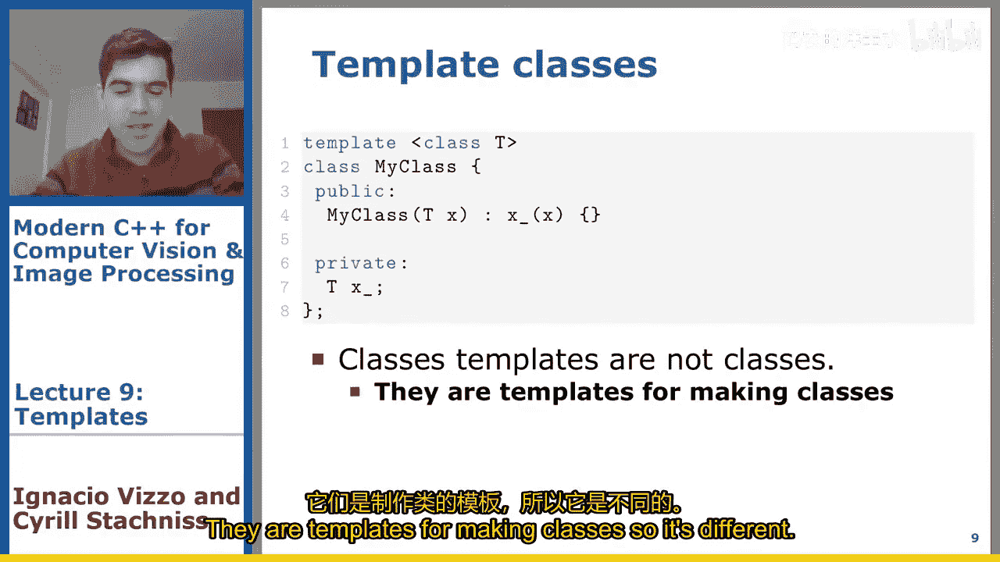
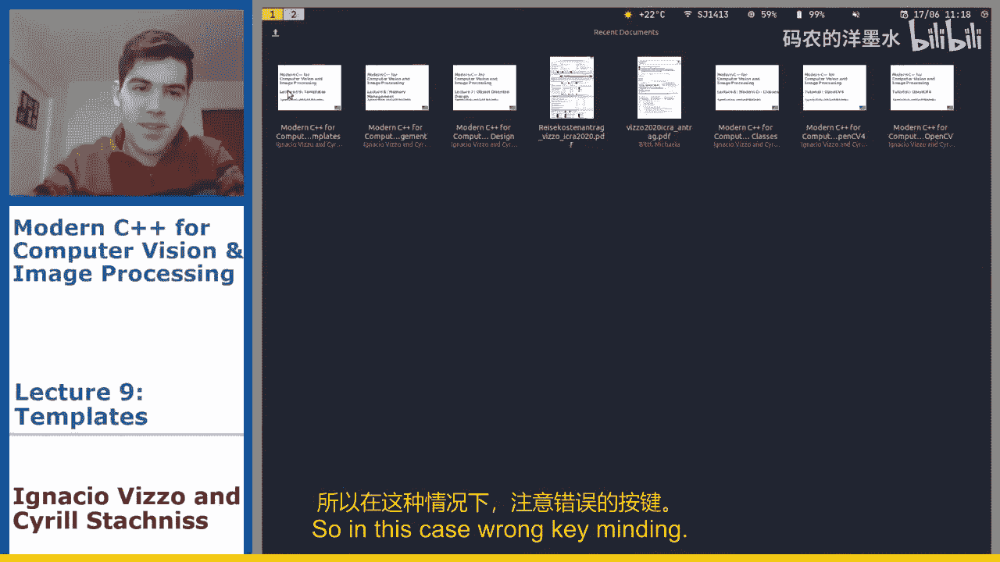
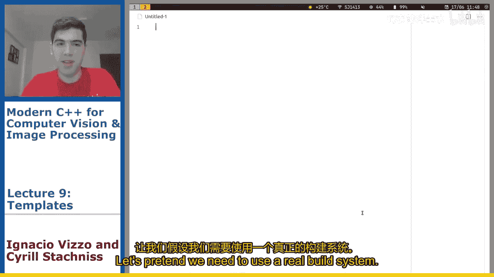
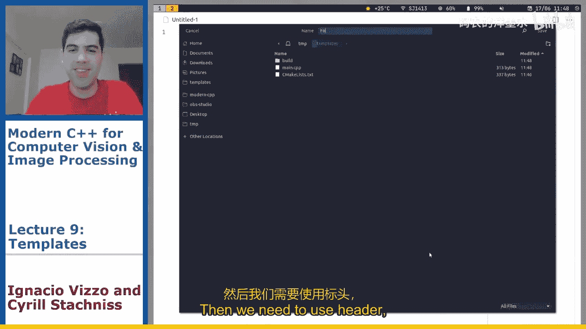
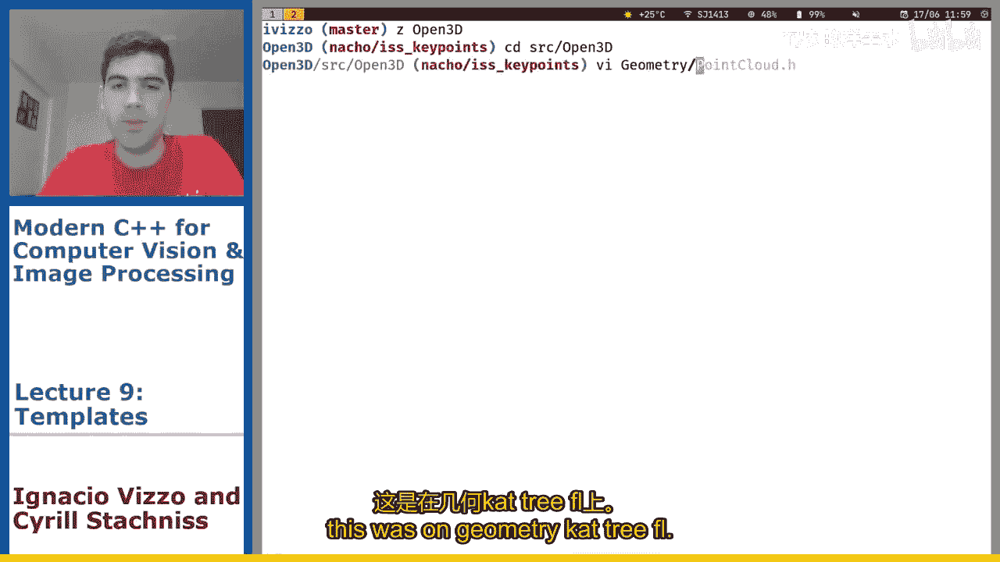
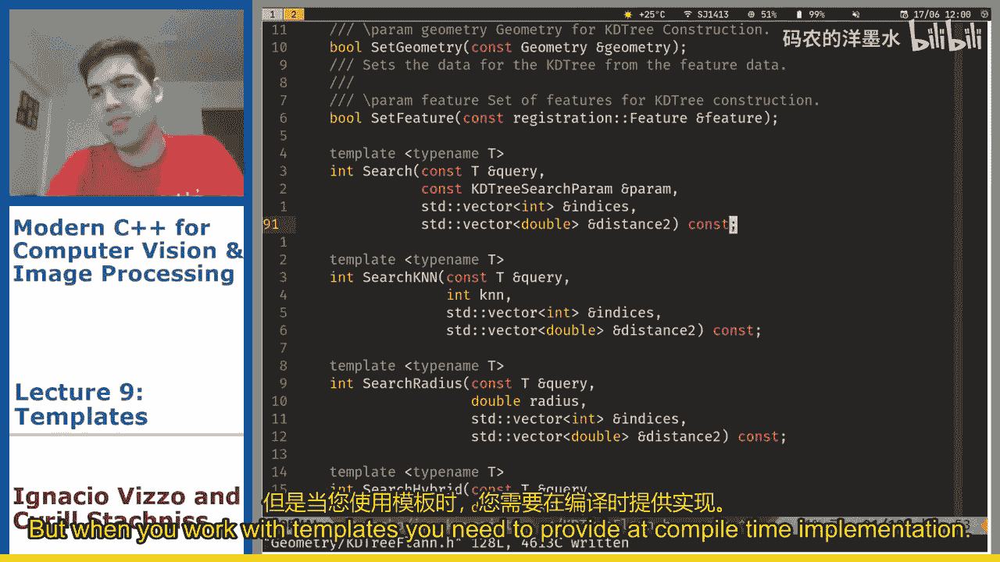
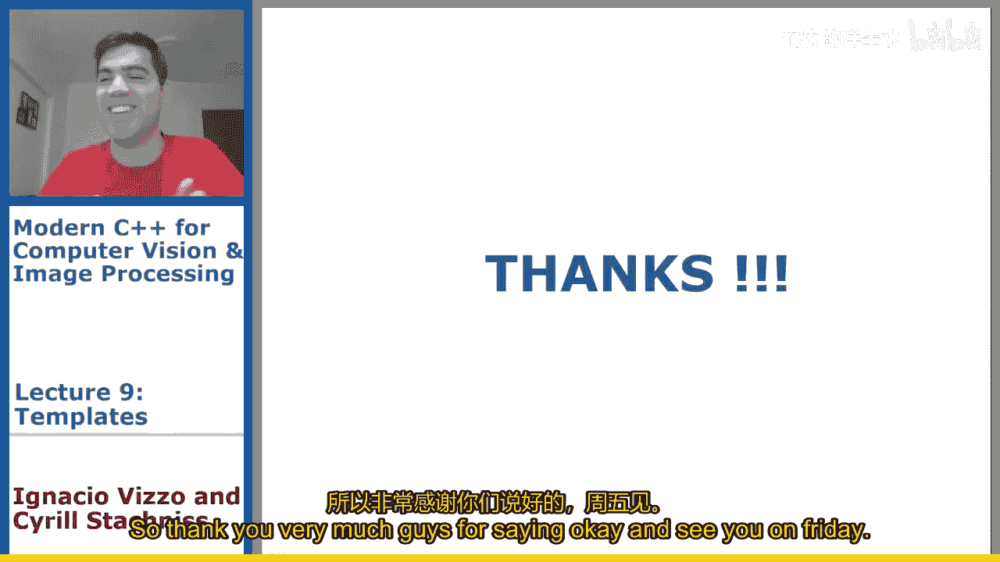

# 【全集】波恩大学 现代C++ CS414 中英字幕 p10 Lecture 9 - 模板 -BV1EYm1B5E2D_p10-

Yeah， let's start。 Okay， so today we're going to have our last lecture together。

 So has been a quite journey， let's say。嗯。So we are covering today topics that we didn't see a lot during the。

There are lectures， but it's actually one topic that is all about templates。And I try to。

 I will try to make。Stuff put the the stuff easy and simple so you can get this and believe me that if you understand what I'm going to try to teach you in this lecture and if you follow me。

 you will most likely know more than 80% at least of the parameters I know of C plus plus So templates is a big thing in C plus plus。

Most of the people are scared about templates and general experiment in general。

 My belief is that it's aware of the syntax。 So the syntax ugly。 let's say。

 and the errors are also ugly， so。I think it tends to be difficult to debug or the develop。

 I don't know。 so for me， it's actually quite simple if you know the basics， but I think it's。

Our fault from the C plus plus community that some stuff for us is obvious。

 And sometimes we don't like explicitly say that this is blah， blah， blah。 and that also makes。

Stuff hard to understand for others。 So I would try to give you the very basics today we are not going to write a full library on templates of whatever。

 but the ideas that you you should know。The bare minimum stuff to work with templates on C++ and don't be scared。

So， first of all。Most of my slides will be heavily inspired in Arthur's CPP contacts。

 So I think I yes， I already recommended one of his talks about smart pointer。

 So he's really he present stuff really easily。 So I highly recommend you to watch。His CBP talks。

And then the idea behind generics programminging is that you have so you separate somehow the data from the algorithms so in this case this is not like really like an algorithm but it's more like a container So you have a cup of something and this case is a tea and this tea you don' know what is that but you can actually put coffee tea water whatever you rise so you can put whatever you want there and then the cap itself is not coupled to the type of data that it holds right so that's basically the idea of generic programming so to do some sort of generic algorithms like sorting a container without having to explicitly you know which type of data you're using So one example of this we have already saw when we work with iterators So iterators is also part of this generic programming idea where all the STL algorithms in the library on the STL library。

They work on theerators。And not on the data itself。

 so if somehow you manage to show how to iterate through your container。

 then you have access to all the itators， sorry， all the algorithms in the SDL library。

Here are two definitions like let's quickly discuss this。

So why is programming the graph of writing useful， maintainable， sometimes and extensivetens。

 sometimes source code which can be interpreted， and this is Python or compiled that this is C C++ Ra。

 wherever。By a computing system to perform a meaningful task， right， that's definition。

 And then what is meta programming。So meta programming is the writing of computer programs that manipulate other programs or themselves as if they were data。

 So one of the key concepts behind generic programming is meta programming that is basically write programs that write another programs and this sounds confusing but it's actually really easy and we will see how to do this。

So what is the meaning of templates so from dictionaries so a template is something that served as a model for others to copy could also be interpreted as a preet format or a document or file or can be something that is used as a pattern or producing other similar things so that those are like three dictionary definitions。

And then the C++ definition of template， a short version is that a template in C++ is a C++ entity and we saw entities on lecture1。

 I guess that defines one of the following， a family of classes that is called class template which maybe be or not nested classes。

 so a template class will define a family of classes is not one。

 two or three it's a whole family so it can be infinite amount of classes。

Or it can define a family of functions that is called function template。

 which may be member functions or not。Like member functions from a given class， right。

 so that's all the legal definitions。What is the motivation behind generic functions is to， again。

 to split to separate the data from the algorithm and work agnostic to the type of data。

 So actually we have the absolute value function here We saw how to do this with function overloading on previous vectors so you can actually。

So let's highlight some stuff here。So you can actually use the same name for a function。

 this is in C plus plus， you can't do this in C。So here's the absolute value， and then。

It can take different type of data as input argument。

 but if you pay attention to the algorithm or the computation itself it's actually the same right so this is not so the good thing about this is that you can use the apps function without paying attention to so you need to define an apps for each type you can overload its name but it's stupid in terms of you need to write like how many absolute value functions for your program。

Now we have for double and ink， but also you should do it for long and then for in and then for floating point and maybe I know complex type。

 maybe car。Maybe short and where does this end， so that's the question where you should end like writing the same function with the same implementation but with different type of data。

So that's where generic functions will come into place to save you from this pain。

And also to keep smashing C。 So how they solved this on C。

 we saw this example when we saw overloading， so they just have like bunch of functions like。

 so this is。With even different names。 So for long， we have L as for long， long。

 we have L L absolute， and that's all the C plus plus 99 standard functions defined。

 So this is basically a pan because you need to pay attention to which algorithm to pick depending on the data and also to the data。

 So as usual， there is C plus plus nowadays and there is smaller and it can save us from this。

So we will rewrite。The absolute value function， but using a template type。

 this means that this can operate on any sort of data because implementation is actually the same。

 no matter if this is an integralteger floating point， double long character， you name it。

And this here is basically you see like these four lines。

Most of the people will say this is a function。But this is not a function， right。

 Fun templates are not functions。 They are templates for making functions。 that is different， right。

And actually， you don't pay for what you don't use。

 So did you create a template and we will see one example now。

And then if you don't call absolute with entire type， then you don't need to create the。

The the symbol， so you don't pay for what you don't use in this case， when you do this sort of thing。

 you always define this function， even if you're not using it， right？

So just keep in mind that function templates are not functional， templates for making functions。

 this is quite different and you can pay for what you't use if nobody calls a given function。

 then it won't be instantiated by a compiler。So let's see one example。My favorite tool， let's say。

 for working with templates is Compr Explorer。嗯嗯。In this case， we will see like a really。

 really dumb example。So in this case， we have a template for a function that is called F that takes no input arguments。

And actually， that's nothing。 right， So it's a dummy function， right。But indeed。

 I just want to show you how why we say that you don't pay for what you don't use， right， so let's。

Return0 here。And then if we comment this out and if you see the assembly code。

 it doesn't actually if you don't really understand this right now。

 what I'm showing here is that we only have one symbol on the binary that is called the main that is actually doing nothing。

But if we a given if we call this template function with a given type， a compiler。

 a compile time we generate this symbol here， so if you see here there is a boy full with integral type that does nothing。

But it is here， right？ And if we call the same template function with another type。

Then the compiler will generate this other function for us。And again。

 we are not doing anything particular here， so it's basically zero but you have the symbol now and you only pay for what you use of course I am using a turning off the optimization if you optimize this code it will just remove everything because you are not doing anything meaningfully。

So whenever you work with Comp Explorer， keep in mind like the optimizer my。Confuse you， right。

 if we go for the like the the。TheThe normal case， like that's how so in this case。

 we actually need to have an inter type， for example， so we have this function full。And then。

In this case， what I want to show you is that whenever you do these type of functions decoration and then double and then。

So I could write the absolute value， but I'm just lazy。In this case。

 what is happening here is that you're paying for something that you don't use。

 So you are actually adding these free symbols full integralte full of double and full a floating point to your binary。

 but you're not using it。 So this is your application。

 you're not using anything and you're paying for it。

 So this is something also important about a function template。

 So you don't pay for what you don't use。 So let's go back to the example。

And this is the absolute value， and we will see more about the syntax of templates now。

So the template functions use the keyword template。And then， this。So。Usually。

 this type here key is so this。So you need to use tea， so it's common actually。

 but you can use bananas here， so this is a name， so you pick it。And in this case。

 this template function will take as template arguments， two types， one is T and one is S。

 and in this case we'll do something， right？And then remember that a function template defines a family a function。

 right it's not a function itself。And then this is one example of using template functions。

 So as usual， my recommendation is you should check it on your computer。 and actually， if you。

If you use Comp Explorer， you can actually get an insight of what's going on behind the scenes。

 right， but this is just an example so。Let's go through it。

 so we have the absolute template function， and then we have two numbers， one double， one inte。

 and then we will call the absolute value function with type double， right？

And then we pass this double argument， and then we get the result and this auto is basically a double because。

The is the same input argument does the as the。啊，我补懂。

But something that you can also do is to skip the angrular brackets and thens just pass X and what is happening here is something maco that is called type deduction。

So you have a familiar function called absolute and then the compiler see that you are actually trying to generate instantiate。

1呃。One function from this familiar function and then you are trying to use the type double because x is double right so here it's the declaration and then it can infer the type from your call and then you don't need to do this angular bracket syntax so this is something called type detectionuction and we will see more in detail。

Something that is。Extremely important about templates is that templates lives in a static wall。

 So this is the lecture number 9， but is' the 10th lecture we have together。

 And I think that I say the word static。On all of the lectures。

So it's really important that you understand that whatever is involved with templates will happen at compile time。

So theres two conclusions about this。 The first one is that。

A lot of people doesn't know how to use templates。Or it's confusing or whatsoever。

 and one of the reason is you don't reason on a proper way。

So whenever you're trying to do something with templates， you should ask yourself the question。

 do I know this at Comp time？No matter what you're doing so always remember this question do we have this information when we build a program or is something that will happen at runtime so for example。

 if you want to write some sort of algorithm and this algorithm depends on I know sensor data coming from a sensor Of course you cannot do anything with this data at compile time because it's something that will happen at runtime when your application is running it will take the input sensor data and we'll do something if you don't have this information at compile time then there is no way you can do something with template。

And the second conclusion is that our world， the roboticists world， it's quite dynamic。

 so usually we work with data coming from sensors and whatsoever。

 so it's actually very unlikely that you as a roboticist parameter need to use templates a lot。

 except when you're writing libraries or utilities or whatsoever。

 but for the core algorithms that you might use。Most of this， stuff，198% will happen at runtime， so。

With this， I want to。Give you an advice and don't get really excited with templates。

 so use it wisely and I will show you some examples on how to use it。So for example。

 if you need to write the ICP algorithm， then actually there is nothing you can template。

 so you cannot write a template for this because all the data。

 the data association and whatsoever would happen at random time。

 So there's nothing you can do at compile time。And this means that you should not be thinking in this whatsoever。

 right， So keep this in mind。So if we go back to this example。

So let's comment this out and then let's。with Integer。

 so this is compiling in this moment and this function got generated at compile time， right？

Everything about templates。Must happen at compile time。 So here。

 this type integralte is already fine at compile time。 You cannot put here like a variable。 like。

 I know， like integralte X and put X here because X。P is not a type， it's a variable。Now it's sail。

 of course。 And then even if this。For some reason it's like a valuable type， so forget about this。

 but this is not going to happen。 This is something that you cannot guarantee at compile time。

Right now here at Comp time Union to say okay。Integer， we know who is this guy。

 let's create a function for full with this type of data。Okay。

 and then we saw two definitions of function templates and template classes。

 so template classes will create a family of classes， so a template class。

So class templates are not classes， they are templates for making classes， so it's different。

 sounds funny， but it is what it is so in this case。

런ンキバイで。

So， in this case。So we have a。Clas template or template size that is called my class will take as input template parameter at type T。

Remember， this tea is just a letter could be bananas。And then inside this class。

 I will have a private data member。That is called X， right。

 And then if you see all the types are T's。So we can instantiate a class that works with integralte double。

 wherever without repeating the code。 So the compiler will do the job for us。 So all about templates。

 living in the study world， something that will happen at compile time。😊。

And will make your compiler suffer。 So whatever you do with templates。

 it's something that is happening at compile time。 and this means that the program that is running there is the compiler that is generating another program for you and that's why this is also meta programming because when you create a class template it sort of way it's a meta class because the compiler is in charge to generate a class for you at compile time so you can have it whenever you need a runtime。

And then the same holds true for。For classes and。Function。

 template functions and template classes that you don't pay for what you don't use。

 So if you don't call my class with In type， then the class will not be in satiated。

 Then the compiler will not generated it。 Then you're free， right， You don't get this。

And how you use this， So basically you call my class。And then with anngular brackets。

 you specify which type you want to be enated at compile time and then then you just work as usual with classes。

 so actually STD vector for example， is this syntax so STD vector is a class and then at compile time you need to say I want this vector to be of type T and then the compiler would generate a vector for you at compile time so。

The C++ doesn't ship with any better class。Chhips the standard library chips with a template class for creating vectors。

 If you want to use Integer vectors， then the compiler will generate one for you at compile time。

I am being very repetitive with this， but it's something it's actually the most important thing about templates。

These ideas。And then template parameters so what is all this stuff that is going on between the angular brackets So my feeling is that these angular brackets。

Somehow scare people。 So I know， because they are like。Igly。

 and this is one of the reasons people doesn't want to use templates at all because the the ugly syntax。

 right， for me， it's just syntax。 So you should you shouldn't。Worry a lot about this。So。

 every template。This could be a class or a function is parameterized by one of more template parameters。

 and then the syntax is basically you have the template here， the keyword。

 this is from the language itself。And then here you have a parameter list。

 and then you have the declaration。 This could be the class， the function， wherever。

And what is important here is that from now on。You can think。

 so let's pick the function template as an example。You can think that you have like two parts。

 so two ways of passing arguments to the function。One way of passing these arguments is passing argumentsments at compile time。

I see that the video is lying in。So if you can hear my voice， please let me know in the comments。

Because my feedback are completely lack。I think we need to go for the backup one。It's working。 Okay。

 so it's on my end。Okay， sorry guys。Connection mess。Okay， so what I will say， okay， thank you guys。

So。What I was saying is that now whenever you see a template function。

 you have two ways of passing arguments。1 will be the。

To pass like arguments at compile time and this is something static and there one is passing arguments at runtime and this is dynamic right so let's speak two colors so red will be whatever you need to pass to the template function at compile time and this is the template parameter is and then at run time let's speak green will be this bug right。

So you can think whatever you pass into aular brackets。

 So it's the same as passing arguments to a function。 But in this case， you're passing arguments。

 template arguments to a template function。 It's all confusing， but it's actually for me。

 it's easy to think that you have two ways of passing stuff to the function one and compile time the one at runtime。

 Again， it's very unlikely that you can pass something meaningful to an algorithm that needs to work with data at run time。

 it's very unlikely that you can pass this data at run time。

 So it's something that it's very unlikely that you will use a lot。So in this case。

 we have this template for a function。That is accumulate vector and then。

We will take one T and I guess that this T is basically a type of it's the type of the data we want to use。

And then in this case， we have。So we have this or guy that is。

These or template parameter that is a size thing。 So in this case it's not a type name。

 So this is basically this is an integral type。 This is a real thing。

 So you know who is this it like could be 0， 50，000 whatever。

And then we will call this n and actually the same way you can do for default arguments。

 for functions like that this happen at runtime。You can say if no one specify you this value。By time。

 then she speak time。And what is this function template function going to do is's going to create a S the vector of the type T。

 and then the value will be repeated n times， right？

And then you just return the sum of all the values。

So think the template parameters the same way as function arguments， but at compile time。

And here is an example， so。Again， you should try this at your own place。

 it's better if you do it with Comp Exp also so you know what's going on behind the scenes。

So we have this accumulate vector when whenever we call this， so we are saying okay。

 we are not passing any template arguments here， so if you see there is nothing here。

 if nothing is between the anglengular brackets， then no template arguments are being passed to the template function。

And then what is going on here is that the compiler is doing all the job for you。First。

 you're using one。 So this is an integral type so the compiler can go ahead and say， okay。

 this D is an integralte。 So I will deduct it up for you。 No need to tell me。

 And then because you have。A default value for this template parameter， the compare say okay。

 I will pick n 10 right， then you will create a vector with 10 values equal to one。

 and then when you return when you do the reduction。

 you will get a number 10 so you should try at your computer and see that this is actually 10。

 So this is one example of calling this template function。

 the compiler will instantiate an enter type with n equals to 10。So the other usage is。So again， now。

 if you see， so let's。So here， so this is the function。 And then you have。

Two ways of passing parameters， one is at compile time that actually we pick red。

 I think when we do the example。And then the other one will be at runtime， right。

 So this accumulate vector function。Now you're saying the type is floating point。 Why， for example。

 because this two is actually an ninteger type， but you want to cast it to the floating point for some reason。

 So at comp time， you say okay， this type name T is a floating point。

 so this will generate a function that will return a floating point here。

 we'll take a floating point here。 will create a vector of floating point here。

And because you didn't specify the n template argument， you will use 10 by default。

And then it will do its magic。 And at run time。 So when you call this function。

 it will pass this number two， right So first it will generate this function。

 and then when you call this function at runtime， it will pass thisarrow in 2。

 and then it will run this algorithm， let's say And then the last way of using this is again。

 if you splitit here， just。You have whatever comes to this side is at compile time and this is at run time。

 So you say give me a floating point for the type name and then use5 instead of n equals to 10 I want a vector of five elements and this five must be defined at compile time so you cannot use here a variable you cannot do in integral tie equals to。

These plus and then put it there because whatever comes to the left between the angular brackets must be defined at compile time。

 So this is， again， extremely important。 This argument。

 the function argument once you have the function generated by the compiler will be whatever you want。

 Now we have a 2。0。 So we know this sub compile time。

 but it could be any variable because this is a function and can work like this like any function at run time。

 you should say， okay， give me accumulate this value， value value and then。

You pick whatever you want to send， but remember， whatever is between angular brackets must be defined at combined time。

 I will repeat it until you you get sick。Okay， so type deduction in an nutscho。

The stuff we saw so far is the most important stuff， so。W is really what a template for？

When this stuff happens for real。So type deduction， so this is a really nice example。

 you can try it at your place。So this is basically。To replace compiler Explorer。

 you will create a function calledfu。And then this puts pretty function wherever so。This ugly thing。

 this is a micro， a C macro。That is defined on the C standard library， but。its shop for this example。

So type deduction。For function templates， basically is the stuff that the compiler will do for you at compile time。

 So in this case we have food。 And then if we call this function。

 you will basically print to the standard output boy with T equals to in right That's basically what's going to happen And why because this four is an integral value。

 and then at compile time， the compiler will inspect this call and say okay this is an integral value。

 and then let me check your your class your function template， you have one T okay it C。

 So you're asking this to be an integralte。 So I will do it for you Don't worry no need to use angular brackets。

 I will deduce the type for you In this case we have。A double。

 and then you might think it's a floating point， but this literal here is a double， so we generate。

The double function and if you call this function， you will print these to the standard output and the same for this string that is basically a cons car pointer。

 right， So this is basically a type deuctionist when the compiler do the deduction for you。Again。

 try this example， use different values， different types to see how this works。

 So the rules are here， we just keep it scoringing。And then here's another example。

Let's go through it like if we were the compiler。So first， we have a template function。

 So this is not a function。 It's a template to creating functions that takes us。10 big parameters。

 two types。He and U。 So let's pick different colors。 So this is you。And then here we have a new here。

 the T。 So this is a function。 It does something。 It doesn't matter， right。

And then we have another function that actually takes one template parameter that is t。

 and then it takes two input arguments from the same type T that we don't know， right good。And then。

 let's call F。In the in our application with two integraltegers。

 So this will go here with check you say， okay。This T is an integer and then the two is also an integralteger。

 so I will generate with create a function for you at compile time with T equals to int and u equals to int right。

 great， And then you call for some reason the same template function。

 but he you say you use the liter， So this means like you sign it int。

It's probably if you try it at your plate， it's probably easier if you create the variables with the type you want to try it because it's more read。

 but here we don't have space。And then the compiler will generate a function at the compile time with T equals to in because the one is an integral type and then with a type U。

 that is another type。And it's defined at compile time with theduct that this is an assignign in。

 so it will create this second function for you。And then the G function， it takes the same type。

 so it's two parameters at runtime， but the type type name is the same。

 so whenever you call it Inger， this will work， it will generate this G function with t equals 2 in。

 so it's only one template parameter。But then if you want to do this， it will flame。

And when I say this will fail， I hope you know that this will fail at compile time。

 so this will not be able to compile why because you are saying generate a function chain。

And then the tight name， the first one should be， sorry， she is here。The first time name will be T。

 so I'm contributing to this type deduction with integral good。

 and then the second parameter is assignsed in， but then t should be assignsigned in if the compiler cannot not decide if this is integral or assignsigned assignsign it in。

He was just abort， so it's not something you can actually do。 It will fail。

 This is the error message。 So you know matching function。

 whatever one way of solving this is to specifying with angular racks in type for example。

 but what's going to happen is that you will if you do this you will cast this andign it in to in type but this is basically how type deduction works So it's not magic it compare is smart it's smarter than I am at least but it cannot do magic or stuff that doesn't make sense at all So that's basically。

The key concepts behind a type deduction。 and then lastly。

You can also do type detectionuction since C++ 17， so keep this in mind so if you work with another standard。

 this will not work。So， let's。Go through the example。 So we have a class full strategy the same。

 Actually， this public is not needed。And then we will hold a data member of type T。

 and then the constructor will basically take anity and then with initial listing。And something。

 So the classic syntax will be this one， so。This case， add， yeah。 So just forget about this。

 So you will create an object。 So let's。Did this。 So this is not here， boom。嗯ん。嗯。m， it's gone。

So you will create an object of from the class template tool and then you say， okay。

 this D is integral。But since E+ was 17， you can use type deduction and avoid thisular angular bracket syntax and say okay。

 I will pass an integer to the constructor and actually if you inspect the constructor。

 you have T here so I mean it makes sense for the compiler。

It also makes sense when you read it so you can detect the type at compile time and then create a class Po with type name equals to integer at compile time。

 So you can actually do this。 And the same holdss true for the vector。

 So you have been using vector for a while and then。You usually do this。

 so you create a vector and then use two elements， for example。

 But these two elements in this case are integral types， so you can actually avoid the these。嗯。

Aular rat syntax， so this you can avoid it here because you can detectduct the type from these two elements。

 Of course， if you pass here an integral type and assign in。

 you're using two different types at compile time， you cannot guarantee who is T so this will fail。

Of course， just don't use this。 I mean， it's easier to read。 but it's not common。 And actually。

 if you do this， you will only be able to compile this code with C plus plus 17。

 And then it's going to probably fire back at some point。

 So that's just an example of how type detection works with。诶。

With classes and actually so this is something that I will do like to do live like how this works and whatsoever。

 but I will just keep it and then ideally just try to think about this puzzle on your place and then we can discuss it on the Discord channel so you can say no for me this doesn't compile whatever of course you can try to compile it and inspect the results。

 but try to before you actually compile it or throw it to compile it experiments。

 just try to think this example on your mind and try to compile it locally on your brain and then we can like brainstorm on the Discord channel I mean if we were on the classroom I will probably give you five minutes to think about this。

But here it's going to be a mess using the chat and whatsoever。 So homework， do this。

And then the last step for knowing all you need to know about templates in C++ for broad diseases is template specialization right。

 so this is basically mostly the last big topic。😊，4 templates。

So let's say that you have a template for a function that is called east boil。So， again。

It's highlight。嗯。So this function， sorry， this template for a function。

We create a family of function， right？And then ideally。

 so actually if you try to read this on a high level understanding。

 you would say it's just a template function that we take any type team and will always return false no matter how you call this。

I will assume that all the types are not boy types。

 so I would just return false right but what happened with the actual boy types。

 So what happened if we call this each boy function。With boy type in the template Ar list。

So we actually want a true value。And then for this。

 we need to do something that is a full specialization that is from this family of function。

 you will pick one function like one particular implementation。

 and then you will provide the full specialization for this particular function between among all the functions in the family。

And how you do this with this uglyg syntax that is basically template and then angriular brackets empty。

 so if you ever saw this on a program and you got confused now you know that is basically a fully specialization or a template function。

And then here on East Boy， so actually there are many ways of doing many syntax to achieve this result。

 this is the one I use the most。So you will say the East boy is basically。This template function。

 but with type boil。 So you saying you have all these formula function you can be whatever。

 but for boy， I am in charge of this， I will provide full specialization for this particular function and then you will return true right that's basically what you want。

 And then no matter So again， try this example at your place。

 no matter how many functions you create with is boil。

 you can do is boil with SD vector with as with floating points double。 you name it。

 It will always return false unless you use boil because。😊。

The so whenever you call this template for a function with any type。

 it will instantiate a new function with the given type and it will always be false the result。

Except for boy because it's a full specialization for this particular type。😊。

So this is something that is important， for example。

 if you are working with serialization libraries or with RoOS。

 so if you need to pass a message from one node to another one in rowOS。

 and then the serialization is not implemented， then you will need to provide a full specialization for the serialization for this particular type。

And if you are interested in this， I can show you some examples like offline。

 but that's basically when you will want to use this。

And then the syn is the prefix with definition template， anggriular brackets empty。

 and then you got write the function definition and this is like。😊，This is like a function。

 This what you're seeing here is a full specialization for a class function for a template function。

 but it's a function it did， So whenever you do this you would create you would generate this symbol at compile time so this is something that will happen so this is equivalent to write the function。

😊，And that usually means you don't need to write any more angr brackets at all。

Whenever you do this full specificization， unless the type can be deducted like the previous case or this particular case。

So we have， for example size of T and then this size of is a C function that is' not defined for boil。

 So if you want to define size of for all the types in a S press program。

 then we need to do a fully specificization for boy and why we use angular brackets here because size of does not take any input argument。

 So whenever we call this function。 So if you call size of whatever。

You are not passing any argument to the function so the compiler at compile time can not de this type。

 so no input arguments impossible to reduce the type at compile time。

So you actually need to specify this。Or the thing that could happen is that unless T is default。

 so what you're going to do for example in this case you say okay this type named T again this is a template argument list。

 all the rules for arguments holds true the same is like you can use default arguments and you say this T will be bold。

Unless you specify something different。 So when you instantiate this fully specificization for my size of。

 now you don't need to do angular racks anymore。Because the type is boiled unless you specify something different。

 right， So that's basically fully specialization of function templates。

And then actually there's something also that is not super useful。

 that is called partial specialization that is basically is any sort of is the same type of specialization。

But in itself is a template， so this means that it still requires power customization by the user before it can be used。

So for example， you can create this variable， so this is a template variable。That is called is array。

 and then you say it's always false， right for any type T is false。And then now you will think， okay。

 but if I want this to be true for like arrays， then I need to do the same as we did like before with functioning。

 I need to define the full specialization for array of integralte array of double and blah blah blah or I can say okay I would do a partial specialization for any type Tp that is an array type。

 So this is a syntax for So this is a template for an array So this could be any sort of array and then there is template variable will be true for this type of data。

 this is not a full specialization because it's still a template and it still need to be associated at compile time and need further customization When this happen when you call this withte array。

 for example， then it would go here and say okay I would generate this variable for this integral array type and this would be equal to true if you do this with floating point array then you would generate another。

Tempate variable and then it will be always equal to true right so it's probably confusing。

 but it's basically。And then last， lastly， so this is like a bill thing。

This is something that people already struggle with Homeboard 3 or four I don't remember。

 so concrete templates are instantd at compile time Now you know it。

 whatever happens with template will happen when at compile time。

And then the linker has no idea about implementation。😊，And then there are three options， basically。

To work with templates and to split the heater underscore the source and probably I think we have time I will do the example。

 so let's actually do the example。어디 안에도 있죠。你们。So。Let's， for now， let's say that。Let's start simple。

 right？So let's create a template。For a function， then。Template。And type name is going to be T。

And then let's call this function void full。To be full or something more meaningful。

 let's do fu for now， that's fine。And then。This four will take an important element at cons。

Reference to a T。 And then which。えX。Basically。那。Right， so。It's。Actually。

 let's keep this so we can print to that。Let's。Instantiate a compile time with integralteger type。

 for example， and then5， right， This will basically return5。 And because5 is an integralteger。

 the compiler can deduct the types。 So let's first。Make。And then a boom is working So5。

And then the compiler can do this for us， so no need to do it。へい。没。It's still fire。So， if I do。5。

5 then it will be another function a compile time and it is working， right？So far so good。

 So let's say that so this is a small example。Let's pretend we need to use a real build system。

 then we need to use hair resources， whatever。So， let's create a new file。

呃，图。

Dot H。MPP， then let's。Brg my w。And actually， something that。And then， let's。It is pretty too big。

I do this。 Yes， sir。 So this is full dot H P P。 And then let's move this over here。And then， now。

 we include。呃。F HP， right， again， if we want to do this， it's working。Mre main。

it's working What is happening here is that you have the template for this function here on the header and then at compile time you include this and then you know that including a fine is basically copy pasting。

The content here and then you put it here， and then when you call this。

 the compare will be able to generate that what usually happen is that you will feel a temptation of doing the same that you do for normal functions that is to do the following。

So that's great。啊呼到 tBB。And then。Can I do this even。Come on BSco。Okay， okay， this will do the job。

 I guess。So what you're going to do is you say okay。Include。出。This is super confusing， actually。

And it's really a really common mistake。So you say okay。Oops。Chaし。So you have the H file and you say。

 okay， I have this。Declaration， and then the definition is here。

And then forget all the errors for now。And then why you want to do this。

 because you like this idea of like splitting function and whatsoever。

 But what is happening here is that let's add this actually to the bill。 So let's add。For the TPP。

Todayでよ。And if you already struggle with templates， you will know that this will not work。

Let's remove this。Not needed this here and then it's a lot of information so the main application then the H file with the template class decor and here' is the presentationation so you would expect this to work but what happen what will happen is that it will fail at link time and then you will see the error now and then if you ever saw this error。

I will explain you why is this， so LD is basically the linker and it says undefined symbol for this four with integral type。

 right？😊，And why is this because the compiler。When you include this， it will see the declaration。

 so it will not fail to compile。But then remember that this will be a promise。 And then at any time。

 you need to provide a symbol and say what， but I am actually comping full dot cP， right。

 What is happening here， What is happening that this is not a function implementation。 So again。

 this is a template for a function。So whenever the compile comes to compile this thing。

 no one is actually calling who。So it doesn't see this， so the full dot CP doesn't see this。Coll。

 so the compile will just ignore this template function and skip it。 right。

 And that's why this symbol is not being defined。 So you have multiple options here。 So one is to。

 so the first one is to do it everything on the hair file。 And then for these， it's。😊。

And so if you're writing like libraries， like both libraries are all like this。

 you just put everything there。And remember that in this case， this is really important as well。

You're actually not putting implementation on the H file。

 You just have a template for a function there， and then when you include this file and you call a function。

 the compile would generate a function for you。 So this is different。

 It's not like putting an implementation like a normal function implementation on the H file。

So that's number one。 And then。What could happen is that you say natural I have a lot of function and I actually like this idea of just showing the API of the function without implementation because it's read。

 it's more read for me you can do this and for that you have two options。

The first one that is common， but I don't like is that you put this here and then。At the end。

 at the very end。Of the H file， you can include an another hell file that is going to be called full and then imp wherever some people do IPP。

 but this is ugly and then HPP and inside this H file you put implementation。So， basically。

What do you want to do？Is to。不イド。HBB。Now if you see these files of this you don't need and then here you put the implementation for the class template。

 the function template this is really common and actually when you see this the F is going actually to be4 H so this is really common if you see on libraries。

 Bo library they do this on PC library whatsoever。And then where it's happening here。

 this is like a mess that when you include this hair file。

 you will see this and then at the end of the hair file， you will include this another hair file。😊。

And then you know that whenever you include and any file。

 you basically copy pastes into the her file， so it's basically the same as before。

 so if we try to build this it should work。And it's not working， of course， why it's not working。嗯。

Pragma once this is a hair， so you need to be careful with this。うバい。嗯ん。Phy not fun。 Okay。

 wide Why not fun full import。Why he doesn't fund the fire。To year。Okay， I will make this work。嗯。

Why is this not working， So。So this should be working and we will make it work。あて滴滴。It's this thing。

嗯，哼。嗯。😊，嗯。Prorayably I will make this less big because it's hard to me。The see and name。Come on。

 this should work。Okay， red definition of4。Why is this。

because I am I I forgot to remove this from the view。So let's forget for this full CB right now。

And then。Yeah， now this should work， come on， trust me， I'm a junior。And then make， now it's working。

 we call the function， we will see the same and then what you have right now is basically this split between the her file and the source file。

And actually this is readable as well， so you can actually hear like put comments like blah， blah。

 blah， and then you hide implementation on RFite This actually works and is' the same as putting in implementation here。

It's a bit funky to see and include a statement at the end of an error file。

 but it's basically to to make the core more readable。 There is nothing but with this。

That's one option。 if you want to split。And then the other option is。

 let's go back to this and now go back to main。Let's remove this simple thing and then you go away and it's the following。

 So here。On the on the food CP， whenever you build the model， you need to say right now， okay。

 please compiler， instantiate the function， the full function from the family for these given types。

 So let's say that you know that for now you only need to work with integer and doubles So what you're going to do is you're going to do template。

 template。 and then。You will do。Dole。And then， full。And to make it clear。

 let's do double here and then cons double。嗯。X， and then that's basically it。 So with this。

 basically saying。It's like calling the function with double type， right。

 you're basically saying please generate this function for me。It's the same as doing this。

 but you are not specifying any argument。 This is telling the compiler。

 please do it for integer and then for double sorry and let's make this and then here will be inked and here will be in as well So now。

So， let's try to build this。Now we are building this photo CP model， like if we are。

Doing like a library thing。And then no， it's not working， of course。And fine。Who ist， Why is this。

Maybe this is not。Okay， so the syntax is different。

 You don't need to do this full specialization thing。

 you should say this is a template for for this function template。Here， of course。

 you need the implementation。 And now， now when you make it and build it。It's working。 And again。

 this is。Actually confusing but it's simple My recommendation is try to do the three ways of working with templates so everything on the hair file。

 two hair files or one hair file and one cP with particular implementation So in this case now you achieve this goal of splitting stuff and I want to show you that this is not actually uncommon on real examples。

So if you go to open 3D， for example。This was on geometry Kd3 fl。

 so there is a Kd3 implementation that needs to work with templates and for example。

 you have this search。

Template for a function。 And then you don so here you don't have the like the the implementation for this function。

 Why， because you want to keep this easy。 So the hair file。

 you want to only have declarations and not definitions。 But when you work with templates。

 you need to provide a compile time。え。The implementation。 So if you go to the KD3， so。

The both CPP and if you see PPP， so now here you have this search function。

 so actually let's do search K andN。And then if you remember this was a template for a function and now you have the implementation for a tip。

 but remember that you need to tell the compiler which one will be the types that you will be using because the compiler needs to generate a symbol。

 This is the third example we saw today and then it's the same so template blah， blah， blah。

And then here you do for eye game vector of 3D and。For an IEM vector of X D and that space you need。

 So you are only generating two functions。At comp time for these template functions。

 so from above all the among all the family functions you are picking to。

 and then you are not doing any fuller specialization， so youre just not you are not doing this。

You're just telling the compilers just go and search for the function template。

 but use type T equals to blah， blah， blah， and then you will get this why you want to do this because you want to split。

The implementation from the declaration between her and source file。 And actually。

 if you say this is stupid and it's not because the implementation is the same。

 and it's much easier to just copy paste that this。

Three lines syntaxt then copy pasting the food implementation for two types and then if you change one in other one you will forget to change it on the other one and that's whatsoever so that's basically here are the three ways of doing it again my recommendation try it at your place。

And then lastly， super easy cons expert basically means try to do this at compile time。

 so we have been discussing how to do stuff at compile time。 in this case。

 if you try this on compile Exp， you will see that this whenever。You return this factor to 10。

This is guaranteed to be computed a compile time。 So this function is a function not for the program。

 but for the compiler。 So you're saying you're saying the compiler， please compute this function。

Ha combine time。And then again， you need to think about like what is happening at compile time and runtime。

So this cons expert can be also applied for variables。 And then if you say， okay。

 give me at compile times， the size of this vector on this case will not work because the size of the vector is dynamic and this means that it might change。

 but this doesn't hold true for an array because an array， you're passing。

 And now you know what is the meaning of this you're passing okay， I want an array of 10 elements。

 and then the size it's guaranteed to be 10 at compile times。 So this can be a constant expression。

 but this cannot be a constant expression。 Why， because this is， you know the size。 So that's。

A small。你这样是。One question is can you use templates for other types as well or must all types be defined in the CPP file so that's a really good question so if you go for option number three you need to define all the types you want to use in that file so if we go to the often three example you're only allowed to actually sometimes it doesn't make sense to use it with other types。

But you're only allowed to do it with eigenbacterctor of 3D or with eigenbacterctor of Xt。

 If youve got this function with any other type， this means it will not work。

 and this is really good question and this will happen。诶。So that's basically there。

I see las on my feedback okay so again these slides were heavily inspired by these CPP content talk it's actually two partss it's one hour each if you have time just scroll through it you will find similarities between the examples there and the one from this slide。

It's highly， highly， highly recommended to watch this CP con。 So please， if you have time。

 just do it。And then here are the references。Basically it's all about we saw all about templates in Cas+ I am sure that if you understand this one hour lecture and that's all you need to know to work with templates。

 then there's much more information detail like baric templates and concepts everywhere it's a mess。

 but you need to know the basis you need to have the ability to reason at compile time versus runtime and whatsoever that's one of the most important things。

 And then we saw on a live example how to work with with with the three cases of working with header only files to header or heater plus EP file or templates because this is something that is really really common to be confused and it's something that I'm guessing that you're already struggled with。

And then。That's it are going to now I'm going to go through a really five minutes course wrap up and then that was basically the end of the lectures。

So we started this journey 10 weeks ago， saying that talk is cheap， Show me the code。

 So I hope I show you as much C+ plus code as I could。

I also promise you that you will get your hands dirty。 So there are9 homeworks。

 I guess that most of you at least did this。 So you know what I。

 what is the the philosophy and probably after。So people still struggling with build system after seven homeworks and that's idea that you should get your hands dirty to get through all these issues。

 we saw how to work with the new Linux systems。We saw how to work with simple bash programs。

 how to redirect the standard output， the standard error and what is the standard input。

 how a program works in a units like environment， We also saw a lot of stuff from the software development ecosystem。

 so we saw text editor， Li， test， the static code analysis like client TDI format。

 this is client format， the CICD Gi build system， so we saw most of the stuff for doing real development。

So we have one lecture and build system that for me extremely important because sometimes you lose ideas that you want to express in your course in your core because of the bill。

 so the same with templates holds true for the third example。

 it's hard to make it bill but ideas are good， so sometimes if you don't know how to build。

 you lose the idea。We saw how to use CM to simplify all of our bills， also the legals。

 how to declare variable， how to create functions for C+ I try。

I hope I convince you like which one are good C++ practices this is not there is no book for this so there's the CPP core guidelines but they are like really hard to follow sometimes and I hope that I try to convince you that why it's important to use C++ and not see and whatsoever。

We saw how to use containers on C++ they are much better than just using plane arrays。 Also。

 we discussed the difference between the static and the dynamic world。

 We saw who who is using containers in our。Community， my video is completely log。

 and I hope you're seeing this。And also we saw its how to decouple the algorithm implementation from the data。

This is basically using iterators， so this is also a type of generics programming we saw like 15 or 20 SL algorithms。

 also the s poitivities like Mo semantics and other stuff。We quickly discuss the P system library。

 we introduce how to create new types for C+ and we say why this is super important。

We managed to represent an abstraction of the real world with a C++ program。

 we discuss all the anatomy of a C++ class with briefly the class about Mo semantics。

 we also saw some objects or in the design patterns like how to do inheritance in C+ class how to polymorphs where objects will behave differently and we also did this at runtime but also we do it we did it compile time with the CRTP pattern。

 we saw other patterns or object are in the design and then lastly we work with memoryogram。

 I hope I convinced you that there is a huge difference between the hip and the stack and when you should use which one and then we saw all the memory issues that will come into place use if you manage yourself your memory and then you say okay smart pointers we do it for you it's much better just use it and then lastly this is basically all the summary of all the stuff we saw and then where to go from now we end up with the lectures。

we enter phase number four， the fourth part of this course， that is the final project。For this。

 I will not say much worse because all the details will be communicated to you。嗯。

Through the in an email。 and basically， you have from now on。

 you have like more or less one month and a half to do this project。 And my recommendation is。So。

Keep on schedule with the with homework so you can start working on the project as soon as possible。

 And then that's basically Thank you very， very much for all your patience。😊。

Across all these 10 weeks， I hope I really gave you some C plus plus understanding。 And from now on。

 it's all up to you。 So I hope you have the basics from my side。 I did as much of as I could。

 And I hope you enjoyed the the course as well。 So thank you very much for staying with me As usual questions。

 complaints。😊，Whatever you can ping me on this score。So thank you very much guys for saying。Okay。

 and see you on Friday。

