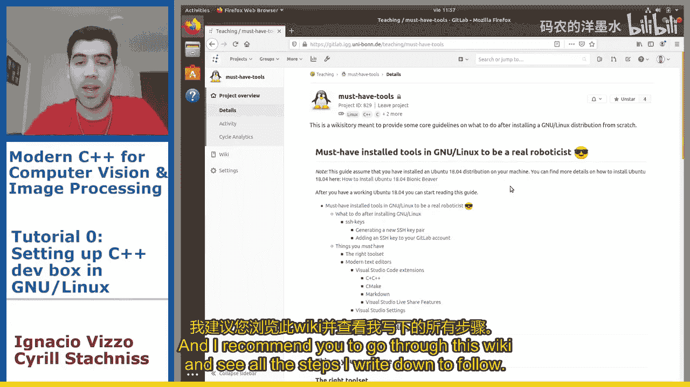
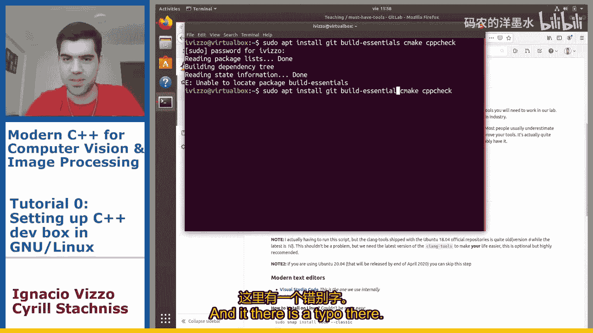
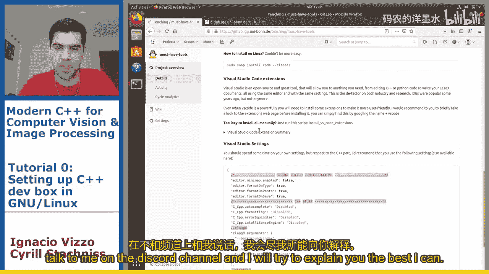
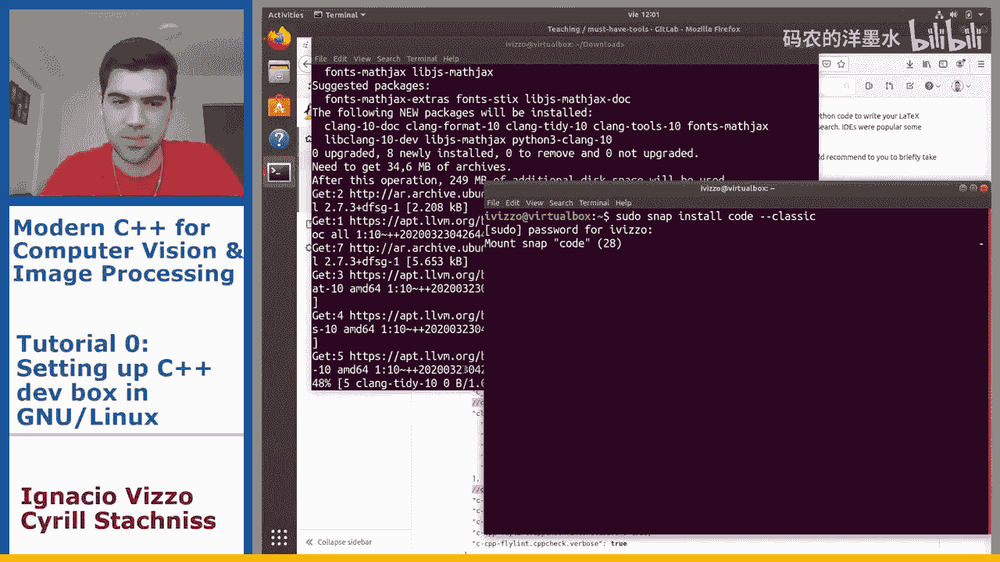
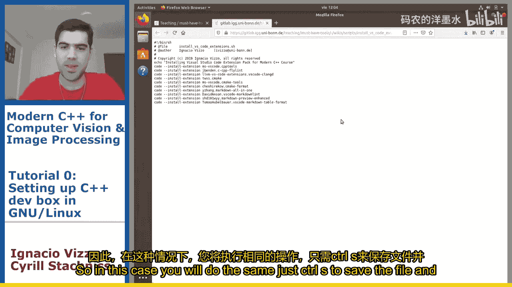
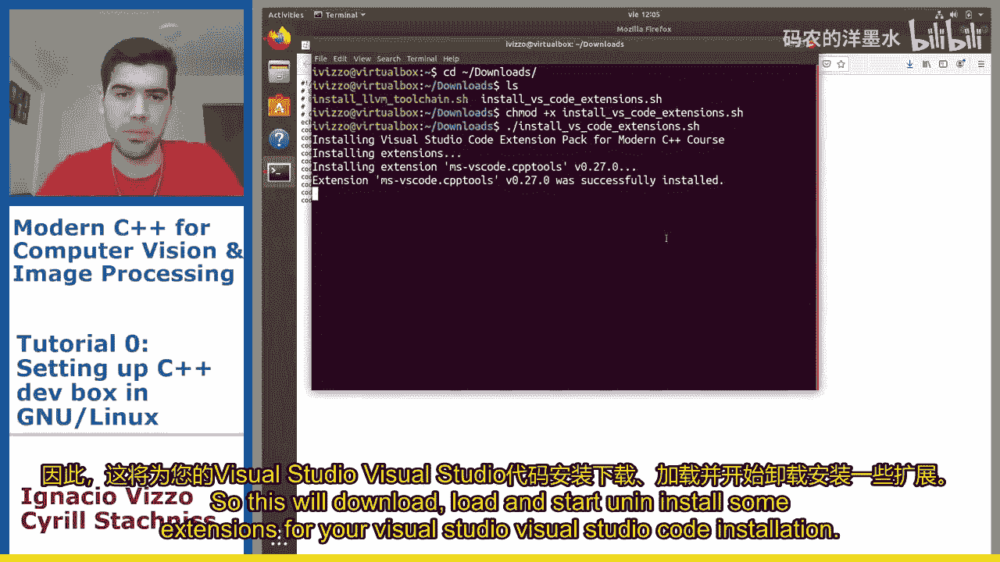
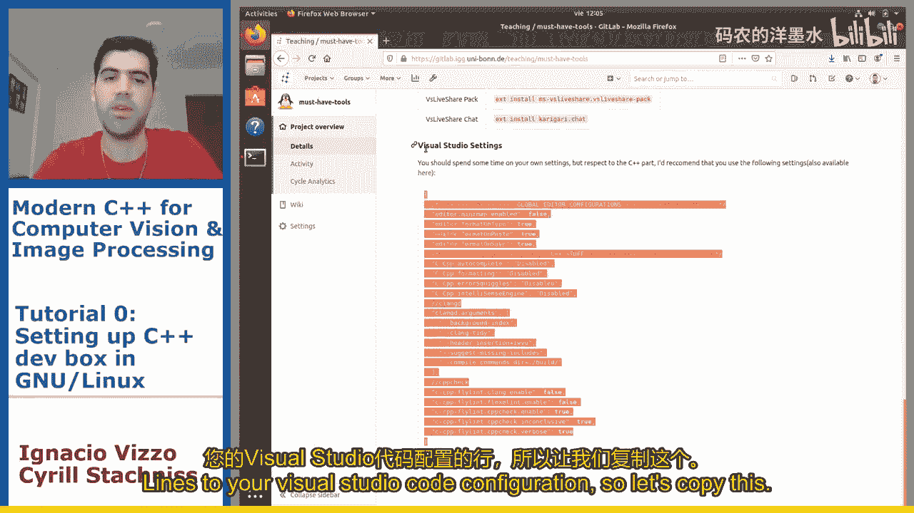
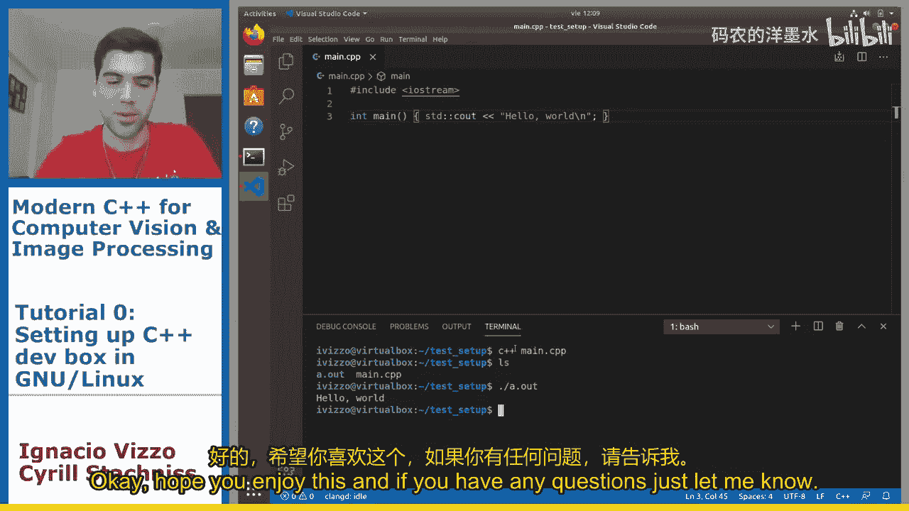

# 【全集】波恩大学 现代C++ CS414 中英字幕 p11 教程1：在 GNU和Linux 中设置 C++开发器 -BV1EYm1B5E2D_p11-

Welcome guys， this is the first tutorial or of a brief series of more tutorial where I will not be explaining concepts in general。

 but I will show I will be showing you how to do something or install a tool or something like this。

So in this case， I will show you what to do after installing Ubutu on your machine。

 and this is the steps you require in order to make everything work for the modern C++ course。

2020 edition。So this is the welcome screen you will see on your Uwtu machine。

And I just want to make a comment right now。 I will not recommend you recommend you to use virtual machines because there are many reasons of why don't。

 I mean， you should not be using virtual machines if you really want to know that those reasons just write to me。

 and I will give you the reasons。So you will go to Firefox after you。

 you went through the welcome steps。 and then here you will。Search for IGG， Gitla， pun。

And then the first link that is the Gi observer you will be using for the Homes。

 you will hit that link， and then I will ask you that if you don't have any user。

 just register here with your unbon account。And then I will log in to my user。So remember。

 this is a tutorial on what install in order to make stuff work。

 so I made a wiki that you will have access on teaching and mass H tools。

And I would recommend you to go through this wki and see all the steps I write down to follow in this tutorial we will be just running the commands so just copy this and then open a terminal。

Just go to activities。And then like Ter me now。And then just copy this command。生效。

It is a type of there， skip hit by。And this will install Gi， make， CMake， CBP check。

 some tools we will be using on this course。So go ahead and install those tools。

 it will take some time。And the next thing you want to do is to download this script that is called install LLBM toolching。

You can just right click and do okay now just。Just click on it。And then this will open you a script。

 This is， you can just save this file hitting controlt S。 and then you will download the script。

Let's open a terminal， so okay， we already reinstall everything here and then we will go to downloads。

Where we just downloaded our script。So the script is there in order to run this。

 you will need to add executable permissions。 So it's just。

Do that and then now you just run this script。This will install a new toolcha we are using this year that is based on LLBM。

And instead of using the traditional Gu GCC compiler we be using client tools and you will see why this is a good idea probably in three or four weeks。

So you don't really need this step to start working on how to build C+ code。

But it's highly recommended because this will integrate a lot of feedback tools we will be use in the future。

 your text editor。Okay， after install solid tools， you will need a more text editor you can use wherever you want。

 I would recommend you to use visuals to your code。

Because this is the one I use and of course I can help you better if you use the same tools we all use。

So it's almost done in order to install piece for the studio code on Linux， it's super super easy。

 you just need to run this command on a terminal。And these would install visual studio on your machine。

So we can open an terminal。Why we wait for this because it's going to take a while probably and just trying to stop this sort circle。

If you want to see what this the script is doing， the one that install tool change just open the script and make sure if you don't understand something that you want to understand just。

Send me an email。 Talk to me on the Disc channel， and I will try to explain you the best I can。

So， we're almost there。This is taking a while because I'm currently in Argentina。

The internet connection here is really， really slow。

 so but let's wait for one second you can fast forward now this video to the part where all this stuff ends。

Okay， now we have these。This is super easy， and this is all the stuff you need to do。And so。APro。

 So if you probably， if you search for instructions for how， how to do this on Windows or Mac S。

 you will probably need to go to a web page， download something， do something。

This is super easy Linux， just so， snap install code。 That's all you need to know。Okay。

 so this is almost done。So okay， done so right now you should check that you install these tools properly and in order to do that you will do C plus plus and then you will type dash dash version。

And this will tell you， okay， here is in Kang version 10。

 this is the compiler and the tool chain itself we will be using for this class。So you're all set。

 the only thing you might want to do right now is to install some extensions for the text al。

I made I。Made a summary here。Let's close this。But also。

 if you don't want to insult all the extensions manually， you can go ahead and use this script。じしす。

Read is though。By the way， I am using a virtual machine to show you how you will do it on your computer。

 and this is one of the reasons why this is super slow。

 So if you if you want to go for a virtual machine go ahead but you will struggle like I am struggle right now。

So。啊。Okay， so we alreadyinst Gi， the buildEssentials， SeeMake make， we have our text editor。

 the last step we are missing is to install some extensions and this is stuff that wasn't working so you can go ahead and install these extensions but I also provide here a script so to do it for you so in this case you will do the same just con to save the file。

And then we open a terminal again。

We hope to downloads。And then again， we will get。Permissions。we will install be scope extensions。

So this will download and start in install some extensions for your Vi Studio called installation。

This includes stuff like the C++ extension， someliners。This is like bare minimum stuff you will need。

And I'll leave back in if we need to chat and code at the same time for any sort of question。

And then the last thing you will do is you need to copy this。

Pins to your visual studio called configuration。 So let's copy this。

And this is to make everything work properly。So now we were waiting two minutes。

Until we end installing extensions， of course， you can pass forward to the part where we end up this。

Again， if you want， you can use。Britttle machines。 but then in the future。

 you will most likely struggle。Because you will need to use Linuxux for other courses。

 for your thesis， for the master project， for whatever so。

Please make sure you spend some time trying to install Linux on your machine。Okay。

 so that that is it， so now we will go to our home directory and let's create test。Set up directory。

We will go this record and then we will hit code and then dot。

 this will open the text editor on this particular folder。So this is a text editor。

 you will see a lot of stuff。Right now to finish your setup， you need to go to。To the settings。

 so you can hit control comma。 And then here you will see this open setting Jasonson。

 and this is your particular configuration。 You will copy the lines I give to you。

 I will make this bigger。And then， you're all said。That's。Try one thing。 So let's create new file。

Then it's called this main dot CP。This is this step is completely optional。

 This is just to make sure that you have everything in place。Are you stream。那。domain name。嗯。Hello。

You can open a terminal here。It's close these。 And then let's do C plus plus and then main。

This will compile， and then you will have an executable and。

That that is it guys okay so I hope you enjoy this video try to subscribe to these channel so you can get notifications whenever I upload a new video and if you have any question or if you struggle just let me know I will do my best in order to help you make sure you you use the time wisely and you spend time trying to make the tools work for you。

So before the semester start， we will have two weeks and this is the weeks you can use in order to make your computer work with Linux install Linux there。

 try to back up your data before you do it because it's very likely that you will struggle go through this tutorial trying to install everything that is on the Wiki I mentioned and then make sure you know what you're doing and that you have the tools install okay hope you enjoy this and if you have any questions just let me know。

