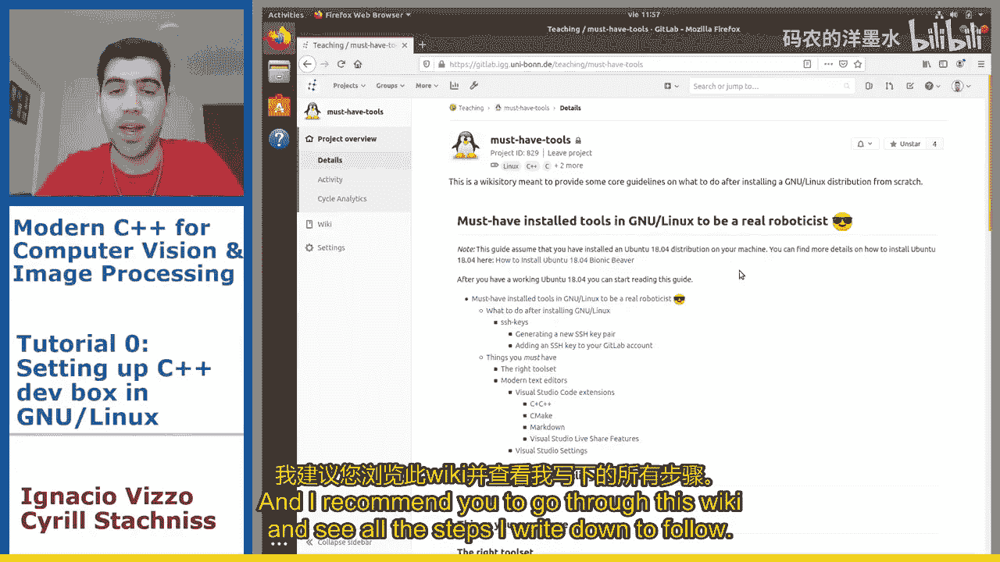
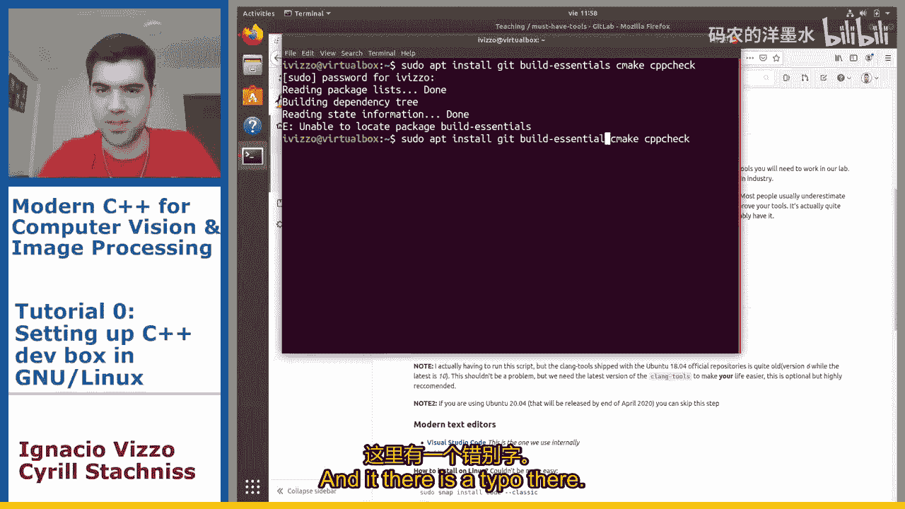
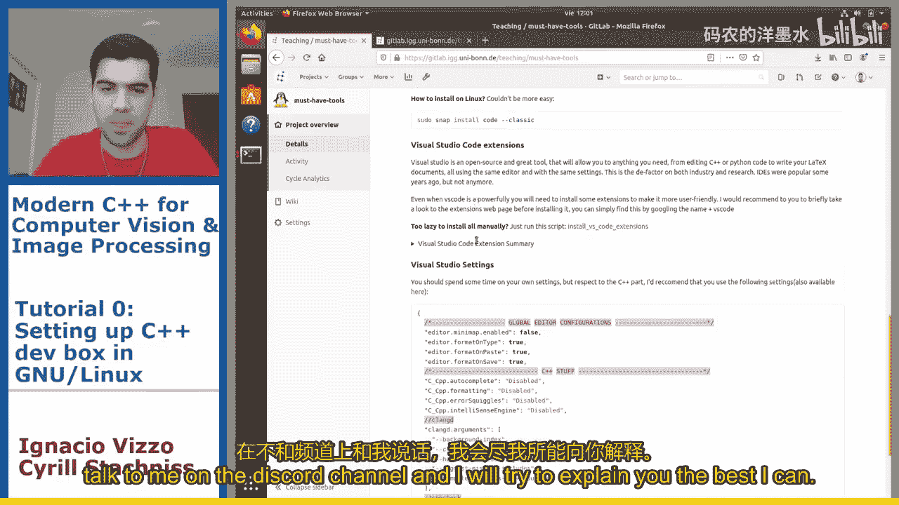
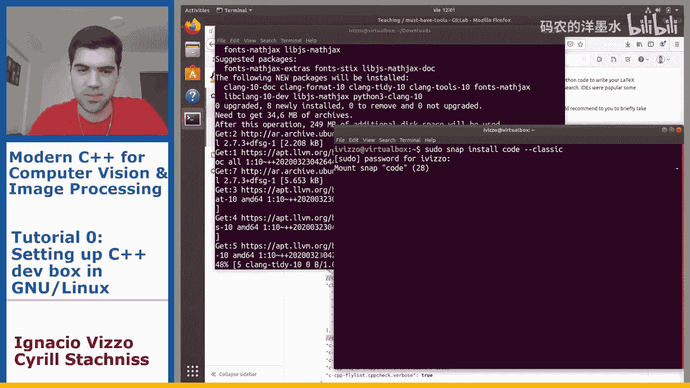
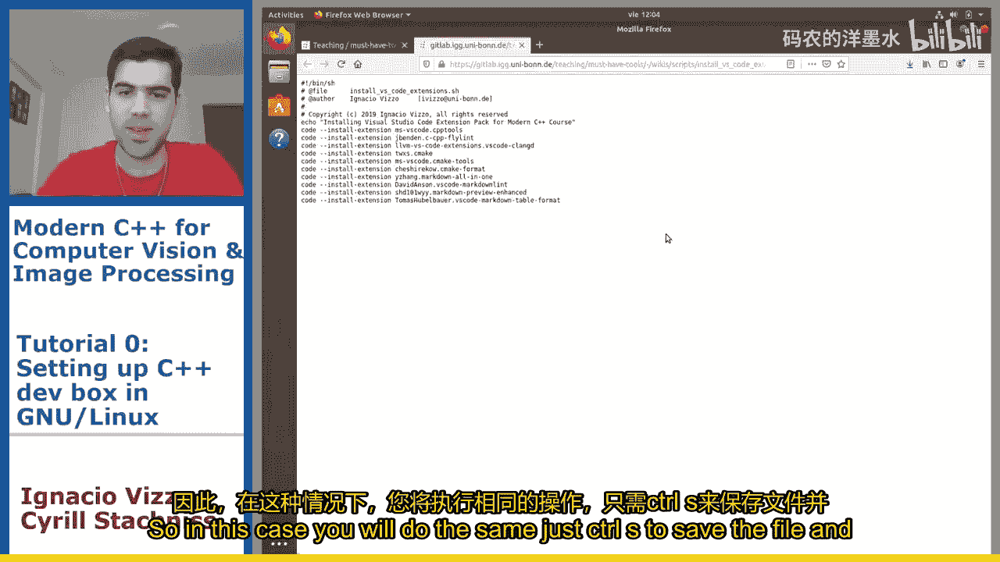
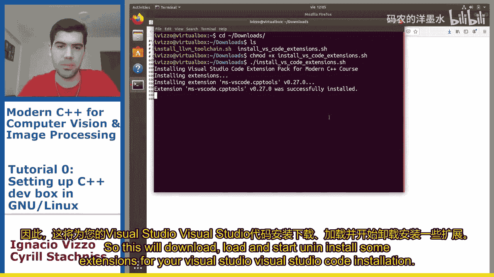
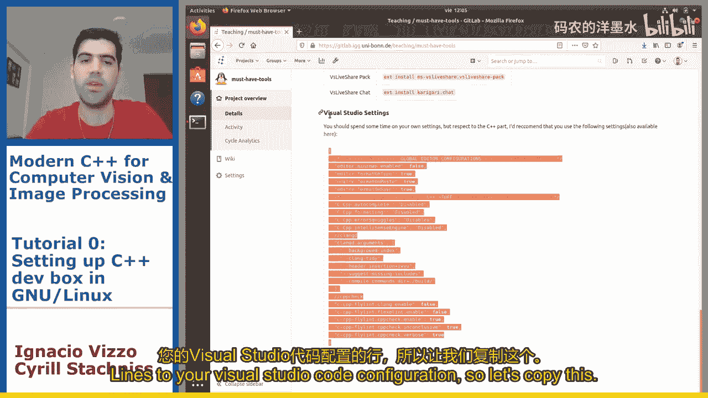
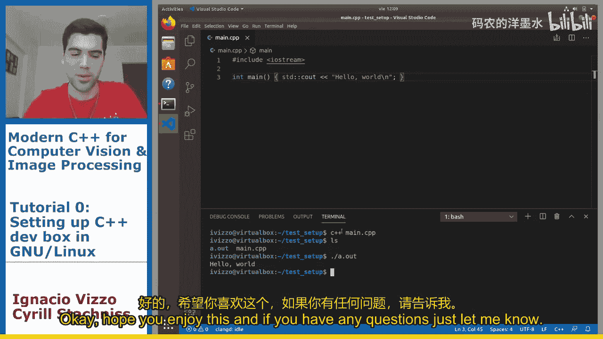

# 现代C++课程：1：在GNU/Linux中设置C++开发环境 🛠️

在本教程中，我们将学习如何在安装了Ubuntu的机器上，为“现代C++课程（2020版）”配置完整的开发环境。我们将安装必要的工具链、编译器和代码编辑器，并进行基本验证。

## 概述

本节将指导你完成在Ubuntu系统上进行C++开发所需的基础设置。我们将从安装核心开发工具开始。

## 安装核心开发工具





首先，我们需要安装一系列核心开发工具。以下是具体步骤：

1.  打开终端。
2.  复制并执行以下命令来安装 `git`、`make`、`CMake` 和 `Cppcheck` 等工具：
    ```bash
    sudo apt update && sudo apt install -y git build-essential cmake cppcheck
    ```

这个命令会更新软件包列表并安装课程中将要用到的基础工具。安装过程可能需要一些时间。

## 安装LLVM工具链

上一节我们安装了基础工具，本节中我们来看看如何安装更先进的LLVM工具链。我们将使用基于LLVM的`clang`工具链，它将在课程后期提供更好的集成和反馈工具。

1.  从提供的链接下载名为 `install-llvm-toolchain` 的脚本。
2.  打开终端，进入下载目录。
3.  为脚本添加可执行权限：
    ```bash
    chmod +x install-llvm-toolchain
    ```
4.  运行该脚本以安装工具链：
    ```bash
    ./install-llvm-toolchain
    ```

虽然此步骤对于开始构建C++代码并非绝对必要，但强烈建议完成，因为它为后续课程集成了许多有用的工具。



## 安装代码编辑器



工具链安装完成后，你需要一个代码编辑器。推荐使用Visual Studio Code，因为在Linux上安装它非常简单。

只需在终端中运行以下命令：
```bash
sudo snap install code --classic
```
此命令将通过Snap包管理器安装Visual Studio Code。

安装完成后，你可以通过运行 `c++ --version` 来验证编译器是否安装成功。输出应显示类似 `clang version 10` 的信息。

## 配置编辑器扩展

为了获得更好的开发体验，我们需要为Visual Studio Code安装一些扩展。以下是需要安装的扩展列表：



*   C++扩展
*   代码格式化工具
*   其他基础扩展



你也可以使用一个脚本来自动安装所有推荐的扩展：
1.  下载提供的扩展安装脚本。
2.  在终端中为其添加执行权限并运行。



## 配置编辑器设置

最后一步是配置编辑器的设置以优化工作流程。

1.  在Visual Studio Code中，按下 `Ctrl + ,` 打开设置。
2.  点击右上角的“打开设置(JSON)”图标。
3.  将提供的配置代码片段复制到设置文件中并保存。

## 验证开发环境

为了确保一切设置正确，我们可以进行一个简单的测试。

1.  创建一个名为 `main.cpp` 的新文件。
2.  在其中输入一个简单的C++程序：
    ```cpp
    #include <iostream>
    int main() {
        std::cout << "Hello" << std::endl;
        return 0;
    }
    ```
3.  在终端中，编译并运行该程序：
    ```bash
    c++ main.cpp -o main && ./main
    ```
    如果终端输出“Hello”，则表明你的开发环境已成功配置。

## 总结



本节课中我们一起学习了如何在Ubuntu系统上为现代C++课程设置完整的开发环境。我们安装了必要的构建工具、LLVM/clang工具链、Visual Studio Code编辑器及其扩展，并进行了最终验证。请确保在学期开始前完成这些设置，以便顺利跟上课程进度。