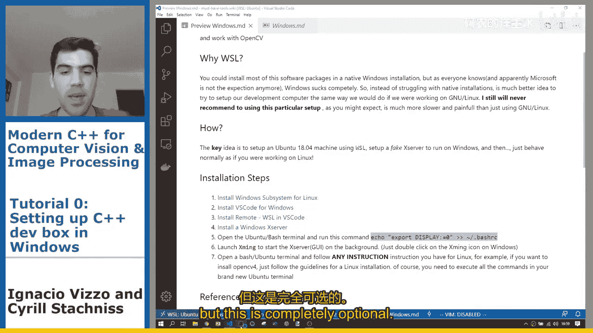
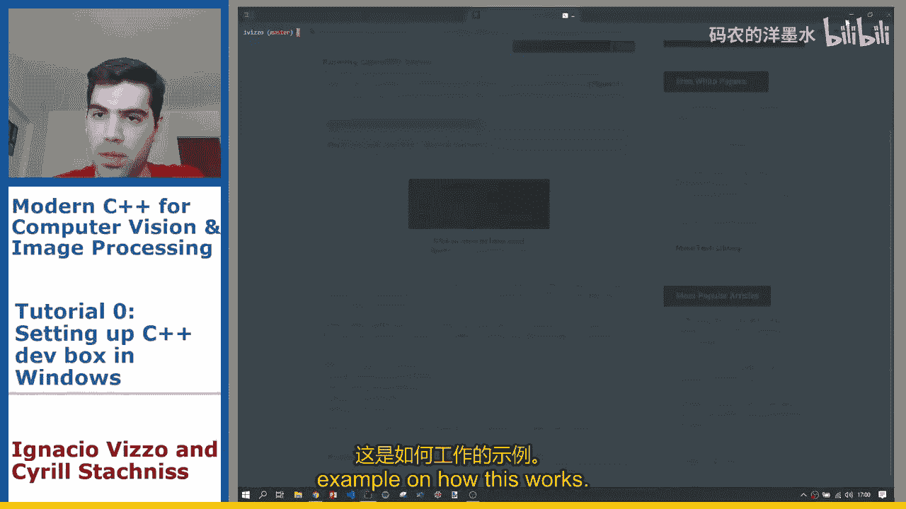
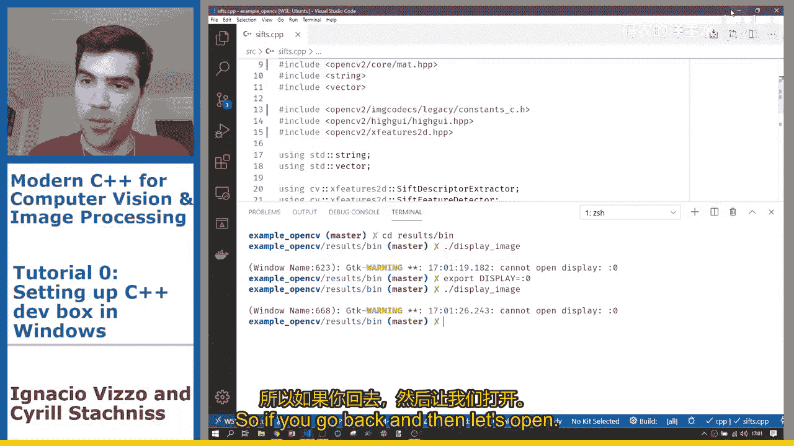
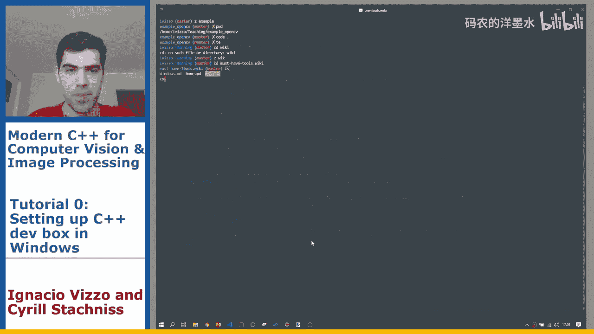
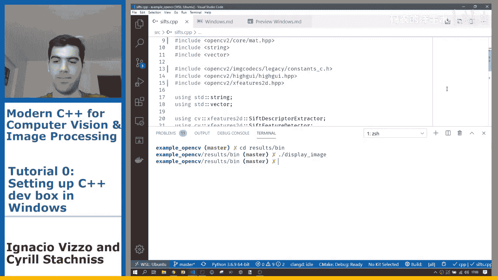

# 【全集】波恩大学 现代C++ CS414 中英字幕 p12 教程2：在 Win 10 WSL 中设置 OpenCV4 C++开发机 -BV1EYm1B5E2D_p12-

Okay， welcome to this video。 Even when I will never recommend you to use Windows for our C plus plus course。

 I managed to find out a way to make it work with all the tools we actually use。

 So I create this wki on So if you go to the tutorials wiki on the IG G Gitla server。You will see。

The instructions， if you go to a G Git lab。You can see all the instructions here on how to set up Windows machines in order to work with C plus plus an open Cv4。

 So basically， the main idea is to kind of cheat because we will not be installing the native libraries like Kang tools。

 GD Open C on all these libraries。 even when you can do it。

 it's usually painful and it's very likely that you do some mistake。 So for me。

 the best idea is to try to still use Linuxux inside Windows。

 So Microsoft realize that they need to do this。 So theyre providing these。

Think called Windows subsystem for Linuxux。So here I。

 I put you the link so you can go ahead and install the the this。

Linux F in Windows that is sort of like a virtualton machine， but it's not really。

 So this integrates into your system。 So you need to launch any specific thing。

 So if you go now to the Maha tools wiki you will see this link and here you will find instructions on how to install all these steps after you go through all these steps and then you know that more or less is' working。

 then you need to go back to the original link and then follow all the steps for Linux So the really good thing about this is that once you complete these steps。

 you will be able to install wherever you want in Windows but using Linux behind the scenes。

So I will not go through all these steps because it will take a lot of time。

 but I just want to make sure that I already tried those steps I am using it on this Windows installation。

And then I already tried that the graphical Gui server is is working。 So everything is is fine。

 So first， you will go ahead and install the Windows subs systemem for Linux。

 then you will install B S code for。Sorry， you can sell BS code for Windows。

 and then you will need the remote WL extension。 if you see on the bottom left corner here。

 you see this green button saying that I am running on you don't do。

 So actually this file is on my Linux installation inside Windows。

 So inside this Windows sub system for Linux。 So you will need to install this installation in order to edit source code from a Vi Studio installation that is running。

 So this is running on Windows。So it's native， it's a native package for Windows in order to edit source code。

 then you would need to install like a fake X server。

 This is in order to run goi applications here I give you a tutorial on how to do it So everything in here is like meant to run on the Linuxux subsystem。

 So just make sure you go through all the steps。And then， after all， you need to。

Exece this command on the Linux installation inside your Windows， and then thats it guys with this。

 you can do whatever you want。 So now you can go through any tutorial that you can find online on how to do blah。

 blah， blah or how to install this library on Linux and you can do it from Windows and it will work。

So how do you access this Linux machine， You just do Uuntu。 just type here on the starter menu。

 I have no idea。 And then if you hit click， then you will have this terminal that is basically a Linux installation。

 so。This is one way of doing it， so this is the kernel version I'm using。

And this is basically a Linuxno subsisting running on Windows。

Even when this app is the default that comes with this subsystem。

 I would recommend you to to install， but this is completely optional and our terminal。 That is。

 I use hyper terminal in Windows because the one that comes with Windows is really， really ugly。

 So this is basically my terminal。 And let me close this。

 And then I will show you one example on how this works。 So let me。

Minimize all this stuff。 And then。So。So for example， this is inside my Linux installation。

 This is the path directory， and then I will open visual studio code inside this folder。

 This is just optional， and this is just to show you how this stuff is working。

 So right now I'm editing source code that is actually located on the Linux installation。

Here you see all the files on the top left corner。 you will see the green button saying that were running actually eventu and all the tools are working。

You can build this project and you can actually。 So there is an example。Of course。

 if you see right now， this is taking for minutes way too long。

 It's much more slower that if you are running everything natively in Linux， but it is something。

 If you don't want to go for Linux， you can try this。

So don't worry if you don't understand this command just to show you that Open C4 is running on Linux inside Windows。

 So there's this display image。Okay， so this is。You need to export this play in order to make this work。

 No， Im missing one step。 Sorry， so if you go back and then。

That's open。

Im missing one important step。嗯。So if you go to the wiki。

You need to install this Windows server and then you need to launch the server。

 So first install Windows system for Linux， then via code。

 then the extension to access code for the Linux machine。

 And then you install the X server that is this tutorial I'll show you。

 but then you need to run this server and it's super easy。

 You just go to the icon it's provide an installation you just double click And if you see right now here on the right button corner。

 So the X Min server is running。How to check that this is actually running。 Just open any terminal。

 And then you can hit X I。 and then you will see this。Gui application。

So now we go back to our Open civic example。And then let's try to run the application to make sure that we can see images and everything。

So。Of course， you need to install manually open CV at this point， you shouldn't care about this。

But you need to make sure that in the future you will be able to install it。

 So I did this for you in advance。 so to make sure that everything is working。

 And now if we try to run the application now it's working So that's basically it So make sure you go through through the wiki you first run these four5 steps they will take some time then don't worry about openC right now but I'm just trying to show you that you can use open C4 in Windows but for Linuxux basically the only thing you need to keep in mind is that all these setup。

 you're running a Linux inside Windows and you're like always accessing this back and forth So this of course will take some time So that's basically if you have any questions just let me know I hope you enjoyed this video。

