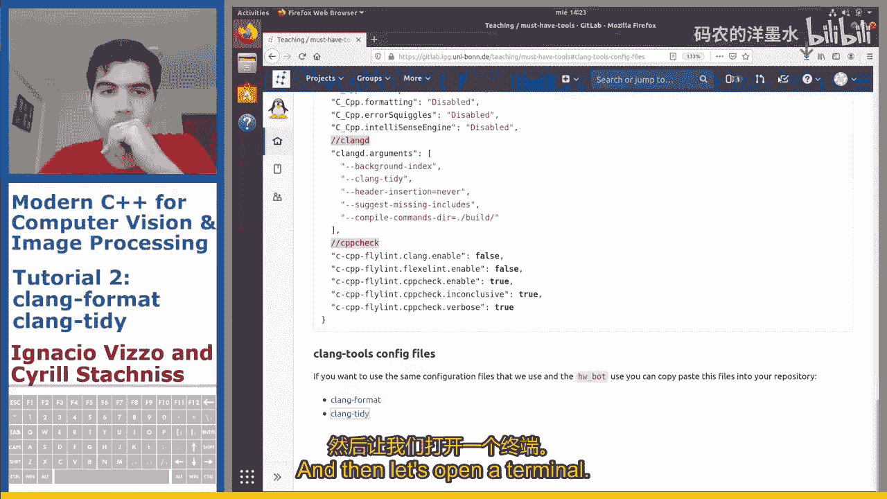
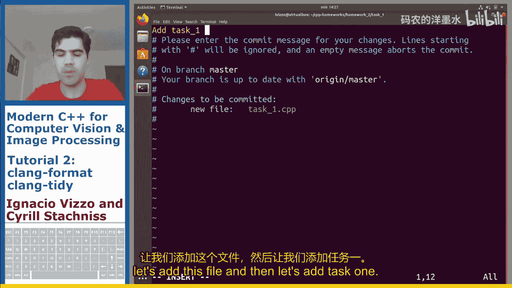
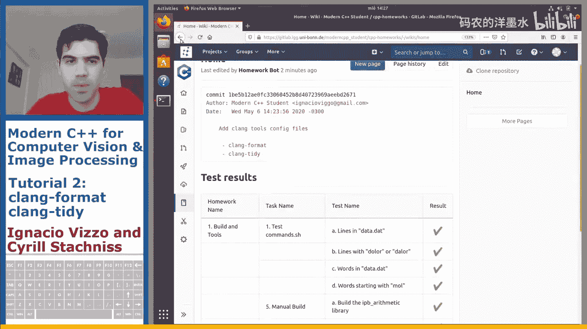
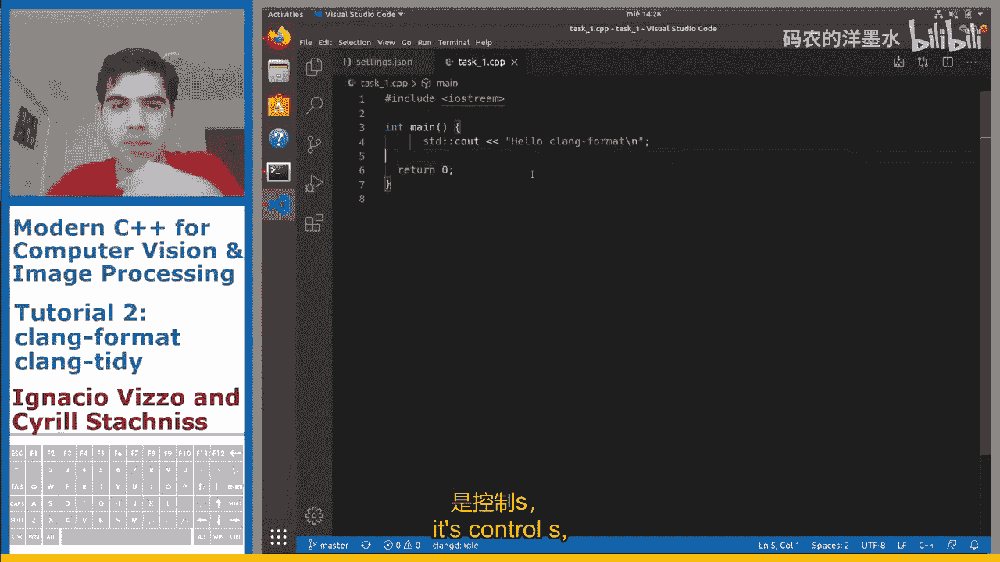
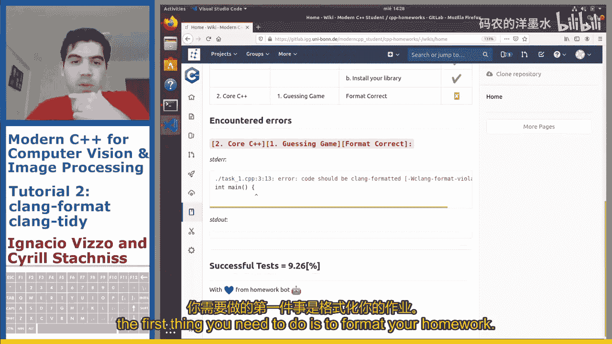
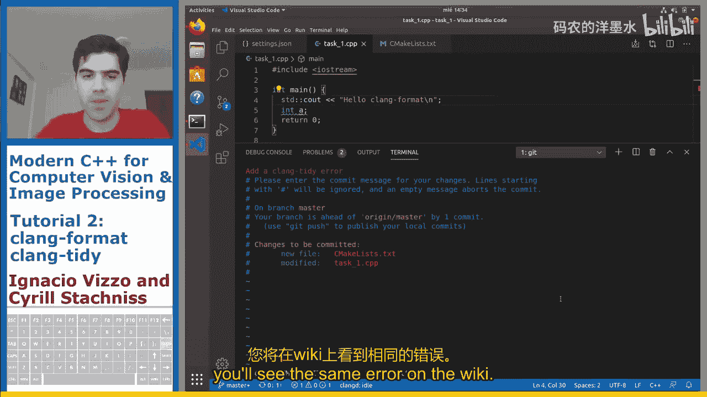
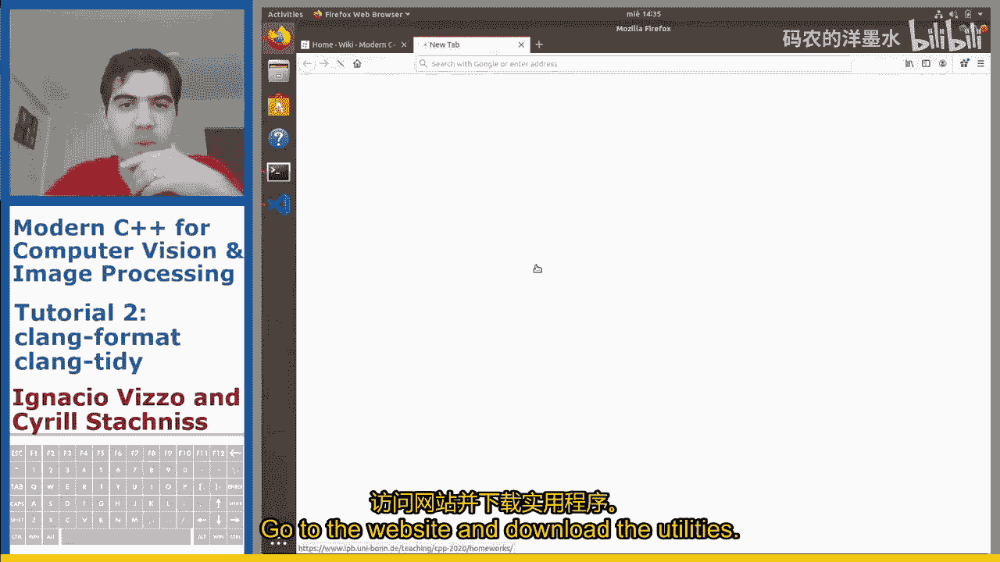
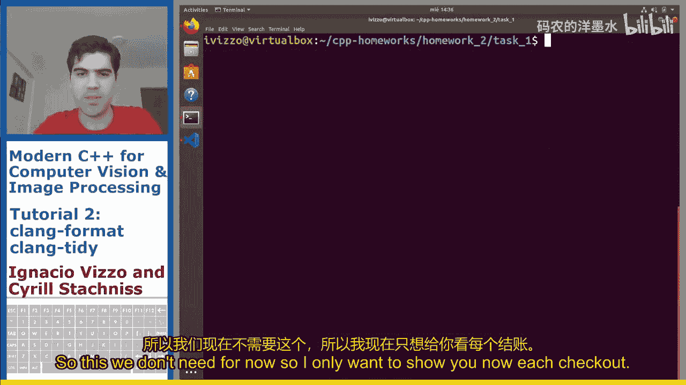
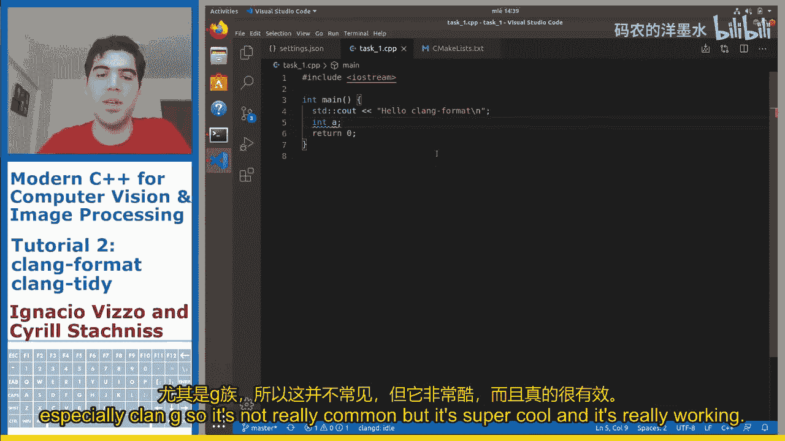

# 【全集】波恩大学 现代C++ CS414 中英字幕 p13 教程3： clang-tools -BV1EYm1B5E2D_p13-

。Okay guys， so in this really brief tutorial I will try to show you how to use the tools we are using this year for Homes。

 and I actually expect that you learn how to use this tool for your professional career。

 So these tools are the reason why I switch from my beloved GCC to LLBM toing。

LLBM is a tool chain that is supported by Apple actually。

 but is completely open source so you can see the whole implementation details。

And they have been doing a great job in terms of tooling so they are besides the compiler and the tool chain。

 they are providing a lot of tools that are actually are meant to make your life easier。

 so this is the only reason I switch to L littleBM you can actually use these tools no matter which tooling you' are using like you can use CCcc and some claim tools。

But for me it made more sense to use the whole tooling system that's why you LLDM release 10 when you started this course right so let's start let's get started with the tutorial。

So basically the first， so we're going to see two tools one is clLlan format and there one is cl TDI。

 K format format is a tool to automatically format your code and make it more readable and professional and Cl TI is a static analysis tool that will help you to write much better C++ code。

 so let's get started。So sorry， it's always same。 So the first thing you're going to do。

If you're going to go to the Ma hub tools wiki。So I just uploaded two configuration files。Not here。

 actually。This virtual machine is extremely slow。And then you will have to clang tools confi size。

 So this is something new。And then， you will。嗯有。Marin。ok。

Save link us and then you will go to your CPP Homes repository and you will save this configuration file and also this one。

Sorry， saving us。That's sit front， right？

And then let's open a terminal。Let's go to CP Homes and then if you do get statuss。

 you will see two new files。The only thing is you actually these files should be hidden on your repository。

 so if you do something like LL here or LS。You will see the two files here， but should be with a dot。

 this means that it will be hidden。And。嗯。For format， which is about in in front format。

And then just the in and do。And then she's good。Right， then get status。H。Okay。

 then you just add this file to your postory。G。2。Confi files。I say cl format and also cl TDI。

So why you want， then you push to your reposer， Why you want these tools on your repository。

 Because this will give you。So these are basically the configuration file sorry。

 not the tools that I am using in the Homeboard bo。 So if you want。

 you can have the same configuration。 And this way。

 you will have the same feedback on your logo machine that in the your wi， right？

 So let's see how this works。 So let's pick Homeboard2。 And then let's start from a。From nothing。

 actually。 And then let's create two directories， task  one， and then task 2。

And then let's go for task one， for example， and then let's create。

The this thought CBB file was task one， that CB， right。

 Let's start working right away with this file。 and then let's pretend that。

This is the task we need to achieve， and then in main。🎼And。ねてとえる。And then S see out。Sorry。Sorry。😔。

Hello platform。And then that's  it。 and then somewhere here。P0。ね。Yeah。

 so if you see this code there's nothing wrong with this code。

 so if you actually compile T1 the TppP， you can run it and it's working。

Only bring with this is that it's extremely ugly and it's impossible to read。

So in order to avoid these kind of issues， so we are using plan format and we are forcing you to format your code So you have two ways of doing it this so the hardware is using the terminal。

And the easy way using the integrated tools that gave to you on the very first tutorial with visual to code So one thing you can do is you can actually run plan format and then you do it with for this file and then the output so on the standard output you will have the formatted version of this file The thing you can do is you can prepare the dash why。

And that stands for interactive and this will format the file with H file。

 So if you now open the same file， it's completely formatted， right？Lering you can check。

 so let's break the format again。Let's so it's as simple as breaking like this。

 you can actually do plan format and then you can do try run。

And then one is as error and then the file and this will basically give you an error and this is the type of error you will see on your wiki if there is an error so let's for now let's add this file。

And then， let's have。Dusk 1。

Homeward to。Right。And I am not even。Adding a Si gl file， nor build nothing。

 So before I even get to build your homework， the first thing I will do is I will be checking for format。

 So if the format is not correct， then my friend， the homework will not be corrected， right。

So make sure you do format your call。AndThen let's go to the wiki。 And now you will see an  error。

 so。

In the meantime。So， something you can do if。Okay， let's show you how you can fix this on the text editor。

 So you have two options， so。The first one is。Do in format document or if you're actually using the configuration I gave to you。

You have this format on save， so whenever you save the file。

 so whenever you save this file with control S， it will auto format it for you。

 So if you don't like this auto format on save just disable and then make sure you format it whenever you want。

And then let's see if this is already done。Okay。So the second homework format correct no。

 so I didn't even bele or check for any other thing， So error code should be cl formatted。

 So if you really want your homework to be checked。

 the first thing you need to do is to format your homework。

And let's say that you actually don't like the format I gave to you。So， if you go to the。

Manual of the tool。So you can search for the style option。 and then you will see。Style， okay。

 that you have multiple styles predefined on the two。 So let's。Pig Wki， for example。

 and one thing you can do on your CB Home on the root directory。So。Okay， let's。And then get commitm。

Faks。Glanform。Now we have a clean repository。 One thing you can do is to planang format。

 and then you pick your own style and then its webki。And then you should stamp config。

This will print the configuration for this particular。Setting to the standard output。

 And one thing you can do is redirect this too。Your client form tool。

And know if you do a gidff you will see that some lines change change it because it's a different style。

 So this is something you can do and now if you say or if you format some stuff will change so pick the style you want。

 you can play with the configuration file and then I would not check that you're using my format style but at least you're using your format style So if you change client format。

Then you can pick virtually any style you want， I will not complain if you pick an uglyglist style。

 just do whatever you want， I will only complain if there is an error on the on the style you pick。

So that's one thing。 The other thing is， let's。Ddge see make list T XD。呢。This we on there。안 there。

Let's open the Smans file and then let's。See the second tool that is the static of an analysis tool。

That is grant to the I。Before I forget， I found an error on the settings I gave to you。

 so there is this header insertion， So this is the tool the configuration I use。

 but I ask you to remove this because if you for example。

 now do STD and then you do string and then you just press enter。

You will get an automatic include here for the stream， so。This is not really important。

 but then I don't want like。嗯。TheThe tool doing stuff for you that will prevent you from learning。

 so minimum required version。It's to project， task one， and then。At executable， task one， task1。

 dot C P。 And now something you can do is like you can。都那 team make。Export。Turn this flag on。

 And then now when you run Cm。 So if you create this directory。

And then you see D onto this directory， and then you will see make。

You will see this file that is compile commands docha。

 so basically these are the B lines for your project。And most of the tools from。

From clientk tools will be working with this particular file and will be giving you information about this so。

Now， for example， let's pretend that I am doing another mistake that it will be， for example。

 first of all， let me go to my。R directory and I would do Ki check out this will go back in time and pick the original format file。

And now if I format this format document， Okay， this is how I end up。

Before now let's pretend that I create a variable called a， right？But then for some reason。

 I'm not using this variable。So if you see， this is what I call early feedback app access that is for me super cool。

And that is that variable A is not being initialized。

 So there is one problem here that is being reported by client TI。 So whenever you pick any tool。

 any funky tool， any fancy tool from regular IE， always ask yourself the question。

 how will I integrate this into my tooling system。So you have this first warning。

You have an another warning but TPP check。 and then for example， if you run it manually here。

 so if you do clang TDI。And then you do dash P and then you indicate where is the build directory？

And then what I'm missing， probably the fight。And then du1 CP。You will see an error， right。

 So the error， the variable A is not being initialized。 so there is one thing here。

And if you actually try to now commit this， so get commit。Just have a clan。TDI error。

And then you push， you will see the same error on the wiki。

So this is something that would be impossible with IVs because usually these tools are not really flexible。

 let's say。And also， it's hard to con。 So you can say， oh， but I know。

 Eclipse also war me about this。 Yeah， but how do you integrate this into your into your whole your ecosystem of development。

 So in this case， you will see there reported on your text editor。I gave you。Some tools on。

 on the website to actually， whenever you make。 So you have the option to。So whenever you make。

 you will see there， I will show you how。And then after all， you will see the same error on the wki。

 So no matter what you you do， we will catch this error。So it's still working。 So in the meantime。

 we can。Go to the website and download the utilities。

So if you go do homeworks， you will download this zip file。Let's see if this is already here。And yet。

 did they push。Okay status。Good show。Yeah。Okay， let's wait then。Then。Let's。コ币。The tone lots。

 and then number2。Here， and then on sip。More to。Then let's remove this。Now let's， for example。

 let's move Cm and then test。Two task one。For now， let's forget our testing。

🎼The test。 So this we dont need for now。 So I only want to show you now， get check out。This is good。

Gt status， so I remove the file and then gate。Ks about this just get a out the I。

 you have it bug again， I want to remove。The sorry， the test for this guy， okay。

And here on the CMake， so try not to open this。Because it's uglymic code。

 basically this will allow you to check for ClI on your bill。And also。For the format。It's open gold。

And how you use these tools。 So you have multiple options。

 One would probably most CC one is to include and then Cm and then static。So how is this goal。すね？

Sttic analyzer do。So with this， you will basically include。This utility。

 and then if you do now See make dot dot。Whenever you make。If this is working。Okay。

 whenever you do make your build fails and this is the same tool working on different places。

 it's still client TDI error variable A is not initialized。 and this is TP core guidelines。 blah。

 blalah， this is a warning that is being pop up。 It's the same warning that you see on the editor here。

 the same one and it's the same one that if this is working you will also see。On your computer see。

 So build succeeded。 no， why it's not being succeeded because variable A is not being initialized。

 right？And this unused variable is a warning of cllan， not TDI， but the compiler。

 and this is because I didn input W all for a warning。

 So this is how you can actually make this stuff work for you and idea that you should check all the stuff。

 and that's why I gave to use this you make directory with these utilities to check。

That everything is working before you submit your homes or what you will be going back and forth with the wki。

 and it's going to be probably painful。 So I hope you get some intuition on on these tools。

I will say that it's very likely that within a few years， this will be standard in the industry。

And probably in academia as well， because this is for me it's the way of going like whenever you pick a tool。

 So forget all the text editor and wherever。 So this plan format could be integrated everywhere。

 So you have it on your system。 you can use it in a shell。

 you can use the text editor I am using client format the same tool on the Home So whenever you set up a C。

 you can actually ask plan format to format the code for you。

 So this is the way of going the modern way of doing development software。

 not having one magic ID that does the job for you。

 but then you cannot integrate any of the I functionality anywhere else。

 you cannot add this to the C， you can share this configuration with some other colleagues So this is extremely flexible and it's getting a lot a lot of attention。

 especially plan D， So it's not really common but it's super cool and it's truly working。

So if you check your settings。The C plus plus auto completelete from visual Z is completely gone disabled because KangD will do it for you。

But after it inspect the bill so with this compile commandt it will search for some stuff and it will give you feedback that is completely tied to your bill right so anyway if you have any questions about formatting or clientDI just let me know I hope this makes your code better Okay thank you for watching。

