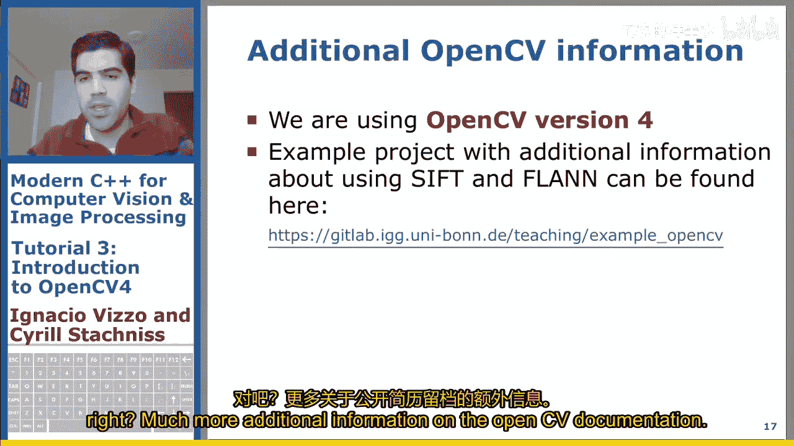
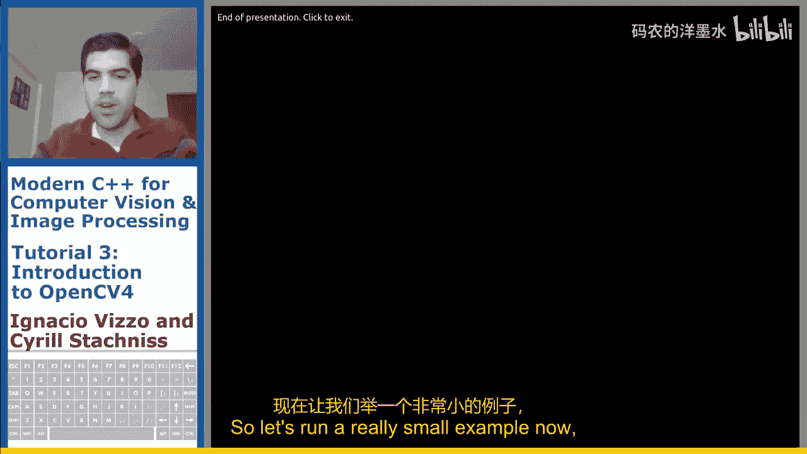
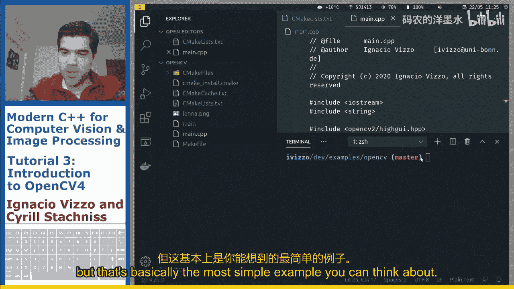
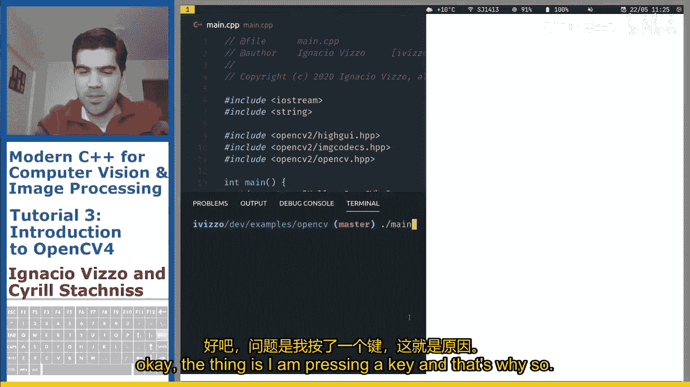
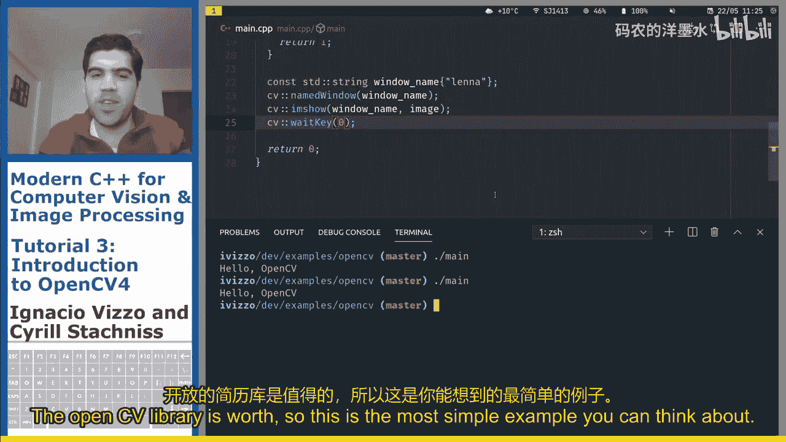
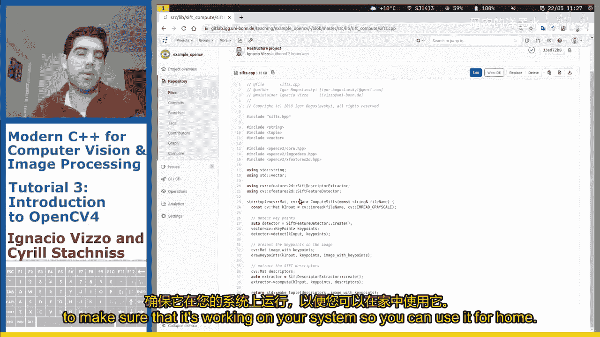

# 【全集】波恩大学 现代C++ CS414 中英字幕 p14 教程4：GNU和Linux中的 OpenCV4 C++ -BV1EYm1B5E2D_p14-

Okay guys， so welcome to this really really really small tutorial on OpenC， so first of all。

 I need to tell you that we won't cover the whole library on this tutorial and it's basically meant to show you that it's easy to use and how to start up using the library。

Before we start， saw small words on the library itself。So there is no real concepts for this library。

 so theres no real theoretical background for the library itself。

 So it's not something that you can say I know open CV perhaps you might say I know how to use Open CV So OpenC just the library and then you shouldn't get too frustrated or frustrated sorry or too excited with the library itself So as any other middleware it's just a way to facilitate how to work with computer vision and with computers right so it's just a library and then take it as it is。

It's one of the most popular libraries for computer vision。

 So now the story changed a bit since deep learning came into the game。

 but if we forget about deep learning for a moment then Open TV is the most widely used computer vision library and。

Fully open source its support for the， but many， many companies and researchers all all over the place。

So this is a library that you will be using for your final project。AndYeah， so let's see some small。

Concepts about the library。 And then I will give you a link to。

Ego explanation on this library that is much more extensive。 So if you have any doubt。

 you can go and check that video， but that would be about 40 minutes。

 and we would check to give this no more than 10 minutes。

So OpenC is a popular library for image processing。

 and we are using version number four of Open CV has been released not too much， not too many ago。

 and the reason of why we are using this version is because this is the first version of Open C that fully support C++ 11 compilers that is supported by these compilers。

And also， it's a much more C+ plus like library。 So when they started developing the library was much more like a C style library。

 and they are switching to C++ because it's just there。😊。

We would be using just a really small part of it and when I say a small。

 it's basically less than 1% of the library。How to access all this the functionality of the library just including this hur file。

 so if you go and check this her file， basically inside you will have like multiple includes statements。

All the functionality will be under the namespace C。

And there's much more information in OpenC right so the only warning is that nowadays everyone is trying to use OpenC with Python and you will be using OpenC with C++ so make sure that if you watch any tutorial of wherever make sure it's on C++ so the A are the same and the functions are actually the same and they're all implementing the C++ and the Python is just a wrappper to call these functions in C++。

The only complicated thing about Open CV is that in order to make it run fast for you。

 they use the own types and the problem is that they trust you to use the right types。

 so the type safety let's call it Open CV it's not great because they want to make it fast for you so they trust you to use the types and if you don't use the right types then you will most likely suffer。

So the names are usually following this pattern， so it's C and then underscorecon and then the bit count of the type。

 the identifier and the number of channel So for example， in this case。Let's highlighted it。

So for an image， for a classic RGB image， we will have the the first part of the tab will be open will be CV that is basically this。

Then the bit count is how many bits will be representing this type in this case will be8。

 so it's one byte。And then the identifier is going to be unsigned character。

In this particular example。And then the number of channels is going to be the last part of the type in this case would be three。

 right okay？So the coloring didn't go so well so A image is going to be C underscore8 beats uned car and then three channels。

 right？And then if you want， for example， to represent a gray scale image will be the same type except that you will be using one channel right。

 so you will change the last number。Perhaps you might want to use data type。

 so this is basically just an alias for this type of openC types and this is one example。

 but it's basically up to you。Then so that's the most condensed history about data types in Open CV。

 then the the most important class in Open CV is going to be CV map that send for a matrix。

And then basically everything on open CV will be a sort of a mat， right？So images would be matrices。

Thescriptors and so on so。If you want to create a new。CDM， for example。

 this is one of the constructors you can use。So in this case。

 you will need to specify the number of rows， the number of columns， the data type， and then values。

And then also you can use this templated type that you basically instead of providing the type in the argument whenever you create the image you provide here。

 so it's basically the same， right？And then this is a small example。

 how to create the matrix 10 by 10 matrix with all zeros。And then， in this case。

We declare like a matrix called image of type C mat and then we will call this utility function called zeros and then here we specify what the rows and the column that is basically 10 by 10 and then the type this will create actually three matrices。

Behind the scenes， because it's free channels inside car， so it's going to be an image full of zero。

Then you can do some type asine to make your call more readable so for example。

 you can use MA F and then to access a matrix of floating point values。And then you can do the same。

 but remember， as we saw here， so in this case， we are specifying the type here。

 so we're saying this is float。And then instead of doing it on the constructor。

 then we don't need to specify this anymore， so this is going to be one matrix of 10 by 10 full of zeros but on floating types。

 right。If you want to get the type of the image。You can。

You can use the this member function that is called type。 Also。

 you can get the size with rows and columns。 And there's much other methods for the class。

 And then from input outputs per perspective， you will be using sort of three methods。

 There is image read。 That is to read an image from the。It's highlight it here。From the file system。

 and then you have image right that again will write an image to the file system。

 and image show is going to be a function to。To to show you an image on the screen。

Then one big disclaimer is that CVM is a sort of share pointer。

 so when they started developing the library， all the memory management。

 dynamic memory management libraries from C++ were not in place so they had to do it by hand we will discuss this on feature lessons but。

Just a warning。 So CV mat。 So the warning is actually here。So let's say you have this image。

And then you create a CV mat， and then you will create another image whenever you do this。

 you will not copy the content so。If you access then image no copy。

 you will also access the original image right so this is just a warning you will get much better understanding on this topic in future lessons。

But just keep in mind that whenever you do these type of assignments。

 you are you're not copying the data。Then how to read an image it's really easily easy actually。

 So the only thing you need to know is sort of the code of the image。

 and then there are many of them on open C， but the three most widely uses。Image read unchanged。

 That is okay， whatever you have on the image， you can read the image as a gray scale or。

You can each read the images of the color。 And these are like basically the。

 the integral numbers behind the type。 So all these types are basically integraltegers or are basically they're replacing a number。

And then if you want to read an image， for example， lower open C dot PN G。

 then it' just called image read that is under the namespace C。

And then you specify how you want to read it。 So if this is a colored image and then you say unchanged。

 you will see a color image， but if you for example。

 do gray scale then you you will only load the gray scale values， right？

Writing is as trivial as reading。 So instead of calling C image。Read。

 you will need to call CV image B and actually there is atypo here。

 so sorry this should be image right， not image read。

So this is run on the slide and then you specify the file and then which is the the demand you want to。

Youre right。And then just another warning with floating point values images so if you want to start for some reason a floating point image you should be using EXR 5s so if you use P andC I highly recommend you to try the example and you will see how weird it is but basically there will be some compression and you will be losing some information from the floating point values and then this format EXR R sorry will guarantee you that you don't lose any information on the values itself so when you write the image to the disk then you don't lose information if you read it。

So there's a small example here so try to happen if you use P and G so basically copy paste this example and then instead if using EXR。

 just put P and G and then open the image So actually when you write it to the disc。

 you can just double click and open the image and you will see all the errors。

Image show it's basically the utility function to show an image to the screen。

 so it's actually quite easy。 The only thing you need to be aware is that you will need a window so the first thing you will create is a window。

And then here you will put the name in this case we pick window names， it's a really smart name。

 and then you want to pick the auto size function， the type sorry。

So the the size of the image will be like will be the same of the window and then it's just called image show。

 right， and then you say which is the window name where you want to put this image and then the image that is basically a CB mat。

And then with this trick with CV weight key， it just open the image and test until the user presses a key。

So this is easy。Again， all this is so there's no real concepts behind like showing an image on the Open civilary。

 This is how you do it with OpenC if youre using other library， the functions will be other ones。

 but the concepts are the same so you should not get really excited about the library itself。

 It's just a tool for you to make your life easier when working with images。😊。

So there is also a vector type use as an example， we will。

Skip this and last warnings that mixing up types is painful so OpenC again trust you to pick the right side and will this can cause errors if you don't use it correctly and then OpenC interprets spike story in Cma according to the types that the user ask so basically inside the Cma there will be an array full of data and then depending on which type you say youre using it will give you the information in this array but if you for example if you have IO。

Two bytes in there and then you say， okay， my type is by by byte， then you will get two values。

But if you say my type is two bytes， then you will get only one value。

 the information is the same but the organization is different。

 so make sure you're using the correct types because there is no safety when when mixing these types again there's one example here the recommendation is go out and check it out。

 try it on your computer。Okay， so we will not cover Si descriptors on this small tutorial because I really want to keep it short。

So but there's basically this is the most popular scale barrier feature transform。

 So this is widely used。 It's one of the most， if not the most cited paper in computer vision。

 And this is really widely used in our community as well。 So for robotics。

And you will be using it for your final project and also for homework member file。

How we do this with open city again。The shift idea so how to extract safety key points and thescriptors are it's an idea。

 So theres some theoretical background in there that has nothing to do with Open CV。

 So see if it's not something that belongs to Open CV Open CV is a library and they decide to implement。

These ideas with some functions and whatsoever， so you can use Sift you can write your own sift implementation。

 there are another shiftft implementations out there openC it's just a tool to give you the implementation and to speed up your development。

So。So don't don't get confused with OpenC itself it's just a tool to allow you to use Sift。

 but it's not so it's really important that you understand how to use Sift key points and features and what they are and not like why is OpenC doing with this or how they implemented So the V is more important than the library。

So how we detect key points。 So it's really straightforward。 The syntax is also good。

 so we you will create a if feature detector。You will call in this function create and then this is how you get your detector and then you will create a vector of key points。

 we will name it key points and then with this detector you will pass an input image that can be any image of that you like and then the key points that is basically vector to be populated。

And then if you want to display these key points， the zip key points on the image。

Then you need to create a new image。We will call it image with key points and then we will call this function that is called draw key points。

This is the input image， this will be the key points and lastly this is the output output of this method。

 right？And how to extract the descriptors。And instead of using a feature detector。

 we will use thescriptor extractor with the same syntax， and then we will compute this on the image。

And the input image with the given key pointss and the descriptors will be the output。 So this is。

So this is not the best syntax of C++， but in order to maintain powers compatibility。

 they did it this way， so it's easy， syntax is easy。

There is also one example here on how to use Fland。

 there is also one on the example project and I will just keep it to keep it really short。

So what you should do after watching this really small tutorial？

You should go and check it out that link， there is one example Open CVV。And。

There's another type of hero， sorry， so this should be four like here on the title。And not free。

 And now we will build this example。 So you see that it' actually really easy。

 So after watching the tutorial， go and check this link。

 So on the readm instruction on how to install the library。And there is some small examples， right？

Much more additional information on the open documentation。 And then that's basically it guys。

 So let's run a really small example now。

So。Let's， for example， two examples。Take off see。Right。And then for this。

 we will create a main dot CPP file and then a CMake list file， and then that's basically for now。

Open this visuals to your code。And then， let's start closing， so。Let's make this bigger。Okay。

 brush egg。Ofpen C example。AndThen smic minimum required version is version 3。1， let's say。

And then for now， let's do like a hello wall example。 So add executable and the main that make do TP。

And then， here。This and。Inncluding。I you stream。And here just。Hello world。Reach out。right。

 so with this， we kind of make sure that everything is working。So。We can loose make dot， for example。

 keep it simple and make it right， and then which is to make main and it's worthier。 Okay。

 now it's time to get open C functionality onto the project。How we do this。

 So if you check for the on the slide the。The most important thing， so。I autumn CV。指？

Is to do find package。And then for this， you will need to say， okay， open C。Often C was like case。

 and then version 4。 and then you will do require。With this your telling see make that you should be。

Using open C4。 So it will look into your system wherever it might find it。

 And this is required for the project in terms of， okay。

 you need to to have this this package otherwise it would fail to build。

 So if you if we do see make now， everything is working。 but let's say we have a ty of here or like。

A missing library。 Let's call it library。And then if we try to run Cic now。

 this should fail why because it says， okay， missing library is not there whatever。 So at this point。

 if you have an error。So do it step by step， so first do the hello work example and now try to find the package。

If you have an error here it's because there is an error on your installation so in this case。

We see this message that says found open CV on slash user logo and then the version is 43 and the minimum required version is 4 because we say version 4。

 right？And then so far， we didn't do anything crazy。But one thing we need to add here is okay。

 we need to say include directories and then specify the open C directories that in this case。

Open C and then include des。 So this is basically where all the hell fights are on the。For OpenC。

 And then if we want to use Open C functionality， we also need to link against these libraries。

 So you know how to do this is target。Sorry。Libraries。

And then we will link main again this variable from CM that is called open C。And then the name is。

Let me check， I think it leaps like this。So the sample is here for you so you can check all these names。

We are just building a really small example right now。

So make sure you go and check it out the example on the on the Gila server。Okay。

 so it's open CV leaves。 Yeah， that's correct。then for now， let's display an image。So， let's just。

See make this and make So there's no difference so far because we didn't do anything with the main function right。

 but if we go back to main， then we can start using open C because now our build system is working for us so we can do open C2 for example and then。

One thing you can do to just include everything。 I actually like to include only what is needed so but for now let's do that like this。

And then hell wall， let's call this hello。Open CV， right， and then first of all。

 we will create the CV map。And then we'll call this image and then we are going to read an image from the disk and then how to do this。

 we just call CV image read， as we saw before。And the final name of this image， let's。I mean。

 it will be then， so。Most widely use image。 and then we need to specify how we want to read it。

 So for now let's do it with race scale。 So image read。 And then here you a big race scale。

 And then that's basically it。And then now it's a good idea to check that this image is not empty so that the read was successful。

 So if image is empty。Then。We will do see error， and then we say okay， image， not found。And then。

 we done。One， right？So if we build this example now。This should work， but you will see this error。

 let's say image not phone。 And if you see if you。Ask the prompt， you will get the error code， right？

So now let's pretend that we have the image。 So we skip this step and then we want to show it。

 So we will create the string。🎼And then window name。Let's call it Lena。

And then we will create a name window with open CV， and then window name。And then lastly。

 image show and then。We want to do it on this window and then this image， right。

And to see the image on the screen， we can do see the weight key。

 and then the delay is going to be 0。 And with this， we will wait until the user。Press any key。

 So that's the most simple example you can do If you make this again， you don't have the image， so。

You would say not firm， but let's copy the image and now it's on so on the example open CV。

 it's on image。So now the image is here， and then if we run main， we should see the image here。

 right？Oops。で。Samples。This doesn't work well with。With I3 window manager。

 but that's basically the most simple example you can think about。

So if we run main now。

不。The thing is I am pressing a key and that's why。 So if I press a key here like space。

 then you will close the image because of this。And but with this， you know that the。

The Auto civil library is worth。 So this is a most simple example you can think about。

And if you go to the example I told you so this example open CV so here you will find how to install the library so make sure you go through all these steps and then if you struggle let me know I will try to help you and here under the tour directory you will have three apps。

 so three applications one is to display the image that is basically same thing we shall saw。

Or want to compute sifts and display it on the image。

 So there is another example here that will be using a library like a small。

 really small utility library that we call it Si compute。

The reason on here that this is basically the example you can start building upon to to compute shift features。

 So that's basically it。It's super easy to use the library so make sure that if you understand I will link you to the eager description of the library it's much more detail。

 but the only thing you really need to know at this moment is to install the library to build the examples to make sure that it's working a new system so you can use it for Homeboard number5 so that's basically and thank you for your attention。

