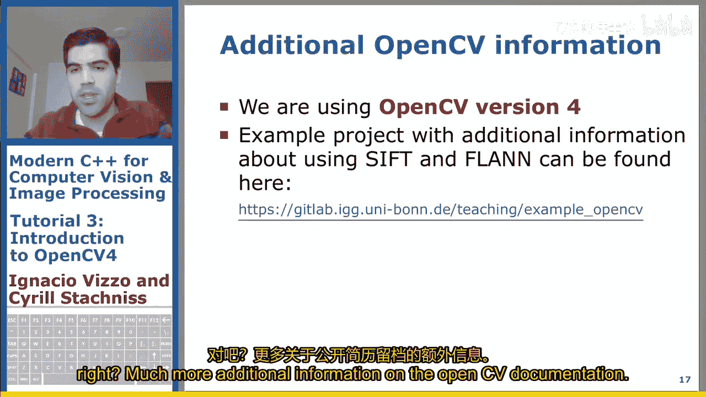
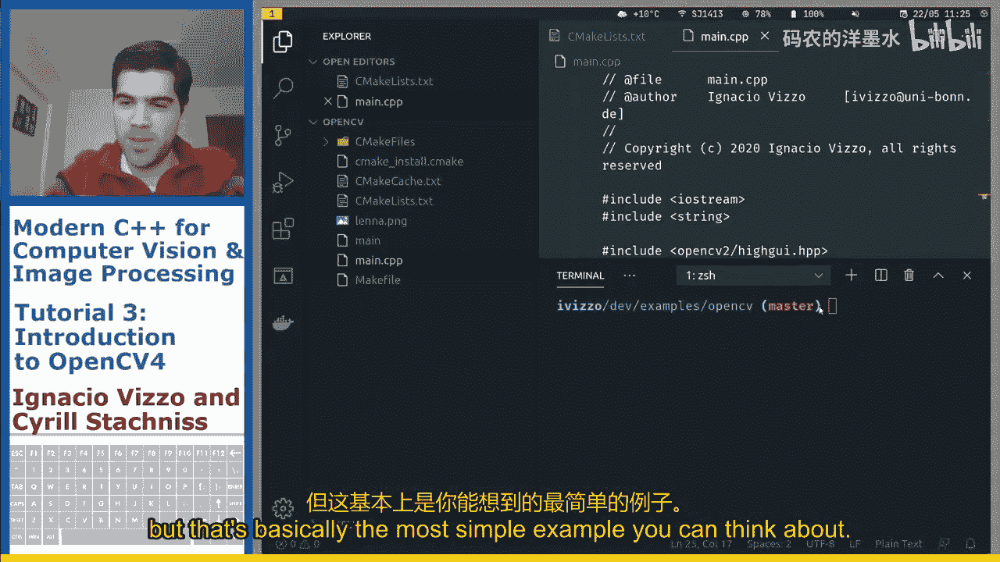
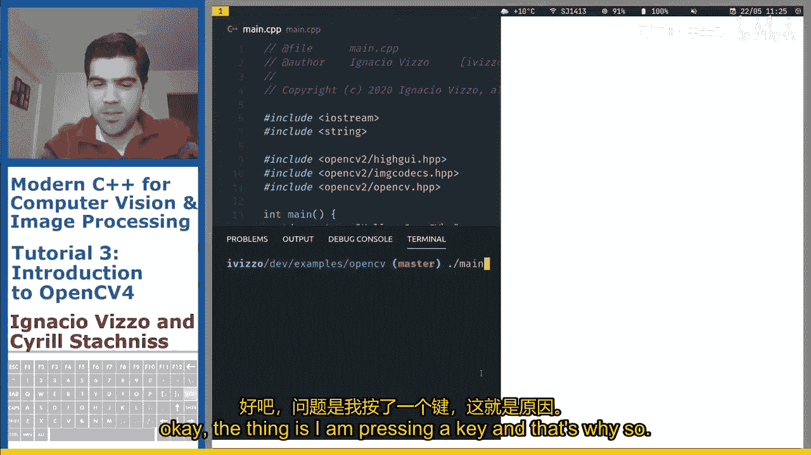
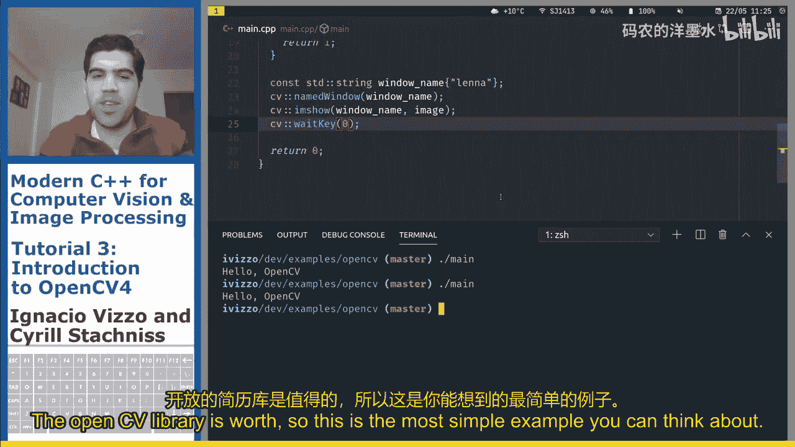

# 现代C++ CS414：教程4：GNU和Linux中的OpenCV4 C++ 🖼️

在本教程中，我们将学习如何在C++项目中使用OpenCV库。OpenCV是一个强大的计算机视觉库，我们将了解其基本概念、数据类型、核心类以及如何读取、显示和写入图像。本教程旨在提供一个简洁的入门指南，帮助你快速上手。

## 概述

OpenCV是一个开源的计算机视觉库，广泛应用于图像处理和计算机视觉任务。本教程将介绍OpenCV的基本用法，包括如何设置项目、处理图像以及使用SIFT特征检测器。我们将使用C++进行编程，并确保内容简单易懂，适合初学者。

## OpenCV简介

OpenCV是一个用于图像处理的流行库。我们使用的是OpenCV版本4，这是第一个完全支持C++11编译器的版本。该库最初以C风格开发，现在已转向更符合C++风格的实现。

OpenCV是一个工具库，旨在简化计算机视觉任务的开发。它本身不包含复杂的理论概念，而是提供了一系列函数和类来帮助我们处理图像。

## 数据类型

OpenCV使用自定义的数据类型来表示图像。这些类型的命名遵循特定模式，以便快速识别其属性。

以下是数据类型命名的基本结构：
```
CV_<bit_count><identifier>C<number_of_channels>
```

例如，一个标准的RGB图像类型为：
```cpp
CV_8UC3
```
这表示图像使用8位无符号字符（`unsigned char`）表示每个像素，并且有3个通道（红、绿、蓝）。

对于灰度图像，类型为：
```cpp
CV_8UC1
```
这表示图像使用8位无符号字符，但只有1个通道。

## 核心类：Mat

OpenCV中最重要的类是`cv::Mat`，它代表矩阵。几乎所有OpenCV操作都围绕这个类进行。图像、描述符等都可以表示为`cv::Mat`对象。

创建一个新的`cv::Mat`对象有多种方式。以下是一个构造函数示例：
```cpp
cv::Mat mat(rows, cols, data_type, values);
```
你也可以使用模板化的类型来创建矩阵：
```cpp
cv::Mat_<float> mat(rows, cols);
```
以下是一个创建10x10全零矩阵的示例：
```cpp
cv::Mat image = cv::Mat::zeros(10, 10, CV_8UC3);
```
这将创建一个10x10的三通道图像，所有像素值均为零。

为了代码可读性，你可以使用类型别名：
```cpp
using MatF = cv::Mat_<float>;
MatF mat = MatF::zeros(10, 10);
```
这将创建一个10x10的浮点矩阵，所有值均为零。

要获取图像的类型和大小，可以使用以下成员函数：
- `type()`：返回图像的数据类型。
- `rows` 和 `cols`：返回图像的行数和列数。

## 输入输出操作

OpenCV提供了几个函数用于图像的输入输出操作。以下是三个最常用的函数：

1. **读取图像**：`cv::imread`
2. **写入图像**：`cv::imwrite`
3. **显示图像**：`cv::imshow`

### 读取图像

读取图像非常简单。你只需要指定图像文件的路径和读取模式。以下是三种常用的读取模式：
- `cv::IMREAD_UNCHANGED`：按原样读取图像。
- `cv::IMREAD_GRAYSCALE`：以灰度模式读取图像。
- `cv::IMREAD_COLOR`：以彩色模式读取图像。

示例代码：
```cpp
cv::Mat image = cv::imread("image.png", cv::IMREAD_COLOR);
```

### 写入图像

写入图像同样简单。使用`cv::imwrite`函数，指定文件名和要保存的图像：
```cpp
cv::imwrite("output.png", image);
```
注意：如果图像是浮点类型，建议使用EXR格式以避免信息丢失。例如：
```cpp
cv::imwrite("output.exr", float_image);
```

### 显示图像

显示图像需要先创建一个窗口，然后使用`cv::imshow`函数显示图像。以下是一个示例：
```cpp
cv::namedWindow("Window Name", cv::WINDOW_AUTOSIZE);
cv::imshow("Window Name", image);
cv::waitKey(0);
```
`cv::waitKey(0)`会等待用户按下任意键后关闭窗口。

## 注意事项

在使用OpenCV时，有几个重要的注意事项：

1. **`cv::Mat`是共享指针**：`cv::Mat`对象在赋值时不会复制数据，而是共享同一块内存。这意味着修改一个对象会影响另一个对象。例如：
   ```cpp
   cv::Mat image1 = cv::imread("image.png");
   cv::Mat image2 = image1; // image2与image1共享数据
   ```

2. **类型安全**：OpenCV信任用户使用正确的数据类型。如果类型不匹配，可能会导致错误或未定义行为。例如，如果你有一个包含两个字节的数据，但将其解释为单字节类型，你会得到两个值；如果解释为双字节类型，则只会得到一个值。

## SIFT特征检测

SIFT（尺度不变特征变换）是计算机视觉中广泛使用的特征检测算法。OpenCV提供了SIFT的实现，方便我们使用。

### 检测关键点

以下是检测关键点的步骤：
1. 创建SIFT特征检测器。
2. 检测图像中的关键点。
3. 在图像上绘制关键点。

示例代码：
```cpp
cv::Ptr<cv::SIFT> detector = cv::SIFT::create();
std::vector<cv::KeyPoint> keypoints;
detector->detect(image, keypoints);

cv::Mat image_with_keypoints;
cv::drawKeypoints(image, keypoints, image_with_keypoints);
```




### 提取描述符

提取描述符的步骤与检测关键点类似：
1. 创建SIFT描述符提取器。
2. 计算关键点的描述符。

示例代码：
```cpp
cv::Ptr<cv::SIFT> extractor = cv::SIFT::create();
cv::Mat descriptors;
extractor->compute(image, keypoints, descriptors);
```

## 项目设置

为了在项目中使用OpenCV，你需要配置构建系统（如CMake）。以下是配置CMake的基本步骤：

1. 使用`find_package`查找OpenCV库。
2. 包含OpenCV的头文件目录。
3. 链接OpenCV库。

示例CMakeLists.txt文件：
```cmake
cmake_minimum_required(VERSION 3.1)
project(OpenCVExample)

find_package(OpenCV 4 REQUIRED)

include_directories(${OpenCV_INCLUDE_DIRS})

add_executable(main main.cpp)

target_link_libraries(main ${OpenCV_LIBS})
```

## 示例代码

以下是一个简单的OpenCV示例，演示如何读取和显示图像：
```cpp
#include <opencv2/opencv.hpp>
#include <iostream>





int main() {
    cv::Mat image = cv::imread("lena.png", cv::IMREAD_GRAYSCALE);
    if (image.empty()) {
        std::cerr << "Image not found!" << std::endl;
        return 1;
    }

    cv::namedWindow("Lena", cv::WINDOW_AUTOSIZE);
    cv::imshow("Lena", image);
    cv::waitKey(0);

    return 0;
}
```



## 总结

在本教程中，我们一起学习了OpenCV的基本用法。我们介绍了OpenCV的数据类型、核心类`cv::Mat`以及图像的读取、写入和显示操作。此外，我们还简要介绍了SIFT特征检测的用法，并演示了如何配置项目以使用OpenCV。


OpenCV是一个强大的工具库，能够大大简化计算机视觉任务的开发。希望本教程能帮助你快速入门，并为后续的项目和作业打下基础。如果你有任何问题，请参考OpenCV的官方文档或示例代码。