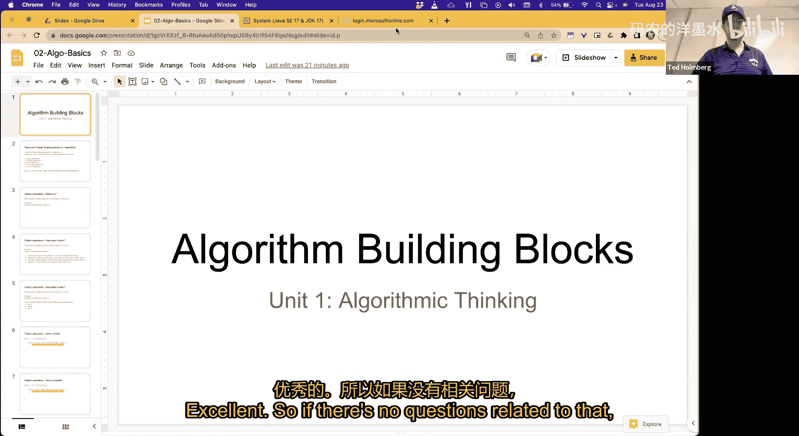
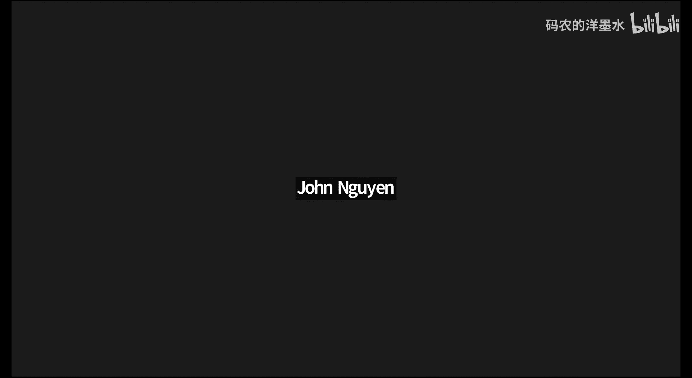
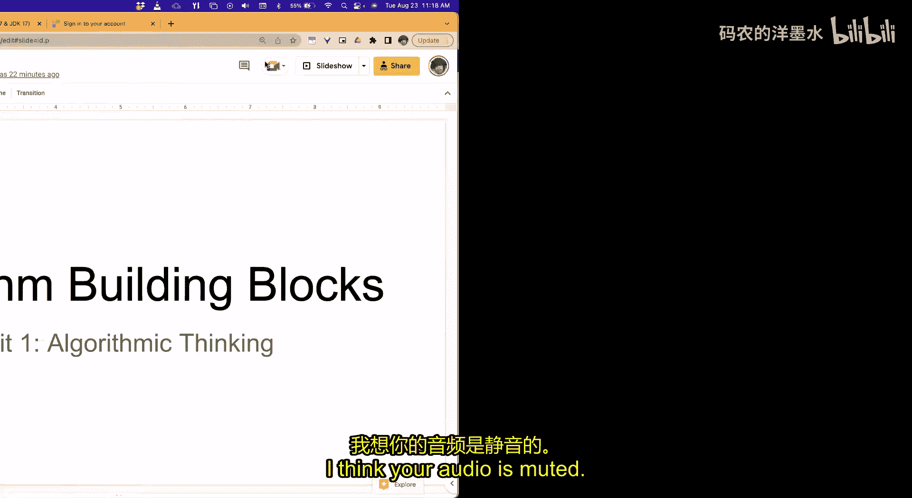
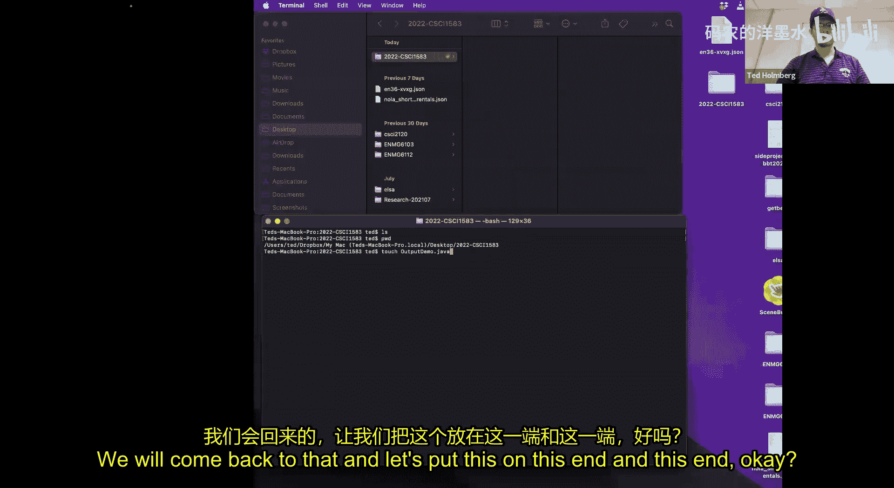
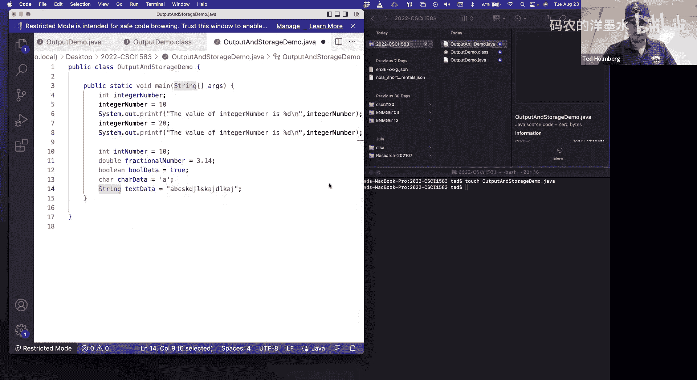

# 002：输出与存储


在本节课中，我们将学习算法设计的基础构建模块，特别是**输出操作**和**存储操作**。我们将了解如何将数据从程序中发送到外部世界，以及如何在程序内部保存数据以供后续使用。







---



## 输出操作

上一节我们介绍了数据建模的概念，本节中我们来看看如何将程序内部的数据呈现给外部世界。输出操作负责将数据从程序中发送出去，例如显示在终端上。

在Java中，我们通过 `System.out` 对象来访问输出流，它提供了几种打印数据的方法。

以下是三种主要的打印方法：

1.  **`print`**：将数据打印到控制台，但**不**自动换行。
    ```java
    System.out.print("Hello");
    System.out.print("World");
    // 输出：HelloWorld
    ```

2.  **`println`**：将数据打印到控制台，并**自动**在末尾添加换行符。
    ```java
    System.out.println("Hello");
    System.out.println("World");
    // 输出：
    // Hello
    // World
    ```

3.  **`printf`**：格式化打印，允许我们在字符串中嵌入占位符，并用变量值替换它们。
    ```java
    String name = "Alice";
    int age = 25;
    System.out.printf("Hello, %s. You are %d years old.%n", name, age);
    // 输出：Hello, Alice. You are %d years old.
    ```

在格式化字符串中，`%s` 表示字符串占位符，`%d` 表示整数占位符，`%f` 表示浮点数占位符。`%n` 是平台无关的换行符。

---

## 存储操作

仅仅输出数据还不够，我们通常需要在程序运行过程中保存和操作数据。存储操作就是用来在内存中保留数据，以便后续使用的。

在Java中，我们通过**变量**来实现存储操作。声明一个变量需要指定**数据类型**和**变量名**。

Java中的基本数据类型主要分为三类：

1.  **数值型**：用于存储数字。
    *   **整数**：`int` (例如：`int count = 10;`)
    *   **浮点数**：`double` (例如：`double price = 19.99;`)

2.  **文本型**：用于存储字符或文本。
    *   **单个字符**：`char` (例如：`char grade = 'A';`)
    *   **字符串**：`String` (例如：`String name = "Bob";`)

3.  **布尔型**：用于存储真/假值。
    *   `boolean` (例如：`boolean isLoggedIn = true;`)

声明和初始化变量有三种方式：

*   **声明**：仅保留内存空间，不赋值。
    ```java
    int number; // 声明一个整数变量
    ```
*   **赋值**：给已声明的变量赋予一个值。
    ```java
    number = 5; // 给变量赋值
    ```
*   **初始化**：在声明变量的同时进行赋值。
    ```java
    int number = 5; // 声明并初始化变量
    double score = 95.5;
    boolean flag = false;
    String message = "Hello, World!";
    ```

**注意**：`int`, `double`, `boolean`, `char` 是**基本数据类型**（关键字为小写）。`String` 是**引用数据类型**（首字母大写），因为它可以表示无限种可能的文本组合，而非预定义的几个值。

---



本节课中我们一起学习了算法设计的两个核心构建模块：**输出操作**和**存储操作**。我们学会了如何使用 `print`, `println`, `printf` 将数据输出到控制台，以及如何声明和初始化不同类型的变量来在程序中存储数据。理解这些基础概念是编写更复杂程序的第一步。