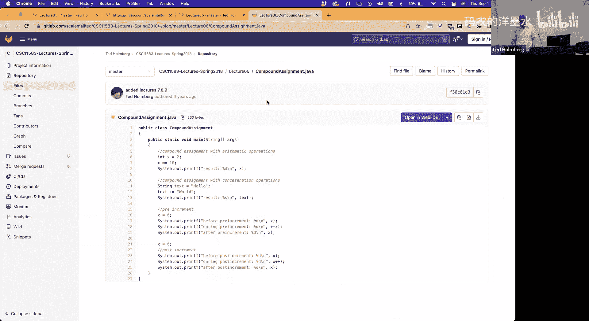
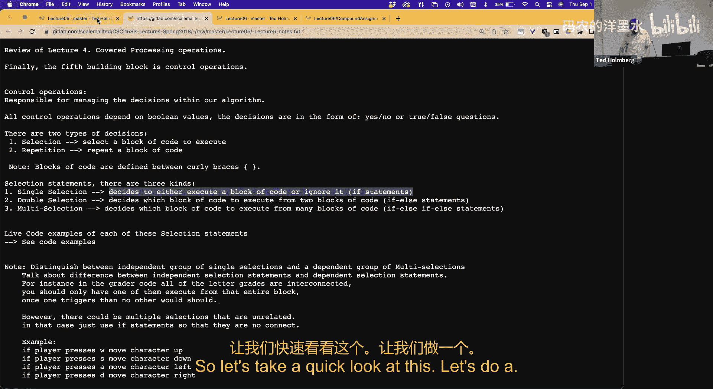
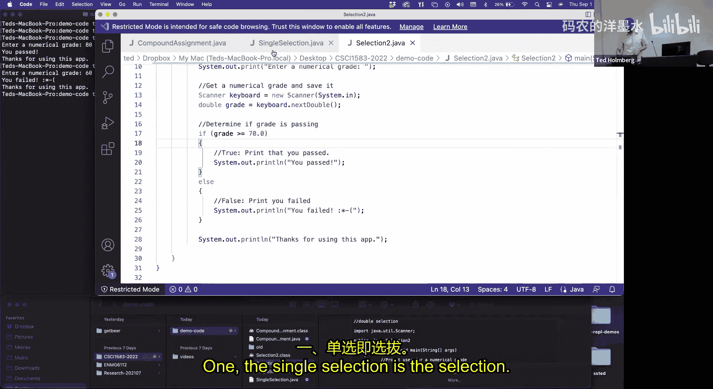
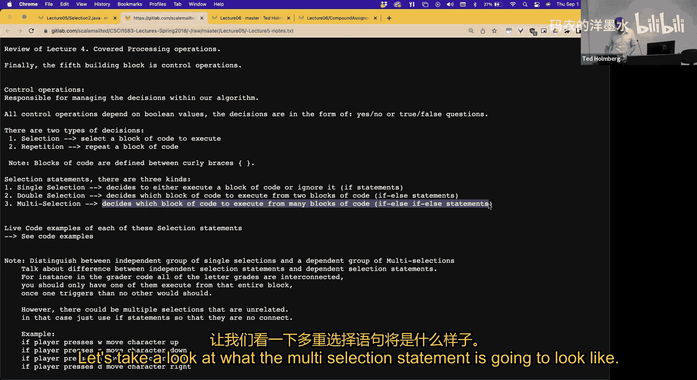
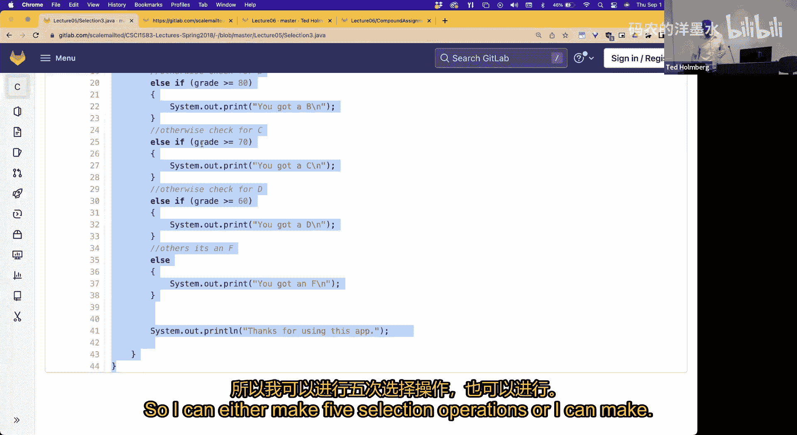
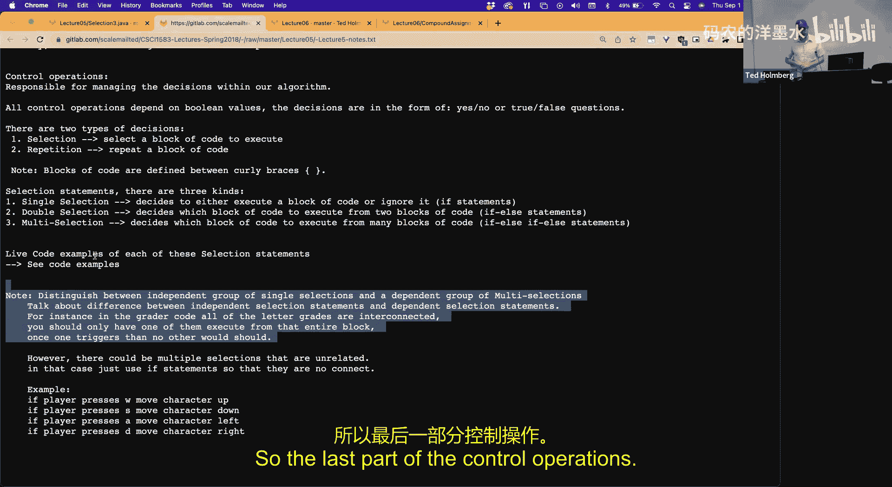

# 005：选择结构 🧭


在本节课中，我们将学习算法构建的第五个核心模块：控制操作。我们将重点探讨选择结构，它允许程序根据条件决定执行哪一部分代码。我们将学习三种选择结构：单选择、双选择和多选择，并理解如何利用布尔值来做出决策。

---

## 复合赋值操作

在深入探讨控制操作之前，我们先回顾并扩展一下处理操作。我们可以将处理操作（如算术运算）与赋值操作结合，形成复合赋值语句。

复合赋值语句允许我们在单行代码中，既读取一个变量的当前值，对其进行处理，又将新值写回同一个变量。这是一种强大的能力，因为它允许我们基于变量的当前状态来更新它。

以下是复合赋值的一个基本示例：
```java
int x = 2;
x = x * 10; // 读取x的值(2)，乘以10，然后将结果(20)存回x
System.out.println(x); // 输出 20
```

我们可以使用更简洁的复合赋值运算符来达到相同效果：
```java
int x = 2;
x *= 10; // 等同于 x = x * 10;
System.out.println(x); // 输出 20
```

对于字符串连接，同样适用：
```java
String text = "Hello";
text += " World"; // 等同于 text = text + " World";
System.out.println(text); // 输出 Hello World
```

### 自增与自减操作

对于最常见的“加1”或“减1”操作，Java提供了更简短的自增(`++`)和自减(`--`)运算符。

这里有一个关键区别：**前自增/自减**与**后自增/自减**。
*   **前自增 (`++x`)**：先对变量进行加1操作，然后使用新值。
*   **后自增 (`x++`)**：先使用变量的当前值，然后再对其进行加1操作。

当在同一语句中涉及其他操作时，这个顺序差异就很重要了。

```java
int x = 0;
// 前自增示例
System.out.println("前自增前: " + x); // 输出 0
System.out.println("执行 ++x: " + (++x)); // 输出 1 (先加1，后打印)
System.out.println("前自增后: " + x); // 输出 1

x = 0; // 重置x
// 后自增示例
System.out.println("后自增前: " + x); // 输出 0
System.out.println("执行 x++: " + (x++)); // 输出 0 (先打印，后加1)
System.out.println("后自增后: " + x); // 输出 1
```



---

## 控制操作：选择结构

现在，让我们进入本节课的核心——控制操作。选择结构是控制操作的第一种类型，它允许程序根据条件（布尔表达式）的真假，来决定执行哪一段代码块。



所有选择结构的决策都基于布尔值。这就是为什么在处理操作中，我们能够将各种数据类型转换为布尔格式如此重要。

---

### 单选择结构 (`if`)

单选择结构允许我们决定是执行一个代码块，还是完全跳过它。这就像在食谱中，如果选择做素食，就跳过加入肉类的步骤。

**结构：**
```java
if (条件) {
    // 如果条件为 true，则执行这里的代码
    // 可以包含多条语句
}
// 如果条件为 false，则跳过整个代码块，继续执行后面的语句
```

**示例：判断成绩是否及格**
我们创建一个程序，提示用户输入成绩。如果成绩大于等于70分，则输出“你通过了”。

```java
import java.util.Scanner; // 导入Scanner类用于获取输入

public class SingleSelection {
    public static void main(String[] args) {
        // 1. 提示用户输入
        System.out.print("请输入一个数字成绩: ");

        // 2. 获取用户输入并存储
        Scanner keyboard = new Scanner(System.in);
        double grade = keyboard.nextDouble();

        // 3. 单选择：判断是否及格
        if (grade >= 70) {
            // 只有条件为真时，才会执行这个代码块
            System.out.println("你通过了！");
            System.out.println("做得好！");
        }
        // 如果 grade < 70，则什么也不做，程序结束
    }
}
```

**重要提示：** 即使`if`后面只跟一条语句，也**强烈建议**始终使用花括号 `{}` 来定义代码块。这能避免未来添加语句时出现错误，并使代码结构更清晰。

---

### 双选择结构 (`if-else`)

双选择结构提供了两个互斥的代码块。程序会根据条件的真假，**必定执行**其中一个块。这就像在制作浓汤时，你必须在“鸡肉香肠浓汤”和“海鲜浓汤”两种食谱中选择一个。

**结构：**
```java
if (条件) {
    // 条件为 true 时执行
} else {
    // 条件为 false 时执行
}
// 执行完其中一个块后，继续执行后面的语句
```

**示例：判断通过或失败**
我们改进之前的程序，使其不仅能告知通过，还能在不及格时输出“你失败了”。

```java
import java.util.Scanner;

public class DoubleSelection {
    public static void main(String[] args) {
        System.out.print("请输入一个数字成绩: ");

        Scanner keyboard = new Scanner(System.in);
        double grade = keyboard.nextDouble();

        // 双选择：根据成绩输出不同结果
        if (grade >= 70) {
            System.out.println("你通过了！");
        } else {
            // 当 grade < 70 时执行
            System.out.println("你失败了。");
        }
    }
}
```

---

### 多选择结构 (`if-else if-else`)



多选择结构允许我们在多个（两个以上）代码块中选择一个执行。它通过将`else`和新的`if`语句嵌套在一起来实现。



**结构：**
```java
if (条件1) {
    // 条件1为 true 时执行
} else if (条件2) {
    // 条件1为 false 且 条件2为 true 时执行
} else if (条件3) {
    // 条件1、2为 false 且 条件3为 true 时执行
} else {
    // 所有上述条件都为 false 时执行
}
// 注意：整个结构最终只会执行其中一个代码块
```

**示例：根据成绩输出等级**
我们创建一个程序，根据输入的成绩输出对应的字母等级（A, B, C, D, F）。

```java
import java.util.Scanner;

public class MultiSelection {
    public static void main(String[] args) {
        System.out.print("请输入一个数字成绩: ");

        Scanner keyboard = new Scanner(System.in);
        double grade = keyboard.nextDouble();

        // 多选择：根据成绩范围输出等级
        if (grade >= 90) {
            System.out.println("你得到了 A");
        } else if (grade >= 80) { // 隐含了 grade < 90
            System.out.println("你得到了 B");
        } else if (grade >= 70) { // 隐含了 grade < 80
            System.out.println("你得到了 C");
        } else if (grade >= 50) { // 隐含了 grade < 70
            System.out.println("你得到了 D");
        } else { // grade < 50
            System.out.println("你得到了 F");
        }
    }
}
```

**关键区别：独立 `if` 语句 vs. 多选择 `if-else if` 链**
*   **多选择链 (`if-else if`)**：是一个整体决策结构。一旦某个条件为真，执行对应的块后就会**跳过**后面所有的`else if`和`else`块。它保证只执行一个分支。
*   **多个独立的 `if` 语句**：每个`if`都是独立的单选择，会依次进行判断。**多个条件可能同时为真**，从而导致多个代码块都被执行。这适用于需要同时检查多个独立条件的情况（例如，在游戏中同时检测是否按下了“上”键和“左”键）。

错误示例（多个独立`if`）：
```java
if (grade >= 90) {
    System.out.println("A");
}
if (grade >= 80) { // 注意这里没有 else
    System.out.println("B");
}
if (grade >= 70) { // 注意这里没有 else
    System.out.println("C");
}
// 输入95会输出: A, B, C
```

---

## 总结

在本节课中，我们一起学习了算法构建的第五块基石：控制操作中的**选择结构**。

我们首先回顾了**复合赋值操作**，它让我们能高效地更新变量状态。接着，我们深入探讨了三种选择结构：
1.  **单选择 (`if`)**：根据条件决定是否执行一个代码块。
2.  **双选择 (`if-else`)**：根据条件在**两个**互斥的代码块中选择一个执行。
3.  **多选择 (`if-else if-else`)**：在**多个**互斥的代码块中选择一个执行。



我们理解了所有决策都基于**布尔表达式**，并学会了如何利用关系运算符（如 `>=`, `<`）来构建这些表达式。同时，我们强调了使用花括号定义代码块的良好习惯，以及区分多选择链与多个独立`if`语句的重要性。



选择结构为我们的程序引入了“决策”能力，使其能够根据不同情况做出反应。在下一节课中，我们将学习控制操作的另一个关键部分：**重复结构（循环）**，它能让程序重复执行某些操作。