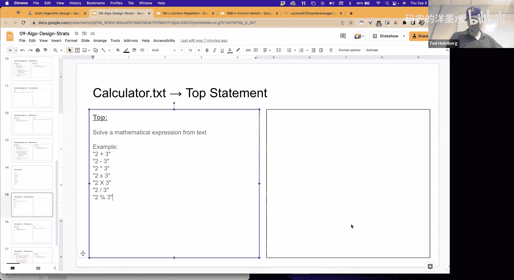

# 007：自顶向下逐步求精（第一部分）


在本节课中，我们将学习一种重要的算法设计策略——自顶向下逐步求精过程。我们将通过构建三个具体的应用程序来实践这一方法，从简单的概念开始，逐步细化，直到形成可以直接转换为Java代码的伪代码。

## 概述

到目前为止，我们已经学习了数据建模、算法的概念以及构建算法的五个基本构建块：输出操作、存储操作、输入操作、处理操作和控制操作。特别是控制操作，我们学习了选择语句和重复语句。本节课，我们将把这些知识整合起来，学习如何通过自顶向下逐步求精的过程，将一个抽象的想法发展成一个完整的、可实现的算法。

## 自顶向下逐步求精过程

自顶向下是一种设计方法，我们从非常抽象的概念开始，逐步增加细节，直到算法变得足够复杂和具体。这是一种让我们能够以非常直接的方式设计复杂算法的策略。

想象一下，在最高层，你只有一个关于应用程序的简单想法。这个过程就是教你如何迭代地完善这个想法，直到它足够完整，可以开始用Java实现。一个重要的启示是：在触碰键盘、在代码编辑器中输入任何内容之前，你应该始终预先规划好要编写的代码。你不应该在没有考虑算法如何操作、数据模型是什么以及如何遵循逐步指令的情况下就开始开发。

### 过程详解

我们通常将自顶向下逐步求精过程分解如下：从**顶层语句**开始，然后通过每次**细化**向下遍历。

*   **顶层语句**：我们首先定义一个语句，作为应用程序的一行摘要。它定义了软件的规格，并明确了我们的目标。这本质上是软件的“电梯演讲”。
*   **第一次细化**：这是一个迭代方法。我们查看之前创建的顶层语句，找出哪些部分是抽象的、定义不够清晰以至于无法直接翻译成Java语句。然后，我们添加更多细节来更好地定义如何完成这些任务。每次细化都定义了整个应用程序，但你在每次细化中所做的是逐步解释如何实现它。这就像一种“分而治之”的策略。
*   **后续细化**：我们不断向细化后的语句集中添加更多细节，直到这组语句足够明确，可以作为我们的伪代码。伪代码类似于Java或Python代码，但它不编译，是人类可读、可解释的一组语句，用于定义你的“食谱”。
*   **最终细化**：在最终细化阶段，即无法再添加更多细节的最后一步，我们伪代码算法的每一行现在都应该能映射到一个Java语句。一旦达到这个水平，你就可以将细化内容粘贴到源代码文档中，并以此为指导来实现你的应用程序。

从图形上看，这个过程就像一个金字塔。我们从顶部开始，信息很少，非常抽象。经过第一次细化，我们将其扩展了一些；经过第二次细化，扩展得更多；经过第三次细化，扩展得更多。最终，在过程的底部，我们拥有最扩展、最详细、最精细的算法，这将帮助我们直接将伪代码实现为Java。

## 应用实践：构建三个应用程序

现在，我们将使用自顶向下逐步求精方法来设计三个应用程序。

### 应用程序一：计数器控制循环的平均成绩计算器

这个应用程序将使用计数器控制循环来计算10个成绩的平均值。

#### 步骤1：定义顶层语句
首先，我们定义顶层语句：`确定学生10次测验的平均成绩`。这个语句简洁明了，传达了应用程序的功能。它指定了具体的测验数量（10次），这让我们知道这是一个适合使用计数器控制循环的目标。

#### 步骤2：第一次细化
接下来，我们进行第一次细化。我们需要思考完成“确定学生10次测验的平均成绩”这个目标至少需要哪些抽象步骤。
1.  初始化所需的数据。
2.  从用户那里获取成绩并求和。
3.  计算平均值并打印。

#### 步骤3：第二次细化
第一次细化后的语句仍然抽象，我们需要进一步细化。

*   **细化“初始化数据”**：
    1.  将 `sum` 初始化为 `0`。
    2.  将 `count` 初始化为 `0`。
    3.  声明一个 `average` 变量以备后用。
    4.  初始化一个 `Scanner` 对象用于输入。

*   **细化“获取成绩并求和”**：
    1.  当 `count` 小于 `10` 时重复执行。
        1.  提示用户输入一个成绩。
        2.  从用户那里获取并存储成绩。
        3.  将该成绩加到 `sum` 中。
        4.  将 `count` 加 `1`。

*   **细化“计算平均值并打印”**：
    1.  将 `average` 设置为 `sum` 除以 `count`。
    2.  打印 `average` 的值。

现在，我们有了完整的伪代码，每一行都可以直接映射到Java语句。

#### 步骤4：实现与测试
根据伪代码，我们可以在Java中实现这个算法。我们将顶层语句作为多行注释放在文件顶部，并将细化后的伪代码作为行内注释来指导实现。实现后，我们进行测试以确保其按预期工作。

**核心代码结构示例：**
```java
// 初始化数据
double sum = 0;
int count = 0;
Scanner keyboard = new Scanner(System.in);
double average;

// 获取10个成绩并求和
while (count < 10) {
    System.out.printf("Enter grade %d: ", count + 1);
    double grade = keyboard.nextDouble();
    sum = sum + grade;
    count = count + 1;
}

// 计算并打印平均值
average = sum / count;
System.out.printf("Average is: %.2f%n", average);
```

### 应用程序二：哨兵控制循环的平均成绩计算器

这个应用程序将使用哨兵控制循环来计算任意数量成绩的平均值。顶层语句变为：`确定学生任意次数测验的平均成绩`。

#### 关键区别与细化
主要区别在于第二次细化中的循环控制部分。

*   **选择哨兵值**：我们选择 `-1` 作为哨兵值，因为成绩不应该为负数（最低为0）。
*   **调整循环逻辑**：
    1.  提示用户输入一个成绩（或输入-1退出）。
    2.  从用户那里获取并存储成绩。
    3.  当成绩 `>= 0` 时重复执行：
        1.  将该成绩加到 `sum` 中。
        2.  将 `count` 加 `1`。
        3.  提示用户输入下一个成绩（或输入-1退出）。
        4.  从用户那里获取并存储成绩（更新循环控制变量）。

**核心代码结构调整示例：**
```java
// ... 数据初始化与之前相同 ...

// 获取第一个成绩
System.out.print("Enter a grade (or -1 to quit): ");
double grade = keyboard.nextDouble();

// 当成绩非负时，持续获取并处理
while (grade >= 0) {
    sum = sum + grade;
    count = count + 1;
    System.out.print("Enter a grade (or -1 to quit): ");
    grade = keyboard.nextDouble(); // 更新循环控制变量
}

// ... 计算并打印平均值 ...
```
这个版本更加灵活，可以处理任意数量的成绩输入。

### 应用程序三：文本表达式计算器（课后练习）

我们将构建一个计算器，用于解析和计算文本格式的算术表达式（例如 `"2 + 2"`, `"5 * 3"`）。顶层语句是：`求解来自文本的算术表达式`。

#### 任务说明
表达式格式为：一个数值（左操作数），一个空格，一个运算符符号，一个空格，另一个数值（右操作数）。运算符可能包括 `+`, `-`, `*`, `/`, `%`，并且可能考虑使用不同符号表示同一操作（例如 `"add"` 表示加法）。

#### 挑战
请尝试运用自顶向下逐步求精方法，为这个计算器应用程序设计你自己的伪代码。思考如何从文本中解析出操作数和运算符，如何根据运算符执行正确的计算，以及如何处理可能的错误输入。

## 总结

本节课我们一起学习了**自顶向下逐步求精**这一强大的算法设计策略。我们了解到，软件开发不应从盲目编码开始，而应从清晰的规划入手。通过从抽象的**顶层语句**出发，经过多次**细化**迭代，逐步增加细节，我们最终能得到一份清晰的**伪代码**，从而轻松地将其转化为可工作的Java程序。



我们通过构建**计数器控制循环**和**哨兵控制循环**的两个平均成绩计算器，实践了这一过程。最后，我们留下了文本表达式计算器作为练习，鼓励大家亲自尝试应用这个方法。记住，这个过程是可扩展的，能够帮助你设计出成千上万行代码的复杂软件。在开始编码之前进行规划，是成为一名优秀开发者的关键习惯。