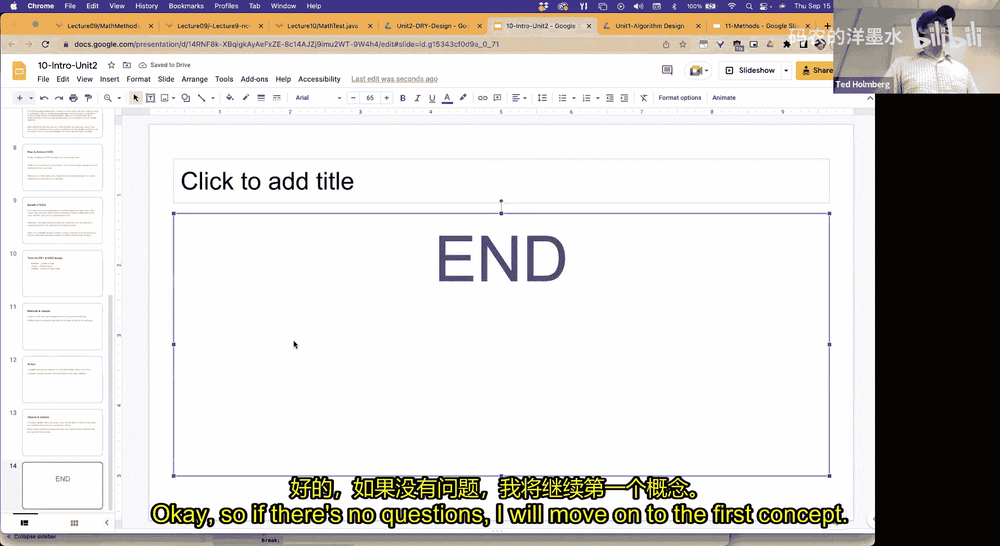

# 010：DRY与KISS原则入门

在本节课中，我们将正式从算法设计单元过渡到软件设计单元。我们将学习两个核心的软件设计原则：DRY原则和KISS原则。这些原则将帮助我们编写更简洁、更易维护的代码，并为后续学习**方法**、**数组**和**类**等新工具打下基础。

## 什么是DRY设计？

上一节我们介绍了算法设计的基本构建模块。本节中，我们来看看DRY设计原则。

DRY是“Don't Repeat Yourself”的缩写。在编程中，这意味着我们不应该重复编写相同的代码。如果相同的代码块出现在两个或更多地方，我们就应该将其提取到一个独立的**方法**中。同样，如果有一组相关的值，我们应该将它们放入**数组**或**类实例**中，以便将它们组织在一起。

DRY原则的核心表述是：**系统中的每一段知识（数据或逻辑）都必须有单一、明确的表示**。这意味着它应该只存在于一个地方，而不是像杂草一样散布在整个应用程序中。

## 为什么要在乎DRY代码？

遵循DRY原则能让你的代码更易于编写和阅读。违反DRY原则通常会导致代码库急剧膨胀，例如达到上千行代码。大量重复的代码会使阅读和理解变得困难，因为你必须费力地记住“这段代码是给僵尸1用的吗？还是给僵尸2或关卡3用的？”。这会增加大量的心智负担。

DRY代码还能让你的代码更易于维护。当逻辑需要修改时，你只需要在一个地方进行更改，这个更改会自动传播到所有使用该逻辑的地方。反之，如果逻辑被重复编写，你就必须找到每一个重复的实例并逐一修改，这很容易引入错误和漏洞，工作量也大得多。

## 如何实现DRY？

为了避免违反DRY原则，我们采用“分而治之”的策略，将系统划分为更小的部分。

以下是实现DRY的关键步骤：
1.  将代码和逻辑划分为更小的、可复用的单元。可以将其想象为模块化，就像搭建乐高积木一样。
2.  避免编写冗长的方法，而是将逻辑分解，并在方法内部使用这些现有的代码单元。
3.  在需要的地方通过“调用”来使用这些代码单元。

我们已经讨论了DRY的好处：**代码更少**（少即是多）、**节省时间和精力**、**易于维护**以及**减少出现bug的可能性**。

## 什么是KISS原则？

除了DRY，我们还需要遵循另一个重要原则：KISS。

KISS代表“Keep It Simple, Stupid”（保持简单）。KISS原则要求我们保持代码简单明了，使其易于理解。毕竟，编程语言是给人看的，而不是给计算机看的。计算机只是无意识的二进制计算机器。我们花费精力格式化代码、选择好的变量名、将逻辑分解到多个方法中，都是为了我们人类自身的利益——为了创建一个易于回溯、重构、分享和理解的代码库。

## 如何实现KISS？

KISS原则在代码库中的一个常见体现是：**每个方法应该只解决一个小问题，而不是处理许多用例**。如果一个方法中有很多条件判断，就应该将它们分解成更小的方法。我们将在后续关于方法的课程中看到，这种“逐步求精”的过程将帮助我们进行所谓的“功能分解”。

以下是实现KISS的关键步骤：
1.  尝试编写简单的代码。为你的问题构思多种解决方案，然后选择**最好、最简单**的一个来实现。
2.  当你发现代码冗长时，将其分解为多个方法。
3.  编写只完成单一任务的小代码块。一个经验法则是：当你查看一个方法时，问问自己“这个方法做得太多了吗？还是它只做一件事？”

KISS原则的好处我们已经讨论过：它能让一个开发者编写的功能，易于被其他所有人（包括未来的你自己）理解。最终目标是，将你的代码库视为一个**不断演进、充满活力的文档集合**。我们想要创建一个框架，能够轻松添加新功能，而不会破坏旧有的工作。

## 单元2的核心工具

为了实现DRY和KISS，我们将在单元2中重点学习三个核心工具：

1.  **方法**：用于封装代码块。
2.  **数组**：一种特殊的数据结构，可以容纳多个值，用于封装数据块。
3.  **类**：允许我们将代码块和数据块封装在一起。

这些基础构件将帮助我们编写出符合DRY原则的代码，从而构建更健壮、更易扩展、易于添加、阅读和分享的软件。

## 总结

本节课中，我们一起学习了软件设计的两个基本原则：**DRY**（不要重复自己）和**KISS**（保持简单）。我们了解了为什么这些原则对于编写高质量代码至关重要，并探讨了实现它们的基本方法。最后，我们预览了在单元2中将用来实践这些原则的三个核心工具：**方法**、**数组**和**类**。掌握这些原则和工具，将使我们能够构建更清晰、更易维护的软件。