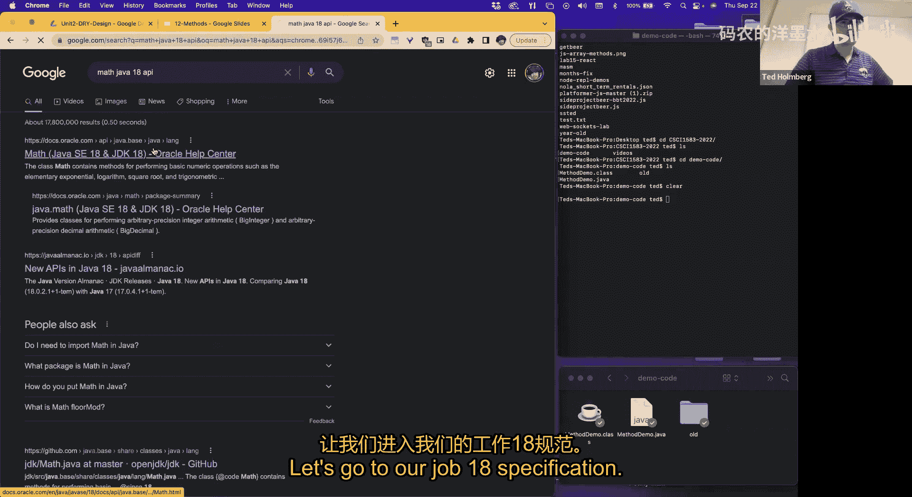
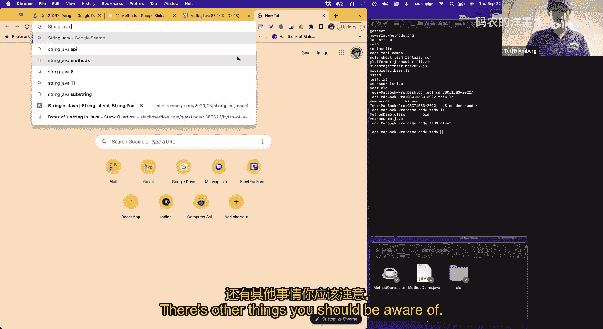
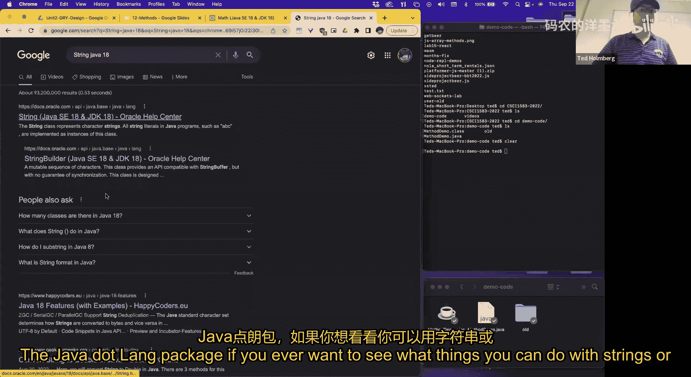
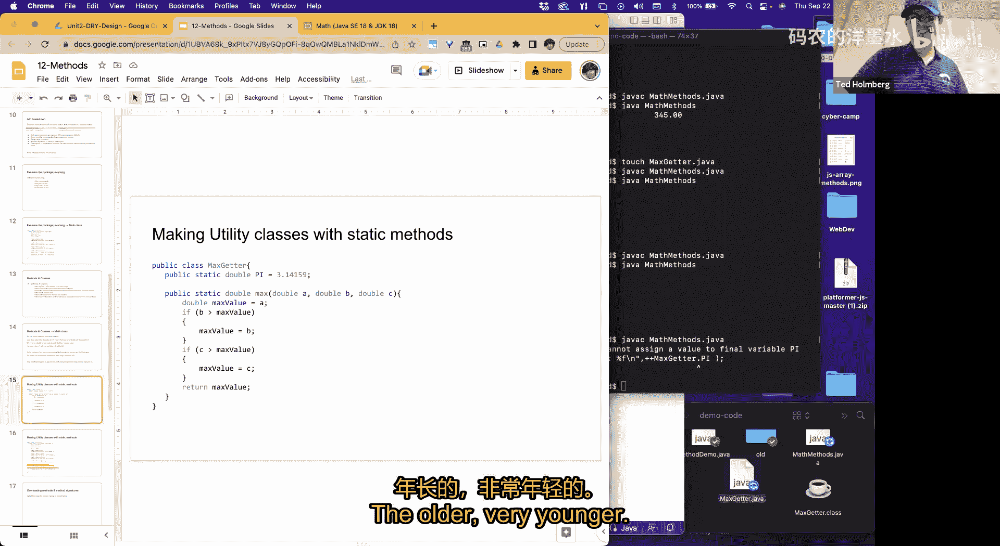

# 013：应用程序接口与数学类 📚


在本节课中，我们将继续探讨方法、类和包。我们将重点学习如何阅读和使用API文档，理解Java标准库中的`Math`类，并动手创建我们自己的工具类和方法。

---

## 概述

上一节我们介绍了方法的基本结构，包括方法头和方法体。本节中，我们来看看如何利用他人编写的方法，特别是通过Java的应用程序接口文档。我们将深入研究`java.lang`包中的`Math`类，学习如何使用其提供的数学方法，并最终创建我们自己的工具类来封装自定义功能。


---



## 解析API文档 📖

API文档为我们提供了关于他人编写的方法的宝贵信息。要使用这些方法，理解如何解析文档至关重要。

方法头向JVM提供了该方法的所有重要信息，包括：
*   **访问级别**：例如`public`（所有代码可访问）、`private`（仅本类可访问）或`static`（可通过类名直接访问）。
*   **返回类型**：可以是`void`（不返回值的过程方法）或任何数据类型（如`int`、`double`、`String`，这类方法称为函数方法，必须包含`return`语句）。
*   **方法名**：方法名本身不必唯一。
*   **参数列表**：定义在括号内，由数据类型和变量名组成，用于接收调用者提供的输入值。

方法的唯一标识是其**签名**，即方法名和参数列表的组合。

在API文档中，方法通常按以下格式列出：
`修饰符 返回类型 方法名(参数类型 参数名)`
例如，对于`Math`类中的绝对值方法：
`public static double abs(double a)`
这表示一个公开的、静态的方法，接收一个`double`类型参数`a`，并返回一个`double`值。

---

## Java标准库与Math类 🔢





Java代码的组织结构是：语句存在于方法中，方法存在于类中，类存在于包中。`java.lang`包是核心包，会被自动导入到所有Java应用程序中。

算术运算符（+， -， *， /）的功能有限。`Math`类将一系列相关的数学方法（如计算绝对值、三角函数、平方根、幂运算）分组在一起，为我们提供了更复杂的数学运算能力。

以下是`Math`类中一些关键概念的描述：

*   **方法重载**：`Math`类中有多个名为`abs`的方法，它们接收不同类型的参数（`int`, `long`, `float`, `double`）。Java虚拟机根据传入参数的数据类型自动选择正确的方法版本。这简化了我们的工作，我们只需记住一个方法名。
    ```java
    Math.abs(-10);    // 调用 abs(int a)
    Math.abs(-3.14);  // 调用 abs(double a)
    ```
*   **常量字段**：`Math`类还提供了两个有用的常量：
    ```java
    Math.PI  // 圆周率 π
    Math.E   // 自然对数的底数 e
    ```
    它们被声明为`public static final`，意味着是公开的、静态的、不可更改的常量。
*   **其他实用方法**：
    *   `Math.ceil(double a)`：返回大于等于参数的最小整数（向上取整）。
    *   `Math.floor(double a)`：返回小于等于参数的最大整数（向下取整）。
    *   `Math.round(double a)`：返回最接近参数的整数（四舍五入）。
    *   `Math.max(double a, double b)`：返回两个值中的较大者。
    *   `Math.min(double a, double b)`：返回两个值中的较小者。
    *   `Math.sqrt(double a)`：返回参数的平方根。
    *   `Math.pow(double a, double b)`：返回a的b次幂。
    *   `Math.random()`：返回一个[0.0, 1.0)范围内的随机小数。

---

## 使用Math类：代码示例 💻

让我们通过一个示例程序来演示如何使用`Math`类中的方法。

```java
public class MathMethodsDemo {
    public static void main(String[] args) {
        double x = 100.6;
        double y = 3;
        double z = -345;

        // 1. 计算绝对值
        double absResult = Math.abs(z);
        System.out.printf("z的绝对值是：%.2f%n", absResult);

        // 2. 计算平方根
        double sqrtResult = Math.sqrt(9);
        System.out.printf("9的平方根是：%.2f%n", sqrtResult);

        // 3. 计算幂运算
        double powResult = Math.pow(2, 3);
        System.out.printf("2的3次方是：%.2f%n", powResult);

        // 4. 找出最大值
        double maxResult = Math.max(x, y);
        System.out.printf("x和y中的最大值是：%.2f%n", maxResult);

        // 5. 使用常量PI
        System.out.printf("π的值是：%.5f%n", Math.PI);
    }
}
```
运行此程序将输出：
```
z的绝对值是：345.00
9的平方根是：3.00
2的3次方是：8.00
x和y中的最大值是：100.60
π的值是：3.14159
```

---

## 创建自定义工具类 🛠️

理解了如何使用现有类之后，我们现在可以创建自己的工具类。工具类通常只包含静态方法，用于被其他类调用，其本身没有`main`方法。

我们将创建一个`MaxGetter`类，它包含一个能找出三个数中最大值的方法。

```java
public class MaxGetter {
    // 一个“伪”常量（未用final修饰，演示问题）
    public static double PI = 3.14159;

    // 一个找出三个double数中最大值的方法
    public static double maxOfThree(double a, double b, double c) {
        double max = a; // 假设第一个数是最大的
        if (b > max) {
            max = b; // 如果b更大，则更新max
        }
        if (c > max) {
            max = c; // 如果c更大，则再次更新max
        }
        return max; // 返回最终的最大值
    }
}
```
现在，我们可以在主程序中使用这个自定义类：

```java
public class MathMethodsDemo {
    public static void main(String[] args) {
        double x = 100.6, y = 3, z = -345;

        // 使用自定义的MaxGetter类
        double myMax = MaxGetter.maxOfThree(x, y, z);
        System.out.printf("使用MaxGetter，x, y, z中的最大值是：%.2f%n", myMax);

        // 访问自定义类的“常量”（目前不安全）
        System.out.printf("MaxGetter中的PI是：%.5f%n", MaxGetter.PI);
        // 危险操作：修改了“常量”的值
        MaxGetter.PI++;
        System.out.printf("修改后MaxGetter中的PI是：%.5f%n", MaxGetter.PI);
    }
}
```
输出将会是：
```
使用MaxGetter，x, y, z中的最大值是：100.60
MaxGetter中的PI是：3.14159
修改后MaxGetter中的PI是：4.14159
```
可以看到，我们成功创建并使用了自定义方法。但问题在于，我们定义的`PI`可以被其他类修改，这非常危险。为了将其变为真正的常量，需要添加`final`关键字：

```java
public class MaxGetter {
    // 正确的常量定义
    public static final double PI = 3.14159;
    // ... 其他方法
}
```
添加`final`后，尝试`MaxGetter.PI++`会导致编译错误：“无法为最终变量PI分配值”。这保护了常量的值不被意外更改。

使用有意义的常量名（如`PI`）而非直接使用数字（如`3.14159`），可以避免代码中出现难以理解的“魔数”，使代码更易于阅读和维护。

---

## 总结

本节课中我们一起学习了：
1.  **API文档的阅读**：理解了方法签名、访问修饰符、返回类型和参数在文档中的表示方式。
2.  **Java Math类的使用**：探索了`Math`类提供的各种静态数学方法，并理解了方法重载带来的便利。
3.  **创建自定义工具类**：动手创建了`MaxGetter`类，实现了多参数求最大值的方法，并学习了如何正确定义和使用`public static final`常量。
4.  **代码组织的重要性**：通过将相关方法分组到类中，可以使代码库更模块化、更易于理解、调试和维护。



通过将功能封装在类和方法中，Java成为一种可扩展的语言，允许开发者不断添加新功能，并促进代码的共享与协作。