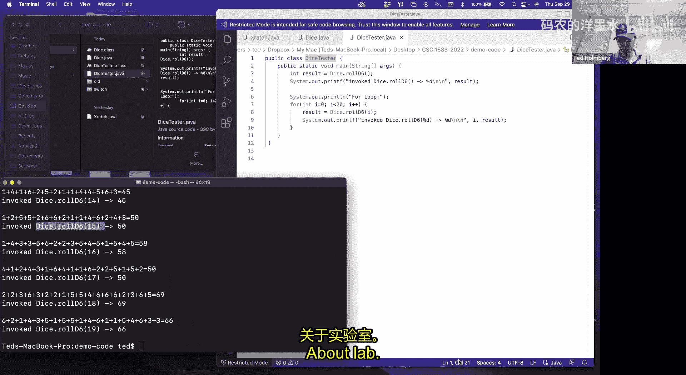

# 014：工具类与静态方法 🎲

在本节课中，我们将继续深入探讨方法。上一节我们介绍了方法的基本概念、与变量的区别、类与方法的交互方式，以及方法如何被包含在类中，类又如何被包含在包中。本节中，我们将聚焦于如何设计我们自己的工具类。

工具类通常只包含静态方法。我们将首先了解什么是工具类和静态方法，然后学习如何设计、实现和测试一个工具类，最后探讨如何改进它。

## 什么是工具类？🤔

工具类，也称为辅助类，是一种仅包含方法的类。它是无状态的，并且不能被实例化。它包含一系列相关的方法，以便在应用程序中重复使用。

工具类通常不是应用程序类，因此通常不包含 `main` 方法。它的设计目的是供其他类使用。工具类的价值在于它体现了Java作为一种可扩展编程语言的特点：我们可以不断向其添加代码，这样其他开发者就不必重复解决我已经解决的问题，或者我可以在多个应用程序中复用解决方案。

一个我们已经见过的工具类例子是 `Math` 类。`Math` 类只包含静态方法，这意味着它是无状态的。我们可以根据类名 `Math` 调用它，传入我们想要处理的数据，然后它返回一个结果。无论我们的应用程序是什么，我们都可以编写10个不同的应用程序，并在每个应用程序中依赖 `Math` 类来执行一些数学计算。

## 静态方法与静态字段 📊

字段是变量的另一个名称，通常在类作用域内。方法则是在类中定义的可执行代码块。

静态方法可以从类作用域直接调用，无需实例化类。静态方法应该是无状态的，这意味着它们具有单一的行为。

静态字段是在类作用域内定义的变量，对于整个类来说只有一个状态。字段或变量的状态就是它的值。当您有一个静态字段时，如果它是可变的（非只读），您可以改变它的值。在 `Math` 类中，`PI` 或 `E` 是只读的，但我们可以从 `Math` 类中调用这些值的状态。在作业中，您将创建可变的类字段来表示敌人位置或玩家位置，并且可以随时间改变它们。没有 `final` 关键字的字段是可变的、可写的，您可以改变它们的值。但当您改变它的值时，它是该单一值的变化，对整个类都有效，而无需实例化。

我们稍后会更多地讨论实例化，但在这里我们想区分静态方法和非静态方法。将来我们会学习实例方法，这是我们对非静态方法的另一种定义。如果我们省略 `static` 关键字，默认情况下它就是实例方法。

实例方法是**有状态**的。这意味着同一个方法可以根据调用它的实例产生不同的结果或处理方式。我们见过的一个实例方法是 `String` 类的 `.equals` 方法，其中字符串的状态会影响该方法的结果。例如，我有一个状态为 “foo” 的字符串，我可以对其调用 `.equals` 方法，并传入另一个字符串实例。如果我用 “foo” 调用 `.equals(“bar”)`，它会返回 `false`。但如果我的字符串状态是 “bar”，并且我调用 `.equals(“bar”)`，那么传入方法的参数值相同，但我得到了不同的结果。这是一个有状态的结果，它根据我的字符串状态（是 “foo” 还是 “bar”）而变化。这代表了一个非静态方法的实例。

而静态方法如果从类调用，它总是产生相同的结果。我们稍后在讨论构造函数和实例化时会更多地学习非静态方法。但现在，我们将把范围限定在类中定义的静态方法上，它们对所有事物都具有单一的无状态行为。

## 设计我们自己的工具类 🛠️

假设我们想要构建一个骰子工具类。这个骰子工具类应该包含所有相关方法或字段的概念。在我们的骰子工具类中，它将是一个包含许多骰子相关方法的类。例如，如果我们构建纸牌游戏、棋盘游戏或任何其他可能需要使用骰子的游戏，我们希望开发者可以导入我们的骰子工具类并使用它来掷骰子。掷骰子的想法本质上是无状态的：我们告诉类中的方法做某事，它返回给我们一个结果。这是设计工具类的一个完美例子。

在我们的实现目标中，我们将逐步完成以下步骤：
1.  创建一个 `Dice.java` 文件，代表工具类。
2.  为了验证它是否有效，我们将创建一个 `DiceTester.java` 文件。

我们将逐步讨论为了正确模拟掷骰子必须考虑的所有因素。我们将学习如何用随机性模拟骰子、均匀分布，并解释缩放和移位的工作原理。然后在测试器中，我们将更多地讨论什么是计算机模拟，并模拟多次掷骰子以获得准确的模拟结果。

## 数据建模过程 📐

在我们尝试在Java环境中构建任何东西之前，应该始终从数据建模过程开始。在实现骰子之前，让我们先谈谈一个六面骰子（我将其简称为D6）的物理对象是什么。它有六个面，每个面上都有一定数量的点（pip）：一个面有一个点，一个面有两个点，一个面有三个点，一个面有四个点，一个面有五个点，一个面有六个点。它被设计成立方体形状，大概有锋利的边缘。

骰子的目的是什么？我们通常将其用作现实世界对象来生成随机数。从六面骰子可以得到的随机数范围是1到6。

## 模拟随机性 🎲

现在让我们谈谈如何模拟随机性。我们讨论了在现实世界中使用D6作为随机数生成器。每当我们开始讨论随机性时，重要的是要知道，在计算机科学、数学和科学领域，我们称之为随机或概率过程，另一个词是非确定性的。确定性过程是指我做某事时得到相同的结果，例如我按照食谱制作蛋糕，我可以无限次地执行该过程，每次都能产生非常相似或基本相同的蛋糕。但有些发生的事情您想要模拟，它们是非确定性的、概率性的，这是其行为本身固有的。掷骰子就是这样的事情。如果我创建一个掷骰子的模型，比如“3在范围内，我就放 `rollD6` 返回 `3`”，您可能会得到3，但这并不能完全捕捉骰子的实际行为。掷骰子现象的一个有趣之处在于它是随机的、非确定性的。没有确定的方法可以说当我掷这个骰子时会产生这个结果。没有一组 `if-else` 选择语句可以完全生成我想要的。因此，如果我想模拟它，我想用那种随机性来模拟。一旦我意识到我正在尝试模拟一个随机性问题，我就必须开始思考如何模拟那种随机性。

一个随机骰子的例子是掷六面骰子D6。这是一个随机事件，因为每次掷骰子时都存在固有的随机性，结果可能不同。事实上，我们希望每次都不一样。我们可以连续多次掷出相同的值，但它也必须有可能掷出其他值。

为了正确模拟随机属性，我们必须识别所有可能的结果以及每个结果发生的可能性。对于D6，您可以掷出1、2、3、4、5或6。接下来我们要问的是，存在哪些不同类型的随机性？在我们研究完这个之后，我们会讨论。

在单个D6上掷出任何特定值的可能性是多少？是六分之一。当我掷骰子时，掷出1、2、3、4、5或6的可能性是相等的，没有偏好。我们称之为**均匀分布**，因为从我可以随机获得的值的集合中，获得任何一个单一值的可能性都是相同的。

如果我将其绘制出来，x轴代表我的骰子面值（1, 2, 3, 4, 5, 6），y轴代表发生次数（可能性）。每个面值的发生次数都是1，除以所有可能结果的总和（6），每个值的可能性都是六分之一。结果的可能性等于该结果的数量除以所有可能结果的总和。

如果我们想正确模拟我们的D6，我们必须确保它遵循这种行为。您对随机数或某事发生的可能性有多熟悉？均匀分布只是众多分布中的一种，我们将来会看另一种您可能非常熟悉的分布。如果我们正确实现了骰子，当我们测试它时，我们应该测试以确保它表现出您期望的真实行为。在现实世界中测试时，您会去掷骰子，如果骰子没有加重，您不应该得到特定的偏好。

## 在Java中设计掷D6 🧮

那么我们如何在Java中设计掷D6呢？这是我们要做的核心原则。首先，我们应该查看一些我们可以访问的API。事实上，如果我们查看 `Math` 类，`Math` 类有一个 `random` 方法。从API中我们可以看到它是一个静态方法，因为 `Math` 是一个工具类。我们正在设计自己的工具类，我们的工具类实际上可以依赖其他工具类的方法。

这里我们有一个静态方法，它返回一个 `double` 数据类型。它是无参数的随机方法，因为这是方法签名（方法名和所需的输入）。描述是：返回一个带正号的 `double` 值，大于等于0.0且小于1.0。因此，`Math.random()` 有效地产生一个随机小数，范围包括0，但不包括1。我使用数学术语来表达两个值之间的范围：我们包括最小值，不包括最大值。并且在该范围内，没有任何值比其他值更有偏好，因此 `random` 方法表现出均匀分布，这正是我们在D6中寻找的。这似乎是一个理想的场景，但它只产生小数。

实际上，让我们看看它是什么样子。我们已经在第一次作业中见过这个。我将启动一个名为 `jshell` 的应用程序，它允许我在终端中运行Java代码。输入 `Math.random()`，我得到0.71...，注意它有大约15或16位精度。再次执行，得到0.4203...，我可以一次又一次地执行，它会给我不同的值。即使范围在0到1之间，该随机值的位数也非常多，因为它包含了所有精度点。

问题是我们如何思考使用这个范围在0到1之间的随机生成器来实际表示我们的骰子？我们如何建模？是否可以使用 `Math.random()` 来模拟掷D6的行为？

我们可以应用一个**缩放因子**。在数学中，我们可以做两件事来影响值的范围。值的范围是从某个最小值开始到某个最大值的连续值集合。缩放范围最常见的方法是乘以一个乘数。

假设我们从0到1开始。为了说明这对任何数字都有效，我将说明如果我们缩放随机值的范围会发生什么。乘以2、3、4、5和6，这样您可以看到会发生什么。如果我将小数点的每一位都乘以10，我从0.0、0.1、0.2...直到0.9。由于我们没有1，我将把我可以访问的末尾部分视为0.9。实际上，它会是0.999999...，直到我得到15或16位小数，但我们只看小数点后的前两位。

假设我想缩放范围，这样我就不只有0作为前导数字，我可以表示两个输出选项。想象一下，就我们想要的结果数量而言，小数点左边的部分将是实际整数，小数点前的整数部分。让我们看看，将整个范围乘以2。如果我们的数字是0.0，乘以2就是0.0；如果是0.1，乘以2就是0.2；0.2变成0.4；0.3变成0.6；0.4变成0.8；在0.5标记处变成1.0；然后0.6变成1.2；0.7变成1.4；0.8变成1.6；0.9变成1.8；0.99变成1.98。

现在，如果我取这些执行乘法后的小数，并将其强制转换为整数（即截断小数部分），您会注意到前导数字（我们将映射为结果数量的部分）的值将是0或1。这意味着，如果我将随机生成的数字缩放2倍，我可以映射两个可能的结果：一个结果映射为0，另一个结果映射为1。其可能性是均匀分布，所以得到0或1的结果是50%对50%。

让我们看看乘以3会发生什么。如果我的值大约到0.3，乘以3会产生一组前导值仍为0的值。如果我到达这个小数块并乘以3，它会给我一个前导值大约为1；然后突然，如果我到达这个块，它会给我一个前导值大约为2。如果我截断，只保留前导数字（整数值），它将给我机会得到0、1或2，即三种可能的结果。

您应该在这里看到，如果我们继续，在范围4上，前导值是0、1、2、3；在范围5上，是0、1、2、3、4；最后在范围6上，将是0、1、2、3、4、5。缩放因子的大小代表了我可以映射的可能结果的数量，如果我将结果随机数表示为从0开始一直到缩放值减1的整数。如果数字是2，我得到0、1；如果是3，得到0、1、2；如果是4，得到0、1、2、3；如果是5，得到0、1、2、3、4，因为仍然是五个数字，五个可能的结果，但我们从0开始计数。

这对大家来说清楚吗？回想一下僵尸游戏，我们想要四种可能的结果：向上、向下、向左、向右移动。我们确实映射了那个随机数，您可能还记得，我们将其乘以缩放因子4以产生四种结果之一，然后我们截断了小数部分，因为有16位数字。如果我们检查相等性，我们可能永远不会得到相同的随机数两次，或者发生的几率非常非常小。当我们知道结果数量时，我们截断小数部分，但我们会得到均匀分布，因为0.0到0.1之间、0.1到0.2之间等的数值数量是相等的。

这代表了我们可以如何获得六种不同的结果。对于D6，我们想要应用的缩放因子值是多少？是6。现在的问题是，当我们掷D6时，从范围6得到的值将是0、1、2、3、4或5。但当我们掷D6时，它将是1、2、3、4、5或6。

因此，处理随机数时的第二种方法是我们可以将整个值范围向左或向右**移位**。我们使用加法进行移位。如果我们想将值范围向右移动，我们会加上一个数。如果我的范围在0和1之间，并且我给该范围内的所有内容加1，那么我的新最小值将变为1，新最大值将变为2。如果我想将所有值范围向左移动，那么我的新最小值将变为-1，新最大值将变为0。

对于模拟D6的情况，如果我真的想表示1到6的掷骰结果，我只需要取从0到5的新缩放范围，然后给结果加1。如果随机得到的是0，它就变成1；如果是1，变成2；如果是2，变成3；如果是3，变成4；如果是4，变成5；如果是5，变成6。通过将所有结果向右移动一位，我仍然只有六种可能的结果，但现在所有这些结果都向右移动了一位。这清楚吗？但关键是我们必须先应用缩放因子来重新设定范围，从0到1重新设定到0到结果数量，然后截断小数部分，因为我们想将结果映射为从0开始到我们拥有的数字的整数计数。然后，如果我们需要实际值在数值上有意义（例如在僵尸游戏中，值并不重要，我们只是用它来表示向上、向下、向左、向右，我们表示特定结果发生的唯一ID），但对于模拟掷D6，我们实际上使用产生的值作为模型的一部分，所以我们将移位它，使其实际表示1到6之间的掷骰结果。

每个人都理解我们将用来表示掷D6随机过程的概念了吗？

## 数学表达式与实现 🧑‍💻

那么，模拟D6随机性的数学表达式将如下所示：我们将有一个0到1之间（不包括1）的随机数，缩放它，应用缩放因子，然后应用移位。

让我们使用自顶向下逐步求精的方法来实际开始构建这个类。我的顶层陈述是：我们将构建一个骰子库，一个包含掷骰子方法的工具类。就我们的目的而言，我们不会一次性尝试构建所有方法，我们从单一方法开始，并扩展我们的应用程序。我们想确保单一方法在测试后有效，然后可以向其添加另一个方法。对于我们的骰子工具类，让我们专注于掷单个D6。

我们将使用与求精过程一致的功能分解，掷单个D6的效果应该是：生成一个0到1之间的随机小数，乘以可能结果的数量，将该小数转换为整数以丢弃小数点，最后加1以将值范围从0到5移位到1到6。

好的，让我们实际开始构建。实际上，这已经完全构建好了。

这就是它的样子。我将有我的类 `public class Dice`。在里面创建一个静态方法，因为这些应该是无状态的方法，它们将返回一些数据，这里不需要任何输入。我们将产生0到1之间的随机数，乘以结果数量（六面骰子有六种可能结果），然后将其强制转换为整数以丢弃小数部分，之后我们将移位，加1，使我们的范围变为1到6。得到结果后，我们将其存储到一个 `die` 变量中，以便为其命名，然后返回它。

这段源代码有什么问题吗？让我们在这里创建，完美。只需创建一个代表我们正在设计的工具类的 `Dice` 类。保存。

## 测试工具类：模拟应用 🧪

即使我们不是从这个类构建应用程序，即使这是一个本身不设计为运行的工具类，我们仍然必须测试它，以确保我们的期望、数据模型以及我们在应用程序中综合模拟骰子行为的方式是一致的，即它模仿了实际掷骰子的行为。构建完工具类方法后，我不能直接执行和测试它，因为工具类很少有 `main` 方法，因为它们不是设计为应用程序的。所以我们要做的是创建一个模拟应用程序，一个D6模拟应用程序，这将是一个类，它将使用我们的工具类来掷D6一百万次。

模拟是软件世界中非常常见的应用程序。在这个例子中，模拟应用程序多次掷D6，记录每次掷骰以检查其概率是否与真实D6相似。模拟应该综合重现真实观察的行为。我们可能都看过很多关于最近袭击佛罗里达海岸的飓风的模拟，那是基于大量数值数据构建的综合模型，代表了海洋的所有有意义的测量，试图预测风暴将如何跨越时间和空间移动。但你看到的模型（预测）并不是真实的，它基于对现实世界现象的观察。如果它是一个好模型，那么模拟的合成路径将告诉我们实际现实世界中真实风暴会发生什么信息。并非所有模型都是正确的，事实上，很少有模型是完全完整的，但它们只需要足够好，以让您了解周围发生的现象。

因此，每当谈论模拟时，我们在计算机科学中所做的一个重要事情就是构建模拟，无论我们是否意识到。模拟是我们一直在做的事情，有时是想象的，有时是真实的。

如果我们想检查真实D6的数学概率是否为六分之一，您会怎么做？让我们谈谈您将如何实际测试它。如果您有一个D6，我说，通过行为证明这是六分之一，而不是通过数学。您会拿起骰子，掷出它，然后记录值是什么。您可能有六个不同的计数器，分别对应掷出1、2、3、4、5或6的情况。您可能会掷很多次，因为您试图观察概率行为。如果您只掷一次，那没有足够的信息。如果您掷一次，可能得到3，然后您说“是的，它给了我3”，没有其他。然后您再掷一次，可能得到另一个3，再掷一次，得到2。因此，为了观察可能性（因为它是随机的），您必须观察许多不同试验中的随机过程，然后它说明了一种行为，一种分布行为。我们寻找的是均匀分布行为。

假设我要求您掷D6六百万次，您应该掷出1多少次？大约一百万次，对吗？掷出2也应该大约一百万次，掷出3也应该大约出现一百万次，不完全是，因为它是随机的，但如果试验规模足够大且真正均匀，您应该得到每个面值大约一百万次。如果我在现实世界中要求您这样做，掷骰子六百万次可能需要多长时间？相当长一段时间。在计算机内模拟行为的一个优势是我们可以更快、更便宜地完成。如果这个骰子确实表现出我们期望的属性，那么进行计算机模拟可以让我们预测未来，进行这些实验更便宜，并且我们可以进行比实际中更大的试验运行。这就是为什么计算机模拟如此有用，即使在传统科学如化学、生物学和物理学中也是如此，因为运行模拟以缩小到最优结果更便宜，然后您取最优结果并实际投入生产。例如，如果是化合物，您可以在数字上缩小实际化合物应该是什么，然后尝试制造它。这只是说明计算机科学已经以非常积极的方式影响了每个专业的每个领域，它使开发更便宜、更快捷。

那么，我们的模拟应用程序将设置初始数据模型以计算每个骰子结果的出现次数，然后重复多次掷骰子并递增适当的计数器，最后打印每个骰子面的出现次数。这将是我用于模拟应用程序的自顶向下逐步求精。

## 实现模拟测试器 🖥️

有了这些，我们为什么不开始实现呢？我将把我的注释代码放入一个 `DiceTester` 类中，放入 `main` 方法中，这将是一个相当简单的类。在这里，我将设置我的初始数据：创建六个不同的计数器（`counterOne` 到 `counterSix`），用于计算每个结果发生的频率。我将这些值初始化为0。

然后，第二件事是创建一个 `for` 循环。我将重复这个过程很多次，这里很多次大约是六百万次，这似乎是一个足够大的样本量，我应该能看到每个计数器大约递增一百万次。从0到6,000,000（我可以用下划线作为数字内的分隔符），在循环内，我将从 `Dice` 类中调用 `rollD6` 方法。注意，为了测试这个，我实际上要访问 `Dice` 类本身的 `rollD6` 方法。保存结果，然后使用 `switch` 语句。我的 `switch` 语句将根据这个 `dieRoll` 的值来操作：如果是1的情况，递增 `counterOne`；如果是2，递增 `counterTwo`；依此类推，直到6。最后，我将打印出每个计数器的状态，打印骰子面值以及在那六百万次掷骰中实际出现的次数。

关于这个测试的定义或这段代码是否足够简单，有什么问题吗？好的，让我们执行这个。粘贴到这里，看看我们得到什么结果。编译并运行代码。

注意，运行六百万次掷骰模拟甚至不需要一秒钟，我的结果大约是每个面值一百万次。这告诉我，我确实有一个均匀分布，这意味着这实际上模拟了掷真实D6的情况。我可以在游戏中使用我的应用程序，而不是实际拥有物理骰子来掷，我应该得到与预期相同类型的结果。每次我运行这个，我应该得到一组不同的结果，有时略多于一百万，有时略少于一百万，但大致上大约是。

## 改进我们的工具类 🔧

现在，改进它的一种方法是讨论模拟多个D6，例如掷2个D6。目前我们的骰子工具类可能想添加另一个方法，因为假设我们想掷多个D6骰子。按照我们当前的实现方式，我们必须多次调用该方法。或者，假设我们想要获得不同的随机分布。现在当我们掷单个骰子时，我们得到均匀分布，但如果我们想要获得正态或高斯分布，我们的值实际出现的可能性不同呢？所以，我们将设计一个新方法，重载 `D6` 方法，该方法接受一个整数参数，表示我们想要掷的D6骰子的数量。

我们将有两个方法：无参数的 `D6` 和有单个参数的 `D6`，但它们将有两种不同的行为。

正态或高斯分布是什么？我相信每个人都听说过，我相信每个人都听说过钟形曲线。钟形曲线通常谈论的是正态或高斯分布。回想一下，在单个D6掷骰中，我的分布对于所有单个值是相等的，我掷出1、2、3、4、5或6的可能性相同。但有许多随机过程不具有均匀分布，它们具有高斯分布，您更有可能得到中间的值，而不太可能得到异常值或最小最大值。

如果我掷2个D6，那就是我们不再具有均匀分布的一个例证。因为如果我取两个值并将它们相加，例如，当我有2个D6时，可能的值的范围是多少？是2到12。最小值是2，最大值是12。让我们看看我在这里发布的图表。有多少种不同的方式可以掷出2？只有一种：两个骰子都掷出1。有多少种不同的方式可以掷出3？两种：掷出1和2，或2和1。掷出4有多少种方式？三种：1和3，2和2，3和1。掷出5有多少种方式？四种。掷出6有多少种方式？五种。掷出7有多少种方式？六种：1和6，2和5，3和4，4和3，5和2，6和1。然后8有五种方式，9有四种，10有三种，11有两种，12有一种（两个6）。所以，这里的想法是，当我掷两个六面骰子时，我最有可能得到的值是什么？是7，因为在所有可能的结果中，总共有多少种结果？如果我加上掷出2、3、4、5、6...的所有不同可能方式，我有36种不同的结果。在36种可能的结果中，我有可能得到7的方式有多少种？是6种。所以六分之三十六，大约是六分之一的机会。我得到7的可能性比任何其他值都大。然后您可以看到，我可以趋向于那个中点。我有三十六分之五的机会得到6或8，但我只有三十六分之一的机会得到2或12。所以我更有可能从中心得到一个值，这些是偏好，而不是在最小值和最大值上。有很多时候我们观察到随机过程，这就是我们想要的随机行为。

这很重要，这就是我介绍这个的原因。掷单个D6与掷2个D6背后的想法非常实用，您可能做过很多次，但是否考虑过这两种不同随机方法之间的可能性、分布、概率差异？这两种不同的随机分布，在模拟随机过程时，查看这些是很重要的。每个结果发生的可能性是什么，并确保您使用与现实一致或相似的行为。

如果我将此渲染成图表，请注意我的分布看起来非常不同，我更有可能得到这个峰值，而在这里我得到这些末端的可能性要小得多。所以，如果我有更大的样本量，这将开始呈现为看起来像钟形曲线的东西。我们只有少量的值，所以它看起来更像一个三角形。

## 设计重载的D6方法 📝

那么，让我们谈谈如何在我们的工具类中设计重载的D6方法。我们再次称之为 `rollD6`，这是重载方法的全部意义：我们使用相同的名称，这样就不强迫开发者记住更多东西。但现在，它不是没有输入（没有括号），而是接受一个整数输入，表示我们想要掷的D6骰子的数量。然后作为输出，我们将讨论返回骰子总和。

我们的初始数据是调用代码（客户端代码）给我们的数量，但对我们来说，我们将有一个代表0的骰子总和。为了测试这个，我们还将进行组合文本测试，我们不仅返回总和，还通过记录单个掷骰结果来确保总和正确。我们将有一个空的组合文本字符串。

我们的算法是：重复数量次以下操作：掷一个D6（调用我们实现的另一个方法来掷单个D6），将结果加到总和中，然后将该掷骰的特定值连接到我们的字符串组合文本中，这样我们可以确保它发生了X次，因为再次强调，随机过程您必须能够评估以确保它表现出您期望的行为。最后，我们还将总和连接到我们的组合文本，打印该组合文本，然后返回总和。这将是我们从自顶向下逐步求精过程开发的伪代码。

让我们将其付诸实践。这是我的新类示例，`rollD6` 方法同名，但接受一个参数，所以签名不同。我将创建那个组合文本字符串（空字符串）。我将有一个参数（给我的数量）。然后我将创建一个初始化为0的骰子总和。然后我将执行一个 `for` 循环，循环次数等于我们需要掷的骰子数量。在循环内部，我将调用 `rollD6` 方法（注意我在这里调用这个方法，所以在一个方法内部我可以调用另一个）。得到那个骰子值，将其加到我的总和中，然后也将其连接到我的组合字符串中。然后我将做一些有趣的事情：检查当前迭代器 `i` 的值是否不等于 `quantity - 1`（即，这不是最后一次迭代）。如果不是最后一次迭代，我将在组合文本中的数字之间添加一个加号；如果是最后一次，我将添加一个等号，以说明这是赋值给另一个东西。然后之后，我将连接我的总和，打印出来以便测试，然后我将实际返回骰子总和。

让我们去更新我们的 `Dice` 类。添加那个新方法，那个重载的方法。现在我们已经改进了我们的工具类，因为现在我们可以掷任意数量的骰子。

让我们创建一个新的测试类来实际测试这个。为此，我将说明我们仍然可以调用 `Dice.rollD6()` 来掷单个骰子，然后我将创建一个从0到20的 `for` 循环，并传入该数字，我们可以看到我们掷出的骰子有多大。我将转到我的 `DiceTester` 并更新那里的代码。

保存。如果这样做，注意我们在这里得到的是：我们的单个骰子掷出（这里是2），然后对于一个传入0的 `for` 循环，掷0个骰子没有意义，注意我们返回的结果是0，`for` 循环从未执行，我们初始化的骰子总和是0，所以实际上没有工作。这违反了掷X个骰子的条件，但说明这是一个边缘情况很重要，我们想测试我们的边缘情况，使其给出预期结果。如果我们告诉计算机掷0个D6骰子，这可能是预期结果。但如果我们掷1个D6，我们可以看到只得到2；如果我们掷2个D6，可以看到得到6+2=8，所以我们返回的结果是8，在我们的应用程序中，组合文本是“3+5=8”。这里是4个D6：6+5+6+1=18；5个D6：6+6+6+6+6=30；等等。这向我展示的是，我可以有7个D6、8个D6，一直到19个D6的组合，我得到了66。但这里我想强调的是我们拥有的灵活性：通过创建一个可以传入数量的重载方法，而不是仅仅创建一个掷2个D6或3个D6的方法，我们现在可以掷任意数量的D6，然后获得适当的结果，就像我们掷了一把骰子一样。

关于这个有什么问题吗？这实际上是我们将遵循的实现自己的工具类的过程。如果我想通过添加更多骰子类型或不同组合来进一步扩展，我可以这样做，并将它们全部添加到同一个工具类中。在这个例子中，我们一次处理一个方法，根据需要添加一个新方法，但我们可以将其扩展为拥有该类需要支持的尽可能多的方法。

没错，每个数字代表一个骰子掷骰的实际结果。如果我在这里做 `Dice.rollD6(15)`，那是要求我的工具类掷15个D6，将它们全部相加，然后给我最终结果。猜猜任何两个或更多骰子的分布概率是什么？它实际上是正态分布。所以，唯一具有均匀分布的情况是当您只有一个骰子时。一旦您添加一个额外的骰子，整个分布概率就从均匀平坦变为高斯分布。随着您添加更多骰子，行为实际变化的方式是它变得更陡峭，所以您越来越趋向中心，而到达边缘的可能性越来越小。

如果这有道理，例如，如果我掷3个D6，得到3或得到18的机会比掷2个D6时要小得多，而我得到中间值的机会要高得多。所以，如果您想要高斯行为、正态行为，真正趋向中心并且很少达到标准偏差之外的最小最大值，那么您需要将多个组成部分加在一起。

还有其他问题吗？那么，这就是我们今天的讲座，这为我接下来将录制并让大家观看的讲座做好了很好的准备，在那里我们将围绕我们的骰子工具应用程序设计一个游戏：双骰子游戏。我将再次使用功能分解，从自顶向下逐步求精一直到实现，录制并发布在YouTube上。

---

**本节课总结**：在本节课中，我们一起学习了工具类和静态方法的概念。我们探讨了如何设计、实现和测试一个骰子工具类，包括模拟随机性、均匀分布、缩放和移位。我们还讨论了如何通过方法重载来改进工具类，以支持掷多个骰子，并了解了不同数量骰子产生的概率分布变化（从均匀分布到正态分布）。最后，我们通过构建模拟测试器来验证工具类的行为是否符合预期。