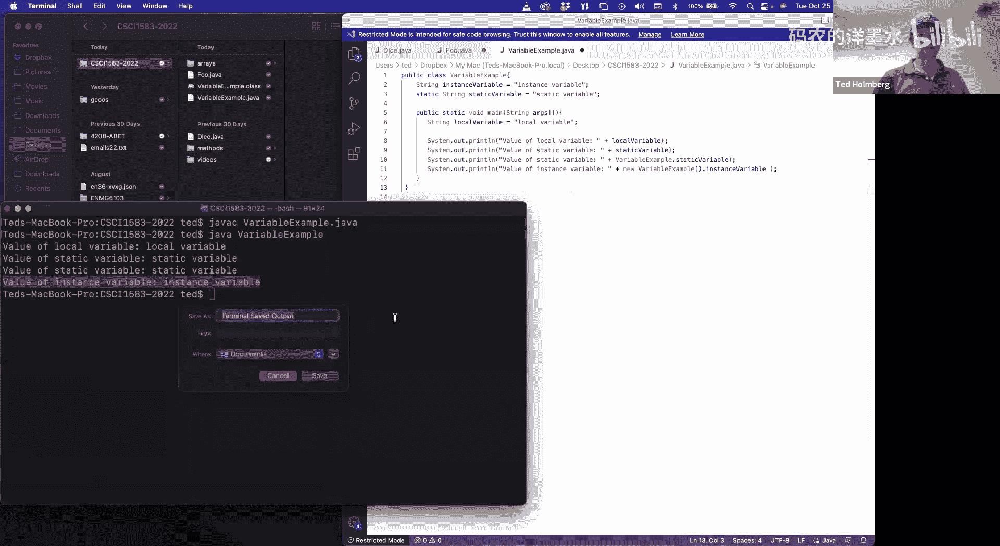
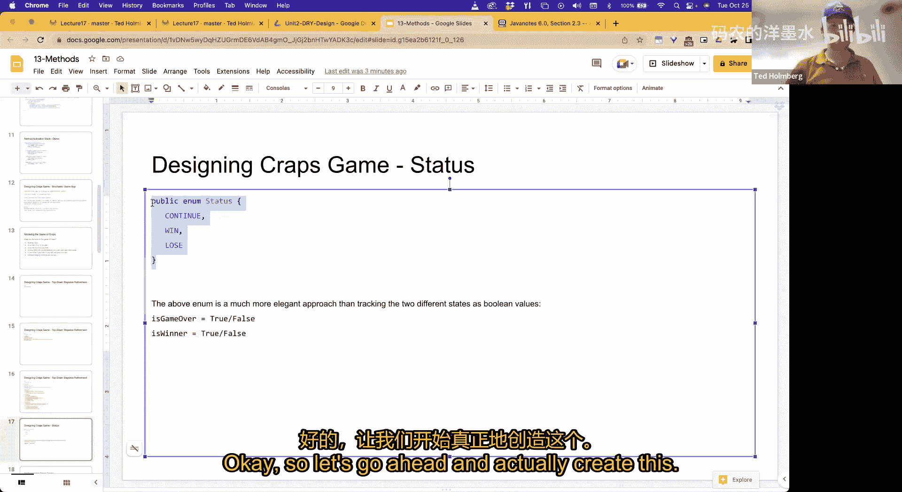
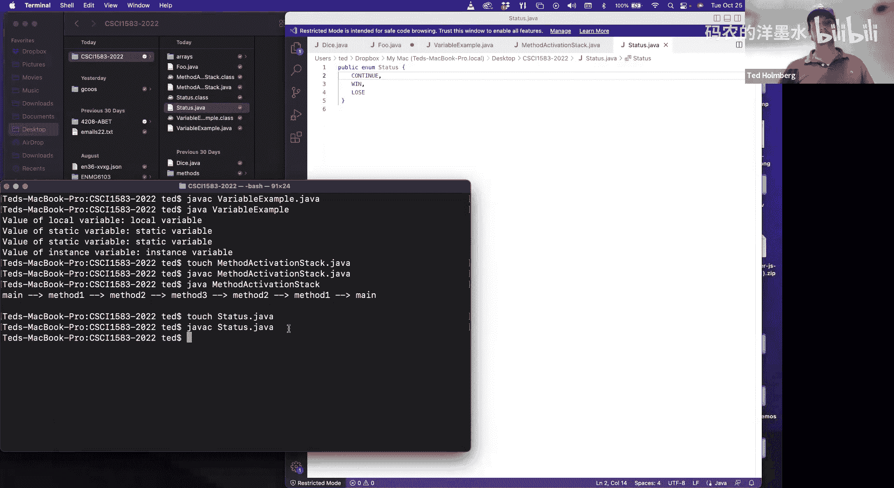
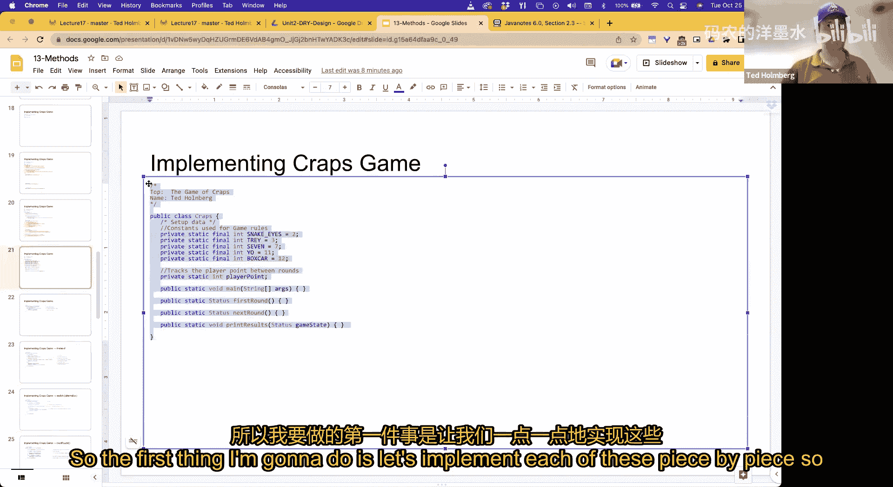
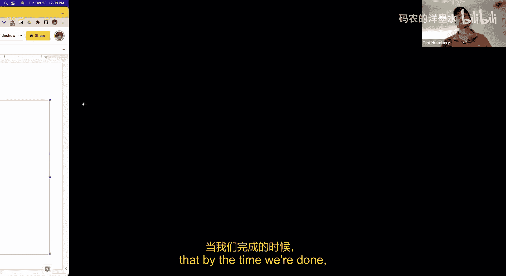
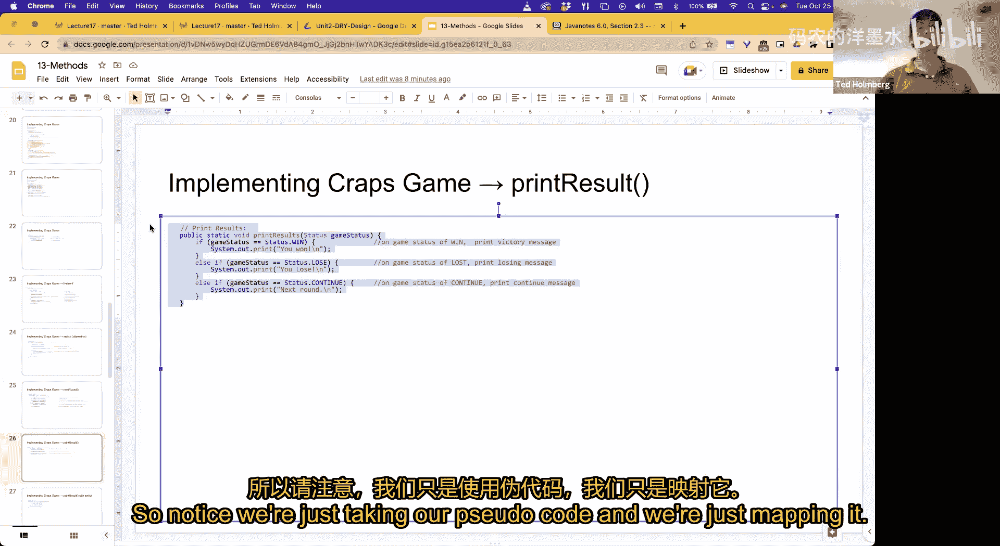
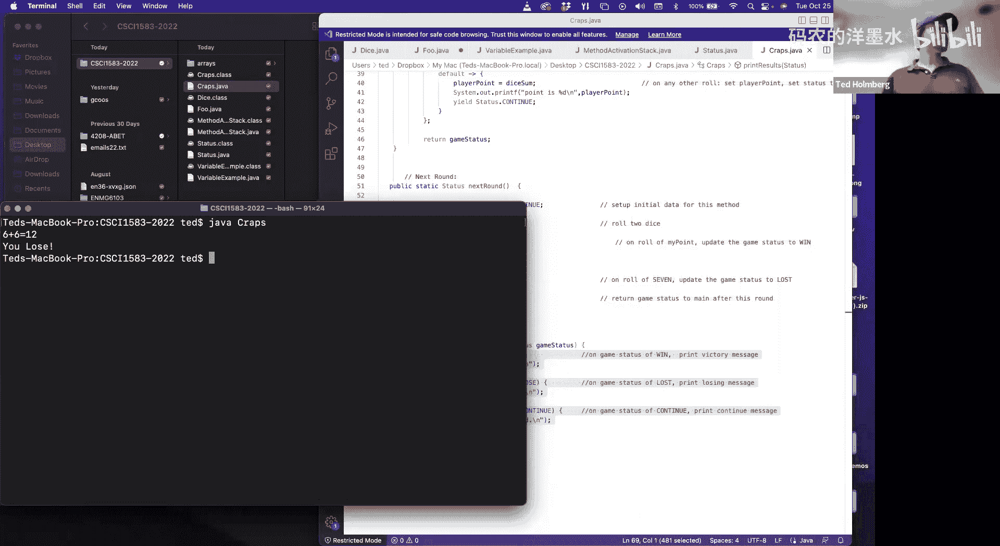

# 015：随机双骰子游戏 🎲

在本节课中，我们将要学习如何运用**自顶向下、逐步求精**的方法，结合**方法分解**，来构建我们之前在楼下实验室讨论过的“双骰子”游戏。本节课的目的是巩固数组之前的知识点，并回顾一些与**方法**相关的核心概念。

我们将进一步探讨**魔数**与**命名常量**的区别，区分**局部变量**、**类变量**和**实例变量**。实例变量是今天学习的重点，它将为我们下一讲开始讨论**对象**和创建自定义对象打下基础。我们还会学习**枚举类型**，这是一种我们可以自定义的数据类型，其特性与基本数据类型类似。枚举类型与`switch`语句结合使用时非常强大。此外，我们将讨论**方法调用栈**，理解方法调用的执行顺序。最后，我们将实际构建我们的“双骰子”游戏。

## 魔数与命名常量

在编程中，我们应始终追求代码的可读性。**魔数**是指直接硬编码在源代码逻辑中的数字。例如，在计算、选择或循环结构中直接使用数字。作为软件工程师，我们应该避免使用魔数。

真正的工程师和数学家都喜欢魔数，但在我看来，他们都不擅长为事物命名。因此，从编写**自解释代码**的一开始，我们就应努力让代码尽可能易读。



即使一个值永远不会改变，与其直接硬编码，不如为这个值赋予一个**人类可读的名称**，一个能提供上下文的名字，然后应用`final`关键字使其不可变。这样不仅防止了意外修改，也使代码更易理解。

例如，在计算圆面积的代码中：
```java
// 使用魔数
double area = 3.14159 * 3.15 * 3.15;
```
这里的`3.14159`、`3.15`都是魔数。读者需要自己推断`3.14159`可能是圆周率π，而`3.15`可能是半径。这增加了理解成本。

相比之下，使用命名常量的代码虽然更长，但可读性大大增强：
```java
// 使用命名常量
final double PI = 3.14159;
final double RADIUS = 3.15;
double area = PI * RADIUS * RADIUS;
```
这段代码清晰地表达了“圆的面积等于π乘以半径的平方”。有时，可读性是以代码的冗长为代价的，但这通常是值得的。

**命名常量**就是一个被命名的变量，但通过`final`关键字使其变为只读，因此我们称其为常量。

## 变量的类型：局部、类与实例

在Java中，变量主要分为三类：局部变量、类变量和实例变量。

**局部变量**是我们最早接触的变量类型。它定义在方法内部的代码块中。局部变量的作用域仅限于定义它的那对最内层花括号`{}`内。在方法中，如果你在`if`语句或`while`循环的代码块内定义了一个局部变量，那么它只存在于那个代码块中。尝试在作用域外访问局部变量会导致“符号未找到”的错误。在Java中，所有变量都必须先声明后使用。

**类变量**是我们学习的第二种变量类型。它们定义在类的范围内，与方法并列。类变量需要使用`static`关键字修饰。这使得我们可以通过类名来访问这个变量（或称为字段）。例如，`ClassName.VARIABLE_NAME`。

**实例变量**是第三种类型。它同样定义在类的范围内，但**不使用**`static`关键字。正因如此，它不是类本身的属性，而是类**实例**的属性。这意味着我们创建的每个类实例都可以拥有自己独立的实例变量值。我们将在下一讲深入讨论实例变量。

以下是一个示例代码，展示了三种变量的区别：
```java
public class VariableExample {
    // 实例变量
    String instanceVariable = “instance variable”;
    // 类变量 (静态变量)
    static String classVariable = “class variable”;

    public static void main(String[] args) {
        // 局部变量
        String localVariable = “local variable”;
        System.out.println(localVariable);
        System.out.println(classVariable); // 直接访问
        System.out.println(VariableExample.classVariable); // 通过类名访问

        // 创建类的实例以访问实例变量
        VariableExample example = new VariableExample();
        System.out.println(example.instanceVariable);
    }
}
```
运行此代码，输出将依次为：`local variable`， `class variable`， `class variable`， `instance variable`。实例变量只有在使用`new`关键字创建类的实例后才会存在。

## 枚举类型

`enum`（枚举）是一个强大的关键字，用于创建自定义数据类型。它与`class`和`interface`一样，是Java源代码文件的顶级声明关键字。

枚举允许我们创建一个**可枚举的集合**，即一个具有明确定义、可计数值的集合。这与基本数据类型（如`int`， `boolean`， `char`）类似，它们都有固定的取值范围。例如，布尔值只有`true`和`false`。

通过枚举，我们可以创建自己的、类似于基本数据类型的自定义类型，其中包含一组预定义的常量（字面值）。按照命名规范，枚举中的常量名应全部使用大写字母，以表明它们是只读的。

枚举在以下场景中非常有用：
*   指南针方向：`NORTH`， `SOUTH`， `EAST`， `WEST`
*   星期：`MONDAY`， `TUESDAY`， ...
*   月份：`JANUARY`， `FEBRUARY`， ...

创建一个枚举类型：
```java
// 文件：Day.java
public enum Day {
    MONDAY, TUESDAY, WEDNESDAY, THURSDAY, FRIDAY, SATURDAY, SUNDAY
}
```
使用枚举类型：
```java
public class Main {
    public static void main(String[] args) {
        Day today = Day.FRIDAY; // 声明并赋值
        System.out.println(today); // 输出：FRIDAY
    }
}
```
枚举类型与`switch`语句是天作之合。以下示例展示了如何根据月份判断季节：
```java
public class EnumSwitch {
    // 在类内部定义枚举
    public enum Month { JANUARY, FEBRUARY, MARCH, APRIL, MAY, JUNE,
                        JULY, AUGUST, SEPTEMBER, OCTOBER, NOVEMBER, DECEMBER }

    public static void main(String[] args) {
        Month date = Month.JANUARY; // 这里可以替换为用户输入

        // 使用switch语句判断季节
        String season = switch(date) {
            case DECEMBER, JANUARY, FEBRUARY -> “Winter”;
            case MARCH, APRIL, MAY -> “Spring”;
            case JUNE, JULY, AUGUST -> “Summer”;
            case SEPTEMBER, OCTOBER, NOVEMBER -> “Fall”;
        };
        System.out.println(“The season is: “ + season);
    }
}
```
`switch`语句会检查`date`变量的值，并与各个`case`进行匹配。使用箭头`->`操作符可以避免忘记写`break`语句。当`case`对应的执行代码超过一行时，可以使用花括号`{}`将其括起来。

## 方法调用栈

理解方法如何执行，需要了解**方法调用栈**的概念。栈是一种“后进先出”的数据结构，就像一摞盘子，你总是把新的盘子放在最上面，取盘子时也从最上面开始拿。

Java虚拟机使用栈来管理方法的调用。当我们启动一个Java程序时，JVM会寻找`main`方法并将其压入调用栈，然后开始逐行执行其中的语句。

当执行到一个方法调用语句时（例如`methodA()`），JVM会暂停当前方法的执行，将新的方法（`methodA`）压入栈顶，并将执行指针跳转到这个新方法的开头。如果`methodA`内部又调用了`methodB`，那么`methodB`又会被压入栈顶。

当栈顶的方法执行完毕（遇到`return`或执行完所有语句），它会被弹出栈，执行指针会回到之前被暂停的方法（即新的栈顶方法），并从之前暂停的位置继续执行。这个过程一直持续到`main`方法也执行完毕并弹出栈，程序结束。



以下代码演示了方法调用栈的顺序：
```java
public class MethodActivationStack {
    public static void main(String[] args) {
        String message = “Main”;
        String output = method1(message);
        output += “ -> Main”;
        System.out.println(output);
    }

    static String method1(String input) {
        input += “ -> Method1”;
        String output = method2(input);
        output += “ -> Method1”;
        return output;
    }

    static String method2(String input) {
        input += “ -> Method2”;
        String output = method3(input);
        output += “ -> Method2”;
        return output;
    }

    static String method3(String input) {
        String output = input + “ -> Method3”;
        return output;
    }
}
```
运行此程序，输出为：`Main -> Method1 -> Method2 -> Method3 -> Method2 -> Method1 -> Main`。这清晰地展示了方法调用“深入”再“返回”的栈式过程。



## 构建双骰子游戏 🎲

现在，我们将运用以上所有概念来设计并实现“双骰子”游戏。我们将使用命名常量替代魔数，使用枚举类型跟踪游戏状态，采用自顶向下逐步求精的方法设计算法，并通过方法分解来构建应用程序。

### 游戏规则回顾
*   游戏开始时，玩家掷两个骰子。
*   **第一轮**：
    *   若点数和为**7**或**11**，玩家**获胜**。
    *   若点数和为**2**， **3**或**12**，玩家**失败**。
    *   若为其他点数（4，5，6，8，9，10），则该点数成为玩家的**目标点数**，游戏进入后续回合。
*   **后续回合**：
    *   玩家继续掷骰子。
    *   若点数和等于**目标点数**，玩家**获胜**。
    *   若点数和为**7**，玩家**失败**。
    *   若为其他点数，则继续下一回合，直到获胜或失败。

### 第一步：自顶向下设计

**顶层描述**：双骰子游戏。这将成为我们Java文件的头部注释。

**第一次求精**：定义核心的数据模型和基本事件序列。这通常对应`main`方法的结构。
1.  设置数据（数据模型）。
2.  进行第一轮游戏。
3.  报告游戏结果。
4.  当没有获胜者或失败者时，继续下一轮游戏。
5.  报告最终游戏结果。





**第二次求精（功能分解）**：对第一次求精的每一步进行细化。
*   **设置数据**：
    *   需要跟踪游戏状态（`Status`）：赢、输、继续。
    *   需要记录玩家的目标点数（`myPoint`）。
    *   需要定义游戏规则中的特殊值（命名常量）：`SNAKE_EYES` (2)， `TREY` (3)， `SEVEN` (7)， `YO` (11)， `BOX_CARS` (12)。
*   **进行第一轮游戏**：
    *   掷两个骰子。
    *   如果点数和是7或11，更新游戏状态为`WIN`。
    *   如果点数和是2，3或12，更新游戏状态为`LOSE`。
    *   如果是其他点数，更新游戏状态为`CONTINUE`，并记住该点数作为`myPoint`。
*   **报告游戏结果**：
    *   如果状态是`WIN`，打印胜利信息。
    *   如果状态是`LOSE`，打印失败信息。
    *   如果状态是`CONTINUE`，打印继续游戏信息。
*   **进行后续回合**：
    *   掷两个骰子。
    *   如果点数和等于`myPoint`，更新状态为`WIN`。
    *   如果点数和等于7，更新状态为`LOSE`。
    *   否则，状态保持为`CONTINUE`，继续循环。

### 第二步：实现

首先，创建枚举类型`Status`来跟踪游戏状态。
```java
// 文件：Status.java
public enum Status {
    CONTINUE, WIN, LOSE
}
```
接着，创建主游戏类`Craps`。
```java
// 文件：Craps.java
/**
 * 双骰子游戏
 * 作者：[你的名字]
 */
public class Craps {
    // 命名常量 - 游戏规则
    private static final int SNAKE_EYES = 2;
    private static final int TREY = 3;
    private static final int SEVEN = 7;
    private static final int YO = 11;
    private static final int BOX_CARS = 12;

    // 类变量 - 玩家的目标点数
    private static int myPoint = 0;

    public static void main(String[] args) {
        // 1. 进行第一轮游戏，获取初始状态
        Status gameStatus = firstRound();
        // 2. 打印第一轮结果
        printResults(gameStatus);
        // 3. 当游戏状态为“继续”时，进行后续回合
        while (gameStatus == Status.CONTINUE) {
            gameStatus = nextRound(); // 玩下一轮，更新状态
            printResults(gameStatus); // 打印该轮结果
        }
        // 循环结束，游戏有了最终结果（赢或输）
    }

    // 方法存根（先声明，后实现）
    private static Status firstRound() { /* 待实现 */ }
    private static Status nextRound() { /* 待实现 */ }
    private static void printResults(Status status) { /* 待实现 */ }
}
```
现在，我们根据伪代码实现各个方法。

**实现`firstRound`方法**（使用`switch`语句）：
```java
private static Status firstRound() {
    int dieSum = rollDice(); // 假设有rollDice()方法返回2-12的随机数
    Status gameStatus;

    // 使用switch表达式，根据骰子点数决定状态
    gameStatus = switch (dieSum) {
        case SEVEN, YO -> Status.WIN;
        case SNAKE_EYES, TREY, BOX_CARS -> Status.LOSE;
        default -> { // 其他点数
            myPoint = dieSum; // 记住目标点数
            System.out.println(“Point is “ + myPoint);
            yield Status.CONTINUE; // 返回CONTINUE状态
        }
    };
    return gameStatus;
}
```
**实现`nextRound`方法**：
```java
private static Status nextRound() {
    Status gameStatus = Status.CONTINUE; // 假设本轮开始状态为继续
    int dieSum = rollDice();

    if (dieSum == myPoint) {
        gameStatus = Status.WIN;
    } else if (dieSum == SEVEN) {
        gameStatus = Status.LOSE;
    }
    // 如果不是myPoint也不是7，则gameStatus保持为CONTINUE
    return gameStatus;
}
```
**实现`printResults`方法**：
```java
private static void printResults(Status status) {
    if (status == Status.WIN) {
        System.out.println(“Player wins”);
    } else if (status == Status.LOSE) {
        System.out.println(“Player loses”);
    } else { // Status.CONTINUE
        System.out.println(“Continue to the next round”);
    }
}
```
**辅助方法`rollDice`**（模拟掷两个骰子）：
```java
private static int rollDice() {
    int die1 = (int)(Math.random() * 6) + 1; // 1-6
    int die2 = (int)(Math.random() * 6) + 1; // 1-6
    int sum = die1 + die2;
    System.out.printf(“Player rolled %d + %d = %d%n”, die1, die2, sum);
    return sum;
}
```
将`rollDice()`方法添加到`Craps`类中。现在，完整的游戏就可以运行了！每次运行都会根据随机生成的骰子点数，按照规则判断输赢，并打印出相应的游戏过程。

## 总结



本节课中，我们一起学习了多个重要的软件设计与开发概念。我们比较了**魔数**与**命名常量**，理解了使用命名常量如何提高代码的可读性和可维护性。我们区分了**局部变量**、**类变量**和**实例变量**这三种作用域不同的变量。我们深入探讨了**枚举类型**，学会了如何创建自定义的、具有固定值集合的数据类型，并发现它与`switch`语句结合使用时非常优雅和强大。我们还了解了**方法调用栈**的工作原理，明白了方法调用和返回的顺序是如何通过“后进先出”的栈来管理的。



最后，我们综合运用**自顶向下、逐步求精**的设计方法和**功能分解**的编程技巧，成功构建了一个完整的“双骰子”游戏。这个过程展示了如何将复杂的规则分解为可管理的模块（方法），如何使用恰当的数据结构（如枚举）来模拟状态，以及如何编写清晰、易于理解的代码。希望你能将这些技巧应用到未来的编程项目中。