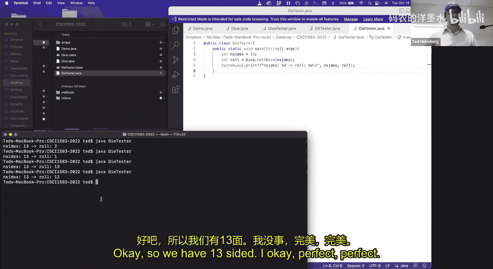
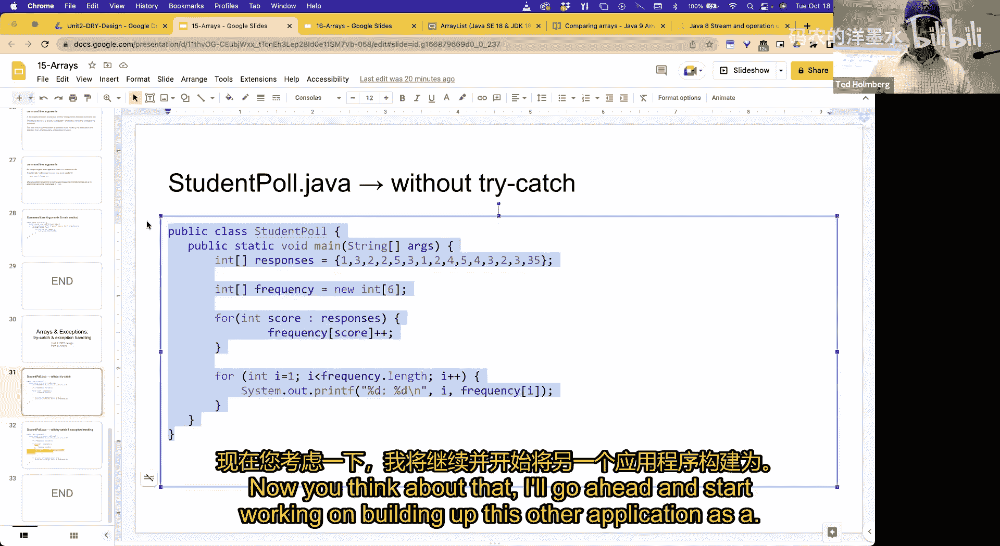
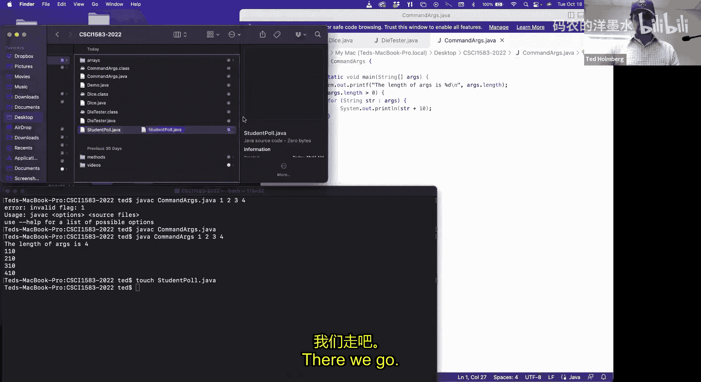
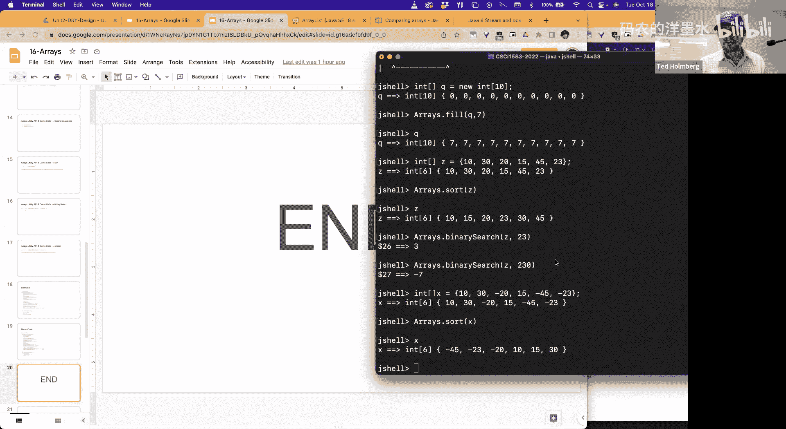

# 018：数组工具类 🧰


在本节课中，我们将继续深入学习数组，重点探讨可变长度参数、命令行参数、异常处理以及Java内置的`Arrays`工具类。我们将通过改进骰子游戏示例来理解这些概念，并学习如何编写更健壮、更高效的代码。

---

## 回顾骰子游戏 🎲

上一节我们介绍了多维数组以及按引用传递与按值传递的区别。本节中，我们来看看如何改进之前实现的骰子游戏。

上次我们修改了`DiceTester`类，使用数组来统计骰子各面出现的频率，这让我们能够方便地测试任意数量的骰子。现在，我们将进一步改进`Dice`类本身。



## 实现任意面数的骰子 🎯

假设我们想为`Dice`类添加一个方法，使其能够投掷任意面数的骰子（而不仅仅是六面骰子）。基于现有`rollD6`方法的逻辑，我们可以这样实现：

```java
public static int rollDice(int faces) {
    // 生成一个 [0, 1) 之间的随机数
    double randomValue = Math.random();
    // 乘以面数，得到 [0, faces) 之间的浮点数
    double scaledValue = randomValue * faces;
    // 转换为整数，得到 [0, faces-1]
    int intValue = (int) scaledValue;
    // 加1偏移，得到 [1, faces]
    int result = intValue + 1;
    return result;
}
```

我们可以在`DiceTester`中测试这个方法，传入不同的面数（如6、12、2），观察输出结果是否符合预期。需要注意的是，通过加1进行偏移，我们确保了结果不会出现0，这模拟了真实骰子的行为。

**关于随机值偏移的思考**：偏移操作不仅限于向右（加正数）。有时，根据问题需要，我们可能希望将随机范围向左偏移（例如，生成包含负数的随机值）。这在模拟随机移动（如僵尸游戏中的移动方向）时非常有用。

## 引入可变长度参数（Varargs） 🔄

接下来，我们想添加一个能投掷**多个**任意面数骰子的方法。一个直接的想法是传入一个整数数组，数组的每个元素代表一个骰子的面数：

```java
public static int rollDice(int[] diceFaces) {
    int sum = 0;
    for (int faces : diceFaces) {
        sum += rollDice(faces); // 调用单骰子方法
    }
    return sum;
}
```

这种方法可行，但调用者必须事先构建一个数组，这增加了使用复杂度。Java提供了更优雅的解决方案：**可变长度参数**。

我们可以将方法签名改为：

```java
public static int rollDice(int... diceFaces) {
    int sum = 0;
    for (int faces : diceFaces) {
        sum += rollDice(faces);
    }
    return sum;
}
```

使用`...`（三个点）表示这是一个可变长度参数。现在，调用者可以直接传入逗号分隔的值，而无需显式创建数组：

```java
// 之前：需要创建数组
int[] facesArray = {6, 8, 10, 12};
int result = Dice.rollDice(facesArray);

// 现在：直接传入值
int result = Dice.rollDice(6, 8, 10, 12);
```

Java会在内部自动将这些值打包成一个数组。这大大简化了客户端代码。

**使用可变长度参数的重要规则**：
1.  可变长度参数必须是方法参数列表中的**最后一个参数**。
2.  不能同时定义使用数组参数和可变长度参数的重载方法，因为它们的内部表示相同，会导致签名冲突。
3.  你仍然可以将一个现有的数组传递给可变长度参数。

## 理解命令行参数 🖥️

我们一直在使用的`main`方法包含一个`String[] args`参数。这个数组用于接收从命令行传递给Java应用程序的参数。

例如，假设有一个对文件内容进行排序的应用程序`Sort`，我们可以这样调用：
```
java Sort friends.txt
```
其中`"friends.txt"`就是命令行参数，它会作为字符串存入`args`数组。





让我们创建一个简单的`CommandArgs`类来演示：

```java
public class CommandArgs {
    public static void main(String[] args) {
        System.out.println("Number of arguments: " + args.length);
        for (String arg : args) {
            System.out.println("Argument: " + arg);
        }
    }
}
```

编译并运行：
```
javac CommandArgs.java
java CommandArgs
java CommandArgs hello
java CommandArgs hello world 123 true 3.14159
```

**关键点**：所有命令行参数都以**字符串**形式传入。如果需要在程序中将它们用作其他类型（如整数、布尔值），必须进行显式转换。

## 处理数组异常：越界访问 🚨

数组操作中一个常见的风险是**数组索引越界**。当我们尝试使用负数索引，或大于等于数组长度的索引访问数组时，就会发生`ArrayIndexOutOfBoundsException`。

考虑一个学生食堂质量调查的程序，评分范围为1-5分：

```java
public class StudentPoll {
    public static void main(String[] args) {
        int[] responses = {1, 2, 5, 4, 3, 5, 2, 1, 3, 3, 1, 4, 3, 3, 3, 5, 2};
        int[] frequency = new int[6]; // 索引0不用，索引1-5对应评分

        for (int response : responses) {
            frequency[response]++; // 用评分作为索引
        }

        for (int rating = 1; rating < frequency.length; rating++) {
            System.out.printf("%d: %d%n", rating, frequency[rating]);
        }
    }
}
```

如果数据录入错误，例如`responses`数组中本应是`3, 5`，但漏掉了逗号变成了`35`，程序在运行到`frequency[35]++`时就会抛出`ArrayIndexOutOfBoundsException`，导致程序崩溃。

## 使用 try-catch 处理异常 🛡️

为了防止这类异常导致整个程序终止，我们可以使用`try-catch`块来捕获并处理异常。

```java
public class StudentPoll {
    public static void main(String[] args) {
        int[] responses = {1, 2, 5, 4, 3, 5, 2, 1, 3, 3, 1, 4, 3, 3, 35, 5, 2}; // 包含错误数据35
        int[] frequency = new int[6];

        for (int response : responses) {
            try {
                frequency[response]++; // 风险操作放在try块中
            } catch (ArrayIndexOutOfBoundsException e) {
                // 捕获到异常后执行的处理逻辑
                System.out.println("Invalid response: " + response + " - " + e.getMessage());
                // 可以选择忽略该数据、记录日志、尝试修复等
            }
        }

        for (int rating = 1; rating < frequency.length; rating++) {
            System.out.printf("%d: %d%n", rating, frequency[rating]);
        }
    }
}
```

现在，当遇到无效数据`35`时，程序会捕获异常，打印错误信息，然后**继续执行**后续循环和输出，而不是直接崩溃。这大大增强了程序的健壮性。

## 探索 Java Arrays 工具类 🧰

Java在`java.util`包中提供了一个`Arrays`工具类，它包含许多用于操作数组的静态方法，如排序、搜索、比较、填充等。使用这些方法可以避免重复造轮子，提高开发效率。

首先需要导入：
```java
import java.util.Arrays;
```

以下是`Arrays`类的一些常用方法：

**1. 转换为字符串 (`toString`)**
方便地打印数组内容，无需手动写循环。
```java
String[] words = {"Hello", "World", "Java"};
System.out.println(Arrays.toString(words)); // 输出: [Hello, World, Java]
```

**2. 比较数组 (`equals`, `compare`)**
`equals`方法比较两个数组的内容是否完全相同（长度相同，对应元素相等）。
```java
int[] a = {1, 2, 3};
int[] b = {1, 2, 3};
int[] c = {1, 2, 4};
System.out.println(Arrays.equals(a, b)); // true
System.out.println(Arrays.equals(a, c)); // false
// 注意：使用 == 比较的是引用地址，不是内容。
```

**3. 查找第一个不匹配项 (`mismatch`)**
返回两个数组第一个不相等元素的索引。如果完全相同，返回-1。
```java
int[] d = {1, 2, 6};
System.out.println(Arrays.mismatch(a, d)); // 2 (索引2的元素不同：3 vs 6)
```

**4. 复制数组 (`copyOf`)**
创建原数组的副本，可以指定新数组的长度。
```java
int[] original = {10, 20, 30, 40, 50};
int[] copy = Arrays.copyOf(original, 3); // 复制前3个元素
System.out.println(Arrays.toString(copy)); // [10, 20, 30]
```

**5. 填充数组 (`fill`)**
用指定值填充整个数组或数组的某个范围。
```java
int[] arr = new int[5];
Arrays.fill(arr, 7);
System.out.println(Arrays.toString(arr)); // [7, 7, 7, 7, 7]
```

**6. 排序 (`sort`)**
对数组进行升序排序（原地修改）。
```java
int[] numbers = {10, 30, 20, 15, 45, 23};
Arrays.sort(numbers);
System.out.println(Arrays.toString(numbers)); // [10, 15, 20, 23, 30, 45]
// 也支持负数排序
```

**7. 二分查找 (`binarySearch`)**
在**已排序**的数组中快速查找指定元素，返回其索引（如果找到），否则返回一个负值。
```java
int index = Arrays.binarySearch(numbers, 23);
System.out.println(index); // 3
index = Arrays.binarySearch(numbers, 100);
System.out.println(index); // 负数，表示未找到
```

---

## 总结 📝

本节课中我们一起学习了数组相关的高级主题和实用工具：

1.  **可变长度参数**：使用`...`语法定义方法参数，允许传入任意数量的同类型参数，简化了调用方式。
2.  **命令行参数**：通过`main`方法的`String[] args`接收外部输入，用于程序启动时的配置。
3.  **异常处理**：使用`try-catch`块捕获并处理`ArrayIndexOutOfBoundsException`等运行时异常，使程序更加健壮。
4.  **Arrays工具类**：利用`java.util.Arrays`提供的静态方法（如`toString`, `sort`, `binarySearch`, `fill`等）高效地操作数组，避免重复编码。



掌握这些知识后，你将能够编写出更灵活、更安全、更易于维护的使用数组的Java程序。下一讲，我们将介绍另一种更灵活的集合类型——`ArrayList`。