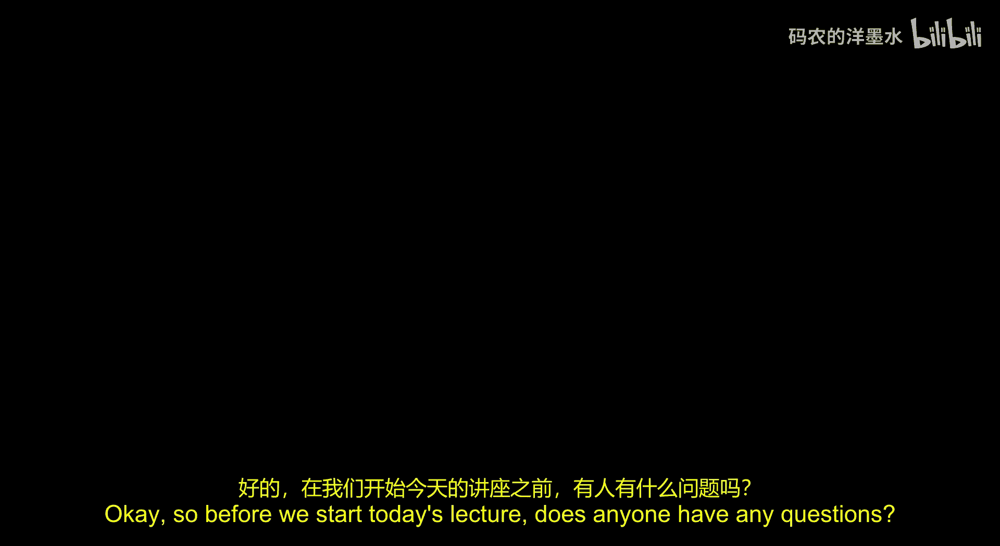
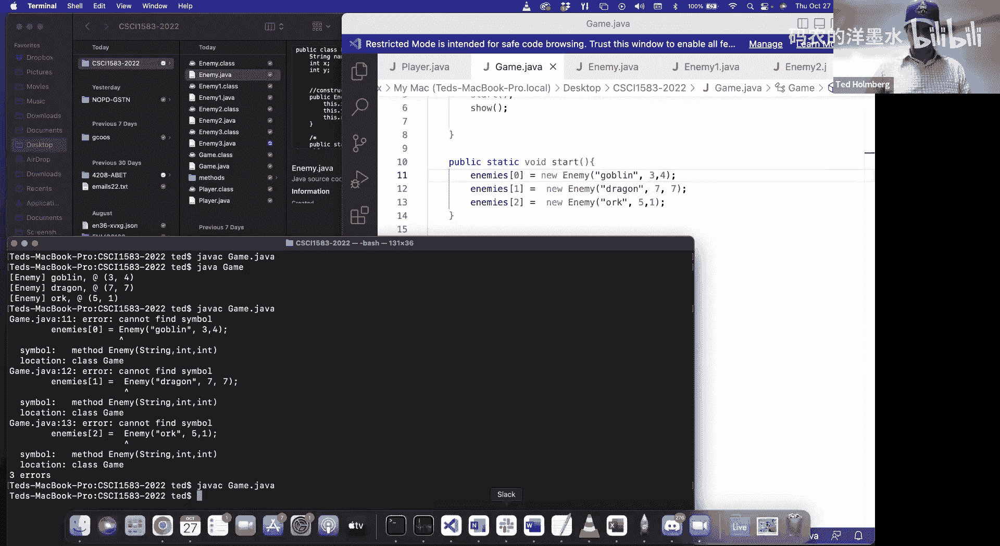

# 020：实例与类 🧱



在本节课中，我们将学习面向对象编程中的一个核心概念：**实例**与**类**。我们将通过编写代码，对比使用`static`关键字和移除`static`关键字的不同，来理解为什么需要创建类的多个独立实例，以及如何通过构造函数来实现这一点。

---

## 概述

到目前为止，我们主要使用`static`关键字来定义类中的字段和方法。这意味着这些字段和方法属于类本身，而不是类的任何特定对象。这种方法在只需要一个共享状态时有效，但在需要创建多个独立对象（例如游戏中的多个敌人）时，就会遇到限制。本节课，我们将探索如何通过定义**实例字段**和**构造函数**来创建类的多个独立副本，从而实现真正的面向对象设计。

---

## 静态方法的局限性

上一节我们介绍了如何使用`static`关键字组织代码。本节中，我们来看看当我们需要多个相似对象时，仅使用静态方法会遇到什么问题。

假设我们正在构建一个游戏，其中包含`Player`（玩家）和`Enemy`（敌人）类。最初，我们可能这样定义`Enemy`类：

```java
public class Enemy {
    public static String name;
    public static int x;
    public static int y;

    public static void start(String enemyName, int xPos, int yPos) {
        name = enemyName;
        x = xPos;
        y = yPos;
    }

    public static String toText() {
        return String.format("Enemy %s at %d, %d", name, x, y);
    }
}
```

在游戏的`Game`类中，我们可以这样使用：

```java
public class Game {
    public static void main(String[] args) {
        Enemy.start("Goblin", 1, 2);
        System.out.println(Enemy.toText()); // 输出: Enemy Goblin at 1, 2
    }
}
```

**问题在于**：如果我们想创建第二个敌人，比如一个“Dragon”，并调用`Enemy.start("Dragon", 7, 7)`，那么`Enemy`类中的`name`、`x`、`y`字段的值就会被覆盖。因为静态字段属于类本身，整个程序中只有一份。这意味着我们**无法同时拥有**一个在(1,2)的哥布林和一个在(7,7)的龙。

一种笨拙的解决方法是创建多个类，如`Enemy1`、`Enemy2`，但这严重违反了DRY（Don‘t Repeat Yourself）原则，且无法应对成百上千个敌人的情况。

---

## 引入实例：从蓝图到对象

为了解决上述问题，我们需要一种方法，能够根据一个“蓝图”（类）制造出多个独立的“产品”（实例）。每个产品都有自己的属性值，互不干扰。这就是**实例化**。

在Java中，我们通过移除`static`关键字并将字段和方法变为**实例成员**，然后使用`new`关键字和**构造函数**来创建实例。

以下是重构后的`Enemy`类：

```java
public class Enemy {
    // 实例字段：每个Enemy对象都有自己的这些变量副本
    public String name;
    public int x;
    public int y;

    // 构造函数：用于初始化一个新Enemy对象
    public Enemy(String enemyName, int xPos, int yPos) {
        this.name = enemyName; // ‘this‘指代当前正在创建的对象实例
        this.x = xPos;
        this.y = yPos;
    }

    // 实例方法：操作特定实例的数据
    public String toString() {
        return String.format("Enemy %s at %d, %d", this.name, this.x, this.y);
    }
}
```

关键变化：
1.  **移除了`static`关键字**：`name`， `x`， `y`现在属于每个`Enemy`对象。
2.  **添加了构造函数**：它是一个与类同名的方法，用于在创建对象时初始化其状态。
3.  **使用`this`关键字**：在实例方法中，`this`引用当前调用该方法的对象实例。
4.  **实例方法**：`toString`方法现在可以访问并返回特定实例的`name`、`x`、`y`。

---

## 使用实例：创建和操作多个对象

现在，我们可以在`Game`类中轻松创建多个独立的敌人。

```java
public class Game {
    // 声明一个静态数组来存放多个Enemy实例，便于全局访问
    public static Enemy[] enemies;

    public static void start() {
        // 使用‘new‘关键字调用构造函数，创建三个独立的Enemy实例
        Enemy goblin = new Enemy("Goblin", 1, 2);
        Enemy dragon = new Enemy("Dragon", 7, 7);
        Enemy orc = new Enemy("Orc", 5, 1);

        // 将实例存入数组
        enemies = new Enemy[]{goblin, dragon, orc};
    }

    public static void show() {
        // 使用增强for循环遍历并打印所有敌人
        for (Enemy monster : enemies) {
            System.out.println(monster.toString());
        }
        /* 等价于传统的for循环：
        for (int i = 0; i < enemies.length; i++) {
            System.out.println(enemies[i].toString());
        }
        */
    }

    public static void main(String[] args) {
        start();
        show();
    }
}
```

运行`Game.main()`方法，输出将是：
```
Enemy Goblin at 1, 2
Enemy Dragon at 7, 7
Enemy Orc at 5, 1
```

**优势**：
*   **DRY原则**：只需一个`Enemy`类定义，就能创建无数个敌人。
*   **状态独立**：每个敌人对象（哥布林、龙、兽人）都有自己的`name`、`x`、`y`，修改其中一个不会影响其他。
*   **可组合性**：可以将实例放入数组或集合中，便于进行批量操作，如遍历所有敌人检查碰撞、统一绘制等。这在开发游戏（如需要大量敌人的“太空入侵者”）或任何涉及多个实体的应用时至关重要。

---

## 核心概念总结

*   **类 (Class)**：对象的蓝图或模板，定义了该类对象共有的**属性（字段）**和**行为（方法）**。
*   **实例 (Instance) / 对象 (Object)**：根据类创建的具体个体。每个实例都拥有类中定义的字段的独立副本。
*   **构造函数 (Constructor)**：一个特殊的方法，名称与类名相同。用于在创建对象时（使用`new`关键字）初始化该对象的状态。
*   **`this`关键字**：在实例方法或构造函数中，`this`引用**当前对象实例**，用于区分实例字段和局部变量。
*   **`static` vs 非`static`**：
    *   `static`成员属于类本身，在内存中只有一份，通过类名访问（如`Enemy.start()`）。
    *   非`static`成员（实例成员）属于每个对象实例，每个实例都有一份，通过对象引用访问（如`goblin.toString()`）。
    *   静态方法**不能直接访问**实例字段和方法，因为它不知道操作哪个实例的数据。

---

## 总结



本节课中我们一起学习了面向对象编程的基石：**实例与类**。我们通过一个游戏开发的例子，演示了仅使用静态成员的局限性——无法高效创建和管理多个独立对象。接着，我们移除了`static`关键字，引入了**实例字段**、**实例方法**和**构造函数**，从而能够从一个类定义中创建出任意数量的、状态独立的对象实例。最后，我们还看到了如何将这些实例组合到数组中进行统一管理，这为构建更复杂、更真实的应用程序（如包含多个实体的游戏）奠定了坚实的基础。理解实例与类的区别，是掌握Java及大多数现代编程语言的关键一步。