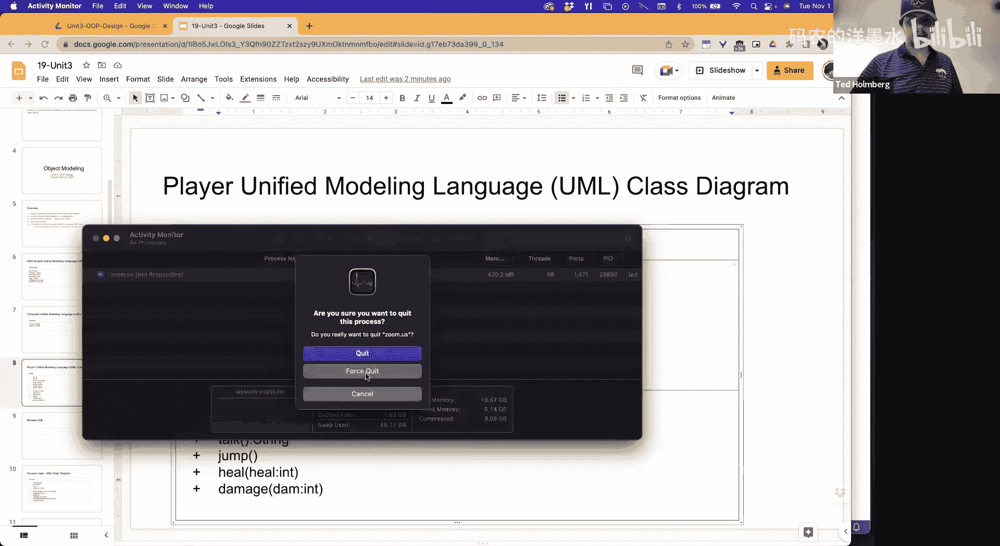

# 021：面向对象建模 🧱


在本节课中，我们将学习面向对象建模的核心概念。我们将从回顾上一讲的内容开始，然后深入探讨如何将软件系统设计为一系列相互协作的对象，而不是一系列独立的方法或语句。我们将学习如何使用UML类图来规划和设计对象，理解对象的属性（状态）和行为，并探讨封装和抽象的重要性。

---

上一讲我们介绍了**实例**的概念，并移除了`static`关键字，从而能够从类中创建多个副本。这标志着第二单元的结束，该单元主要讨论了方法和数组。现在，我们将进入第三单元：面向对象编程设计。

## 从过程式编程到面向对象编程 🔄

到目前为止，我们主要进行的是**过程式编程**，即将算法分解为一系列更小的方法或过程。现在，我们将“升级”我们的代码设计方式，开始将代码视为一系列**对象**的集合。

面向对象编程的核心思想是，我们倾向于将事物和概念本身视为对象。这非常符合人类的认知方式，因为我们生活在一个由对象组成的世界中。例如，机械工程师设计时钟时，会考虑齿轮、表盘、指针、马达等各个物理部件，每个部件都有其特定功能，共同协作以实现“报时”的整体目标。

同样，在软件开发中，我们希望将软件的所有组成部分视为软件对象。在规划应用程序时，我们需要找出构成该应用程序所需的最少数量的软件对象，每个对象在应用程序中扮演自己的角色，共同协作以实现整体功能。

## 面向对象设计概述 📋

本单元将涵盖以下核心内容：
*   **OOP设计**：比较过程式编程与面向对象编程。
*   **软件由对象类型构建**：学习如何将事物建模为对象类型。
*   **抽象、封装与模块化**：探讨采用面向对象方法的五大驱动概念。
*   **对象建模**：在数据建模的基础上，学习如何将数据封装到对象模型中。
*   **对象间交互**：对象通过方法与其他对象共享代码和交互。
*   **构建复杂对象**：后续将学习通过**组合**（has-a关系）和**继承**（is-a关系）从现有对象构建更复杂的对象。
*   **根类Object**：了解所有对象都继承自的`Object`类。
*   **继承、抽象类与接口**：学习如何构建具体类、抽象类和接口，以构建复杂的软件系统。

面向对象设计允许我们**抽象**掉问题域中不属于该对象本身的所有细节，并将数据**封装**到这些对象模型中。

## 如何开始对象建模：UML类图 📐

当我们开始设计对象时，通常从创建**UML类图**开始。UML（统一建模语言）提供了一套图表工具，用于表达软件系统中多个事物之间的关系。在面向对象设计中，我们使用类图来规划每个对象的职责。

一个UML类图通常包含三个部分：
1.  **类名**：位于顶部，表示要建模的对象的类型。
2.  **属性**：中间部分，列出定义该对象的属性或字段。
3.  **方法**：底部部分，列出该对象可以执行的行为或操作。

让我们通过一个例子来具体说明。

### 示例：设计一个`Player`类 🎮

假设我们正在设计一个游戏，需要一个`Player`（玩家）类。

**1. 确定类名**
首先，在UML图的顶部写上类名：`Player`。

**2. 定义属性（状态）**
接下来，思考哪些属性定义了一个玩家。属性是对象的特征，在代码中表现为实例变量。

以下是`Player`可能具有的一些属性：
*   `x` (int): 玩家在游戏世界中的X坐标。
*   `y` (int): 玩家在游戏世界中的Y坐标。
*   `width` (double): 玩家的宽度。
*   `height` (double): 玩家的高度。
*   `imagePath` (String): 玩家图像的路径。
*   `hitPoints` (int): 玩家的生命值。
*   `attackPower` (int): 玩家的攻击力。
*   `name` (String): 玩家的名字。

在UML中，我们这样表示：
```
Player
-------------------
- x: int
- y: int
- width: double
- height: double
- imagePath: String
- hitPoints: int
- attackPower: int
- name: String
```
`-` 符号表示该属性是**私有**的。

**3. 定义方法（行为）**
最后，定义玩家可以执行哪些操作。行为是对象的动作，在代码中表现为方法。

以下是`Player`可能具有的一些行为：
*   `move(newX: int, newY: int): void`：移动到新位置。
*   `attack(): int`：执行攻击，返回造成的伤害值。
*   `jump(): void`：跳跃。
*   `heal(amount: int): void`：治疗，恢复一定生命值。
*   `takeDamage(damage: int): void`：承受伤害。

在UML中，我们这样表示：
```
Player
-------------------
- x: int
- y: int
- width: double
- height: double
- imagePath: String
- hitPoints: int
- attackPower: int
- name: String
-------------------
+ move(newX: int, newY: int): void
+ attack(): int
+ jump(): void
+ heal(amount: int): void
+ takeDamage(damage: int): void
```
`+` 符号表示该方法是**公有**的。

### 为什么使用私有属性和公有方法？ 🔒

这是一个关键概念：**封装**。

*   **私有属性**：我们将所有实例变量（属性）设为`private`。这意味着其他类不能直接访问或修改玩家的内部状态（如`hitPoints`或`x`坐标）。这可以防止外部代码意外或恶意地将玩家置于无效状态（例如，将生命值设为负数）。
*   **公有方法**：我们通过`public`方法（如`move()`、`heal()`）来提供与对象交互的接口。这些方法内部可以包含逻辑来确保状态更改是有效的。例如，在`move()`方法中，我们可以检查新坐标是否在有效范围内。

这种方式确保了对象的**责任明确**。如果玩家的状态出现问题，我们只需要检查`Player`类内部的方法，而不是在整个代码库中搜索。这提高了代码的可维护性和健壮性。

### 处理复杂属性：对象中的对象 🧩

有时，一个属性本身过于复杂，无法用基本数据类型（`int`, `double`, `String`, `boolean`）表示。这时，我们需要将其建模为另一个对象。

**示例：设计一个`UnoStudent`类 🎓**

考虑为UNO学生建模一个`UnoStudent`类。

可能的属性：
*   `studentId: String` - 学号（用`String`而非`int`，以保留前导零）。
*   `firstName: String` - 名。
*   `lastName: String` - 姓。
*   `gpa: double` - 平均绩点。
*   `isEnrolled: boolean` - 是否在读。
*   `transcript: ???` - 成绩单。

成绩单`transcript`包含课程列表和对应成绩，它不是一个简单的值。因此，更好的做法是创建一个单独的`Transcript`类，其中包含`courses: String[]`和`grades: double[]`等属性。然后，`UnoStudent`类可以拥有一个`transcript: Transcript`类型的属性。

```
UnoStudent
-------------------
- studentId: String
- firstName: String
- lastName: String
- gpa: double
- isEnrolled: boolean
- transcript: Transcript
```

```
Transcript
-------------------
- courses: String[]
- grades: double[]
```

这种“对象包含对象”的关系就是**组合**（has-a关系）。它帮助我们更好地组织复杂数据，并将相关逻辑封装在合适的类中（例如，计算GPA的逻辑可能在`Transcript`类中）。

## 总结 📝

本节课我们一起学习了面向对象建模的基础。

*   我们了解了从过程式编程转向面向对象编程的动机：将软件视为由具有特定职责的对象组成的集合。
*   我们学习了使用**UML类图**作为设计工具，它包含类名、属性（状态）和方法（行为）三个部分。
*   我们深入探讨了**封装**的原则：将属性设为`private`以保护对象内部状态，通过`public`方法提供可控的交互接口，从而确保对象始终保持**有效状态**并明确责任。
*   我们认识到，当属性过于复杂时，应将其建模为另一个对象，从而通过**组合**来构建更复杂的系统。




下一讲，我们将把这里的UML设计付诸实践，开始编写代码来构建一个使用面向对象方法的应用程序。