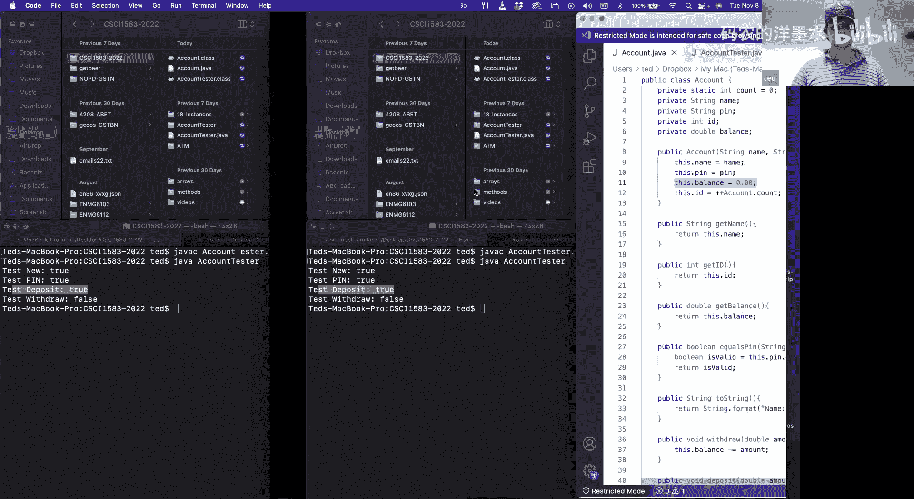
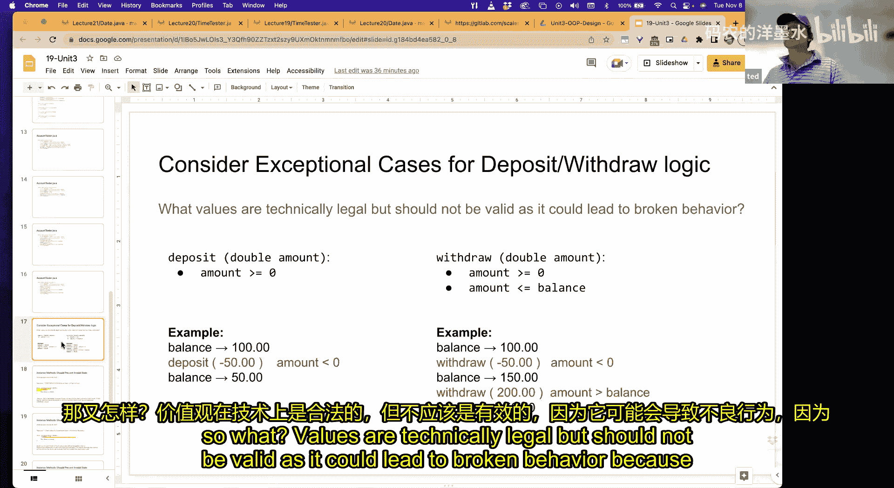
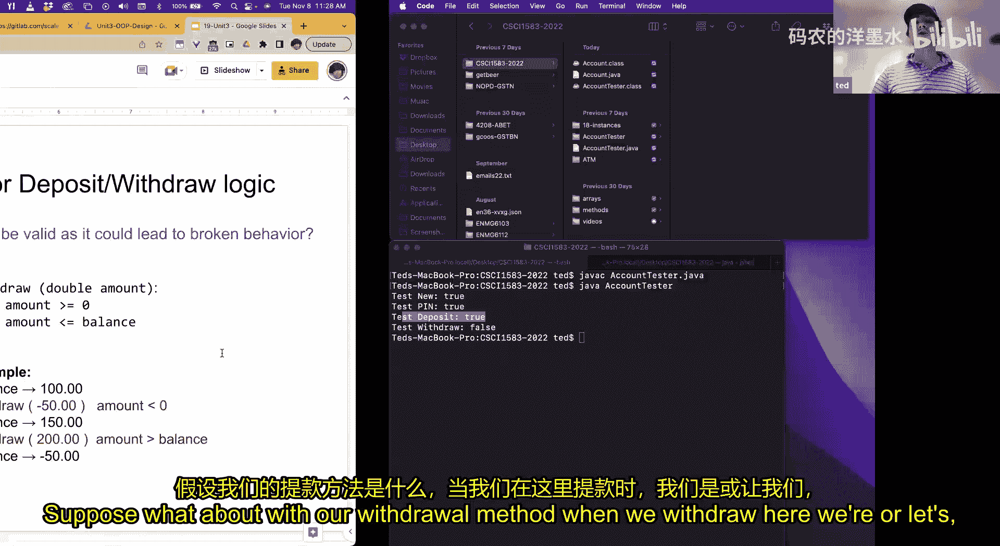
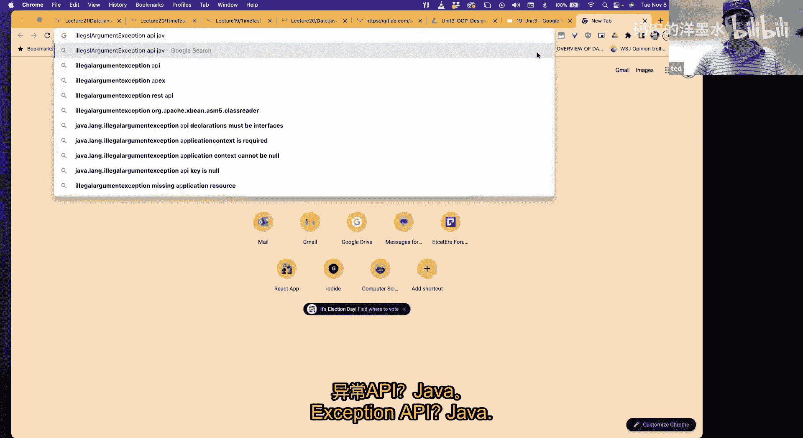
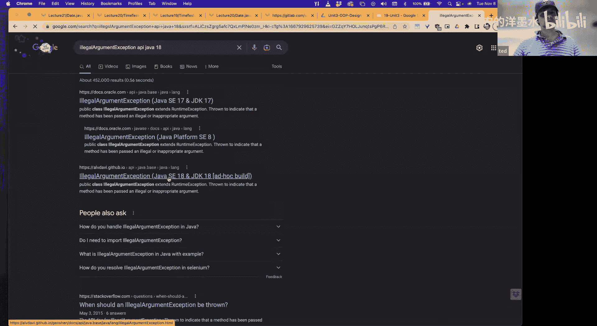
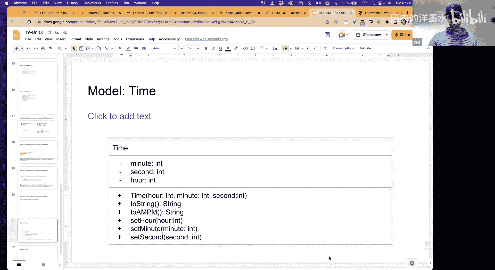

# 023：ATM账户与异常处理


在本节课中，我们将学习如何完善一个ATM账户类，重点是使用异常处理来保护对象的状态，防止其进入无效状态。我们将通过实现存款和取款方法，并加入防御性检查，来确保账户数据的完整性。

---

## 账户类的回顾与状态保护

上一节我们介绍了如何设计一个`Account`类，并定义了其实例字段（如姓名、PIN码、ID和余额）。本节中，我们来看看如何通过方法控制对这些字段的修改，以确保对象始终处于有效状态。

实例字段被设为私有（`private`），这意味着外部代码不能直接读取或修改它们。我们通过公共的“getter”方法（如`getName()`）来提供读取访问。然而，我们仍然没有提供直接的写入访问。这是因为我们使用基础数据类型（如`int`、`double`、`String`）来表示对象的特性，而这些类型允许的值范围可能比我们模型所要求的有效范围更广。

例如，账户的`balance`（余额）理论上可以是任何`double`数值，但对于一个真实的ATM账户，余额不应为负数。这就是“合法值”（技术上允许）与“有效值”（符合业务逻辑）的区别。我们的目标是确保对象的**状态**（即所有实例字段值的集合）始终有效。

---

## 实现存款与取款方法

我们为`Account`类定义了`deposit`（存款）和`withdraw`（取款）方法。这些方法是改变余额状态的主要途径。

最初的简单实现可能如下：
```java
public void deposit(double amount) {
    balance = balance + amount;
}





public void withdraw(double amount) {
    balance = balance - amount;
}
```
然而，这种方法存在风险。如果`amount`参数为负数，存款操作会减少余额，而取款操作反而会增加余额，这违背了业务逻辑。同样，如果取款金额大于当前余额，会导致余额变为负数，这也是无效状态。



---

## 识别并防御无效状态

我们需要识别哪些输入值会导致无效状态，并在方法中主动检查这些“异常情况”。

对于`deposit`方法：
*   **无效情况**：存款金额 `amount < 0`。
*   **有效情况**：存款金额 `amount >= 0`。

对于`withdraw`方法：
*   **无效情况1**：取款金额 `amount < 0`。
*   **无效情况2**：取款金额 `amount > balance`（当前余额）。
*   **有效情况**：取款金额 `0 <= amount <= balance`。

一种初级的防御方式是忽略无效操作：
```java
public void deposit(double amount) {
    if (amount < 0) {
        return; // 什么也不做，直接返回
    }
    balance = balance + amount;
}
```
但这种设计很糟糕，因为它**静默失败**。调用者不知道操作未执行，可能误以为操作成功，导致程序出现难以察觉的错误。

---



## 抛出异常：正确的错误报告机制



更好的设计是当检测到无效参数时，**抛出异常**。这能明确告知客户端代码其操作违反了规则。

在Java中，我们使用`throw`关键字抛出一个异常对象。`throw`的作用类似于`return`，但它将控制权交还给调用方时，传递的是一个异常对象，而不是普通返回值。

以下是改进后的`deposit`方法：
```java
public void deposit(double amount) {
    if (amount < 0) {
        throw new IllegalArgumentException("存款金额必须大于或等于零。");
    }
    balance = balance + amount;
}
```
*   `IllegalArgumentException` 是Java标准库中的一个异常类，非常适合表示“参数不合法”的情况。
*   在创建异常对象时，我们可以传入一个字符串消息，清晰地说明错误原因。

同样地，我们可以实现`withdraw`方法：
```java
public void withdraw(double amount) {
    if (amount < 0 || amount > balance) {
        throw new IllegalArgumentException("取款金额必须大于等于零且不超过当前余额。");
    }
    balance = balance - amount;
}
```

---

## 在测试类中处理异常

当我们编写测试类来验证`Account`类的功能时，也需要测试这些异常情况。我们可以使用`try-catch`块来捕获预期会抛出的异常，并验证异常信息是否符合预期。

以下是测试存款无效操作的示例：
```java
// 在测试方法中
boolean testPass = true;
String expectedMessage = "存款金额必须大于或等于零。";
String actualMessage = "";

try {
    account1.deposit(-20.0); // 预期会抛出异常
    testPass = false; // 如果没抛出异常，测试失败
} catch (IllegalArgumentException e) {
    actualMessage = e.getMessage(); // 获取异常信息
}
// 验证捕获到的异常信息是否与预期一致
testPass = testPass && expectedMessage.equals(actualMessage);
```
通过这种方式，我们的测试不仅覆盖了正常流程，也覆盖了错误处理流程，实现了更全面的代码验证。

---

## 总结与下节预告

本节课中我们一起学习了：
1.  **防御性编程**的重要性：通过将字段设为私有，并通过公共方法控制状态变更，可以保护对象数据的有效性。
2.  **异常处理**：使用`throw`关键字抛出`IllegalArgumentException`等异常，是报告无效操作、防止静默失败的标准做法。
3.  **全面的测试**：在测试类中使用`try-catch`块来验证方法在无效输入下是否能正确抛出异常。

通过为`Account`类实现带有异常检查的`deposit`和`withdraw`方法，我们创建了一个更健壮、更可靠的软件组件。



在下一讲中，我们将开始设计一个新的类——`Time`（时间）类。我们将重复类似的设计过程：定义属性（时、分、秒）、规划方法（构造器、设置器、字符串表示），并思考类似的问题：对于`setHour`、`setMinute`和`setSecond`这些方法，哪些值是有效的？哪些会导致无效状态并需要抛出异常？请提前思考这些问题，我们将在下节课一起实现。