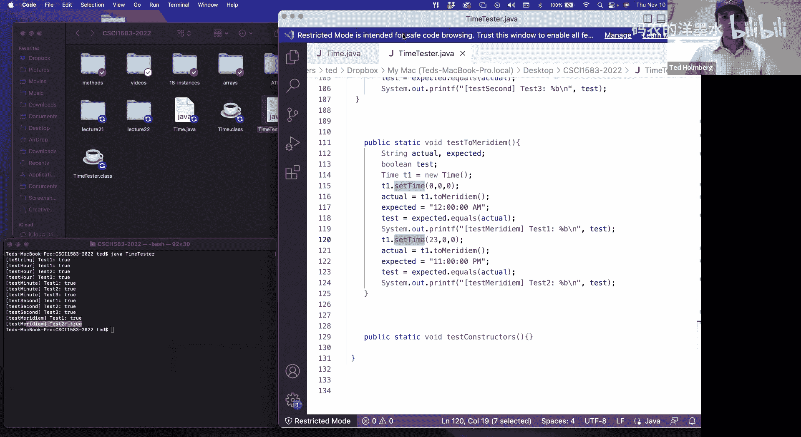

# 024：单元测试的时间类


## 概述
在本节课中，我们将学习如何应用面向对象设计原则来建模一个“时间”类。我们将从设计UML类图开始，逐步实现这个类，并采用**测试驱动开发**的方法，为每个方法编写单元测试，以确保代码的正确性和健壮性。

---

## 从UML设计到代码实现

上一节我们介绍了面向对象设计的基本概念。本节中，我们来看看如何为一个具体的“时间”对象设计UML图并实现它。

我们决定，`Time`类将包含三个核心属性：小时、分钟和秒。其UML类图设计如下：

```
+-------------------+
|      Time         |
+-------------------+
| - hour: int       |
| - minute: int     |
| - second: int     |
+-------------------+
| + Time()          |
| + setTime(...)    |
| + toString(): String|
| + toMeridian(): String|
| - setHour(...)    |
| - setMinute(...)  |
| - setSecond(...)  |
+-------------------+
```

基于这个设计，我们可以开始创建类的框架。

```java
public class Time {
    private int hour;
    private int minute;
    private int second;

    // 公共方法（API）存根
    public void setTime(int hour, int minute, int second) {}
    public String toString() { return null; }
    public String toMeridian() { return null; }

    // 私有设置方法存根
    private void setHour(int hour) {}
    private void setMinute(int minute) {}
    private void setSecond(int second) {}
}
```

---

## 测试驱动开发简介

在深入实现每个方法之前，我们必须理解**测试驱动开发**的重要性。这种方法要求我们先编写测试代码，再实现功能，以确保每一步都符合预期。

我们将创建一个对应的测试类 `TimeTester`，其结构如下：

```java
public class TimeTester {
    public static void main(String[] args) {
        testToString();
        testSetHour();
        testSetMinute();
        testSetSecond();
        testToMeridian();
    }

    private static void testToString() { /* 测试代码 */ }
    private static void testSetHour() { /* 测试代码 */ }
    private static void testSetMinute() { /* 测试代码 */ }
    private static void testSetSecond() { /* 测试代码 */ }
    private static void testToMeridian() { /* 测试代码 */ }
}
```

---

## 实现并测试 `toString` 方法

首先，我们实现 `toString` 方法，它将时间状态转换为“HH:MM:SS”格式的字符串。我们使用 `String.format` 来控制格式，确保分钟和秒总是两位数字。

```java
public String toString() {
    return String.format("%d:%02d:%02d", hour, minute, second);
}
```

以下是测试该方法是否有效的代码：

```java
private static void testToString() {
    String actual;
    String expected;
    Time t1 = new Time(); // 使用默认构造函数
    actual = t1.toString();
    expected = "0:00:00"; // 预期默认时间为 0:00:00
    boolean testPassed = expected.equals(actual);
    System.out.println("[testToString] Test 1: " + testPassed);
}
```

运行测试后，如果输出为 `true`，则证明方法实现正确。

---

## 实现并测试设置器方法

接下来，我们实现私有的设置器方法（如 `setHour`）和公共的 `setTime` 方法。关键在于验证输入值的合法性。

### 1. 实现 `setHour` 方法
小时的有效范围是 0 到 23。对于非法输入，我们抛出异常。

```java
private void setHour(int hour) {
    if (hour < 0 || hour > 23) {
        throw new IllegalArgumentException("Hour must be between 0 and 23");
    }
    this.hour = hour;
}
```

公共的 `setTime` 方法则调用这些私有设置器：

```java
public void setTime(int hour, int minute, int second) {
    setHour(hour);
    setMinute(minute);
    setSecond(second);
}
```

### 2. 测试 `setHour` 方法
我们需要测试常规情况和异常情况。

以下是测试代码示例：

```java
private static void testSetHour() {
    String actual;
    String expected;
    boolean testResult;

    // 测试1：常规情况（设置小时为12）
    Time t1 = new Time();
    t1.setTime(12, 0, 0);
    actual = t1.toString();
    expected = "12:00:00";
    testResult = expected.equals(actual);
    System.out.println("[testSetHour] Test 1: " + testResult);

    // 测试2：异常情况（小时为 -1）
    try {
        t1.setTime(-1, 0, 0);
        System.out.println("[testSetHour] Test 2: false"); // 不应执行到此
    } catch (IllegalArgumentException e) {
        actual = e.getMessage();
        expected = "Hour must be between 0 and 23";
        testResult = expected.equals(actual);
        System.out.println("[testSetHour] Test 2: " + testResult);
    }

    // 测试3：异常情况（小时为 24）
    try {
        t1.setTime(24, 0, 0);
        System.out.println("[testSetHour] Test 3: false");
    } catch (IllegalArgumentException e) {
        actual = e.getMessage();
        expected = "Hour must be between 0 and 23";
        testResult = expected.equals(actual);
        System.out.println("[testSetHour] Test 3: " + testResult);
    }
}
```

我们以同样的模式实现并测试了 `setMinute`（范围 0-59）和 `setSecond`（范围 0-59）方法。

---

## 实现并测试 `toMeridian` 方法

最后，我们实现 `toMeridian` 方法，将时间转换为12小时制（AM/PM）格式。

转换逻辑如下：
*   小时部分通过 **`hour % 12`** 计算，但需处理 0 和 12 的情况。
*   通过判断 **`hour < 12`** 来决定是 “AM” 还是 “PM”。

```java
public String toMeridian() {
    int displayHour = hour % 12;
    if (displayHour == 0) {
        displayHour = 12; // 将 0 或 12 显示为 12
    }
    String meridian = (hour < 12) ? "AM" : "PM";
    return String.format("%d:%02d:%02d %s", displayHour, minute, second, meridian);
}
```

测试该方法：

```java
private static void testToMeridian() {
    String actual;
    String expected;
    boolean testResult;
    Time t1 = new Time();

    // 测试1：午夜 00:00:00 应显示为 12:00:00 AM
    t1.setTime(0, 0, 0);
    actual = t1.toMeridian();
    expected = "12:00:00 AM";
    testResult = expected.equals(actual);
    System.out.println("[testToMeridian] Test 1: " + testResult);

    // 测试2：晚上 23:00:00 应显示为 11:00:00 PM
    t1.setTime(23, 0, 0);
    actual = t1.toMeridian();
    expected = "11:00:00 PM";
    testResult = expected.equals(actual);
    System.out.println("[testToMeridian] Test 2: " + testResult);
}
```

---

## 总结

本节课中我们一起学习了如何完整地设计、实现并测试一个 `Time` 类。我们遵循了以下关键步骤：
1.  **设计**：使用UML图规划类的属性和方法。
2.  **存根**：创建类和方法框架。
3.  **测试驱动开发**：为每个功能先编写测试用例。
4.  **实现与验证**：逐步实现方法，并运行测试确保其正确性，同时处理了常规情况和异常情况。



通过这个过程，我们不仅构建了一个功能完善的类，还创建了完整的测试套件，这既是正确性的保证，也是给其他开发者使用的绝佳示例。下一讲，我们将探讨如何为这个类添加显式构造函数。