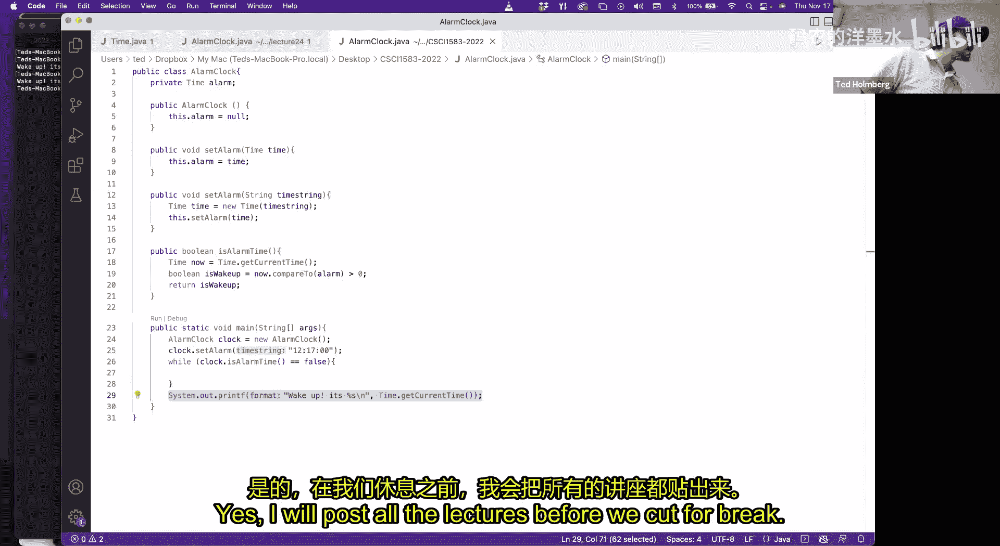

# 026：组合与闹钟演示 🕰️

在本节课中，我们将要学习一个重要的面向对象编程概念：**组合**。我们将探讨如何利用已有的类来构建新的、更复杂的类，并通过创建一个闹钟应用来实践这一概念。

## 概述

到目前为止，我们主要学习了如何从基本数据类型（如字符串、整数）构建对象。然而，在构建更复杂的类时，有时使用其他类作为其属性会更有意义。这种关系被称为“拥有”关系，是组合的核心思想。本节课我们将通过设计一个闹钟类来深入理解组合，并完善我们的时间类以支持对象间的比较操作。

## 什么是组合？

组合是一种概念，它允许我们使用预先存在的对象来构建新的对象。

我们之前主要关注的是从基本数据类型构建对象。例如，当我们构建一个账户类时，我们使用了字符串来表示文本数据，使用了双精度浮点数来表示账户中的货币金额。这些都是在课程初期讨论的基本数据类型。

但很多时候，在构建一个类时，使用另一个类作为其属性之一是有意义的。这是完全可行的。我们的类可以拥有任意数量的实例字段，这些实例变量可以是任何数据类型。它不必只是基本数据类型，也可以是引用数据类型。我们已经见过字符串形式的引用数据类型，它甚至可以是用户定义的引用数据类型，例如我们构建的账户类、玩家类或坐标类。

当我们开始讨论使用另一个类来构建一个类时，特别是当那个类是我们新类的属性之一时，我们通常将这种关系称为“拥有”关系。这意味着我们的新类拥有一个由我们试图使用的其他类定义的属性。

让我们看一个更具体的例子。假设我们正在设计一个玩家类。在玩家类中，我们确定玩家在游戏世界中应该有一个坐标。但这个坐标不应该仅仅是两个数值X和Y，它本身就应该是一个对象，用于建模坐标是什么。

那么，使用另一个对象作为我们的实例属性有什么优势呢？复用性绝对是关键。它实际上有助于我们减少玩家类需要关注的问题。

当我们开始为玩家建模时，首先想到的是坐标可以用X和Y值表示。但一旦我们开始思考这个问题，我们就应该考虑下一步。坐标有有效或无效的状态。当我们说玩家应该有一个坐标时，我不应该深入思考这个问题。我应该把它当作一个对象，然后使用它。但如果我在玩家类内部展开坐标的概念，说它是X和Y，那么我还需要展开什么？我刚刚打开了潘多拉魔盒。现在，我必须在玩家类内部处理什么是有效坐标与无效坐标的考虑。问题是，在设计玩家类时，我是否应该承担这些考虑？答案是否定的。玩家类不应该负责知道什么是有效和无效的坐标。因为如果我在玩家类中处理了这些逻辑，然后我去设计怪物类，并决定怪物也需要一个坐标，我就必须在怪物类中再次展开所有坐标逻辑。实际上，任何需要坐标的东西现在都必须负责检查坐标的有效性。这些都不应该是玩家、怪物或物品等类的职责。事实上，你会开始得到大量重复的知识和检查，违反了DRY原则。

因此，将这些逻辑封装起来是有意义的。封装意味着隐藏逻辑，将这些职责从玩家和怪物等类中抽离出来，放入一个坐标类中，让它负责维护X坐标、Y坐标以及检查其是否有效。然后，其他所有类都可以只拥有一个坐标实例，而无需担心任何细节，它们只需要知道“我有一个坐标”。

这就是动机所在。玩家拥有一个坐标，坐标本身不是基本类型，而是我们建模的一个事物。我们花费了大量精力思考它的实例字段以及我们可以如何改变它，这可能导致有效状态，也可能导致无效状态，然后我们进行检查和保护。一旦我们创建了一个我们对其有信心的坐标对象，我们就可以在玩家、怪物、物品中使用它。现在，这些类都不需要关心它是如何工作的，它们只知道“我有一个坐标”。如果玩家试图违反坐标的规则，坐标就会向玩家抛出异常。这样我们就有了一个健壮的软件生态系统，没有脆弱性，也不容易出现导致错误行为的大规模故障。

所以，“拥有”关系指的是组合。组合意味着我们可以使用更小、更简单的类来构建更复杂的类。在这个例子中，坐标是一个更小、更简单的类，而玩家类更高级，但它恰好需要一个坐标作为其建模的一部分。因此，我们说玩家拥有一个坐标，怪物拥有一个坐标，游戏世界中的物品拥有一个坐标。

“拥有”关系的概念很重要，因为下一节课我将介绍继承的概念，即“是一个”关系。在单元三的测试中，肯定会有问题让你识别和区分“是一个”关系和“拥有”关系。

## 从时间类到闹钟类

现在，让我们将组合的概念应用到我们一直在解决的问题上。在过去的几节课中，我们一直在设计一个完整、定义良好的时间类。我们终于到了认为它足够好，可以开始使用的阶段。我们将通过尝试将时间类用作一个组件类，放入一个组合类中来测试它。

组合类是由其他类或其他类的实例组成的类。

我们已经介绍了什么是“拥有”关系，以及为什么我们可以用其他对象作为其实例属性来构建对象。

设计我们类的一个美妙之处在于，一旦它被设计成可以实例化和使用，你就可以开始用它构建各种东西。例如，我们现在可以使用时间类来构建一个秒表或一个闹钟。在今天的讲座中，我只构建一个，但秒表和闹钟之间的功能区别是什么？闹钟在某个时间点会以警报结束，而秒表只在你决定时结束，并能够给出两者之间的时间差。闹钟是你设置一个警报时间，当到达那个时间时，它会发出哔哔声提醒你。两者都至关重要，它们都依赖于时间作为其下的基本模型。

所以，在今天的课上，我想设计一个闹钟。

## 设计闹钟类

在开始编码之前，我将按照传统设计我的UML类图。它由三行组成：第一行是类的名称，让我知道我在建模什么；第二行是这个特定类的属性；第三行是方法。

对于闹钟，你可能需要建模两个东西：当前时间和警报时间。这里我只列了一个，因为我要“作弊”：我将从时间类获取当前时间，因为我们创建了那个静态方法。但如果我想让它更通用，你可能会有类似“now”的属性，它也代表一个时间元素，这样闹钟总是知道当前时间是什么，以及警报时间是什么。但我要利用我总能从时间类获取当前时间这一事实，因为这是我们定义它的方式。这意味着在任何时候，我只需要知道我要在什么时间发出警报。

我们需要从闹钟中获得的东西包括：一个构造函数、设置警报的能力（可能有两种方式：传递一个时间对象，或者传递一个字符串，因为时间对象的构造函数之一允许我们传入字符串）、检查当前是否是警报时间（真或假，即是否该叫醒了），以及为了测试，我将创建一个主方法来实际运行我的闹钟，这样我们就可以看到如果它是一个应用程序会是什么样子。

## 实现闹钟类

让我们开始搭建闹钟类。

首先，定义类并创建实例变量：一个私有时间类型变量 `alarm`。

然后，创建方法存根：一个无参数的构造函数、两个 `setAlarm` 方法（一个接收时间对象，一个接收字符串）、一个返回布尔值的 `isAlarmTime` 方法，以及一个 `main` 方法。

在构造函数中，我们将 `alarm` 初始化为 `null`，这样新创建的闹钟没有设置警报，用户必须手动设置。

在接收时间对象的 `setAlarm` 方法中，我们直接将传入的时间对象赋值给 `alarm`。这就是组合在行动中的体现：我们花费了所有时间设计时间类，现在在这里将其设置到我们的组合类——闹钟类中。

在接收字符串的 `setAlarm` 方法中，我们使用该字符串创建一个新的时间对象，然后将其保存到 `alarm` 实例变量中。这里有一个问题：这个字符串可能不代表一个有效的时间字符串。但幸运的是，我们已经在时间类中设计了异常处理。闹钟类不需要担心什么是安全的，它只是将字符串传递给时间类，并说“尝试用这个构建时间”。如果时间类无法构建，由于我们已经设计了时间类来检查有效性，它会向这个方法抛出一个异常，然后这个方法会立即将该异常抛出。将所有这些异常处理放在时间类中的美妙之处在于，现在每个在其上构建的类都不必担心什么是有效的时间字符串或有效的时间管理器，它只是盲目地尝试。如果不起作用，它会抛出你已经设计好的异常。这再次证明了使用基本类构建然后在其上构建的好处，因为你得到了这种级联的骨牌效应。这意味着我在闹钟中的实现要简单得多，我不必像在设计底层时间类时那样做所有的考虑。

接下来，实现 `isAlarmTime` 方法。如何知道是否是警报时间？我可以获取当前时间，也可以获取警报时间。如何用这两个时间实例来做出有意义的决定？我们需要能够比较两个时间实例。回顾我们设计的时间类，除非我们在其中定义这些操作，否则它们不存在。关系运算符、相等运算符只适用于基本数据类型，因为它们在JVM中预定义。对于其他一切，它取决于开发人员来定义相等意味着什么，或者比较一个实例与另一个实例意味着什么。我们以为我们设计了一个非常好的时间类，它建模了小时、分钟、秒，有一组很好的构造函数，允许我们以多种方式构建时间实例，有能力在时间实例中设置时间，并能够以两种不同的方式将时间表示为字符串。但我们没有添加任何实际比较时间的功能。所以，我们实际上缺少一些方法。开始构建软件的一个美妙之处在于，当你看到这些可能存在于我们开始构建的基本组件类中的漏洞时。你真的需要深入思考这些类将如何被使用，并思考应该允许对它执行什么样的操作。

因此，我实际上想在这个类中扩展我的时间类，赋予它闹钟需要执行其任务的功能，因为我们可以创建两个不同的时间，但无法将它们相互关联。我们希望能够开始一起处理时间实例以获得有意义的结果，找出两个时间是否相等，或者一个时间是否大于另一个时间。

## 完善时间类：相等与比较

这给我们带来了缺失的方法：`equals` 方法和 `compareTo` 方法应该被包含在时间类中，以及它们意味着什么。

首先，`equals` 方法：对于时间来说，相等意味着什么？每个时间实例的状态由三部分组成：小时、分钟、秒。如果我想说时间实例一等于时间实例二，我在评估什么？由于我必须决定相等意味着什么，那么在比较两个时间实例时，什么对评估相等很重要？所有属性都必须相等。确定相等性是在类的设计步骤中必须做的事情，你必须选择哪些属性对于区分两个不同的实例是关键的。

`equals` 方法是一个我们实际继承的方法，有一种特定的写法。它接收一个 `Object` 类型的参数，因为 `Object` 是Java中所有引用类型中最通用的。首先检查传入的对象是否是时间实例，然后将其转换为时间对象，接着比较小时、分钟和秒是否全部相等。为了访问另一个时间实例的数据，我们需要获取方法。获取方法不仅对其他对象访问类内的实例变量有用，对于同一类的其他实例访问另一个实例的数据也至关重要，特别是当我们开始定义像相等操作或比较操作这样的关键方法时。

其次，`compareTo` 方法：这相当于关系运算符（大于、小于、等于）。比较方法通常返回一个整数值。如果两个值相同，则返回0；如果当前值小于另一个值，则返回负值（如-1）；如果当前值大于另一个值，则返回正值（如1）。这样，我们就可以对时间实例进行排序。

实现策略：由于时间实例内的所有数据本质上都是整数，我们可以将小时、分钟、秒连接成一个大整数，然后使用基本的关系运算符进行比较。这样，我们就可以判断一个时间是否在另一个时间之前或之后。

创建这个方法的一个好处是，如果我现在使用我们在第二单元学过的数组类来排序时间实例，我们现在已经定义了一种比较方式。`compareTo` 是Java在可比较事物中寻找的内置方法，所以现在我们可以开始排序时间实例了。

现在，我们有了一个功能更丰富的时间类：我们不仅可以构建时间实例，还可以请求每个时间属性的状态，可以评估一个时间实例是否等于另一个时间实例，还可以比较一个时间实例是在另一个之前还是之后。

## 完成闹钟逻辑

回到我们的闹钟实例，我们之前在这里卡住了。在 `isAlarmTime` 方法中，我们可以这样思考：从时间类获取当前时间，然后将其与警报时间进行比较。如果当前时间大于或等于警报时间，则应该唤醒。

因此，我们可以创建一个布尔局部变量 `isWakeUp`，获取当前时间并与警报时间比较。如果结果大于或等于0（根据我们的设计，`compareTo` 返回0表示相等，正数表示当前时间晚于警报时间），则将 `isWakeUp` 设置为真。

现在我们能做到这一点，是因为我们已经实现了开始关联时间实例的能力。

## 构建闹钟应用

让我们在 `main` 方法中实际构建这个应用。你会看到我们的 `main` 方法将非常小，因为这么多工作都被编码到我们的基本时间类中了。

在 `main` 方法中，我们将创建一个新的闹钟实例，设置警报（例如，设置为“12:15”），然后运行一个 `while` 循环，不断检查是否是警报时间。当 `isAlarmTime` 返回真时，我们退出循环并打印“Wake up!”。

运行这个程序，当系统时间到达12:15:01时，它就会输出“Wake up!”。如果我们再次运行它，由于已经过了12:15，它会立即输出。我们可以扩展这个应用，例如在唤醒后让闹钟持续响铃，直到用户提供某种输入。

## 总结

本节课我们一起学习了组合的概念。我们看到了使用更简单的对象构建更复杂对象的价值，同时也看到了为什么我们希望严格测试简单对象，以便它们能够扩展而不增加太多复杂性。我们通过设计一个闹钟类来实践组合，并完善了时间类以支持对象间的比较操作。

下一节课，我们将进入继承的学习，然后是接下来的多态、抽象类和接口。希望你们都能看到基于我们过去三节课设计的时间类，实际上可以制作出一个真正的闹钟应用程序的潜力。