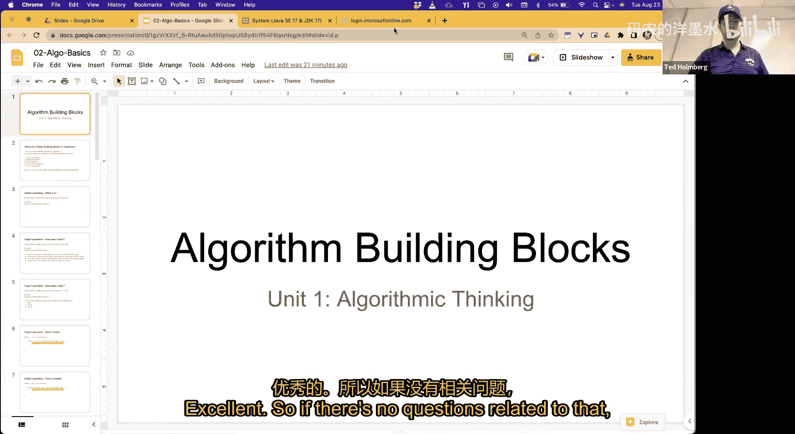
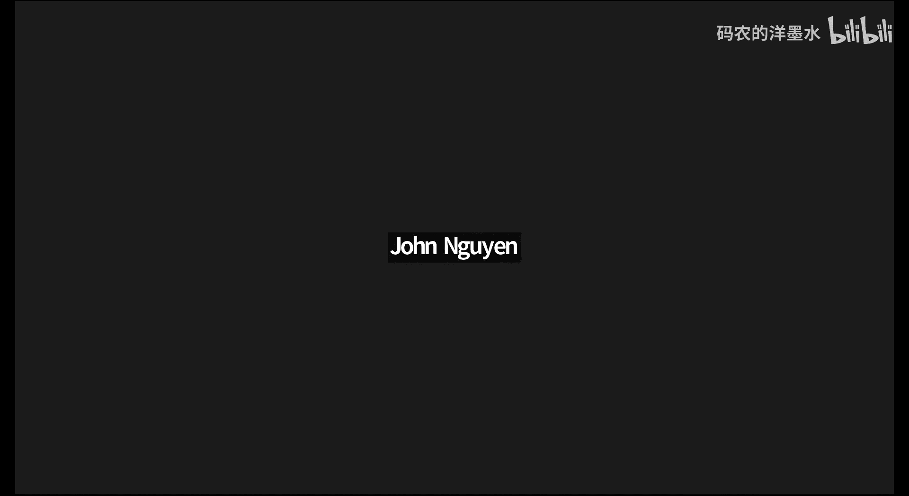
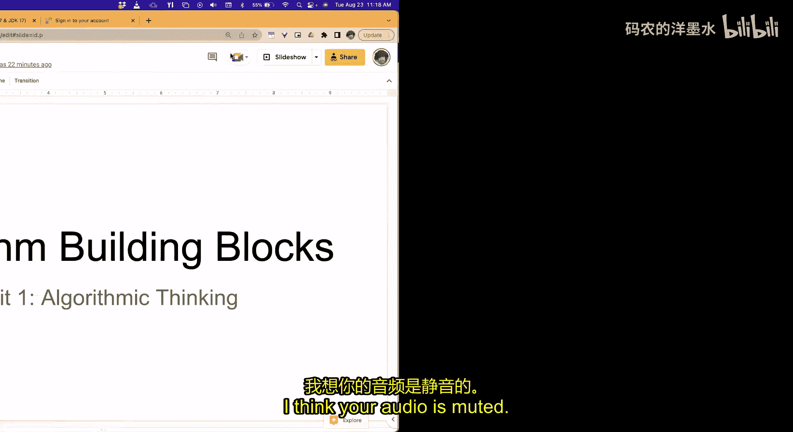
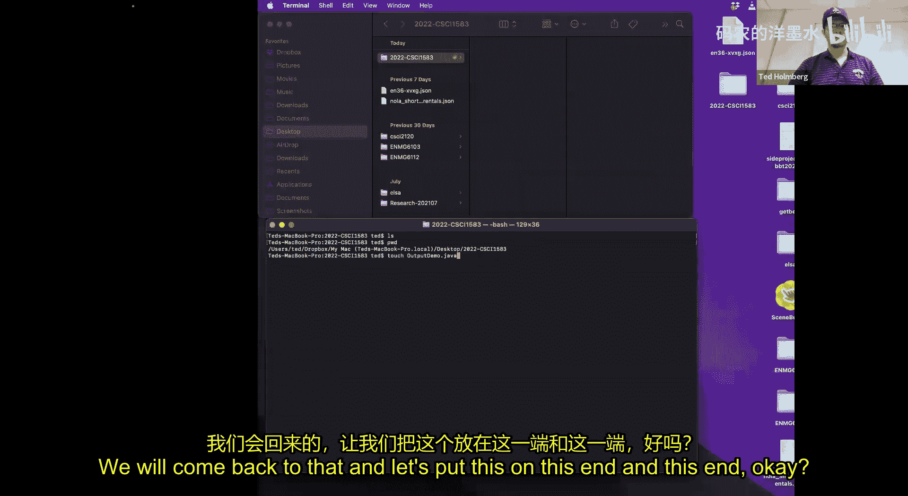
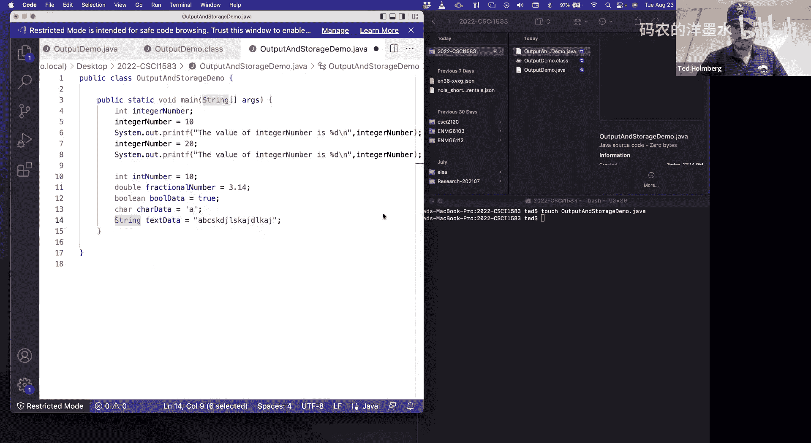

# 【全集】加州理工学院 软件设计与开发 中英字幕 1080P p02 Lecture 2 - 输出与存储 -BV1AvzCBdE7a_p2-

Excellent okay so today is lecture three now so we had some really interesting questions。

 so before we start today's lecture where we'll talk more about algorithm building blocks previously we've talked about we've talked about data modeling。

And before then we talked a little bit about the syllabus and a roadmap of where we're going to go so I had some questions in terms of lab work and installing Java and the distinction between Java and visual studio code and so we should take a moment I think just before we start talking about algorithms and the building blocks of algorithms which should take just a moment to to talk about the technologies we're actually going to be touching and using to build out our software so first and foremost this class is going to use the Java programming language and so the Java programming language was and still is a。

It's。One of the most popular languages that you can learn it's the most popular enterprise level language you can learn we brought in a。

Actually a adjunct professor who works in industry and he's worked in three or four different positions always in Java there's a lot of Java related development and。

When you go into the professional world， this is a very relevant language。

And the reason why is because Java is designed in a way that scales up with code and with people。😡。

So there are languages that can be a little bit easier to initially learn。

 but they don't scale as well so languages like Python and Javascript you'll learn over the your tenure as a student are great for smaller projects but where Java is really going to shine it's going be hard to get this depiction over the course of this semester is when you are working on an application that's hundreds of thousands of lines of code or millions of lines of code and you have teamsed of 20 to hundreds of people all working on the same code base that's one reason why Java is still so popular todays because it really supports the ability to scale up a codeb to be that large so what does it take to run Java well the Java language is essentially any programming language is essentially packed as effectively like an application so you can install the Java。

Language onto your system it usually exists in effectively two different flavors you have what's called the JDK and the JRE the JDK stands for the Java developer kit that's what we use to take the what we're going to learn how to code it's going to take our source code and it's going to compile that into what we call bike code so that becomes executable code machine code that no longer is human readable but by default the machine can't read our human readable code so there's always this translation process between taking what we can read and with the machine can execute and so that's what we use the JDK for and then you have the Java runtime environment the Java runtime environment is super portable almost any computational machine regardless of whatever it is not just laptops or mobile smartphones but also things like toasters and set top box。

And refrigerators and everything runs Java so Java is portable because what Oracle does is they maintain what's called the JVM that's the Java virtual machine so unlike languages like C or C++ where your source code is compiled down into object code or code that actually executes on the actual hardware Java code executes so it can run inside this virtual machine that is an application in and of itself on your computer so your code only has to compile to the JVM and not the。

Actual hardware， which makes it incredibly portable right so anything that has a JVM your Java source code can compile to so instead of having to be aware of all the different hardware restrictions like you might have to on a see application you can be agnostic of that and just program for the JVM and that's also one reason why Java became so popular it's not just the portability。

 the idea that you can write your code one place and it can execute no matter what the platform is but also the fact that since it executes in a virtual space and not in your actual hardware it was a safe way of being able to exist in this this interconnected world where the internet was this burgeoning thing Java grew up alongside the internet and this idea of having a virtual machine that you can execute code there was an awareness of the security implications of that right you don't want to just download some source code that you didn't。

yourself off the internet and run it on your machine because it could be highly destructive it could destroy your it could erase your hard drive right it it could give some other user privileges to your machine so to prevent having hardware level access whenever you ran any kind of application that's what motivated this concept of a JVM and still that's one of the major ways that software runs today inside these virtual environments JavaScriptscript works the same way but it's housed inside the browser which is even stronger wall garden so then there's all sorts of tools that allow us to author our Java code so when we're talking about visual studio code or sublime or intelligent these are all what are called editors code editors and some code editors will offer really some nice quality of life features like syntax highlighting that will go ahead and it'll display your key。

wordords in a different color than the variable names for instance and so when you go to author your code typically you're going to use a code editor to do that which will make it much easier to kind of read your code base but then when you're done altering your code you actually use Java or Java C Java C short for Java compile to actually compile your code from a dot Java file right that's the human readable format to a dot class file which is going to be the compiled version and that compiled version can then be interpret it by the JVM and actually execute so that it can run on your system so does that how clear up kind of how these different technologies interact with one another。

Does anyone have questions？Related to that。Excellent， so if there's no questions related to that。

 let me see here， let sure I'm logged into my system on earth。

Then I want to start today's lecture， but I want to make sure I have access to my red terminal here。

 if not。That way we can use the same system dots。That you have access to。嗯。

I think your audio is muted。

Okay。Have I been muted the entire time？It only just got muted。Perfect after you。

 as I the share screen。可以。Well I think yeah， I think what happens。

 I won't use web terminal says demo because I can't share on my screen so let me get set myself up locally really quick。

So I'll have a new finder window， let's see for new finder let's jump to desktop perfect inside of desktop let's create a new folder that we'll call 2022 CSciI 1583 this will be the place that all my demo code goes now let me go ahead and open up a new terminal。

At this folder。Okay， perfect， and so now I have a bass terminal。Okay。

 let's clear this let's do LS present print workinging directory perfect that's what I want Okay。

 and then let's do this。你你企。File open up， okay。We will come back to that and let's take this on this end and this end okay。

So let's start with today's lecture。So algorithm building blocks。

 so previously what spent a lot of time doing was discussing the role of data modeling and how what we strive to do whenever we start developing software which we haven't started doing yet is understand that we have to take our observations of a problem domain and map it from this concept model that is inside of our head from a mental image into some more rigid form of data and weve discussed how to do that in confines of recipes。

 for instance， so now that we understand that data models part of this concept。

 the other part is an algorithm that makes use of our data models that actually steps us from a beginning point and leads us to some endpoint。

So algorithms are not something that's just restricted to software it's not something that's just restricted to computer science。

 you can build an algorithm in any domain you as a human can follow an algorithm it's just a sequence it's just a step by step sequence of instructions right but we make use of algorithms。

Computationally to be able to automate tasks so in the same way that you can follow an algorithm。

 we can define an algorithm in a way that it can be handled by a non intelligent system like a like a computer。

😡，Now with that said， a well designed algorithm doesn't have to have any awareness and doesn't have to make any decisions beyond blindly and mindlessly executing an instruction so one of the other difficult things there's two difficult things that we're going to encounter when we first engage in computer science the first is taking our observations and mapping them in the form of data but the second will be being able to articulate an algorithm that's so well defined that。

😡，There is no。Eoneous abstractions in it that there's no decisions that have to be made by an outsider reader and so you want to think of it this way it's like have you ever tried to explain a process to say for instance。

 a five yearear old how explicit you have to be right well a fivey old is infinitely more intelligent than a computer is because a five year old still has thought and consciousness and the ability to understand instructions and actually if you give a little bit of an abstraction it can fill in the blanks computers can't do that they do exactly what we tell them to do and nothing more so that's an important so so if you think it's already challenging to explain a process to a fiveyear old it's going to be that much more challenging to explain it to a computer but once you do if you can explain it to a computer it's certainly reproducible by anything else so it's definitely something a skill set that's worth learning is going to be a skill。

That that you'll have to master in order to design any kind of software Okay。

 so let's take a look at our building blocks so fundamentally every algorithm。

Inside of our computer system can be derived as one of five basic building blocks。

 so we'll talk very abstractly very generally about what these building blocks are so we have output operations。

 we have storage operations， we have input operations。

 we have processing operations we have control operations。So we build out our software。

Each statement inside of our algorithm。😡，Will manifest as one of these things。

 sometimes we may have multiple of these operations in one line of code in one statement。

So we can sequence these basic operations together to build any algorithm inside of our software system so let's start explaining what these types of operations are so let's start with the output operations we'll start with number one what is it well the output operation is responsible for getting data out of our program it says to the user but just out of the program doesn't even have to be to the user。

😡，So let me put to the。Outside。So。And so an example here that you've probably already seen inside of your lab is where we do like system out out dot print and then you put in a string like hellello world and then on the console it probably displayed that I'm going to explain a little bit more what's happening there in detail。

 but the role of all output operations is to take some some piece of data that exists inside the app and send it outside of the app。

So what what does that end up meaning well you want to think of your app as being kind of like a walled in garden or like a walled in little village right where everything coexist together but it's separate it's isolated around from all the other processes that are executing inside of your OS right like when we create our application we are reserved computational space and memory just for our application and nothing else is allowed to get into it or out of it without our allowing it without us allowing that so we essentially hold the gates to that。

😡，Kingdom when we define our application where were the kings and queens of that domain so what's really critical then is most application just don't have everything internally to do what they need to do most of the time is very critical that we're able to get data into the application from the outside from from a place that is not predefined inside of our app and at the same time there is oftentimes where we need to take something that we've processed within our application and exported out send it out of the application so we're going to look initially at getting data out of our application and that's what the output operations are all about and again responsible for getting the data out of the program to the。

I would sell it。So we want to think of our apps as being like rolleded in where we have control within the app and so we use a concept of streams to move data out of the app and in fact we're going to use the same concept to move data into the app but we're not on that operation and so when when I think when when I say streams。

😡，Conceptually think of it like a river， so think of our application as if it were the city of New Orleans surrounded by nothing but swamp land。

😡，Muck and Meyer where everything is inside the small community。

 but we have a river where we can import things into the city or export things back out of right and so the concept that we use to be able to bring data in or take data out of our application uses the same concept of the way a river is used to bring goods and service goods and materials into a city and export it back out via ship。

😡，So we can put things into the stream and then we can collect it from the stream or we can put things in the stream and we send it back out to some other application that if I'm upriver and I'm throwing stuff into the river then on the other side the other application can be plucking things out of that stream does the concept make sense okay perfect so。

So Java has a built in class name system that represents our computer system that represents things that we want to have access to the underlying system that our app is running within。

 and so one of those things that system has are input streams and output streams。😡。

🎼And so in order to do the output operation we're going to have to take advantage of the systems output stream that's given to us that's predefined for us In fact。

 whenever we see something new I'll try to go ahead and open up the API if you're not familiar what an API is it stands for a application programming interface it it's essentially the set of rules as a set of descriptors about every class and every method that's defined in Java we can read about inside of the documentation so if you're going to become a successful developer becomes very important to be able to start reading the API documentation very early on so let's see we have system here and we get a description of what the classes the system class contains several useful class fields and methods it cannot be instantiated and it effectively gives us things like these input streams and these print streams。

嗯。So that's what we're going to make use for and then in the next class you'll learn even more about how to use streams to be able to read from other sources besides the initial system。

 input stream， but we're going to really just use this for this semester until you get comfortable with these concepts。

Okay， so。There are three different types of print statements inside of system dot out， we have print。

 we have print LN and we have print F， did you cover all of those in the lab by chance？Okay， so。

Let's do some demos so we could see how these all interact so let me grab this code。

You don't want to open intelligent， no， stop intelligent， quit。这老。就。Okay看。We want to open with。

I'm going to use visualual Studio care。Yeah。Okay， let's see here and we will paste this Okay。

 so what do we have going here， let me make this bigger。Although I'm sharing the screen。

 but can everyone see？Can everyone read that？Okay， so when we first go and make our code the thing I want to highlight here is the output operation we're doing is line four。

 but we can't do an output operation in isolation with Java so let me explain some of the fundamental rules for building software and Java just so I can build a basic demo for you effectively a hello world so this is the output operation everything else around it is what's needed just to have a Java application constructed。

😡，So。I'll try to build this up in terms of like kind of like a nested doll of sorts so we create algorithms here right so this is a part of my algorithm this particular algorithm exists with just one output operation where the entire point is to display a message to the outside to our terminal that's going to say hello world now Java is an object oriented language it's heavily objectoriented which means we can't do anything outside of the concept of objects this class is going to teach objects in a late object approach which means initially we're going to have a lot of like hand wy boiler played things but i'm going to try to explain to you like what what's going on until we formally introduce the idea of objects but what I will say is that there are multiple paradigms where we could develop code we could do。

Sa for instance， procedural we could do functional we could do object oriented and so the approaches we have here all of our statement Java enforces on us has to go inside of a method and so and in order for a Java application to actually execute it has to have at least one method that is the main method so when you launch the JVM and you send the JVM your Java file if you wanted to actually execute the JVM tries to execute the main method as the launch point so the main method always the launch point for every application within Java no matter how complex it is whether it's a single line of code like this one or whether it's millions of lines of code it always starts with the same method name so that's that method name is a special method that whenever you invoke。

Java from the command line and feed it a Java file， a compiled Java file。

 it's going to look for that so we have to have it。

So this is that's what I'm defining here and so methods themselves have to be defined inside of classes and classes are defined inside of packages so effectively all of what this has to do is ways of organizing our code so it's more manageable so one of the things I mentioned that Java is so popular because its scales up really well one reason why it scales up so well is it forces all developershood here towards a methodology that compartmentalizes your code so that it's easier to navigate and read through so again the chain or sequence of things would be I have my instructions right here so this is the algorithm I'm building it has to exist within a method we can't have any free floating statements the statements go inside of methods and methods have to go inside of classes。

So starting to build in reverse order then the first thing I have to do whenever I build out any application is to define a class and so you want to think of a class as a classification right it's a classifier source。

 it's a thing of grouping a collection of related methods。😡。

Now we're not learning about methods yet we're just learning about these basic concepts that even allow us to implement a hello world but but later on when we start learning about methods you can understand that we can have multiple classes and classes should be related that things inside of a class should have relations where the methods are similar to one another if the methods aren't similar to one another then that means you should put it into different classes again this is a little bit beyond where we're at now but i'm kind of i'm kind of seeding the ground for the future when we actually get to those concepts so we'll learn more about that in the in the lectures to come but right now just know we always have to have a class where we can then put our main methods so public is an access level type we have。

We have a couple different types with the two main type is something could be either public or private if it's private it's effectively like the same access types you can put on a file or on like a social media profile right like if it's private then the outside world doesn't have access to it if it's private only this class would have access to it and if it's public then anything has access to it we need to be public because we want to run our code from the command line the command lines is not part of this class so the only way that we can give access to this main method to our command line where we're gonna to execute our code from is to label it as public does that much make sense in terms of the public so all these things you see here are keywords where when Java goes to parse this and compile it into machine code or what we actually call bytecode it has certain keywords that it parses for the purposes of Java。

Itself so for instance when we start learning how to create variables we can't use any of the key words as our variable names it's restricted because they have special meaning inside of the Java programming language so public is one of those such key words we know that it's a keyword because it highlights blue inside of my syntax a so my the nice thing about these code editors is it lets me know different parts of the language as i'm authoring it so then the next thing is a class so this is allowing me to define a namespace where i'm going to be able to start inserting a collection of methods。

And then the name of my namespace， the name of my class。

 the name of this place where we're gonna put all of these methods has to be the same name that your Java file is called so I created this Java file called output demo Java well it's going to my class name has to be the same as that as that Java as the Java file name so there has to be that one to one correspondence there and I'll show you what happens when that doesn't match up just so you can see in case you encounter that error okay so then once we're inside of the class scope So then we create these curly brackets the curly brackets in and this is really common in many other programming languages well allows us to define what's called a scope So this allows us to open up this class definition that we've just created and then we also have another curly brace that。

sesThe class definition so when I start coding， let me cut this out， when I start creating my class。

 I always open and close my curly brace at the same time It's super important because if you're missing a curly brace your your your code won't compile because it doesn't。

If you forget a closing brace then you're not closing the scope of a class or a method or some part of your code and so that prevents your Java file from being able to parse and understand where your sequence of directions are supposed to stop at so it's super important that when you ever open a code block you also close the code block and we're going to use these curly braces not just in defining our classco but when we go and put a method inside of our class so inside of our classes we have methods and so the first method we're going to learn how to author is going to be the main method for some time at least for the first batch of weeks we're just going to use the main method and then we're going to graduate out and learn how to create our own unique methods inside of our class but we have to at least have this one so the main method also has to be public because it gets invoked from the outside from not inside this class。

But from our terminal， when we go and execute our application。

Statatic is the key word that doesn't necessarily hold a lot of sense until we have instances of objects。

 but just understand that static means that it's a property of the class itself where we don't have to use the class as a blueprint to construct an instance from it。

 that we can just call the method from the class definition in and of itself。

 so I'm going to show you what that means and I'll stress this when we get to the ability to contrast it against something else we just understand for now we'll always use a static key word when we define our methods so that we can invoke them from within the class。

😡，The the void means that this method doesn't return back anything。

 so methods can take inputs and methods can take output that can be shared across our application itself。

 so just like I said our app as a whole is kind of like this walled community that is isolated from all the other processes。

😡，That occur in the computer system， well each method is its own little walled house where everything that happens inside of it is protected from the other methods that exist。

 so we have the ability to feed data into a method or to get data back。😡。

Out of a method but a method has to declare whether it's giving back data and so if it doesn't give back data then it has a return type of void so that's what that void means it doesn't have a return type later on when we learn how to use methods or when we start defining their own methods we'll see some methods do have a return type where it can give back some data and then we can use that data inside the method we're at every method has to have a name so since there's an expectation that a main method exists we have to call the main method name so there's another caveat here based off of the notational directions that oracle put forth and before it was oracle the sun we always name our class names with an uppercase letter always always by convention use upper cases for your class names for your method names they should always be lowercase。

And then we have a set of parentheses here after the main method where we can pass in the data we might want to go ahead and supply to it here this is a label。

 this could be anything it's convention to call this a short for arguments that you feed to the main method but I could have labeled it X or arg X or V or anything else right this part doesn't matter。

 this part does matter this is the type of data that we'd expect to have supplied into this method and so here a string is text data we're going to talk more about that in this lecture and when you have the brackets around it and just means that it can be more than one piece of text data and again we'll see more about arrays that's a construct that's called an array so way before our time but I just want to give labels to identify the parts you're saying and then we're going to slowly make sense of it as we go on。

と日本。You can do that， but it is。So it so here。There was the statement that we can put brackets here after the variable name that is。

Legal， but I would not advise it because it's not clear it's not clear when reading it the type of data。

 so this is that the square brackets。😡，Act as a kind of mutator on the data type so when we get to storage operations and we start talking about how we can start mapping different forms of data in our application。

 if we apply square brackets on the tail end of our data declaration。

 then what it conveys is that this。😡，Piece of data can have more than one value。😡。

But it's easier to see when you contrast it， when you attach it to the data type as opposed to the variable name。

😡，it's fine for now， just know conventionally， even though it's legal to do it in the alternate way。

 conventionally you want to group it with the data type and not the variable name。

But it's fine for now， I'm just it's just I'm giving you one of my roles is to give you convention expertise as well for the notational distinction so that when you go and read code or if you're going to produce code that other developers are going to read。

 it's more in line with what the Java developers typically author。Okay。

 this is really all of that stuff and again， after we declare all of like what the access level is whether it has whether this method has membership to the class or whether it's what's going to be called an instance method。

 we're going to make more instance methods for now。

 whether it has a return type or whether it has a set parameters and a name then we have to give it a code block we have to assign an implementation to it so just like with class we're going to open up a pair of curly braces and also close a pair of curly braces and then our actual operations our algorithm operations can go in between those curly braces of a method。

 so this is where we finally get to do our output operation。Okay。

 so notice I use twodial format matting as well that allows me to see where my code blocks are defined at so where my scopes are so we call anything in between code blocks a scope that's a jargony term I guess we use so here the scope of my class starts here and it ends here so to visually allow me to see that very easily I'm going to indent everything that's in between those two curly braces right so now just looking at my source code I could say hey this main method is defined within this class because notice that's much more readable than something like that right？

😡，This is technically valid I could execute that but it becomes less readable for us in fact Java doesn't require us to use any kind of formatting rules I could make all this code one line and it would compile and execute but it would become very difficult for us to read like in fact this would all be。

😡，This is all legal here。All right， like that's completely legal， I can compile that that would run。

 but that becomes very difficult to be able to parse and debug。So we avoid that we use。

This form this formatting scheme as opposed to that okay。

 is there any questions regarding this yet in terms of just like the boilerp code before we even talk about the system do out got print you capitalize that correct so let let me see so in whenever we define a class we always capitalize the first word or the first letter in our class name。

So that that's the case whenever we define or give a label to a method。

 we always use a lower case name， so methods use lowercase names and classes use uppercase names。Now。

 if your name is more than one word， we use what's called camel notation。

And camel notation based off of what Oracle and before Oracle's sun is the preferred way of taking two words and meshing them together for the purposes of creating a class name so let's talk about some rules for our class names and method names and this will extend out to variable names as well They can't start with a number right they have to start with a letter。

 you can't have spaces between them you can't use any special symbol that's used by that are kind of reserved for parsing so you can't use like。

Currently can't use apostrophe， you can't use quotation marks because we're going learn those are all used for other operations inside of the Java programming language so you can use underscores or we don't use underscores for the most part in Java because what's preferenced is use underscores is what's called snake case you use underscores if you're authoring Python use Caml case if you're authoring Java technically yes it's legal to use snake case but if you read the notational guidelines that Oracle puts forth they advocate against it and Se goinging for Caml case the reason why we want to be familiar with these notational rules is that it sets up an expectation with other developers so when other people go to try to use your code and if you use different notational rules it becomes more challenging for them to intuitively guess how your code works or to remember how your codeb works。

So it makes it it's much better if everyone's on the same set of using the same kind of styles so that you have this builtin expectations like if you say for instance create a argumentative essay you probably have to follow what MLA rules right well that's the same for when we author our code in a professional sense like if you're developing code just for yourself it doesn't matter but the idea is that you want to go into the workplace you want to be have a profession you want to have an occupation of software developer so it's important now to start considering the rules by which we even do things like variable naming or how we go ahead and declare our methods in our classes and things like that。

你玩。嗯。Okay。Yes， and in fact we're going to talk about that so like I said before。

 we have three different print statements that we have access to in order to learn how to take data from inside of our application send it to the app。

😡，Outside now when I say the outside what print does is it sends the application out to the terminal and it sends the application out to the terminal in the form of text so effectively what we're really thinking of with the print statement when we're say send the data out is we're going to send it out so that it could be printed now clearly as you evolve to be a more fluent Java developer you might want to export your data in more complete ways than just as a text representation you might want to export it as data types that can then be loaded into another application so you might want to export the actual data that can then be used or you might want to export files or you might want to export graphics or all these other kinds of things that applications can do but since we're going to start with the basics we're going to at least for this class restrict ourselves to just exporting text now later on when we look at the homeworks we're going to see that Princeton has created a really cool class called the standard draw。

Class that will also allow us to essentially display graphics and so we'll do that with the homework。

 but inside the lectures in the lab we'll reserve ourselves just to having text representation as our output。

If that may but there are three ways we can send texts out and we're going to look at that print L end is one of those I want to start with print because that's the default that's the initial one so here like I said。

We have a representation of our underlyinglining system that's part of the standard library that Java supplies to us so again the way that Java。

🎼Accums a collection of classes is what's called a package a package you could think of as a directory as a folder that has a lot of class files So the default package that we get is the Java do L package and part of the Java dot link package is the system class I can actually verify that by going to the API and if I go to the system here we can see that system is defined here you can see the class system which is predefined for us and the dot operator means that this thing is inside this other thing So if you've ever seen like a file is everyone familiar with a file path on a computer system like you can have directories or folder like say for instance。

 the C drive inside the C driveri you have like a desktop folder or documents folder and inside of the documents folder you might have like homework folder and inside the homework folder you might have like a text file that's called like。

I file that Txt everyone's。Like for instance， here right I have this file here 2022 CSCI 1583 and inside here's this Java file right so typically when we what's the delimma we use to show that a file is inside of a folder and a folders inside of another folder what what symbol do we use on the OS？

😡，YeahYeah， we use a slash， right？Like I could C slash。Right， and then desktop slash homework slash。

My file that's Df6。😡，TheThe slashes represent a delimiter represents that the thing on the right hand side is within or nest it within the thing on the lefthand side everyone's comfortable with that concept right well that's exactly what the dots mean inside a Java so when I see here everyone sees what i'm highlighting here let me zoom this up here inside the API showing me system is inside the dot represents system is this class that's inside this package laying so that's the default default package that we get all of up no matter。

😡，What code rewrites by default we always get the system dotl package available to us without having to explicitly import it。

 we can get other packages into our software system by importing them。

 but by default we always have access to anything that's in Java。lang。😡。

And since system is the member of Java dot Lang。😡，We can call on it without having to import it later on when we learn how to use the scanner object to be able to start getting input into our application。

 we'll actually have to import that because that's part of the Java do package。

 which isn't one of the default packages that's automatically imported for us we have to explicitly import that。

😡，Okay so system is a class that's defined for us as part of the Sandra library like I said。

 system has input streams and output streams that's that abstraction that allows us to get things into our software or to get it back out so we want to access the output stream and the output stream one of the methods it has one of the behaviors on the output stream that allows us to do is to send things to it to get printed to the console so I'm going to use the print method。

 so when we invoke a method， it has these parentheses attached to it so in order to print something I actually have to send something to get printed。

😡，And so I'm going to send text。And so the way that I declare text or what i'll call a string inside a Java is to put it in between quotation marks if it's not between quotation marks。

 then Java thinks that that's going to be a variable name or a reserved memory address so here。😡。

We'll have the quotations to open our string and the quotation of the close our string and we're going to say hello world and then what we want to do is we want to print a new line character after that so i'm going to use this escape sequence and then an end to highlight that that's a new line and I'll show you what this is we'll play around with this sum so you get a feel for this。

😡，你咩有。Okay， so let's clear my so the first thing I'm going to do here is once I have my hello world application。

 I'm going to make sure it's saved。Now that it's saved。

 I'm going to call Java C that's short for Java compile。

 can everyone see that is that big enough for everyone to read？On the terminal。Okay。

 so Java C and then I'm going to use the name of the Java file that I want to compile the name the Java file that has the main method。

 so it's going to be called output demo do Java and so when I。

Run that that's going to run through the JDK what it does is it's going to parse this human readable。

😡，Source code and it's going to compile it into this doc class file you see I now have a doc class file I didn't have that before if I try to bring that class file into my editor you're going to say it's no longer human readable。

😡，so嗯。Open anyway saying hey this file is it's a binary file so here and that's what it looks like now so now it's something that the machine can execute but we can't read whereas this is something we can read with the machine can。

So that's why we have that compilation step， that's the translator between human and computer linguistics。

And then once we have this doc class file， we can then call the JRE the Java runtime environment using Java。

 and then I can give it a Java executable Java class file a by code that I wanted to run。

 so here's going to be output demo。And so when I execute that in my terminal。

 we'll see now what prints of the terminal what gets sent to the output stream that my terminal then gets and then renders is going to be hello world。

Now let me show you a couple of things here if I don't put that new line character I can do this just fine。

 what do you think will happen if I don't put the new line character with just a print statement？

Let's see let's let's run this so actually let me clear my terminal so I'm going to remove that and we're going to run that and notice it Prince hellello world。

 but since I didn't embed a new line character。The terminal is just going to start rendering the next pieces of data out from there。

 so now I get kind of this really muddled dirty hello world and then I have my user prompt immediately thereafter。

😡，So again， what's happening here is if we put an escape sequence。

 a escape sequence lets the terminal know， hey， this isn't something we want to print as part of the string。

 this is a formatting instruction that we want the terminal to know， create a new line。😡。

So if I do escape n that's going to make a new line character， so for instance。

 if I put escape so forward slash n。And then if I run that so let me do that in front of hello too as well。

 so what you'll see here is now hellellos on one line and world is on another one and notice since I technically have a space there world is actually spaced out as well there's a space there so does everyone see kind of see how that output works and in fact n isn't just the only thing I could put a T there to if I wanted to。

That is an escape sequence that would embed tab there so here if I run that notice here I have a tab in between those and in fact there's all sorts of escape codes we can put into our string that the terminal will then render in interesting and novel ways so it's not just the ability to add tabs in or add new lines in but we can also add emojis in we can add color of the text or color of the background so we can use antsy escape code to actually change the color of our text or change the background color we can use the uncode escape sequences to actually do unicode symbols or emojis so you have a lot of you have a lot of cool things you can do inside of the string when we do these print out。

Okay， is there any questions in terms of just the basic print statement here？

Then the next single ones it was inside of inside of lab you said you use LN right print LN so what print LN stands for is print line the LN stands for a line and so what LN does is it automatically appends a new line character to whatever data you're supplying it so instead of us manually putting that escape。

And character， that new line character， it'll actually do that so here if I do print LN。

And if I compile that and then run that。Then we could say I have hello world all on。And me see here。

Okay， perfect and here you'll see that it embeds that newline character for me。Okay。And then finally。

 I have。Now， I could still also embed new line characters。Inside of this string， so if I do this。

Or if I put a new line character after。Let's see that let's put the new line character after hellello world。

 but with print Ln what that's going to do is it's going to produce a double new lines。

 so here you see I have my new line， but then I also have an empty line。Okay。

 so the last print that I want to show you is going to be the print F。

So print F stands for formatted print， so this allows us to embed data into a formatted string。

 so a formatted string might be something like this hello。😡。

And then I'll do something like percent S。And then anything that has the percent sign is effectively a placeholder value where I then have to add a comma after my format is string and then I need to add a substitute for what that placeholder is going to be so here I'm going to put world and actually me let me put the new line character here。

😡，So what's going to happen with the print F statement and these are my favorite these are what I'll be using all throughout the semester is going to be let me clear this。

 let me compile my code and let me run the code and what you're going to see as output is I'm going to get my hello world。

And what's happening here is this is what's going to get displayed。

 but for each percent S I have here or each placeholder value。

 percent S is a string placeholder value， I can then add something here that will then replace the percent S。

So。To put that in perspective， let me put another one。And then I'll put Sa instance by here。

And we will combine that and you'll see here now my string says hello， worldwide bye。

Excellent so those are really and we can have more placeholders like if I use say for instance D that could be a number。

 so instead of buy I could put like the number 10。See。

 and then that's going to burn out 10 for me if I put F。I could do a fractional number， so like 3。4。

Just like so。So I can have different placeholders embedded in my formatted string。

 depending on what type of data it is， whether it's text data。

 whether it's numerical data and numerical data as an integer or a fractional number。Excellent。

 so does anyone have any questions about the output operations？😡，Excellent， okay。

 so we looked at print， we looked at print LN， we looked at print F。So the next operation。

That's going to build our basic building blocks for algorithm design is going to be storage operations so output operations allows us to send data out but we can't too much just output operations right so any algorithm that we're going to design is probably going to be a combination of all five of those operations we talked about storage operations are super critical though they're responsible for saving data so that we can use it later on so by default whenever we have data on a particular line of code。

It doesn't exist after that line of code is unexecuted unless we store it into memory。

 so storage operations allows us to take a piece of data from one line of code and reuse it in future lines of code so it's an immensely important operation to be able to do。

 which is to be able to take data and store it and mutate it over time if we want to as our application continues to run。

😡，So now this is going to be the big thing if we're going to store data when we initially declare。😡。

Or reserve memory。To store our data， we have to let the JVM know。

 we have to let the computer know the type of data we want to store into memory。

 and the reason why is that different types of data consume different amounts of memory。😡。

So when we declare a variable it has to know how much memory to allocate for the data we want to store there so usually when we create a storage operation it's at least two pieces of information we have this to supply the system it's the type of data that we want to store and then we give it an alias a label a name that we can call that piece of data later on so we can recall it and it's just like anything else like if you want to be able to name like。

If you want to be able to reference something you have to give it an name that's true in the real world that's true in software right the moment we try to describe anything the first thing we do is label and that's exactly how software development works as well so fundamentally there are three types of data so we're talking about building data models and we we represented building data models using recipes before。

😡，And so。We talked about how data can be quantitative or qualitative right the quantitative is when we can ascribe like a numerical value to data。

 but not everything can be defined as a numerical value and those that can't is qualitative data so numerical data represents。

😡，Things that are either integers or floats， so the account of people in this room could be represented as a quantitative piece of data as numerical data text like your name can't be quantified。

So that would have to be a qualitative data that could be representative of text so that's another type of data that we can represent inside of our applications and then you have a concept that isn't text and it's not numbers it's the idea of something being either yes or no or true or false it's a boolean value and of course Boolean sounds like a weird term for that data type is named after。

George Po， someone who had great influence in the math of Boolean logic so if you're wondering where that term came from it's like most things in math and science named after somebody so now we have like an eclectic kind of jargony term which doesn't understand that whenever we say a boolean data type we're talking about something that's true or false we're talking about textbased data we're going to call that strings in Java and when we're talking about numerical data we're actually going to distinguish between whether the number is an inature or the number is a fractional number a floating point number right those are two different concepts even mathematically those are two different concepts those belong to two different sets。

So we'll have。So whenever we want to create a space and memory to hold any one of these data we understand what the data types are there's a set of primitive data types that are built into Java what makes a data type primitive in Java is first of all it begins with a lowercase letter it's a reserve keyword but second of all it's every value that can be mapped to that data is defined within of that within of that data type so for instance all the possible values of Boolean is true and false right it only has two values that Java understands for integers there's a max int and amendment in so it's not an infinite number of integers and because of that there's different encodings they have like shorts they have ints and they have longs and longs can have a larger amount of values than a standard int and short would have lesser values。

A more bits to encode or less bits to encode and then fractional numbers can be represented either as float or doubles it's usually preference to use double overflow because it's double the precision and so floating point numbers are always approximatelys you can never truly do and this is true conceptually not just is not a computational limitation this is true on raix points numbers or floating point numbers generally is that you can't really check them for equality so when you go and do things like calculus typically what you'll try to do is you'll find what what your allowed error rate is what amount of flexibility or delta value you can have to consider something to be approximately equal to and again you can always like the classic trope that's usually you in a math class and you'll see this probably in。

Now， of class， if we haven't already seen it is the very real fact that the integer value of one is equal to the raix point value of 0。

999999 repeating like those necessarily have to be equal for the convergence of our radix math。

 our phoy point math and our integer math to cross operator across one or0 otherwise all sorts of operations like division would break and not produce any true answer。

嗯。来看。😊，That was a little bit of a。诶。Detour， but。Let's take a look I have a couple minutes take a look at our source operations so they're responsible for saving data for later used there's three types of sort operations just like there was three types of print statements we have the ability to just declare a variable so date variable declarations will。

Reserve a space in memory for some future data value。😡。

Of a particular data type and give it a label and give it a reference name。

 but it doesn't assign a value to it at that time， it just reserves it then we have assignments assignments can store a value in a piece of memory that has a reference name that has a label that's already been defined and then if we want to declare a space of memory and assign it a value all at the same time that's called an initialization so we can declare variables。

 we can assign values into variables or we can initialize a variable where we're doing both a decor and an assignment。

😡，So let's take a look at a some sample code there and what I would like to do here is actually just go ahead and execute this。

 so I'm going to put this inside of my。So。i will。So the first thing i'm going to do i'm going to slowly evolve the code so it's easier to read as I walk through this so the first thing i'm going to do whenever I go in and construct any code oh let me not get rid of my other source code file。

 let me make a new one so first let me make。What was this called， I want to say it was output。And。

Storage demojoice and first thing I'm going to do is i'm going to make a new Java file here。

 so I have an output and storage Java file and I would put in storage because I'm going to have print out in addition to my storage。

There we go。 Okay， so do。Let me go back and actually grab the source code since I started cutting it apart。

Okay， so now that I have this Java file， I'm going to create a class definition and then a code block that's associated with it that uses the same name as the file name。

 so output and storage demo and then。😡，Inside of my class I can start defining methods so again the class is just a container for methods so here we're only going to use the main method for now so i'll create a main method。

 so this is an example of a an initialization so here on the。😡，安y。

Left hand side I am declaring a data type of int so it's going to be non fractional numerical data I'm going to provide a reference name that I can use within this application that will be called。

😡，Integer number and i'm going to assign it a value so this is an initialization if I did this。

 let me turn the initialization into declaration and an assignment just so that you can see。

So that would be just a declaration， and that would just be an assignment。

So when it's all in one line it's initialization， then once I do that， I can print it out。

 I can make another， I can then do my assignment here， print that out。I can do here on line 11。

 you see I can do a double data type that lets me do fractional numbers。

 I can do a data type of Boolean that allows me to assign a value that's either true or false notice true or false or all lowercase。

😡，I can do an individual character which is a single quotation or which is a primitive data type it's a car or I can do a string which is a reference data type which uses double quotation so I want to ask one question and then I'll everyone go today what do you think the difference is between the car data type and the string data type That's right so that's going to motivate this one last insight I want you to have notice for every other data type we saw which is the integer which is the double which is the Boolean and the car they're all lowercase I stated earlier that means it's a primitive data type that means what it means to be a primitive data type is every single value within it is predefined inside a Java but string has a capital letter it's an upper。

which means it's a reference data type Why do you think that's a reference data type and not a primitive data type Why can't strings be like ins or doubles or booleions or cars？

😡，And well like I said before， numbers have a predefined ordering right like you have zero one comes after zero two comes after one。

 three comes after two and I said that in integers it doesn't have an infinite number of integers it has let's see what the scope really quick is of integer so that just so you can see integer min max Java so integers can be anything from this value to this value anything larger than that and you got to declare it as a long but with a string there's no ordering with text right I can have the letter a as a string thing I have the letter as aa as a string and then I can have the letter AAA as a string when am I ever going to get to AB。

😡，I might never get to AB so there's no way for me to precode every permutation of text into the Java JVM and so therefore it customizes it as you declare it that's what it means to be reference data type it's not prebuilt values in the system it has to store it in memory and we dissociate reference data types from primitive data types by giving them an uppercase letter okay that's what I want we'll talk more about that next time on Thursday remind me about that but that is a little bit of an insight between what's going to delineate between our primitives and our references which will be an important concept as we move forward。

😡。

