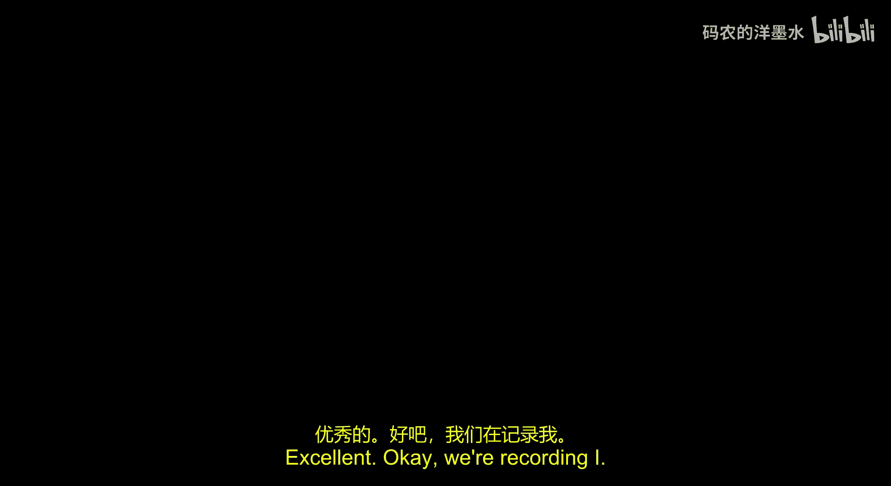
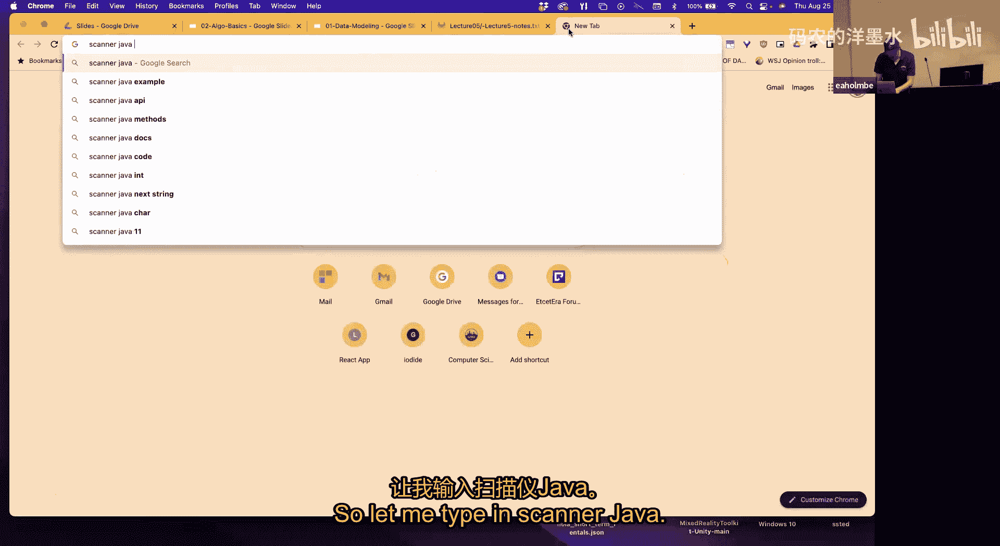
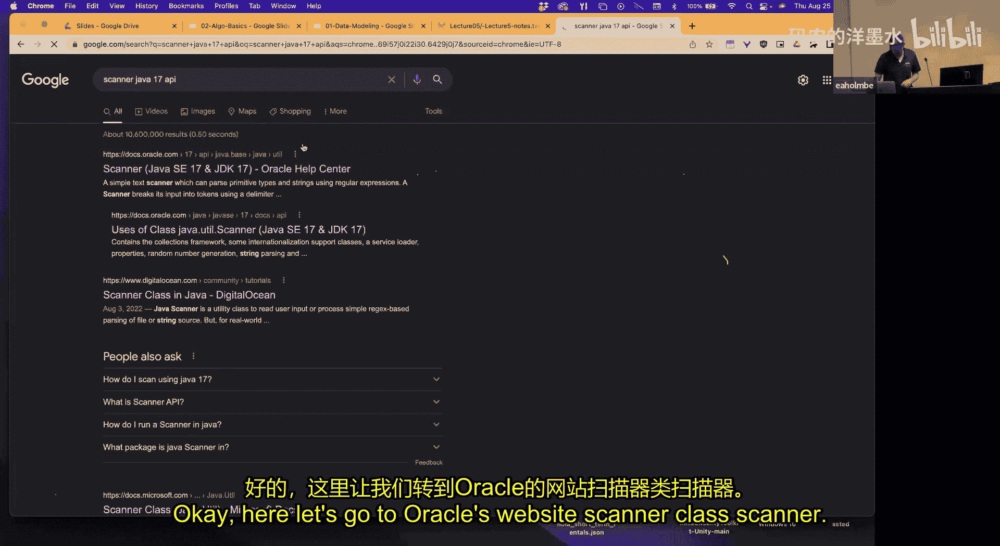
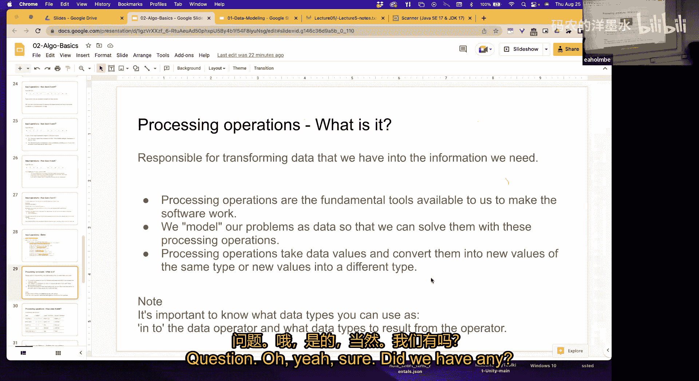

# 【全集】加州理工学院 软件设计与开发 中英字幕 1080P p03 Lecture 3 - 输入与数据类型 -BV1AvzCBdE7a_p3-

Excellent， okay， we're recording。

As。Got it， Okay， perfect。So oh yeah， it's time for start to welcome today to our lecture。

 what is this lecture for now。Smester's going by really quick already so before I pick up where we last left off does anyone have any questions about what we covered previously I actually went back this has been a really good opportunity because i've taught this class a lot of times and for the longest time I just didn't believe in PowerPoint because I thought that PowerPot。

Was the lazy approach to deliver a lecture that you can get into really bad habits with PowerPoint delivery where you just have a PowerPoint and then I narrate what you already see on the slide so before I guess COVID had happened really I really liked having a give and take in the classroom and using the whiteboard to its full extent and have engaged in a dialogue but that's super difficult to do try a couple times now I've had a couple opportunities to try that approach with the online model just doesn't work so I'm slowly taken all my handwritten notes and'm I'm putting them into my own PowerPoint presentation so that I can deliver the content to both the online students but also the in-person students。

But you guys are teaching me a lot， so i'm going to go over some of the slides we went over last class that i've decided to add to it and hopefully in the near future I'll have a complete set of slides that I can just give to everyone else that I think encapsulates all of the critical information that will rapidly get you to the point where you can be confident in software development so with that said。

We talked a little bit about data models in our prior era lectures and we started talking about algorithms and I'm assuming in labs you're already starting to work on very basic algorithms probably input output and some type of processing operation like probably arithmetic operations or relational operations or equality operations and so。

I want to talk more I want to get to that part that's part of this PowerPoint slide but I want to make sure that everyone has a strong foundation this isn't a race this is a marathon so it will behoove us to make sure your foundation is strong here so that when we get deeper into the semester you don't have holes in your knowledge where I can easily trip you off so I'm going to try to walk through a little slower this semester than I typically go and I already feel like I do a really good job of setting a foundation but I think I see where there are definitely places where we could have some improvements i'm hoping this is going to be the best semester yet。

So what I might do though， is close the store。Anyone who like what happened not。So。嗯。Okay。

And I have my computer all cleared up so I can actually operate so my goal is to get all the slides all the slides and the the videos up later today I had a big research deadline today so that absorbed my time immediatelyly after I was done with my slides I no idea it was going to take four full days like 40 hours to get through 918 tabs。

Tooo many too much stuff was open on my computer at once okay so。

Algorithm building blocks let's just go quickly look over what we already talked about and look at the new stuff so here's a new slide that I added so i'll just go ahead and mention some of the content of what I added so before I ran so we had a data modeling slide where we talked about recipes and we talked about being able to take phenomena or observations and map them in a way that we can either quantify them we first and foremost try to quantify a piece of data if we can't quantify it then we qualify it right and everyone we talked about the difference between quant and the qualitative data and quantize data right and so here。

Let me do this。放了。So here。If if I go ahead and。Look at what of the fundamental types of data。

 I feel like I should have mentioned this before jumping right into algorithms。

 I mentioned where we want to quantify things， but then I don't tell you what are our basic building blocks that we use to build every data model that we then build algorithms on top of。

And so it's important to understand that the data modeling stuff comes before the algorithm step。

And I'll highlight that like before you start either reading。

Recipes or you start or you start writing food recipes you have to understand how to quantify heat right you have to know how to quantify time and you have to know how to quantify your ingredients if you go and read a recipe and you don't know what cups are you don't know what hours are and if you don't know what degrees are you're not going to be able to follow the step by step instruction。

So fundamentally it doesn't make sense to talk about algorithms until you learn the data models so this is other thing though so all our data models in Java or just so happens in any programming language it just so happens this is true for any domain where we try to quantify things so this is universally true。

Can be modeled as one of three types of data。As either numerical data。

As either text data or as either booleing data so those are our three very foundational primitive data types at the end of the day。

 that's how we can describe this regardless of what it is we can attach me in those three representations those are going to be our building blocks for all of our data models Now numerical data can take one of two forms they have a form that is exact and there is a form that is approximate and so numerical data is what we call quantitative data but as a number then we've been able to quantify。

If we can't represent as a number， then it's qualitativeated there。Or categorical data。

So integers are exact right when I say the number one one only means one thing。

 and then the next thing inside of the integer data set is the number two and then the number three right they're very exact。

Floats are always approximations and this isn't a computational thing。

 this isn't because computer only have certain amount of memory to track how many precision points they are by definition。

Floats。Yeah。Yeah。嗯。Represents。Well， and part A， I know how I else to describe。But it's not exact。

 So one of the problems that you'll in， let me highlight the difference between approximate and exact What why should you care at the end of the day。

 that's what we should talk about。 Why should you care between these two things you can check on equality for things better and that。

 right， this is equal to that for approximations， you can't look at equality exactly。

 You have to define what equality is based off of the number of precision point errors right So you give yourself some delta range that you said。

 you say if it's within this scope then that's close enough to be considered equal right And so again。

 we go back to the idea that mathematically in order to be able to get our integer map to our flows。

 we have to rely on the fact that the integer 1 is equal to the floating point value of 0。

9999 infinitely。Because that's an approximation so we have to。

 in order to map our arithmetic operators understand that that's a truth thing。

 but it can trip you up because you might have a floating point number that you have inside your code and you might want to check it for you qualify and what you put into the system and what the system gives back to you might be two different values。

And that's normal， like that's a normal behavior of something that is an approximation。

So keep that in mind whenever you use a floating point button， that is a thing okay and then text。

 we call strings and Java， but when you hear strings you think of text and bullying is just anything that's true or false or yes and no。

Okay， so fundamentally， these are always our building blocks。

 whenever we try to do any kind of modeling， this is our quantitative versus our qualitative。

So our algorithms are order seven instructions that rely on these data models。

 but all human knowledge can be represented using these basic units of data that's the entire goal of what we use for scientific analysis and using this scientific analysis in every hard science and soft science and business science and management science。

Or education science it's all about taking your observations and phenomena and mapping it into one of these these units of data so when you learn how to master this。

 you become a very effective a different type of effective communicator than you were before because you can't you won't just rely on natural language to communicate ideas but you can start to rely more on a quantitative or mathematical definition for。

Excellent， is there any questions that did this slide help was the inclusion in the slide。

So fundamental types and data and Java or rules for primitive types primitive types in Java mean that the values do not need to be sort of memory。

 so when I say that Java has a primitive type。It means that every possible value。

For that particular data type is already known inside of the JBM。😡。

It doesn't have to hold the space and memory it can look it up so it's very fast。

 it's very fast look up for values that are friendly so all current data types in Java use the lowercase keyboard so we know as developers if a data type is primitive or not based off of whether it has a lowercase name。

So any type that is not primitive is a reference type。

 what that means is that the values of the data type， and when I say values。

 what does the values mean to you？Like numbers or strings yeah so so exactly so if I say give me a value from the integer data set what might use that number a whole number like the number three is a value it's a exact。

Unit that is defined within the data set， So number four would be a value integer 3。

4 would be a value from the floating point data set。

 right Tru would be a value of the Boolean data set。So when I say value。

 I'm talking about a member to the whole of the type。So again， primitive data types。

 Java by default knows every single member without having to look it up。

Anything that's a reference data type， the reason West's called the reference data type is it doesn't know it。

Intuitively it has to store that value inside of memory and every time it needs to access it it has to do a memory work so understand that's more costly than something that's internal built into the system and if you kind of get that intuitively right？

So we'll talk more about that when we start talking about reference aid high but i'm trying to see some of these concepts。

 let's talk about the fundamental types of data in so like I said there are three。😡。

Primitive units of data that exist， not just in Java， not just in programming languages。

 but in the way that you describe them using mathematical models， right numbers， text and Booleions。

And so numbers I can subdivide into integers or floating points are fractional values。

So then we have our tax， which can be， well， just tax and then we have our ho value。

 which let's see this thing's kind of blocking me slightly。Maybe I can do this。Okay。

 put it up here for now。O。Or what I can do is。Maybe。I can do this。

I can perfect that's what I need to do all this time just move this so it doesn't block the view Okay so。

I create a chart that maps from the most abstract concept of what we're talking about to the more concrete example。

So when we say， hey， Java supports numbers， well， the first thing we have to do is we have to。

 we have to。Split our concept of numbers between those that are exact which is our integers versus those that are approximations which are floating point numbers。

 so let's look at the imagestes first， there's four different types of exact numbers that we have access to in Java。

 the most popular one I highlight in yellow。So the other one here is int。

 typically that's when you'll see the most to represent an integer number。

 but you also have access hookabbyte， a short and a long。

So here I want to highlight all the second column here represents our primitive or reference type stuff everything I want to show you here is the fundamental type。

 so they're all going to be primitive except for this sh。

 this one reference type that I put on here and there's no getting away from。

 there's no way to represent as much as we would love to represent text as a primitive data type is just impossible。

Because you can't store every permutation of letters。Into a into a JM into into a pre built system。

 so right like。Because the number of permutations that we can do with gls is is。Right。

Does everyone see that like we can never get past to letter A because every time I just ask you is that all the amount of letter A's we can have you can always just add another one to the end of it right and that's a valid that would be a valid piece of text right like A valid piece of text。

 AA valid piece of text AAA valid piece of text AAAA valid piece of text。

At no point can I ever stop because if I say， can I stop now， you're like， no。

 I want to add another red completely about。So there's no scope we can see with numbers we can scope for。

 we can say we're going to have a minimal number and a maximum number。

 but even though we we can apply a number ring to our letters， we can say， oh。

 is it alpha numerical order， there's no true ordering in terms of how we can store them。Yeah。

So that。😊，Unfortunately it's going to be the one reference side we have to deal with initially Okay。

 so what's this third column here well this is to give you a clue of how much space and memory each of these data type types take and consume。

So you'll learn much more about this when you go into assembly， but understand that again。

 computers are non intelligentology。I can't even call them stupid because in order to be stupid。

 you need to have intelligence。Computers are non thinking entities right and so the idea of being able to know information that is a human characteristic。

The ability to understand what it means to have these three different data types， true false。😡。

Or tax。Or numbers right like computers don't know what any of that stuff is so how do you think a computer can track it how do you think a computer tells the difference between an integer and a piece of text and a floating point number。

走一下。We have to encode it。Its always抽。And so。What do you think the basis of encoing in the computer system is。

 So a computer doesn't know。It doesn't it's not really aware of what it's processed all it knows is that it has a register of values that are represented as binary units。

😡，And so a binary unit is is one of the few things that a machine can discriminate against because it can be represented as an auto switch。

So a machine understands if a particular state is on or off。

And so what that allows us to do as computer scientists is identify or define a base two numbering system。

So base two numbering systems is everyone familiar with numbering systems on multiple bases like where you have a so right now the base you probably are most familiar with is the decimal base number right you go from zero to9 and then you start a pattern of repeat。

 but there's other number systems that exist like there's a base 12 system that lot human society used before the base 10 system became very popular。

There's the B eight system which is really popular in computer science base it seems supremely useful。

 phase two is foundationally important， so phase two is the numbering system by which we encode all of our knowledge into computers。

And again， it's because of the concept that each individual binary unit。

 which if I can those terms together I call that bit。

 a bit stands for one singular binary unit to be represented like as a light switch that's either in an on or off position so I can I can encode concepts to that like I can use those as the words in a computer language so for instance。

 if I had one bit， how many states can I define to that。Two， with one big， right。

 I can have the definition for when it's on and definition for one is all， right？If I have two bits。

 how many states can I go ahead and define to？But yeah， four because I can define。One for zero0。

 one for01， one for10 and another for one1， right？Pretty much the way that you can understand the number of definable terms on a binary sequence is if you took the number two and you put it to the square the power of however many binary units you have。

 right？So if you had one bit two to the power of one is two different options if you had two bits。

 two to the power of two is four if I three bits， two to the power of three is eight right so that's eight different if you did by hand if you encoded in000001011 and just if you walked it all the way through you'll see those eight unique combinations of just zeros and1 So at the end of the day every piece of data that we're decocoding in machine is the same set of encoding。

But we give it a context that so like the ten number that we have and the floating point number is just a combination of zero and1。

The only way that the computer knows whether it should be a floating point or whether it should be an integer is because we tell it which。

W it's supposed host to parse that binary sequence。 That's why it's important to define data type。

 Does that make sense， So when we start defining our storage operations， we have to define hey。

 this is going to be an integer data type and then the JDM dose oh So when I see this binary sequence。

 I know the parset using the encodings for integers and have the encodings for floating point companies because to the computer it all looks the same it's just a sequence of audit off switches。

Or on and all states more a， not only scratch that that that's a switch。Inside of a computer。

 it's a stake。DoesDoes that course make sense and it's a sequence of ordered states that it uses to encode information and then we use software to decode that information into whether it's going to be a floatinging point value or whether it's going to be an integer or whether it's going to be a booleing value so we do all the work about to translating and giving context to what that binary word is again。

 you'll learn much more about that in asse ways and this is just giving you a taste of how data is fundamentally stored inside of our systems。

Okay。So this gives you an idea of how much space these consumes， typically in a computer system。

 the smallest amount of addressable space is a bitete。

 so the individual bits don't have their own addresses a bitete does so a bitete is a group or a sequence of eight bits。

 so eight bits makes a bite。嗯。And so how many possibilities do you have for that。

 what's choose to the power of AC？s four no。我希是分意思。3。さ。Right， but， but okay。

 so so but let's see how this， let's let's see how this starts to process out。

 So notice you can start seeing which of the experimental types are smaller versus larger Would you believe that there's a data set called bite and guess what the size of it is。

It's a byte yeah， or eight bit so one of these represents a byte is what we're seeing here or the min max value of a byte it's an inteature can be represented as an inte value。

 it is negative 128 to positive 1207 zero counts towards the positive n so the negative n always goes one more than the positive n。

Or zeroero is a non negative value。0。20。So a short is twice as large as a byte， it's two bytes。

 but look at how much we gain in terms of impossible encoding values。

 resulting from minus 1208127 to minus 32，768 to 32，767。

Now typically this is still not enough numbers for most applications。

 the reason why we use integers is well， this is four bytes at 32 bets and it gives us what it minus 2 billion to positive 2 billion for most applications。

 integers are enough。But in these rare instances， you might need something larger than an energy。

 right， like let's say that you're count the number of ats in the universe。

And that's not going to be big enough， or let's say that you need account for the number of people on the planet。

That might not be enough either， right， so if you do need a larger value than this。

Then you can actually use a along， a along is twice as big as in it， that's eight points。

And I don't even know how to pronounce that number。Yes。It's just a really big number。

 a number that's probably fair than you'll ever need。嗯。Okay。

 let's look at the fractional numbers so we can define our fractional numbers by float and double now like I said before where with our integers。

 those are exact so we can give one unit per integer right so that gives us like the difference between like 2 billion to 2 billion negative 2 billion to positive billion。

But for numbers， what we get from the shore space is an amount of precision points。

So it's going backwards， not forwards， so with floats。

 you only get six to seven precision points of accuracy。With double。

 which stands for double precision， double precision as compared to float because its8 bikes instead of four bikes。

 you get 15 to 16 decimal points。 So in your applications。

 you always want your approximation to be as close as。What it's supposed to represent is possible。

 so you should always use a no data type as opposed to a apply。Almost never use both。

 pretend closedstonet exists。Okay， for strings， there's two types of strings。

 strings are reference size we talked about why， but look。

 I actually can consume memory on a string four buttons， what do you think that is。

 what do you think the memory consumed for string is。开始。Yeah， it's that hexagonal address。 Y。

 so the value is the address in memory。 so the string can actually be really large。

 the string can take up several addressable bytes of inside the computer system。

 but the address can access where the stream reside and memory is always going to be the same。

 It's always going to be a four by hexadeimmal address regardless of how big the actual string is。

 So again， another way you might want to think about that。

 I like to tap into analogies a lot is think about houses。

 you can have a small house and you can have a very large house but their addresses are about the same size。

 right。If you mail them a letter， you can't， you don't know if the house you're going to give them a letter to is like a little hovel orin be like a city block mentionch。

Okay， characters or cars are these really weird ans， they represent a singular character。

Which is kind of like text but that character inside the system is encoded with an an code。

 so it actually also represents syn number so the way we can translate between our text to numbers is with the cards the power is a primitive data type and it takes the form it has a dual form of both a singular letter and a number。

And again， that's only going to be two bytes because it only has to encode all of the characters on your keyboard。

Yeah。And finally， Boolean is one bit， it's only one bit because how many states does the Boolean have two truth false。

 but now this is one of the interesting things。In't I claiming that the smallest amount of addressable space is a bitete。

 how can we actually have a data step type that only consumes a bit？他在方手。

What do you think the intuition， what do you think the answer is that？

Because bulloleying represents on and all it does， but normally if I want to save that a memory I can't have a space any smaller than a fight right that's even if all I want is a bit usually the smallest allowable space I have access to a fight。

 but the reason why booleying is allowed to be a single bit。

Inside the Java is because it's the primitive data types， so they are able to have access to。

The one bite and actually allocated for other things so they might have。

Ding a particular bit inside of a byte addressable space and have access to that。

 So it's an optimization fit just to understand highly optimized is not actually taking any computer memory is actually inside of the JDM so it can reserve that space however at once and it allocatess own addressable space on top of that but normally you can only have something that is a byte。

 So I just want to highlight that if you look this up， it's actually a bit。

 but it's because it's a private data。 you cannot do that with reference from same time even。Okay。

 is there any questions， does this all make sense？Does examining these data types in the table like this helps？

嗯。嗯。What do like。And shorts even really exist if you're using ins。Well， that's a good question。So。

Way back when Ja was first created we didn't have the wealth of memory that we have now， and in fact。

 that's still the case in embedded systems， so where it might not make sense when you're on like a laptop or you're on a server and you have like unlimited amount of storage resources that's not always the case in a system where you're building software that lives on a chip itself and so for optimization reasons。

 if you don't need something that goes from-2 billion composite 2 billion and if you actually have a limited amount of memory footspace。

Then it behooves you to use a short if your numbers of organ just be between by one and 10。

 for instance。So it allows for you to be able to highly optimize your code to minimize your memory footprint so that's versus foremost instead of just giving you one blanket data type。

 they give you optionsness to select so that you can make a analysis of what is best for your own purpose now that's true for short that's true for and that's true for long too lungs are there in case you need a number that's bigger shorts are there in case you don't want to use all the memory that four bytes it' really selling right like four bytes doesn't sell like that much but I guess in some very limited like high embedded systems that doesnt make a difference then by bytes actually are super critical and you'll actually be using bytes as a data type in the next class and so remember we use the metaphor of the way we import data into our application and we export data out of our application using the concept of the streams right。

We think of it like we have a river stream that flows in the app and like something on the outside throws things into the river and we pick it up on our side right and then when we want to send stuff out of our app。

 we throw things into the river， but what do you think we're throwing into our stream？Right。

The fundamental unit that。We encode things as bitetes。

 so when we're actually importing applications and exporting applications， we're doing it at a data。

 we're doing it at a bitete level， so this is the data types that Java has to depend on because this is the fundamental unit that we encode things in。

So that's why this exists， that's why I bites this and you'll actually use things like betterer ways to be able to access the input or output stream and be able to read back things like data actually and pull it not as text。

But as as like a represented piece of data from another application。

 so as actual objects and floats or even more complex objects that contain multiple pieces of data。

Does that answer the question。Okay， I think。That covers that slide。Let me go back over here。

 let me say I probably can't see me， okay。Okay， is there any questions about this？

So usually this isn't something we really go this and depth on but I think that there's a value here to be able to map firm understanding how many bits are in one byte there are eight bits to one byte and a byte is the smallest addressable space so a bit represents a singular binary units but we usually group those units in a cluster of eight and that's the what we create a binary word so if we want to think of having a computer language the characters and language which are zeros and one。

But we group them in the form of eight， so if we group them in the form of a sequence of eight。

 we can represent those as two hexademal values， that's why if you look at a lot of binary code it actually using letters in there as well because a hexademal representation rotates after 16 unique characters to that 0215 so 013。

4 by67，89 and then A B C D EF。And so the calf represents 15， right， you know， the A represents 10。

 the D represents 11， the C represents 12， the D represents nearly other。

We're all the way to you to help。Again， that'll have more meaning to you when you go and into assembly so this will all be information that you use in some later information it's just backgrounds information right now like you won't things that i'm giving you aren't going to help with building software except that it's going to give you really firm understanding about what you're building on top。

Okay， so there's this concept of literal values too I want everyone to be super aware of where a literal value is a literal value is just a very welldefined value that's inside of a data type so like if I say give me a literal value of the integer data type。

 you can tell me the value three right in Java that is in a demo literal value a literal value of a long with me it could be a very big number。

 it doesn't have to be a very big number though it could be an032 as well but the way we distinguished between it and longs in Java is that we have to supply some other symbol so it knows partsin as a long as opposed to an inger so we usually put an L as part of the number。

And so then Java knows if an L is attached the end of the number。

 that that's a long data type and not just an integer， the integer is the default value。

For a floating point， if you want to use a float， which I highly suggest you don't。

 you should just drop it from your memory that it exists there's whereas ins or four bytes。

Right and longs are eight by and we preference the smaller integer versus the long。

 we always preference the double versus the flow because the only gain you get from using a long is if you need bigger numbers。

 but you always gain from using the double because it's a better approximation。

Becauses 1615 decimal points first nation as opposed to5 or if so because of that。

 the default value of the double is just a numerical value that has a rate points。

So if you want it to be af floatat， you actually have to put the F after the number。Okay。

 characters are usually identified with the apostrophe symbol， so a single。

 I usually call that single quotation。I guess。This is kind of annoying moving around。And in strings。

 you several quotations。So remember， a character can only have one singular letter。Or parishter。

Whereas a string can be any number of parent but of course that's a reference data types that's not technically the primitive data type we treat it as such because it's a fundamental building block for building data models but conceptually in the computer science world there's no way to actually sort as a prim data type this is not a closed set of values。

So that's the one thing all these other ones have in common is it's a close set of values close means that it's it's well defined that there's a set of map that's finite right close means that it's a finite set。

We can't unfortunately define a finite set that evers at strength and then bullolean that's is true or false。

 but keep in mind that true and false are in all lowercase that's going to be how the。

 primitive of keyword and Java are typicallyly always lowercase。

The only ones in our uppercase are classes and interfaces， which is our type of class in fact。

So weve seen when we did our hello world， how we defined a class。Okay。Okay， note to self。

 move those to the data model section。Work in progress。

Okay oh and then I made this new slide what is an algorithm now that we talked about data models ways to measure things around us and model that in terms of quantitative and qualitative properties to make use of these models we use algorithms right models are just a way for us to measure things。

But it's an important way because it's the first step we need before we can start even talking about algorithms。

 like again， a great example of algorithms of my favorite are recipes。

 but a recipe doesn't make sense until you understand what the measures are defined inside the recipe。

You've brought up with that so that's something that's super easy but if you've never counted it before。

 then you'd have to learn what minutes are and what temperatures are and what cups are and what so using emergency just talking about this。

 using the recipe as an example weve talked about data models as it's a quantity of time that's a thing whenever you're thinking about how we're defining things it measures so it's a quantity of time。

A quantity of yeast， a quantity of ingredients and if it's not a quantity then it's going to be a qualitative data of categorization anyway once we've established a definition for those things we can start design our recipe so only after we know our data models can we start designing our recipe and what is our recipe well it's an ordered set of instructions that's all it is。

6。Okay。😊，Well， I think。Oh I went up okay let's see here so okay and we already discussed this so we said just inside of now this isn't true generally you can build algorithms algorithm1 on pen and paper but when it involves a computer there's five basic building blocks we have to become accustomed to and we're gonna build our algorithm to automate our algorithm design so we have output operations the storage operations the input operations process and operations control operations we already talk about the output operations that storage operations and I'm hoping that talking about the data models as their model Java will make the storage operations a little bit easier to understand now so i'm not just throwing things out so for instance I oh I don't know I keep doing that。

So for instance， I showed you the other day this print app and made me realize I should talk more about the data because that I got some questions about print app the format of print strain and what all the different。

A placeholders off and so it just so happens that on the placeholders we can put in a format of string and app printed statement that correspond to all the data types that exist job。

 so it would belu me last class to show you what I showed you this class when I showed you print。

So for instance， if I use percentage task that says hey I want to embed a string into my formatted string so the way that print app works is I have to have a formatted string here and then my formatted string so that's going to be the thing that's printed with the thing that I print。

K have placeholder values， placeholder values are these things which represent something that will be replaced with something else。

And then if I was going to have a placeholder value for each placeholder value that's in my format a string。

 I have to have a comma separated list inside of my preheses here that gives a value for that so for instance。

 if I had something like this。😡，Like I could have a tax and then I could do percent ask so this would be one placeholder value inside of this print as so if I have at least one thing it's going to be replaced with something so then I would have to put a comma here and actually give back a data type of a string because it's a placeholder for a string so I could put something like I don't know。

So I can do something like this like world。And so what's going to happen is when this goes to friends of the terminal。

 it's going to take this value and it's going to put it where that percent S is that。

But I'm not just limited to string， if I use C， I can do a character， if I do D。

 I can do decimal integers， if I do app， I can do floating point numbers， if I do D。

 I can do booleing values and so again the real powerful thing about print app is I don't have to put a string literal here I can put a variable there and I can mutate a change state over time so that the actual makeup of my string can be a dynamic it can be mutable。

 it could change what the printing as the application runs So print app is a very powerful print statement inside of our tool inside of our arsenal。

But see how print apps was a while in this concept of understanding our foundational and fundamental data types。

嗯。So that might not have been super clear last time。It should be a percent sign there。Okay。

 so and then here， don't need to talk about this anymore this。Because we already did that。

 so let me put。Delete。Put that in red now I'll just going to move on。Oh， there it is。2分。嗯。Okay。

 let's see what else we have are。So I think we got this far right does that remember this slide from last part where we say okay for storage operations there are three different types of storage operations operations assignments and initializations。

So source operations are responsible for saving data to use for future steps by default。

 any data that we process on a line is discarded it's not automatically remembered so if we want to store data for future use we have to put it in a variable so in order to put in a variable we have to we have to declare that variable a variable declaration requires two pieces of it requires two things the type of data that you want to store because again you got to tell the JDM what encoding is it going to use to translate the binary representation or whatever the actual。

Contexact of the data is， and then the second is a name， a reference。

 a label and id Where are you going to call in your application and that label。

Should be meaningful it shouldn't just be like。The letter acts。

If you're trying to represent something that represents within your application， use the word with。

this height is the word height。If it's number of students。

 then do student counts or number of students。And so this is what's going to enforce what's called kind of self。

Documenting code， or readable code or literate code， these were all terms for the same thing。

So that just by reading the source code， you will understand what your model。

 what the algorithm does。She。Okay， so declarations are where we store where we declare that space and memory and we bind a memory address to the label。

 assign this is where we use the label to access that memory address either to write into it or to read from it。

The initialization is just a declaration and assignment all at once。

 where we declare and decide at the same time。And again， if we just look at the source code。

 this is a initialization because on this side。Yeah。好。As if I cover this up here。😡。

I see in that's my data type right and then any this could be anything。

 but you should strive to make this as readable as possible so in at' your number。

 then this would just be an assignment。Insure number is equal to 10 when it's combined and is' both a declaration and an assignment。

 this is an initialization。So this is initialization， this is an example of an assignment。

 this is an example of initialization， initialization， initialization， initialization。

 and initialization。Theres some reason I never showed a way for Justice a declaration。

 but if you wanted to say just a declaration， that's what that would look like。

Where you can just go ahead and declare a variable。

 but not a sign of value utility and so one thing in Java is you can't。

Write or read from a variable until you've declare it， you have to declare it。Before you can use it。

So let me ask you this。When might you use declarations versus when might you use initialization？

Why wouldn't you just initialize all you did。Sometimes you're going have to have their vehicles change over time Yeah。

 I mean yeah， I mean sometimes you might not know what the initial say of the data hit right let's say for instance。

 I want to compute a sum and so how do we define sum mathematically what is the definition of a sum wait the average I'm sorry let's say if we wanted to take the average a sum So what's the definition of an average。

Yeah我咪s right yeah me say。The sum of whatever the values are and you divide by the account。

So let's say that we can initialize the。Count and let's say we can initialize the sum。

 but we can't necessarily initialize the average because that's the thing we're trying to solve so we might declare that we might initialize the other two values that we take the sum we divided by the account and then we can assign that into the variable we declare earlier in our application of location So understand there are instances where you can know that the value is ahead of time but there's instances you know you're going to need it。

But you don't have it yet， that's when you declare it and not initial does that make much make sense？

Okay。Okay， okay， let's go into input operation we we certainly haven't talked about it。

 so input operations are very similar to output operations that they work in the reverse direction。

Our operations are responsible for getting data into。The program from the outside。

 let's replace user because it doesn't have to be a user could be another application。😡。

So let's just put from outside。From the outside。嗯。Yes。对。Okay， so what is it or？

So using the concept of stream， we can flow data into our app from the outside。嗯。

And we'll you'll learn much more about streams in the next course。

 but we'll just make use of system in and system out so however， with input the program does not。

The program does not what the data is， does not know。哦。Okay。

I like pointing at slide so I'm constantly oscillating here the camera。

Input is a little bit more challenging than output and why do you think that is？

What do you think the intuition did why do you think input would be a harder thing to handle that output because it's unpredictable based to exactly we have an unfair vanish with output because we're the ones who are sending the thing out sending the data out so we know how much data is going to be part of our cargo part of the thing that we're shipping。

But we're getting to shipment in we don't have any control over what what is getting passed to us right so there's kind of like a management task there's kind like an inventory tax there right where we need to be able to read things off of the stream and decide whether we have all the information or not。

And， and where the cutting off point is and where we start to translate it into some kind of meaningful form of data。

So because of that， it's a little bit more difficult to get access or to get data into our application than to just get it at。

Now， again we have this system class that's given to us from the Stanford library we saw previously there's the system dot out that's the output stream that we make use of that has the print statement that allows us to send our data out and then print it out to the terminal Well system also has an input stream system dot in and we can use the system input stream to get data into our application。

 but we can't use it by itself system dot in doesn't have methods by system do out does by print methods system in has to be used as has to be route around something like a scanner that can scan the input stream and the scanner has all the logic。

 it has all the knowledge on how to read data how to read the bytes from the input stream and how to convert it into data that's meaningful us how to read it as text or how to read it as in a Jerusalem or how to read it as doubles or how to read it as bulloleing。

And you've probably already started seeing that in last。So for instance。嗯。For instance。

 imagine so how does it work how do our different operations work so imagine if i'm typing away in my keyboard right and I want the system to load all the type keys as I press them in the order that I press them in right that because when I type things in when I provide data in a stream。

It's not just the data that I care about but we ordering also matters right that's when we use the concept of the streams because it allows us to create an order of unit one of data unit two usually pull those tokens So the data that's inside of our stream as token1 to2 to3 token 4 and then we can plug those tokens out and then we can convert them into what we expect them to fit But suppose that we're trying to predict what scanners going to do for So we're just typing letters on the keyboard then we might represent our input stream is this right Ityping H and H is going to go the input stream and then and E so if I type how low world and then that's the inner key right then I hit enter。

Then what's being loaded is a set of characters， right， H E LLO space。WORLD， New Line Par。

So this is the state of my input stream， so if I type this text。

 then what should be the first word like if I'm just looking at the input stream and I had to make this decision。

When would I decide to stop？Would it be after？Just the H。Should it be when I did the space？

Should be when I hit the inner key。I mean， no， let me ask you this， is it all of those valid？

Maybe I do want to just have the singular character。Or maybe I want as my delimiter。

Where there's a space and grab a single word at a time。

 or perhaps I want to grab the entire piece of text all the way up to a new line character。嗯。清楚。Yes。

So this is a logic that goes into determining how to pluck this information and decide how it's going to get read。

 how it's going to get parsed， how it's going to get packaged into the fundamental data types that we have in Java。

嗯。And this is a this can be a relatively challenging problem。

 but guess what it's one we can ignore because the tools for parsing the data and industry decision tools。

 there's a class in Java。 package called Scner。That the entire purpose of the scanner class is to read input streams and parse them into the data we need in our application。

So yeah， we have the standard object， the standard object has a popular buffer。

 which holds multiple characters of data at once。And so the standard job is determining what constitutes a whole piece of data and translate that text into a data model that we want。

I'm going to just stick around here so I' stop moving the camera so much so imagine we have this input stream one two three four five space six789 new line character。

😡，The first number。Is not necessarily one right we wouldn't just plug that one even though that's a ballot number。

 you probably would want to puck the integer all the way until you hit the space and in fact that's what the scanner object is going to do when you look for the next int the delimiters are a space。

 a tab or new line character。😡，So here if we put next in it's going to grab13345 it'll grab or more precisely that's 12245 and then the next number we could pull would be 6789。

😡，And so we can even tell the scanner object to pull a next int and if the system do in is empty。

 then the program， our application will pause and wait until tokens are inputted into the system。

 input stream。😡，So do keep that in mind with the scanner object is that when you run your application。

 sometimes it will wait for input， it'll wait until you insert something from the keyboard。

And so here， has everyone seen an example of this in lab already？Does this look familiar？So again。

 the way that so we don't unlike the Java do line package。

 which is by default in automatically and implicitly imported into all of our software， we have to。

Mannually import the scanner class if we want to use we have to explicitly do an import so here we would import from from the Java standard library is a package called U which has a lot of utility classes that well use throughout the entire semester will get very familiar with Java。

U the first one that we're going to use from this package so it is going to be the scanner class。

Once we import the scan class then we can start using it now the scanner class also like string represents a reference data type it's something we have to store memory and not something that is primitive in the system。

So here when we do our declaration， the data type for our scanner objects is going to be scanning。

Then we can give it a label or a reference so that we can use it through our application I like to call my input but you could call whatever you want right that's just a reference it could be keyboard。

It could be。Those are the two common ones that usually see keyboard or input。

 but it could be literally anything you want to do this doesn't matter this is super important you have to use the data type though because it's a very particular definite data type Okay so here I'm doing a declaration then I'm using an assignment operation the assignment operation is a single equal song。

If you want to do equality， you use two equal signs， we'll talk about that later。

 but one of the biggest。Mistakes early developers use is confusing the assignment operator from the Equals software。

In math equality is defined a a equal sign in computer science is to equals in computer science the single equal sign is an assignment it means the thing on the left hand side I mean I mean the thing on the right hand side is getting moved into the thing on the left hand side so what that means is an assignment operation the thing on the left hand side always has to be a variable that's linked to some memory address。

And the thing on the right hand side always has to be a value or something that resolves into a value。

Now here we're using new scanner， we're going to learn more about the new keyword when we get to augment join programming just understand in order to use a scanner。

 we have to build a particular instance of it， we can build instances of things and Java using new keyword so we'll call a new and it will'll call the scanner constructor。

To build us a scanner object that we can use in our application and so the scanner object needs to know the thing is going to scan so the thing is going scan is the thing that goes in between the parentheses and so we want to scan the input string Scner is a really powerful tool there's more than just input strings that we can use a scanner on they can use it to scan elements in a string for instance in a parcel string it data as well because the string represents a sequence of characters just like the input stream does we can also use the scan on a file if we wanted to pass a file descriptionscript and then we can use the scanner to read the concept of a file So if scanners are kind of multiuseful in the fact that they can be used to read strings they can be used to use string to read strings or they can be used to read files。

In this course， we'll predominantly just use them to read our link stream and maybe strings in the left。

But understand， we have to tell it what it's scanning and that's what we're doing now。是。

And so by default。The way that we call our so once we set up a scanner onto a data source we can then call next on it now by default the next method and notice we're calling that on the variable so what happens is restoring this variable that represents our standard objects for scanner object it has a collection of methods we can it has behaviors tethered to it let me show you the API here。

😡，So again， whenever we encounter anything new， all of our answers are in the documentation。

 so let me type in scanner， Java， what version of Java you use in 17， probably。😡。

Okay， here， let's go to Oracless website scanner class scanner。

 it is inside of the u package right Javava。ut so we can see right there。😡。

We can get sample code and get descriptions。The documentation on Java is very good。If I go here。

 this tells me all of the behaviors。😡，That I can find out from scanner， so you have like hasz necks。

Or has next in or has next double or has next float。

So this allows me to look at the state of my where the scanner is at inside of the stream or whatever the source is and determine if that piece of data is the next thing that can be read from that。

😡，So that returns back a boolean value， something that's either true or false， right？Alternatively。

I also have nexts where it's actually going to。😡，Read the contents it's going to grab the contents from the stream or the file or the string and parse it it's going to return it。

 but then it's going to move to the next element， so when you do next that's kind of a destructive action by destructive I mean it's taking something that's currently in the stream and removing it out to stream and providing it to your program but once you do that it's no longer in the stream any longer。

😡，And so there's a next method for each data type that we want to go ahead and contextualize from our stream so we can read data in as text。

 our strings， we can read data in as ins we can read data in as doubles I mean look at all my options here these are all the options we could do it as next line next line so by default next uses as a delimiter。

😡，Either a space， a tab or a new line character， new line explicitly only uses new line characters as the delimiter。

 so it won't stop reading a piece of text when it hits a space or a tab。

 it'll continue reading from the input stream all the way until it hits the new line character。😡。

So sometimes be wary of this， you'll probably encounter this。

 you might get an error from this so understand this now if you do next int it only grabs the number from it。

 it doesn't grab the new line character so it can leave a dangling new line character in your int so if you try to do if you try to read like inger and then try to read a string after that you might not read the string you think you are because you might grab the new line character from the string and it thinks that's the string you're looking for so you'll probably encounter that if you do understand thats a possible kind of edge case that sometimes happens。

😡，Oh， I'm already on myself here， perfect。Okay， let's actually take a quick demo and。Of this。

 of this and for me I to I like to touch the board。Touch this slide interact。

 I like had to be interactive with Okay so that import statement this on the first time you had to do an import statement because for output operations。

 which use a system that's part of Java do length， we get that for free string is a reference type that actually also exists in Java length but we don't have to manually import that that's given to us for free in every job application but the moment we want to scanner。

 we have to import it some very first line of our code。

 even before we define our class is where our import statement go So keep that in mind。

 do not import inside of the class definition， it has to have them before you start your class application。

 So here I will import and then I got to give the path the class path of where that scanner class exists at And if you need to find where that's at check be done the API should be your source truth for all things job get used to that now because that will benefit you as you progress as a developer moving。

ForwardJava。 scanner and so highlighted yellow has been part of the code that we really care about for this particular operation then we have our class definition remember that our class has to be named with the capital letter of ourcase ladder and then we use the cur braceness to define scope I'm indenting so this is easy to read right then I got my main method remember all of our statements have to own methods all the methods have to go into classes all of our classes have to go into packages that's the way Java keeps all the course code organized。

Here I'm going to create that scanner when I create my scanner it's easy just to initialize it as opposed to declare an assign。

 so I'm going to create that scanner and I'm going to scan on system do in。

The input stream so again the input stream by itself doesn't have any built in methods。

 but scanner has plenty and so we'll use a scanner to parse and read the input stream for us so that we don't have to understand the logic of encoding things from bytes into date。

Handled for us。Okay， so for example， suppose I wanted to grab a line of text all the way up through the new line character so I want to be able to get so for instance。

 a name a name might be a first name and a last name right so you might have a space in between so this might be in instance of where I want to do next line so next line could have Ted space homework。

And then I can store that into a variable。And then I could print that with a formatted string。

 so these are all statements， the ones that aren't highlight yellow those observations we've already seen。

Here into a year， well I can use my input， I can use my scanner object to scan for an integer so it'll look into our input stream and it'll try to read the next piece of data as an integer data type which means I can then store it as an integer data type inside of our application and then we can print that out and if we I're going to put that up I got to use D right for a additionalal integer。

And then if I want a double value because hey， I want to enter some dollar amount here。

 I can then ask my scanner aate give me the next double from the input stream and then I can store that it's going to return it back to me so it now exists inside of my application and so I want to store it so I can access it later on this line here so this is a good example of an application that's using three of the five foundational operations that require us to build out our algorithms right。

Output operations， input operations， storage operations and。Out operation。

So we're doing outs we're doing ends and we're doing stores and you'll see how they all combine together to start to build something that looks more like a real application。

 we're not quite yet there yet though we need to start talking about processing operations to really start making interesting things。

😡，Oh。So I only have a few minutes left so what I'll do is I'll motivate the concept of processing operations so we just the easy stuff first we talked about how to store things so that we can use it later we learned how we can import things how we can get data into our application so that we can use it in some kind of way or we talked about how to send things out because after we're done processing it it's probably not useful just to exist in the application how we the user wants to see it or we got to use it for something else right like if there's no output we're doing all this processing and no one gets to see。

That would be a waste of time so clearly they adopt operations。

 but the crux of what these three other operations allowed us to do is to get into the system so we can start processing it into a meaningful way。

So like I love going back to the rest of the example， the rest of the example。

 what we are processing operations， its the things that mutate the state of our data from。

One set of values or one set of type into another set of values or another set of types so in cooking our processing operations could be things like dicing cutting or things like that right you're actually mutating your ingredients or when you cook something you're changing the state of your ingredients from one thing to an up right so there's this concept of processing on top of the ingredients and cooking that fundamentally by processing them translates it from your initial status of ingredients of like flour and eggs and sugar and milk to allow you to produce something like a cake。

And so what are processing operations that we have as defined by our data mode。

 so things that are numbers， things that are text， things that are booleing data。

 we can use some foundational processing operations probably think you already know to convert those to translate those into new results that we can then model as a new data something as the solution to what our application solves。

To be the answer that you're looking to do1。So that will talk more about these processing operations。

 what they are， definitive， more， more academically， and how we use them in Java next class。

 which I guess is on Tuesday。Excellent thank you for coming to class today。

 thank you for watching the lecture i'll try to get these lectures up today or tomorrow they're done processing。

And。Yeah。yeah， sure， did we have any？

