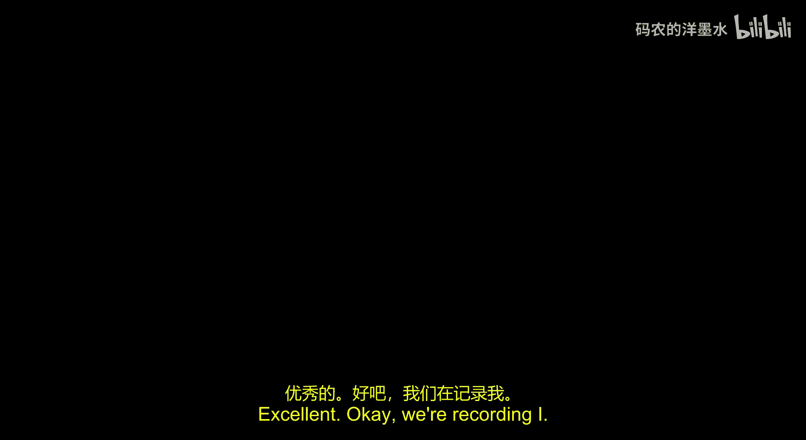
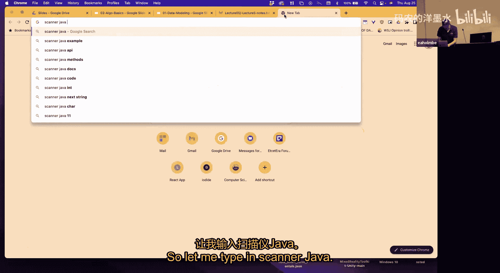
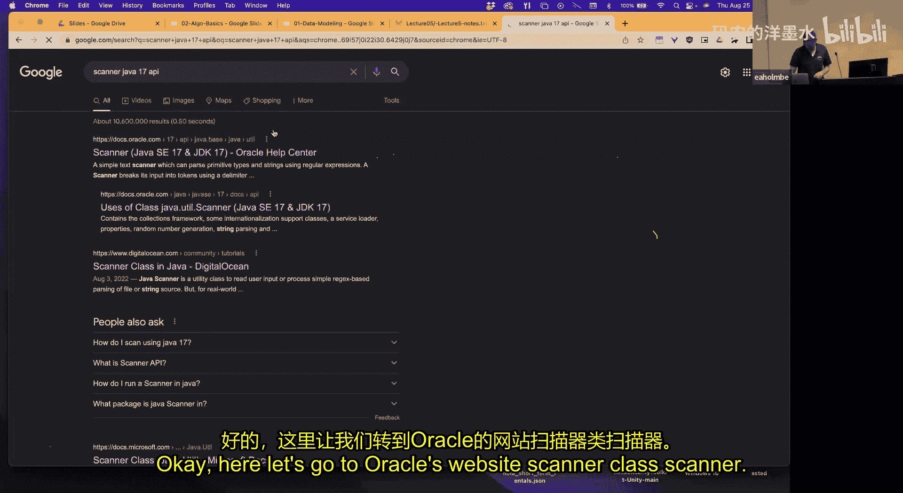
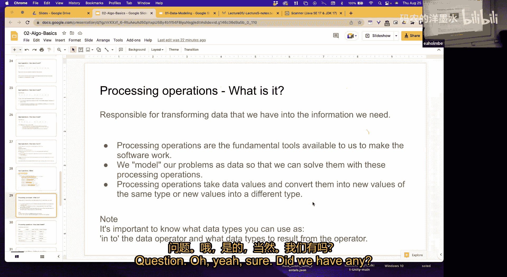

# 软件设计与开发：第3讲：输入与数据类型 📚



在本节课中，我们将深入学习数据建模的基础知识，并探讨如何在Java程序中获取用户输入。我们将从理解编程中最基本的数据类型开始，然后学习如何使用`Scanner`类从外部（如键盘）读取数据。掌握这些概念是构建有效算法和应用程序的关键第一步。

---

## 数据建模：基础构建模块 🧱

上一节我们讨论了算法和食谱的类比。然而，在开始编写算法（食谱）之前，我们必须先理解如何量化我们的“食材”。这就是数据建模的作用。

所有数据模型，无论是在Java中还是在任何编程领域，最终都可以归结为三种基本类型的数据：

1.  **数值数据**：可以量化为数字的信息。
2.  **文本数据**：无法用数字精确表示，需要用文字描述的信息。
3.  **布尔数据**：表示“是/否”或“真/假”状态的信息。

这些是我们构建所有复杂数据模型的基础“积木”。

### 数值数据：精确与近似

数值数据（定量数据）可以进一步分为两种形式：

*   **精确数值**：在Java中称为**整数**。例如，数字`1`、`2`、`3`都是精确的。
    *   公式：`整数 ∈ {..., -2, -1, 0, 1, 2, ...}`
*   **近似数值**：在Java中称为**浮点数**。例如，`0.1`、`3.14159`。由于计算机内存和数学表示的限制，浮点数通常是近似值。
    *   核心概念：对于浮点数，不能直接使用`==`判断完全相等，通常需要定义一个误差范围（delta）。

### 文本与布尔数据

*   **文本数据**：在Java中称为**字符串**。它是一系列字符的序列。
*   **布尔数据**：只有两个可能的值：`true`（真）或`false`（假）。

---

## Java中的原始数据类型 🔢

在Java中，上述基础类型有更具体的实现，称为“原始数据类型”。原始类型意味着Java虚拟机（JVM）预先知道所有可能的值，因此访问速度非常快。它们的特点是其类型名总是**小写**。

以下是Java中主要的原始数据类型及其关键信息：

| 抽象概念 | Java 类型 | 内存占用 | 说明与示例 |
| :--- | :--- | :--- | :--- |
| **精确整数** | `byte` | 1 字节 (8位) | 非常小的整数范围：-128 到 127 |
| | `short` | 2 字节 (16位) | 较小整数范围：-32,768 到 32,767 |
| | **`int`** | 4 字节 (32位) | **最常用**：约 -21亿 到 21亿 |
| | `long` | 8 字节 (64位) | 极大整数，字面量需加`L`，如 `10000000000L` |
| **近似浮点数** | `float` | 4 字节 (32位) | 单精度浮点，精度约6-7位小数，字面量需加`f` |
| | **`double`** | 8 字节 (64位) | **推荐使用**：双精度浮点，精度约15-16位小数 |
| **字符** | `char` | 2 字节 (16位) | 单个字符，用单引号，如 `'A'` |
| **布尔值** | `boolean` | 1 位 (理论上) | 只有 `true` 或 `false` 两个值 |
| **文本（非原始）** | `String` | 可变（引用类型） | 字符串序列，用双引号，如 `"Hello"` |

**重要说明**：
*   `String`是**引用类型**（类型名大写），不是原始类型，因为可能的字符串组合是无限的，无法预先存储在JVM中。
*   计算机底层将所有数据（整数、浮点数、文本）都编码为**二进制位（0和1）**。数据类型的作用就是告诉计算机如何解读这些二进制序列。

---

## 存储操作：变量声明与赋值 💾

理解了数据类型后，我们来看看如何存储数据。算法处理的数据如果不保存，就会被丢弃。我们使用**变量**来存储数据以备后用。

以下是三种基本的存储操作：

1.  **声明**：在内存中为特定类型的数据预留空间，并给它一个名字（标签）。
    ```java
    int age; // 声明一个名为age的整数变量
    ```
2.  **赋值**：将一个值存入已声明的变量。
    ```java
    age = 25; // 将值25赋给变量age
    ```
3.  **初始化**：声明变量的同时进行赋值。
    ```java
    int height = 180; // 声明并初始化height变量
    String name = "Alice"; // 声明并初始化name字符串
    ```

**为什么需要先声明？** 因为Java需要知道为变量分配多少内存以及如何解释存储的数据。

---

## 输入操作：从外部获取数据 🎯

现在我们已经知道如何存储数据，接下来看看如何从程序外部（如用户输入）获取数据。输入操作比输出操作更具挑战性，因为程序无法预知会收到什么数据以及何时收到。

在Java中，我们使用 `System.in` 代表标准输入流（如键盘），但直接使用它很复杂。因此，我们借助 `Scanner` 类来解析输入流。

### 使用 Scanner 类

`Scanner` 类可以将输入流中的原始字节数据，解析成我们需要的整数、浮点数或字符串等。

以下是使用 `Scanner` 的基本步骤：

1.  **导入类库**：在Java文件顶部导入`Scanner`。
    ```java
    import java.util.Scanner; // 必须的导入语句
    ```
2.  **创建 Scanner 对象**：将其连接到输入流（如`System.in`）。
    ```java
    Scanner input = new Scanner(System.in); // 创建一个从键盘读取的扫描器
    ```
3.  **读取数据**：使用Scanner对象的方法读取特定类型的数据。
    *   `nextInt()`: 读取下一个整数（以空格/制表符/换行符为分隔）。
    *   `nextDouble()`: 读取下一个双精度浮点数。
    *   `next()`: 读取下一个单词（字符串，到分隔符为止）。
    *   `nextLine()`: 读取下一行文本（到换行符为止）。

### 一个完整的输入输出示例

让我们看一个结合了输入、存储和输出操作的例子：

```java
import java.util.Scanner; // 1. 导入Scanner

public class InputDemo {
    public static void main(String[] args) {
        // 2. 创建Scanner对象
        Scanner keyboard = new Scanner(System.in);

        // 输入和存储一个字符串（整行）
        System.out.print("请输入您的全名: ");
        String fullName = keyboard.nextLine(); // 读取整行

        // 输入和存储一个整数
        System.out.print("请输入您的年龄: ");
        int age = keyboard.nextInt(); // 读取整数

        // 输入和存储一个浮点数
        System.out.print("请输入您的账户余额: ");
        double balance = keyboard.nextDouble(); // 读取双精度数

        // 输出存储的数据
        System.out.printf("您好，%s！%n", fullName); // 使用 %s 格式化字符串
        System.out.printf("年龄：%d 岁%n", age);       // 使用 %d 格式化整数
        System.out.printf("余额：$%.2f%n", balance);  // 使用 %.2f 格式化浮点数（保留两位小数）
    }
}
```





**代码解析**：
*   程序依次提示用户输入姓名、年龄和余额。
*   `keyboard.nextLine()`、`keyboard.nextInt()`、`keyboard.nextDouble()` 分别从输入流中读取相应类型的数据。
*   读取的数据被存储在变量 (`fullName`, `age`, `balance`) 中。
*   最后，使用 `System.out.printf` 和格式化符号 (`%s`, `%d`, `%.2f`) 将结果美观地输出。

**注意事项**：
*   混合使用 `nextLine()` 和其他 `next...()` 方法时需小心。例如，`nextInt()` 只读取数字，不会读取其后的换行符，如果紧接着调用 `nextLine()`，可能会读到空行。一个常见的解决方法是：在读取数字后，额外调用一次 `nextLine()` 来“消耗”掉残留的换行符。

---

## 总结 📝

本节课我们一起学习了软件构建的核心基础：

1.  **数据建模**：我们认识到所有数据都可归结为**数值**、**文本**和**布尔值**这三种基本类型。数值又分为精确的**整数**和近似的**浮点数**。
2.  **Java原始类型**：我们详细了解了Java中对应的原始数据类型（如`int`, `double`, `boolean`, `char`）及其特性，并理解了`String`作为引用类型的特殊性。
3.  **存储操作**：我们学会了如何使用**声明**、**赋值**和**初始化**来创建和管理变量，以保存程序中的数据。
4.  **输入操作**：我们掌握了如何使用 **`Scanner`** 类从标准输入（如键盘）可靠地读取不同类型的数据，这是实现程序与用户交互的关键。



现在，我们已经掌握了算法的五个基本构建模块中的三个：**输出**、**存储**和**输入**。下一节课，我们将深入探讨最核心的**处理操作**（如算术运算、逻辑比较），学习如何转换和计算数据，从而让我们编写的程序真正开始“思考”和解决问题。