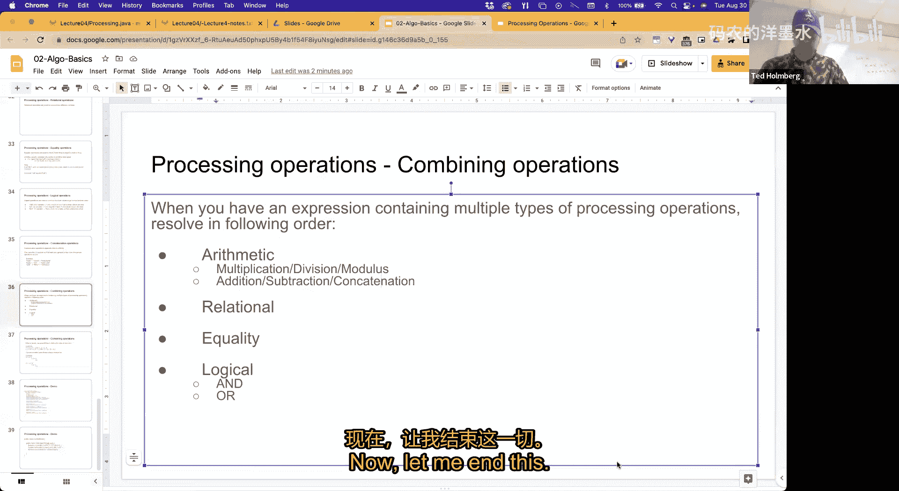

# 【全集】加州理工学院 软件设计与开发 中英字幕 1080P p04 Lecture 4 - 处理运算符 -BV1AvzCBdE7a_p4-

Yeah。

是的。Okay so is there any questions that anyone has from last lecture do you I mean for a quick summary do you guys want to do you remember what we did last lecture we talked about input operations and prior to that we talked about output operations and storage operations I think we talked about all this things in pretty great detail right。

Thank。Sure， do you have Giab or is its just the same file？So you should do both。

Post onto Gitlab and Moodle， but the way that I'll be able to track that you've actually turned in your assignments is for Moodle because that reports back to me。

So the reason why we use two different technologies is an industry。

The de facto standard that allows you to。Be a part of a team and share a code base across multiple people is with a version control software。

 which is what Git and then Gitlab by extension is Git is the actual command line tool that allows you to pull or push your code onto what's called a remote repository which is you can kind of think of it as some server space somewhere。

 like if you had like some kind of a cloud storage like that's effectively believe what GitLb is for source code files and so the real intent of Git is that it'll track all the changes in code so that you can have not just one person such as yourself implementing a source code project and then pushing it onto a repo。

 although that is a big use case individual projects but you really get to see where it's much more powerful once you have a second。

 a third， a dozen developers working on the same。ProBecause it gives you the one location where everyone can go to pull the project and you can have different versions of the project such as the version you're working on and then the version you're working on and then finally the main branch。

 which would be where the version that everyone has kind of made their modifications to that's like the true source。

Vararianance so the idea is that if two people are working on the same project simultaneouslyous it's going to be slightly different right like you're going have implemented some part of the codeb and someone else would have implemented some kind of a codeb so Gi helps you manage that kind of complexity it allows you to have two different versions of the same thing simultaneouslyaneously without causing conflicts because by by the very fact that you're each working on a different part of the codeb that means some of your codeb is the newest part but it's also the oldest part because the other persons part they were working on is the newer part but since they don't have your code it's an older part and ideally you would both get together and take your changes and take their changes and merge them together and that's what your main branch would do so it's super important that everyone learns how to use Gi and as as you might realize initially right now there is a learning curve to get right so one of the worst things that we could do to prime you to。

into industry where Git is like the de facto standard is to have you not have any exposure experience to get put you into the marketplace and that's going to be you're going to be expected to use git from day zero right by the time the day that you walk in they're going to have an expectation that you know how to use git to access their source code files so that's what we're priming you up for now now unfortunately Git doesn't have all these really。

Good tools to report back to me in terms of who had submitted or not so that produces a lot of overhead on me and so that's why I also opt use moododle Moodle has a lot of convenient tools for the instructor to be able to alert me when students haven't turned in a submission so I can send an email out and say hey i'm missing a submission like。

Yeah and find out it gives me a lifeline to the students that I wouldn't be able that would not be as easily be had and so that's the reason why i'm going to adopt those both those technologies one because it benefits you and the other because it benefits me。

😡，Can IYeah you should do that， you should do that。

Did you want to zip up our lab lessons for the last no I don't care about your labs okay your lab instructors you can send the labs i'm only going to go ahead and look at the homeworks okay so。

So whoever your lab instructor is will be the one who will do all the lab grading for you and then they'll report to me what your lab grade is and that'll make up 30% of your grade in this class and whatever I give you in this class is what you will get in your lab class as well let me go close this story。

Yeah。好吧。Okay， so I made this claim that there's five basic。Building blocks for every algorithm。

 and we've already made the claim prior to that that all software is comprised of data types or data models and on top of the data models we build our algorithms。

 which is just step by step instructions on how to do some kind of process。😡。

So the real crux of what allows our applications to do interesting things is the processing operations this is where the magic happens this is where we can transform our data into one form into some new form so up to this point we talked about how we can store data in memory we talked about how we can import data into our application we talked about being able to export data from our application。

😡，So in terms of the processing operations to give you a real worldorld example of what those might look like。

 I mean they're effectively the mathematical operations and all the different mathematical operations you've learned across a your studies from from the point you entered the schooling system till today right we can make use of any one of those operators you learned on quantitative data but if you think about it。

 you probably have been practicing using things like multiplication and addition and subtraction using strictly numbers now remember anything that you can quantify and then have adherence to any of the mathematical operators you've learned to use。

 but conceptually those operations are also rooted in like real worldord activities and again I always like to go back to this idea of cooking recipes and trying to identify。

What it means to have things like addition or subtraction or division or multiplication when it comes to a recipe so let's start with addition that seems like just being able to add ingredients together right in terms of subtraction that's like if you had a whole egg and you were told just to put the egg white in there let's say you're making a cocktail you don't want the yolk well you would take the whole egg and you subtract the egg you right so clearly there's an easy definition for addition in real world non-quantitative formats they have real concepts for what subtraction is what about division well just that idea of dicing and onion for instance what are you doing you're taking a whole onion and you're dividing it into constituent pieces that's exactly what the operation division is designed to represent。

And then lastly， what about multiplication， what if you have a recipe that makes for one serving side。

 but you're going to have four people that you have to feed。

 you probably just multiply all the ingredients by four。So the entire point of this exercise。

Of mapping these examples to mathematical operations is that。When we design software。

 we're restricted to us fundamental data types that we discussed a couple of lectures ago。

And when we're we're defining how we're going to transform our data that we have into the information we're looking for。

 we're going to use these mathematical operations and when we use them we want to think of them in a way of achieving what our goal is so it's like。

😡，It's important to come up with a strong conceptual understanding about what these operations are intended to represent as it's applied to our data models and as it applies towards our algorithm。

Does that much make sense？And so I know that be that can be something that you solely get used to you're probably encountering that that right now in the labs。

 right， you probably are challenged to use the processing operators in a number of ways to take whatever data that you start with and be able to transform it into actual information that you're looking to gather or produce。

Okay， so processing operations are the fundamental tools available to us to make our software work。

 we model our problems as data so that we can solve them with these processing operations and processing operations take data values and convert them into new values of either the same type or new values into a different type。

And so it's important to know that what data types you can use as。

Inside of each of our data operators。 so let's take a look at the first set of operations here。

 we're going to at the arithmetic operations we're going to look at the relational operations we're going to look at the equality operations we're going to look at the logical operations and we're going to look at the concategnation operations and I'm going to wager to say you're probably all familiar with these so I just want to highlight some facts about and I'm assuming you've been using these throughout the lab as well if you haven't seen these before。

 but the first type or probably the ones that everyone's super familiar with the arithmetic operations so that would be additions subtract division multiplication and modulus。

So we'll probably cover a little bit more about modulus because that's the one you might not be familiar with inside of your prior math classes so the important thing here is in order to do any one of these processing operations these are primitive operators primitive operators work primarily on primitive data types and so for instance we use the plus sign on the keyboard to indicate we want to do addition so that's our audition operator the dash is our subtraction operator the slash is our division operator and the asterisk is our multiplication operator the percent sign is not division its modulus。

Okay so the big thing about arithmetic that you should always keep in mind is that it does require that the two things that you are those are are binary operators it means that they need two different values to produce a result right so if if I'm going to do addition I need to have two things that i'm adding together if I'm going to do subtraction I need two things that i'm subtracting like one is subtractive from the other one is added to the other one is divided from the other right like again these are super basic concepts i'm just highlighting some of the pre requirements we need for addition to actually work but what's even more important is that the data type for anything that's arithmetic has to be numerical。

Which means if you want to use one of these operators。

 you have to transform whatever data you have into some kind of quantitative form。

And then the output of anything that's arithmetic is going to be numerical as well， Okay。

 so I'm assuming we're good with addition subtraction right multiplication division。Well。

 let me ask you about division how what is。What is？

So you're probably super familiar with division as it goes to floating point numbers right what's the distinction between division with floating point numbers and division with inger numbers if I were to say take one and divide the integer value of one and divide it from the integer value of two what would the result？

What's that？It'd be well like I in in a mathematical world where we're not restricting ourselves to a particular set of numbers。

 we would then just go into a floating point number right we would say oh。

 that division would result in a 0。5 but once I have 0。

5 is that an integer now because an integer are discrete whole countable units right？😡。

So you don't have this concept of having a number between one and two。

 but I can clearly do division on integers right like that's still a valid operator。

 so then the question is what is the result of one divided by two if I restrict myself to the integer set of numbers。

😡，嗯。It'll be well， usually what you're going to do to compute that is that you would take trying to see someone had put zero。

 yeah， the answer would be zero。So the idea here is what。

Let's route this into what the division represents。

 instead of thinking of it as a mechanical translation of input numbers to output numbers。

 what does division fundamentally mean？😡，Doeses this thing so one divided two is like how many units can we default like how many。

Okay。没问了。Yeah。Yeah， so if I have one and I try to divide it into two parts since I have one unit I have a half part right that's what that would do now if I am allowed to have halfs that would make sense。

 but let's say you're not allowed to have halfs let's say the thing you're counting are people and you don't want to have a half of a person。

😡，Right then you'd say oh well then the result would be there are zero I can't define that any into any smaller groups。

 so the resulting process， the resulting computation would be 0 effectively what you're doing is you're just truncating the fractional part so if it would be 0。

5 and you can't have the 0。5 you trunccate that part and you just say it's 0。😡。

Right or let's let's look at but let's examine the pattern of just division let's say it's two divided by two well two evenly divides into two right so you'll have one let's say we do four divided into two well four evenly divides into two so that could be two different parts that you can go ahead and do division by two right so。

Again， think about what is being represented with the。

Concept of division and that'll give you an idea of why we have to when when we're doing it in the confines of an integer data set why we confine ourselves to the whole discrete values we can't go outside and use any fractional point numbers so then with that said what would be three divided into two。

😡，Yeah， it would just be one， right？Okay so that's going to motivate whereas if I use the floating point numbers I can actually get 3。

5 I can get 1。5 so again this is going to motivate when you should use a double versus when you want to use a an integer so so integer division is restricted to the integer data set so keep in mind that you do trunccate and you always result in something like the number0 if you divide one by two but then then that's going to motivate the other operator which is going to be our modulus operator that's represented with a percent sign so that allows us to see how many remainder are left over after division that didn't get processed through so for instance if I were to say。

Here。So if I were to say and here these are the integer numbers， this is on this slide。

 this is where we kind of show the difference between integer division and a fractional numbers。

So with modulus。If I say one and then usually we say mod as a short and term。

 so if I say one mod two equals one， so think of it this way， if I say one divided into two is zero。

 then how many units from the numerator didn't get processed by the denominator。

One right because that one unit couldn't make up a hole if we're defining a hole as being two parts and we only have one thing then we can't make a hole that we want。

 we can't get a result so we're gonna to get a result is zero but we still have the one thing left over that didn't get used during the action of doing the division right so the remainder which is what the modulus captures the remaining amount from that division is one unit so one mod two is one so what do you think two mod two is so two divides into two want right so that results is once how many units are not spent in the action of division zero yeah absolutely so two mod two since it divides evenly with nothing remaining is going to be zero what about three mod two。

😡，So three divides into two once， but then it still has this floating unit left over right。

 because it only is if we think of using the number three as being three parts of one。

 then two of those parts going to the division of two leaving one part left over。

The modulus result of three mod two would be one。😡，What about four module？

Zero because it evenly divides with you leaving nothing left over， remaining remainder of zero。

 five mod two。😡，So what are you starting to see a pattern when we do a number with modD two。

 what is the pattern when we see starting to emerge？😡，Yeah， so if you ever wanted to computationally。

 if you ever wanted to mathematically determine if a number is even or odd， that is how you do it。😡。

That is a rule by which we can observe we could see these mathematical patterns and then we can ascribe human meaning to that。

😡，So if you've ever been challenged to say can you mathematically define whether a number is even or odd and probably what you did was just see if well you probably just divided by see if divided by two or not right well another way of doing that just taking the modules does it have a remainder or not when it's modifieded by two。

😡，Okay。So let's actually。Change the number， though two mod two is like the base case。

 but just to ensure everyone kind of understands this principle， what if I had。😡，One mod five。

What's the result of that？喂。Well let me start with this， let's say I had zero， zero mod five。

 so zero in the percent sign and then five。😡，这个。Yeah， zero， what about one mod five？

So one divides into five how many times？Well， one device into five zero times， right？

And how many units were left over that got did not get expended in that division process？R。

 exactly one， right because。One divides into five zero times。

 but there's still that one unit that was in the numerator， right？😡，Okay， what about two mod five？

Exactly， it'll be two because。Two divides into five zero times。

 but there's still two units left over， what about three mile five。3。For mod five。Five minus five。😡。

Six mod five。I are you going are you seeing a pattern emerge here so the rule about modulus is that it's going to return back an energy value starting net zero all the way up to the number you're moded against but not including it so if you're mod2ing you'll get a pattern of numbers count up010101 because the moment it becomes the same number as the denominator。

😡，It restarts。Excellent so everyone feels good about the concept of modulus and modulus is a super useful tool you'll see it you'll see it a lot inside of these labs because it's an operator you haven't had to really been had to think about how to use in a way to translate it to like real worldor phenomena and our mathematical modeling and so it's important to kind of get kind of fast trackrack you onto using that operator as well I think one of the problems that。

We sometimes have in math is that we don't restrict ourselves to a particular set of numbers so we very fluidly transform between integers and floating point numbers and having that restriction that you can't。

 I think to be a very it could be one of the pitfalls that a new developer encounters where they go and divide a number。

 they think they're going to get a fractional number。

 they get zero and they get some erroneous behavior because they don't realize that that's the result that they're getting but like modulus we see all the time in the real world like for instance。

 the action of a clock。On principle， anything that's circular。

 anything that has a repeat pattern where you have a starting point you get to an ending point that then brings you right back to your starting point is a modulus pattern。

 so it's like for instance on a clock after you get to 12 and you go around the clock entirely you start over again。

😡，So could I can represent something like a day using a modulus operator to try to compute。Okay。

Or I think another lab example that uses modulus operators in a very kind of real world context is if we're doing something like that game duck duck goose right if you want to try to predict what child you're going to stop on and since the children are arranged in a circle and each one is accountable units then I can use a modulus operator to know if I do this many rotations what child am I going to stop at。

You see how we can start using these mathematical operators to come up with solutions for real world problems。

😡，So computer science is really just， it's like the word problems in all your math classes。

But it's fun because you don't have to compute it， you don't have the computer compute the answer。

 you just get to architect and engineer the solution。Okay。So with that said。

There are the relational so is there any questions about the arithmetic operators so I spent a long time on them。

 but I think it usually it helps really define integer division and modulus operators because again one of the big pitfalls I usually see on the first test is I'll give I'll give a question that says what is the result of this computation and it has a modulus operator and a lot of people do division there。

And of course that's the wrong answer because that's not vision operator so again understand the Java symbols and what action what what transformation what processing operation is going to result from that and what data is valid so again the idea about mathematical operators it's super clear it's just numbers to numbers but not all of them are like that in fact the next one we're going to look at will also be numbers right a relational operator is probably one you've seen before right it's the idea of less than greater than less than or equal to greater than or equal to。

And actually， let me see what why do I have？Yeah， I like having access to this this is I like this table here so i'll leave it on this table so。

The type of data， so again， this is another operator that we'll call a binary operator and the reason why it's a binary operator。

😡，Is because it requires two values in order for you to validly do it right so you it's a comparison operation so that's why we call it relational but so what is the data type now clearly I have the table on the screen so you can cheat but in order to do anything that's relational what type of data do you have to start with。

😡，Yeah have you have to start with numerical data and the reason why is that fundamentally it's quantitative data that is apt for comparing in a relational way。

😡，So you have to be able to think of something as if it's numerically based。

 so even even if you conceptually have the idea that you can tell if something is less than something else。

 like if I said is apple less than banana， what might you， what might be a result from that？😡。

Yeah it depends on how we might define that like what does that mean that an apple is less than a banana now if we if we meant do you mean alpha numerically now if you mean alpha numerically we we can kind of cheat because we can say oh。

 we're going to start we're going to treat a as if it's a zero and we could treat B as if it's a one and we could treat C but what we're doing is we're quantifying the alphabet system。

So even when these concepts if you're like， well， I could kind of make text relational。

 well the only reason why that works is because you're converting it from something that's qualitative into a quantitative format。

😡，Does that much make sense？Okay。So now this is this is where it gets interesting to me though。

 and this is where I like having this chart and this chart unfortunately isn't in the book。

 so we start with numerical data in。😡，But what is the result of a relational operation unlike an arithmetic operation。

 we produce another number and result right so for instance one divided into two is zero right one plus two is three one minus2 is minus one。

😡，one times two is two。We have two numbers that we put into those operators into that operation。

 we give back a new value， but it's still a numerical value， but when we do a relational operation。

 we start with two numbers。But what do we get back？That's right。

 it allows us to convert from one data model into another data model to one form of data that is numerical which is quantitative。

 I mean quantitative to something that's qualitative。😡。

So it allows us to express numbers and convert numbers into things that are either true or false Boolean data is super critical when we start designing algorithms because all of the decision operations that our algorithm can make whether it's to repeat an action or whether it's to select one action from a group of actions that could potentially be executed it's always based off of Boolean logic the idea of should I do this or should I not do this so it's fundamental that we know how to take data in whatever format it's in and start expressing it in ways that can be be curated as true or false and we'll see that when we get into into the last category。

😡，Our control operations。Okay so this is the first time where we've actually seen where we can translate from one data type to the next。

 so the next one and I kind of want to separate these is that a lot of people and even a lot of textbooks I think even our textbook。

Mges the concept of relational operators and equality operations and treats those as being the same。

 but I want to stress this they're not the same they're not on the same group they are a different set of operations even though there's a concept of greater than or equal to or less than or equal to in relational the idea behind equality is different and why do you think equality is fundamentally different the idea of determining if something is equal to something else is different than deciding if something is less than or more than something else。

😡，That's right because we can do equality on non numerical forms of data。😡。

It doesn't have to be restricted to quantitative data。😡。

We can do equality on qualitative data and quantitative data。And that's a big thing。

 that's a big affordance that equality gives to us that you don't get with relational operators and that's a big enough distinction to separate them into two different categories。

😡，So we can start with any type of data for equality operations。

 I could see if true is equal to true， I could see if the string cat is equal to the string cat that makes sense。

😡，Does Apple equal Apple or does Apple equal banana like you can you can actually answer that without a question mark。

 right？And so that's the big separating point between equality and relation operations and so again。

What do we result with equality or operations there's two types of equality operations that you're seeing here。

 double equal sign represents equality。😡，So this is one of the number one things that junior developers that early programmers make is using the single equal sign。

😡，To try to evaluate equality。😡，And that is not an equality operation。

 the single equal sign is the assignment operator。😡。

The single equal sign means that whatever is on the。😡。

Right hand side is a value that will then get stored into a variable on the left hand side。😡。

Its it is the action it tells the computer store this value into memory if you want equality。

 make sure you use the double equal sign that will compare the left hand side to the right hand side and give back what kind of response what kind of data do we get back regardless of what we're comparing that's right it's a way for us as he any type of data and convert it into a Boolean value something that's represented as either true or false。

😡，Okay， so we also have the ability not only to check for equality。

 but check for inequality so is this thing not equal to this other thing is Apple not equal to banana and so if I wanted to do not equal it's going to be exclamation mark equal signed as our symbol as our operator inside a Java。

😡，So I don't know if I highlighted this before， the greater than and less than and the greater than and greater than and equal or less than than equal。

 it's important that the greater than or less than symbol is before the。😡。

Equal symbol when you express those so you can't flip those if you do equal sign and then the greater thanescence sign that's going to be an error Java that's not the symbol that Java uses for that operator so the these these are these symbols are keywords。

😡，So we don't always think of words since we speak naturally in English as being things that can be made up of symbols。

 but these are key words inside of Java， so it's the same as having the keyword public or class where you can't use that outside of the way that Java expects you to use it the same way。

😡，We're our operators。And so it's the same with the not equal as well where it's exclamation marked in the equal sign to check for inequality and then finally we have the logical operators and so the logical operators allow us to take two boolean values so two things so again it's a binary operators so far all of these operations we've seen so far or binary which means we need two values to result back into a new value of either a different value or different data type like sometimes we'll convert between data types like in the case of relational or equality operations so for logical it allows us to take two boolean values and process it into a new boolean value so。

Has anyone studied logical operators before the idea of ans and or's and knots so very common in like symbolic logic classes。

 discrete mathematics So even if you haven't formally studied these concepts I'm willing to believe that you kind of already can intuit what the results are going to be so let's see if I can't model this in real world demonstrations and see if we can't like intuitively see how these will result So if I say for instance。

 the floor is white and。The wall is blue right so the floor is white is what kind of expression what am I going to get a result when I say that statement the floor is white there's a bulling because it can be either true or false in this instance is it true or is it false so it's true the floor is white and if I say that wall is blue。

😡，That's also a boolean expression it can either be true that that wall is blue or it could be false in this instance what is it true okay so for those of you who are watching both these are true so if I say the floor is white and the wall is blue what's going to be the result of combining those two it's going to be true。

😡，Now， if I said， let's play around with this concept some more if I say the floor is white and that wall is blue。

One of them is at least false right the floor is white so that is still true but this wall over here is white right so my boolean expression where I assert it that wall is blue is false and so when I try to combine the concept of something that's false even if the other thing is true the end result is something that's false so it's。

😡，See if we can get the logic of this and operation。

 So we always require two values that are either true or false if both values are true。

 then the result of the and operation is true。 But if at least one of them is false。

 either the left hand opera or the right hand opera end then the entire result is false So there's four different outcomes I can have right。

 I can have true and true false and true。😡，True and false。And false and false， right？

For true and true， the result would be true for false and true， the result was false。4。

True and false the result would be false and for false and false the result would be false so the only time I ever get a true outcome with a and expression with an and operation is if all the things i'm comparing are true Now the awesome thing about the and operation is yes it does require two things to be compared and only two things but I can chain those together I could say that wall is true and this floor is white and that wall is white。

😡，And so the way that we would process that would be the same way you process an arithmetic operation that changed its operators together。

😡，Like one plus two plus three。You don't do them all at once you combine two until you get a new value so one plus two would be three right and then if you were to add the three then you take that new result and use that。

😡，In the addition of that other value，3， which we produce 6。

 you do the same thing with logical operators。 You start with the left hand most side and you process until you start。

Surviving results and then you can chain those together with new and operations Okay。

 let's look at the or operation。😡，Let's see what that might appear as。So if I said same example。

 if I had。电。The floor is white or。The wall is blue。

Right so here the idea is that if at least one of our bullolean expressions resolve to be true。

 then the entire thing becomes true。😡，哎。AndSo in this instance they are both true so the end result is going to be something that's true if I say the floor is white or the wall is white that's still true right even though that wall isn't white just because the floor is white because we have at least one thing that resolve to be true then the entire expression resolve to be true so what so we have four different outcomes with an or expression if it's true or true what's going to be the result true if it's false or true what's going to be the result。

😡，If it's true or false， what's it going to be？If it's false or false。

 what so it's an inversion of the and operator right so for the and operator the only time you get a true outcome is that both of your constituent values are true well the only time you get a false value within or operation is that both of your values that you're evaluating are false。

😡，If at least one is true， then the entire outcome of that operation is also going to be true。Okay。

 is there any questions in terms of this idea and in even if you haven't formally studied it。

 that's effectively the crux of it， that's how we use it to design around that's how we use it in our algorithm designs and being able to to use them to compare our quality。

😡，AOf data。Okay， I I still coming out all right， am I as glitchy as it looks like here in lab that is the ore operator and so the symbols that we use for the and operation and the ore operation is a double ampers stand and you can see it here on the PowerPoint double ampersstand for the andt。

And the pipe operator， what we call that， if you're not familiar with the pipe operator。

 it's the same key that is like the full slash key。😡，So if you do like shift forward slash。

 it creates a symbolim that is completely vertical， doesn't have a lean to the left or right。Again。

 we'll call that a pipe operator， the pipe operator， I mean the pipe symbol， not operator。

 the pipe symbol， so we'll use two of those to represent our ors。😡，Okay， and so there's one other。

Operation we can do with a logical operator and it's let's see here it's probably。

The sec so I hadn't formally stated it， there's two unary operators。😡。

That are worth mentioning one of them is a lot。Greater so the exclamation mark when put in front of a boolean value flips its state so it's so so if I say something is not true。

 what's the same thing as calling that not true is what。😡，And not false is what yeah。

 so like linguistically that already makes sense to you mathematically we can put the exclamation mark from the keyword true and that's the same as saying false it or we can put the exclamation in front of false and that's the same as using the true keyword。

So they have the concept of not and not just flips the Boolean state of something。😡。

But one of the interesting thing about the non operation is it's one of the rare uninary operators。

 which means it only needs one value up until this time that we've covered all of these kind of。😡。

Primitive operators right something that you should be super familiar with is that they always require two pieces of data right that's why we call them binary operators but the knot is just a single true or single false it doesn't use two different values it just flips the state of the current thing what other operators the unary operator that we hadn't formally mentioned but it exists。

Can you think of it and it's very much similar to the concept of the not operator with Boolean data。

 but it's the what would be the equivalent of the knot operator in numerical data？

That's also a unitary operator and kind of represents a similar type of pattern being able to switch a state of a number。

 but what does it mean to even that's exactly right。

You put a minus sign in front of a number and it makes it a negative number。

 you only need the individual number， the one number， one value to make a negative number。

 if you put a negative sign in front of a number that's already negative it'll flip it to become positive so the same concept that drives the idea of not operators。

 we actually have that concept as numerical data as well in the format of a minus sign as a negative operator。

😡，Excellent， okay， so。We're almost done with the processing operations and again。

 this is where in my opinion， all the magic and algorithms and all of our in our software happens。

 so it's super important that everyone gets a firm grip on。😡，But little easy to master。

The last one that we haven't seen is concatednation。

 so what is one of the interesting things about concatednation， if you look at the table right here。

 what is the symbol used for concatednation？😡，It's a plus sign。

 so notice this is one of those rare instances where the symbol we use to do a concatenation operation is also used for another operation what is the other operation that we use the plus sign for addition。

😡，So what's the distinction when does Java know that something supposed to be an addition operation versus a concatednation operation absolutely the idea is it's going to look at the data you're providing as input so if both pieces of data or numerical data。

 then it will treat that result as a numerical result it will do the addition operation So what Java is looking at behind the scenes isn't just the symbol of the operator that you're using the plus sign。

 it's also going to look at what the left and right hand opera is to predict what kind of result you want so if both operas are numerical and that's why I like to highlight a column that shows input versus output because this is where again。

 early developers can trip up and they think they might get a numerical result。

But if at least one of the opera is a string， then it's going to do a concatenation operation instead because with concatednation。

 the data type can be anything。😡，Not just numerical and what it does is it results as a string。

 not as a number and what it does is it takes what a contaminatnation operation does is it takes the left hand opera end and merges it with the right hand opera end and makes a new string that is the combined two things so say for instance。

 if I had the string hello and then I had the string world and I put the plus sign in between it get a result that is hello world combined if I had the and actually we can play around with this a little bit。

😡，Do I have oh， I hate when this is up here， let me pull this down here。Let me see。 Do I have。

I think I have。喂。 let's go to。Here。Okay， let's。grab this。And go over here。So clear here， touch， Okay。

 let's call this con dot Java。Okay， do I need to make this bigger for you all to sing。

 is that better？Okay， so now'll have some cat here， let go here。O。Well， don't know and go away。

T what today okay so。Let's comment some of this stuff out。Okay， so oh， let's come that up too。

So let's do say， for instance。嗯。I'm going to have can everyone see that is that big enough for everyone's saying to I need to blow that up。

 does that help？I haven't formally mentioned this either maybe I should do this。

 if I want Java to ignore a line inside my source code file。

 I can put slash slash in front of it and that creates what's called the comment。😡。

So let me formally introduce these concepts of comments since I haven't done that yet。

🎼So slash slash means I could put anything after that so what I've done here is I took these lines of code that I don't want to get executed but I don't want to delete because I to want to use them later so in order to have them do nothing。

😡，Or if I wanted to go ahead and add a comment so i'm like I could make something human readable that your future self or some other developer can come back and read that's relevant towards why what motivated your decision for this line of code that's another use case for comment so comments are typically used in one of two ways you can either provide context to what your code is doing so that others have insight on why your code works the way it does。

😡，And usually what you're doing there is you're describing your data model that you've based your logic on or how the algorithm。

 what what your processing operation is doing on top of your data model to get its outcome or your testing code out and there's some block of code that you don't want to run at this time but you don't want to delete it so we're doing the latter but either of those are often comments so a single line comment is slashlash two line comment I can do slash just like that and now I can make any number lines anything between this slash star to this slash star I can have comments in and it will be ignored bombpi okay so let me just highlight that right now which means。

😡，Which means。That。This is not a numerical operation。系い。

Okay so let's take string so so one of the things that let's go back to our slide here here notice that with a contaminatnation operation we can start with any data。

 but the result will always be text data back so let's take a look at this。

 let's say the implications of this right。😡，What happened。So we text data again。

 we call string inside a Java， so here let's call this variable text， so if I do， for instance。

 one plus two is that valid。😡，Yes。Let's see one of the best ways to see is to see if we can compile this code。

And so what what am I getting as a result when I try to do one plus two and then save that into a data type that is of data type text？

😡，What is the result here， what does the error say？😡，不是。So what that's letting us know is。

The left operant here， the one and the right operant here， the two， when we apply the plus。😡。

Is going to result in keep going here is going to result in numerical data as output right not as text and since it's an integer。

 we can't store it inside of a storage variable that's really designed for a string。😡。

Because it's using the wrong kind of encoding remember。

 one of the first things we said is the way computers store data is。😡。

As binary blocks as binary words， as just string of binary bits。

011100111 the reason why we attach the data type to the storage operation is so that the Java program so the JVM knows how to translate it back into a value that's meaningful to us if I'm telling it。

 hey， this is designed to store string and then I try to give it an integer value。😡。

It's not going to ring back the same value we tried to store there because we're taking something that's an int。

And then we're going to translate it back into something and that is a string。

 those are incomparible， right， they're incompatible。😡，So Java， though。

 one of the nice things about Java why Java is so popular is it alerts us that we've made this mistake without us just making that mistake and getting an erroneous result when we go to run the application and finding out why is our code not working？

😡，Okay， so what about？What about this？Will this work？Well， what about this， let's start easier。What。

 so that's going to work。And actually， let's start doing this。What's going to be the result of this？

Actually。是。Let's actually instead of save， well， I'm going to save it in here。😡，Okay。

 so let me clear here let's run it one of the things I love about application development is we can take and always challenge our beliefs in what's happening by testing it。

Okay。And there we go， it takes the value of one， it takes the value of two now these aren't numerical。

😡，Values， right， they're text values。We're using the symbol that we perceive as being the number one。

 but it's the text representation of one and we know that because we put the double quotations around it。

 so it's a text type， not a integer type， right？😡，In fact let's start I'm now going to start challenging now that I've used this i'm just going to put right into the print statements so that we can start singing with the result is going to big so we know this is going to result in a string right and so the string now if I remove the double quotations now it's actual numerical types so what's it going to print out when I do that。

😡，Yeah， it's going to print three because it's going to do the numerical computation and return back an integer value。

 not a string value， okay， what happens if I do this？What what do you predict， first of all。

 there's there's there's。There's first of all， you have to make a decision is this a valid or is it invalid well let's see so one easy way if it's invalid。

 then when I go to compile then it's throw an error for me so let's take a look at that。😡。

Oh it compiled so we know it's valid because it didn't throw an error to me now if I run this。

 I know it will execute what's going to be the result。One and twos and so yeah。

 it's going to be one and two and why can we predict that before we even run it if we look at this chart。

What is there's two。There's two possible operations that can result from the plus sign， right？😡。

Arithmetic only happens with what？这个你方。If they're both numbers and then what is the input data type under concatednation any。

 so if at least one is not a number but a number is still any type of data。

 then it's going to it's going to cast so there's this concept of casting and Java casting allows us to take something that's defined in one data type and converted into another data type。

😡，Concatednation operations is allows us to cast our data into strings。

 so it will take the numerical representation of that number two and convert it into a string or text representation and then it merges it together does that make sense？

😡，So this is an idea of innate caing there's another format that this takes and I want to I want to highlight that so just to prove this concept let me run this code so here yeah look iss going to be 12 what if I did this what if I did the reverse what if the one came first and then the two was the second the the on the right hand side。

😡，Yeah it's going to be the same thing right if at least one of the operas it doesn't matter which one the left or the right is going to result in the same thing Okay。

 what if I did this？😡，网名。let's say。One， two， three， four。What if I did this？

How is it still to be report if the two the quotation。

Because we're doing the concatenation operation so think and we follow the same rules as mathematics so we start at the left hand side and we work towards the right hand side the same as we do with reading right so when you read a big block of text you probably start in the top left hand corner and you go rightward until you're done reading the sentence when we process our math operations the same way or a concatednation operations or any of these operations right so we would look at the one and then this and that's not the numerical value of two that's the text representation of two so the result of that is going to be a string of one two。

😡，And then when I go to do this that means this isn't going to be an addition operation。

 it's going to be a concatednation operation so it's going to produce the text of one，2。

3 and then here is's going to be one two three，4 so once I get a string inside of my plus sign operations is just going it's going to migrate all the way through but what if what if I do this？

What if I have。You see what I did there？And here， let me。What's that going to result in two， two。

 three， four，'s let's check that out。Two， two， three， four， does everyone see why that's the case？

That's right here， the first two values are going to be numerical one plus one。

Then so that's going to result in two， once we get two。

 then we're going to concatenate it with the string two。😡。

Then everything else is going concatetnation once we get that， what if I do this？嗯。

What if I have the multiplicative operation between the three and the four？Well， well。

 let's see let me ask you this， let me motivate well there's one way to find out if that's going to be invalid it's to。

So it compiles。So what's the general rules for arithmetic order of operations？

You do multiplication division first then you do addition and subtraction so whether it's a connation operation or an addition operation。

 the order of the plus selling is always done after the order of the asterisk sign it follows the same rules of math in that regard so that allows us to create these really complex chain expressions that you see like for instance here where I can mix and match like that had a division in there so with that said。

 what do you think the result of that's going to be so you would do this first you would do three times for So then we would have 12 but then after that everything's going to be an addition or a connation。

So then we would start over here and do one plus one well that's going to be two。

 then we're going to do the text of two plus two， so that's going to be two2 and now we're going to do two2 plus the numerical representation of 12。

 so that'll be2，2，1，2。😡，Right？2，2，1，2。🎼Now if I want to prioritize things。

 I can always put it in between parentheses so anything in parentheses will get evaluated first and then you'd go back to the or normal order of operations the implicit order of operations so for instance in this instance what is the result going today。

😡，Yeah， one， one， two， one， two。Excellent， does anyone have any questions about this？Okay。

 so there's one other thing that I really want to highlight。

 so the operators we were looking at are primitive operators。

 they're primitive operators because they're these symbols that are these free floating symbols that can work on primitive values so what were the rules about primitive values。

 do you remember when we were talking about primitive values。😡。

We stated that primitive values always used data types that use lowercase ladders right like int lowercase I in the int double lowercase D and the double boolean lowercase B in the boolean almost all the data types that we've seen so far are primitive so we can use these equality signs。

 so all of them are primitive operators， they use the primitive data types to process。😡，Results。

But the one that is not though is the equality one， right？

So we said that could be any so numerical all numerical data is primitive in Java right so these operator these primitive operators work on primitive data bullolean is a primitive。

😡，Data type， so these are primitive operators as well， but equality， we said it could be any。

Now upp until now that means it could be numbers， so ints or it could be floats or doubles。

 it could be boolean right， it could be cars right but it could also be strings and strings are different than all the other things。

 right？😡，Because it's a reference data type， so let me see， let me challenge you to see。

 even though you haven't programmed this before， but the equality operator。

 since it's really designed for primitive data types is going to behave differently for a string than is going to for a true value or a number value。

😡，So。Do you remember when we were looking at the string data type。

 what we said it was actually storing the memory？😡。

Remember when we're looking at the blocks of memory and how much each data type consumed in terms of its encoding？

😡，喂。Yeah like it yeah， so there's a bite and let me let me jump to that I can it's right here remember this slide here。

So we said all these other types are primitive data types。😡，However。

We looked at tax and tax consumes4bytes， but in the descriptor here where we look at the actual primitive set of values。

😡，That。Each one of these data types is defined by what does it say next to text？😡。

The value is the address of memory where the string is stored。😡，喂。

So if we were to do a primitive equality operation on a string。😡。

What do you think it would be comparing， you think it'd be comparing the actual contents of the string？

😡，好。It's going to be comparing the memory address of the string towards the other memory address of the string。

 which is not going to produce the result you think you want because then you' can to have two strings that have the same text。

 but if they're stored in two different memory addresses， it's going to think it's different。😡。

So understand， this is again， one of the big missteps that early developers in Java will do。

 they'll use the primitive E operator。😡，For reference data types and you can't do that because the default action of the primitive operator for anything that is not a primitive data type is to compare its memory addresses together to see if that reference type is in the same memory address that's what equality means。

😡，Are these two things in the same memories are they in two different memory addresses。

 which is probably what you're not thinking of as inality operation on something like a string。

 what would you think inequality operation on a string should be？😡。

That's right if the set of characters encoded in one string is the same as a set of characters encoded in the other string。

😡，And so the cool thing about reference data types and we've already seen this is that they have internal behaviors。

 so like when we created a scanner object and let me see if I can't find that。

 when we created this or like say for instance out when we looked at the output stream。

 out streams have the ability to print， that's a behavior we can tell the output stream to do。😡。

And we use the dot operator to access that behavior。

 that method that's built into that output stream， it's the same thing with the input if we go to our input。

😡，Let me go to this source code here， we created this。

The scanner objects here right it was highlighted in the yellow right so we use the constructor we pass in a reference to the input stream and it produces a data type of a reference a reference type right because it uses the uppercase letter for the data type so this is a variable that we create it it's not a primitive variable because it's not lowercase so since it uses the uppercase that means it's an entity that resides somewhere in memory and not built into it's not a value that's built into the JDM。

😡，But the cool things about these entities that are reference types is they support these behaviors that can be attached to them since they're in memory。

😡，And so here， this next line method that we learned to use。

 this next double are all behaviors that we can invoke on that reference data type。😡。

On these more complex things。😡，So strings are the same way if we want to so what I'm trying to get to is if we want to check equality where we are comparing the set of characters to another set of characters。

 we have to use the dot equals method， which is built into the string。😡，So let me comment out this。

 so suppose I have cat。😡，Here， does everyone see line six here？

I'm going to have cat and I'm going to see if it equals cat。😡，If I want to compare， not that。😡，Right。

Let me save that。Clearer this。If I want to actually make that comparison instead of and yeah get false because case matters。

 if I want to compare this to see if if the text inside these two strings are equal and not their memory location is equal。

 then I have to use the dot equals method， I can't use the doub equal because that's only for primitive data types and it is valid to use for reference data types。

 but it's not going to produce the result you think it's going to do is going to show you whether the memory address is the same or not。

 not whether the actual entities have the same values or not。😡，Excellent。喂。

Is there any questions regarding？ I think that might be it for。

Oh the last thing that I want to mention is just combining operations we already saw how you can have these really complex。

Expression， so that's another thing I want to an expression is typically。

The word we use when we start embedding operators between our data types so let's talk about mapping math you probably hear that math is a language right and you're like howow that's it's not any language I've learned to speak right well。

😡，So why don't we start defining math in a way that language is normally defined so our subjects our nouns。

😡，Are our data types like our numbers？😡，In now。And our verbs。

The things that produce actions on our subjects。😡，Are our operators？

And so once you a once you have the understanding that what you're learning is your set of nouns and verbs as they're expressed。

😡，Nummerically。In a quantitative way， then you can start mapping the phenomena in the real world that you see around you into mathematical expressions as opposed to linguistic and as opposed to English expressions so the same word we use to express a complex sequence of actions of thought of something that has a subject and it has a action。

😡，That's an expression we use the same thing for mathematical expressions so everything we've been looking at where we've been taking input data and converting it。

 transforming it。😡，Into different data types or different data values。

 we've been creating these expressions。So we use that same word so when you hear the word expression that's what it means and try to map it to how you would use it in English as well or whatever your natural language is。

😡，Great， is there any。Any other questions that you might have？

Well I think that's going to be it for processing operations the one last thing is just the order of operation arithmetic operations are typically done then relational operations then equality and then logical so if you had a big string of expressions actually some operations are prior to prioritized over others and that's the last thing I have to say about the processing operations iss really all of the verbs inside of our mathematical language and so that's why they're so exciting and allow us to do cool and interesting things itd be like telling a story without having verbs right verbs are what makes stories interesting operators are what makes our algorithms interesting。

Mad would fall into the arithmetic operations。😡，It would be the same as division。

 so actually that's a good expression so。Right there because effectively it is a division like operation。

 but instead of giving you the amount of units that get divided。

 it's the amount of units that are remaining after the division。😡。

So you kind of kind of think of it as a remainder operator is how a lot of people end up thinking about。

Is there any other questions， good question， by the way。Excellent。

 thank you for coming to lecture today， whether it was digitally or in person。

 and I will see you all tomorrow where we will finally talk about the fifth。Building block。

 which is our control operations that's why of decision points that's where we can start just not making a sequence of statements but actually decide make decisions while we're going across our sequence of statements。

😡，By the way I'm going to post those today was my intent to get those posted already。

 but my schedule's been insanely busy this semester already so that's what i'm gonna to do right now soon as I get back into my office i'm going get all of our prior lectures and all of these slides and probably what I also do is as as I teach this i'll modify the slides and continually update them with the idea that I want to get a nicer slide deck usually what I just like to do before we went into the virtual space I like having dialogues like what we're having now so and I didn't like the idea of PowerPoint slides because it becomes a crib too much but i'm starting to see the value when I have to teach online as well。

哦，呢唔事嗯。I'm going try to compile it doesn't compile Let me end this。

