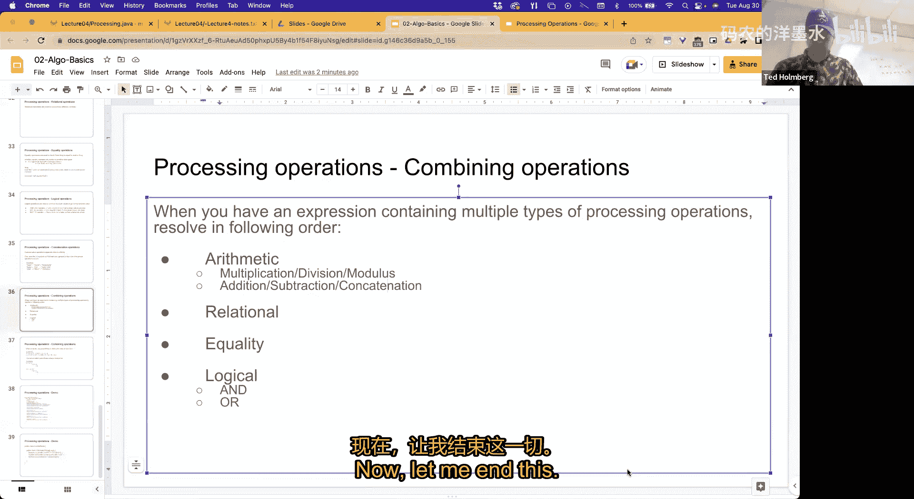

# 软件设计与开发：第4讲：处理运算符 🧮


在本节课中，我们将要学习算法的核心组成部分之一：处理运算符。这是软件实现其功能、将数据转化为信息的关键所在。我们将探讨算术、关系、相等、逻辑和连接等不同类型的运算符，理解它们如何作用于数据，以及如何将它们组合成复杂的表达式。

---

## 概述

上一讲我们讨论了输入、输出和存储操作。本节中，我们来看看处理操作。这是算法中实现“魔法”的部分，它允许我们将数据从一种形式转换为另一种形式。处理操作本质上是数学运算，但我们可以将其概念应用于各种现实世界的问题。

## 算术运算符

算术运算符是我们最熟悉的运算符，用于对数值数据进行基本数学运算。它们是二元运算符，意味着需要两个操作数。

以下是Java中的基本算术运算符：
*   **加法**：`+`
*   **减法**：`-`
*   **乘法**：`*`
*   **除法**：`/`
*   **取模**：`%`

算术运算要求输入和输出都是数值类型。一个重要的区别在于整数除法。当两个整数相除时，结果会被**截断**小数部分，只保留整数商。

例如：
*   `1 / 2` 的结果是 `0`，而不是 `0.5`。
*   `3 / 2` 的结果是 `1`。

取模运算符 `%` 用于计算除法后的**余数**。它对于识别模式（如判断奇偶性）非常有用。

例如：
*   `1 % 2` 结果是 `1`
*   `2 % 2` 结果是 `0`
*   `3 % 2` 结果是 `1`
*   `5 % 3` 结果是 `2`

任何具有循环或重复模式的现象（如时钟）都可以用取模运算来建模。

---

## 关系运算符与相等运算符

关系运算符用于比较两个数值的大小关系。它们也是二元运算符，输入必须是数值数据，但输出是**布尔值**（`true` 或 `false`）。

以下是关系运算符：
*   **小于**：`<`
*   **大于**：`>`
*   **小于或等于**：`<=`
*   **大于或等于**：`>=`

关系运算符将定量数据（数字）转换为定性判断（真或假），这对于后续的控制流程决策至关重要。

接下来我们看看相等运算符。虽然常与关系运算符归为一类，但相等运算符有本质区别：**它可以用于任何数据类型**，而不仅仅是数值。

以下是相等运算符：
*   **等于**：`==`
*   **不等于**：`!=`

**重要提示**：`=` 是赋值运算符，用于将值存入变量。`==` 才是用于比较是否相等的运算符。混淆两者是新开发者常见的错误。

与关系运算符一样，相等运算的结果也是布尔值。

---

## 逻辑运算符

逻辑运算符用于组合或修改布尔值，从而构建更复杂的条件判断。它们主要也是二元运算符。

以下是逻辑运算符：
*   **逻辑与**：`&&` (AND) - 仅当**两个**操作数都为 `true` 时，结果才为 `true`。
*   **逻辑或**：`||` (OR) - 只要**至少一个**操作数为 `true`，结果就为 `true`。

此外，还有一元逻辑运算符：
*   **逻辑非**：`!` (NOT) - 用于取反单个布尔值。`!true` 是 `false`，`!false` 是 `true`。

类似的，数值数据也有一元运算符，即负号 `-`，用于改变数值的正负。

---

## 连接运算符

连接运算符 `+` 用于将数据（尤其是文本）拼接在一起。有趣的是，它使用的符号与加法运算符相同。

Java如何区分 `+` 是加法还是连接呢？规则如下：
*   如果 `+` 两边的操作数**都是数值**，则执行**加法**运算，结果为数值。
*   如果 `+` 两边的操作数**至少有一个是字符串**，则执行**连接**运算，结果为字符串。在此过程中，非字符串的操作数会被转换为字符串形式。

例如：
*   `1 + 2` 结果是数值 `3`。
*   `"1" + 2` 结果是字符串 `"12"`。
*   `1 + 2 + "3"` 的运算顺序是从左到右：`1 + 2` 得 `3`（数值），然后 `3 + "3"` 进行连接，得字符串 `"33"`。

表达式的计算遵循标准的数学运算顺序（先乘除，后加减），可以使用括号 `()` 来改变优先级。

---

## 关于引用数据类型的相等性比较

之前讨论的 `==` 和 `!=` 是**基本运算符**，设计用于比较**基本数据类型**（如 `int`, `double`, `boolean`）的值。

然而，对于**引用数据类型**（如 `String`），`==` 比较的是两个引用是否指向内存中的**同一个对象**（即内存地址是否相同），而不是比较对象的内容是否相同。

例如，两个内容相同的 `String` 对象，如果存储在内存的不同位置，用 `==` 比较会返回 `false`。

要比较两个 `String` 对象的内容是否相等，必须使用 `String` 类提供的 `.equals()` 方法：

```java
String str1 = "hello";
String str2 = "hello";
// 错误的方式，比较内存地址
boolean isSameObject = (str1 == str2); // 结果可能为 true 或 false，取决于JVM优化
// 正确的方式，比较内容
boolean isSameContent = str1.equals(str2); // 结果为 true
```

引用数据类型（如 `Scanner`, `System.out`）通常都内置了各种方法（通过 `.` 操作符调用），用于执行特定操作。

---

## 表达式

将运算符和数据组合在一起，就构成了**表达式**。表达式是算法中实现计算和逻辑的核心单元。

我们可以将编程语言中的表达式类比为自然语言中的句子：
*   **数据（名词）**：是表达式中的主体。
*   **运算符（动词）**：是对数据执行的动作。

通过将现实世界的问题映射为数学表达式，我们就能用软件来解决它们。

---

## 总结

本节课中我们一起学习了处理运算符，这是构建算法逻辑的“动词”。我们详细探讨了：
1.  **算术运算符**（`+`, `-`, `*`, `/`, `%`）用于数值计算，特别注意了整数除法和取模运算。
2.  **关系运算符**（`<`, `>`, `<=`, `>=`）用于数值比较，并产生布尔结果。
3.  **相等运算符**（`==`, `!=`）可用于任何数据类型进行比较，同样产生布尔结果，并强调了与赋值运算符 `=` 的区别。
4.  **逻辑运算符**（`&&`, `||`, `!`）用于组合和修改布尔值，构建复杂条件。
5.  **连接运算符**（`+`）用于拼接字符串，其行为取决于操作数的类型。
6.  理解了对于引用数据类型（如 `String`），应使用 `.equals()` 方法而非 `==` 来比较内容。
7.  最后，我们认识了**表达式**的概念，它是将数据与运算符结合以产生新值或新判断的基本单元。



掌握这些运算符是设计有效算法和功能软件的基础。下一讲，我们将进入最后一个基本构建块：控制操作，学习如何让程序做出决策和重复执行任务。