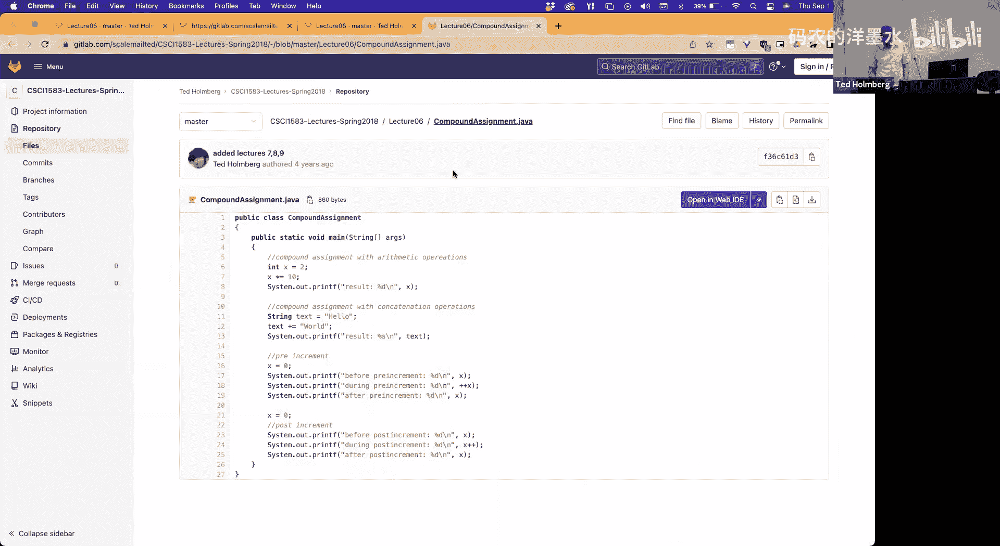
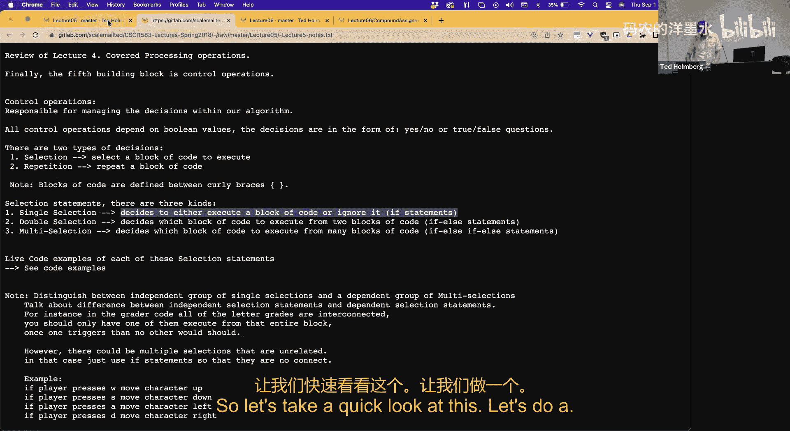
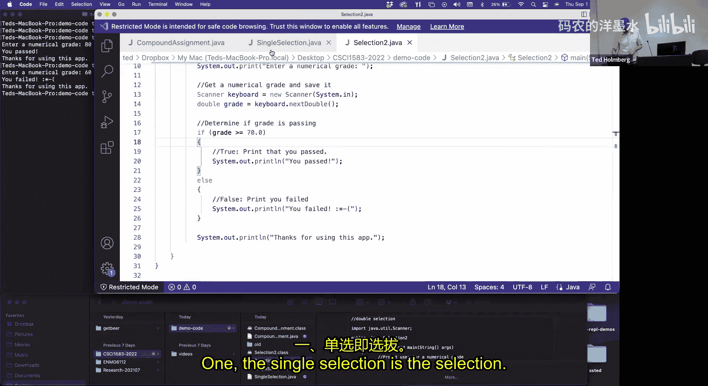
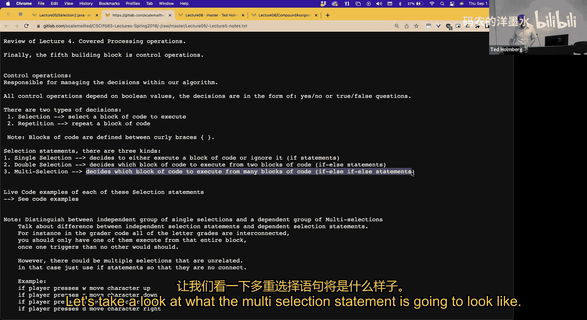
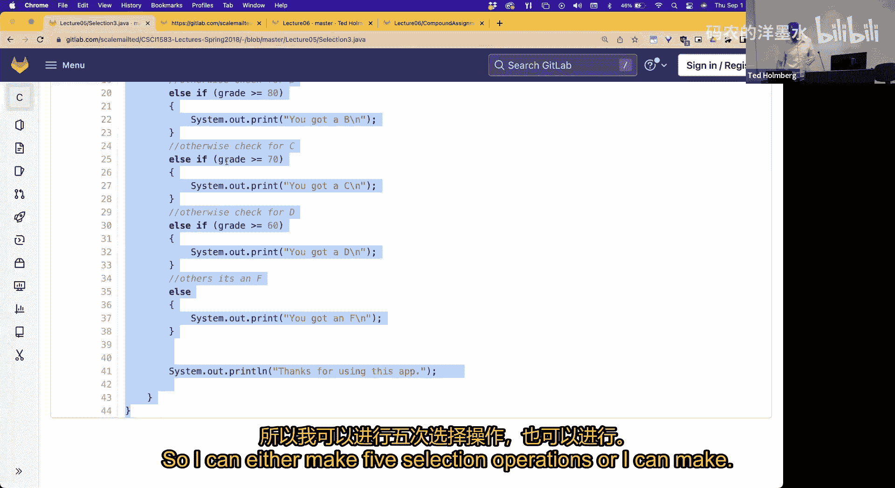
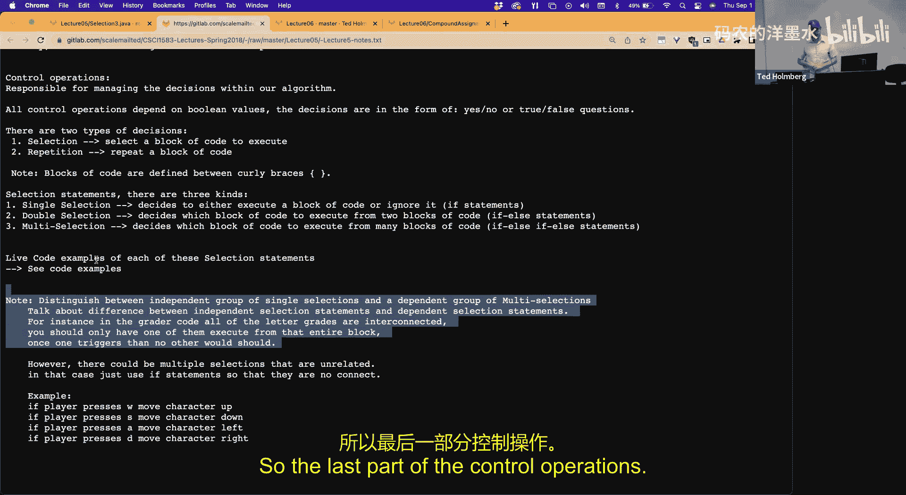

# 【全集】加州理工学院 软件设计与开发 中英字幕 1080P p05 Lecture 5 - 选择结构 -BV1AvzCBdE7a_p5-

Okay， let's see here it's 11 o'clock， so we be able to start up the lecture。So let's see。

 I'm assuming everyone can see me， everyone can hear me online。Yeah。Okayか。It test us once yeah。

 I see a feed bubble on the microphone， perfect。Okay。

 so everyone should also be able to see my screen and check， check， check， perfect。Okay。

 so last time we left off。In these last couple of lectures we've really been discussing what are the five building blocks for creating an algorithm inside of our programming language and so the first。

Was the output operations and then we looked at the input operations and we looked at storage operations and then we looked at the processing operations so before I move on to the last set of operations the control operations I do want to show you one interesting thing about the processing operations that we can do to pair them off with an assignment operation。

So and in fact， let me。Here then。Okay， so we have these concepts that are called compound assignments。

And let me grab this source code， let's actually play around with the source code a little bit at a time。

Let's go over here。😔，啊你 create this touch。啊。How。Signment dot Java。Okay。

 so let's take that file that we just created， let's bring it over here。And。我 sicker。Okay。

 let's actually remove some of this。So let's start with here。

 so in a compound assignment statement is one。Let's carried up just a little bit， okay。

So it's one where we can go ahead and have the let me blow this upone。

Is that easier for everyone to read？Okay， so what's happening here is。

I can take an arithmetic symbol。Such as the multiplier and if I put it before an assignment operation I can in one line of code do both a processing operation and an assignment operation this is what's called a compound assignment because we're not only。

😡，Writing to that location and memory where the alias is where whatever that identifier is pointing towards but we're also going to take whatever we're also going to read that value and overwrite to it so actually let me show you what a example。

Typical example without compounds。So let's see we had or let me do this actually so deleting all that let's do that's the same this here。

This is the same as stating this。Right so now that we've learned about processing operations and we've learned a little bit about storage operations。

 recall that with storage operations that label that identifier that we've declared points to some location and memory where we can go and store values now when we store a value we use that same name that we've declared to be able to read back values from memory。

So you can think of our memory as a storage bin where we can constantly go and put in and extract out values。

But in one line of code， it is possible for me to both read a value。😡。

Inside of inside of one of our memory banks。And then after reading it。

 we can process it in some kind of way in this instance in the example you see here， I'm taking X。

 which I've declared and assigned in the same line。

 so that's called an initialization that's on line four。

And then what I'm going to do is I'm going to read A so if I look at a assignment operation。

 this is the very important thing you have to understand about the way that that resolves is typically the assignment is the last thing that happens on that line so notice there's more than one type of operation on this one statement so each line we'll call a statement or actually any any code up to a semicolon is all part of the same statement。

😡，Inside a Java like a semicolon represents effectively like a period inside of an English statement。

So what we're going to do here is the assignment operator is always the last one to resolve and the reason why is what happens with an assignment operator is it takes whatever is on the right hand side which has to resolve into a value so it can either by default be a value or it could be something that like a method that returns back a value or it could be some kind of arithmetic operation that produces a value right so in this instance we're going to do a operation a processing operation an arithmetic operation to go ahead and produce a new value。

So what's going to happen here is we're going to read the value of whatever。

We have in memory so that's going to be two right because I can see that we assigned the two in line four so we'll read back the value of two we will multiply it by 10 so this executes first then that resolve into a value that's going to be 20 once we have a value that's been resolved then we can do the assignment operation where we will then take that value and store that new value in the memory where originally that value two was。

So this is an important concept though， that I can both read and write into a memory address in the same line of code。

Because that's a very powerful concept because it allows us to read the initial state of something。

 mutate the state， and then bind that new state where the old state used to be。Okay。

 is there any questions related to this does everyone？

but do mean that kind of thing does it save you any space at all even a small amount of space Well it's not so much the idea of the the space that we're going to care about with this kind of capability what it's going to do for us more so is the ability to evolve in real time a variable where we can inspect it mutate it and then save that mutation without having to rename the variable so without being able to read and write into a variable in one go every time we had to change the state we'd have to make a new set of variable and reference them and we wouldn't be able to programmatically do that right because we have to declare our variable names inside of our source code so then we we couldn't dynamically spin up new variable names so obviously the solution to that is for us to be able to have one variable that can read its state and then be able to mutate its own state。

the same line of code so that we can track this evolution right so that each variable isn't just a singular snapshot。

 but that we can mutate it not based off of some external code。

 but we can use its own state to help decide how it's going to mutate like before we did this we could have done something like this right like we could do we could have hardcoded that like two times 10 right and then you could see we're just saving。

We're just saving， we're just doing right operations into our storage。😡。

Variable into our variable labeled act。So， by， by。Being able to replace a literal processing operational or a operation that is not including x。

 being able to also include x allows us to take into account whatever state x is in define a operation on it that then evolves our state of x and then bind that to the same variable name。

😡，So and that's going to be really big when we get to the control operations。

 which is why I'm trying to motivate this like in a control operation like for instance。

 if I were to try to count everyone in the room for instance。

 I would probably start at one and then go to two and three and four and five and six and seven and eight and so if I want to have one variable that like let's say for instance。

 is the labeled count of people in room， then I'd want that to be able to start and continually evolve as the application lines。

So should every code start with public class and then？started。So。

Until we start learning how to build our own classes， yes， so the keyword public。😡。

Means that's the access level that this particular class file is going to have inside of the Java ecosystem。

In terms of external entities processes trying to interface with it trying to interact with it and so if it's public that means any other Java class can go ahead and visually see that this class exists and try to request it to do things if it's private then。

Nothing outside of this class is exposed， which means that anything defined to that class is only accessible internally to that class。

 but not external Now if we want our Java file to be an executable。😡。

The launch point of our application， so if we wanted to be able to actually execute and do things like print statements or be able to get user interactions and then do some kind of processing and then deliver some type of result。

 if you want to do any kind of actually execution of the application。

 then you have to have a name nothing。Because in Java。

 the launch point of every application is the main method。

And so the main method is a static method to any class or any class can have the main method。

 but you use whichever class's main method it is as your launch point and when you do that's going to be the main set of operations that your application performs to do its job。

嗯。So because the main method is invoked from the command line from the JVM that also has to be public。

 so that has to be visible Uber to make that private then that wouldn't be a method that's exposed to the outside worlds from our class and then we wouldn' be able on our application so yes for the time being will use public class and public static avoid main for our definitions of all of our source code files and really the big reason for that is is recall how Java wants the code based I mean I'm sorry recall how Oracle wants Javas code based to be maintained where all of our statements go into methods。

 all of our methods go into classes， all of our classes go into packages and then everything's organized by packages and it's supposed to be kind of like a similar concept。

 a similar strategy on how you might organize data inside of like your operating system。

Somehow the equivalent of a package。Inside of Java would be like a directory of your inside of your OS and what might be the concept of a class。

In Java you might think of as an individual file， that's why we give each of our classes the same file name and that's why we give our file name the same as the class name。

And then inside of each of your text document， you might have， for instance， a。

Some kind of delimiter like let's say paragraphs whenever you go and type something out and so that might be the or chapters if it's going to be something like a book。

And so the same way you'd use a chapter to determine what part of the book you should go to at any given time。

 we have methods right the methods help organize all of the different source code that's in one Java file。

 one class file。And then what makes up a paragraph， well， it's a bunch of individual sentences。

So that's kind of like the metaphor that Java goes for with source code files so because of that we can't just have the source code files hanging out outside of the method and so we'll just right now put them directly in the the main method。

Because we need to at least have the main method if we want our Java code to run。

 we can't launch something without the main method。Excellent， okay， so let me see this here。

 so let's actually test this out。Oh。Oh。And so here we do see that we do get the value of 20。

And clearly what you saw is we started with the value of two， then we did this read。

 and then we did this read value of X created a processing operation resolved it to 20。

 then we did the assignment to X and now when we print out X we're going to go ahead and have the the new updated state of that so again the concept here is when we store a value and memory we can evolve it over time。

But。We can also combine these two actions into one。😡，So here。

 instead of having x and then multi multiply by 10， I can put the。Atraic here。

Get rid of that and so now that what this is going to do is going to be an operation that does it。

Both in one sweep。 So the first thing it's going to do is it's going to read the value of X it's going to multiply it it's going to do this first operation first the the multiplier so the asterisk symbol and then whatever the value is that's resolved on the right hand side。

 So if this was a more complex expression say for instance， times two， for instance。

It would do the multiplative property of 10 times two before it would then multiply it towards the actual value here。

So it'll go ahead and multiply this， resolve into a value。

 then take whatever that is multiply by this x。And then once it resolves to a new value。

 it will go ahead and then print out。The or it'll write to x。

 and then once we've written to x on this line set。

 we will print out the new value So you'll see we should get the same。

Result when the compile let me run and there we go we see we we get 20 for both instances。

 so this is what's called a compound assignment the one we saw before where it's the right here on line four that's a simple assignment。

Because we're just using an assignment operator， but whenever you pair it off with some other processing operation。

 you will call that compound， excellent。I'm going to say I think I had a couple more examples that we probably just walk through。

So this was an example where we used it for for integers here we can do the same thing for text right shouldn't be a surprise we looked at that quite extensively last lecture so here i'll create a variable。

And initialize it with the string literal hello。Then I will use that compounded operator with a concatednation operator。

 you know it's concatenation because this is a string， we'll take whatever the prior state was。

 which was hello， we will concatenate world to that and then we'll overwrite that to text so that when we print out the text it shouldnt now say hello world。

Okay， so。The last thing I want to kind of highlight with the compound assignment operations is that there's actually。

If you need to increment or decrement by just one unit。😡。

There's even an abridge version versus the one we saw， so the one we've been seeing is like this。

Where it's like text and then whatever your operator is and then the assignment， well。

 if we do this X， and then we could do either x plus plus or plus plus act。

That's the same as saying increment whatever the current value of x is up by one and and if we do minus minus it's going to take whatever the current value of x is and decrease it by one and the reason why we have special symbols to do this particular compound assignment is because this is such a it's such a common operation we have to do once we start getting into like repeatable patterns once we start talking about repetition statements we find that we have to be able to increase and decrease a counting variable effectively by one so that we can evaluate all of the elements。

Or be able to do an operation X number of times。So。There are notice， though。

 that I can do it in both ways， so if I have X here。😡。

Let's do some predictions here So if I have x and I start x as0 and so notice all let's go up here So here I'm declaring。

The integer value of x right and so here for the pre increment， I will assign it to zero。

And then I'm going to print it out so what state is it going to be at this point it's going to be zero。

 right？😡，And then here。I can do plus plus acts。😡，And or I could do。

X plus plus so we're going to evaluate both of these， but based off of your intuition。

 do you think there's a difference between these So first of all。

 what do you think either of these do plus plus x and x plus plus。😡，Yeah。

 so so regardless of whichever one you use。It adds one。To that unit， now， why。

Might it matter what order I put the plus plus？Well。

 if it's I'll give a small hint if it's if it's on the same line。

 if there's only one thing on the line， it doesn't matter if it's plus plus x or x plus plus。

It's going to add one to the value of x。😡，The difference is if you're doing more than one thing in that statement。

 you can prioritize when that X。increasesreases by one。

 whether that should happen before everything else in this line of code executes or after。😡。

So for instance， we're doing two operations on line 19 right where' we're doing a print statement right that's a print operation and we're doing a compound assignment operation which means that we're doing a processing operation and an assignment。

 right？So if we do plus plus X， what we're stating to the JVM is do the increment to the variable first and then do the rest of the statement。

😡，So here it's going to take our value of x， which is going to be zero。

 it's going to make it go to one。😡，And then it's going to print the state because that's the other action we're doing in the statement。

If we look down here at line 25 where I have x plus plus that's selling the JBM。

 I want to do an increment in this line， but I want to do it after everything else。😡。

So evaluate that last。So what we would see here is if our value of x is zero。

 we're going to do the print statement first where it'll be zero。

 then we're going to we'll update x to1。So in each of these in each of these notice I'm going to print the state before I do the pre increment。

 I'm going to print in the same line as the pre increment。

 and then I want to prove whatever happened that the state of the value of exchange after the post of pre increment。

 so I'll go ahead and print the new state again， and then I'm going to do the same thing here on line 24。

😡，But with the post incroement， so before we do the post increment during and then finally after。

 so let's actually save this。That's。Clear our terminal。Okay， let's see here， let's compiles。哦。Pa。Oh。

 well， I guess。Not good to have。Okay， perfect。That's。Prom with copy pacing code。Okay。

 so let's take a look at this。These were the other examples that we already saw we already took a good long look at the results and we already looked at string and in for that these are the interesting things here so the output that corresponds with liness 1718 and 19 are right here so before pre increment it zero then with pre increment is's going to increment it first and then do the print so that's going to be one and then then of course after。

We do that the increment we see that the state is still one。

 so now at lines 23 to 25 that's going to be the output here。

You can see we set our state to zero so when we print out before we do the post increment if the state's going to be zero then we during the post increment it's still going to be zero because it's going to print the state before it does the increment so it's initially still going to be zero when we do this print operation but afterwards after that operations done it does go ahead and increment so when if we print it out again it's going to be one is there any questions related to that does everyone say and I could do the same thing if I did minus minus。

So there's the only two ways to either called an increment or a decrement and it's only for the value of one every other way you would use a compound assignment and in fact not all languages support the idea of like an increment or decrement operator like that like for instance Python does not have an increment or decrement operators just have to use a compound assignment。

Excellent， how's my audio now is it so lagging？They come。Okay。

 so if there's no questions related to this。

That's going to help build us up to。Our fifth and final building block。

So that's going to be our control operations。So up until this point。

 we could make algorithms we actually once you have the ability to have an initial state of of。

Your problem and then once you have the operations where you can store those initial states。

 recall them， mutate them with processing operations。

 then you could just sequentially follow step by step those directions and you get a result so even before we look at the fifth building block to our algorithms we can already make algorithms the problem with our algorithms are we can only build them line by line and there's no decision points in there now there are some recipes that are like that right but let's think about a recipe for instance or concepts and recipes where there are decision points to be made while you're following the recipe right where you just don't follow every line but you have to do something either repeatedly or you have to select between one of two ways of preparing something so probably in the format of cooking the two control operation。

are selection and repetition so i'm thinking in the confines of something like gumbo usually you can make one or two types of gumbo right and so either types of gumbo will use a ro so there'll be a set of similar directions but you'll get to a certain point and if you want to make a chicken and gumbo chicken sausage gumbo versus a seafood gumbo that's going you're going to select a different set of ingredients so that's an example of how you can have a decision point in an algorithm where you're forced to select from a block of instructions and so to compare that。

There's another decision point that we normally have inside of our algorithms。

 our step by step directions， something like a recipe is this is very common one let's go back to our cake example。

 you might have something in there where when you create batter， batter can sometimes be lumpy。

Sometimes there's a direction that says stir batter until it's not lumpy， right？

And so what I want you to want to want to illustrate is that that direction is giving you a condition where you're repeating an action where the action is to stir and you'll continue to do that until you get to a stopping point so like if。

To put this in confines like that is a concept where we want to repeat a set of instructions and we want to give the conditions so instead of just saying like stir stir。

 stir and writing like stir 60，000 times if that's how many times it takes for like 20 minutes of stirring I don't knows instead of that we can we can more easily define that block with with a repeat keyword。

Okay， so those are going to be the two decision points that we're going to look at the first I want to examine are going to be the selection statements。

 so those are going to be along the lines of there's three forms of selection statements they have a single selection they have a double selection and they have a multi selection。

And the big thing about。This election statements and this is true for our repetition statements when we get there is that the decision point on whether we're going to do。

That whether we're going to execute that decision or ignore that decision is going to be based off of boolean data and that's why it's so important when we're looking at our processing operations that we had the ability to transform into any data type into some kind of boolean format because that's all the interesting decisions in our algorithms are made so let's take a look at our selection statement so with a single selection it allows us to decide whether we want to execute a block of instructions and every time I say a block of instructions what you can think of is a block of code so this will allow us to decide whether we want to execute a block of instructions or completely ignore it again an example for what this might look like inside of a cooking recipe is if you want to keep your dish vegetarian then you can have the option to ignore adding the meat in。

So let's take a quick look at this， let's do a。

Okay， so in this example， let me grab it。Okay， let's clear this。Okay。Okay， let's see here。Okay。

 so let's see initially in order to do anything we need to create a class。

 so let's motivate what my single selection Java file is going to do and actually let's get rid of all of what it actually does。

😡，Here。Okay， so inside of this code。I'm going to create a。

An algorithm that will let me know if I've passed the class or not。So just let me know if I passed。

So I'm going to have a grade or request a grade and if the grade is a passing grade。

 it'll tell me that I passed and if it's not a passing grade， it won't do anything。

So in order for me to start working on this， the first thing I need to do is define my class so and as of now all of my classes should be public。

So public is the access type that was the JVM know that this class is available to all other classes inside the JVM。

 then we're going to create our class and we need to create a class because anytime we make any kind of source code file。

It has to go into I mean every time we make any statements that's the individual units of Java code that we produce。

 those have to be contained within a method and methods have to be contained within of classes so we can't operate we can't write any Java code without a class so as a public class。

Then the name of our class has to be the same name as our。As our Java files。

 which since this is called single selection， when we call this。Single selection。

Then whenever we open up a class。Definition we have to give it scope so whenever we give or we got to define where the block starts and the block ends so this class scope starts on line6 and then ends on line 12 so sometimes what it's what you can potentially do there's one of two ways you normally will see this where people will put the curly brackets on the same lines so that you can do the finger test the finger test is make sure like one of the most common mistakes that early developers do is have missing。

Brackets and that is such a pain to debug and one way to always avoid having missing brackets because whenever you open up a code block。

 you have to close the code block is well create both the opening and closing at the same time。😡。

So usually what you'll see in these instances is whenever I open a bracket。

 I immediately close the bracket。And then I hit enter twice because everything that goes in between a set of brackets should always be indentant with it。

Because that represents something that's contained within that scope。

 so again the scope of my class starts here。😡，The scope that ends the class goes here。

 that means everything in between that should be indentit so that it gives me a formatting structure that visually illustrates to me what the structure of your code is。

😡，Like it's valid not to follow these rules， but it makes it more difficult for me or for yourself to read what's happening in your code。

Okay， so then after that we're going to have our。Method and as of now。

 we'll always use the main method。Whenever we make any application in Java we'll have to have a main method。

 but later on， as we start to evolve our capabilities as Java developers we'll have more than one class that our code that our software will be built around。

 however only one of those classes will have the main method。Okay。

 so right now we're just going to put all of our code into the main method。

 also know that's usually not a good design practice。

 but it's something for us to easily kind of look at when we're looking at our code。Okay。So now here。

 let's take a look at。Starting here， we have the comment that says the first thing we're going to do in order for application to work is we're going to prompt the user for a numerical grade。

And so a prompt is simply whenever we see that word prompt that's going to be effectively an output operation here we're going to let the user know hey。

 if this application is designed to let you know if you' past or not i'm going to need a grade from you so the next thing that I need before I can start processing is a grade。

Okay so then the next thing we want to do and i'm going express this as a comment here is I'm going to get a numerical grade and I want to save it i'm going to get that numerical grade from the user so remember what I said about assignment operations assignment operations that these here right as long as the right hand side resides into a value it will take that and it'll wait for that to resolve and then it will do the second part which is to take that value and assign it or stored in that space and memory and that' storage into memory the last thing that happens on that long so there's actually like。

Here， okay， so first we're going to create our。Under scanner operation。

And so here this is going to resolve to create a new scanner instance。

 we know that because whenever you see the new keyword in Java that's going to call a constructor that builds a complex object for us so so far most of the types of data that we're going to learn how to use are going to be the primitive data types the ones that we spent a lot of time in class defining me so that's like your ints that's like your doubles that's like your booleans your cars and the one special type that's not quite primitive data type。

 but it's a little bit more specialized，'s a little bit more built into the system than any of the other classes is going to be a string technically it's a reference type but there's a lot of cool things that we can do with strings in terms of just making them into string literals using the double quotations like it has special symbols that none of the other classes have but just like a string is like a reference type it can take multiple different instances right because it can have。

different set of character sequences， that's the same thing with a scanner。

 a scanner is something that's been defined for us in Java and its it exists as a reference type that has its own behaviors that we can invoke on it。

Anyway， so we're going to build this instance of scanner we're going to pass it that input stream that we said because we want to be able to evaluate the input stream and plot data that comes from our keyboard and then we're going to go ahead and assign that here into keyboard。

So then here。For this assignment for our grade to determine whether the grade is passing or not。

 we will go ahead and。On our keyboard， we will grab from that complex instance that scanner object。

 and we're going to call that next double method。And so that's going to return to us a double value that's going to resolve a double value。

 so that's coming from the keyboard， that's where that data is effectively coming from we know because that's where the system got in defaults to。

And then when that results into a value， then we do this assignment operator where we will bind whatever this value is from the keyboard from our input stream to this variable that we are declaring at the same time that we're initializing it or assigning it again that's an initialization so now we have a value of grade so by the time we're done line 15 we can make a decision point and so our decision point is whether this grade is a passing grade or not if the grade is 70 or higher because that's the minimal grade you need for a C then we're going to create this if statement so notice selection statement single selections use the key if after the if we will have a set of parentheses inside the parentheses will be some expression that has to resolve into a boolean value because all of our decisions in these decision points are yes no decisions they true false decisions so regardless of what your data model is you have to express that in something。

That can be resolved as true or false so notice the data that we initially had to make our decision off of is numerical data so we're going to use a we're going to select to use a processing operation that we can use on top of our numerical data that we have as input to derive a yes no some true false clause in this instance we're going to use a relational operation and say if the grade is greater than or equal to 70 well that's going to resolve into something that's true or false that is a valid data type that I can go ahead and use inside of my。

OnInside of my that I attached to that if statement or that if operation， that control operation。

And so if this is true or false， I then have to bind a block of code to that if to that control operation so control operations and this is true for both repetition and selection are going to be different and you have to watch out for this all the other operations we saw input operations output operations storage operations were all done in a singular statement and we put a exclamation I mean we put a semicolon at the end we put end of statement after that do not put an end of statement。

😡，Do not put a semicolon there， right， that's wrong。

Because that's not where that statement ends you're you're opening it up and if but then you have to bind to it。

 you have to attach to it a block of code if you do this， so let me just say this。😡。

I can actually that's not what I want to do at all。嗯。Okay。Okay， so for instance。

 there was actually two different legal ways we can create a one of these any any one of these control operations。

 whether it is an F statement， a while statement a four statement。

 like we're going to look at all of those in these lectures。

 but I can either find a singular statement。😡，To a control operation， so this is legal。

 but this is what's considered very a very bad design practice or design pattern。😡。

And so the reason why is that。Here， if you don't provide a code block and a code block aid again defined by the curly braces every time we've been using curly braces we've been defining blocks starting an ending blocks。

 if I just use a singular statement which is completely valid。

 then I can't add any more lines to this control operation。

 so even if I go back even if I want this to be a single line， this is this is。😡，This is valid。

 in fact， let me。Let me actually， let's go back， let's take yeah， I don't like that。

That's not forever this is just a。Okay， so here let's save that， let's actually run this。Yeah。Oh。

So let's see here， let's do 80 you passed。Oh， whoops。posed to get rid of that。好。One of that。没有得。Okay。

 so let's do 80， you pass， okay， then let's do 70， you pass， okay， and then let's do 60。

Okay okay so notice that does work as we expected， so let's let's run through what's happening here。

 we're going to prompt the user to enter a numerical grade then we're going to set up our scanner object。

 then we're going to use our scanner object to go ahead and grab the next double。😡。

From the user so and we're going to save that for later the reason why we're saving that for later is for our decision point。

 if the grade is greater than or equal to 70 then we're going to system got printed now notice this is a completely legal way of doing this。

 but this is the bad one。I'm showing you， though， that the way that this is designed that this if statement affects the rest of this line。

 but if I want to have more than a single line affected by my if statement instead of putting a statement there。

😡，I can cut the statement， I cut the semicolon， but I can replace it with a code block。

 and then in the code block， I can have multiple statements。

So even if I want to do a single statement， you should always use this format。

 always attach the code block to the control structure， to the control operation so that if later on。

😡，I needed to add another line of code I can do that in the other approach you're just stuck with that one statement。

😡，And so that's bad form because it prevents you from being able to extend what happens inside of this block in the future。

😡，So it's just always best to define a codewalk even it's going to be for an individual line so here。

 for instance， let's say I don't want to say you pass， but i'll say。Good job。

So now what we'll see here is if I compile my code and if I run that。And let's put in 80。

Execute those two operations that are inside that code block。

 the print statement that says you passed and the print statement that says good job in fact。

 whenever you create a block of code the way that the JVM treats that as if it's one contiguous statement so it allows you to say that this is a unit of code that's what you want to think of code blocks so prior to having code blocks your basic default unit of code is a singular statement that's what goes after or before a semicolon that's what goes before semicolon but code blocks allow us to say no our unit of codes going to be defined starting at this bracket and ending at this bracket then it could be any that code block can then be any number of statements inside of there so it allows you to create an unvisible amount of code something that supposed to if one line executes the rest of it's going to execute。

Okay， does this muchment makes it so notice with a single selection though。

 we opt whether we want to execute that block of code or completely ignore it， right？😡，And again。

 if I were to paint that in the confines of a recipe， if I wanted to make the meal vegetarian。

 I would just ignore the instructions that said to put meat in there。Okay。

 so I want to paralyze I want to I want to take this， I want to compare it。

 I want to contrast it to a single selection where here if we want to do this the I mean the double selection in the single selection we're just deciding whether we're going to do a block or ignore it I can do a double selection where I always guarantee i'm going to execute a block of code in this instance I am not always guaranteed to execute the if statement so it might be the instance that I run through this control operation and then nothing happens in result of that I just ignore it all in a double selection statement I have two blocks of code and one of them is guaranteed to get selected to run so that in that instance it's an if else block。

😡，So there instead of just ignoring the if clause， if the if clause doesn't trigger。

 then we will always run the else clause if the if clause does trigger。

 then we'll ignore the else clause， but what happens in that control structure is it's either one or the other。

😡，So you're guaranteed to get some kind of change of state something to happen in response to that decision and an example of this would be like the gumbo example。

 whether you're going to go ahead and。Select to make a turkey and sausage gumbo or whether you're going to go ahead and make a seafood gumbo like the directions might be very similar up to a certain point and then there's a branching path。

 but you're going to not just ignore one set of directions。

 you're going to select whether you're going to follow this set of directions a or this other set of directions B。

And again， that decision point is going to be based off of the same thing that the single selection was。

 which is going to be a booleing value， let's take a look at that actually。

And here what we'll do is we。Yeah。And this example will just continue with the same theme here as well about improving this app that tells you whether you've passed or failed the class。

So let me create。So so。So inside of here。We're going to make a similar app so let's see what i'm doing here and i'll start to cut some of this code out so it just makes it easier to read at any given time so let's actually cut out the implementation have I not been charging this entire time at 2%。

Oh。Okay。Obviously， I'm having some。O。My power adapter seems to be on the fronts。Okay， so here。

I'm going to start the way that I'm going to start all my other Java files in order for for me to run any kind of code the code has to be defined inside of a method and that method has to be defined inside of a class so the first thing I'll do is I'll define a class and as of now all my classes have to be public now。

😡，The default behavior for a class is actually public。

 so I could if I wanted to just define this as class here。

 but we should get used to understanding that we can。

That we can give each of our classes and each of our methods its own access level， so for instance。

 I could set my class to be private， but then we wouldn't be able to execute it because it wouldn't be available from the command line right we wouldn't be available from our IDE or wherever we're actually running our JVM from。

We could declare our methods as private， but then we wouldn't be able to access them from outside the class。

Anyway， as of now， we'll always need this code， a class and inside the class a menu method。

 so we're just stuck with that for right now。So then inside of here。

We're going to prompt the user the same thing we did before， hey user。

 we want to get a numerical grade from you。啊。Then we're going to get that data from the user so in order to get that data the first thing we need to do is create a new scanner object and remember if we're going to use the scanner object that's not part of the Java dot lay package which is implicitly import it to every Java application so we actually have to manually import that scanner class from its package from the package it lives at so that's Java dot u so once I have that scanner class I'm going to go ahead and build an instance of scanner which will allow me to plugl things from our input stream here the thing I want to plug from our input stream is going to be the next double value I'm going to take whatever that results into and I'm going to save that into this variable grade。

And so I'm going to declare that variable， the data type is going to be double and assign it the value。

 the thing I'm getting back from our input stream in the same go， so that's an initialization。

Then I'm going to do the double selection， so in the instance of a double selection。

 you can see here I'm going to check if my grade is greater than or equal to 70。

 then I'm going to print out this statement， hey， you passed。

And then I'm going to attach so and then。This code block here is attached to this if operation。

 Well and else。😡，Binds to an if statement。So in another form。That you could see this in is a。

Another way you could think about this is like this。

If we were to think of it as individual statements and not blocks of statements。😡。

This would be the same thing。And in fact， let me keep combining it so that you can see。

What an actual if L structure looks like without me creating code blocks。

 because you might see how Java might be more apparent to you， how Java is actually parsing this。

So in this instance， you'll see that there's only one yes or no evaluation in a double selection。

 the same as with a single selection， but if。Oh， I need to have a print statement in here。听到啊。Okay。

And let me stretch this out more so so really the way that this is parsse in Java is when you create an if you have to whether it's a single selection or double selection define what the decision points going to be and that has to be resolved as a boolean value so here we're going to use a processing operation that's going to do a relational operation on one grade and we don't know what that grade is until we run the application right it's represented as a variable and we're going to compare it to a constant literal value of what we classify as the boundary point between passing and failing。

And so if this is true， then this statement。😡，This operation。Not so much statement。

 this operation will result from that。😡，And since I have an else。

 what that means is since there's an else attached to the if。😡，Then if the if the if doesn't trigger。

 then the else will trigger so instead of ignoring the if block it will pass over the if block。

 but if an else block exists it will then execute the else block if we leave out the else clause it just ignores it just it moves on。

😡，So effectively， this is a double selection because we have an L and then a some operation。

 some instructions after that。Where this is would be a a single selection because we have an if and then we don't say what to do if the if is a false。

 so if we don't give it a false。Set of blocks and else。

 then it ignores that Or if I use that keyword else， I now bind that else to the if。

 So the reason why I keep bringing that up is let me show you what is not legal but something that's very common with early developers and I'm going to go back to taking it out of that format of individual instructions and creating block of instructions because again。

 that's what's preferred in。😡，In。In industry and just in building out these control structures is to always use the curly braces。

 but illustrating that the reason why illustrating that works without the curly braces because if you ever do this you're binding an empty statement to that if and now this this block of code isn't attached to it so if you're ever running a control structure and it's not working see if you put a semiical in there because it's bad and it's a hard hard bug to identify。

😡，Because that's technically legal and then it ends that control structure on that line and then what you're doing here is you're just controlling you're just defining a block of code。

 but you're not binding into anything。😡，It is not being attached to the control structure Okay so what is also something that you can't do is put a semicolon after the blocks don't do that because that's not the end of the statement technically the end of this statement is after this else clause right because this else technically attaches to this if but this if has a block of instructions right everything that goes from between the open and closed curly braces so it has the block of instructions that it could potentially do for the true。

And then on the L。This block of instructions will happen if this is false So another thing that is illegal is you cannot do this There is no else clause that does something like。

😡，Like we don't have to do that right because the else isn't an if the else doesn't get to make a decision about true or falses it just gets to run if the other part doesn't so again i'm showing you this to show that this is invalid this is bad if you see this though then you know or if you're helping someone。

😡，And you see code like this， and this is a mistake。And again。

It's one that might not get reported when you go to。

 it could be like a runtime mistake that you don't realize where the JVM。

 it's technically legal or valid syntax， but it could potentially do things that you don't anticipate doing。

 especially at the semicollon after these statements here。Excellent。

 so now let's go ahead and test this so on this instance we're going to evaluate the state of grade and if grade is 70 or higher。

 then we'll execute this block and if it's not， then we'll execute this else block。

So here we're going to improve our application from just being able to say you pass to actually also alert the user to know that they failed。

So let's go ahead and run compile that， so let's do selection two and then let's run that。Oh。Okay。

 enter a numerical numerical miracle grade so here let's do that 80 so you passed。

And now let's run that again and then let's do like say， for instance 60。And then you fail。

 So they're an example of a。Double selection statement。

So the last that I'd want to show here in terms of selection statements is that we can nest these ifL statements together to make what's called the multi selection statement。

 so we said there are effectively three types of selections we can do in our algorithm one。

 the single selection is the selection and in fact。

Right the single selection is where we get to decide whether there's a block of instructions that we want to execute or completely ignore in the double selection what we just saw was having two different blocks and we get to select which of those two blocks that we want to execute from well in a multi selectionction。

 there's multiple blocks。And we get to determine which of those blocks from more than two than three or four or five or however many we want we want to select。

 but we are only going to select one and execute that one block so in the instance of our grade reporter imagine if we wanted to report our grade reporter so just't just give you the binary like printout of you pass or failed but if you put it in a grade whether you got an A or a B or a C or a D or an F right that would be more interesting but the only way we can do that kind of implementation is if we go ahead and use a multi selectionelection statement let's take a look at what the multi selectionelection statement is going to look like。

So here if I go to my selection three。我 me。Coode's going to be and in fact， we'll just read。

 I like playing around with the code and editing it so I can remove some of it。没。See if this is。

Perfect。Copy that。Okay。So now here， let me create。I actually need to。

We'll create selection three here and then inside here I will。

Open that up that's new line perfect Okay， so let's see inside of our multi selection。Let's。Remove。

Do the same thing I did last time and take everything here and just cut it away so when we start。

I'm going to import the set of classes that I know I'm going to need in order for this class to be defined so since I'm going to build the same application I've been building I'm going to import the scanner class so that we'll be able to get user supplied input from our input stream then I'm going to actually create my class so public class selection three I got to name my class whatever my Java files named or more precise I should name my Java file whatever my class name is and if they're not the same the JVM will actually give you a compiled time error in response to that will say that there's not a class it it's going to use the file name structure to determine whether there's a class there or not。

Okay so with that said inside of our class we define a block of methods。

 so here all blocks are defined with open closed curly braces。

 so then I need to have a method public static void main is the most common method because that's the launch point of every application typically we would run other methods inside the main method but right now since we haven't learned how to make our own methods we'll just put all of our statements inside of there so right now we're just going to do all of our code inside of the main method。

 but i'm just letting you know that in practice that's a bad pattern it's not something you typically want to do。

嗯。So we give a block of。Code or a block。Of scope to our method and so inside of there we can go ahead and create our actual source code so in here we're going to do the same thing we've been doing i'm going to use a a on this statement on online 10 there's this that's a statement because statements are always appended with semicolon you can think of that as an end of statement like an end of sentence like an end of thought。

To a computer， those are our sentences， so here this is an output operation but this output operation in the confines of our app is designed to be a prompt to say hey。

Give us a number。Then if we actually want to get the number from the user we need to go ahead and create that scanner instance because the scanner instance has all these builtin behaviors that can monitor and interact with the input stream this part of system do in so we will build a scanner object around the input stream and then we will save that into memory so that we can access it later we're going to store it into memory using the label using the alias using the name keyboard so now whenever I use the word keyboard inside of my application that's effectively going to refer to the memory address where that scanner objects at。

 so I will access that scanner object here on line 14 the one I create line 13 and I'm going to invoke one of its behaviors。

 one of its methods this particular behavior is the ability to grab the next double value that appears in our input stream and that's going to appear from the input stream from the keyboard because that's the default location of。

I'm in so here after this that's going to resolve into a value that is a double value once that resolves into a double value I'm going to do the other part of this assignment operation and actually take that value。

 whatever it might be and bind that to this variable that's called grade and so here I'm going to have my decision variable is my is based off of grade so this is to notice we've been spending a lot of time talking about things like our data types and being able to go ahead and make decision points on models doing mathematical models here my mathematical models is the concept of what delimits the concept of a grade or my labels for a grade。

So here the decision point is based off of the grade itself。

 so whenever you make any selection statement， whenever you make any control statement so either a block of instructions that you're looking to repeat or a block of instructions that you're looking to select across it's important that you identify what your point of selection is。

 what is the variable， what is the part of your model。

 what is what is the decision point based off of right you have to know what makes it the yes or no。

So in this instance， if we want to know if a user got an ABC or D， E or F。

 I'm going to use the grade and if the grade is a 90 to remember on every if。For every if。

There is a decision point a true false value that must be attached to it because that's what the if means if this thing is true then the immediate block of instructions after that is going to get executed and then I can attach an else to that now what I said was I can't do a true false clause that attaches to the else but what I can do is follow up that else immediately with an if and every if requires a true false entity a T so if I want to have multiple selections I can create what's called a nest if else statement so here if the grade is higher than or greater than 90 I will execute this block。

Of instructions inside that block of instructions would be to print， you got an A。

Now if that's not if that's the case， then I move on and it ignores the L block right so in an if L structure if it does the if if the if is true。

 then we move on and that's what we want in this case。

 we want to say if the grade is 90 or higher then you got an A and we don't want to do anything else。

😡，Now if it's not true， then we go to the else clause well I can immediately follow the else clause instead of using a block of code。

 I can then use another if clause and this allows me to start adding more options that are part of the same decision as part of the same selection operation。

 these aren't two independent selection operations this if will only get triggered if since it corresponds since it follows this else。

😡，So， so we'll say else and then immediately into another if the grade is greater than or equal to 80。

Well， the。We'll print a B and so now we know we haven't printed the a because this if cause is attached to the Ls。

 but now we can make a new decision point， we'll see okay。

 the grade wasn't higher than or equal to 90， so now is it higher than or equal to 80。😡，And if it is。

 then we'll print out this block of code that's attached to this cells。😡。

Or we're not just this house， but this else if。Right so this actually the if here。😡。

So since there's an if here， I can attach an else to it。😡，And then another if。

So another else if clause， so else if and now I can make a third decision point。

 if the grade is greater than or equal to 70， then I want to pronounce the statement you got to see。

😡，And then if that's not the case， well， guess what， I can still do another else clause。

But if the grade is not， or I got， I think this is actually 50 else if the grade is not higher than 50。

Then you got a D， and then if you didn't get an A， a B， a C or a D。

 the default value that we can have。😡，That if none of the other decision points were true。

 the one that falls into the false category for the entire assessment would be you got enough。😡。

So this is an example of how we can nest the logic and take what is this， this is one block。

 two block， three blocks， four blocks， five different blocks。

 five different decisions based off of one grade。😡。

And only one of those we only want one of those to occur so let me show you some things so first let's see how that works is make sure that it works the way we expect。

Oh。So let's compile this。So Java C， for short for Java compile， will convert this。

 translate our source code into Bte code， and we can run this。嗯。Okay， inner numerical grade。

 so let's say I got a 95， I got an A and notice it sucks to just report the。Okay。

 let's run that again， let's say I got an 82 yeah you。20。家系七点。都系查询。

No oh like that oh so so from the command line， I don't know how much to go over this in lab。

 but there's a couple of really cool shortcuts that'll make your life way easier so the up arrow on your keyboard but recall the last statement you use inside the terminal and you can keep hitting the up arrow and it'll keep bringing up the history of all your call instructions so here notice if I hit up once it brings me to Java then if I hit it again Java C then clear then touch so all the things all of those instructions I've been typing。

 I can immediately just hit up or down on to toggle through so I don't have to type it out Another thing is if I'm trying to go into a directory or not or try to type in a file name I can start typing it out then hit tab and tab will if there is a file name that is unique to that set of sequences it'll finish filling it out for。

So if you notice that I can somehow navigate through my directories or get to the source code file names really quickly' because I only type out a couple of the characters until I know it's unique and then I hit tab I don think the OS Ill let the terminal selfcomplet for me so these are just going to be some nice affordances that if you know about will make your use of the terminal much more efficient it may more efficient than what you can effectively get with the windowing system that you're probably really used to。

Okay， so here we got a B， but notice we didn't print the a and we didn't print any of the other of the code blocks either right and the just the one that was associated with if the grade was an 80。

😡，So here let's run this again。Let's say I got a 79。

I got a C let's run this again let's say I got a 50 that's a D and then if anything is a 50 or lower than a 50 let's say a 17 then I got an half so notice this is an example where inside of our algorithm we can create a decision point that can lead based off one decision to five alternate code blocks and I can have any number of code blocks so that's an multi selectionelection statement so I do want to highlight what happens though if we make a mistake suppose that I forgot to put these elses here right。

Suppose that I do this。First of all， will this compile？第二项。Well。

 there's an easy way to find that out。嗯。Okay， so that compiles now what do you think it's going to do by me removing those elses is it's going to behave the same way that I wanted to behave now what have I done by disconnecting the elses I've no longer made this one selection statement。

😡，That will make a decision across five different blocks of code What I've done now is these are disconnected。

😡，If checks so there there's actually five different selection statements。

 so by doing the if else if else if else clause it treats all of that as one control operation so it guarantees that only one of those five blocks will run but now without the elses I have just this if check and since that if check doesn't have an else it'll be complete it's a single selection right so it'll be complete whether it runs or not。

😡，And then I have this if check， which is unrelated to the prior one because I didn't attach it with the else。

😡，Right。So here I'm going to actually have five different if if selection checks。

 the first four or the first three， the first three are going to be single selection。

 and this else clause will attach itself only to that if clause that's here。😡。

Right so what do you think is going to happen when I run this what if I put the value of 90 in there what do you think is's going to happen and that's going print a that's right you see that it's going to print the black because since 90 would be equal to or greater than grade here then it's going to print a but since grade would also then be higher than or equal to 80 it'll print out B and since grade would also be greater than or higher to 70 it'll print that yeah so do keep that so let me ask you this one last question。

😡，Since we're running out of time， why might I want to have a collection of。

Independent selection statements like that versus having them be all attached as one selection operation。

So I can either make five selection operations or I can make like okay。

 so here that's that's exactly what this is designed to highlight distinguish between an independent group of single selections。

 which is what we saw and a dependent group of multi selections and an example where we might want to use the independent selection is like say for instance in a video game where the decision might be based off of the same。

😡。

Concept like let's say what keys are the user pressing up down left or right。

 but we don't want to if the user is hitting more than one key。

 we want to be able to ensure that the decision made in one step didn't affect a future decision that's also has to get made be made So for instance。

 if the character was allowed to move both vertically and horizontally at the same time because I hit the up in the left then I wouldn't want to make that a multi selectionction statement because the moment I just saw that I was hitting up it would ignore the additional statement to move left so those are independent actions。

 I want to be able to move both simultaneously up and left so I wouldn't want to embed that kind of decision into a multi selectionction I'd want to actually have independent selections on that because I want to be able to decide if I'm moving across the X access and the y access So keep that in mind that's a decision point you have to make whether you're doing a collection of single。

😡，Actionions where you're making decisions on whether you're ignoring or executing a particular block or whether you're going to do a multi selection where it's only a single block。

😡，Based off of multiple selections that you want to execute。

 is there any questions that are related to that？😡，Excellent okay。

 well everyone have a good day the next time we'll meet up we'll go ahead and talk about repetition statements so the last part of the control operations。

I行。A里面这个。