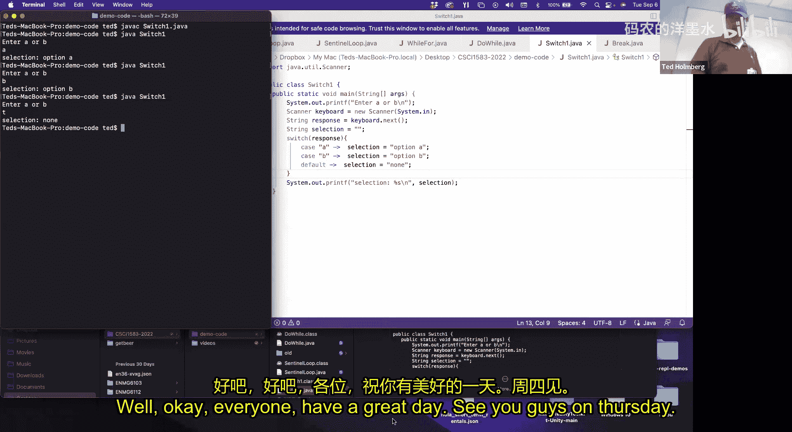

# 【全集】加州理工学院 软件设计与开发 中英字幕 1080P p06 Lecture 6 - 重复与循环 -BV1AvzCBdE7a_p6-

Exent， okay， so before we start today's lecture， just a quick preamble of things。

 so I now have a Google form for the。Or attendance that should now be available。

I should also have all of our lectures on YouTube， which I posted both those things in the Discord currently so you can go to either of those links throughout the sum well the attendance link will change over the course of the semester。

 but what the YouTube link will say the same。So with that said， the last。Topic that we had。

 let's see I want to say that the zombie apocalypse has a tentative due date of Thursday I'm going to push that back to next Thursday because we're going to finish discussing what you need to know to be able to complete that homework and that'll give you a full week to actually implement that homework and flush in your own options on it。

So before I start today's lecture， is there any questions？😡。

And then probably today or tomorrow on grade the first homework。

 so you'll you should get your first homework grade。Inside a needle as well。Excellent， so last time。

SoSo far， we've really been spending a lot of our time。

Talking about the building blocks for algorithms in Java and so we identified that the five basic building blocks are。

😡，Output operations。Storage operations input operations is our processing operations。

 which are like our operators like arithmetic or relational operators or equality operators or connation operations or logical operations and then finally started last lecture we started to talk about the fifth and final building block which is the control operations and we said that the control operations can split into one of two styles of control So up until we introduced the control operations your algorithms were completely sequential you executed each statement one after the other but what control operations affords us is the ability to make decisions while we're executing our algorithm to be able to skip over statements or select a。

Block of statements from a collection of statements or it allows us to repeat a block of statements or block of code so we've seen the selection statements where we did a single selection。

 a double selection and a multi selection so in today's lecture I want to show you how to do the repetition statements or where we're going to be able to take and and repeat a block of code some number of times until we hit some kind of terminating condition。

😡，Yeah。是。Okay， so let's see we just did a quick review of our last lecture that we talked about。

And yep， and so control operations， we're going to do repetition， okay so。

Let me do this actually consider this being problematic for me。

So repition statements are responsible for repeating a set of instructions or a block of code within a program。

 so an example of our repetition statements in terms of our recipe algorithms which is what I like to keep parking back to since I think that that's one of the most intuitive models that people are familiar with in terms of how we program something is actually pretty common so it would usually take the form of something like stir the batter until there are normal alarms right so that represents an instruction you might follow in a recipe where you repeat that action that action is to do a single stir but then you will continue that action until the terminating condition occurs and in this instance the terminating condition would be when your batter is no longer lumpy。

So so long as there are lumps， you continue to stir。

So the action to continue to stir which changes the batter state the thing that we evaluate to stop is the state of the batter so our pseudocode will look something like this while the batter is lumpy we stir the batter and that keeps going so note that all control operations use boolean values we talked about that last time when we introduced the concept of selection statements that all the choices between our if else blocks required something to be either true or false that's the same that's the same case with our Boolean I mean i'm sorry our repetition statements as well so we' only repeat based off of yes no true false on our loop control variable。

Okay， so when we're talking about repetition statements。

 there are generally two kinds of repetition statements you're going to see as you start to develop your software。

 the type we just saw in the sample I gave in terms of doing in terms of evaluating the state of the batter was what's called a Sinel control but typically you'll either encounter a countercontrorolled or Sinel controlled a countercon typically you know ahead of time how many loops you need to perform and so usually if we know ahead of time。

 how many times we have to loop through we'll use a for loop structure。

 if we don't know ahead of time the number of loops we have to perform。

 how many times we got to repeat that code then we use a while loop structure and that is usually in the form of what we call Sinel control and so we'll take examples of that so that you get an idea on the distinction of those two in just a moment in the next slide in fact。

So a quick thing I do want to highlight， though， is that repetition statements always require three things。

😡，It requires a variable that controls the loop that's usually called their loop control variable。

 it requires an evaluation of the variable to determine if the loop's instruction should execute and it also has to update the loop control variable such that it becomes false at some point so every time you build a loop it required make sure it has those three things。

😡，And again we'll look at that in source code so you can actually see what's happening so note if you fail to update the loop control variable within the loop so that it eventually terminates the loop then you'll always be running that so for instance。

 if we didn't give a terminating condition here in our studio code while the batter is lumpy if if we never change the state of the batter such that it never not becomes lumpy we will be infinitely stirring that batter。

So the same concept that we only stop when that。Condition becomes true。

 you have to understand every while loop or for loop works the same way。

 so always make sure that whatever you're evaluating to decide whether you're going to repeat the action or not eventually breaks out of the looping condition。

😡，Lets let's take an example， let's take a look at this。Okay。

 I'm going to copy this code and let's go over here。

So the first example I want to show is going to be one that's our countercon loop。

 I want to compare and contrast it to the Sentinel control loop。

 but usually when we show off looping structures in programming classes or just to junior devs。

 we start off with a counter controll because it's very intuitive。Okay。

 so let's see is Ill call counter loop。打java。I text now that I have it all。

Let's go ahead open that ear inside of my editor Okay， so let's take a look what's going on here。

Can everyone see the source code dropped to pull that up on？Yeah。Okay。

 so let's take away the actual implementation first and let's look at just a。你。Okay， let's stop。好。

Not at all what I want， let's go back。🎼Okay， so first thing is let me cut up the main method and look at just what the comments have to set。

 So the first thing I'm going to do here is I'm gonna create a new class。

 So public class and then I'm going give this class name counter loop and so recall that every time we define a new class file new Java file it has to share the same class name as whatever the file name is So I call this counterlo Java So it's going have the class name counter loopop。

 then I'm going to open and close scope using the curly braces and now I'm going to put some comments in there as reminders of what it is we require for any kind of looping structure in in Java or in fact any programming language So this is a pretty common theme regardless of the language you're programming in。

 So first you must create a loop control variable that controls the loop2 you have to evaluate the loop control variable to determine whether you're going to execute the。

associated with it or not and then third and finally。

 you have to update the loop control variable such that it becomes false in order to end the loop。😡。

Okay so let's make a main method so I'm going to create my main method the same way I've made every other main method for these examples and so this is going be the first part here line six is where I'm going to create what's going to be my loop control variable I'm going to call my loop control variable a counter to illustrate that this is a countercontrorolled loop I'm going to default my counter to zero so it's going to be an integer data type typically all countercontrolled loops are going to process across integers and then here what I'm going to do is I'm going to do a wild statement so while statement going to allow me to evaluate a poll condition and determine whether I should execute the block or not so what has to resolve inside the parentheses of the wild statement is going to have to be a balloonan expression so it's going to be something that resolves to be something that's sure or false so recall that the relational operator allows me to use numerical data。

And convert it into a boolean response。 So here， so long as counter is less than 10。

I will do this block and then I can associate a block of code to this while statement。

 so notice that I associate a block of code to a while structure the same way I associate a block of code to an if or selection structure this int is very similar。

😡，So then what inside of the block， this only executes if the Boolean expression resolve to be true。

So if it does resolve to be true， I'm going to print out the state of my counter and then I'm going to do the third criteria criteria I need to do which is I'm going to update the state of my loop control variable and we're going update the state of our loop control variable using that compound assignment operation we saw last lecture where I can read the state of my variable currently it's at zero the first time I would do this I can then add one to whatever the state of it is that's going to resolve to be a new numerical value0 plus one would become one and then I can overwrite the current value of counter with a new value of counter so then when I'm done and hit here what's going to happen the way that this is really distinguished between a selection statement is that then we jump back to line8 where the while is expressed and we reevaluate that boolean expression and if it's true after we execute that block of code we're going to execute。

😡，again and we're going to continue to execute that block of code until our loop control variable becomes false or until the Boolean expression that's evaluated in the loop control variable becomes false。

😡，So。Let's take a look and then finally， when all is said and done after I exit the while loop because the while loop ends here right where the scope of it ends。

 then I'm going to print out the state of my counter variable here on line 13。😡。

So let's take a look and actually run this and then play around with it just a little bit。

 so I'm going to compile that， but so let's compile Javava C counter。 Javava and now let's run that。

And so here we can see this is exactly what we'd probably expect a counter controlled loop to do。

 so the idea behind here is we're using the counter to step the value up of the counter for each iteration of the loop。

So that's a common term that you might not hear outside of computer sciences is iteration and iteration just means the execution of a while or4 loop or do while loop so any kind of looping structure it's an execution of it once and you can multiple iterations based off for what your loop control variable state is so here if we started at zero well each execution of our block will increment it by one so here you're going to see our counter is zero it executes our counters one2。

3，45，6，7，8，9 it gets all the way to9 and that is when it stops because。

After nine increments to 10 this is going to resolve to be false because 10 is not less than 10 so we will stop executing that loop and then finally the reason why we do print out 10 is because line 13 after we're out of the while loop then we're going to go ahead and execute that the ability to actually see what the final state of our counter variable is when we break it out of that loop so does this。

😡，Fundamentally logically makes sense to everybody。

 is there any questions in terms of this looping structure？或 that。

So that because of line 13 here so if so let me comment this line up so here I put a comment on line 13 and what you're going to see here is if I recompile my code。

And if I rerun this， notice now it only goes to。And that's what we would expect right because we start our counter at zero and so long as our counter is less than 10。

 then we print out the state of it and then we increment it and then we do that action again and again and again until our counter is no longer less than 10 Now the moment it's no longer less than 10 then we don't execute that block of code。

😡，And then we would just move on to the next group of statements after the while block so in this instance。

 if I wanted to see the state of my counter after the wild block was done。

 then I can do this print out， but notice it won't actually print out the value of 10 because it's got to be less than 10 to actually implementcrement the block I'm to actually do this this statement here。

😡，Now， just to show you， what do you think would happen if I make my counter equal to 10 by default？

😡，What do you think the the response that that's going to be first of all。

 do you think that'll compile？这样。Okay， yeah， very good now what will happen if I make my loop control variable 10 because what's going to happen with my boolean expression if my loop control variable is 10？

Right it's not so it's not it's going to skip passive it it's just it's going to resolve to be false so it's going to execute my wild block zero number of times right so understand that that ability with while loops and is true for four loops when we look at four loops is that we can execute the code in there no times if the initial evaluation of that expression is false。

😡，And just to prove that concept， let's go ahead and run it and see the only printout we get is the counters 10。

 which is from line 13， so we've completely ignored this wild block because there was no reason to execute it the condition that required us to repeat or even execute that block of code was never true。

Okay， so let's try this。 What do you think would happen， Let me put that back down to zero。

 What do you think would happen if I。Comment out my update to my loop control variable so here on line 10 is where i'm actually changing the state of my counter variable by one with each execution of that while block that's going to produce an infinite loop that's exactly correct let's actually see what that looks like。

😡，Yeah， see and since we never increment our counter， it gets stuck at zero。

 so it's always going to be less than 10 and so we'll never break out of that。😡。

And we'll actually have to force a breakout。Excellent。Okay。

 does ever have you covered this in live already， this concept of Wild loopops？O。

Just out of curiosity， where are you at in lab？我要。Oh， excellent。

Perfect so the next lab you'll be doing selection and repetition statements it's very good yeah。

 so you're doing the one that's really focusing on data modeling and sequential processing operations how to take an initial state mutate that state and produce it into some desired outcome so I think that that's a really good lab I know it's challenging lab if you're not used to data modeling and algorithm design but it's one that will really strengthen your capabilities going towards that goal。

Okay， perfect， okay。And again， I would just want to highlight that this is a counter control because the thing we're controlling is counting up and down。

 I want to now contrast that with a Sinel controlled。Now。

And so this will be my Sinel control and so I won't spend too much time looking the slide because what I'm going to do is I'm going to we're actually going to play around with the source code Now the Sinel control loop。

 like I said earlier is more in line with what my example was where we we're evaluating the state of the better and then deciding。

What we're going to do so remember I said one of the telltale signs of a countercontroroll loop is you know ahead of time how many times you needed to execute so for instance。

 in this instance， you knew before you ran this code that you're going to execute it how many times。

😡，Yes。So in the counter on this counter loop， can you tell ahead of time how many times it's going to execute before I run it？

How many people think you can tell how many times？How many people think that they can't？

Does the questionDoes the question make sense at least。

 am I verbalizing the question in appropriate way？So like how many。

 I guess let me try to reexpress it then when I run the code we just looked at。

 how many times did it end up running do you remember what the output was？😡，How。Well。

 when I when I updated it here， so look at the current state。

 so my loop control variable is set to zero， my booleing expression that I evaluate my loop my loop variable on my loop control variable on is so long as counter is less than 10 and then my update thank you。

😡，Now， now my update is to increment my counter by one with each execution。

 so with that amount of information， is it possible to predict the number of executions that's going to happen in this while loop before we even execute it？

Yeah right it's going to be 10 because you're going to start at zero then you're going to increment that to one and then two。

 and then three，45，6，7，8，9 once you get to nine and increment to 1 it's not going to run it anymore because 10 isn't less than 10 right only up to nine is less than 10 so I know before I ever execute this it's only going to run 10 times and then I can test this out we can we can do the scientific method run this and see。

Here， these are the 1 times this this last time was out the wild loop。Okay。

 that's what a counter control loop represents， so we know ahead of time。

 let's compare to a Sinel control loop where we don't know ahead of time。😡，And again。

 I'm going to do the same thing let's take a look at what we're doing here and then we'll slowly build this out So in this instance。

I'm going to import the scanner object of the scanner class so I can build scanner object so that we can actually make this a little bit more interactive I'm going to define a new class this one i'm going to call the Sinel loop and i'm going to add my same three comments because whether it's a Sinel loop or a counter loop a counter controltrol loop I still need those three basic criteria a loop control variable and evaluation of the loop control variable and an update to the loop control variable Okay so now let's add in that main method so in the main method here。

Oh't mind， let's actually get some formatting in here。Yes。

Okay perfect okay so here's my main method it starts here and it's going to end here so inside my main method the first thing i'm going to do is on lineIn i'm going to create a new scanner object and i'll call that input so that I can actually read data from the keyboard and then i'm going to create my loop control variable in this instance i'm going to just make it a boolean value。

Right it doesn't matter what your loop control variable is as long as your expression that you evaluate translates the response into a boolean value so here i'm going to show you that I can actually just use a boolean value to directly control one of my while loops so notice here since this is already a value that is either true or false I don't have to use an operator on it I could if I wanted to。

😡，Use a primitive operator and do this right I could do that that's fine。

 but it's unnecessary right because it's already something that is either true or false。😡，So here。

 while repeat the value of my variable repeat is true。

 what I'm going to do is I'm going to send a prompt to the user in queue to quit。😡。

Then I'm going to use that scanner object I made， the input variable。

 it has that next method that returns the next piece of text that the user had supplied on the keyboard。

 well then I'm going to save that into a variable called response that holds a string data type。

 and then I'm going to use that dot equals method we talked about because remember strings are a reference type I'm going to say if response dot equals Q。

😡，Then i'm going to change the state of repeat to false my i'm going to change the state of my loop control variable if it's not Q then I don't change the state of repeat so when all is said and done after my while loop is done I will then print just a statement so that you know that the while loop ends with the end so。

😡，looking at this。When does this wild loop start？res Q when I press Q and only when I press Q right so the question is do I know ahead of time how many times this looping structure is going to execute before I execute before I run this code？

😡，No right it's not like the counterconl where I could see and comp and compute I have all the information I know to compute the number of iterations here it's based off of what happens during the runtime of my application it's impossible to know because there's not enough information for me because the thing that updates my loop control variable isn't supplied directly inside of the while loop。

😡，The condition is but it requires the user to make that selection that's what we mean by a Sinel control loop is that we have some Sinel value in this instance it's our repeat variable that will determine when the loop stops or not as opposed to a countercon where it counts until it hit some specified number and with countercontrol I didn't illustrate this but know that this is possible you can count up or you countdown I could have started my countercontrol loop at 10 and decremented it and checked so long as it was a positive number continue the execution so keep that in mind is that you can do countercontroroll loops using any of the arithmetic operators it doesn't have to be with just addition you could do it with subtraction you could do it with multiplication you could do it with division。

Okay， so let's test this out。诶 this is。Wt a second。Oh， no。Whoops。I guess I should well。

I never did make a。And Java file for that。Okay， so let's actually bring this here and let's copy post our code。

So I can actually run this。死啦。Here I can make this my counterlo again。That type per， no。

 that's not quite a counter。 that's my counter Sa that， Okay， so let's go back to the S。

 let's actually run that。And。嗯。And so here I've enterq to quit。

 so if I do Q right off the bat that should terminate my while loop but let's test that again and let's hit other things so if I hit t that's not a Q so I'm going to repeat that loop structure I'll do u yep that's that's not a that's not a Q。

Andang。😊，In fact， let me do this。I mean I can put everything in the stream at once that's what the scanner does so that's a highlight that I can actually put multiple characters in the stream because the delimiter with the next method。

 if you recall is also a space So what I did there is I insert it what one， two， three， four，5。

About 10 letters or so。 And so I hit the queue and then finally we terminated Excel。

 Does anyone have questions with that， Does everyone have a good firm What's that what happens to a few other letters Oh。

 that's a good question。 Let's say。So in this instance， let's say I do R and then T and then Q。

 and then W then E then R。It's only it's going to go to R and that's not a Q。

 so then it's going grab the next thing from the input stream which is going to be the T and that's not a Q so it's going to repeat that Y loop and then it's going to grab that from my input stream and now that matches my loop control condition so even though there's more things inside of my input stream that I can potentially read with my scanner I'm not because I've hit the loop the condition to terminate my loop inside of my code。

😡，So that stuff so that stuff does so this WER that I've entered into the input stream never gets used for this application。

😡，Good question though， because you get to see what happens with that。Okay。

 is there any other questions， is this pretty intuitive enough for everyone to understand？啊。

I guess really you get a great chance when you start doing the lives and the homeworks related to it is when you really get a chance to to see where the。

The challenging concepts are。Okay。Well， if there's no questions， I'm going to move on。Okay。

 so there's three types of repetition keywords we can use so far I've only showed you the wild keyword。

😡，But what I want to do is I want to show you the distinction between a four and a while loop they only vary syntactically because behaviorally a for loop and a while loop behave exactly the same there's no difference between them it's just the way that we can compress the logic we're called that earlier in one of the prior slides I have stated that typically for countercontrolled loops。

 we use four loops， when we know ahead of time how many times we want to loop and for the sentinel control loops。

 the ones we don't know ahead of time， we are going to use while loops and you're going to see why that's the case in just a moment。

😡，But the big takeaway is when I say they're both the same behaviorally it's with this this line here inside the slide both for loops and while loops may execute the loop code a minimal of zero times right so if the loop if the boolean expression on my loop control variable resolve to be false then whether it's a for loop or a while loop I might not line the block of code associated with the loop at all that's an important thing to understand that you're not guaranteed to run that block of code。

😡，Okay， let's take a look at both fours and ws。 And here I have a big block of code that we can break apart First things first。

 though， let me actually create。The file that we needed。

 So here we're going to create a while or dot Java file。Perfect， and then here。

 let me go there out here is in here。😔，It。Okay， so I'm going to do the same thing I did before first let the Clmer terminal。

🎼Put this here。 Okay， so let me first start taking away things so that we can look at us code and move up to more code。

 So the first thing I'm gonna do whenever I start any Java source code file is create a class name and name the class the same thing my file names called So I called this while for So I'm going create a class called W for the next thing I'm going to do until we learn how to make our own custom methods is to create a main method and give that a scope to open close parentheses。

 So this is the boiler play code I need。 Okay， so the next thing I want to do is let's just take a look at what we already know how to do。

 So I'm going to cut up to here。So at this point， this is what we saw。

 this is a counter controlleded loop。Using the wild loop structure， so if you look this is our loop。

 this is where we declare and initialize our loop controlled variable。😡。

Here's where we evaluate our loop control variable and this is where we update our loop control variable。

 Remember every looping structure requires those three things to happen。

 So in a while loop notice how my initialization my evaluation and my updates are kind of littered inside of the logic of my。

 right。So for instance， if this is the action I want my loop。

 is if this is the statement I want my loop to do in order for that to work。

 I'm kind of polluting the surrounding code space with the logic that governs the loop。😡，Now。

 if I just run this。We can see that we'll get what we expect here。

 which is a counter controltro that starts at zero is the same thing that we did before， in fact。So。

 let me do。File4， I'm going to run that。😔，嗯。See same thing that we had before， zero to nine， right。

 okay。Let me show you how we can， in my opinion， improve that。And again。

 let me cut what's not necessarily there out。So this。

To to compare it would be the for loop structure so the for loop structure and I'm going to execute it first and then we're going break it down you're going to see that the for loop is going to have the exact same behavior as the while loop notice on my output is doing the exact same0123456789 let's take a look at what's actually happening though so the keyword or for loop is obviously for as opposed to while but where in a while loop the only thing that goes in between the parentheses is the boolean expression a for loop allows us to cluster the three criteria that all loops need since we already know ahead of time how many iterations we want the loop to have into the parentheses and so this prevents us from polluting the rest of our our looping logic from what is actually happening inside of the body of the loop so it makes our loop much cleaner。

To read so what I mean by that is the first so notice there's sets of semicolonons inside of the for loop because there's three actual statements happening inside of the for loop the first statement is the initialization of our loop control variable so here where this was on in its own line here in is equal to zero or the sign zero i'm going to do it inside the parentheses and then i'm going to terminate that and a statement so it actually happens。

😡，Then the next thing I'm going to do is I'm going to define the boolean expression that evaluates my loop control variable so that's the only thing that goes inside the parentheses for a while loop。

 but that's going to be the second parameter the second statement that I can put that's attached to my for loop and then finally inside of my loop body for the while loop where update my loop control variable I can define that update as my third and final statement now notice that one does not have a semicolon so the initialization of the loop control variable has a semicolon。

To end a statement so that we can。Process that action so we can execute that action and move on to the next thing which is to define a bulloleyan expression and then once we define that we say end a statement and then finally we give to our for loop the third and final thing it needs but we don't end statement there because then we have to attach a actual block of code to it just like anything else but notice here when we look at the for loops actual body is much more readable than the while loop because the while loop what I keep saying this it pollutes the space because the only reason why we have line eight and the only reason why we have line5 is to be able to control the logic of the loop so that's logic that works for the loop and not necessarily for our application。

😡，So if you know ahead of time how many times you want your for loop to I mean your your loop to execute you want to use the for loop because it's cleaner。

 I mean would everyone agree that this is a cleaner way expressing this logic here as opposed to here。

😡，I mean， fundamentally， it doesn't matter， you could do either of these the same way。

But what motivated the concept of having the for loop to begin with and not just while loops is because it allows us to compress our logic and make it more readable。

So are loops superior loops so for loops can only be used。

If you know how many how many times your loop has to execute ahead of time so that's why so if it's a countercontrolled loop the advice is to use a for loop and if it's a sentinel controlled loop。

 then you use a while loop， but if it is a countercontrolled loop for loops are superior。😡。

For readability， because under the hood， a for loop is syntactically。The same as a while loop。

 there is no performance boost for using a for loop or while loop。

 they cost you the same computational time。😡，In fact， they're doing the exact same thing。

 it's just the Java developers found it syntactically more readable to be able to take all of your looping logic。

 which is your loop control variable， the evaluation of your loop control variable。

 and then the update of your loop control variable and put that all on one line so it doesn't muddle what's actually happening in the body of your loop。

😡，And I think you'll see this more when we start doing examples。

Of actual applications that do looping structures， especially with the homework。

 I know someone's started on the homework and you can probably see how the looping structures you use both four loops and while loops in the homework don't you and nest it for N loops。

没有。In fact， what I want to show you is。I can actually to prove to you that a for loop is exactly the same thing as a wild loop。

 I can format my for loop to look exactly like a wild loop so if you look at this third and final example this is my loop control variable i'm going to declare it before I declare my four keyword the same way I did for my wild loop and so a for loop requires three statements inside the parentheses so if I put an empty statement so if I just do a semihole and that's an empty statement。

😡，Then the second statement it always expects is going to be the Boolean expression that to evaluate the loop control variable。

 I'll put that the same way it appears inside of my while loop and then the update if I want to mimic my while loop from my for loop I can actually do the update inside of the body of the code like so so notice at this point my for loop and my while loop look almost exactly the same just to highlight the fact that these are comparable to one another but again the suggestion is use for loops if you know ahead of time how many times you're going to to loop over the block of code because it's much more concise。

😡，Okay is there any and I can run this just to prove that this will run is there any questions related to this does everyone feel comfortable with the syntax of four loops and wild loops？

😡，And again， the thing that tricks most people up with four loops is going to be the fact that you need to have three statements inside of the parentheses and not just the one。

 so that's kind of where it separates itself slightly。😡，Okay so finally。

 I want to introduce the third and final version of a repetition statement which is going to be do while loop and the way that a do while loop is going to distinguish itself from either a four or a while because we state that those are comparable to one another they're almost exactly the same we use whiles though or code blocks that we want to repeat that we don't know ahead of time how many times we want to repeat them so for Sinel control loops now one of the deficiencies of a while loop is that we might execute the block of code associated it with it zero times so if you know that you want to execute the block of code at least once and then does her if you want to do it again then you can use a do while loop for that instance so a do while loop guarantees that the block of code associated with it gets executed at least once and then it evaluates to see if it does it again。

Whereas again， a while loop is zero times， it might never execute that of block of code。😡。

So let's actually look at that in practice。And again。So it's create a。Do file that jobva。我妈。Perfect。

Let's clear a this。Excellent okay so let me do the same thing I did before let me cut away so that we're not looking at a huge block of code the first thing I'm going to do before I start doing anything is i'm going to create my class。

Do while it's going to be named the same thing。 I name my Dutcht Java file。

 Then I'm going to define a method inside of my class because if this is designed to be a Java application。

 all of my source code has to go into a method。 And we need to have at least one method that is the main method if we want to execute。

 So then inside of here， let's cut some of this out and look a little bit at a time。

 So that we're cut here。 So here is what we've learned how what to do already。

 So here we have a while loop。😡，And I'm going to print this statement before the while loop。

 I'm going to create my loop control variable， I'm going to set it to 10。😡。

Then I'm going to create this while。Statement where i'm going to evaluate my loop control variable to see if it's less than 10 which it it's not right we could see that it's set to 10 so this isn't going to execute now inside of here if it did execute it's going to print out the state of my loop control variable and then increment it。

😡，And then we're going to print out this this text that says after the while loop。

 so let's save this and let's just see what happens when we run this。😡。

So we're going to compile that and then we're going to run this。Okay。

 so notice we have before the while loop and after the while loop so we get these two print statements but we don't get anything printed here because that while statement never executes right because the loop control variable never resolve to be true and we need to resolve to be true at least once to execute it at least once。

 so let's compare that to the doW。😡，And again， let me cut this out here， so with the do while loop。

 which I'm going to now implement underneath my while loop。

 I'm going to print out a statement before the do while loop and at the end of the loop I'm going to print out a statement after the do while loop just to let me know when it starts and ends inside of my console。

😡，And then what I'm going to do here is I'm going to set up a loop control variable similar to what I did in the previous block here I'm going to use the loop control variable of J and I'm going to assign it the value of a11。

 but notice。Instead of opening with the while statement。

 we're going to open with a different key word do and we're going to associate a block of code to the do so by doing this we can say do this block of code and then we're going to put the while after that because that's when we're going to then evaluate whether we do it again so in a do while loop the while actually goes at the end instead of the front。

😡，So here this is going to print out the state of J， which is going to be 11。

 then it's going to increment the state of J， so J goes from 11 to 12 and then at the very end。

 after we've executed that block， we're going to evaluate and say， okay， if J is less than 10。

 do it again。😡，And if it's not， then just exit out。

 then move to the next set of statements that are inside of this algorithm。😡。

And so where we didn't get anything in this implementation， we're going to get something in this。

 let me save it， let's actually run it。😡，And here you can see we did get a print out here。

 11 now this is super important。The the while that's here is at the end of the statement。

 so we do have to put a semico in to say this is the end of the do while statement。

 so this can look very weird if you don't register this as a do while rule。😡。

Because we never put semico up until this time we never put semicolons after the if or the else or the four or the while right so this is the first time that we did something that's kind of strange like that so if you ever see this in the wild where you have a while statement and you actually have the semicolon at the end of it make sure that there's a do in front of it because that lets you know that that's a do wildly。

😡，So that is something that can trip you up because let me now show you this and gets you to show to compare this is a common mistake that can happen notice here what what is this structure between lines 23 to 29 here is that is that a while or a do while。

😡，看完们。That's a wildlife loop， right？Because it starts with a while， doesn't start with a de。

So what happens？If I have a traditional while loop and I do put a semicolon at the end of that。

If I accident put my semicolon if I if I did something I got confused with my syntax and I looked at my do while loop and I'm like yeah。

 I'm going to put a semicolon at the end of my wild loop the expression there first of all do you think that's legal do you think it's going to let me compile that？

Again， there's only one way to know let's say let's try to compile that lo and behold and lets me compile that so that's super dangerous because that's probably not the syntax I want so since that lets me compile i'm going be able to run this what do you think's gonna happen run this yeah so everything exactly so remember when I showed you with if statements it's the same thing with while statements if I don't have this block associated with it and this block isn't associated remember a semicolon says end a statement so this block of code isn't part of this while it's it's after the while loop。

😡，So by putting a semico in here， I bowed an empty statement to the wild loop。

So an empty statement is going to be the thing that executes indefinitely because we never update the loop control variable right。

 so this is going to result in an infinite loop。😡，Do you say that。

Because this is a ballot statement just a semico and by itself is a valid statement it's an empty statement so if we run that it's gonna to look like my console is just paused right and it is because it's sucking an infinite loop and it's suck in an infinite loop where there's no print statements or anything so it's just going to hang until a control C and the reason why it's doing that if you have code where it's just hanging like this make sure you can put a semicol in after your while keyword the only time you can do that is if it's a do while loop so please don't confuse it that's a very common mistake that happens for junior level developers。

你。Okay， we talked about updating the loop control variable today we have any questions about that concept of being able to use this compound assignments do you remember that from last lecture how and again all the compound assignments we can use the plus assign or the plus equal the minus equal the asterisk equal the division equal the modulus equal and the concatednation equal all those are valid as compound assignments I think we did we did examples of that didn't we last cost。

Okay， and then we also talked about the difference between increments and decrements。

 the post increment and the pre increment。I only highlight that because it's really relevant when we're talking about repetition structures because one of the necessary things we have to do with our loop control variables is update them。

 we have to read the current state and mutate it so that it eventually breaks out of the looping structure。

 so this is when you actually really do use those compound assignments in practice。😡。

Is is is usually in line with these loop structures like this。

 so just making sure that we covered that and everyone is familiar with this and what's the difference between putting the plus plus before and after the variable name do you remember。

It's going to determine on whether it incrementsed before it does the rest of the statement or after remember we did the print statement where it。

😡，Pried the pre increment， the original state and then it printed out afterwards what the state was after that and then in the post increment it it。

Does the socrement increments first？And then does whatever else。

 so then we printed it out after an increment in a post increment。

 it prints it out or does whatever we want to do with it， and then it updates the state。And again。

 go back now that those lectures are on YouTube， if it doesn't sound familiar。

 go back and listen and look at those examples。Okay。

 the last thing I kind of want to highlight inside of our repetition statements are going to be our continuing break statements that we can put inside of our loop our looping structures。

 so break statements allow us to break out of a code block and so we'll see these break statements and repetition statements。

 we could also see them in switch statements which are'm going to show you in just a moment。

And then we continue statements allow us to stop processing the body of a loop and then continue to the next iteration and we we'll take an example of each of these so that you get an idea of what's happening so let's go over here。

And actually do this is what the break。Break dot Java， I guess I need a dot there。对。I can。Okay。

 so let's take a look at this again and I'm going to do what I've been doing where I'm going to cut out the implementation so the first thing I'm going to start off with is declaring a new class called breakak follows the same name that my break do Java file is and then I'm going to create a main method inside of there and then inside my main method I'm going to be able to create some logicm going to create a while loop in here so I'm going to create a loop control variable called count actually I'm going to do a for loop structure so I'm going to create my variable but I'm going to set it I'm not going to initialize it I'm going to assign it in my for loop I'm going to go ahead and I'm going evaluate it so long as count is less than 10 I'm going to continue this for loop and then I'm going to increment it one each time it iterates。

Okay， so we have a counterconrolled loop so it makes sense he use a four loop here's a question for you though。

 why did I declare on line three and not inside of the four loop block inside the parentheses why do you think I did that？

😡，And the answer is。That whenever I declare a variable， Java has a built in garbage collect。😡。

So whenever a variable within a particular scope falls out of the set of curly braces that variable is discarded and I don't have access to it anymore。

 does that make sense？😡，So if I declared my variable here。

 let's see what happens if I declare the variable here。😡，If I declare it here。

 then it starts inside of this scope here， right？😡，So it would start at the end of this curl。

 so would it exist for lines five and six， but I want to print it out after after my for loop。

 I'm sorry， it would exist here。So five， six， seven and eight。

 so it would exists inside that block of code between this curly brace here and this curly brace here。

 the one that starts on what is that line for and the one that ends on line nine。

 but at the very end I want to be able to print the state of it after everything is said and done。

 which means that I need to declare the variable inside of that block， does that make sense？😡。

So i'll show you let's let's do this so here this is a for loop。

 but i'm going to declare it inside of the main method scope here where this curly pricece is so that I can。

😡，Access it within inside of my main method here， so this is a lot of scoping rules that are important to now actually。

😡，So let's compile that。And let's take a look at the output so here what break does is and let's walk through this so we're going to start our count at zero so long as count is less than or equal to 10 will increment it。

 but if count is ever five。😡，Then I'm going to tell my repetition statement to breakout to stop and exit out of the loop and then move on to the next block of statements which would be line 10 so notice what happens here when I run this is I go zero。

 one，2， three four then five then count is equal to five so this break triggers this break causes me to break out the four loop。

😡，Regardless of what the boolean expression is， regardless of what the loop control variable is。

 and so once I break out this loop here， then I'm going to execute this block。

 which is going to say the loop breaks at and then it's going to be that value of five。😡，And again。

 I want to show you what happens if I don't declare this here， so I'm going comment outline three。

 I'm going to do this， and I want you to see what happens So here let's go ahead compile and notice it won't even let me compile Why does it not let me compile It says it cannot find this symbol on line 10 the symbol can't find this count whenever it says symbol it means it can't find a variable named that thing。

😡，And it's because this count is declared。😡，Herear to here。

And it doesn't exist outside of that block， so I can't access it， so if I want again。

 if I want to access it， then I have to declare it in the block of code。

 then I'm trying to access it， does that make sense。😡。

So then I'll declare it here and then I'll assign it here。😡，Excellent。Okay。

 does the brake statement make sense to everybody， you see how that works allows us to define a condition to break out of our for loop。

Okay， let me show you the continuous statement then。Because it works similar， but slightly different。

And then I want to show you。How the brake statement can be used inside of a switch structure as well。

After that。Okay so here we're gonna to do the same thing。

 Let me cut this so we can take a look So the first I'm going to do is I'm going define a class continue because it's going match the file I just created I'm going to create main methods all of my statements have to go into a method so now the statements are'm going to do I'm going to do a for loop and I'm going to access my loop control variable after I'm out of the four loop block so I'm going to declare the loop control variable here on line3 then I'm going to have my basic for loop structure so I'm going to assign the value in the first statement I'm going to define my booleing expression on the second statement I'm going define the loop control variable update in my third statement here I'm going to do the opposite when count equals5 I'm going to use the continue keyword instead of the break keyword。

And then i'm going to then have this statement where i'm going to print out the value of count and at the very end after i'm done the for loop i'm going to show what condition count is when I broke out of the for loop so let's look at what the output is and then we'll try to figure out what continuous behavior was for us so let me clear this output let me compile this。

😡，And let me run this。嗯。So here notice this runs all the way to completion01234 but what continue does is it skips printing five why does it skip printing and then it does six seven eight nine so and then I get the loop breaks at 10 so what continue does is if。

😡，When count is equal to five。Continue， will advance。

It will end this iteration of the loop but advance to the next state。

 it doesn't break us out entirely， but we won't execute anything after the continue key does that make sense and that's why we never print out line845。

😡，Because the continue just says okay， whatever is under this continue。

 just skip and move on to the next iteration which is going to be six and then six prints out and seven and eight and then we'll naturally break out of our loop with our normal Boolean expression which is when count becomes 10 so then our breakout condition was actually 10 so do you see the distinction between break and continue。

😡，Excellent， and if not， you can always， you know， send me a。

If you're working on code or what if you're confused with it， you can always send me a question。

 so the last thing I want to do is there's one last control operation we have to cover。

Before we're kind of done the foundational building blocks for our algorithms for our basic algorithm design。

 and that's a switch statement。😡，So so far we've seen selection statements。

 we've seen repetition statements， switch statements are actually they're very similar to multi selection statements。

 they're very similar to the nestE ifL app so it can allow us to take multiple blocks of code and be able to select one of those blocks to execute from them。

But it uses a different syntax so typically what is preferred in industry is that you use the nestS FL structure but there are instances where switch statements are nice and so we'll try to we'll highlight that in actual examples in future lectures but let me show you how a switch statement is designed so switches are a little bit different because they use cases and each case is based off of inequ statement and so because of that switches are a little less flexible than the NASE FLs because we can do like relational statements and not just equality statements with F elses right we can check scopes say for instance。

 like when we did the greater when we were trying to select determine if something was an A a B a C or D we could say if it's greater than 90 or if it's greater than 80 or if it's greater than 70 do you remember that example with a switch statement we couldn't do that we have to check based off of equality。

And not something that's relative， but it can be very powerful if you have multiple states of something and you want to do something in response to a state so we also have to use break statements so the break I just showed you for repetitions can also be used for switch statements and i'll go show you what happens if we don't and there's a default case which is like the default Elison andnessa de elses。

😡，Okay let me just show you some basic examples and we're going to look at switch statements again next lecture but this will what your appetite for them so there's two kinds of syntaxes we can use for our switch statements there's the old classical style and I want to show you as of Java 14 they've improved syntax to make switch statements much more user friendly and i'm going to show you both。

😡，And so here， let me create， I'll call this switch1 do Javava。Okay。

 so a quick gander of what's happening with this code。 and again， let me。

Cut out here so here I'm going to import my scanner class so that I can get user input so that we can actually play around with different cases I'm going to create a class name called Swis I'm going to create a main method where I can put all my code。

😡，Okay， so then let's see what's actually happening with the code so on line five I'm going to create a prompt to the user enter A or B。

😡，Then I'm going to create a scanner object so that we can get input from the user。

 I'm going to call that keyboard then i'm going to get that response from the user in the form of a string。

I'm going to set the selection that the user wants to be an empty string and then I'm going to create a switch statement so a switch statement opens up like an if does or any of the other control structures but we use the keyword switch and we pass it the thing we want to try to match on so again this is like an quality we're trying to match to a particular case so in this instance we're going pass in response which is going be whatever the string the user supplied so if the case a so notice we use the keyword case and now it could be a string it could be an integer it could be a byte it could be a car so it could be any of the numerical data types that aren't approximate values right because you have to actually you actually have to be equal to or it could be like we see here a string so if it's an a and then I use colon and then I could do a block of code then I'm going to set my selection to be option a and then I'm going to break out of that if I don't put。

😡，The break statement， then I fall into the next case by default it doesn't know to end without the break statement so that's what breaks me out of the switch then on a case of B。

😡，I'm going to set selection to be option B， and then I'm going to create a break statement and then my default。

 if it's not a or B， then I'm going to set selection to be none。😡，And then at the very end。

 after I'm done the switch statement， I'm either going to have the value of option A。

 option B or none， so notice this is a different way of doing a multi selection statement。😡。

And actually， let's go ahead and take a look at what that looks like what we run。

 so let me call this one。And let me run that。嗯。So here enter a or B。

 so I'm going to hit a and it's going to say option A that's what we'd expect let's do it again B option B and then finally let's say like W that's it's neither a or B so the default the catch all that's like the else in an asset if else if else if else block will be the none now let me show you what happens if I forget these break statements。

How critical these breaks say what do you think will happen what's going to happen is it's going to select it's going to set selection。

Let me share you。Let's save this。Let me compile because it's a very nuanced thing for getting those breaks。

 but let me show you how nefarious this is because it's so executes， but when I hit a。

 what do we want to happen？😡，We wanted to say option A， right， but when I hit enter。

 it's going to say selection none。😡，And the reason why is。Even though case a triggered。

 I can even put a system I can put a system in here， let me do a system dot out dot print。😡。

And I'll put and let me do print LN let me put the selection here so that you can see what's actually happening I think if I if I put some statements in here it'll be more intuitive without the break statements it's going to fall through every case the moment it triggers the first case。

嗯。食咗未。Do that that。 So if I do a。It triggers A， then it triggers B。

 then triggers the last one because it doesn't have a break to break out。If I do it again。

 but it's like B， it ignores a， but B， it's equal to so it's going to trigger that case。

 but because there's no breakcase after that， it's also going to trigger everything underneath it so that it's very swift statements can be very dangerous for this reason。

😡，But because of that， they improved it， let me show you the improved version of a switch statement。

😡，I can also ignore the the default case like a default case potentially is also optional I don't need it。

 so let me show you what it looks like without the default case and then I want to show you the improved syntax。

So here， if I do a notice， I'll trigger A B。😡，Because I don't have this break statement so here i'll just do the B and here if I don't have anything my selection is nothing right so the default allows me to catch a situation where I don't match any case but I still want to have a default behavior so some value that's append there usually it's like an error message so here let me show you this one last thing the syntax the newer syntax for the very same code and how much more readable this is。

😡，And I just want to execute it so that you can see it in practice so here。

Lying five is the same line six， seven eight the differences there's the switch statement。

 so instead of using the case and then a colon。😡，And then a break statement。

 we can use an arrow symbol instead of the colon symbol to define what our statement is instead。😡。

你试啦。And that's much more and that that implicit link gives us the break so if I use this newer syntax。

 which is preferred。😡，We're gonna get the behavior we expected before without having to worry about break So if I hit a notice it just gives me option A no break statements。

 but I'm not falling through and let me show you that again with option B I just get the option B and if I do anything else like a T it gives me the none I get the behavior I had for the correct way statement without all of the headache and potential of forgetting the break and causing you erroneous behavior so if you use to statements。

 please use the newer syntax but please also understand the book unfortunately is the Java A so if you look at the book syntax it only has the older syntax which is what the type you don't want to use any longer。

 this is a much improved expression that is now can be more readily adopted in industry they really improved this since the textbook was released so I wanted to highlight that for everyone because if you look at the textbook is completely wrong you want to move to this newer approach。

😡，Excellent， before I let everyone go， is there any questions？

Excellent well we've done a good we've made some good progress today。

 we've discussed all five fundamental building blocks we need for algorithms。

 I want to start building some basic algorithms in class and walking through that process so you can start seeing how you can start thinking about designing your own algorithms so we'll do that on Thursday。

With that said between now and then， I'll start grading your first homework that you have grades in mood。

And again， don't forget to go on Discord and put that you've attended today's class if you didn't have a computer and you should also have access to the YouTube playlist as well if you don't let me know if it's not working as soon as this lecture is done processing i'll add it on as well it'll be easy to update now that I have the playlist set up。

Well， okay， everyone， have a great day to see you guys Thursday。

