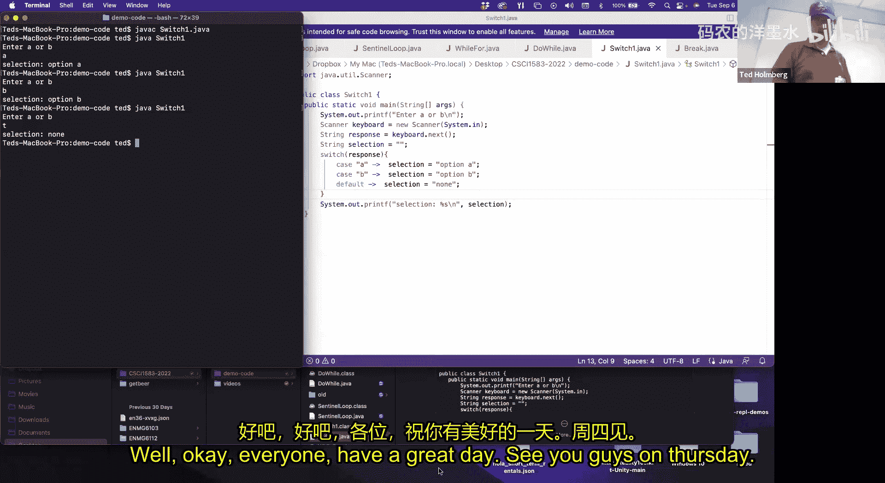

# 软件设计与开发：第6讲：重复与循环 🔄


在本节课中，我们将学习算法设计中的第五个基本构建块：控制操作中的**重复语句**。我们将探讨如何使用循环结构来重复执行一段代码，直到满足特定条件为止。课程将涵盖两种主要的循环类型：计数器控制循环和哨兵控制循环，并详细介绍 `while`、`for` 和 `do-while` 循环的语法与用法。

---

## 循环基础：为何需要重复？ 🔁

上一节我们介绍了选择语句，它允许程序根据条件决定执行哪部分代码。本节中，我们来看看如何让程序**重复执行**某段代码。

重复语句负责在程序中重复执行一组指令。一个生活中的例子是食谱中的“搅拌面糊直至没有结块”。这个指令意味着重复“搅拌”这个动作，直到终止条件（面糊没有结块）满足为止。

用伪代码表示如下：
```
while (面糊有结块) {
    搅拌面糊
}
```
所有控制操作（包括循环）都基于布尔值进行判断。只有当循环控制变量的条件为真时，才会执行循环体内的代码。

---

## 循环的两种主要类型 📊

循环通常分为两种主要类型，区别在于我们是否提前知道循环需要执行的次数。

*   **计数器控制循环**：当我们**提前知道**需要循环的确切次数时使用。通常使用 `for` 循环结构。
*   **哨兵控制循环**：当我们**不知道**需要循环多少次，循环依赖于运行时某个条件的变化时使用。通常使用 `while` 循环结构。

无论哪种循环，都必须包含三个基本要素：
1.  **初始化循环控制变量**。
2.  **评估循环控制变量**的条件（布尔表达式）。
3.  **更新循环控制变量**，使其最终能使条件变为假，从而结束循环。

如果忘记更新循环控制变量，可能会导致**无限循环**。

---

## 计数器控制循环与 `while` 🧮

让我们通过一个计数器控制循环的例子，来看看 `while` 循环是如何工作的。

```java
public class CounterLoop {
    public static void main(String[] args) {
        // 1. 初始化循环控制变量
        int counter = 0;

        // 2. 评估循环控制变量条件
        while (counter < 10) {
            // 循环体：要重复执行的代码
            System.out.println("Counter is: " + counter);
            // 3. 更新循环控制变量
            counter++; // 等同于 counter = counter + 1;
        }

        // 循环结束后执行
        System.out.println("Final counter value: " + counter);
    }
}
```
运行上述代码，输出将从 0 打印到 9，最后打印出 10。

**关键点**：
*   如果初始条件为假（例如 `counter` 初始值为 10），则循环体可能**一次也不执行**。
*   如果忘记更新变量（如注释掉 `counter++`），条件将永远为真，导致**无限循环**。

---

## 哨兵控制循环 🚨

与计数器循环不同，哨兵控制循环的次数取决于运行时的用户输入或其他动态条件。

以下是一个使用 `while` 循环的哨兵控制示例，它持续询问用户输入，直到输入 `Q` 为止：

```java
import java.util.Scanner;

public class SentinelLoop {
    public static void main(String[] args) {
        Scanner input = new Scanner(System.in);
        // 1. 初始化循环控制变量（布尔值）
        boolean repeat = true;

        // 2. 评估循环控制变量条件
        while (repeat == true) {
            System.out.print("Enter a letter (Q to quit): ");
            // 获取用户输入
            String response = input.next();

            // 3. 根据输入更新循环控制变量
            if (response.equals("Q")) {
                repeat = false; // 满足条件，改变状态以退出循环
            }
            // 如果不是 Q，则 repeat 仍为 true，循环继续
        }

        System.out.println("Loop ended.");
        input.close();
    }
}
```
在这个例子中，我们无法在运行程序前预知循环会执行多少次，它完全取决于用户何时输入 `Q`。

---

## `for` 循环：更简洁的计数器循环 ✨

对于计数器控制循环，`for` 循环提供了更紧凑、更易读的语法。它将循环的三个要素（初始化、条件、更新）集中在一行。

让我们将之前的 `while` 计数器循环改写为 `for` 循环：

```java
public class WhileFor {
    public static void main(String[] args) {
        // for 循环将三个要素集中在一行
        for (int count = 0; count < 10; count++) {
            System.out.println("Count is: " + count);
        }
        // 循环结束后，count 变量在此作用域不可见
    }
}
```
**`for` 循环语法解析**：
*   `int count = 0;`：**初始化**语句，在循环开始时执行一次。
*   `count < 10;`：**循环条件**，每次迭代前检查，为真则执行循环体。
*   `count++`：**更新**语句，每次循环体执行后执行。

**`for` 与 `while` 的对比**：
*   **行为完全相同**：在性能上没有区别。
*   **可读性**：对于计数器循环，`for` 循环更清晰，因为它把循环控制逻辑封装在一行，而不“污染”循环体周围的代码。
*   **原则**：已知循环次数时，优先使用 `for` 循环；未知时，使用 `while` 循环。

---

## `do-while` 循环：至少执行一次 🔄➡️

`while` 和 `for` 循环可能一次都不执行（如果初始条件为假）。但有时我们需要**至少执行一次**循环体，然后再判断条件。这时就需要 `do-while` 循环。

```java
public class DoWhile {
    public static void main(String[] args) {
        int j = 11;

        System.out.println("Before do-while loop");
        do {
            // 循环体至少会执行一次
            System.out.println("j is: " + j);
            j++;
        } while (j < 10); // 注意结尾的分号
        System.out.println("After do-while loop, j is: " + j);
    }
}
```
运行结果会打印出 `j is: 11`，尽管 `j` 的初始值就不满足 `j < 10` 的条件。这是因为 `do-while` 先执行循环体，再检查条件。

**重要语法提示**：`do-while` 循环的 `while` 语句后面**必须有一个分号**。这是它与普通 `while` 循环的一个易错区别。

---

## 循环控制：`break` 与 `continue` ⏸️▶️

在循环内部，我们可以使用 `break` 和 `continue` 语句来更精细地控制流程。

### `break` 语句

`break` 语句用于**立即终止**整个循环，并跳出到循环后面的语句。

```java
public class BreakDemo {
    public static void main(String[] args) {
        for (int count = 0; count <= 10; count++) {
            if (count == 5) {
                break; // 当 count 等于 5 时，立即跳出循环
            }
            System.out.println("Count is: " + count);
        }
        System.out.println("Loop broke at count == 5");
    }
}
```
输出将只打印 0 到 4，当 `count` 为 5 时，`break` 使循环提前结束。

### `continue` 语句

`continue` 语句用于**跳过当前迭代中剩余的代码**，直接进入循环的下一次迭代。

```java
public class ContinueDemo {
    public static void main(String[] args) {
        for (int count = 0; count < 10; count++) {
            if (count == 5) {
                continue; // 跳过本次循环中后面的代码，直接开始下一次迭代
            }
            System.out.println("Count is: " + count);
        }
    }
}
```
输出将打印 0, 1, 2, 3, 4, 6, 7, 8, 9。注意，数字 5 被跳过了，因为当 `count` 为 5 时，`continue` 语句使得 `System.out.println` 没有被执行，程序直接开始了 `count=6` 的迭代。

---

## 补充：`switch` 选择语句 🔀

在结束所有控制结构之前，我们简要介绍另一种多路选择语句：`switch`。它类似于 `if-else if-else` 链，但基于单个表达式的**精确匹配**。

传统 `switch` 语法（易出错，不推荐）：
```java
switch (response) {
    case "A":
        selection = "Option A";
        break; // 必须使用 break 防止“贯穿”
    case "B":
        selection = "Option B";
        break;
    default: // 类似于 else
        selection = "None";
}
```
如果忘记写 `break`，程序会执行完匹配的 `case` 后，继续执行后面所有 `case` 的代码，直到遇到 `break` 或结束，这被称为“贯穿”，通常是错误来源。

**Java 14+ 改进的 `switch` 表达式（推荐）**：
```java
switch (response) {
    case "A" -> selection = "Option A"; // 使用箭头，无需 break
    case "B" -> selection = "Option B";
    default  -> selection = "None";
}
```
新语法使用 `->` 箭头，更加简洁，并且**不会发生贯穿**，避免了因忘记 `break` 而导致的错误。

---

## 总结 📝

本节课中我们一起学习了算法设计的核心——**重复语句（循环）**。

我们掌握了以下内容：
1.  **循环的基本要素**：初始化、条件判断、变量更新。
2.  **两种循环类型**：计数器控制循环（使用 `for`）和哨兵控制循环（使用 `while`）。
3.  **三种循环结构**：
    *   `while` 循环：先判断，后执行，可能执行零次。
    *   `for` 循环：专为计数器循环设计，语法紧凑。
    *   `do-while` 循环：先执行，后判断，至少执行一次。
4.  **循环控制语句**：`break`（终止循环）和 `continue`（跳过本次迭代）。
5.  **`switch` 语句**：一种基于精确匹配的多路选择结构，了解了其传统语法和更安全、更简洁的 Java 14+ 新语法。



至此，我们已经涵盖了构成算法的五个基本构建块：输入、输出、存储、处理和**控制（选择与重复）**。接下来，我们将开始运用这些基础来设计和构建更复杂的算法。