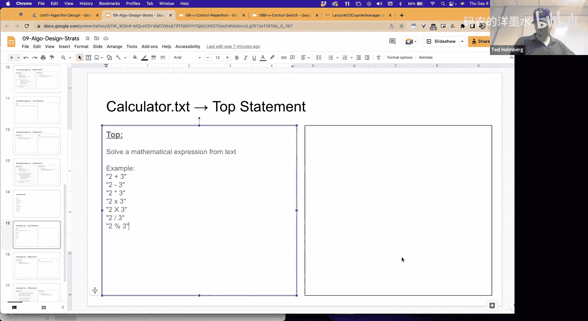

# 【全集】加州理工学院 软件设计与开发 中英字幕 1080P p07 Lecture 7 - 自顶向下逐步求精 part1 -BV1AvzCBdE7a_p7-

Okay。So we've made great progress so far this semester in terms of where we where we're at in unit one I think we're on the tail end of unit one and after today's lecture we might be able to start discussing the first test we won't do the test after the first homework still I'm going to push homework back I think I haven't done that yet I'm going push it back to you next Thursday so pretty much though we've already talked about。

Data modeling。We've talked about what an algorithm is and then we talked about the five fundamental building blocks that are required to build out our algorithms to implement our algorithms inside of Jo right so we looked at output operations。

 we looked at storage operations， we looked at input operations。

 we looked at the processing operations and then finally we looked at the control operations。

 and in the control operations in particular， we looked at selection statements and we looked at repetition statements where we can repeat a block of code or we could select a block of code from multiple blocks。

😡，So with that said。What I kind of want to piece all of this together with is go over a lecture that goes over a algorithm design strategy so we're going to talk about the top down stepwise refinement process and we're going to keep coming back to this process throughout the semester to utilize a methodology by which we can start with a concept we could start with what we'll call a top statement which is like a single sentence explanation of what our application is intended to do and then from there it'll provide us a tactic right a plan on how we can expand that so that it's a fully defined algorithm that's effectively in pseudocode so that it's a fully defined algorithm that maps one to one from our English explanation into our Java implementation so again。

One of the most challenging concepts for junior levelvel developers for people just learning how to develop code is to figure out how to grow out out how to plan out how to define an a complex algorithm like how do you take what you want to create。

 whether it's a video game， whether it's a application that allows you to go ahead and process your taxes。

 whatever whatever the objective of the code is， one of the challenging things is figure out how to get from an initial idea to a。

Fully implemented deployable project。😡，And so I'm going to show you a strategy that's commonly referred。

Engineers all over and let's go here and we'll actually take a look a couple look at examples too as we progress in our capabilities throughout this semester。

Okay， so the attack。As one of two things either functional decomposition and the reason why it's going to be called functional decomposition is because we're going to learn how to identify what methods we're going to have in our code base so that part we're going to come back to later on because we haven't really learned how to define our own methods yet we're only using one method。

 the main method but understand that functional decomposition and top down stepwise refinement refer to the same thing so right now we're going to take a deep look into the top down stepwise refinement portion of this strategy and later on once we introduce the concept of methods we're going to revisit this and see how we not only can evolve a thought into a complete algorithm a complete pseudocoded。

plement a pseudo coded explanation of our algorithm。

 but we'll also see how it can help us identify how to break our code base into different functions and classes。

Okay。So we don't have to review any of the repetition statement we're going to jump right into this。

 so let's talk about the and here let me jump put this into the title oh no。

Let's do case for that formatting perfect Okay， so let's talk about the top down stepwise refinement process。

So， it。There we go。So top down is an approach by which we start with something very abstract and we incrementally add details until it becomes more complex。

😡，So it's a strategy that allows us to design complex algorithms in a very straightforward way so again what I want you to visualize。

😡，When I say top down is think about having something at the very top。😡。

You have just a little bit of information when you start with your applications。

 usually that's what you you're going to initially start with some some idea。😡，And so the idea is。

 how do you iterate across that idea， that concept that then you want to do until it's completed enough so that you can start implementing in a Java so the big takeaway here is that you should always preplan what you're going to code before you ever touch your keyboard before you ever start putting anything into a code editorary you should understand what your algorithm is that you're going to encode first and foremost。

😡，You shouldn't just be spitballing。What you want to develop？Without considering。

How it's going to operate what the data of the model is。

 how you're going to follow the step by step directions， you should always pin and paper that first。

😡，Okay。So let's take a look。So we typically break down the top down stepwise refinement where the top statement is where you start that you traverse down with each additional refinement so that's what refinement means we take what we initially started with and we start with the top statement。

😡，And we keep adding details， we look at the latest refinement that we do and we ask ourselves。

 is this so well definedfined， is this effectively pseudocode pseudocode is like Java code or Python code or any other code except that it doesn't compile it's a human readable interpretable set of statements that define your recipe but it's designed for you to plan out in your head what your algorithm is and once you have suitably welldefined pseudocode。

 the idea is that you can then translate it into any actual programming language。

 whether it's Java or Python or C++ or what have you。😡。

Because all of those programming languages make use of the same building blocks that we've spent the last three weeks or so covering。

😡，So our top statement， we start by defining a statement which serves。

Theres a one line summary for the application that allows us to define the specifications of the software and know what our goal is so then after we've defined our top statement which is effectively the elevator pitch of our software we move into the first refinement so this is an iterative approach that means that we start and then we iterate we look at what we previously made and said what is abstract what is not so well defined that I can't directly translate it into a Java statement。

😡，And if you look and see oh this statement says a lot I can't just translate that into a line of Java code then you have to do another refinement。

 so the first refinement the next step is to add more detail to the statement which better defines how those tasks are accomplished so effectively you never change what's happening from the top statement for every refinement it's always defining the entirety of the application but what you're doing across each refinement is explaining how you're implementing it a little piece at a time so effectively it's a strategy like div and conquer。

😡，Where you you define a little bit and then you examine it and then you identify a new part that's not so well definedfin and then you define that so it allows you to start taking this really abstract thing and defining it in a more concrete more concrete more concrete until it has a one to one mapping to Java so for instance in refinement two we would add even more detail to the set of statements from refinement one and we continue to do so until the set of statements is well definedfin enough to serve as our pseudocode so finally at our refinement and stage that represents the last refinement step before no more details can be added each line of our pseudocoded algorithm should now map to a Java statement and once you get to this level you should be able to paste the refinement into a source code document and use it as a guide to implement your application。

😡，So again， pictorially。😡，And here let me give this so pictorialally one way you might want to visualize what this process looks like is almost like a pyramid right we represent the evolution of our algorithm where we start with the top and the top is the peak where we have very little information is very abstract and then after the first refinement we've expanded it out more and then after the second refinement we've expanded it out even more and then after the third refinement we've expanded it out even more and so finally at the very base of the process we have。

😡，The most expanded， the most。Define the most like elaborate of algorithms。

 but that's going to help us because then we could take that pseudocode and then directly implement it into Java。

😡，Is there any questions about this does this kind of motivation does this idea。

 this does this design pattern make sense at least conceptually？😡。

Perfect so it's one thing to kind of talk about it that's another thing to actually see and be challenged to do this in practice and of course when you go to design your own software I would encourage you to practice at this because you only get good at at these endeavors the more you challenge yourself to try it so you shouldn't just be doing Java code but start thinking about how you can start planning to design code and not just implement code。

😡，So in this lecture， we're going to use that top down stepwise for refine approach to design actually。

 we're going to do three applications。We're going to start with a a grade aver application that uses a counterconrolled loop that averages 10 grades and then we we start by walking through the top down stepwise refinement process we're going to create a like counteravverage year TxT file where we would step through and build out our algorithm I'm going to do that on our PowerPoint slides instead of actually a TXT document。

 but if you were to do this yourself， you'd open up a TXT document and just start writing out your pseudocode you start with the top statement then you'd do refinement one refinement two all the way until you felt。

Good enough about what your pseudo code represents to be able to then convert it to Java。

The next application we're going to build in this lecture is going to be a great ar that uses a Sinel control loop so recall last lecture we really stress the difference between countercontrolled loops and Sinel controlled loops what do does anyone remember what the distinction between that is when do we use a counter controltrol versus a Sinel control。

Coun control is when you don't know how many numbers there will be and's actually the flip on that right so the counter but yeah that's a distinction so a counter controltro loop we know ahead of time how many iterations we have to do so we we count down or up to that point。

With a sentinel control， Sentinel means that there's a special value that our loop is looking for to stop processing。

 so a sententinel control， we use a sentinel value because we don't know ahead of time how many times we have to repeat that block of code so when that sentinel value occurs。

 then that alerts the loop that it should stop。😡，Yeah that's exactly distinction though so I want to really impress upon that we saw that once before but let's actually design an application an application that feels more real something that actually performs a task I think the application we did last time was just like printing out numbers right so let's build something that average is great because that feels more real and we could step through that process to see how we would design that and then finally we're going to build a calculator and we'll use that'll make use of the switch statement that we talked about as well last time so we'll build three applications and all of these applications we're going to design first using this process that we kind of just a。

So let's step through let's kind of do this interactively if I was to do this counter ature。

 suppose I made a counter ager dot Txc file and in fact。😡，Let me see something here， actually。Yeah。

Okay， perfect so。Okay， so the first thing we start with。

 whenever we start planning to do any kind of implementation is we have to think of what our top statement will be our top statement again is effectively a summary of what our application intends to do。

😡，So for our counter ar， my top statement here will be determine a student's average for 10 quizzes。

😡，It's quick concise one sentence， but it conveys to me and everyone else exactly what this does right so does this much does this much make sense to everyone so far？

😡，Okay， so what's the next thing so notice a couple of things that are important to indicate even at this stage is that we specified a concrete number of quizzes that we're going to average that lets me know before I do anything else that this is a optimal target for a counterconed loop as opposed to a Sinel control loop because I know there's going to be 10 grades that I need to average across hence why this is called counterav because we know ahead of time how many how many grades we have to process okay so now the next thing we were we would do if we were doing this in real time right is after I define my top statement。

😡，I do my first revment so i'm going to put that top statement off to the side and i'm going to think about it i'm like okay what are at least abstractly i'm not going to hang myself up on the details I want to just think what is the next set of sequences that even allows me to start tackling this problem of determining a student's average across 10 quizzes and so。

😡，My refinement and again， this isn't a hard science like there's a little bit of creative。

Decomposition that happens here so your refinement and my refinement steps can be different and that's okay right but it doesn't matter what happens in the inbetween refinement steps what should always happen is that the end result is what's similar with everyone's process so in my first refinement and I'm open to to questions about this would be the first thing I would want to do to determine a student's average for 10 quizzes is well initialize the data that I'm going to need right so clearly if I'm going to take an average of some quizzes there's going be data that needs to be set up to be able to produce that right so I'm going kick the can of what that data is but I'm going to say well this problem requires data so I'm going to put that as the first step so I can think more deeply about that in a future refinement right so the second thing I'm going to do after I set up my data after I initialize my data is I'm going say well I'm going to get those。

😡，Gras from the user and I'm going to sum them together。😡。

And then the last thing undo is once I have the sum。

 does everyone know what the how to average like the an average is defined by the sum divide divide right？

😡，So once I have the sum， then I can compute the average and I can print it。

So if I was so notice my refinement one so what's now on the lefthand side is exactly I've lost no content on what's on the right hand side so this if I read these three instructions together it's still produces the same explanation as what this top statement is right but it's more detailed it's giving me a little bit more insight of how I accomplish that now the question i'm going to challenge you is do I have enough information after just refinement one to directly implement this into Java。

😡，No no like no no I don't right I mean id have to make it up like I would have instructions in my mind that's not on the page and that's not the goal of this process so the goal this process is to explicitly convert into pseudocode every line that I want。

😡，Be in involved off and so here。Le one is clearly not Java statement it's two abstract right line two is clearly not one singular Java statement is too abstract and line three is as well so what that indicates to me is I need to do another refinement I need to do another iteration。

😡，Because I'm not at my pseudo goal yet， but I've started to isolate and define things that have to happen for me to build out this application so I。

Move on to a refinement step two so what I do in refinement step two is I would number each of my lines。

😡，So here I had three statements initialized data get grades from the user and some of them calculate the average and printed so in the second refinement i'm going to focus on just the first statement and refinement one and say okay what does it really mean to initialize data for this application and so well I have to think what is an average well I need to initialize I need to declare a sum and so at this stage I can start asking myself am I going to declare a variable or am I going to initialize a variable do I know ahead of time what the value is or do I have to wait to do some processing across my application so for the sum。

😡，Here Budh， I put initialize because we know ahead of time before we start counting that a sum should start at zero。

 would everyone agree with that？Yeah， before we start counting， before we do the first grade。

 we start at zero， and then we'll add to that， whatever the first grade is。

 and then we'll add to that， whatever the second grade is， and then we'll add to that。

 whatever the third grade is。So by definition， the starting value before we start doing。

E is zero Okay before we start counting the number of grades what is our count do we know what that is at is time we do before we start counting it's zero so we'll also initialize the count variable so we've identified in order to produce an average we need to have a sum we need to have a count so what we're doing is we're defining what are the dependent the independent variables what are our decision variables that we need to have in order to process a solution and since an average is based off of the concept of a sum and count then I can declare an average then why am I not initialize in an average。

😡，Why am I declaring an average when initializing the sum in account？😡。

Because the average is the thing I'm trying to compute。😡，Start our sum。嗯。

Not what's the word implicitly we start our sum implicitly at zero even when we're doing that with mental math right like you're not pound at minus1 or positive one or 10 when you look at the first number you're like okay I'm going take that as my number 170 then I'm going add to that at 68 then I'm going add to that 100 I'm going to add to that at 82 but you start it at zero whether you recognize it or not so we want to be very explicit at what our starting point is so we know that we're going start that we're going to use some in and that's what we're going get from the user so we have to give it a starting position so that when we start adding to it it has a value now since average is the thing we're trying to get we don't get that until after we've got the user's input so there we're going to declare it with the understanding that we're going need it later but we don't know anything about it now like an average we have to wait until we actually have real values for some account so we'll simply just declare。

😡，That。And then finally， we're going to initialize a scanner object that we'll have to use for input。

 so the real big takeaway here is I want you to see that these four lines of statements here。😡。

Or all based off of my interpretation my analysis of this single statement from refinement one so what I've done was I took that one statement that I made earlier and I've expanded it to four and now it still says the same thing right initializing the sum to zero initializing the count to zero declaring an average and initializing the scanner object is still the same initialized data but is better defined its less abstract it's more concrete it gets me closer to being able to mapping this directly into a Java implementation right so once I've walked through this I look and i'm like okay I think that's enough I can't think of anything else I would need to be able to compute an average。

😡，For a set of 10 grades so I'm like I'm done with that let's move on to the second statement from refinement one and so for the second statement in refinement one。

 it says get 10 grades from the user and some them。😡，So okay。

 if I'm going to get 10 grades from the user and sum them what that tells me is I have to repeat a process 10 times right so I'm going to do that I'm going to first put repeat 10 times now when I'm repeat 10 times is going to be a block of instructions so notice how I'm going to indent that in so that I can clearly visibly see what I'm going to repeat 10 times。

😡，So if I'm going to get 10 grades from the user， the first thing I should always do is prompt the user to alert them that my application that this application needs something from。

😡，The type of data， where is the value？We're going to prompt the user for a grade right so when I say get tin grace from the user the first thing I need to do is prompt them once I've prompted them I can expect they're going to give me something on the keyboard so then I got to use the scanner object to get that grade but in the same line when I get it I need to store it into a variable right so I can use it later on in my application。

😡，Once I get that grade from the user， I can then add that grade to my sum。

 so my sum started at zero， so I would add two sum whatever that new grade is。

 and then I would also add one， I would increment the count。😡，And I would do that 10 times。

Does that make sense and do does everyone say how？Well let me go and then once I've done that I feel like I've done enough for this step。

 I can't really think of any other way I can articulate that。

 so I'll move on to this third statement， calculate the average and printed well I'm going to define my instruction i'm going to expand that into this box here labeled three to show you the connection between these to calculate the average printed well I'm going to set my average finally。

😡，To be whatever the sum divided by the count is， and then I'm going to print that average。

 I'm going to print the value of that average so the user can see it。😡。

And I think that's it that's all I need to do there so does everyone see the connection between each of these tables here table one table two and table three。

😡，Basedase off of the preex refinement that I did just as stage before。😡。

Does anyone have any questions， does everyone see how would you feel that you could do something similar to what I just walked through？

😡，Yes。😊，Yeah。Well we'll look at it again with the Sentinel， but okay， so now。😡。

What we want to do is we want to try to go ahead and implement this。Let's go here。屌了屌啊啊乜鬼。

Let's go here。A perfectf。Okay， so let's make。I just have a file。啊。Counter as is what we'll call it。

So let me go down to counteravverr here and get it into okay， so。If I did my due diligence。

And I actually created a TXT file where I started with the top statement and evolved it。

 so I did two refinement steps。😡，And let me ask you this， is refinement two well defined enough。

 is it concrete enough is it is it in。😡，A format that represents pseudo code that allows me to do a one to one mapping to Java let's do a quick analysis or do we have to do a third refinement so let's say can I initialize sum to zero is that does that translate nicely into a Java statement？

😡，What about initialized count as zero does that translate to a Java statement what about initializing a scanner object for input does that translate to a Java statement what about declaring an average to be able to store for later does that translate okay so i'm done with part one let's look at part two repeat until count is 10。

😡，That's a looping structure right that has a bullolean expression so that is we have account it starts at zero until count reaches 10。

 we repeat that translates what about prompt the user for a grade can we convert that into a Java statement。

 what about get and store a grade from the user。😡，What about add a grade to the sum。

 what about add one to the count， yeah， we're done with that。😡。

Finally set the average to the sum divided by the count Yeah I can do that directly in Java and print the average yep I feel like I now have complete pseudo code for the application I want to run。

 so once I have that。😡，I might have a text document that looks like this。😡。

Here's my top statement and here's my first refinement and。My final refinement。

And look last time I did this I actually had three refinements in my second refinement I decided to ignore having to do the repeat logic and just focusing on what the code bo dot has done and then in the final step I inserted the repeat logic so it actually happened more than one time again this is an illustration that I can have any or。

😡，All everyone here who engages in this can have different number of refinements you can have different things that you identify at any given time but the goal is to have complete pseudocode by the end of it so the way I approach this isn't like 100% a hard science that you will always do it the same way I do it right this is a strategy so it gives you a starting place and it tells you how to take the next step and the next step and the next step hence the term stepwise refinement until you get to having complete pseudocode and then once you have pseudocode it gives you something to start building and executing and debugging if it doesn't work the way expect it to so what I do with my pseudocode is I make use of it。

😡，So I'm going to copy my top statement when I go into my implementation。😡，No。嗯。

And I'm actually going to use that as my header statement or my application。

 so I'm going to use a multiline comment。😡，And I'm going to put my I'm going to remove top on there。

 but I'm going to put what the statement was so now that anyone who comes and looks at my source code file knows what this application does。

😡，It's super important that you have a heading description。😡。

In every class file that explains what this class is responsible for。😡。

And so instead of having to do that while we're writing the class。

 we should define that before we ever start doing any Java code what we should also do is provide authorship because it asserts who owns this code who is responsible for this code。

 who to go to if you have questions about this code。

 so always give yourself credits for the code you author。😡。

Just like you always put your name on any piece of text that you write。

 whether it's a research paper， whether it is a novel， whether it is a short story。😡。

Same way you would give yourself credit for a piece of art by adding your signature to it。

 the same way you'd give yourself credit for producing a musical composition。

 you want to do the same thing for your source code and this isn't just for vanity。

 this is even bigger than that， this is for responsibility so that other developers know who to seek out if they have a question about the logic that happens in the codeb。

😡，It provides you as the authority figure on this class file。

 so here I will put author Ted Homeberg so moving forward everyone when you create your source code should have that heading and you can just grab it right from the top statement excellent is there any questions from this so far。

😡，Okay， so the next thing I'm going to do then is I'm going to take my refinement。😡。

My final refinement。And I'm going to paste that into。And in fact， let me do this。

Let me scaffold out before I do that， let me scaffold out my code so public。😡，Class。Counter。Average。

Okay。诶 then。Public， statictic。Bod Maine。O。So I have an empty class and an empty method the first thing i'm going to do is i'm going to copy my pseudocode text and I'm going to paste that into my class file。

😡，And since right now we're not doing since we're not using more than one method i'm actually just going to put it all in the main method。

 but this is kind of premature moving forward we wouldn't just put this all in one main method we'd put it in the class definition but we'll talk about that later when we use this for functional decomposition and not just the step the top down stepwise refinement process so here let me comment this out so i'm going to go here and should be able to toggle these into line comments and so now what I have。

😡，Is I not only have。A summary statement at the very top。

 but I can also use my pseudo code to guide my implementation。😡。

Of my Java file and it'll give me very descriptive comments。😡。

Inside my code base now one thing we strive to do and i've mentioned this already when we start developing our software。

 we strive for self documentmenting code that means we give good names to our classes we give the good names to our methods and we give good names to our variables so that as you read。

😡，Just the identifiers and labels， you get a sense of what I as the developer， the architect。

 the author of this code intends to express in terms of my source code in terms of my my Java expressions now the pseudo code can aid in that it shows you what the basis of my algorithm my Java algorithm is okay。

😡，So let's now slowly convert this line by line initialize sum to a double so I mean i'm sorry initialize sum to zero so what does that let me know that's numerical data right what are my options for numerical data I can either do integers or doubles I'm going to do doubles。

😡，Because it's possible maybe you can get a like you maybe you can get a fractional number for a grade。

 maybe you get a 95。5 for instance， maybe you have a half point off so I'm going to do a doubles because I got to selected data type and if I do doubles now its going to let me have an average that is also supports a fractional number right so does everyone see why I selected to do doubles because average is potentially you want to have a fractional value。

😡，You like you could potentially have like a 89。9 and you probably don't want me to drop that 09 and just make it an 89 because I might round out to a 90。

So double sum and this is initialized， so I'll go ahead and make that zero。😡，And then here。

 this is going to be initialized count to zero， so here。😡，This is something discrete。

 I can't have half of a quiz， so I'm going to make that an integer。😡，需要。23。These。No be。

Those are no longer comments so that's a great question so one thing is there's two different types of comments they have what's called the block comments。

 which is what is on lines one through four I open a block comment using a slash and an asterisk and then I have to close it with an asterisk and a slash and any text that appears in between this opening and closing symbols。

😡，Is ignored by the JVM it's ignored it's treated as text comments for human consumption and not part of the source code at all now line comments are an alternate way I can do comments it slash slash and what that does is anything to the right of those two slashes is ignored but anything before those two slashes is still valid code so that's a great way for me to insert a comment after a statement where the statement will get executed but then I can put a piece of text that doesn't get executed that's not read it's a great question。

😡，So here so and so notice i'm going to push that comment off to the side as I implemented and so now I can clearly see what I have done what I have implemented what I haven't implemented the next i'm going to do is i'm going to create that scanner now in order to make a scanner object I actually have to import it right so let me do that。

😡，你咪。Import from Java dot U tell。The scanner。Class， so now that I have the scan class。

 I can go on to line 11 here and。😡，I can declare the data type scanner， I can give it a name here。

 I'll call it keyboard。😡，And then I will initialize it。

Which means I'll give it a value at the same time I declare it and so I'll create a new scanner that looks at system。

 n， the input stream perfect and here just to keep everything as readable as possible for me when I get a line of code that's too long。

 I want to align my comments。Because that makes them much more readable。

So I'll go back and I'll reset my comments from the prior two lines so that they're in line with this comment。

So then the next thing I want to do is I want to declare an average。

 well we know we want that to be fractional and I won call it average。

 so again we want to be very articulate with our variable names and we can actually grab those variable names straight from our pseudocode。

😡，Yeah。啊。And then next thing I want to do here is repeat。

 so let's throw that off to the side for now。So here， just for the purposes， I can use。

 I can use a for loop because normally would say for countercontrolled loop we use for loops but for the purposes of this application just to keep everything as clean as possible with the way that the logic is run out。

 I'm going to use wild。😡，Which is completely fine。So here， while my count， which starts at zero。

 is less than 10， right， that I think satisfies this line here。😡。

And then everything in between is in this walk， so actually that may。😡。

I have these indentations here， but actually let me indent these so it looks more like that。😡。

So let me open up a block of my let me open up my implementation and then close it now。

 so now the block of code contains the comments that represents my repetition statement。😡。

And then here this is going to be a output system do out。 print。I always like print path。

Enter a grade。Or I'm going to do inter grade and actually let me do percent D and it'll actually give me the number of grade that I's asking before right now。

And then here I'm going to actually pass it the variable。

 so I'm actually going to create a prompt that allows me to see what grade number I'm on and actually I'm going to add one to it because my grade count starts at zero。

So this way， it'll say grade one， grade two， grade three， grade four， grade five。

And what I'll do here is I will now bring everything else into alignment in terms of my comments。😡。

Bring it perfect， so now these are all linesd up so I can easily read them。

So the next thing I'm going to do is I'm going to get eight that grade， so it's going to be a double。

No。Let's push that off to the side right now， so double grade is equal to and then from my keyboard I'm going to grab the next double。

Then here we're going to then take and to our sum， we will add to it the grade。And then finally。

 for our account， we'll increment our count by one。Perfect so that represents that block。

Then finally， I'm going to set my average， so now average is going to be set to what my sum is divided by my account。

And then finally， I will do a system。Dot out dot print。F。I'll put that。Average is。Percent D。

 percent F。And a new line character。And then here， let me also go ahead and。Quite average。Perfect。

And I think those are the Java statements that line up in parity with the pseudo code。

 would you not agree？So you want to see if this works。

 you want to see if we appropriately defined our algorithm， let's check it out this is tested。😡。

The next thing we always do so in the process so in this design pattern， what we're doing is we plan。

😡，And we planned on paper， then we implement it in Java and the third and final step you should always do is then test to make sure that everything works the way you expect it to。

😡，First of all let's see if it compiles it compiles and then finally let's go ahead and run that okay。

 so enter one grade let's say that you have a 58 and then enter grade2 let's say you have a 90 and an 88 and a's 67 and。

99 and 86 and 95，77。66 and finally at 34。And then we'll get an average to somebody many six。

 is that the correct average， so this work well？We don't know right。

Illustrates that might not be a great test if we put in data and we can't validate that it's right or not。

 so why don't we do something easier。Because that's one of the important things about testing you want to actually make sure that is working so we we definitely get a result though probably correct let's test it one more time。

 but now use numbers that we know are going to be correct so what's the way that I can definitely get an average that's been computed that we can compute in our heads what if we did say for instance what's that。

We you do the same number？UI'm going to do two different numbers and just see if it takes the halfway point。

 so I'm going to do zero， zero， zero zero， zero， then 100， 100， 100， 100， 100。And the average is 50。

 which is exactly what exp about。Excellent z anyone have any questions about this does everyone see how we evolved from their top statement all the way having a complete application？

😡，And this process is scalable， it's scalable to being able to develop software that is hundreds of thousands of lines of code。

😡，Using this same approach if youre starting in an abstract space and you keep iterating。

 adding just a little bit of detail， adding just a little bit of complexity a little piece at a time and doing that again and again and again until you've matured。

😡，Your thought process， your step by step instructions until it's complete and ready to be implemented。

😡，Okay， let's do the second thing。Let's go back to so we've done the counter Ar。

Let's look at what we have to do。For a Sinel aperture。

So we're going to create a top statement and notice the slight difference in this top statement determine a student's average for any number of quizzes。

😡，So now that represents a Sinel value， any， we don't know when to soft with any。

 we know soft with 10， this adds an additional complexity to us。😡。

But the first refinement notice I'm going to effectively think of doing this piece of software the same way。

 I'm going to say okay， the first thing I need to do to be able to determine a student's average for any number of quizzes is I need to initialize the data。

 right that's our data model again， mapping this back to the concept if I were all a recipe。

 the first thing I need to do is figure out what is the set of ingredients that I'm going to use to build out my recipe。

😡，Right before I give the step by steps， you have to have the checklist。

 so I'm going to create my data that I need， my initial state of data that I need。😡。

Then the second thing is I'm going to get all the grade from the user and sum them。😡。

That's slightly different not 10 grades， but all the grades and then finally I'm going to calculate the average and printed so notice。

😡，At this level， steps one and three。They're still abstract。

 but they're pretty similar to the last application we built。

 but step two already at this stage is slightly different。😡。

So now I look at refinement one and I ask myself， is there enough data here for me to be able to go ahead and map this directly into a set of Java statements。

 my answer is no， which means I have to go through another iteration of this refinement process。😡。

So again mapping a statement from refinement one and expanding it to the lefthand side on this slide I'm going to see well when I say I'm going to initialize data now I have to think hard indeed D what are the ingredients that have to be used for this application what are the data what is the data that I start with and what do I know ahead of time and what am I looking for while I'm processing the result so it's going to be very similar actually I'm going to initialize sum to zero I'm going to initialize count to zero I'm going to initialize the scanner object for input I'm going to declare an average so everything's the same in terms of that part of my refinement process。

😡，And actually， let's look at part three， let's skip out part two right now。

 go to part three and say， well， let's see how similar part three is saying once I'm done getting all of the grades。

😡，From the user， I just go ahead and set the average to be equal to whatever the sum is and count and then print that out。

 So the only distinction here is going to be in the second part of refinement one where I get all the grades from the user and sum them and so here I'm going to use a Sinel value。

 So let me。😡，So the Sinel value here， so let's do an observation。😡。

The user has to alert our application on when。😡，It's done processing values and our application at the moment is always looking for numerical data right so every time we try to pull a grade we're using next double but what we can do what what the word Sinel value implies is that I can create a special value that doesn't represent a real grade but it represents a value to the wild loop that it should stop so let me ask you what is a good example of a Sinel value that can be represented as miracle data as a double value but doesn't represent what you can really get as a grade in a class。

😡，嗯。A negative number。You should never be allowed to get a negative grade because think about that。

You would have a higher score by not taking it than if you took it， like that's absurd。

The lowest grade you should ever be allowed to have is a zero because that's the same as not taking that test to begin with maybe be a ridiculous class that allowed you to get less points by taking a test than by just avoiding it。

😡，So with the understanding that the lowest。Balic grade is zero。

 Then we can map a special value to a grade that is less than zero and let's say for all intents and purposes。

 we use the value minus one， but to be any negative grade so that will apply to our loop when you see a negative value。

 something less than zero that's when we're going to stop that's the Sinel value that says。😡。

Stop processing grades， we've hit the endpoint。😡，Now， if it's a positive value or zero。

 then we'll add that into our average。😡，The first thing we're going to do then is then prompt the user for a grade with the understanding that that grade could potentially be minus one to begin with。

 perhaps they launch the application by mistake， so we need to give the option to the user to kick out。

😡，And do a mind one to begin with that's why this prompt is before the loop we need to get a definition of grade before we decide whether we're going to execute our block of code or not so we're going to prompt the user for input。

😡，So enter a grade。Or minus-1。To quit。😡，Then we're going to get in store that grade from the user and we're going to repeat this process until the value they supply to us is less than zero and this process is going to essentially prompt the user for another input。

 which would actually be the first grade。😡，Then get and store that grade from the user。

 add the grade to the sum and add one to the account， so that's almost fundamentally the exact same。

😡，Now， in the in order to preserve time， instead of stepping through this entire process all over again。

 would it be okay if I just update the part of my algorithm that we've changed？😡，Okay。

 so I'm going to copy and pay， so let me go here， I'm going to take counter ature。

 I'm going to duplicate it。😡，And I'm going to rename it。To Sinel。And I'm going to pull that in here。

And I'm going to change the name here。有。There we go， okay。

 so now that we have our name changed so the part I'm going is really the part that I care about is this。

😡，That's what after and also the top statement， so the first thing I'm going to do is let's take our top statement。

And update our top statement so it's consistent with what this particular application does so this for the early run said to10 grades this is going to say。

😡，We want to determine the student's average for any number of quizzes。And then here。

 let me go to this refinement step。 I'm going to grab this part here， and I'm going to。Delete this。

 I'm going to paste into this new pseudocode。Let's go ahead and。Toggle discs to be blind comments。

And here。Perfect， and I want the indents to see where my w in my pseudo code begins and ends。Okay。

 so let me update here so just using again my pseudocode， I'm going to say system。😡，Dot out。

Dot print app。Let's tab that out。嗯。Enter a grade or minus one to quick。Okay， so I have a prompt。

So now that I have a prompt， I'm going to then。Get a value for grade。

 so grade will be equal to whatever the keyboard dot next double is。Then I'm going to。Create my wild。

 while。Grade is greater than or equal to zero。And now whenever I have any control structure。

 I have to give it a block of code， a block of statement so I'm going to open and close my block now。

 and I'm going to indent in here。😡，To represent the code that's affected by this while construct。😡。

Okay， so now what I'm going to do is I'm going to cheat， I'm going to copy this line here。😡。

And we're going to pay so we're going to have the same prompt。Then I'm going to cheat。

 I'm going to copy this line here， but I don't need to declare it's already been declared and I'm going to do that。

😡，So here inside of my while loop， I'm going to do the same thing。

 the only time I enter my while loop is that they they gave me a grade and in fact。

 what I want to do is if I did this， I want to do this last actually。😡。

Right because that's the update to my loop control variable if they gave me a non negative number when I've entered the while loop and already have a valid value of grade right so I should save that grade and I should I should add it to my son and I should add it to my account。

😡，So noticeve already I've already identified while coding this。😡，A flaw in the logic。

 the order of operations was wrong just have everyone see that did you see why I had to maneuver the order of operations if we're going to get a grade here and if it's a non negative grade then they gave us the first grade from that needs to be that needs to be added in。

😡，So I'll grab it and I'm going to add it to some so here my sum。😡。

It's going to be whatever that initial grade is。And then I'm going to have my count and increment my count so notice I'm doing those steps first in this time around and then after I take the grade that I grab outside of my while loop。

😡，After I take it and add it to my summit add to my account then remember one of the things we have to always do whenever we define a loop is we have to define the loop control variable we have to define the terminating condition for the loop and then we have to update the loop control variable so what's happening here is by getting a new value from the user we're updating grade which is our loop control variable we're evaluating the value of grade and we only stop when grade is minus one or any negative number right so does everyone see why it has to change the order of those statements for this to work。

😡，Excellent， well， let's test this out。Let's clear this。Let's do Java C， Sentinel。Averger。

And I was wrong。Sinel avature so inner eighth grade or minus one to equi so let's start by giving it a minus one so what's going to happen if I give it a minus one right now。

Yeah， it's going to stop or it even it even tries to do an average average is na。O搞。So。

We don't process anything there， so let's run it again and let's try to do。Actually。

I'm going to make one more revision， I'm going to remove this other paw。

Number 19 so I'm just going to inside my while loop i'm just going to take whatever the grade is。

 i'm going to add it to the sum i'm going to increment the count and then i'm going to grab the next value from the input stream and i'm going to repeat that until I have a negative grade I'm only going to use the original prompt。

😡，So let me kill that。It's clear that。That's recompile and let's see how that that works like that so here then I should be able to do like 190。

90， 80， 100。A啲。What should be the average in that in this particular sequence？Well。

 I have two values that are 10。Two values that are 80 and two values that are 90 right so likely I should have an average of 90 right？

And let's see and I did get an average of 90 and notice what's nice about this application is now I can just average two grades if I wanted to。

Right， or I can average。Any arbitrary number of grades。Yes。哦。Okay， excellent。

 is there any questions about this？So after doing this the second time。

 are you feeling a little bit more comfortable with this concept of this top down stepwise refinement process where again we start with the top statement and we keep evolving refinement after refinement after refinement until we get something we're satisfied with and then we make use of that that's not just wasted time。

 we get to use all of that work we put in as our comments。

 our line by line comments and our initial summary comments at the top of our code base。😡，然好啊好就是我。No。

 with this， I can do any until I hit minus1， it can be an indefinite number。

So and so and I can do it on different lines too， so let's say I can do 100， I could 90 and do 80。

I could do 45， 65， 77， 23， 45， 35， 78， 98， 100。A899765，82。0。

And it'll give me an average and again that's supposed to be the powerful component of this version as opposed to the last one the last one you could not have fewer than 10 grades and you couldn have more than 10 grades you only ever got an average for 10 grades so that wasn't a very flexible average application right its tailor fit for a class that explicitly only has 10 grades that has to get average whereas this is much more flexible this is a much better application I can still average 10 grades with this or I could just do two or I could do 20 or I can do 10000。

😡，嗯。Excellent。Okay， so finally。I want to use this process one more time。

 I probably don't have enough time to actually walk through it in our lecture today because I have four minutes but I want to motivate I want you to think about it and see if you can build up。

😡，Your own refinement before next lecture so we were going to meet on Tuesday。

 so one thing i'd like you to do and this is see if you can't create。😡。

Sudo code for this particular application， so I'll give you the top statement。😡。

My direction am I going in this one？And remember where my okay。

 so I'll give you this top statement for the last thing we were going to want to do。

It's going to be a calculator。And so the top statement is we want to solve a mathematical expression。

 an arithmetic expression。😡，嗯咩。From tax。😡，So it'll be one piece of text。😡，And so what I mean by that。

 let me give you an example。Example。Two plus two will be so there will be a space。

 so it will it'll be the same way you would normally define a mathematical arithmetic expression。

 it will use binary operators。😡，It will have a left hand opera， it will have an operator。

 and then it will have a right hand opera。😡，So the text will always be formatted where it has some piece of numerical data followed by a symbol that represents a mathematical operation。

😡，Followed by another numerical value。Now， the symbol could vary the symbol。For instance。

 let me do the following， let me show you different possible symbols with the same set of mathematical values and I know for the most part。

嗯。Okay， let's walk through some of these now。On here。

 what should be the result of this first example？Okay。

 what should be the result of this second example， what should be the result of this third example？😡。

What should be the result of this fourth example？What about this fifth example？

What about this example？And finally， this。That's a modulus operator right so we'll build a modulus so lets let's constrain ourselves to integer an integer calculator in which case this will produce a zero and this will produce a two。

😡，So notice。When we start talking about mathematical expressions it's possible that we can have more than one symbol that represents the same mathematical operation。

 we might want to take that into account when we build out our application so what I want you to do after seeing these examples of mathematical expressions that are represented in the form of text and by text I mean these are in a string format so you can think of these as string literals right where you have double quotations。

😡，Encapsulating these these are what's being provided as the initial sets of input into your application what would be the process to actually。

😡，Convert this into the result that you just did mentally for me and so I'd love everyone to go ahead and。

😡，Practice。What we just did today， see if you can't develop your own set of pseudocode。

 even convert that pseudocode into an application and then next class will actually walk through it and see if your refinements are similar to mine or if your end result are similar to mine or how similar they are or how different they are so this is a great way to challenge yourself and then compare contracts does that sound good to everybody。

😡，Yes， make your own pseudocode and if you feel so apt， try to even test it out in Java。😡。

See if you can' even just convert it the same way that we spent today doing that。

 I'd love for you to try that and then what we'll do is we'll actually look at my solution next lecture。

😡，And so I think this will be a great way just to make sure everyone's on the same pace before we start adding more complexity in how we design our software excellent so is there any questions that we have before I dismiss class for the week。

No， I did not do attendance today because yeah， I will randomly do attendance。

I do stochastic attendance。😡，No i'm going push that back so I just need to log into Moodle unfortunately my time schedule has been so insane this semester that i'm trying to juggle too many things and I got to send me a reminder if it doesn't get pushed back just so I know because when I leave this class I instantly jump into the mode of the next thing that I have to get done keep in mind though when I tell you these things like I'm usually really flexible with homework turn into so let me let me be frank with everyone here now Im much much rather you turn something in late with something and that's good as opposed to turning in something that's poor but on time I will not。

😡，Give you a late penalty if I can see that you invested time in getting the work done where it becomes problematic is if you're both late and you have poor work。

Because it means you're not learning anything and you're not putting any effort into anything so don't be super stressed about the due dates I have the due dates because you want to hit those due dates if you don't want to get so far behind the semester that you get lost right like the due dates are milestone points on where I think you should be but I'm not going to penalize you if you miss that especially if you're super into the assignment since I give you options for creative expression。

😡，Because remember you don't get a grade on your assignments until you coordinate to do an audit with me we didn't do that for the first assignment oh I didn't apply it for the in people I think all the online people have grades yeah Ill also update your grades for the first homework for all the future homeworks for homework too and moving forward though you have to set up an audit with me where you show off what you've done and that's when you're going to get a grade for those assignment。

😡，Excellent， okay， any other questions？就是。都系未度。晚上啊。中边感。

We have a set of tutors who have been selected we're finalizing the paperwork so that they can start working because the tutors don't want to start working until they get paid for working now I will say that we have some really exceptional tutors and I'm excited about the semester two of them are masters students so they've completed their bachelor's degree in computer science and we will have tutors available six days out of the week Monday through Saturday so we got great coverage this semester and the hours because I put together the schedule will be approximately between 11 to about five each day so you'll have good coverage over the course of the semester we' we're just waiting to get all the work process by the university so that we can put them into the and we have they'll be working both inperson upstairs on the third floor as well as having a zoom link but again there's usually one person on duty so there could be a queue at any one time so do keep that in mind。

Any other questions and of course， also use Discord ask questions in discord and we can crowdsource problems that you might be having so you're not relying on the tutors 100%。

I would prefer that I would prefer I would prefer so one of the reasons why I do the audit is again one of my primary roles is as the industry liaison I communicate with our industry partners to find out what skill sets they want you to have to be as marketable as possible and so the feedback I routinely got was that the technical skills of all the students coming out of this all of our alumni coming out of this program was very strong what they wanted me to find ways to increase what are called soft skills soft skills are your ability to communicate with a variety of stakeholders whether it's nontechnical people whether it's technical people or whether it's managers who are non-technical what their stakes are different than a client clients care about features managers care about where the money is going why it's worth investing in the three weeks to get this feature made so it's important for you to be able to communicate。

Vbalally what you're doing and that's what these audits allow you to start practicing I get to pretend to be your lead developer and you're doing checkins you're doing standups with me where you were assigned a task and then you get to show off what you've done does that help answer your question in line and so for that reason I prefer for you to be complete before we did the audit now I will do audits for incomplete work if you need a debug session don't feel like you're isolated by yourself if you're stuck and need help and i've already done this with students in this class you can show me your code I prefer to look at code on discord as opposed to doing a video session but you can share your code with me in a direct message and I will help you debug it I've already done that with students in this class。

😡，You just send me a direct message in this word。And as we I get busier。

 I'll actually start posting when I have audit schedules。

 but right now my schedule is effectively quick。😡，Any other questions？Excellent， okay， everyone。

 have a great weekend， I will see you on Tuesday。13。What is the stronger。没什么没有。

啊可以。