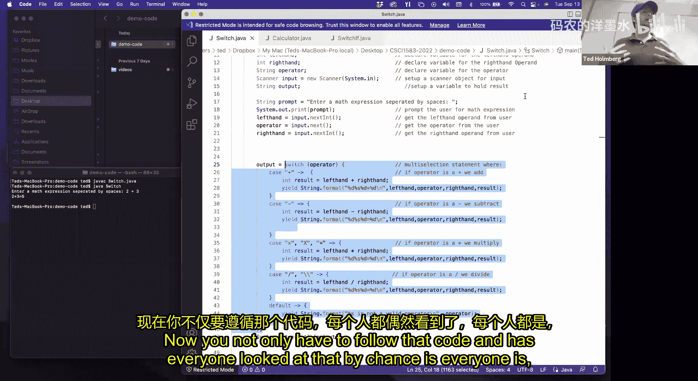

# 【全集】加州理工学院 软件设计与开发 中英字幕 1080P p08 Lecture 8 - 自顶向下逐步求精 part2 -BV1AvzCBdE7a_p8-

Okay， so last time we left off， we were talking about the top down step wise refinement process as a tool as a tactic as a strategy。

That will allow us to go ahead and design our pseudo code because one of the most challenging things。

 especially for junior level developers， people who are just starting to code out is how do you take your ideas。

 how do you take the thing you want to accomplish and sufficiently build it into the step by step directions to actually implement as software and so we saw one way to do that is we start with that top down we start with the top statement which is the very abstract thing you want to do doesn't attain any concrete details and effectively we end up using that as our header comment right so every time you make a class file now should always have a multiline comment that includes your top statement that defines what is the role and responsibility of this class and also who is the author of this class。

So moving forward， whenever you turn in the homework two， the zombie game or any homework thereafter。

 you should always make sure that you have an author attached to it and that each class has a header comment。

Then after that we did our refinement process where we added a little bit of information and a little bit of information until finally we got to our last refinement which represents our complete pseudo code that we can then map one to one to our Java statements right so does everyone kind of recall that and that that should be posted on YouTube already so we last left off if remember correctly talking about trying to design a calculator。

And so our top segment was to solve a。Mathematicical expression from text and then we gave some examples and we set through each of these examples and we might not actually do most of these like I think this actual example comes or you have something like this similar to so we won't do the last three of these in today's example that is a challenge for when you do that lab exercise but we'll do these other ones here these examples that we didn include。

So I think what I did was I asked you to see if you can't design your own pseudo code for this did everyone go and do that over the course between Thursday to today which is Tuesday it a four day period we thought deeply about this。

Well， fortunately， I have slides so we can go ahead and work this out， oh good。

 we had some people on mind who did。😊，Okay， so Jonathan online。When we walk through this。

 I'd like to see if， oh， I did not。死。I misread that okay， well for those of you who did。

 see if as we walked through this， how similar or dissimilar what variety we had as we stepped through this refinement process。

'd be interested to see if your approach to solving this problem is any different than my approach and if we got to the same place on this。

What okay， here we go。Okay， so。系。So the first thing we're going to do is what we already defined our top statement right solve a mathematical expression from text and then we actually gave some examples this might not be a bad idea to start dealing in the future as well to start thinking of concrete examples before you start the refinement process so might actually add this into my other slides as well。

We talked about it in class and then I wrote these down but then I came to the realization this is a great way to illustrate what our expected input is and what our expected output is and if you think about it this is how the labs are designed as well where each lab is a set of initial input values and then you have an expected output value that you have to go ahead and compute in order to get credit lab so I thinkm going to update。

Well very similar to so my。Make sense to you and for those of you who had already done this and thought of deeply about this say if this is similar to your first refine it that internet connection is unstable so my refinement one was set up data right so the first thing I need to do is I need to set up the data model before I can start defining the algorithm that process on my data so here i'm identifying what is the data that I start with my initial state of my application and then how do I have to process upon that until I can get to some concluding states state what is it that i'm trying to result from。

🎼Then the second thing is while I'm going to get that expression from the user once I've set up my data I'm then going to get that text expression and then the third and final thing is I'm going to resolve the expression printed right that seems like that seems like a reasonable set of steps from my perspective does this seem is this in line with for those of you who have done this was this your first refinement as well？

Perfect so just check it online and looks like it is so now let's go to the second refinement because when I look at this refinement I ask myself is this pseudocode yet and what I mean by pseudocode is is this explicit enough for me to convert directly into some concrete programming language the beautiful thing about pseudocode is that it's expressive it's human readable but it's concrete enough that we can translate it into Java code or python code or C++ code or whatever programming specific programming language we can use we can easily map it so it's kind of a generic。

coding language that doesn't actually compile to anything。

 but allows us to express our algorithm in a way that makes sense and allows us to then transcribe it into any language that we want to go ahead and actually encode it to compile。

Okay， so this is not quite done yet， so we're going to go to a second refinement and just like what we did last class。

 I'm going to take the first statement。In refinement one and i'm going to expand it to include more details so for each statement on the left on the right hand side I'm going to have a table that corresponds to it on the right on the left hand yeah for each statement on the right hand side I'm going to go ahead and have a table on the left hand side that shows the expansion of it in the next refinement so when I said set up data I asked myself what does that actually mean。

😡，Well， we got to declare a variable for a left hand operator。

 we have to declare a variable for the right hand operator on the opera we got to declare a variable for the operator itself。

And we have to initialize that scanner object to go ahead and get the input。 In fact。

 we can also go ahead and say we also need to。Declare。A variable。For the result。

And so that would represent my initial state of my application here。

 all of this would be the initial state and then here this is what I'm expecting to output。

And then what my algorithm。Is intended to do is how do I get from my initial state to my resulting state？

😡，So here I'm going to look at my next statement， get the expression from the user well what do I have to do to get that well the first thing I have to do is I have to prompt the user。

😡，Then I'm going to get the left hand opera end， I'll get the operator itself。

 and then I'm going to get the right hand opera end because if we go back and look at our example。

 we see it is a numerical value， the operator which is going to be a string value and then a numerical value so we're going to want to parse that in the order that is given to us。

😡，Yeah。And then that seems to be everything we need to do for that second statement in refinement one。

 so then I'm going to move to my third statement， resolve the expression and print it here I will calculate the results。

😡，And then print that result。嗯。Now when I look at refinement two I see i'm much closer to having pseudocode in fact。

 if I look at at a block at a time I could say block one looks well defined enough for me to express that in Java code if I like so that is that is hit pseudocode block two。

😡，I can prompt the user that's a that's an output statement。

 get the lefthand opera that's a call to my scanner object and then a storage operation I could do that in Java get the operator from the user that's a call to my scanner object and a storage operation so I know I can do that and get the right hand opera from the user same as before right it's a call to my scanner object and a storage operation so block two I feel confident enough that I've defined this such that I can now encoded as Java code Now when I look at block3 calculate the result that's still abstract that's still too general I can't directly map that into a concrete set of Java statement so I'm going to have to think deeply on that on how to express that print the result well that is a output operation so I could do that so to this point is this effectively what refinement2 head look like。

Yeah。🎼For those of you who had worked on that so I'm going make a decision now that I have to go through at least one more refinement process so I'll take refinement two and I'll use that as my starting point and then I'll examine those parts general and i'm going to expand those so in this instance I've highlighted the one statement that needs more expansion and so inside block3 when I say calculate the result what I mean by that is I have to inspect the symbol that's given to me and make a decision on what kind of arithmetic operation we're going to perform so if our operator is a plus symbol then we would perform addition if the operator is a dash symbol we would perform subtraction if the operator is an asterisk symbol we would perform multiplication and if the operator is a slash symbol then we would perform division。

And so after that。We问别。Here's the result we're looking for and so now we're in a scenario where we can go ahead and encode this directly we finally refinement three is at a stage where we can map directly from our pseudo code into our Java code or map directly from our our set of statements to Java code so we've hit pseudocode。

Okay， is there any questions about this we've done this I know two times before。

So this time showing you this process and repetition hopefully it becomes easier and easier for you to be able to follow along as well to try to perform this and again I'm assuming the labs are really challenging you of this community right do you see how the same process that we're dealing here can be used to derive solutions in the labs and it gives you a set of building blocks to start with something simple and building into something more complex。

Okay， so let's talk about now translating our pseudo code into our Java code and so on the left hand side here I have my pseudo code and on my right hand side I actually have a Java I actually have my Java file and so notice the top statement here is my header comments so it gives me a description of the class and it shows me who the alter of this document is then of course all of my methods have to go into a class so I'm going to create a class and all of my statements。

 all my algorithms have to go into a method so for now we're just going have the main method。

So inside of block one， where we declare our variables。

 we declare for our initial state and we declare our variables for our end state。

 which I should put here。Theclre。Variable for result。

And then let's move this down so it doesn't over。And we give that down a little， and。It's just。

Perfect， okay。So we see block one is defined here and we'll look at this in the code answer in just a moment。

 but while I have it side by side I can show my block one， I use those comments here。😡。

And then I actually implemented into Java here and so with block two。

 I use the comments here and I implement into my Java code here， and then finally in my block three。

 I have my comments here and I implement it into my Java code here。

 so I actually use my pseudocode as my line by line comments that then defines what every line of my code does。

😡，So let's go into the actual source code document so we can actually say I will increase。

The size to make it a little bit readable， is that a little bit better in terms of readability for everybody？

Okay， so again， I take the top statement and make it the header comment。And so here。

This is what this so when I say I'm going to declare my variables for my left hand opera and my right hand opera I'm going to use。

😡，Good naming conventions to represent what those data values are supposed to model So if I say in English that this is my left hand opera my right hand opera i'm going to use variables that represent that that makes what we call selfdocumenting code so that even without these line by line comments the code is still incredibly readable you still understand what it is this variable in particular models inside this application so we have left hand we have right hand we have operator these two things are numerical data。

 this is a string data we're going to set up a scanner object and then finally we're going to create an energyteger value that will be able to hold our result then on the second block we're going to and just for readability sake i'm going to create local variable just called prompt。

😡，So that I can define what my prompt is as a string and then I'll just pass that variable into my system do outt print statement。

And then that's my prompt， so then after which the user should supply a mathematical expression。

 we define a mathematical expression as one that has a left opera， which is a numerical value。

 so we're going to do nextent followed by a space followed by a string that is a symbol that represents the mathematical operation we wish to perform so we will save that as a string。

😡，Followed by a space followed by another numerical value which will be the right hand operator okay once we do that we're going to do use the switch statement now we could have done this in one of two ways right it's a multi selection operation we're doing because it's going to depend on the symbol that we get from the user to decide whether we're going to do addition or subtraction or division or multiplication。

 so in this instance I will use a switch operation but i'll show you that it is equally valid to also use an if else if block right。

😡，So here， if we wanted to do this as a switch statement。😡，We can go ahead， and。

Switch on operator that's the thing we're trying to match against to make a decision on what type of operation we're going to perform so the operation recall is a string symbol。

 so on the case that the string symbol is the plus sign and then i'm going to use the arrow operator recall the arrow arrow operator is the new form that we can use to define our switch statements where we avoid having to use break。

😡，This was introduced I want to say in Java 14 and this is the way you want to do switch statements now your textbook only goes up to Java 8 so it does not show you this syntax so I want you to use this syntax moving forward as opposed to what the textbook says in fact。

 if you use the oracle API documentation it will illustrate that you should use the newer format of the switch statement over the older format okay with that said this is an arrow operator so this essentially says on the instance that we match this case。

😡，It points to this code block so this code block starts here。

 it ends here and what we're going to do here is we're going to we're going to compute the result。😡。

Which is going to be。The addition of the left hand integer to the right hand integer and then we're going to print out the result so we'll display it as a string okay。

 so if it wasn't a plus sign that was the operator， then we'll say okay on the case of a dash symbol。

 we'll do subtraction and then print out that result。😡。

And then we'll then we'll do some multiple cases for multiplication because multiplication might use multiple symbols。

 we might use the asterisk， but we could just as validly use the lowercase X symbol right because when I asked when I showed you the example everyone。

Intuitively thought of this is multiplication right same thing with the big X so on the instance that any one of these cases occur we want to perform the same operation so if we want to match more than one value to a block of coded and switch statement I can separate it with a comma separated list so notice that's what I'm doing here on a case of lowercase X comma case of uppercase X comma case of asterisk on any one of those instances I will do that code block of multiplication finally I will do the case of well I'm missing one here the case of slash a forward slash or a backslash。

😡，Oh。To to do the backslash， though， remember。Or the forward slash， that's the forward slash。

 so do the forward slash。That's a special symbol when it's embedded in a string for an escape code right so normally when I put a forward slash I'd have to put an n or a T right that when the system sees that forward slash it's like oh you're going to give me some meta information so if I actually want to use a forward slash I can't just have one of them I have to have two of them。

😡，Does that make sense？Because it itself is a special symbol。

It's the same thing like if I wanted to have a double quotation in a string since then double quotation usually terminates a string。

 I could put the escape key in there， the escape character。

 and then I could do that and notice it highlights that entire character bright red you see how this is bright red here and then that ma color that dark red shows where my string starts an ends in my syntax higher so anything that is either a meta formatting instruction like a new line character or a tab character or if it's a special symbol for managing string data that types inside a Java like double quotation or the forward slash。

 you have to use the forward slash before using that symbol so a forward slash with the forward slash forward slash a double quotation would be forward slash quotation。

😡，So let me go back and put that Okay， so now when it says double quotation for were。

What happened to my chat okay there we go so when it says a forward slash there twice it just really means once it's only going to treat that for the one symbol Okay so is there any questions related to that or is that clear。

And then we have a default so if it's none of these things， then we'll say okay。

 then we are going to print out a value to the user that hey that is not a valid operator so let's actually try to run this so is there any questions about this implementation based off of our pseudocode that we created。

😡，And let's to get to chapter now。Okay， so let's go ahead and run this。

So this was called calculator Java， let's go ahead and compile that and then we will run。

So enter a main expression separated by spaces so we were going to say what was the example we did two plus three right that was our first example should we go back to the examples let's go back to the examples。

 refresh our memory。So based off of our sample input。

 we're going to use that as our test case to see if this is implemented the way we expected to be so this was our top statement where we gave example initial。

And then what the expected result would be， so on the left hand side， we have what we。

And on the right hand side we have what we'd expect our application to deliver so we're do two plus three we're going to expect five two minus three we're going to expect one two asterisk three we're going to expect six two x three we're going to expect six two upper x three we're going to expect six to back last three zero two forwards last three zero and we we didn't implement these other ones so we're going to ignore those I would up to you ignore these additional symbols be very similar conceptually。

Okay， so let's go and try that out so if two plus three we get two plus three is equal to five。

 so let's run that again two minus three。2 minus3 is equal to minus1。To act3 y。To upper X 3， yeah。

To asterisk3。蕉。Back slash three or forwardlash I don't never remember which of those it is。Okay。

And I think that's it， okay， perfect。Let's see I have a question， any update on the torch ring。

 I have no idea what that meanshuh oh。I could see how they can be confused though。Yes。

 tutoring starts。The schedule is now out and I believe it starts this week so you should be able to and I have to double check but I want to say it starts if it doesn't start this week it starts at the beginning next week so the tutoring office is in 319 upstairs on the third floor of the math building I have it posted I should update my Moodle with the new schedule but I do with the new schedule posted in the announcement section of our discord so if you go to the Discord server if you go into the announcements channel the new schedule for when tutoring is available it should be posted there and it might be actually the beginning of next week when the tutors are actually inside the office。

No， they should not be open at midnight。开哦。Yeah。It should be kind of like from afternoon。Yeah。Well。

 computer science people are renowned for their night's schedule。Okay， perfect。

 so this works exactly as we'd expect， is there any question about this implementation as we're using it here with the with the switch statement？

Now I want to highlight that we could do the same implementation this would not affect our pseudocode at all if we wanted to use the if else if blocks so what that would look like would be this so if I want to convert between those two let's see what changes we see that here。

😡，Our。Data models， the data that represents our initial state。

 the data that represents our ending state is the same。😡，We can see here that。

The way that we go ahead and get that data into our application remains the same the only thing that's going to change is the multi selectionelection statement itself and notice if I wanted to move from the and let me get it here if I wanted to move from the oh no not here let me do here if I want to move from the switch operation here's a switch operating where i'm switching on this operator simple I could just do a set of F statements as well and this does this will。

😡，Perform the exact similar set of operations and execute to you， the end user exactly the same。

 so even though the implementation is different。😡，You wouldn't realize whether I'm using a switch statement or an if else if block。

 right？😡，系。Okay， so here for instance， I would start my initial if statement where I would evaluate to see if the operator equals the plus sign and then I would perform that block notice that would be exactly the same as this case here right so in the case of the operator equals plus sign we do that else if because a switch statement represents a multi selectionction statement not an independent set of if statement so else if the symbol was a dash we'd operate we do this operation so again this would be akin to this block here。

Then here operator equals x or then we're going to use the logical operator because remember this resolves into a Boolean expression。

 so if it equals the small x or if it equals the large x or if it equals an asterisk。

 that's the same as trying to determine if it's all these cases。😡，Small x large Xx or asterisk。

 then we would do the multiplication。And then here we get this to be in the same format so or。

Or if the operator。Is equal to the forward slash or the back slash。

 So that's the same as this block here。And then finally we have the default block。

 if it's not any of those cases， then we're going to report。

 oh we never try to test it that out either， let's say we do to question mark three right or then we're going to get the result。

 hey question mark is not a valid operator。Well， the the equivalent of a default case on switch inside our else if block is going to be the else so in fact。

 if I go into my code here， let's clear this out and if we compile our switch。😡。

If do Java state file and run that and test it out。

 we'll see that the behavior is going to be exactly the same。Okay， what do we have here？嗯 switch if。

Switch if。Oh， whoops， I got to use Java。There we go。 Okay， so let's see here。

 So we do two plus three， y。Okay。And then two times three， oh dont， two minus three。你好。

And then to Act3。To big act 3。To asterisk 3。超。Divide three。

To divide three with both slashes and then finally to question mark three so notice from our perspective。

 they perform exactly the same。From the end user。And so let me ask you this。

 is there a preference and this is just a personal preference from what you see。

 do you prefer the if else block or do you prefer the the switch statement block？😡。

Either way is valid and it's up to you which one you'd want to do now again they both have their own shortcomings。

 they both have they're both advantages so say for instance the advantage of the multi selectionction statement is that I can go ahead and not only test for equality because that's what switch statements are restricted to they can only test for equality the multi selection statements using if else if blockss can check for relational operations or anything else right that can resolve into a expressive boolean value。

Switch statements are exclusively equality， but they can do something interesting that multi nested switch statements can't that a nested block can't and I'm going to show you what that is in just a moment。

😡，Oh my goodness， actually， I want to turn this off。That's going into。

I don't know how to that off because that's going to cause habit going。Okay， there。

 we can just move that。Okay。So with that said， let's take a look here at what the advantage of a switch statement is that we can't do with a selection statement。

 it's actually possible and let me actually show you here。

Where I can yield a value from a switch statement， which I can't necessarily do。😡，With a if else。

 if statement， So what does it mean where I can yield a value， It means that I can actually。

Take one of the values that are selected in the switch statement and then return it back to the parent block of code So remember the way that the code scopes work is whenever I declare a variable whenever I process a result inside of a code block and code blocks are defined by the curly braces right the open closed curly braces after I hit the closing brace any variables that are declared in that block are thrown away right they don't carry over you don't maintain them so that's why in some instances when we were doing repetition statements we were declaring variables outside the repetition statement right does everyone remember that。

😡，LetLet me get my chat back up here。你狗。Perfect， okay。

 so let me show you how we can take a value from one code block and。

Give it to an outer code block in the same method we can use the yield key word。😡。

In order to transfer data from one codeb to another。So if I go to switch here。This is。

What I'm going to do with this switch statement is notice instead of On 15， where I had int results。

😡，I'm going to presume that the output is supposed to be a string and it's going to be the statement。

😡，The mathematical expression that also includes the result。😡，Okay， so if that's the case。

 I can go ahead and use the switch statement as if it's a statement itself to resolve a result。😡。

So notice here I can do output and assignment， so whenever I do an assignment operation recall that the assignment operation the single equal sign requires a variable to be on the lefthand side and on the right hand side it is a value or an expression that results to be a value so the Swiss statement can actually give back it can yield back a singular value that I can then assign。

😡，Into my output variable。😡，So what i'm going to do so what it means is that it's going to figure out a value internally inside one of these code blocks。

 but it's going to yield it back to its parent block So in this instance we're going to switch it looks exactly the same as before we're going to switch on the operator on the case of a yield I mean the case out of a plus sign i'll go ahead and。

😡，Use a local variable for result to recall result in this instance is declared inside this code block here then i'm going to use this method inside of string so string as a class we always get string imported into every Java application because it' part of package Java。

U。😡，One of the methods that string provides is string。 format。😡。

That allows us to do a formatted string a print the same as print F so this is the same as print F。

 but instead of sending it directly to the output stream。

 we can actually build a string around it does that make sense。😡，So in this instance。

 notice the parameters are going to look the exact same that I would use for a print F statement。😡。

So the first argument is going to be a formatted string where I can put those placeholder values in this instance it would be percent D。

 percent S percent D is then the assignment operator。

 the equal sign if this is a math and expression and then percent D so again with that's supposed to express is a numerical value that is an integer。

 the symbol， the string is our symbol or mathematical symbol followed by another numerical value which is going to be an integer and then we'll have the equal sign in math and an assignment operator in Java finally last percent D is going to be a numerical value that is an integer and then this is our new line character。

Okay， so this is going to produce a string when I produce this string notice i'm going to use the keyword yield。

 this is a statement itself because it terminates with a semi colonlon and what this is going to do is it's going to effectively give this value back。

😡，It's going to send this data out when the switch operation is done to the outer block。😡。

So this is one way we can process data inside of one block and then give it to another block。😡。

But the trick is it has to give it to the block in the same methods。😡。

Is this is this fine this concept of yield and so for each statement that I potentially want to yield out of my switch statement。

😡，I'm going to have a yield。Attached to it so this is the yield for the plus operation this is the yield for the minus operation。

 this is the yield for the multiplication operation。

 this is the yield for the division operation and this is the yield for the default and so what I want you to see here is that。

😡，We can go ahead and。Compile this and test this and it's going to look exactly the same as what we're doing before。

 so if I do two。超。Pluss three。It's going say two plus three is equal to five。

 where is it actually printing this out at it's not printing it out inside of the switch statement anymore it's actually printing it out online line 47 after the switch statement is done so actually this way I think is a little bit cleaner because instead of doing the printing and the computing in the same block I'm computing the result and then I have a separate line of code that then prints the result based off of the computation so it allows me to separate those two concepts to be their own。

Wines of code。😡，And so this is an advantage that we can do with the new to statements that we can't get from the ifL so I just want to highlight that there's a give and take here。

 you have more flexibility in what you can assess using the FLs if blocks。

 but you have the capability to yield values out of a switch statement so keep that in consideration when you have to make a decision on which of these two multi selectionelection structures to use is there any questions related to this。

Excellent， okay。As far as I'm concerned， and let me make sure that there's no questions from the chat。

Okay so since there's no questions related to this。

 I' am done with unit one now we've talked about everything we need to for what we're going to call algorithm design and so again going all the way back to the beginning what that effectively means as we covered what it means to think mathematically how to model our observations or the phenomena of the world around us in terms of quantitative data and qualitative data。

 how to build a set of how to then express our initial problem domain as an initial state of data。

 then once we have a data model that's suitable we've learned how to start talking about algorithms which is a set of stepbystep directions on how to。

😡，Mutate our initial state of data into whatever our desired outcome is and how we can go ahead and。

😡，Plan out our algorithm using this top down stepwise refinement process so that we can start with something very abstract and evolve it into our pseudo code that we can then map to our Java code and we learned that our building blocks for any Java algorithms are based off of five different types of operations those are input operations output operations storage operations our processing operations and our control operations right so is there is there any questions related to this because what this means now thatre we're moving out of unit one is that we can start talking about the first test so the first test is going to be like all other tests in this class a take home test I will probably make it live now that we are done this the moment that the first homework is due because I always like to ensure that we finish the homework related to the。

That we're in so the zombie homework right I have that do this Thursday， correct？This Friday， okay。

The zombie homework is due Friday。And it has you using all of the constructs that we learned right it has storage operations。

 it has input operations， it has output operations。

 it has processing operations and it has two different types of control or three different types of control operations right it has the selection operations and repetition operations and it has both types of repetition operations。

 the countercons and the Sinel control using four loops and whiles correct？😡。

So it effectively covers the entire gambit of everything we've covered since we started the semester。

 so it's a good capstone homework to illustrate where we should be at after today's lecture now you not only have to follow that code has everyone looked at that by chance is everyone is is anyone having issues following that。

😡。

