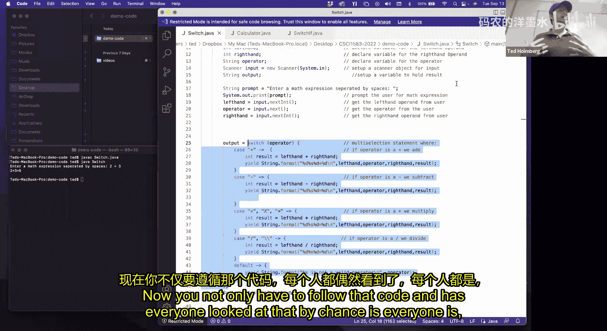

# 软件设计与开发：第8讲：自顶向下逐步求精（第二部分）


在本节课中，我们将继续学习自顶向下逐步求精的设计方法，并将其应用于一个计算器程序的设计中。我们将从抽象的目标开始，通过多次细化，最终得到可以直接映射为Java代码的伪代码。

---

上一节我们介绍了自顶向下逐步求精作为一种设计策略。它允许我们从抽象的目标出发，逐步细化，最终形成可执行的伪代码。这对于初学者尤其重要，因为它提供了一种将想法转化为具体实现步骤的系统方法。

我们的起点是一个顶层的目标陈述，它非常抽象，不包含任何具体细节。这个陈述最终会成为我们Java类的头部注释。因此，从现在开始，提交作业时，请确保每个类文件都有一个多行注释，说明该类的职责和作者。

## 设计过程回顾

我们的顶层目标是：**从文本中解析并计算数学表达式**。

在开始细化之前，我们先定义一些具体的输入输出示例，这有助于明确程序的预期行为：
*   输入：`2 + 3` -> 输出：`5`
*   输入：`2 - 3` -> 输出：`-1`
*   输入：`2 * 3` -> 输出：`6`
*   输入：`2 x 3` -> 输出：`6`
*   输入：`2 X 3` -> 输出：`6`
*   输入：`2 \ 3` -> 输出：`0`
*   输入：`2 / 3` -> 输出：`0`

## 第一次细化

在第一次细化中，我们将顶层目标分解为几个主要的、但仍较抽象的步骤。

以下是第一次细化的步骤：
1.  设置数据模型。
2.  从用户处获取表达式。
3.  解析表达式并打印结果。

## 第二次细化

现在，我们对第一次细化中的每个步骤进行进一步分解，使其更具体。

对于“设置数据模型”这一步，我们需要定义程序初始状态所需的变量。

以下是“设置数据模型”的细化内容：
*   声明左操作数变量。
*   声明右操作数变量。
*   声明操作符变量。
*   初始化Scanner对象以获取输入。
*   声明结果变量。

对于“从用户处获取表达式”这一步，我们需要与用户交互以获取输入数据。

以下是“从用户处获取表达式”的细化内容：
*   提示用户输入。
*   获取左操作数。
*   获取操作符。
*   获取右操作数。

对于“解析表达式并打印结果”这一步，我们将其分解为两个子任务。

以下是“解析表达式并打印结果”的细化内容：
*   计算结果。
*   打印结果。

审视第二次细化，我们发现“计算结果”这一步仍然过于抽象，无法直接映射为代码，因此需要进一步细化。

## 第三次细化

本节中，我们将重点细化“计算结果”这一步骤。其核心是根据不同的操作符执行相应的算术运算。

以下是“计算结果”的细化内容（使用多分支选择逻辑）：
*   如果操作符是 `+`，则执行加法。
*   如果操作符是 `-`，则执行减法。
*   如果操作符是 `*`、`x` 或 `X`，则执行乘法。
*   如果操作符是 `/` 或 `\`，则执行除法。
*   否则，报告操作符无效。

至此，第三次细化已经达到了伪代码的级别，我们可以将其逐行转换为Java代码。

## 将伪代码转换为Java代码

现在，我们将最终的伪代码实现为Java程序。我们将使用伪代码作为行内注释，清晰地表明每行代码的意图。

首先，根据“设置数据模型”的伪代码，我们声明所有必要的变量。

```java
// 设置数据模型
int leftOperand;        // 左操作数
int rightOperand;       // 右操作数
String operator;        // 操作符
Scanner input = new Scanner(System.in); // 输入扫描器
int result;             // 计算结果
```

接着，实现“从用户处获取表达式”的步骤。

```java
// 从用户处获取表达式
String prompt = “请输入数学表达式（格式：左操作数 操作符 右操作数，用空格分隔）：”;
System.out.print(prompt);
leftOperand = input.nextInt();   // 获取左操作数
operator = input.next();         // 获取操作符
rightOperand = input.nextInt();  // 获取右操作数
```

最后，实现最核心的“解析表达式并打印结果”逻辑。这里我们使用 `switch` 语句来实现多分支选择。

```java
// 解析表达式并打印结果
// 根据操作符计算结果
switch (operator) {
    case “+” -> {
        result = leftOperand + rightOperand;
        System.out.printf(“%d %s %d = %d%n”, leftOperand, operator, rightOperand, result);
    }
    case “-” -> {
        result = leftOperand - rightOperand;
        System.out.printf(“%d %s %d = %d%n”, leftOperand, operator, rightOperand, result);
    }
    case “*”, “x”, “X” -> {
        result = leftOperand * rightOperand;
        System.out.printf(“%d %s %d = %d%n”, leftOperand, operator, rightOperand, result);
    }
    case “/”, “\\” -> {
        result = leftOperand / rightOperand; // 整数除法
        System.out.printf(“%d %s %d = %d%n”, leftOperand, operator, rightOperand, result);
    }
    default -> System.out.println(“错误：’” + operator + “’ 不是有效的操作符。”);
}
```

> **注意**：在Java字符串中，反斜杠 `\` 是转义字符。要表示一个真正的反斜杠，需要写成 `\\`。

## 选择结构：`switch` 与 `if-else` 的对比

`switch` 语句并非实现多分支选择的唯一方式。我们也可以用 `if-else if` 链达到同样的效果。两种结构各有优劣。

`if-else if` 链的优势在于其灵活性，它可以处理任何结果为布尔值的表达式（例如关系比较）。而 `switch` 语句传统上只能进行等值比较。

然而，现代Java中的 `switch` 表达式引入了一个强大功能：**`yield` 关键字**。它允许我们从 `switch` 的一个分支中返回一个值给外层的代码块，这是 `if-else` 结构难以简洁实现的。

下面的示例展示了如何使用 `switch` 表达式和 `yield` 来改进代码结构，将计算和输出分离。

```java
// 使用switch表达式计算并生成结果字符串
String output = switch (operator) {
    case “+” -> {
        int r = leftOperand + rightOperand;
        yield String.format(“%d %s %d = %d%n”, leftOperand, operator, rightOperand, r);
    }
    case “-” -> {
        int r = leftOperand - rightOperand;
        yield String.format(“%d %s %d = %d%n”, leftOperand, operator, rightOperand, r);
    }
    case “*”, “x”, “X” -> {
        int r = leftOperand * rightOperand;
        yield String.format(“%d %s %d = %d%n”, leftOperand, operator, rightOperand, r);
    }
    case “/”, “\\” -> {
        int r = leftOperand / rightOperand;
        yield String.format(“%d %s %d = %d%n”, leftOperand, operator, rightOperand, r);
    }
    default -> “错误：’” + operator + “’ 不是有效的操作符。%n”;
};
// 统一打印结果
System.out.print(output);
```

## 单元总结

本节课中，我们一起完成了算法设计核心内容的学习。我们回顾了如何将现实世界的问题用数据（初始状态和最终状态）进行建模。接着，我们深入学习了**自顶向下逐步求精**这一强大工具，它帮助我们将抽象目标层层细化，直至得到可直接转换为代码的伪代码。

我们了解到，任何算法都可以由五种基本操作构建：**输入**、**输出**、**存储**、**处理**和**控制**。在控制结构中，我们重点对比了 `switch` 语句和 `if-else` 链，并介绍了现代 `switch` 表达式的 `yield` 特性。



掌握这些基础，意味着我们已经具备了设计并实现简单程序的能力。接下来的作业和测试将综合运用这些概念，请务必通过实践来巩固理解。