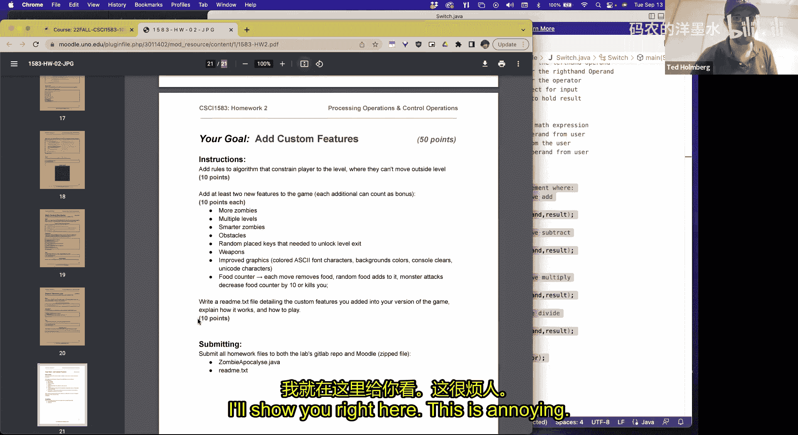
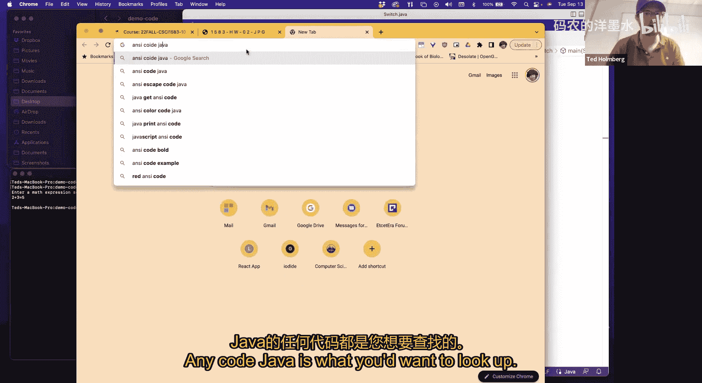
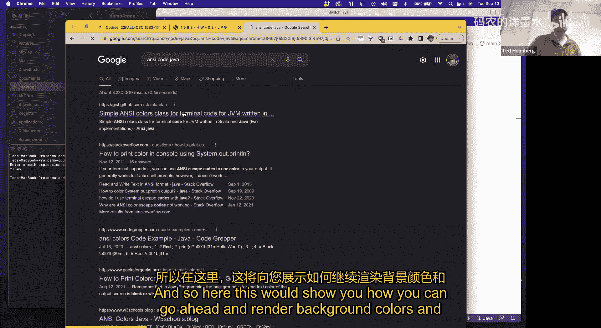
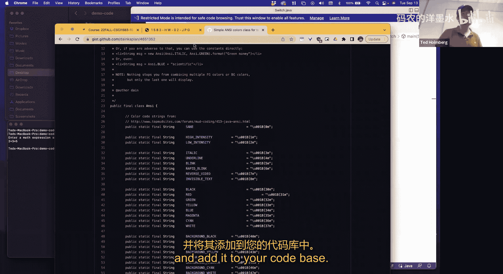
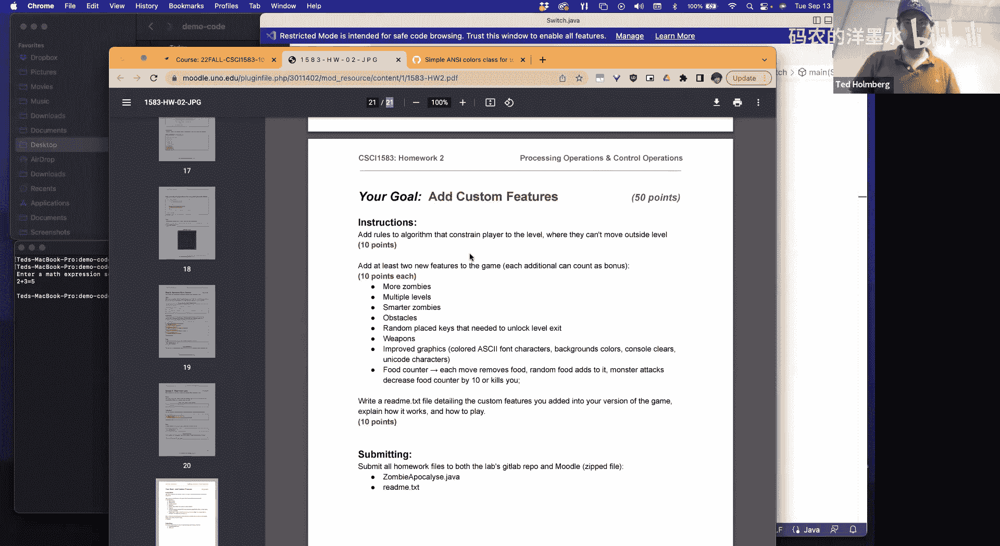

# 【全集】加州理工学院 软件设计与开发 中英字幕 1080P p09 Lecture 9 - 作业：僵尸末日 -BV1AvzCBdE7a_p9-

These documents if you haven't looked at them already they might look scary。

 you might open this document like it's a 21 page homework assignment i'm telling you this is a good thing。

 not a bad thing because it's very explicit and it walks you step by step what to do for the first half of the homework so the first thing we have is a name for the assignment it's as the apocalypse the roadgue like survival game here we have two different screenshots that were actually taken from the complete application so you can make an ASCI version the ASI version is actually the version that you'll be shown how to build。

😡，Inside of the instructions that are provided the Unicode version produces prettier graphics right and if you do the Unicode version you actually get that that's one of the that could fulfill one of the requirements for this assignment it shows that you understand how to do complex output operations using system got out。

😡，And so here， this is an example of the exact same code。😡。

Just using different symbols to go ahead and display out so what's crazy about how powerful systemem。

 print is is you can embed not only Uniicode characters but send antsy codes that allow you to change the color of the bash terminal so you can change the font color or you can change the background color so here the reason why you see like a green grass in the back on the right hand side of this image is that it's using an ani code to create a background green color for each of the tiles。

😡，And in fact， the ansy Codes can also clear the terminal。

 so instead of getting an infinite loop of the game state of your board， you refresh。

 erase the old state and redraw the new state which is very much in line with how a real video game would work right where you're constantly refreshing the state of your screen。

 you're not just drawing it after the previous state。😡，Again。Okay， so this is the rubric。

 the rubric sets small goals by the time you get to your end goal you will have completed the basic application of the zombie apocalypse game so notice there are a total of 10 goals because we start counting at the number zero in computer science。

😡，So each one of these goals is worth five points by the time you complete all of your goals you've completed 50 points worth the assignment so the first half of the assignment is effectively you just following my instructions because again。

 the motivation behind these assignments is that it's supposed to train you in an apprenticelike model where I show you what I think good programming practices are。

😡，In terms of variable namings and making decisions on how to break building a complex application like a video game is。

 and then you follow along， but then that's only half of the story once I show you how to do something in an apprentice like model。

 you have to then show me you understood what I showed you and on your perform it yourself。

You have to add to it and so the other half of the assignment is you add features to this game your own features I give you a list of options at the end that you might decide to select to implement。

 but feel free to make whatever decisions you want don't feel that you're drafted within my recommendations I want you to leverage creativity I want you and make these assignments your own the goal here is by having openended assignments like this and allows you to be creative but it also allows you to start building portfolio pieces early on even in the first programming class that way everyone's game is different it's something that you had a pardon designing I design the first half you get to design the second half of it。

Okay， so the rubric here kind of shows you what each of the goals are。😡。

Followed by the amount of points that there were。So again。

 doing this initial part is only worth half so you still don't look at a passing grade you have to by completing the step by steps you have to put forth and add to it to actually complete the homework assignment so a quick overview this again shows you this is the preicile show then do approach that's what to just explain students are first shown the core concepts along with good coding practices by walking step by step through the iterative design process of a complete application afterwards students are challenged to improve the application by adding features of their own design into the code base custom features must use concepts from the learning objectives for credit and so again these learning objectives are the ones that I explained earlier it's this idea of data modeling it's this idea of algorithm design it's the concept of cop down stepwise refinement so this iterative design process the idea that we want to test what we create so a test driven development and the fact that our code is incredibly readable so that we create what's called self-documented code and。

The programming practices that we're going to be evaluating that you're really illustrating and that you have a competency for that I'm looking for。

 so again， these all the learning objectives I want you to show me that you know how to do the processing operations in order to change the state of our data in meaningful ways repetition operations so that we can can repeatedly perform or execute a block of code until we hit some kind of breaking condition and selection operations where we determine what block for many blocks or a couple of blocks to actually execute。

😡，And then we have our specifications on what is a road like game this isn't this just gives you some background information on what we're actually building so like common attributes for a road like game is that a turn based it's grid based where you can move up down left right that you have some kind of permanent failure that it's usually proly generated that there's kind of random outcome blah。

 blah， blah this isn't necessarily super important just gives you ideas so that as you evolve your game you know。

What kind of features that would normally be found in this genre？

We talked a lot about data modeling already so but I give descriptors again。

 this homework in and of itself is very ver so it doesn't leave anything out here we actually define what our data models are we have our world which is effectively 2D space in 2D spaces that are grid base you can think of it like a chessboard or a tuer board where you can easily label each cell based off of its row and column and so that's where we can identify the location of a player or the location of a monster a zombie you giving it an x coordinate on y coordinate we'll have a player a player's data attributes to notice here on the righthand attribute I'm actually defining how we're going model each one of these things that we have each one of these objects that we have in our game world so our world will have the grid column size as an integer it'll have a grid row size as an integer and then it'll define what an empty tile is。

What a floor tile is as a string then we'll have a player which will define as having a X position and Y position so we know where in the world our player is and again we'll identify a player using a specific kind of character like a string character to represent it distinct from the empty cells well have a zombie which will have its own X and Y position and then we'll give it a tile that'll be represented as a string well have an exit so here our goal is you're the player you're gonna to start at some coordinate in the world you have to traverse to the exit to win the game and if a zombie touches you then you die so there's a wing condition and lose condition So again。

 the exit will have a exposition it'll have a Y position and it'll have a tile that's presented as a string and the X position of Y position will be represented as integers and then finally we'll have our scanner。

That will be able to grab the input from the player based off of the input from the player。

 we'll make a decision on how do we move our player for each term Okay。

 is there any questions up to this or does this much of it make sense So notice the first thing we start doing before we start implementing anything is we start defining our data model The same thing we've been doing before。

 but our data model here's a little bit more complex than the other algorithms or the other applications we've been building right because each entity each object has more than one attribute。

😡，So once we're clear there， then we're going to start with our goal zero。

 which is going to be our top level pseudo code so notice each one of my goals my goal represents what do I want to achieve for this step of my software development process so one thing I never want to do is go into trying to build an application all at once because the complexity is going to be to。

😡，It it's going to be too verbose it's going to be too complex it's going to be too large for me to handle all at once I want to take a divide and conquer approach whenever I build out my applications I want to give myself a small step I can make that ultimately leads me to the final product does that make sense so again there's that famous phrase that a journey of1 thousand miles starts with a first step and then the next and then the next so whenever we go to design our applications we shouldn't think about building the entire application of one go and not testing it not not evaluating it until it's complete we should give ourselves a tiny goal here my first tiny goal is going to be just to create the pseudocode so that's going to be my goal zero so here i'm going to break each goal down into a planning step so what is it that I'm trying to achieve then once I figure out what i'm trying to achieve i'm going to have an implementation step。

😡，How do I encode that in Java and then after i've encoded it in Java each goal should be a testable goal I should be able to verify that it's complete so then I want to test and make sure that this goal works that way I expected to so i'm going to do that for each goal I have I have 10 goals right goal zero through goal nine so i'm going to do that process 10 times。

😡，So here。My my plan here is I'm going start by defining the entire apps algorithm in a very broad big picture way ignoring specific details This helps decompose a complex app into a collection of similar simpler tasks the next parts of this project will focus on iteratively implementing these task a feature at a time this is a process that we call rapid prototyping very common in the software development world in terms of being able to build out your application so here our top level game algorithm I look at like this the first thing I'm going to do is i'm going to set up my game data then the second thing I'm going to do is run my main game loop so once the initial state of the game starts then I repeat the process of doing what join the game scene。

Geting the player input， executing the player's action。

 checking to see if the player once is checking to see if the win condition has been hit executing the monster action if we didn't win the game and then check to see if we hit the lose condition after the monster had an action right so does this much make sense you see how we can take the idea of what the game is what do we say is the point of the game the player starts in one location they get an action to move somewhere in the game world their goal is to move towards the exit the monster moves around if the monster ever touches the player then the player loses if the player gets to the exit then they win so do you see how I've been able to express in pseudocode the set of instructions that defines how the game plays right is everyone okay with that？

Okay， so that。Represents my base algorithm to complete this application。

 I need Java code that expresses all of those statements right so that's what we're going to evolve。

😡，After I've essentially defined what it is my game does algorithmically in a very pseudocode like way。

 I'm going to convert those into comments right this is the same process we learned with top down subwise refinement right I've defined an algorithm and now I'm going to represent those as line by line comments that I can now look at and say how can I achieve that。

😡，I'm gonna do it a small piece out of the time so in my implementation step I'm going to define a class I'm going to define a method because all of my statements have to go in methods all my methods have to go into a class and then i'm gonna to put my comments that represent the algorithm then i'm going to test and make sure I can compile and run up to this point there was no code that's actually implemented so it shouldn't do anything but if I get an error that means I have some kind of syntax error so i'm going to resolve that now I want to make sure I can compile this code before I move to the next goal so always make sure on each of these test phases that you can compile your code and that the output is similar to the output that's provided in the instructions so now I would then move to goal one。

😡，After I complete goal zero if I compile my code and it executes now my goal one。

 I'm gonna to give myself a new task and when I accomplish this task and I move to my new goal so here my goal and I look at little goals at a time right so I'm supposed to be able to create this game world that's going have a player it's going to have zombies and it's going to have an exit but before I can do any of that。

 let's see if I can just define and draw the game world draw and define the grid that's gonna to be the little goal that's going to bring me one step closer to building out a complete application so I'm going make a plan for this how can I define and draw a grid well let's focus on drawing an empty game grid the data required for modeling a grid is the number of rows in the grid the number of columns in the grid and the floor tile graphic So here I'm going to give you my pseudo code So for each number of rows and for each number of columns I'm going print the floor tile right and then after I print a si row I'm going to do a new line character。

The next row appears under it and then a new on characters so the next column of the next row appears under that so does everyone understand the pseudo code of the my logic for drawing a game scene well once we understand that and again while you're walking through this lab make sure you understand what each pseudo code is doing and what the Java code corresponding it is like I don't want you just to copy and paste this I want you to fundamentally understand what's happening what motivated each step along the way so here I show you the implementation right and notice。

What you see here when it says the comment set of game data we're going to be adding this to our preexisting class so the the code in yellow is new code on where it goes in your preexisting code file right so one of the most common mistakes I see people do on this first homework when they're following my instructions is they keep copy and pasting the same code over and over and you're going to get all sorts of errors what you're doing is you're editing on top of what you did last goal does that makes sense so the new code you're adding on top of the old code is highlighted yellow the old code is not highlighted at all so that means this set of game data already exists because it's not highlighted yellow and in fact if I go up to my original code here I could see there's a set of game data here So what this means is underneath that comment we're going to add the yellow code。

😡，So we're going to add in this column size is assigned 10。

 we're going to add in this row size is assigned 10 and we're going to add in this floor tile is assigned a period thin space string。

😡，Okay， so that's our first step where we initialized the world grid data attributes。

 the second step for this goal is to create a double four loop that allows me to draw draw my rows and my columns。

😡，So here you could see I have a double four loop， one to be able to draw the rows。

 the other to draw the columns and inside of the double four loop。

 I'm going to go ahead and print out the floor tile again。

 this follows step in step with my planning step with my pseudocode。😡。

So again I'm just following the top down subwise refinement and once I have my pseudo code I just match the Java statements next to that and here I have my line by line concepts on the right。

And then once I implemented that， I go to the test。

 I actually compile my Java code and then I execute and I say。

 do I get this expected output at this stage， you should do the same。😡。

Don't move on to the next goal until you know that this particular goal works because if you get an error it's easier to catch the error and debug now than to get wait until you get to the end of the assignment and get 100 different errors that might have started all the way in goal one because then it's gonna be too hard to debug and figure out what went wrong so catch them early that's the entire point of this test drivenn development where we do a little bit then test we do a little bit than test then do and we keep adding complexity so we start with something simple until we build something complex so once I get this once I get my empty grid I give myself a new goal my second goal I want to define and I'm want to draw the player and again my planning step talks about how I'm going to model that and define that inside of my game algorithm so here let's focused on drawing the player in the grid the data required for modeling a player object is the player X position the player position and the player tile graphic。

😡，So then I give you the pseudo code on well really what we need to do is while we're going through the for loop doing the draw logic instead of just drawing an empty tile for every instance we want to see if this tile we're currently drawing is the same position as where the player's position is and if it is the player's position we're going to draw the player tile and if it isn't the player's position。

 then we're going to draw an empty tile so now you can see how we're making decisions in our draw logic on whether it's a player or floor and then what we'll do is we're going to implement once we have an understanding of how it's going to work in pseudocode in a natural language we're going to encode it in our Java program or Java app so I'm going go into my setup game data again the preexisting code is not highlighted so I'm going to go find that space inside of my application inside of my class and I'm going add this new code after it so I'm going to define a player location player X player Y I'm going to play them at the zero。

zeero position， and then I'm going to give us a symbol that define on supplier， the at symbol。

Then I'm gonna go into my draw game scene logic that I had before and I'm going create a selection statement to determine whether I should be drawing a player tile or a floor tile Now once I do that that's complete so I'll go ahead and test this I'll compile I'll run and this should be now the expected output of my game application so if I get this I can give myself a new goal to get myself onese closer to completing this game the next goal is okay great I can draw a game world I can draw a player let's create a game loop that can repeatedly draw the game world state after state after state so we can start updating the player' movement so that we can start implementing user interactivity and based off on what the user supplies to us we can actually change the location of the player before we can do that let's encode our logic into a loop so that we can have that looping process。

😡，So our plan here is the main game loop is responsible for repeatedly executing the events and actions for each turn of the game。

 the game loop is sentinel controlled since the number of game terms depends on whether a when loss condition occurs since the game loop continually repeats all of the actions for a single turn。

 all of the game logic for a full turn must be nested in the wild loop。😡。

So here once we've defined our logic and what determined our game loop we can implement that so here I'm going to create a new variable that's going to be my loop control variable I'll call it game over and I'll initialize it to false then I'm going to create a while loop and I'm going tocapsulate everything I had before into my wild loop so so long as the game is not over I will do all of these actions。

 the draw action， the get player input action the execute player action the check wing condition the execute monster action and the check lose condition。

😡，And then what I'll do is I'll test， I'll compile I'll run， and what we should get is an infinite。😡。

Print out on our console that keeps redising the same game world again and again and again and again。

😡，So now that we have a loop， if we go ahead and then query or prompt the player to give us an action。

 we can take that action， mutate the state of our player and when the next time we print out the state of our game world our players should draw in a different location so our next goal now that we have an infinite game loop。

😡，Is to go ahead and update the state of our player。

So here we're finally going to implement our input moves for our player so our plan here is we're going to use a multi selectionction to update the player X and y on each turn the player input from the scanner object is used to determine whether the player X or Y coordinates or increment or decrement it the player controls are W to move up as to move down a to move left or D to move right was it controls and just so you know since this is a gridd at world and each cell has a X and Y coordinate you should understand that the zero zero position is in the top lefthand corner that means moving up is a decrement on y moving down is an increment on y moving left is a decrement on x moving right is an increment on X so that defined how we can mutate position to move around in our world that's our data model。

😡，That's how we're treating space as a quantitative data and how we can use the arithmetic operations to mutate our locality inside of our world so once we understand that we go ahead and do our implementation and again we'll set up will follow these instructions to be able to update our player state and then we will test and run and when we do this you should be able to input WSadD and actually watch as your your player moves around right now there's no update to the loop control variable so if you want to terminate the game we have to hit control C right you have to break that logic the fifth goal we're going to define and display the exit this is very similar to what we're doing before we will now create an exit X exit Y and exit tile we will add being able to display the exit into the draw logic then we will test and see if our exit appears。

😡，Then we'll test to see if we can break the game loop when we touch the exit so here inside our check for when condition comment。

 so here the pseudocode is if the player coordinate and exit coordinates are the same then we set game over to true。

😡，And we print a victory message so now that we know what the pseudocode is。

 we'll go into our check game our win condition and we'll implement that then we will test move our players through the exit tile and see if the game doesn't stop running。

 then if that works， we will define and draw a zombie so we will create our zombie coordinates。

 we will draw our zombie inside the game scene where we define that logic。

 and then we will test that out and see if the zombie draws。😡。

Then we will randomly move the zombie so here I have my pseudocode here we have a mini algorithm to execute our monster logic to randomly move around the pseudocode is given here and then the implementation is given here pretty much what's happening here is we randomly produce a number that's between zero to three if the number is zero then we will move the zombie to the right if it's one。

 then we move the zombie to the left if it's two we move the zombie up if it's three we move the zombie down we compile that we test to make sure the zombie moves around then we will define the game over condition the game over condition here is if the player coordinates are the same as the zombie coordinates then we will say game over to true and print a fail message a defeat message we will put this statement under the loose condition where we check to see if they're the same and said game over the loop control variable to true and then print out a message we will test and see if that works and that's the。

Half of the homework after that you're going to be tasked with adding your own custom features now one feature that everyone has to add is you have to add rules to the algorithm that constrain the player to the level in the initial implementation the player can easily walk off the level。

😡，And。Cheat so constrain that， prevent the player from being able to exit the top left right or boundaries of the world and then after that here are some options each each is worth10 points for each that you implement beyond what you need to hit 100 it can count as bonus points so you can go ahead and get over 100 points on this assignment if you keep adding features examples of features you can add to illustrate that you understand how this game logic works is to add more zombies to add multiple levels to add smarter zombies so right now zombies just randomly move but if you can get the zombies to have patterns or if you get the zombies to move directly towards the player that's where bonus points to go ahead and add obstacles where maybe like walls or whatnot to have random place key so that the exit isn't accessible until you get a key and then once you get the key then you can get the exit that's a bonus point that's worths so that could be。

😡，you add to it adding weapons that allow you to kill the zombie if you have the weapon as opposed to the zombie automatically killing you can be a feature improving the graphics so the default graphics are ASI characters if you upgrade it using unicode characters if you upgrade it using the ansi code characters and if you're not familiar with that look them up i'll show you right here this is annoying。

。Okay。AnsI code Java is what you'd want to look up。

And so here this would show you how you can go ahead and render background colors and how to go ahead and do screen refreshes if you wanted to so you can easily find sample code run it learn how it use it how it works and add it to your code based and that's could be worth a that's an easy one to add for a feature so I recommend you' all investigate that and get a better understanding how powerful system dot out is or you can have like a food counter where you have a limited number of moves and you have to collect food along the way to the exit to be able to make it and if if you don't path out the correct way。

 you die right you die of hunger as opposed to being Z file these are all options or you can be creative and add features that I didn't specify so again instead of forcing you to think of your own features I give you a base don't feel constrained by those did this help anyway when you submit submit your zombie let off Java file and readme Tx。

That includes the features that you've added to talk about how you made the game better now when you submit your homework recall the only way you're going to get credit for any assignment in this class is if you schedule an audit with me to run the code and show it to me and I will give you feedback one on one with your implementation because I think feedback is a very important part of the learning process when you learn how to code so I don't want that to be a black box where you submit code and just get a numerical grade back think is more valuable to get tangible feedback in the form of me giving you comments okay is there any questions did this how clear things up on how these homeworks are supposed to be delivered。

😡，So again， if you haven't started on it started on it now just notice it does it will take some time like these the homeworks are much larger in scope than the labs and that's on purpose。

 the labs are teaching you how to code on your own of your own design。

 the labs are showing you how to build out larger applications but it's kind of walking you through it。

😡，Okay， I am done with those comments。We will meet on Thursday and start unit two I will make unit one test available probably Thursday which is going to be close to when the first homework is due the unit one test i'll probably make available between Thursday to Tuesday so you'll have about four days to work on it so you will have multiple days i'll talk more about that when I do that on Thursday。

😡，Yeah， yeah， yeah， yeah， of course。没有问题。

