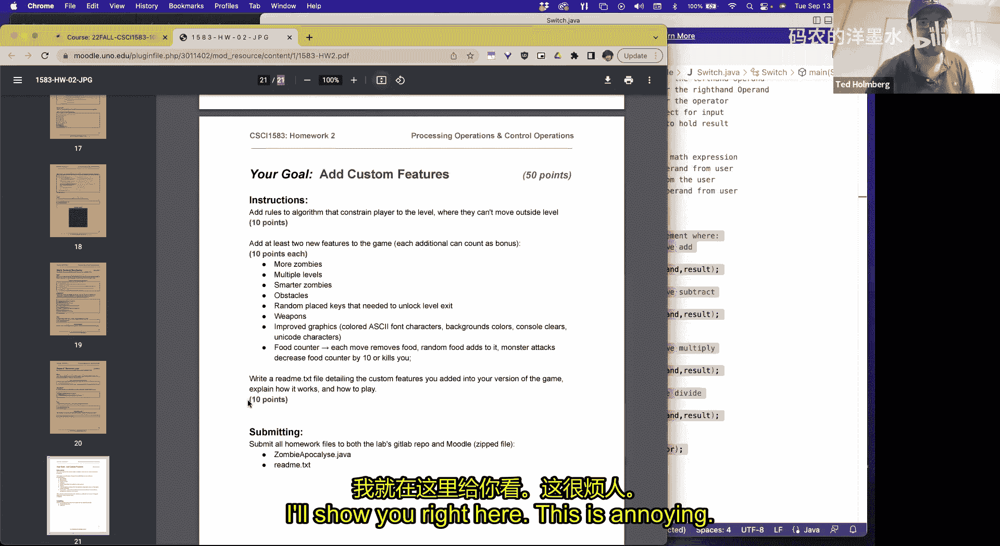
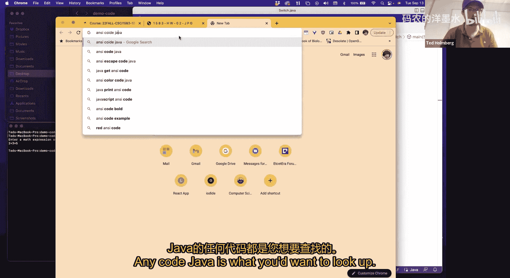
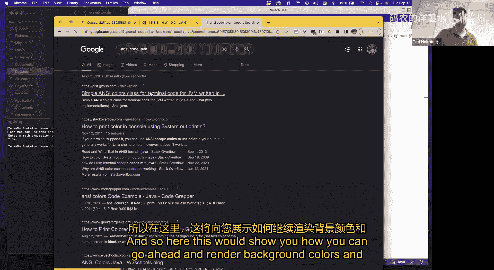
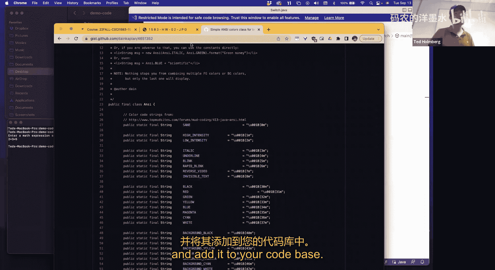
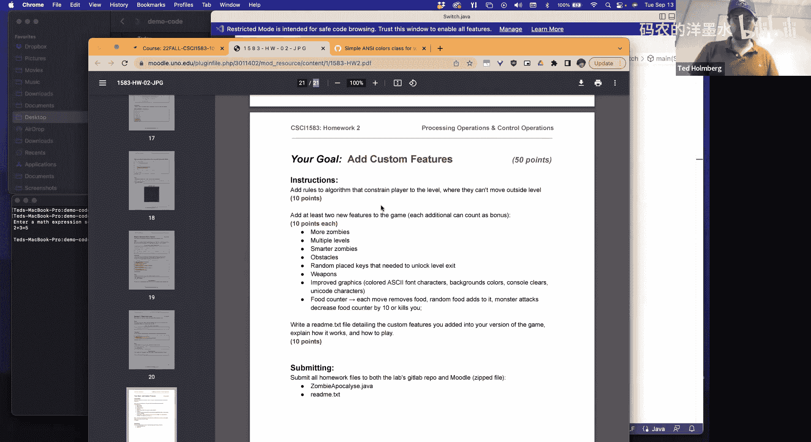

# 软件设计与开发：第9讲：作业：僵尸末日 🧟

在本节课中，我们将详细讲解“僵尸末日”作业的要求、设计思路和实现步骤。这是一个回合制生存游戏，我们将采用“先展示，后实践”的教学模式，逐步构建游戏的核心功能，并鼓励你在此基础上添加自己的创意功能。

## 概述

本次作业的目标是构建一个名为“僵尸末日”的ASCII或Unicode图形化游戏。作业分为两个主要部分：第一部分是跟随详细的步骤指南，完成游戏的基础版本；第二部分是要求你在此基础上，自主设计和实现额外的游戏功能，以展示你对核心编程概念的理解。

---

## 作业结构与评分标准

作业文档可能看起来篇幅较长，但这是一件好事。文档非常详尽，会一步步指导你完成作业的前半部分。

作业名称是“僵尸末日”，这是一个类似roguelike的生存游戏。文档中提供了完整应用程序的截图。你可以制作ASCII版本，也可以制作图形更精美的Unicode版本。使用Unicode版本并实现复杂输出操作，可以满足作业的一项要求。

**System.out** 的功能非常强大，你不仅可以嵌入Unicode字符，还可以使用ANSI转义码来改变终端中字体的颜色或背景颜色。例如，通过ANSI码可以将背景设置为绿色来模拟草地。此外，ANSI码还可以用于清屏，从而实现游戏状态的刷新，这与真实视频游戏的运行方式一致。

评分标准设定了10个目标（从0到9）。每个目标价值5分，完成所有基础目标可获得50分。作业的前半部分主要是跟随指导完成，旨在以学徒模式向你展示良好的编程实践，例如变量命名和如何分解复杂应用程序。

后半部分则需要你展示所学，并自主为游戏添加功能。你可以从建议列表中选择功能实现，也鼓励你发挥创造力，设计自己的功能。这样做的目的是通过开放式作业，让你早期就能开始构建作品集，每个人的游戏都会因此变得独特。

评分标准展示了每个目标及其对应的分值。仅完成基础部分无法获得及格分数，你必须添加额外功能才能完成整个作业。

快速回顾一下，这体现了“先展示，后实践”的方法。学生首先通过逐步迭代一个完整应用程序的设计过程，学习核心概念和良好编码实践。之后，学生被挑战去改进应用程序，添加自行设计的功能。自定义功能必须使用课程目标中的概念才能获得学分。

这些学习目标包括数据建模、算法设计、自顶向下逐步求精的迭代设计过程、测试驱动开发以及创建可读性强的自文档化代码。

我们将评估的编程实践，即我们希望看到你具备能力的方面，包括：展示如何使用处理操作来有意义地改变数据状态；使用重复操作来反复执行代码块，直到满足某个中断条件；以及使用选择操作来决定实际执行哪个（或哪些）代码块。

---

## 游戏规格与数据建模

接下来，我们明确什么是roguelike游戏。这为你提供了我们正在构建内容的背景信息。常见的roguelike游戏属性包括：回合制、基于网格（可上下左右移动）、存在永久失败、通常随机生成、具有随机结果等。这些信息主要是为了给你灵感，以便你在扩展游戏时，知道这类游戏通常包含哪些功能。

我们已经讨论了很多关于数据建模的内容。作业文档本身非常详细，没有遗漏任何内容。这里我们定义了数据模型：
*   **世界**：一个基于网格的2D空间，可以想象成一个棋盘，每个单元格可以通过其行和列来标记。这样我们就可以标识玩家或僵尸的位置。
*   **玩家**：具有数据属性。
*   **僵尸**。
*   **出口**。

在右侧的属性列表中，我定义了如何在游戏世界中建模每一个对象：
*   `World`：包含网格列大小（整数）、网格行大小（整数）、空瓷砖（字符串）、地板瓷砖（字符串）。
*   `Player`：包含X位置（整数）、Y位置（整数）、代表玩家的字符串字符。
*   `Zombie`：包含X位置（整数）、Y位置（整数）、代表僵尸的字符串。
*   `Exit`：包含X位置（整数）、Y位置（整数）、代表出口的字符串。
*   `Scanner`：用于获取玩家输入。

游戏目标是：玩家从世界中的某个坐标开始，必须移动到出口才能获胜。如果僵尸触碰到玩家，则玩家死亡。因此，存在获胜条件和失败条件。

在开始实现任何功能之前，我们首先要定义数据模型。与我们之前构建的其他算法或应用程序相比，这里的数据模型更复杂一些，因为每个实体、每个对象都有多个属性。

---

## 目标0：顶层伪代码与开发流程

一旦明确了数据模型，我们将从目标0开始，即编写顶层伪代码。每个目标代表软件开发过程中该步骤我想要实现的内容。我从不希望一次性尝试构建整个应用程序，因为那样复杂度会太高、太冗长、太庞大，难以一次性处理。我希望在构建应用程序时采取分而治之的方法，为自己设定能最终导向成品的微小步骤。

著名的格言是“千里之行，始于足下”。在设计应用程序时，我们不应考虑一次性构建整个应用程序并在完成前不进行测试或评估，而应该为自己设定一个小目标。我的第一个小目标就是创建伪代码，这就是目标0。

我将把每个目标分解为：
1.  **规划步骤**：明确我想要实现什么。
2.  **实现步骤**：如何在Java中编码实现。
3.  **测试步骤**：验证该目标是否按预期工作。

我将对这个过程的10个目标（从0到9）中的每一个都重复此过程。

我的计划是：首先以非常宏观的方式定义整个应用程序的算法，忽略具体细节。这有助于将复杂的应用程序分解为一组类似的、更简单的任务。项目的后续部分将专注于迭代地实现这些任务，一次一个功能。这个过程我们称之为快速原型开发，在软件开发世界中非常常见。

我们的顶层游戏算法如下：
1.  设置游戏数据。
2.  运行主游戏循环：
    *   绘制游戏场景。
    *   获取玩家输入。
    *   执行玩家动作。
    *   检查是否满足获胜条件。
    *   如果游戏未获胜，则执行怪物动作。
    *   检查是否满足失败条件。

这表达了定义游戏玩法的指令集。为了完成这个应用程序，我需要用Java代码来表达所有这些语句。

在以一种非常类似伪代码的方式从算法上定义了游戏的功能之后，我将把它们转换成注释。这与我们学习的自顶向下逐步求精的过程相同。我已经定义了一个算法，现在我将把它们表示为逐行的注释，然后可以查看并思考如何实现。

在实现步骤中，我将定义一个类和一个方法，因为我的所有语句都必须放在方法中，所有方法都必须放在类中。然后，我将放入代表算法的注释。接着，我会测试以确保可以编译并运行到这一点。目前还没有实际实现的代码，所以它不应该做任何事情。但如果出现错误，意味着存在某种语法错误，我需要解决它。在进入下一个目标之前，始终要确保在每一个测试阶段都能编译你的代码，并且输出与指南中提供的输出相似。

---

## 目标1：定义并绘制游戏网格

完成目标0后，如果代码编译并执行，现在进入目标1。我给自己一个新的任务，当我完成这个任务时，就进入下一个目标。在这里，我一次只看小目标。我需要创建一个包含玩家、僵尸和出口的游戏世界。但在做任何这些之前，让我看看是否可以先定义和绘制游戏网格。这个小小的目标将使我离构建完整应用程序更近一步。

我为这个目标制定计划：如何定义和绘制网格？让我们专注于绘制一个空的游戏网格。建模网格所需的数据是：网格中的行数、网格中的列数以及地板瓷砖图形。

我的伪代码是：对于每一行，对于每一列，打印地板瓷砖。打印完一行后，执行换行符，下一行出现在其下方。

一旦我们理解了这一点，并且在你完成这个实验时，请确保理解每个伪代码在做什么以及对应的Java代码是什么样的。我不希望你只是复制粘贴，我希望你从根本上理解发生了什么，理解每一步背后的动机。

实现如下：注释“设置游戏数据”处的黄色代码是新增的代码，它应该放在你已有代码文件中的什么位置。一个常见的错误是反复复制粘贴相同的代码。你是在上一个目标的基础上进行编辑。新增的代码用黄色高亮显示，旧代码则不高亮。这意味着“设置游戏数据”这个注释已经存在。所以，在这个注释下面，我们将添加黄色的代码。

我们将添加：
*   `columnSize = 10`
*   `rowSize = 10`
*   `floorTile = ". "`

这是我们的第一步，初始化世界网格数据属性。这个目标的第二步是创建一个双重for循环，让我可以绘制行和列。

这里你可以看到一个双重for循环，一个用于绘制行，另一个用于绘制列。在双重for循环内部，我将打印出地板瓷砖。这完全遵循了我的规划步骤和伪代码。

同样，我只是遵循自顶向下逐步求精，一旦有了伪代码，我就在旁边匹配Java语句。右侧是我的逐行概念解释。

一旦实现了这一点，我就进行测试。实际编译我的Java代码并执行，然后说：在这个阶段，我是否得到了预期的输出？你应该做同样的事情。在确认这个特定目标工作正常之前，不要进入下一个目标。因为如果你得到一个错误，现在捕获错误并调试比等到作业结束时再处理要容易得多。等到最后可能会有100个不同的错误，而这些错误可能从目标1就开始了，那时调试和找出问题所在将变得非常困难。所以尽早捕获它们，这就是测试驱动开发的全部意义：我们做一点，然后测试；再做一点，再测试；不断添加复杂性，从简单开始，直到构建出复杂的东西。

---

## 目标2：定义并绘制玩家

一旦我得到了空的网格，我给自己一个新的目标：第二个目标，我想要定义并绘制玩家。同样，我的规划步骤讨论了如何在我的游戏算法中建模和定义它。

让我们专注于在网格中绘制玩家。建模玩家对象所需的数据是：玩家X位置、玩家Y位置和玩家瓷砖图形。

然后我给出伪代码：在我们进行for循环执行绘制逻辑时，我们不只是为每个实例绘制空瓷砖，我们想检查当前正在绘制的瓷砖是否与玩家位置相同。如果是玩家位置，我们将绘制玩家瓷砖；如果不是，则绘制空瓷砖。

现在你可以看到我们如何在绘制逻辑中做出决定，判断是玩家还是地板。一旦我们理解了它在伪代码和自然语言中如何工作，我们将在Java程序或Java应用程序中对它进行编码。

我将进入我的“设置游戏数据”部分，已有的代码不高亮，所以我将找到应用程序内部、类内部的那个空间，并在其后添加这段新代码。我将定义一个玩家位置 `playerX`, `playerY`，我将把他们放在 (0, 0) 位置，然后我将给出一个符号来定义玩家，例如“@”符号。

然后，我将进入之前已有的“绘制游戏场景”逻辑，并创建一个选择语句来确定是应该绘制玩家瓷砖还是地板瓷砖。一旦完成，我就进行测试。我编译、运行，这现在应该是我游戏应用程序的预期输出。如果我得到了这个，我可以给自己一个新的目标，让自己离完成这个游戏更近一步。

---

## 目标3：创建游戏循环

下一个目标是：好的，我可以绘制游戏世界，可以绘制玩家。让我们创建一个游戏循环，可以反复绘制游戏世界状态，一帧又一帧。这样我们就可以开始更新玩家的移动，开始实现用户交互性，并且基于用户提供给我们的输入，我们实际上可以改变玩家的位置。在我们能做到这一点之前，让我们将逻辑编码到一个循环中，以便拥有那个循环过程。

我们的计划是：主游戏循环负责重复执行每个游戏回合的事件和动作。游戏循环是哨兵控制的，因为游戏回合的数量取决于是否出现输赢条件。由于游戏循环不断重复单个回合的所有动作，因此完整回合的所有游戏逻辑都必须嵌套在while循环中。

一旦我们定义了逻辑并确定了游戏循环，我们就可以实现它。在这里，我将创建一个新的变量作为循环控制变量，我称之为 `gameOver`，并将其初始化为 `false`。然后，我将创建一个while循环，并将我之前的所有内容封装到我的while循环中。只要游戏没有结束，我就会执行所有这些动作：绘制动作、获取玩家输入动作、执行玩家动作、检查获胜条件、执行怪物动作和检查失败条件。

然后，我将进行测试，编译并运行。我们应该得到的是在控制台上无限打印出相同的游戏世界，一遍又一遍。

---

## 目标4：实现玩家移动输入

现在我们有了一个循环，如果我们然后查询或提示玩家给我们一个动作，我们可以接受那个动作，改变玩家的状态，当下一次我们打印出游戏世界的状态时，我们的玩家应该绘制在一个不同的位置。所以，现在我们有了一个无限游戏循环，下一个目标是继续更新玩家的状态。

在这里，我们最终将实现玩家的输入移动。我们的计划是：我们将使用多重选择来更新每个回合的玩家X和Y。来自Scanner对象的玩家输入用于确定玩家X或Y坐标是递增还是递减。玩家控制键是：W上移、S下移、A左移、D右移。需要注意的是，由于这是一个基于网格的世界，每个单元格都有X和Y坐标，你应该理解(0,0)位置在左上角。这意味着向上移动是Y递减，向下移动是Y递增，向左移动是X递减，向右移动是X递增。这定义了我们如何通过改变位置在世界上移动。这是我们的数据模型，这就是我们如何将空间视为定量数据，以及如何使用算术运算来改变我们在世界中的位置。

一旦我们理解了这一点，我们就继续实现。同样，我们将按照这些说明来更新玩家状态，然后进行测试和运行。当你这样做时，你应该能够输入W、S、A、D，并实际观察你的玩家移动。目前还没有更新循环控制变量，所以如果你想终止游戏，必须按Ctrl+C来中断逻辑。

---

## 目标5：定义并显示出口

第五个目标，我们将定义并显示出口。这与之前所做的非常相似。我们现在将创建 `exitX`、`exitY` 和 `exitTile`。我们将把显示出口的功能添加到绘制逻辑中。然后我们将测试，看看出口是否出现。

然后，我们将测试当玩家触碰到出口时是否能中断游戏循环。在检查获胜条件的注释内部，伪代码是：如果玩家坐标和出口坐标相同，那么我们将 `gameOver` 设置为 `true`，并打印胜利消息。

现在我们知道伪代码是什么了，我们将进入检查游戏获胜条件并实现它。然后我们将测试，移动玩家穿过出口瓷砖，看看游戏是否停止运行。

---

## 目标6：定义并绘制僵尸

如果那可行，我们将定义并绘制一个僵尸。我们将创建僵尸坐标，在定义该逻辑的游戏场景中绘制僵尸，然后进行测试，看看僵尸是否被绘制出来。

---

## 目标7：随机移动僵尸

然后我们将随机移动僵尸。这里我有我的伪代码，我们有一个执行怪物逻辑以随机移动的小算法。伪代码在这里给出，然后实现也在这里给出。这里发生的情况是：我们随机生成一个0到3之间的数字。如果数字是0，我们将僵尸向右移动；如果是1，则向左移动；如果是2，则向上移动；如果是3，则向下移动。我们编译它，测试以确保僵尸移动。

---

## 目标8：定义游戏结束条件

然后我们将定义游戏结束条件。游戏结束条件是：如果玩家坐标与僵尸坐标相同，那么我们将 `gameOver` 设置为 `true`，并打印失败消息。我们将此语句放在失败条件下，检查它们是否相同，并将循环控制变量 `gameOver` 设置为 `true`，然后打印出一条消息。我们将测试看看是否可行。

这就是作业的前半部分。之后，你将需要添加自己的自定义功能。

---

## 后半部分：添加自定义功能

现在，每个人都必须添加的一个功能是：你必须向算法添加规则，以将玩家限制在关卡内。在最初的实现中，玩家可以轻易走出关卡并作弊。因此，需要约束这一点，防止玩家能够退出世界的上、下、左、右边界。

之后，这里有一些选项，每个选项价值10分。每个你实现的功能（超出达到100分所需的部分）都可以算作加分。因此，如果你不断添加功能，你可以在这个作业中获得超过100分。

你可以添加的功能示例，以展示你理解游戏逻辑的工作原理，包括：
*   添加更多僵尸。
*   添加多个关卡。
*   添加更聪明的僵尸（例如，让僵尸有模式或直接向玩家移动）。
*   添加障碍物（如墙壁等）。
*   添加随机放置的钥匙（出口在获得钥匙之前无法进入）。
*   添加武器（允许你在拥有武器时杀死僵尸，而不是僵尸自动杀死你）。
*   改进图形（默认图形是ASCII字符；如果你使用Unicode字符或ANSI码字符升级它，你可以获得加分。如果你不熟悉，可以查找相关资料。在Java中搜索“ANSI code Java”，你会找到如何渲染背景颜色和进行屏幕刷新的示例代码。这是一个容易添加的功能，建议你研究一下）。
*   添加食物计数器（你有有限的移动次数，必须在前往出口的路上收集食物才能成功，如果路径选择不正确，你会饿死）。

这些都是选项，或者你可以发挥创意，添加我未指定的功能。同样，我给出了一个基础列表，但不要感到受其约束。

提交时，请提交你的 `ZombieApocalypse.java` 文件和 `README.txt` 文件。`README.txt` 应包括你添加的功能，并讨论你如何使游戏变得更好。

请记住，在这门课程中，你获得任何作业学分的唯一方式是与我预约审核，运行代码并展示给我看。我将一对一为你的实现提供反馈，因为我认为反馈是学习编码过程中非常重要的一部分。

如果你还没有开始，现在就开始。请注意，这需要一些时间。这些作业的范围比实验大得多，这是有意为之。实验是教你如何按照自己的设计进行编码，而作业则是向你展示如何构建更大的应用程序，但更像是引导你完成它。

---

## 总结

在本节课中，我们一起详细剖析了“僵尸末日”作业。我们学习了如何通过定义清晰的数据模型（世界、玩家、僵尸、出口）来构建游戏基础，并遵循自顶向下、逐步求精的迭代开发流程，从伪代码开始，分多个小目标（从绘制网格到实现完整游戏循环）逐一实现。我们强调了测试驱动开发的重要性，即每完成一小步就进行编译和测试。最后，我们探讨了作业的后半部分——如何发挥创造力，在基础版本上添加自定义功能（如更多敌人、更智能的AI、更好的图形等），从而将所学知识转化为个人作品。记住，完成作业的关键在于理解每一步背后的逻辑，而不仅仅是复制代码，并且最终需要通过一对一的代码审核来获得反馈和学分。