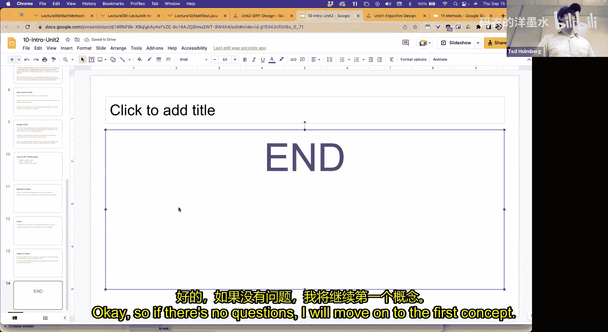

# 【全集】加州理工学院 软件设计与开发 中英字幕 1080P p10 Lecture 10 - DRY 与 KISS 原则入门 -BV1AvzCBdE7a_p10-

Okay， so we have finally made it past unit one， which was our algorithm design。

 So now we're finally going to formally transition into unit two。

 which is going to be drive design now the first real homework we had right so the first homework was a was a hello world I don't really consider that as the homework that's just that's like a homework zero really to make sure everyone has a Java installed so you can start coding so the real first homework you had was the zombie apocalypse game this road like game that made use of all five building blocks for our algorithms right and so。

When it came time for you to implement your own features on top of the zombie apocalypse game and the like you get a survey here。

 how many of you had found how tedious it was to have to add in multiple zombies or how tedious it was to add in multiple levels how you kept taking similar blocks of code and copying。

 pasting copying， pasting doing a lot of redundant checks like if you added in the second zombie。

 everything you checked for the first zombie you had to do for the second zombie if you added it in a third zombie。

 all the checks you did previous you had to do again if you had multiple levels you probably had to have multiple。

Wil loops right that ran the first level and then the second level and then the third level and so what you probably saw was that you kind of mastered the ability to encode an algorithm like after we get through the first unit。

 you know all the building blocks to make any algorithm for any application that exists。

 but the larger the application grows， the more clumsy it becomes using just the limited set of practices and strategies。

 just the limited set of tooling we have。🎼So in the second part of this course in unit2 we're going to talk about dry design where it's going to give us new tools in the form of methods in the form of array in the form of classes that will allow us to be able to write less code but get more from it to be able to effectively overcome what probably purposefully felt like a hindrance in the zombie apocalypse game and so again the goal there was to motivate why unit2 here is important so we will discuss the dry design so a quick overview to our intro to unit2 section。

Or PowerPoint that I have here let me close up these themes here and give me more surface area is we'll talk a little bit about what is dry design we'll talk about why do we care about dry code we'll talk about how to achieve it the benefits then we'll talk about kiss how to achieve kiss the benefits of kiss and then finally we'll talk about methods。

Arays and objects which are going to be the three new fundamental concepts that we're going to introduce over unit two before moving on to the third and final unit that we have designed in this course。

 which would be then object oriented design。Okay， so what is dry design。

 well we every time you hear the words why， you can think of it as don't repeat yourself。

So in programming it means we don't want to write the same code repeatedly。

 if we have the same block of code in two more places。

 then what we would want to do when we identify that is place it into its own separate method so again we're going start learning how to use methods starting to create our own user defined methods in order to accomplish this and if we have a block of related values。

 then we might want to place those into either in a right or a class instance to group those up so they exist all in one place。

So the dry principle。Foundationally is stated as such every piece of knowledge and every time we think of the word knowledge you could think of that in terms of a software application as as our data。

 so any piece of data or logic must have a single unambiguous representation within the system。

 it means it should exist in one place and one place only and now spread across our application as if it were a collection of weeds。

😡，So why do we care about dry code it makes your code easier to write and read because when you violate the dry principle what effectively happens is you bat your code base again with the game that you're writing if you want to add a lot of deep features but if you don't adhere to the dry principles it's not uncommon for your code base to explode up towards a thousand lines of code right and so it becomes very difficult to be able to read over all that code just because of the volume of it especially when it starts to repeat in its representation because what ends up happening is you start looking at similar block and you don't it's hard to recall is this block for zombie one is this block for zombie2 is this block for level one is this block for level three so there's a lot more overhead that you mentally have to track to be able to go ahead and keep track of your code and that's not good that's going to make it more difficult to maintain read。

😡，Understand， interpret the code base。So dry will allow us to minimize that overhead work we have to do mentally to make the work that we're looking at the source code we're looking at as clear and concise can you close that door for me thanks。

Another thing about dry code is it makes your code easier to maintain， so not only is it easier。

Know where to go you have one place in your code base when you write that a task is supposed to happen at it makes it easier to read because you know where to go to find where that one task is at。

 but also because of that makes it easier to maintain so changes to your logic。😡。

That might occur in one place you change one place and it propagates out as opposed to if you kept repeating your logic again and again and again and you're like。

 oh， I have to make a quick shift in the way that this works。

 I need to add a different option where I need different make a different check on the zombie conditions。

 then if you've repeated your logic， you have to find every instance of that repeated logic and make those changes。

 And so you can see that's very prone for errors and bugs and just a lot of work and your。

 So where if you adhere to dry principles， a refactor of one line of code could turn into a refactor of 10 lines of code And then where you have to search and hunt for those lines of code as well。

So how do we achieve dry to avoid violating the dry principle。

 we divide our system into pieces so you could think of it as like a divide and conquer approach。

 so we divide your code and logic into smaller reusable units。😡。

Think of it as modularity as if we're building a set of Lego pieces that' snapped together so that we can then build the larger application。

 so we'll divide our code and logic into smaller reusable units and use that code by calling it where we want it。

And so we attempt not to write lengthy methods， but instead divide our logic and try to use the existing pieces inside of our methods。

So again， we've already discussed the benefits， less code is good， less is more。

 this is one of those instances where you hear less is more。

 this is one of the perfect times we can use that expression。It saves time and effort。

 it's easy to maintain and also reduces the chances of bugs。Okay。

 so we also have a principle that we would like to adhere to in addition to draw would be kiss where kiss stands for keep it simple I have no idea what the additional S might stand for。

But it's usually expressed as KISS the kiss principle so the kissIS principle is descriptive to keep the code simple and clear making it easy to understand so after all programming language are for us to understand it's for humans not for computers computers are just mindless binary computational machines so the goal for putting all this effort into formatting our code so that it's incredibly readable and get pick selecting good variable names and breaking the logic across multiple methods is for our benefit the benefit of the humans it' not for the benefit of the machine right and again its because we want to create a。

Document a code base that we can go back to and easily refactor without having to work around what we the decisions we made in the past or we want to be able to take our code base and share it with others and have them be able to easily read and parse it so they can add to it and you want to be able to see what they added to it and easily understand what it is。

😡，And one day， one tactic， one strategy that helps in that regard is the kiss principle。So again。

 the way that that usually manifests itself in terms of our code base is each method should only solve one small problem and not many use cases and if you have a lot of conditions in the method。

 then you break those into smaller methods。And we'll see actually how that top thing on stepwise refinement process will help us perform what we'll call functional decomposition。

When we get the we actually get into the PowerPoint slides about methods。And again。

 how do we how do we achieve kiss to avoid violating the kids's principle。

 we just try to write simple code it's very easy right think of many solutions for your problem then choose the best simplest one and transform that into your code and whenever you find lengthy code then divide that into multiple methods and so you try to write small blocks of code that do a single task that usually the rule of thumb you have when we look at a method you ask yourself is this method doing too much or is it just doing one thing。

And so again， we'll talk about that more when we talk about functional and decomposition。And again。

 the benefit of Ki I think we already discussed is to go ahead and have our functionality written by one developer in such a way that it's easily arsible by everyone else including your future self so really the end goal here is your code that you want to think of your codebase as this living evolving collection of documents and so what we want to do is create a framework by which we can easily add new improvements without breaking our old work and so these tactics that we're going to look at in unit2 these strategies。

 these tools will help us adhere to these concepts so that we can make software that's more robust we can make software that's easily scalable we can make software that we can add to it。

Or read or share without having concerns about it easily breaking down。

Excellent and so again the tools that we're really going examine over the course of unit2 is going to be methods we're going to use methods to be able to effectively encapsulate a block of code we'll look at arrays these are going to be special variable special data structures that can hold more than one value so we can think of this as encapsulating a block of data and finally we'll look at classes which allows us to take a block of code and a block of data and encapsulated together。

So these are really the three fundamental constructs we'll look at that'll help us make our code dry。

Yeah and I think we pretty much just gave a quick explanation for those excellent so that's just a quick intro over what we're going to be covering over the next several lectures is there any questions related to this。

make。There we go， I'll make one more slide here that is end。Let's just blow that up。有 i want that。

There we go and we'll startner out。Okay， so that'll clue in on the video。Okay。

 so if there's no questions， I will move on to the first concept。

