# 【全集】加州理工学院 软件设计与开发 中英字幕 1080P p11 Lecture 11 - 方法 -BV1AvzCBdE7a_p11-

Okay， so there are going to be three。Different approaches we see the first and probably one of the most important are the concepts of methods so methods and classes what are methods methods allow us to name a block of code says that we can evoke it by using it its name so methods are great because they improve readability and reliability so you could think of。

Let's compare methods to a variable。😡，AllRe quick。 And so here let me do this。

 Let's make a new slide methods first。Variables， okay， so a variable right is。A named data。

 right that we store。To use later， right？A method。Is。Named code block that we store to use later。😡。

So they're kind of similar， one allows us to store a particular value into memory and then when we need it later on in our program。

 we can use it， a method allows us to ascribe a name to a block of code and simply by invoking that name。

 we can call that block of code to do some work。So usually the difference okay。

 so I said these are what are the differences， so when we want to recall。A variable。

 it looks something like this。哦。I might have something like an x is equal to 10 right and then I could be I can say for instance。

 to x is assigned or let's see this this is better x plus。诶 five。Okay。

 so what's happening here is I'm doing an assignment right and I'm taking the value of x or the label of x that is now being stored as an aile so whenever I reference the value the name X。

 whenever I use the identifier X whenever I use the label X all those words mean the same thing identifier label name。

😡，Variable name then what's happening in the JVM is it does a look on it's going to see if there is a user defined symbol。

So maybe when you see an error block it says can't find symbol and then it points to whatever the variable name is what's trying to do there is it trying to see if you have a variable that has that name and then it'll then go to that memory address that that。

😡，Variable name is an alias 4， and it'll pull the value。😡。

So this is how we use variables in the wild and actually what I want to do here is let's get a formatment。

Let's make that that's awful。Oh， let's do。Yeah， let's remove that Okay perfect is a little bit better okay so。

Let's。If we want to recall a method， suppose I have a method name。😡，so。

Suppose already have a method defined and let's also call that method X。

 so let's do something like static void oh no， let's。Yeah。

 let's do static void let's call this x so it's very similar Okay。

 so suppose I haven't a method that's called x here。Well， if I want to go ahead and invoke it， then。

It's going to look like this。So every time we call a method， whether we have to send an input or not。

 we always need to use the parentheses， so you know just by reading whether a identifier represents a named method or named variable based off of whether it's just a name of something or if it's the name with a set of parentheses。

 name with a set of parentheses indicates， hey， I'm trying to recall a or invoke upon a method from memory whereas here I'm trying to reference a variable。

😡，So just keep that in mind when you're reading your code。Okay。

 so let's go back to methods and classes so classes can contain methods and methods can contain code right so we've stated this from the get go but when we first started doing this we just ignored the fact that we can make user defining methods so that we could just focus on the code now we're going to start focusing on building out methods。

So understand when we build out our methods， we have to put all of our methods inside of the class scope。

😡，So again， just like how we have been coding， we will define a class when we start building out our applications。

 every application that's supposed to execute has to have at least one singular main method so if we don't have a main method in the class then that class can't be edited in isolation。

 it can't be the root of our application it can't run。But we can have more than one method， right。

 we can create our own， but every time we create our own。

 we have to declare it inside of the classco。So let's talk about method declaration versus method in vocation。

 so declaration is when we first define the method and again all methods must be declared within the class scope invocation is when we invoke or call upon that method and so we usually do that inside of other methods right so inside the class we define a method inside of other methods we actually use it to do a task for us。

And again， the way you want to think about this is that methods are really used to talk with one another by sending data between each other so there's two ways that a method can。

😡，Transmit data back and forth you can either send data into a method from another method so we send data by placing values between the methods parentheses that's why the parentheses are important that represents the important data that block of codes going to need to be able to process now not all methods need any values supplied to it。

 but sometimes they do and then also again there's the ability for a method to give back data or return data back to the method that called it to do some work and so if we need to return data back from one method to the other method we would use a return statement for that so return statement would be the very last statement of any method and that's what's going to when we look at the method declarations that's going to be where they were avoid uses so if you don't have to return back any data your return type would be void。

😡，But if you did want to return back data and you can only return back one piece of data right you can only you can only get back one thing on a method。

 methods are hyper focused， then where we would normally type in void。

 we can type in the data type that we're returning back。😡，So if say for instance。

 we have a method that's going to return back a numerical value an integer numerical value。

 then the return type would be in and we have to put that in the header and then to adhere to the contract because you want to think of the header that we create for the method as a contract between。

What we're implementing in our code base and what all other methods are going to invoke so the idea when we start making methods is you want to give your methods really good names that。

😡，Define what happens when you call this method so typically what we do in Java and this is true for most programming languages is you select a good verb that communicates what is the action what is the event what is the sequence of statements that get executed inside of the block of code that we've labeled as this method so the name should be very descriptive and usually you want to think of it as an action concept so again we use so usually I don't know if I've mentioned this with variables usually we think of variable names as nouns and we think of method names as verbs so we start building up this language that we can define in our codeb。

😡，So we have things and we can operate on things by sending them into these verbs。😡，And again。

 when we have these verbs， these verbs can take in data from another method or they can return things back。

Okay so how does methods allow us to adhere to these dry principles where we attempt not to go ahead and repeat ourselves Well you can see there's six different ways here that I have listed first methods allow us to define an algorithm once and run it multiple times by using its name that's super powerful especially if you worked on the zombie apocalypse game already you could see it allows you to write something once and then repeat it an unlimited number of times without ever having to alter it again then if you have to refactor your code you can just refactor the code that's inside that one method and every place in your code base that invokes that method now we'll have that reflected change super powerful it allows you to propagate a change by just having the implementation in one single place okay number two here methods allow us to divide our algorithm into smaller parts so as you might have noticed having all of your code。

The main method makes for a very unreadable main method that's bad design that's bad form What we strive to do is make it much more manageable and so what we want to do is we want to break our code base across multiple methods in fact and again i'll remit i'll mention this again probably in the slide deck but i'll mention it now too a good rule of thumb is your method should never be over about a dozen lines of code if it's over about a dozen lines of code that should be a clue to you hey maybe I should break this into smaller methods that then get called by this larger method that needs to do all these different things Another rule of thumb is that a singular method should only have one job it should only have one task and sometimes that task is to manage or ensure that another set of task get done right that's what a manager does in a company your methods have a hierarchical structure we'll talk about that in just a moment when we start looking at the top down stepwise reform。

But I'll give you a kind of preview of that you wont think of the main method as kind of like your CEO if your application is like the hierarchical structure of a company。

 then your main method is like the CEO and so the CEO's job isn't to do everything right it's to be able to have a collection of employees under the CEO that they can delegate to。

And then those employees might be upper levell managers themselves that have a number of employees under them that they delegate to and so you finally get to a set of employees that are tasked with completing an action the nice thing about a hierarchial structure like that is that you can look at any one piece and look at it inside of this this tree of responsibility and say what is this unit responsible for and if something has gone wrong with the application if your application isn't working the way you anticipated to it's easier to debug you can go towards the method you know that works' supposed to be going on at。

😡，And check to see where the broken logic occurs at。

Okay methods make our code easier to implement and test a piece out of a time so you might have noticed as you're testing your code if it's all in the main method you've got to test the entire application all at once one of the nice things about implementing a method at a time is you can define the method and then you could test the input in the output to make sure it works the way you expect it to even before the rest of your application is complete right so if you know I can send this data in and I'm going get this data out you can make a quick mock set of tests where you create a main method you pass some data in and then you see what the result is a good indication of how a method can be test like this is effectively the way that the labs are written right the labs test your code they don't test how your code's implemented it test based off of sending input into your code and then seeing auto lab then checks your input and sees if it gets expected output and if it does then。

You got credit because you did with the specifications for what that question was asking for。

 so that's what it means to be able to test effectively a unit at a time where the smallest definable unit in a code base is a method。

😡，It's a blocker code that we can give a label to。Methods allow us to divide our project into parts so that one person can work on it so again another nice thing about methods is we can actually distribute the labor of creating applications because I can say you're going to write one method you write this other method you write this other method and if each of each of the individuals works on the logic that's governed by one singular method instead of having one person have to work on a complete application on their own you can kind of divide that work across multiple programmers or developers。

嗯。Methods make our code easier to read and follow each method has its own responsibility I already mentioned that。

 but again the value of your code blocks being responsible for an individual things makes maintaining and refactoring and debugging much much easier。

😡，I will say that you've probably already encountered this and maybe this is true or not non trivial non a significant amount of your time so non trivial non insignificant amount of time will be not necessarily encoding。

😡，Or developing pseudocode or implementing but debugging。

So how have you found that true with the zombie homework since when you especially when you start designing things on your own you're having to test it out。

 you get all sorts of errors or you get erroneous behavior like you run into a zombie and it doesn't kill you or the zombie kills you even though it's on the other side of the world or maybe you're rendering movement like at a 90 degree angles every time you go up you go left or right right like all these you then have to search out why it's causing a behavior who didn't expect so all these strategies are designed to help make。

Debugging as painless as as possible because that's the worst part of coding The worst part of coding is when you've written the code。

 you try to run it and doesn't work at all or doesn't work the way you want it to。

So we want to try to make it easier to find out well where is my problem， it's easier to know oh。

 let me check this method there's only 12 lines of code as opposed to let me look at the entirety of my application。

 which is a thousand lines of code。😡，It's also why you want to test off so you can try to catch those bugs earlier on before your application is fully built。

And finally， the main method should not have any implementation detailsLs。

 we have violated this concept tremendously because we didn't know about methods， but moving forward。

 we want our main method to effectively just be the delegatelegator and the only thing that should be happening in the main method is effectively the invocation of other methods。

😡，Because that's going to make the main method much more readable like the goal of the main method is again。

 let me step back before I finish that sentence the purpose of our header comment is to using just a natural language abstract way tell whoever the reader is what this class is responsible for well the purpose of a main method should be as readable as possible to see what the overall logic for the entire algorithm is and so you can you don't want to show the trees from the forest in this respect you want everything again you can give methods really good readable names so if you have a collection of say four method in vocations I could read that as if it's a set of sentences and get。

A very clear impression of what is happening inside of your logic inside your algorithm to get from the initial state of the application all the way to the resulting state。

 right to start with the beginning， work my way through the middle and then get to an end as if it were enough right as if it were a story。

😡，And so each one of those methods then would contain the trees。

 it would contain the particular details that must actually occur for our application to run。😡。

And again all these concepts work together to do what we call enforce self-documenting code so again all these strategies make it as easy as possible to reread through the code to understand what's happening and this isn't just for other people right even if you're working in isolation after you step away from your code and maybe you've already experienced this maybe on the zombie apocalypse game you stepped away from your code even for a day you looked at and like said to yourself what the hell was I thinking when I wrote this line of code。

😡，Or you wonder why is this working like what was some of the decisions I made here and again these concepts are for our own practical purposes so that when we have to revisit our code base a week from today a month from today。

 three years from today。😡，When it's been flushed out of our mind。

 what the like key decision points were in the way that we designed our logic。

 we can easily and rapidly remind ourselves。😡，Okay。

 let's talk about methods and functional decomposition When I first talked about the top down stepwise refinement process I said we could use it for two things The first is we can start with a top statement and using this iterative step by step approach expand that top statement that very simple summary into a fully fleshed out collection of pseudocode statements and the nice thing about pseudocode is is very similar conceptually to a。

Programming language such that I can then select a language like Java or Python or C++ and then do a one to one mapping from my pseudo code to that concrete programming language。

So in addition to that with the top down subwise refinement， it can also help me。😡。

Define what should be methods so now that we're talking about methods we're going to walk through this process again and see how the refinement process itself can start breaking apart what should be clustered as a definable method。

😡，So actually we're going to do a sample of this here so we can actually see what functional decomposition in the top down stepwise refinement process actually looks like so here it says we're going to see the Ature do TxT document I embedded it inside these slides so。

没。Maximize my space there Okay， so let's start the way we've been we have started in the past。

So this is my average year do TXc file we're going to start with the top document so average year is going to be a little bit different here so previously we were just averaging a single collection of grades。

 but does everyone remember how our grades are computed in this class based off of the syllabus？嗯。

I don't even see， I don't even remember that。I want to say it's 30% is your lab grade。😡。

Is it 30% is your is it 30% is your test grade and 40% is your homework grade does that sounds about right let's just say that's what it is I just check the syllabus。

It's it's usually around that level though usually I might flip it might be flipflop the other way。

 maybe it's 35 and 35 between tests and homework， but either way。

 right the idea is that there's a weighted distribution to compute your grade So whereas our other averaging program had an equal weight for all of the scores average right all we did was we summed the set of scores and the divided by the count scores to get the average for whatever those were quizzes or test or homework of perfect 30%。

30% test， 30% homework。And。How much is is live worth 40%？I thought lab were 30%， I don't know。

 I have to look at the syllabus。But suppose we wanted to go ahead and create an average program that did something different than what we made before。

 suppose we want to determine a student's average for any numbers of labs homework and tests but。😡。

It's a weighted average between the homework test and labs， right so that's a little bit different。😡。

So we have to figure out so in this instance， you might have 10 labs that you do or 12 labs that you do over the course of the semester。

 so we would take the sum of those and then apply weight to that and then we would have to add to that the sum of your homework grades。

 right find out that average and then apply the weight of how much the test actually means to your overall grade and then we would add to that whatever the average is for your homework。

😡，But then we have to apply multiplicatively weight on that that makes up the entire ratio of that。

Okay， so with the top statement said， if I wanted to actually break this down into pseudocode。

 I would take the top statement determine a student's average based on any number of labs homeworks and tests and we will go through the refinement process for the first thing we do in our refinement process the first step is we initialize our data model。

Right so we figure out what are all what's the initial state initialized data here this is the。

Initial state of what we will need。So we've seen that before。

 and then the second thing we would need reading this， right？

So once we determine what are all the things what you're going to need， we're going to say okay。

 well we're going to also then compute an average for the number of labs。

 so the second block here I'm going to say is well we'll get the labs from the user and sum them and count them。

😡，Then we would get the homework grades from the user and some them and count them。

Then we we get the test grades from the user sum them and count them right so these are the three main types of grades categories of grades you have so we need to get averages for each individual one by collecting all the individual scores and then once we have the average for the labs for the homework and the grades we can compute the overall average right the weighted average。

And display that。So again， do you see how this refinement follows what we've done before？😡。

And so is everyone comfortable with this being refinement one from my top statement。

 how there's this organic translation where I take this thing that's abstract and I apply I break it into a set of instructions that are a little bit more detailed now clearly this first refinement is still to abstract。

😡，So we're going to have to do another refinement。😡，So in refinement two。

I'm going to highlight what block。😡，What statement I made what more abstracted statement I made in refinement one and i'm going to consider it more deeply in refinement two and make some decisions and start making articulations on it so when I say oh I need to initialize data what I really mean by that is i'm going to initialize a sum to zero i'm going to initialize a counter to zero am I not even need any of this stuff actually let me see here。

😡，Again I'll keep it in there i'm going to initialize count to zero i'm going to initialize the scanner clearly all those instructions are pulled from the old one we did。

 but here we also need to have separate things like a test average a homework average and a lab average and finally we're going to have to get a let's change I don't want to use the word final a total average。

Finals actually keyword in Java so I don't want to be using that to be articulated in anything Okay。

 so finally we'll get our total average。So this is all the data that we'll effectively need。Now。

I want to look at in refinement two。The parts2， green and four altogether because I want you to notice something in part two where I want to get the lab grades from the user and sum them and count them well to get those homework grades from the user and sum them I would do this I would repeat until the grade is less than zero I would add the grade to the sum I would add one to count I would prompt the user for input I would get the user input and then after all this sudden done I calculate the lab average right。

🎼So this is how we calculate an average for a lab grade Well if I look at it。

 well we are doing the same thing right we repeat until the grade is less than zero。

 we add grade to sum， we add ones account， we prompt the user for input。

 we get the user input and then that would calculate our homework average and then finally we would repeat until the grade is less than zero。

 we would add the grade to the sum add one's account， prompt the user for input here。

 I'll put instead of just input， let me put that this is for test input make it more clear。

 let's say that we will prompt the user for let's say。

Homework input and then here for input let me say that this is instead the lab input notice for the most part。

 we're doing three different actions but they're all using the similar or same set of logics right this when we're developing our pseudocode and when we're see this behavior start to manifest itself that's the clue to us hey。

 that's a violation of the dry principle we already see that right then and there right so here two。

 three and four or exactly the same blocks of code the only difference is the prompt that it gives to the user it's like give me your task grades give me your homework grades give me your lab grades。

And then finally， on the fifth part， we're going to calculate the final grade and then print that final grade out。

So again， if I look at our。Process。In completion using that top down step refinement。

 this is what it looks like right so the top statement we've already said I can reuse that in my actual code base as my header comment。

😡，Wwhich explains to everyone else what this class is responsible for doing or what this application does。

 but what we haven't done yet is there's actually a use case for that first refinement。

 that first refinement should be very representative of what happens in our main method。😡。

That is the very abstract set of invocations of those methods that will get called out so when we defined。

 say for instance， and let's go back here。😡，So going back and using this strategy when in refinement one。

 I said there's effectively five key concepts， there's five driving statements。😡。

That get us from point A to our destination， then that is decomposing our logic from the get go into what could be our methods。

😡，So we know we could effectively have five method calls in our main methods。

To be able to complete the work that has to happen， does that kind of make sense？

And we're going to see that in practice。So we use our refinement one as a guide to figure out how many methods we're going to need to delegate to to accomplish our task。

And then finally， what we have in refinement two is our functional decomposition where we define what's happening in each one of those blocks of code。

😡，So again， what you could think of it as I said that a method is a named block of code。

 so what you could think of this is this is effectively the name the block the name that we want。

 and this is the block that's associated with it so this is one name and the block of actions that get associated with it。

 this is another name and the block of actions that get associated with it。

 this is another name and the block of actions that get associated with it。😡，Okay， is there any。

 is there any questions and concern about how？What we're doing with functional decomposition and how it works in this top down subwiseise refineing process。

😡，So the next thing I want to do is actually let's。

So let's see how much of this actually gets repeated so my top is my header comment yep step one is my main method step and is the methods that the main method relies on to accomplish the task。

And again， sometimes if you have multiple refinements。

 so here we only have two refinements what that tells me is that my main method is going to delegate its task to a set of helper methods。

 but those helper methods are able to accomplish the task in of itself now if I had it。😡。

Helper methods like in refinement2 that were still not well defined and I've had to go into a refinement3 where I had to better articulate what was happening inside of one of the helper methods then that represents that helper method needing another helper method to delegate some of the work does that make sense so if I have say for instance end number of steps that lets me know I'm actually kind of building a tree method calls where my main method delegate some of its work to external methods other methods and sometimes there's other methods can delegate some of its work to another set of methods I can see how deep my method chaining goes by the number of refinement steps I take when i'm designing my algorithm again。

 this is why the top- down stepwise refinement process is a very powerful approach for allowing us out here to both draw and kiss。

😡，Because we can take the step by step。Approach to develop from abstract to a concrete set of statements of pseudocode and then see how we step through that to see how we should break that down to make our code。

😡，More easily modifiable and more easily discrete and more easily modular。😡，Okay。

 so again avoid putting implementation details in the main method。

 this is what we will adhere to moving forward， it should delegate the work to all other methods。

 the main method is like the CEO of a company is responsible for everything to run but doesn't try to do all the work it delegates it to other methods。

Okay， and then this will actually be our implementation is let me grab this let's actually let's actually go and look at this source code though。

 so we're not actually looking at it inside of here and actually let usm going to cut this。

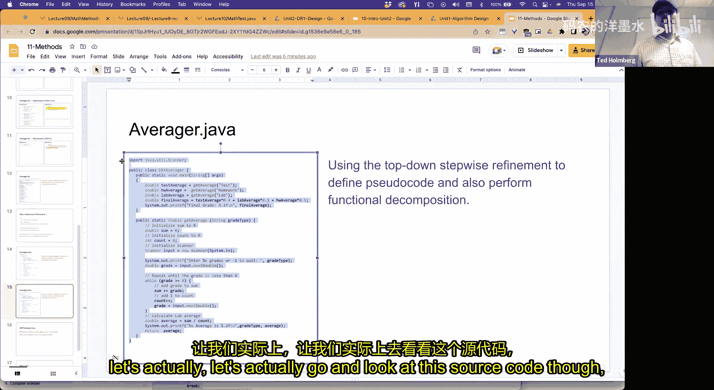

Here。Okay， let me。Okay， let's cut this out and let's just start with something easy our public class dry ature so this is going to be the name of our class we're going to import the scanner object because clearly we're going to have to be able to get user input so i'm going to do that now okay。

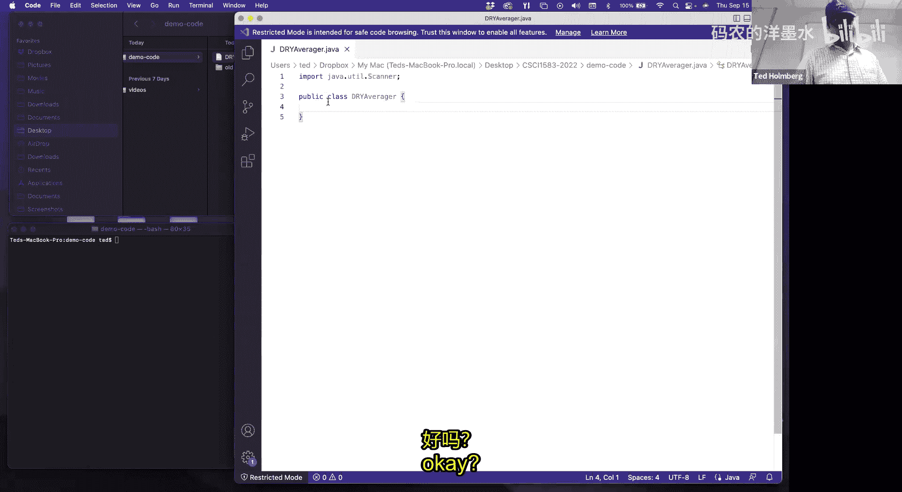

So we said we're going to reuse the top statement， so the first thing I'm going to do is I'm going to go here。

 let's grab this top statement。

And let's start implementing this。 So here， even before my import。I'm going to。Ma a multily comment。

Perfect。And。I'll give myself the authorship so the person responsible for this code。

 the person who wrote this always give yourself credit。So again。

 so much of what's important when we start talking about software design is always identifying responsibility so in our code base our methods。

Are responsible for a certain set of statements that get executed and our class a class is responsible for a certain collection of methods that it contains and so a developer is responsible for the methods and classes that they've altereded so for any reason someone has a question about what this class does it's important that you put your name on it so they know who to go to to get more information from。

But。So that they don't have to ask you from the get go， you also give the top statement。😡。

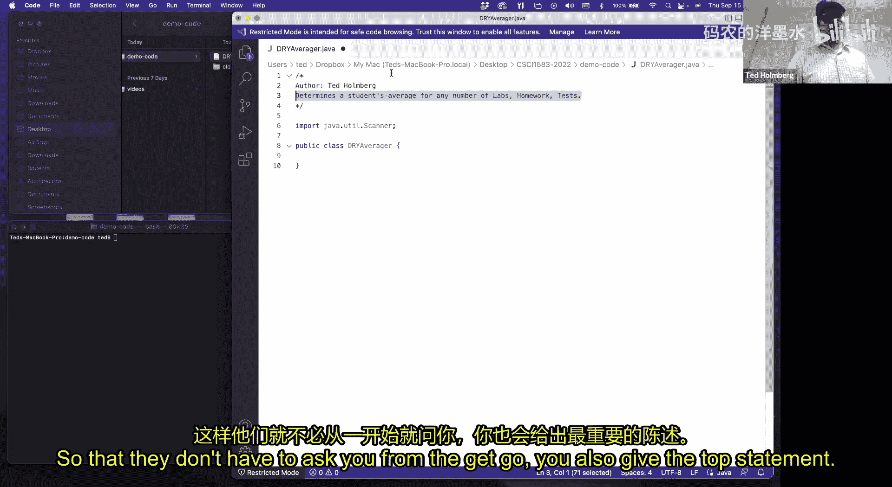

Okay， so now that we have that， let's see here， let me grab this。

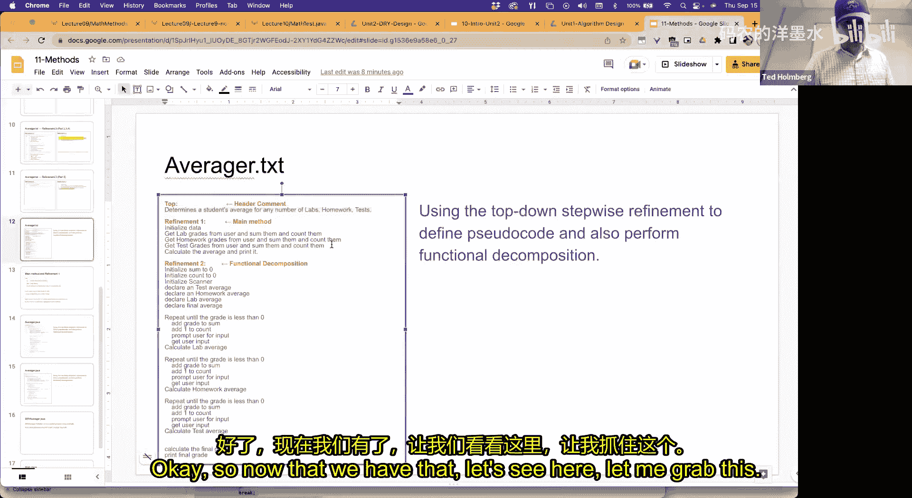

Refinment one， I said was going to be the main method， so let's go and here。Public static。Vid main。

String array。Abs。And let us。Put our comments in here。So， let me。Toigle。Toggle the line comment。

 and let me。Andent that out。And I want to end up one more time。And so this will be the set of okay。

 perfect， so that's effectively the work that I want in my main method。And then。

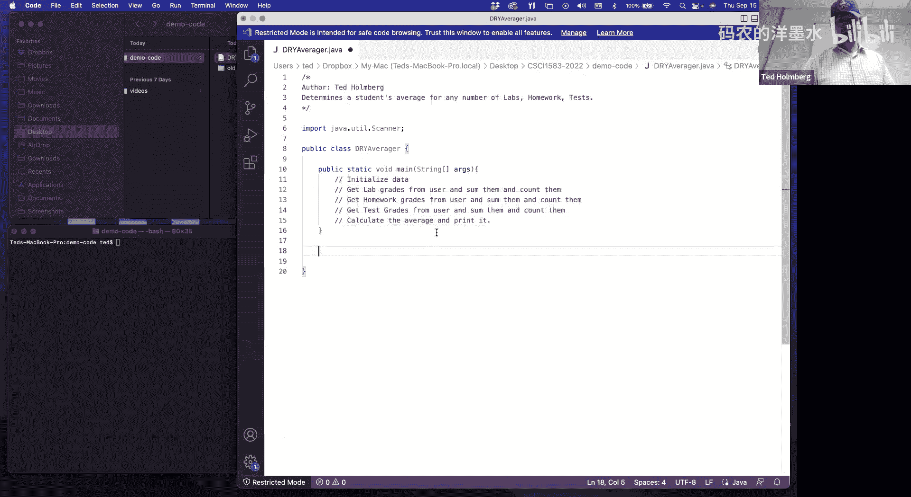

And let's actually start to flesh this out so the first thing。Actually， let's get here。

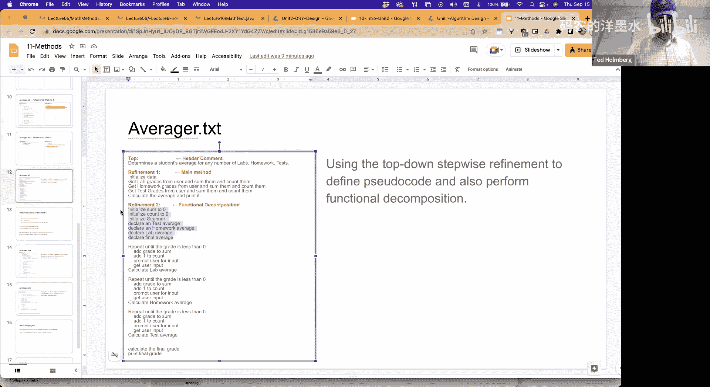

Under initialized data， let's start with that this part。So in the actual implementation。

Let's put this in as lines of code。So again， let's go to toggle line comment okay。

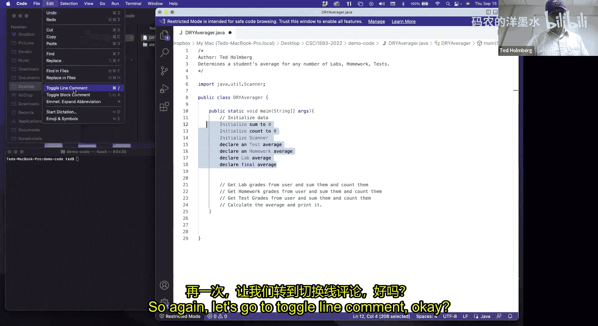

And let's actually map this to our sample implementation that's given in the slides here。

 so here notice that I have test Ature homework ature and lab ature notice。

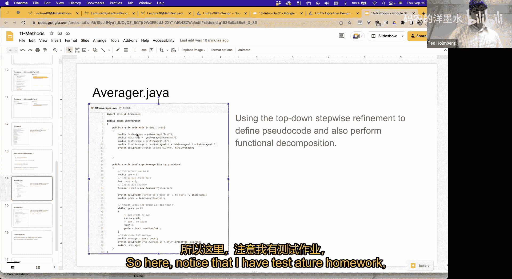

This right here。Is implementation details。😡，That's part of my data model。

 but what I said is we shouldn't have implementation details in our main method so we should cut this。

😡，So what we're going to want to do is we're going to want to declare a test average。

And when we declare that， we can also。Get it from the user and sum and count them together。

But's see here， when we get this lab grade here， we can declare it。And。

Use the actual that way doesn't look like a logical operator I'm performing。And finally。

So i'm going to merge these two concepts just for readability of my main topic because that's a consideration that I now have so once I've identified what data I big picture was limitedd the little picture stuff。

I can now say， oh， I can effectively initialize because I can declare a test aperger and then I can call a delegator that gets it and sets it。

😡，So again， this。Is getting initialized by a delegator。家围有几。To a method it。Delegate this。

The actual action of doing this to a method。And delegate this to a method and then finally， though。

 once I have these three things， then I can go ahead and。Calculate the average in so again。

 this is setting me up to get the data I need the initial data I need and then process it out。😡，Okay。

 so let's talk about this delegator that I have。So in this concept。

 I have get test grades from user and sum them。Together， right？

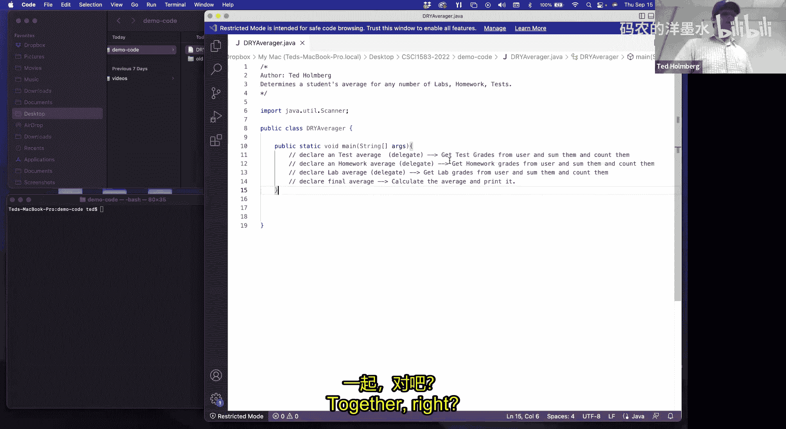

So how do we do that Well let's go into our top down stepwise refinement process。Or。

Let's see if we can't just no， not what I want。

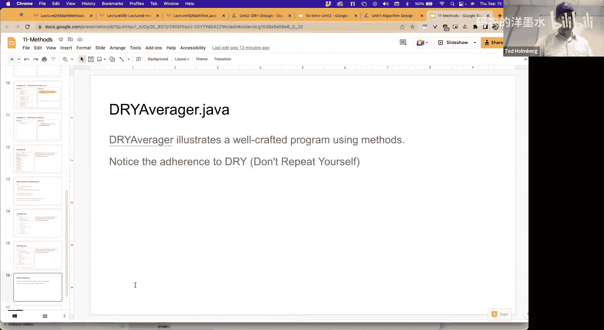

We've we've solved this problem before， so let's see how close to a solution this looks。

 so let's say that we will create a public static so up to for now every time we create one of these helper methods。

We're going to always make it public。😡，So that it's available。Internal to our class。

 but also external to our class So right now we're going to ignore the other access level we could give to a piece of our code in a class which is private if we did declare something as private though it's available to anything else defined inside our class。

 but it can't be access to anything outside of our class so if we wanted to。

 we could declare this private， but I'm going to keep it easy just keep it public okay eventually we're going to use that other keyword。

 but we need to it's good practice for us to put it if we don't put it it'll be defaulted to like package level which I don't even want to get into that so we'll be very articulate just always use public for now and until we start getting into being able to build instances of class which is gonna to be the tail end of this unit we're going make all of our method static a static means that this method is a property of the class itself。

 which means that it has。ular implementation it has a singular rigid set of values that it's nonmalleable that it can't have multiple instances that look different Later on we're going to learn how we can do cool things with classes where we can use it kind of a blueprint to create instances that manage its own set of variables and each instance of a class can have different sets of variables like what that means is imagine if we made like a zombie class and zombie class had like an X and Y and each individual zombie can have its own set of coordinatedinance。

We're going to ignore that and by saying we're going to use a static keyword。

 the set of values are going to be for the class itself。

 so there's only one set of values that the class can have the or one method that returns the same thing from class up itself。

😡，We'll talk more about that later when it makes more sense to， but for now。

 just know we need to use public and static to declare all of our methods。😡。

Then the next thing we're going to do is the return type so here we know we want to delegate this work to a method and this is actually the first time we're seeing a method methods require three things right they require a name so they require and then they need to know what input might they need and what output might they need so let's do this let's do this。

😡，In an MVP build minimal viable product， let's do this as simple as possible first。

 and then we'll do a slight refactor so suppose that first of all。

 we need to do we need to return anything so we're relying on these methods to do get averages for us so what does that tell us does this method return something or does it not return something to the invoking method and the evoking method in this instance the method asking to have some work done is the main method right so is our helper method is our is the method we're about to define is it going to have to give something back is it going to have to give data back to the main method。

Yes， what type of data？Yeah an average which is probably going to be we probably want to represent that as a as a fractional number right so numerical data that supports fractions because if we if we if we're a computer on average you probably want it to be like an 89。

9 versus an integer which we just truncated it and make it an 89 so that means we're going to define we're going to start with the return type so instead of void like we did in the main method we're going to say this does return something it's going to return back a double value。

Okay， the next thing is we need to give it a good name。

 so we're not going to adhere to the good dry method we're going to refactor through this。

 So here let's say get test average。😡，Is the name。

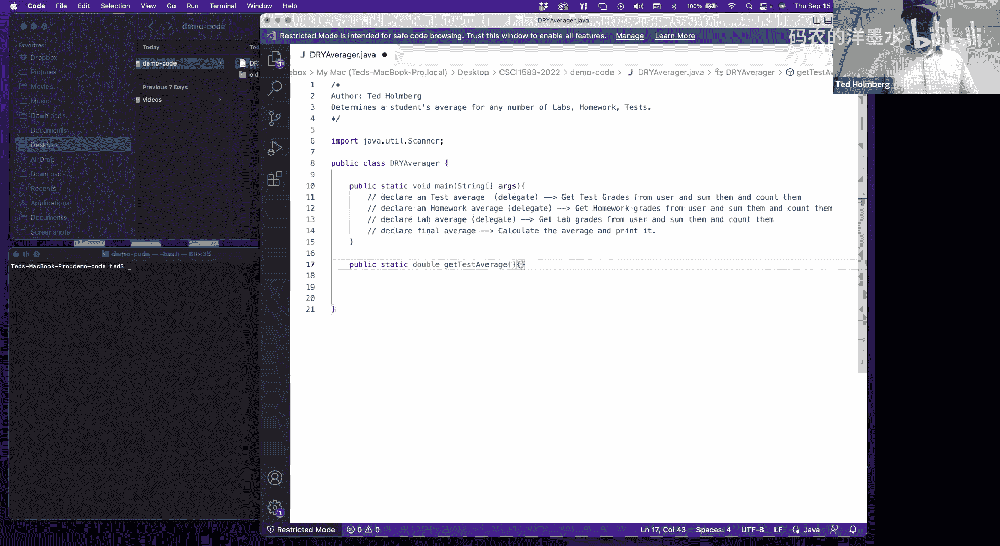

And so what was that block of code to be able to get a test average。

 well let's go back over here and。Let's hear right here， I think was。And I want to say just for。

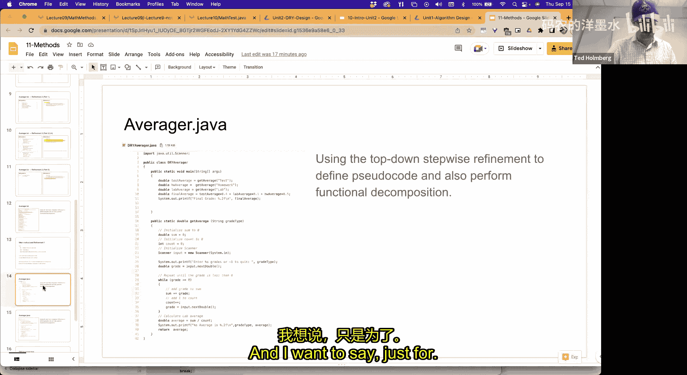

Okay。So inside of here， let me grab this。Let me comment this out。对。Okay。So inside of here。

 what I'll do is I'll create a scanner。So here I'll call this keyboard。

Equals new so notice another thing is I could have created like a scanner in the main class and have to pass it around or all this other nonsense。

 but I don't I only want to create the scanner when I need it right so I need it on this instance where i'm going to get test average。

😡，So let's make it。 So now we have our keyboard now the next thing I'm going to do is let's do system dot out dot print。

Actually， let's just do print。And here let's put enter。Task。Prades or minus1 to end， okay。

Now we do our。Then let's do this， let's get our grade。Double grade is equal to。

Keyboard do next double perfect。 So we get a value， then we can say while。Braade is。

Great than or equal to zero。We're just following along what we've done before， right？

And then we will take our。We're going to need some more data here， so we need to。

I should have deleted my data， I should have put it inside this method。

So remember we need to have a sum。诶系 on。We need to have a count。ererfect。Okay。

 so here I will then take my sum， Okay， let's indent indent。

Indent and indent and actually let's do this。Here， so I will take my sum and then I will add to it my grade。

😡，Then I will take my account and I'll add one to that。

Then I will prompt the user I won't prompt the user again I'll just go ahead and prompt it once。

 make it easy， then what I'll do is I'll just take and do grade is assigned the keyboard。

Next double that'll update my loop control variable， let's no stop that。

Let's get these comments organized in a more readable fashion。As I'm kind of。Okay， perfect Okay。

 so that's what we already had。 And then finally， let's compute that average。 So after this is done。

 we can then say what is this our。Double。Average is equal to our sum divided by our account。

Let's print that out， system dots。Perfect system dot out， dot print。F。

 and let's put something like a test。Average， and then。Percent。

Let's see this is an F and let's limit it to two fractional points so I can put in between my percent sign and the F some format formatting instructions and then I'll put a new line and then I'll give it the average。

Okay， let's actually see really， and then remember， since I claim that this returns a double。

 I then have to have the very last statement in my method return back something that is a double data type that's going to be the average。

Okay， let's actually test this one out。 So here where I said I'm going to declare my average and then get that from the user wass actually do that let's do。

So let's call this test。And I'm going to assign that to whatever I get back from this get test Averger。

So here let's call this test average。And now I've done enough code where I want to test this。

 I want to see if this works。 So let's do Java C。 what is this straw Aer dot Java So oh what's it say。

 So here this is an important reason why we test I actually misspell print F So I'm going to go here and I'm going add that T and save that and now we're going do it again let's go ahead and run that and let's type in。

嗯。Okay， so here。Inter test， okay， or minus one to end actually let me do a coal in space。

 the next time I test this So let's test this out。 let's do like 10100。50， 50 minus1。

And so test average is 75， let's see if I actually get it inside my main method。

 so let's do a system dot out。 print。F here and let's for now， let's just test let's see here。

 let's just test out our test average。 So here we'll put test。

Average is equal to percent F and again will do。There we go， and then we'll put our。

Test average there， and we'll do a new line here。So let's run this one more time。

So here let's do 150 minus one， so notice here the second pronoun is coming from the main method。

 so notice we've delegated work into this method here。

And so what we can do here is what we've realized is our logic is very similar so I could do this。

 and then I could call this my quiz average， right？😡。

And then the only thing that has to change would be this。

Now everything we and this right here right everything else would be the same so all I did was change two prompts but the rest of my code is the same is that good software design based on what we talked in the beginning part of this course I mean this lecture no right it violates the dry principle I now have two methods that look almost exactly the same。

😡，So how before I commit to this implementation， I see that I'm like， no， that's bad software design。

😡，Because now if I have to change the logic for averaging and if I copied this again。

 and made another one that was called get lab average。

 I'd have three methods that are effectively the same。

 wouldn't it be better if I sent like a piece of text into the method that G told it what the prompt was。

 then I could use the one method for all three operations。😡。

One place of code that's that does a similar or the same kind of computation so i'm going to get rid of this。

 I'm going to rename this from get test average to just get an average。😡。

But now I'm going to pass in a string， so in the parentheses I could put data that this code block needs to perform its jaw so here i'm going to pass in a string that says something like prompt。

😡，And here I'm going to change this print to be a print F。😡，Where I'll put percent S。

And I'll pass in。What was given to me for prompt？And I'll do the same thing here instead of saying test average。

 I'll do percent as， and before I give it the average， I'll also give it the prompt。

Oh got to spell that right though so now I'll take this in this data that's given to this now that this requires data n since something since there's a data type since there's a variable declared in the parameter list when we invoke this method we have to give all the variables in the parameter list and the parentheses values。

😡，So now I can't just call this without supplying a value in there to bind to that variable。

 so here I'll give it test， let's test it out and see if it doesn't look similar。😡。

Get grades from user， what did I do here？Oh， I got also called this get average。Okay。

 perfect let's clear this and let's run this really quick。

 So now inner test phrase looks exactly the same150 minus-1。

 And when I run that it still says test average。 So now look at how much easier this is going to be for me to implement I can now do。

Homework average， get average， and here I'll pass in homework。And now I will do。Quiz average。

 and I'll assign that get average and here I'll put。Wb。And now what I'll do here is。I will get。你。

Total average and what do we say it was it was like test average times let's say it's 30% let's say it is。

Quiz average， let's say that that was。30%。And or no wait， did I do quiz homework。

 lab that's supposed to be lab？Let's make that lab。And then finally， let's。

Let's call this I have tasks homework。Yeah， homework average。 and let's say that that is 40%。

 let's say for arguments sake， this is my weight it's the the average plus at times the weight average times the weight average times the weight。

 So finally， let's call this total average instead。And give it the total average。Let's save this。

 let's run this。What does it not like， I need a semicolon somewhere， what line 13， line 13 oh here。

 don't forget your semicolonons。Okay， let's。And let's run this so see if it works。

 so I need test averages 100。50 minus1 okay so I got 75 now I can enter my homework grades so let's say 10000 and let's say 75 minus1 so now I have a homework average 93。

 75 finally lab grades so 5060，708090 minus1 so that is an average of 70 which our total average is a clearly this is why we test。

So let's see what happened here when we did our computation， let's see here oh。

 this is not supposed to be a plus that's supposed to be at times。So let's do that one more time。

Again， this is good for testing reasons because you could say I didn't get the behavior I wanted。

 but because of the way I broke the code down I knew exactly where in the code base to look so I love when that stuff happens to me in practice so that you could see how easy this approach is so let's do this one more time。

😡，Just to make sure it works， so we got a test average。We got a homework average， and now。

We have a lab average and then that will compute a weighted total average that you get for your grade and now when I look back up my code base notice that effectively my main method looks at exactly like refinement one and is hugely readable。

Get a test average， get a homework average， get a lab average use that to compute your total average and print it out right isn't that effectively refinement one and then we use。

😡，Our last set of refine is to figure out how。Many methods we're going to have and what code goes into our methods and so here all the minutia。

 all the little details are actually put into these helper methods that can receive data。😡。

Or it can return data and this instance we needed a method for both right so that we can build one method that gets all the averages we tell what prompt we want and then the average we're going to get back from it the numerical value we're going to get back is there any questions regarding this does everyone feel good about what we've done in terms of discussing or introducing the concept of user defined methods and how we can make use of them to build better software。

Okay， perfect， I will go ahead and let you all go today。

 I will make the test go live probably sometime later this afternoon and we will talk more about methods on Tuesday。

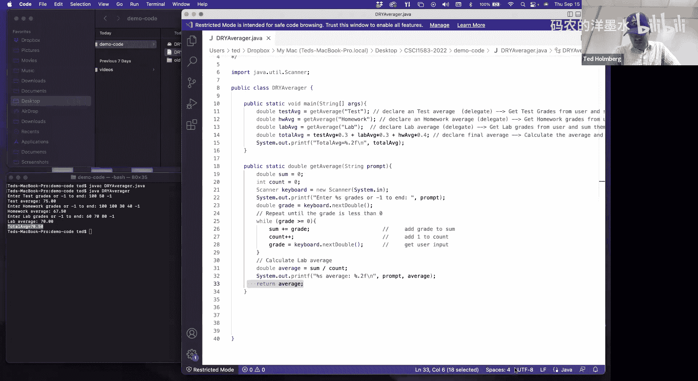