# 软件设计与开发：11：方法 🧩

在本节课中，我们将要学习软件开发中的一个核心概念：**方法**。我们将探讨什么是方法，它们与变量的区别，以及如何利用方法来编写更清晰、更易维护、更高效的代码。通过一个计算加权平均分的实例，我们将学习如何通过“自顶向下、逐步求精”的设计过程来分解问题，并最终用方法来实现我们的程序。

---

## 概述：什么是方法？

方法允许我们为一段代码块命名，这样我们就可以通过使用它的名字来调用它。方法非常有用，因为它们提高了代码的可读性和可靠性。

为了理解方法，我们可以将其与变量进行对比。

以下是变量与方法的对比：

*   **变量**：一个**命名的数据**，我们将其存储起来以便后续使用。
*   **方法**：一个**命名的代码块**，我们将其存储起来以便后续调用。

它们有些相似：变量让我们将一个具体的值存入内存，在程序后续需要时使用；方法则让我们为一段代码赋予一个名字，通过调用这个名字，就能执行那段代码。

通常，区别在于调用方式。当我们想要引用一个变量时，它看起来像这样：`x + 5`。这里，我们直接使用变量名 `x`。而当我们想要调用一个方法时，假设它也叫 `x`，那么调用方式会是 `x()`。无论是否需要传递输入参数，每次调用方法都必须使用括号 `()`。

因此，在阅读代码时，你可以通过一个标识符是单独的名字，还是名字后跟了一组括号，来判断它代表的是一个命名变量还是一个命名方法。

---

## 方法与类

类可以包含方法，而方法内部可以包含代码。从一开始我们就知道这一点，但之前我们忽略了可以创建用户自定义方法的事实，以便专注于代码本身。现在，我们将开始专注于构建方法。

需要理解的是，当我们构建方法时，必须将所有方法都放在**类的范围**内。就像我们一直编码的方式一样，在开始构建应用程序时，我们会定义一个类。每个需要执行的应用程序都必须至少有一个 `main` 方法。如果一个类中没有 `main` 方法，那么这个类就不能独立运行，不能作为我们应用程序的入口。

但是，我们可以拥有不止一个方法。我们可以创建自己的方法，但每次创建时，都必须在类的范围内声明它。

---

## 方法声明 vs. 方法调用

**声明**是我们首次定义方法的时候。所有方法都必须在类的范围内声明。

**调用**是我们调用或使用那个方法的时候。我们通常在**其他方法内部**进行调用，以让它为我们执行任务。

理解这一点的方法是：方法之间通过相互传递数据来进行“交流”。一个方法可以通过两种方式传输数据：

1.  **向方法发送数据**：我们可以通过将值放在方法名后的括号内，将数据从一个方法发送到另一个方法。这就是括号如此重要的原因，它代表了该代码块需要处理的数据。并非所有方法都需要输入值，但有些需要。
2.  **从方法返回数据**：一个方法也可以将数据返回给调用它的方法。如果我们需要从一个方法返回数据给另一个方法，我们会使用 `return` 语句。`return` 语句通常是任何方法的最后一条语句。

在方法声明中，返回值类型的位置指明了这一点。如果你不需要返回任何数据，返回类型就是 `void`。但如果你确实想返回数据（一个方法只能返回一个数据），那么我们在通常写 `void` 的地方，写上要返回的数据类型。例如，如果一个方法要返回一个整数值，那么返回类型就是 `int`，并且我们必须将其写在方法头中。

---

## 方法的设计原则

方法头可以被视为我们代码实现与其他所有调用方法之间的一份**契约**。当我们开始创建方法时，目标是给方法起一个**好名字**，清晰地定义调用该方法时会发生什么。

在Java（以及大多数编程语言）中，通常的做法是选择一个好的**动词**，来传达将要执行的动作、事件或语句序列。方法名应该非常具有描述性，通常可以将其视为一个动作概念。通常，我们将变量名视为**名词**，将方法名视为**动词**。这样，我们就在代码库中构建起一种语言：我们拥有“事物”（名词），可以通过将这些“事物”发送给“动词”（方法）来对它们进行操作。

这些“动词”（方法）可以从另一个方法接收数据，也可以将数据返回。

---

## 方法如何帮助我们遵循DRY原则？

方法使我们能够避免重复，以下是六种主要方式：

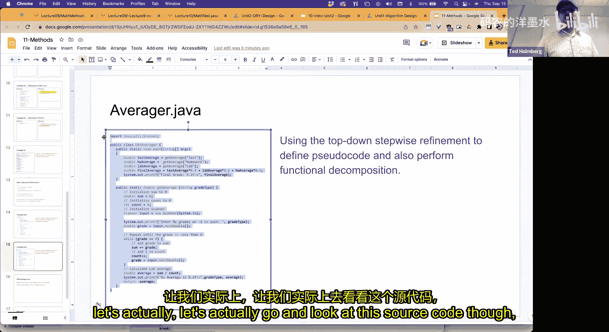

1.  **定义一次，多次运行**：方法允许我们定义一次算法，然后通过其名称多次运行它。这非常强大，尤其是在你已经完成的“僵尸启示录”游戏中，它让你可以编写一次代码，然后无限次重复使用，无需再次修改。
2.  **分解算法**：方法允许我们将算法分解成更小的部分。将所有代码都放在 `main` 方法中会导致 `main` 方法非常难以阅读，这是糟糕的设计。我们的目标是通过将代码库分解到多个方法中，使其更易于管理。一个好的经验法则是：一个方法不应超过十几行代码。如果超过了，这可能是一个信号，提示你应该将其分解成更小的方法。另一个经验法则是：一个单一的方法应该只负责一项任务。
3.  **便于分步实现和测试**：方法使我们的代码更容易分步实现和测试。你可以一次定义一个方法，然后测试其输入和输出，以确保其按预期工作，甚至在应用程序的其他部分完成之前就可以进行。这是进行单元测试的有效方式，代码库中最小的可定义单元就是方法。
4.  **分工合作**：方法允许我们将项目分成多个部分，以便多人协作。我们可以分配任务，让不同的人负责编写不同的方法，而不是让一个人独自完成整个应用程序。
5.  **提高可读性**：方法使我们的代码更容易阅读和跟踪。每个方法都有自己的职责，这使得维护、重构和调试变得容易得多。
6.  **保持主方法简洁**：`main` 方法不应包含任何实现细节。我们之前严重违反了这一概念，因为我们不了解方法。但今后，我们希望 `main` 方法主要充当“委托者”的角色，其中唯一应该发生的事情就是调用其他方法。这使得 `main` 方法更具可读性，其目的应该是清晰地展示整个算法的总体逻辑。

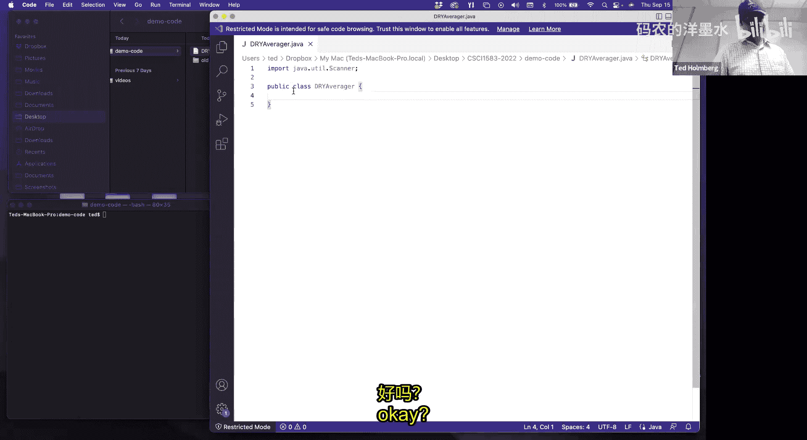


所有这些概念共同作用，实现了我们所谓的**自文档化代码**。这些策略使得重新阅读代码以理解其逻辑变得尽可能容易。这不仅是为了他人，也是为了你自己。当你离开代码一段时间再回来看时，这些概念能帮助你快速回忆起关键的设计决策。

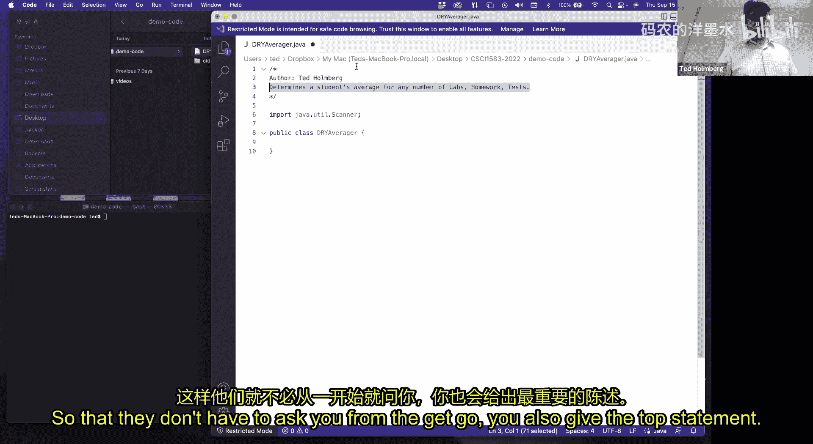

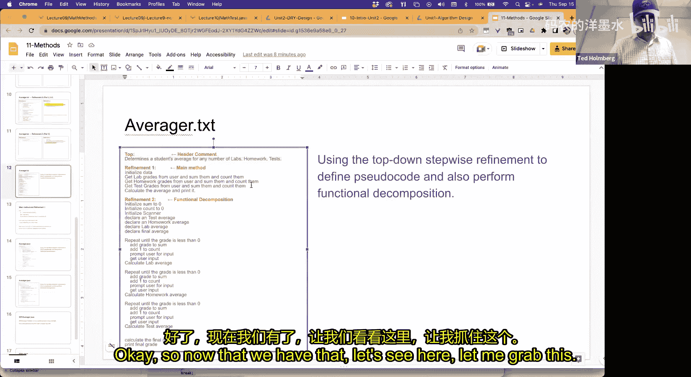

---

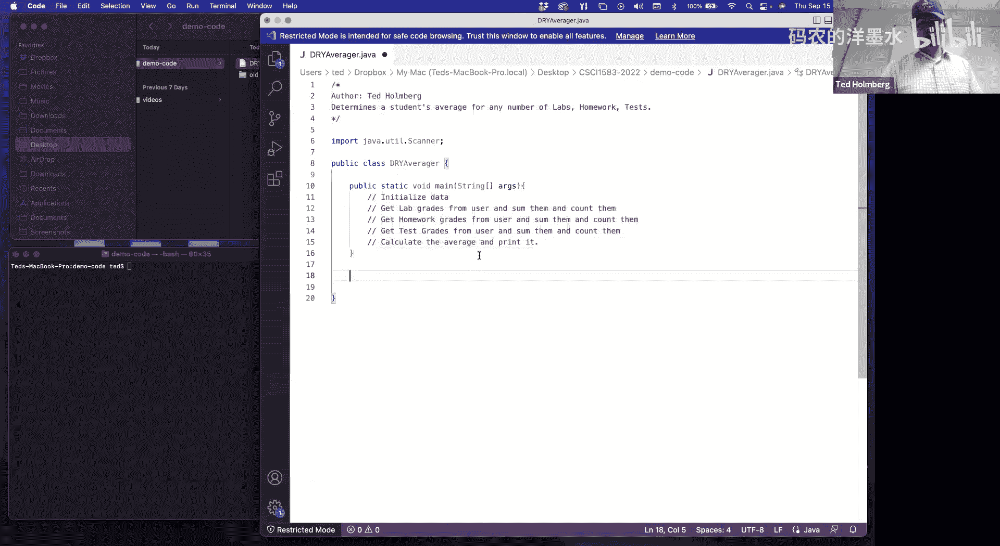

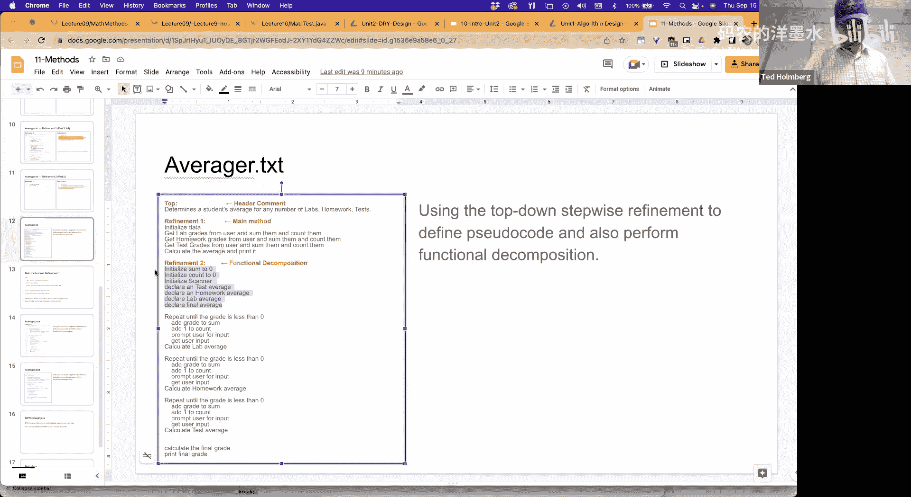

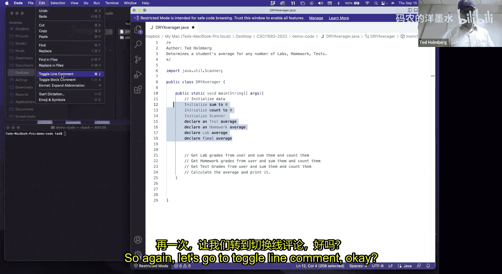

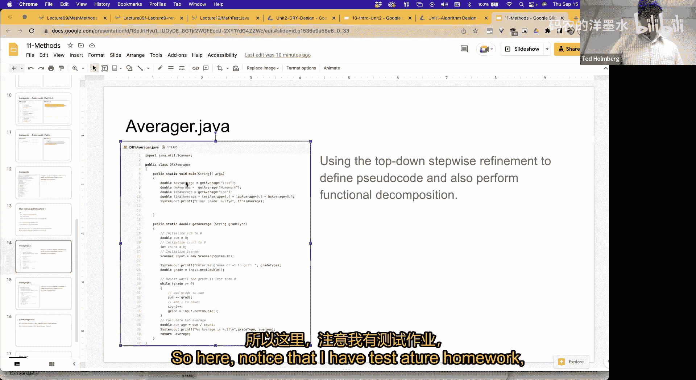

## 方法与功能分解

当我第一次讨论“自顶向下、逐步求精”过程时，我说过我们可以用它来做两件事。第一，我们可以从一个顶层语句开始，使用这种迭代的、逐步的方法，将这个简单的摘要扩展成一套完整的伪代码语句。伪代码的好处是它在概念上非常接近编程语言，使得我们可以将其一对一地映射到Java、Python或C++等具体语言。

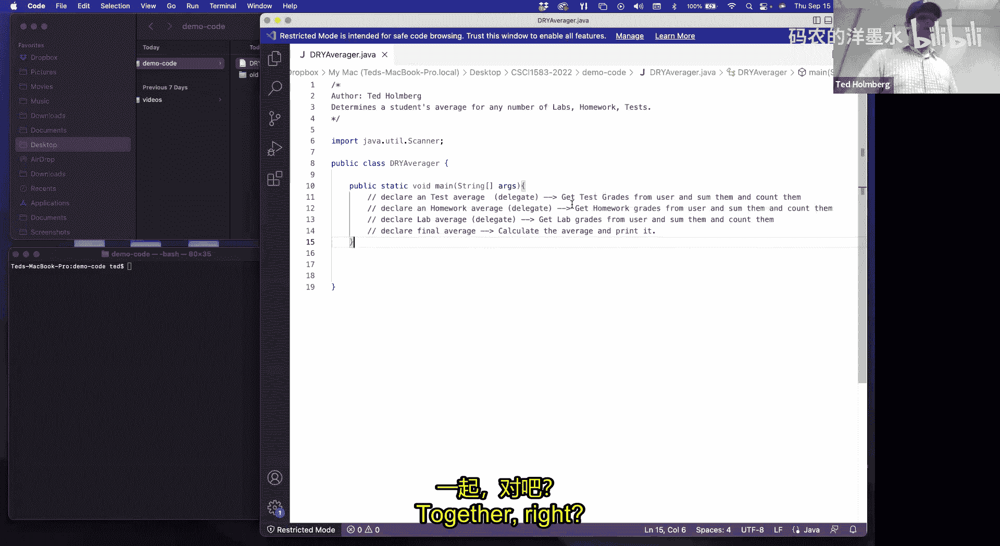

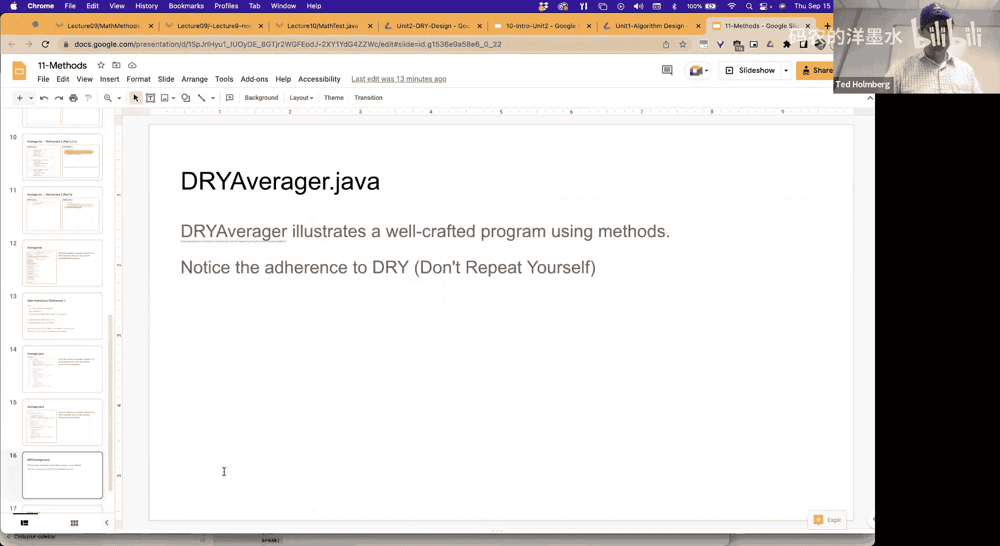

除此之外，“自顶向下、逐步求精”过程还可以帮助我**定义哪些部分应该成为方法**。既然我们现在讨论方法，我们将再次演练这个过程，看看求精过程本身如何开始分解出应该被定义为方法的代码块。

我们将通过一个计算加权平均分的例子来具体看看功能分解和“自顶向下、逐步求精”过程是如何运作的。

**顶层语句**：确定一个学生基于任意数量的实验、作业和测试的加权平均分。

**求精步骤1（主方法蓝图）**：
1.  初始化所需数据。
2.  从用户获取实验成绩并求和、计数。
3.  从用户获取作业成绩并求和、计数。
4.  从用户获取测试成绩并求和、计数。
5.  计算并显示总加权平均分。

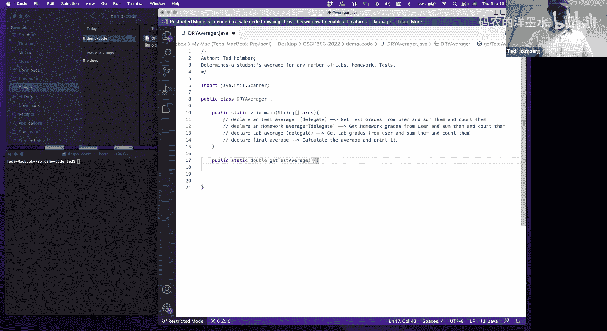

这个第一层求精仍然比较抽象，但它可以作为我们 `main` 方法的蓝图，代表需要调用的五个主要方法。

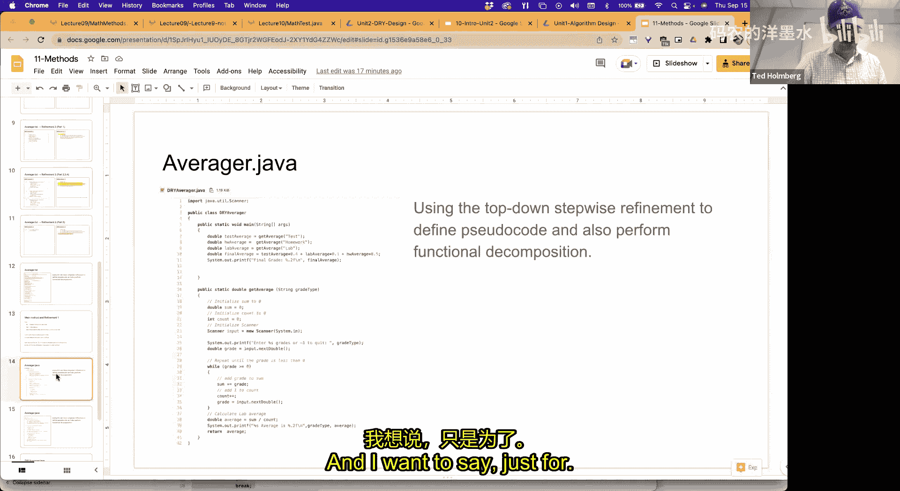

**求精步骤2（方法内部逻辑）**：
当我们详细展开第二步（获取实验平均分）时，逻辑是：循环直到输入负数，将成绩加到总和，计数加一，提示用户输入，获取输入，最后计算平均分。

仔细观察会发现，步骤2、3、4（获取实验、作业、测试平均分）的逻辑**几乎完全相同**，唯一的区别是给用户的提示信息。这立即违反了DRY原则，提示我们应该将这些重复的逻辑合并到一个方法中。

通过这个设计过程，我们明确了：
*   **顶层语句**成为类的头部注释。
*   **求精步骤1**成为 `main` 方法中要调用的方法列表。
*   **求精步骤2**及更深的求精定义了每个方法内部的具体实现。如果需要更多求精步骤，则表明某些方法可能需要进一步委托工作给其他辅助方法，从而形成一个方法调用树。

---

## 代码实现示例

基于上述设计，我们最终实现了一个程序。其核心是：

1.  一个 `getAverage` 方法，它接收一个字符串参数作为提示信息，负责与用户交互，收集一系列成绩，计算并返回平均分。
2.  `main` 方法非常简洁，只包含几个方法调用和最终计算：
    ```java
    double testAverage = getAverage("test");
    double homeworkAverage = getAverage("homework");
    double labAverage = getAverage("lab");
    double totalAverage = testAverage * 0.3 + homeworkAverage * 0.3 + labAverage * 0.4;
    System.out.printf("Your total average is: %.2f", totalAverage);
    ```

通过这种方式，`main` 方法变得高度可读，精确地反映了我们最初的求精步骤1。所有繁琐的实现细节都封装在了 `getAverage` 方法中。这种方法设计也避免了代码重复，完美遵循了DRY原则。

---

## 总结

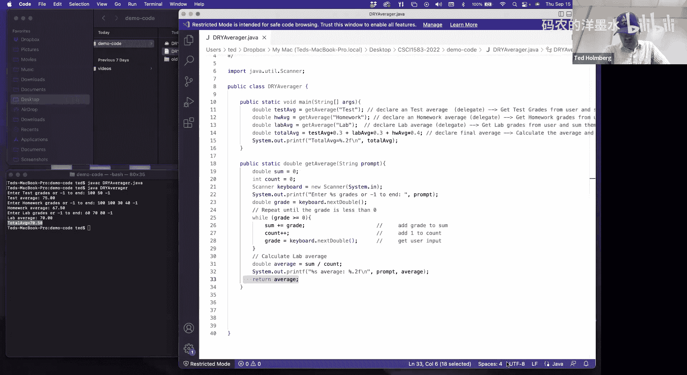

本节课中，我们一起学习了软件开发中的核心构件——**方法**。我们理解了方法作为“命名的代码块”的本质，以及它如何通过提高可读性、可维护性和避免重复来提升代码质量。我们深入探讨了方法的声明与调用、参数传递与返回值。更重要的是，我们通过“自顶向下、逐步求精”的设计流程，实践了如何将复杂问题分解为多个方法，并最终实现了一个计算加权平均分的程序。记住，好的方法设计意味着单一职责、适当长度，以及一个清晰、可读的 `main` 方法作为程序的总指挥。