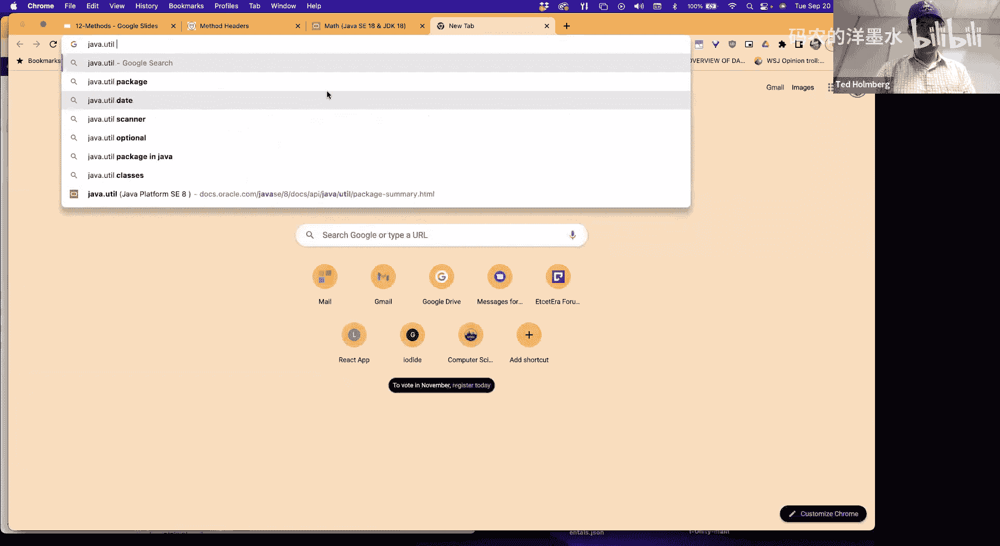
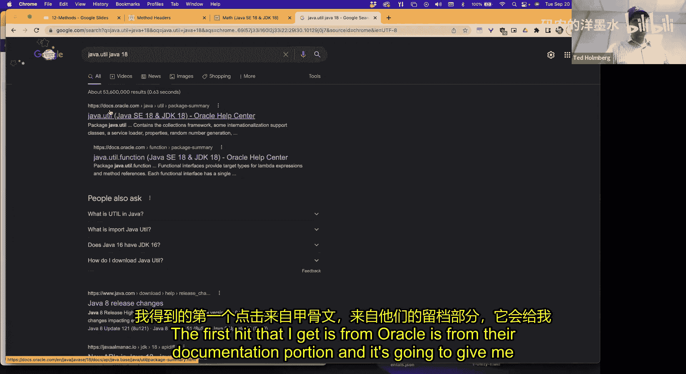
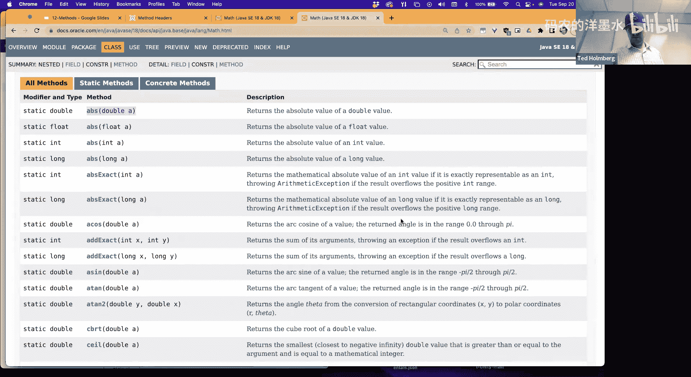

# 【全集】加州理工学院 软件设计与开发 中英字幕 1080P p12 Lecture 12 - 方法、类、包与应用程序接口 -BV1AvzCBdE7a_p12-

Okay， so last lecture started we started to talk about methods right and we articulated some of the advantages we have with methods。

 which allows us to start encapsulating small blocks of our code so that instead of having one giant main method。

 we could break it down into the smaller parts。And so that's great for testability exibility right we saw how we could use that top down stepwise refinement which is also called decomposition of a problem to build out what our methods should be so I want to continue on this track I want to talk more about methods in this lecture I want to talk about methods as they relate to classes I want to talk want to talk about methods as they relate to classes and how classes relate to packages I want to talk about API versus the method headers and how we can start using APIs to improve our ability to use the Java standard library and how in Java too you'll start making your own documentation your own API documentation in fact in the future labs it'll start specifying the things you need to either build or read as if it were Java API documentation so it's a very important skill。

That you kind of understand how you can read what methods exist in a class what classes exist in a package and what all those methods do what they all require and what they all get back and then got I kind of want to just hap in on the static keyword because we've been using that a lot and now we finally have come to a point where we can kind of explain a little bit more about what it gives to us since we're going to start breaking。

Start doing our own user defined methods and our own user to find classes that can be used by other classes。

 in fact。So a quick overview of this。This presentation will do a breakdown of methods so we didn't formally do that right I just kind of dropped you into how we can define methods and so that might have been very quick and rapid and you probably were able to get an inkling of what was going on right it's probably obvious enough with the exercises we were doing last class on what our a because we built an aper generally then we do like a class ature it's pretty clear what that method did and how the main method was able to use it how it was able to call it to do work but in this lecture I really want to hammer in and be very articulate and explicit with everything that goes into defining a method in Java so really last class was how we designed using methods and the kind of abstracted away the building blocks that go into constructing the method and I just showed it to you。

So you've had exposure to that so you've seen it so now I'm going to circle back around and I actually want to specify this is a method header。

 this is the method body these are the parts of it this is when you have to have a return statement this is when you don't so really break that down today then I want to compare that method breakdown to the API breakdown so you can see there's a one to one match so that in the future you can go read the API documentation and see exactly how to use code that you didn't write yourself how you can import someone else's code。

And easily be able to call it because that's a very important skill if you're going to become a software developer it's not just designing your own software。

 but learning how to use other people's software and again this metaphor of being able to take our algorithms and break it across methods and put those into classes and put those into packages allows us all to make code that can be shared with everyone else。

 a community of code and so keep in mind when we're programming in a language like Java or any other language。

 whether it's Python or R or Javascript or C++ or Charp or whatever right whatever rust or go or。😡。

These languages are all living languages， they're extensible。

 it means that it will be different tomorrow than it is today and what we're using today is different than it was a year ago that you have a community of people who are constantly contributing towards the language。

 making it better and making you have to do less work because every time someone add something to the language when you have a problem at hand。

 you don't have to know how to solve it。😡，You can see if someone else has solved it and used their solution so much about software development is not reinventing the wheel find out if there's a tool that does a job for you before you try to build it yourself if there is use it if there's not。

 then you build it。😡，And so API documentation will allow us to see what's available。

Okay so after that we're going to take a quick gander at the Javal package so that's the default Java package that gets automatically or the term we usually use in industries implicit import it into every Java application that we write now we've seen other packages that we have to explicitly or manually import that's the Java do package but today I want to since we're examining methods we're going to examine API documentation I really want to look at this package to make sure that everyone kind of understand what you might have available that you didn't even know you had access to up to this point although you haven't written a lot of codes that doesn't really matter that you didn't know yet。

And then I want to talk about how we can start then methods and classes。

 how we can start grouping our methods collection of related methods into its own class and then use classes across classes so again one of the motivating concepts about the key word public is that allows other classes。

Other than the one we're currently implementing to have access to the class itself and the methods within that class by default we've just been using public I want to show you why that's important。

 I want to show you the value of that as well and we can we can start learning about that value with methods。

😡，And then finally， we'll talk about overloading methods。

 which is a interesting thing we can do in Java， not all languages support method overloading。

 like for instance， Python and JavaScript does do not， but Java C++ do。

 so we'll take an examination of that at the end。Okay so methods so just a recap this might be a small recap from last class methods or like many programs in and of themselves。

 they can have their own sets of inputs， they can have their own sets of outputs methods talk with other methods so inputs and outputs or mechanism that allows one method to share data in memory data with another block of code or with another method and be able to return it back so effectively the big thing that a method gives to us is that it can process。

A block of instructions and sometimes we need to give that block of instructions a starting value。

 sometimes it knows what the starting value is hence the input sometimes we need to get back a value from our other method and sometimes we don't right so we we have those choices。

😡，Four choices， right， input yes， input no， output， yes， output， no， any combination of those。

So software components。Let's see here so the idea though is that we are building these tiny little programs。

 these little algorithms that intercomate with one another and they can communicate with other methods so the motivating concept is that we can start building software components these software components are built off the concept of identifying our methods。

And then these these software components can then work together to build a much larger more complicated system。

 so each method it should have only one task job or responsibility right so if you've noticed that you're building out a block of code that's doing more than one thing and you could do this a good way of testing this is can you ascribe an action verb towards what this block of code is doing and if it takes more than one。

😡，Term for that then that's a clue to you hey I need to break this into multiple methods another rule of thumb you could use is is this include more than a dozen lines of code you should never。

 especially in an industry have a method that that's more than a dozen lines of code if it is it's too big。

😡，And it's I mean， you'll see it within its poorly designed so that's you can do it。

 but that would be a poorly designed method。😡，Okay。

 again our main method is like our application manager it's responsible for delegating task and ensurings programs run and it should contain no implementation details。

 remember in our last lecture when we designed our ature。

The main method effectively made calls to the ager method in fact。

 the main method looks very similar to the very first refinement from our subwise refinement process so again what a welldesign main method looks like is a bird's eye view of what the algorithm is doing so well definedfined methods should just be a set of invoking calls to other methods invoking calls to other methods that have really great names such that if I read the sequence of names it expresses almost in a humanlike language what my algorithm is。

And then at each one of those method names will be the block， the very particular implementations。

 the gritty details that actually take care of what happens then and again this allows me to initially see this is what's happening and then if I need to see exactly how it happens I can go into that method definition and see the implementation so each method should only have sorry so this method name should be precise in defining its job methods encapsulate instructions does the word encapsulate encapsulate essentially means high。

😡，Right so again， one of the valuable things about encapsulation is allows us to express a abstract or a a complex thought very。

Concisely and very abstract。And so we can ignore the details until we need to know it。

And so that's a very valuable thing to us， especially when you start building out larger data systems where you can call a method that just has a name I'll give you an example。

 use systems。out dot print to be able to send any kind of inmemory data to the output stream to actually display out into the console do you care how that actually works。

Like do you want to read the actual implementation of what happens inside of the print method to make it work no like you don't care about that that's what encapsulation gives to us we can ignore the gritty details we know conceptually we want to print something to the terminal all we need to know then is the name of the method and the data we need to give it。

😡，Okay so let's see so methods encapsulating instructions so know what it does by so we know what it does by its names and we don't need to know how it does it and we only care what input it requires and what output it gives back and again some key terms that I want to make sure everyone's familiar with extensibility means you can have access methods across classes so extensibility means that we can extend the language right so if I make one method in one class if I make it public it's available in every other class that's what it means to add extensibility into our codeb and then I already mentioned thecapsulation that means we don't need to know the details of how something works we can just use its name and given the description rely that it's going to do that job。

Okay， again if we look back at the example we did last class which was the average methods。

 once we implement it， we don't care how it works anymore just what it's called and what arguments it needs and what data it returns right so in the main method the main method just new I have to give a piece of text as a prompt to the ar and is going to give me back the average。

And from the main methods perspective， it doesn't care how averageture works。😡。

It just cares that it's going to give it back an average。

And that's that's the mentality we want to have moving forward when we start designing software and we start relying on external classes and external methods as long as we know what the names are and what it's supposed to give to us。

 we won't we won't question it any further。Okay so yeahep we talked about this so a class so here let me give you a better concept of a class though so extensibility means we can expand the program languages with new functionality by adding more classes a class contains or encapsulates a collection of related methods and data so we're we should actually see that today that so we've been using classes just to create main methods but I want to show you that we actually use it as a containing structure we use it to group together similar sets of methods and sometimes even data。

Data can go in there as well so for instance， we'll look at the math class and math class part of the Java dot lay package it contains a collection of math data and methods beyond what we're given So if you look at the standard set of math operators we have they're kind of boring right they have addition they have subtraction they have division and they have multiplication and that's it now there's a lot of more complex maths that you probably want to be able to do right and without having a。

Without having operators to do it， you'd have to implement that yourself， like say， for instance。

 if you want to find the cos sign value of something， if you want to find the s value of something。

 right？😡，If you want to find the tangent or if you want to find the max value of a number or a set of numbers or the min value or the absolute value or the square root or the power。

 these are all very common things to do numerically that we can't get from the primitive set of operators and so in we learn how to use。

Methods and classes， we have to implement that on our own。

The advantage is that in Java do layang theres a math class already。

 so we don't have to worry about implementing square root we can use the math class。

 the math library inside of there is a method called Powell。

That will allow us or Sqt i'm talking about square root this time so square root so SqRT and it'll perform that duty for us so again the idea behind the。

How we select what our class name should be should be this I want to do a complex mathematical operation where would you expect to find behaviors related to complex math something beyond simple operators well you probably call those math methods right so you create a class called math and inside that class can be all of your methods that do math like operations so。

😡，Sre root is just one example of a particular numerical operation that we don't have built in but we would like to have but that's not the only one doing powers or another right or doing trigoometric functions or another and so all these can be individual methods that are contained inside of one class called math and there might be values we care about right like pi is not a constant value inside a Java but it can be defined inside of a class and we can access it from the class。

😡，So that if we need it， we don't have to type it out manually。So again。

 this is we're gonna learn that this is going to be one of the advantages that affords us to quickly start prototyping code much quicker。

 you know to rely on classes but organizing our own code base so we can identify a group of related methods in this instance that I give you here as an example it's the math methods but in your own software it could be other things I say for instance you're building a video game let's go back to that video game example you might have one class it just represents all of the methods and all of the data that is assigned to the hero so anything so that class is responsible for mutating for affecting and tracking the state of the hero in our game and let's say that you have a goblin in the game you might have a separate class that tracks just the goblins data and the goblins methods what the goblin can do so when we think of methods think of those as verbs actions when you think of data think of those as properties we might have another。

Cl as is a dragon class that has all the properties of the dragon and the methods so this is an idea of how we're going to start separating our code base across classes Does this conceptually at least make sense before we actually see any code。

😡，And just want to make sure that the concepts are sounds excellent okay so whenever I need to find a math function I know to look at the math class classes help us organize our methods and data we can build our own classes with math just like the math class what we're going to do in this lecture is build something called the math gettter class that will also implement some math functions so I could show you that there's nothing magical about these classes that are predefined in Java they are effectively the same thing you would have done by yourself it's just they're already made so I think it's important to understand that things that are given to you aren't any more complex than you would have done yourself so we'll inspect that by kind of creating or rebuilding some of these math functions or math methods that we're going experiment with in just a moment。

So we can build our own classes with methods like the math class we'll build the Mac Ster class that also implement min the math function we'll step through the algorithm and once we're done we won't care anymore how it works we just know that we can rely on it to do that job Okay so now let's do that breakdown that I promised you let's look at the declaration line of a methods so in Java all our methods are declared within a class that's not necessarily true for every programming language but it is true for Java so let me give you another caveat。

All of our source code in Java has to go into classes in a language like say， for instance。

 JavaScript or a language where in Python where we can have three floating。😡。

Methods or or or blocks of code that we give named to that aren't in classes。

 we call those functions so as you progress。😡，The difference between a function and a method is that a method is defined inside of a class a function is defined outside of a class we will never see actual functions in Java but if you go ahead in your future studies and start programming in C you can very much have functions in C or assembly or some of your other classes so it's a linguistic thing I just want you to understand the conceptual difference between the method and function now with that said we will say that there were function methods and there were procedure methods。

Function methods are a block of code that returns back a value。

 a procedure method is a block of code that does not return back a value。😡。

So whenever we use the F return type， we're effectively defining a procedure method。

 whenever we return， whenever we have a data type that's anything but F。

 it means it has to have a return statement， which means it gives back some type of value。

 which means that's a function method so does everyone understand kind of a difference between a function method and a procedure method。

😡，I think we took a I don't know if we took an example of that last lecture but we'll certainly look at that this lecture and of course whenever I say block of code that's the same thing as saying in a set of instructions that's the same thing as same an algorithm right those are all effectively the same concept okay so again let's continue this breakdown of a method so methods are composed themselves to two parts you have the method header and the method body the method method body there we go。

So。Our header has。Four different parts to it the first part is the access specifier now the access specifier can actually be made of two things。

 so this example doesn't show you the other part of the access specifier。😡。

So the first part is whether it's going to be public or private， if it's a public method。

 then it's available to outside classes， if it's a private method that's only available in the class that it's defined within so it's hidden from the rest of the world。

😡，What goes in between there between this and our return type is also whether this is a static method or not。

 so for all the methods we're going to be looking at are going to be static methods。😡。

But notice I can omit the keyword static and then it becomes an instance method。😡。

But instance methods don't make much sense to us until we get into the tail end of this unit。

 so we'll pretend like those don't exist and we'll just talk about what the static key word gives to us and what the static key word gives to us is。

😡，That we can access this method from the class name itself without having to construct instances now we have very limited exposure of what it means to be an instance。

 but where you do have that is whenever you use a scanner class right when you use the scanner class it's not like the print statement like when you use print statements you're calling scanner do print right you're not having to create any variables or anything you're able to from the class itself call the print command。

😡，However， in order to pull data from the input stream。

 we actually have to construct an instance of a scanner and tell it what it's scanning。

 we give it a reference to the input stream and in your labs you're giving scanner other things too just to show you how awesome scanners are like for instance in the labs you're giving scanner instances to strings right and where you can scan a string and actually then convert that into inmemory data types like ins or floats or Boolean values right have you done that already。

😡，回 down。Right now we'll be just using a static class then the next part of the method declaration is going to be what is the output now every method can only return。

😡，One value out so it only ever results to one value now that one value out could be really complex objects as we'll learn in the future。

 but right now since we're predominantly just using primitive data types that just means we can only get like a number or a piece of text or booleying value。

😡，So we'll call that our return type now if this。😡，If this is a procedure method。

 the return type would be void because we're not returning back any values。

 but if we do return back a value， then this would be a non void data type here。

Then we would have the name of our method in this instance， our method name is sum。

 our return type is int， this is a public method， which means it's available to outside classes。

Finally， the fourth and final part of the method header。

 it goes in between parentheses and what goes in between parentheses is the collection of input data。

😡，That our method requires and in fact what you're going to notice is those are actually variable declarations and it's separate if it's more than one value if it's one more than one piece of data that you need then you can use a comma separated list so in this example there are two pieces of data that the some method requires。

😡，And so。We will assign a data type and a label to each of those so effectively what we're doing in the parentheses is we're declaring two local variables local to our method local to the block of code that is going to be in the body of our method that we will have access to and the values of those because notice that's just a declaration not an initialization and you can't initialize these input data。

 the entire point of the input data is that it has to come from somewhere else in our application so whenever other method is calling this method has to provide a value for the variable A it's going to have to provide a value for the variable B and again we're going to see that in practice but。

😡，question to just be clear this would be a method inside a method。

I'm glad you asked that we can't declare methods， we can't define methods inside of other methods and this is where it can get kind of confusing all of our methods have to be defined inside of the class。

 but methods call on other methods。😡，So like for instance。

 and let's take a look at the code we did last class really quick just so I can highlight that concept and we'll see it again today。

 but since already have that code。What was it called like dry Ager？

So let's take a look remember we built this last class and so here if we look I have a main method here and if I look where my main method is defined at is' in the class scope right so my classes here and then under the main method so this is where the main method ends because we open and close based off the set of curly braces that defines a scope so after our main method we can create a whole nother method。

 this was our method header here right where this is the access type public method。

Statatic means we can access it from the class itself This is what the return type so this method is going to give back a value that is a data type double the name of our method is get aer we want to be as descriptive as possible with and notice it's like an action that we also ascribe to it and then inside of the parameters is essentially variable little declaration that states the before our block of code before this method can do any work it needs to be given a starting value and so it's defined it declared。

😡，Inside of the class， but it's actually used inside of a method。 So inside the main method。

 this is what we call invoking where we have they get average。😡。

Method name here notice how it highlights it let me get the syntax highlighter okay so here I'm actually calling it three times so I've written this block of code once。

 but one of the advantages of methods is once I've defined it once and given it a name I can call it an unlimited number of times but the trick is the calls to math have to happen in other methods。

😡，So declaring a method that has to happen in Placo。

 but using the method that has to happen within some other amount。😡。

Just go to the example where you put the integer variable from the colon they names or tribe。

When I go to use that， I would have to use that inside of a main button what's that。Oh。

 you could in that method name as some and individualize A。

Well so this is a thing though and this is a really good question because this is going to definitely be a triple point the declarations that are happening the parameters are for the scopes of the input data so that we can access them inside of our method source code so when the main method or whatever other method goes to use it it's not going to declare a variable is going to pass in an actual value or or it'll pass in a variable that has a value let's look back at the dry average or we'll look at this again with our sample code with our dry ature we created a declaration called prompt and its data type string right？

😡，So notice。That now allows us to use that variable inside of our method block。

 so our method block starts here and it ends here and if you notice we're using prompt here。😡。

And we're using prompt here actually， I like when I highlight。

 you see I'm actually using it two places online 22 and online 32。

Right and the value now notice I'm declaring that variable。

 so I have access to it it's valid for me to dereference it to say， okay。

 whatever values held that variable， I want to use it in my prompt on 22 and I want to use it in my prompt on 32 or my printout on 32。

😡，But it doesn't have a value at this time， it's a placeholder。

It's something that has to be given to us， right？Now the value that it's given has to come from the method that calls it so notice in here on get average in order to call get average since there's a since there's an uninitialized variable and again all parameters we call those parameters the data input into a method is our parameter list so all of our parameters start out with having no values and in order for us to successfully invoke them if there is a parameter inside of the method header it has to be assigned to value so that when we try to use it in our method。

😡，It has whatever value we got from the invoking method so here when we call get average the value of the string prompt will be test but here when we call it immediately after that it's going to have a new value when it gets called the second time it's going to be homework and then finally when we call it the third time the value for string prompt will be lab so it gets called it excessiveesively three different times and for each one of those times it'll have a different value。

😡，Does that make sense and so what that allows us to do is declare a singular variable that can have different values for each time it's called and then the execution of this block of code will vary slightly differently depending on what that value is。

😡，And in this instance， it changes the wording of the prompt on whether we're looking for test grades。

 whether we're looking for lab grades， or whether we're looking for homework grades。

And maybe this will make more sense with a simpler example， does it？Yeah， well， yeah， like。Yeah。

 so if I had to do an example of cooking for instance。

 I might have a recipe that tells me that I have to add a protein to my dish and then that gives me the option when I actually implement that。

😡，Recipe whether I want to select fish or chicken or beef so like the very the parameter that i'm given in order to successfully execute the food recipe is that I have to add a protein but then when i'm actually implementing when i'm actually calling upon the recipe to actually execute it at the time of calling it is when I get to decide what value that protein has whether it's a fish protein or whether it's a beef for pork or what have you and it could be based off of dietary constraints right like if the meal has to be kosher I would use a nonpork。

😡，Protein， if it had to be vegetarian， I might use like a bean or tofu protein。

So I can have additional constraints that might decide what is the value of this parameter going to be。

 but the recipe doesn't really have to change otherwise does that help make it more sense？Okay。

 with that said， we're actually at a point where we can do a quick little demo Okay。

 so let me go ahead and make this and then well we'll run through this a little bit so I。

Would it be helpful if I give you these ugly slides， I mean these slides are awful。

 but they'll be helpful okay。Yes。I'll go ahead and I'll post those in the Moodle then， but there。

Super embarrassing slides right now。Okay， what did I call this？Methaddema。

So first thing I'm going to do is I'm going to create a new Java file。

 going to call it method demo because the entire point of this class is to demo methods。Okay。

 now I'm going to take away source code initially and we will slowly implement this out as we as we need to I don't want to do too many methods at once。

So I'm going to take this one out。And I'll take this out。Okay。

 so let's start with these first two methods so here I'm going to do a main method。

Because recall that the starting point， the launching point of every Java application is the main method。

 if we don't have the main method， we can't execute that class。😡。

So we'll have a main method now the entire point of this is to show you that I can have other methods that we do define and one of the prior slides I said there were two forms of methods we had method procedures and method functions method procedures don't return back a value so at the return type。

😡，Which will be this kind of。This portion right here inside of my method header I would use the word void that articulates hey。

 I don't return back any data now so inside of here I'll put an instruction so whenever I actually implement my body the body just like with everything else in Java starts with a curly brace and ends with a curly brace so we open and close scope。

😡，Inside the curly braces can go blocks of instruction。

 so again this is exactly like the main method， but with a different name。😡，We'll print out in here。

 no value returned。😡，And then I will explicitly give a return statement。

 but when I have a void data type， if it's not actually returning to value， it's not necessary。😡。

So I can return nothing notice i'm not putting a value afterward it so i'm returning nothing so what i'm returning is control。

😡，Of the application control of being able to execute instructions to whatever called me to do work so effectively what return says is I'mdone and if I don't give it a value you can take back over so when we invoke a method what we do here so inside of main main calls I can invoke method procedure here so this is an invocation versus a declaration declaration happens at the class level where I can then define the block of instructions that define what this method does so this just prints out and then it returns back control to the main method so when I go to invoke this what's happening on line three is I then jump and execute now this doesn't require any parameters in right there's no data in there so I can just start executing right away so i'm going to print out the statement and since this has no return type I can just return。

😡，When I'm done the block of instructions right back to the main method from where I left off。😡，嗯。

So and then here is an example of a method function。

 remember a method function is a method that does return back a value。

 so if it does return back a value at the return type， we use a nonvoid data type， it could be int。

 it could be string， it could be boolean， it could be car， it could be byte， it could be anything。😡。

It could be a scanner。So it could even be complex objects。😡，あ。

And then the trick though is if you define a return type。

 then you have to have a return statement as the very last line。

 it has to be the last line because what the return does is a returns control to whatever called this method to do work。

 the return is like saying I'm done running this block of instructions。

 it's your term pick back up now in this instance I can put a value after the return and it will give back to that method。

 whatever is that value。😡，And whatever data you put after the return has to be the same data type that you declared in the method header。

 so for instance here I said that this returns back a string so the value that I return back in the return statement better be a string。

 otherwise I'm going to get a note。😡，So again， for method functions。

 we have to have return statements for method procedures， we don't。

 that's optional and I'll prove that。😡，So let's go to Java。 Let's， let's。嗯没有。嗯。Okay。

 so here I run the code， I guess we can make it bigger。

There we go so here I run that and notice it executes those methods in order。

 so here I have no value return that was printed inside of the block of code for that method for method procedure and then for method function we're getting returns back this string well this string was given。

😡，To the main method here。😡，Right， so we invoke method function。😡。

And notice we can actually have that method in vocation on the righthand side of an assignment operator so remember the rules for an assignment operation is that on the left hand side it has to be a variable and on the right hand side it has to resolve into a value well since we claim that this will return back a string then I can know that if I call this method it's going to give me back a value of a string and when it does give me back that value of a string I can save it into memory under the label response and then use it later such as on line five to actually print it out and that's what actually happens here So this is an example of a method that doesn't return back a value and one that does and I said that this was optional so I'll prove it I'm going comment that out I'm not going to do more than comment that out I'm going delete it。

😡，I'll delete that so now my method procedure does not have a return。😡，But because it's void。

 it will implicitly add that for me。And that's mostly how you're going to see most methods that are method procedures is it will not have the return on there and notice it still returns control。

But since we're not returning to any value it doesn't really matter。

 so when it ends Java automatically gives back control as if we had that return word added at the end。

😡，But no effectively they both have returns so that's one frustrating thing I see in the book one of the things that I see a lot with junior developers is that they'll sometimes forget the return keyword because you start a lot of times playing around with the void methods that just do some processing and they implicitly return control back to the evoking function and you don't get in the habit of seeing that return and then once you start playing around with method functions where you do have to return back values you put the data type。

 but then you forget to put the last return statement so I think it's valuable to see the return statement actually goes on every method it's just if it's a we can omit it because Java adds it for us。

嗯。Is there any questions with this Okay， so I want to show you one more thing with this demo that I omitted out last time。

😡，So I'll do a little bit of cut and paste back here。

So I'm gonna to make one more method because this shows you how we can have a method that doesn't return back a value and where we have a method that does return back a value。

 finally I want to show you that we can make a method that takes in values like we already saw that last with the other demo dry average here but this is a little simpler I think and it takes more than one value so here recall inside the parentheses we can declare all of the initial state of data that this block that this method's going to require in order to do its work。

😡，So here， let's say it requires a numerical piece of data called int and let's say that it has a text piece of data that's called Str。

😡，I'm sorry， a stream piece of data that's called text and an integer data type that is a number。

Then I'm going to print it out and the notice， since these are declarations。

 these don't have values it's going to require to get these values from the thing from the method that decides to make use to call upon this method。

So in our main method， our main method it's going to call method inputs here。

 and so when it calls it it has to give it as many values as it has variables declared in its parameter list。

😡，Remember variables are declared with a data type and a name so the first data type is an anteger and the name is number the second data type is a string and the name is text so i'm going to put in the order that it's declared so this value of 99999999 will then。

Be given to the value that that will define the variable number。😡，And in this second parameter here。

 Ho from Maine， that string literal will be。Save into the text variable does that much make sense question I no if I flip flbit。

 yeah， in fact i'll prove that first let me do it with it working and then I'll break it。😡，So let's。

So what is this， this is method demo。Okay， so。嗯。Okay， so that's it working right。

 so it's printing what we expect。The values that we pass into the the method from our main method now what if what if I reverse that well Java is not smart right like these are computers so what it's going to do is it's going map the data type and if I do this even though it's the same number of parameters and the same data type since it's out of order it's going to try to save hello from Java to an int variable why it's going to try to save the value to the variable in the order that they're defined so it's going to give me if I try to I save that and if I try to file that。

😡，It's going to give me an error， it's going to say， hey。

 that's an incompatible type let's read through the error though a string cannot be converted into an ink data type。

😡，So one of the nice things about Java is when you learn how to read these errors。

 it makes it very easy to see what I did wrong inside of my code and also it's not just that I need both those parameters so if I just try to put in 999。

 but I omit the second parameter， watch what happened。😡，It's going to say hey。

 the method method inputs in our class method demo cannot be applied to given types。

 it shows me this invocation is wrong why it requires an int and a string so it even shows me what it expects。

 and then it shows me what I gave but I gave it just in it。😡。

So this is a really important rule whenever we have these methods， we have to。

 and they require input， then we have to give it that input in the same order and the same like magnitude in the same quantity in the same count that it expects。

😡，But so long as we do that， then it will do its job， execute its instructions。

 and then it's going to either return back control or return back a value to us。😡，Excellent。

 does anyone have any other questions related to this， does this make sense？O。

So now that we've talked about methods and I think we've seen methods in a way that it's understandable。

 at least at a very kind of basic level， the next thing I want to do is now bridge what we've been doing with methods into the documentation so that you could start becoming better at reading how other methods work because that's going to be an invaluable skill to build out your capabilities as a Java or any kind of developer right all all code basiss use documentation uses APIs and in fact let's talk about when an API stands for youve probably heard the term it stands for application programming interface but effectively it's just。

It's just the instruction manual for what you can do inside of your code。

So the API is the documentation developers use to quickly learn what packages。

 classes and methods do， packages contain classes， classes contain methods。

 the smallest unit of code and Java is a method。So notice we've been implementing the actual instructions and methods。

 the methods get grouped into classes， and then classes get grouped into a folder that folder is called a package。

😡，So in API documentation， each row that we read is going to give us information about a map within a class。

😡，Here's an example method from an API documentation which matches to the method header so again。

Let's think about the way the ordering that our method and header had。😡。

And then look at the way it's given to us in the API so we have the modifier and type so。

We were told this is the modifier here is static。😡。

Now remember the modifier in our header is public static right both of those make up the modifier public is something we can see outside of our class private is something we can only see inside of our class so here I put a note only public methods are listed in API documentation then I asked the question why because I think that this should be it's obvious to me I want to say how obvious it is someone who hasn't been developing for a long time why do you think only public methods are listed in the API documentation。

😡，Exactly because it doesn't matter if it's private because you don't have access to it the entire point of the documentation is this is what you can do with this class。

 but you're doing it from outside of the class so you can have。😡。

1 thousand private methods and 12 public methods and the only ones you should see are the 12 public ones because you don't care about the private ones。

 you don't have access to them。So yeah， very good， very good answer。

So you're not that's not going to be listed， it's assumed that every method inside of the API by default will be public so that we have access to it。

😡，Now the second is whether it's static or not just know that most of the methods we're going to be looking at right now are static methods and so that means it's off of the property it's it's。

😡，It's available from the class level， which means that I would use the class name and then the method name to access it i'll show you a demo of that if not this lecture the next lecture then it shows us our return type this is going to get back a double then it shows us the method signature。

😡，So a method signature is a combination of two things it's the method name and the set of inputs it it takes so notice this method has the name aBS short for absolute value and the data type that we can pass into it is a double data type right？

😡，And then the last thing I have is the description， the human。

Language explanation for what this method does here it says it returns the absolute value of a double value so that so does everyone kind of say the one to one matching that a method header to the API documentation has。

😡，Yes， no。Okay and let me just make sure I hit all these points so yeah static modifier accessible from class level access return type is our output the method signature is a combination of the name and the data inputs the descriptions and explanation for the method does and so note the method header equals the API doc。

Okay let's take a look at some actual API so one of the nice things about Javas APIs is actually all of Javas APIs are produced using this tool called Java docs you will learn how to use Java docs to produce your own API in the next class in 2120 but the nice thing about oracle actually giving a uniform tool for auto documenting code means that all of the documentation the same that means it makes it very easy on you right you don't have you don't have to read other people's standards。

 you can have an expectation that once you know how to read the standard Java API you can read any other API for the Java language so let's take a look at this actually how would we normally find this let's say I want to find the Java package it was Java。

 u。

And I want to do Java I want to do the most version up to date version Java which as of this recording is Java 18 so I'll just Google that the first hit that I get is from Oracle is from their documentation portion and it's going to give me the package so this is the package level so I send a package is a collection of classes。

Or it could be actually even a collection of other packages so a package can hold other packages with whole of plastics so again when I say packages and Java you want to think of a folder directlyy in your OS so you can have nested folders。

 you can have nested packages。I want to go to okay so here if I went to the API this is the collection of related packages so these are base package these these aren't part of Java。

 Lang these are part of Javava。b so it just gives you supporting packages you might care about it i'm going to ignore that then i'm going to come here this is going to then give me the list of all the classes that are contained in this package so a class is a very particular Java file so we should know that because we've been building Java classes right so every time we've made like main do Java or my class Java or like homework1 Javava or is on the apocalypse Javava that's creating a class file。

😡，The class files are contained inside of the package。

 so here each one of these are essentially a dot Java file。😡，Now。

 let's take a look at say for instance， the math clock。

The other thing I want to illustrate is this package we're looking at the Java dot L package is the one that is always imported into your code by default。

 you don't have to explicitly do it like the Java You package so all these classes you see you automatically get in every Java application。

😡，So the moment you create a class file， you get all of this。😡。

Now we're not going to obviously look at the entirety of these package。

 we're going to pick and choose some things that are interesting that are worth your time to learn early on。

 but the more you evolve as a Java developer， the better you get。

 the more you'll read this documentation， the more of these classes you'll slowly start to learn。😡。

Right， so it's just like building up any other kind of language， you start with smaller。😡。

Stets of words and and verbs and you can start building your basic。

Statements and paragraphs and small stories and the more complex you get with it。

 the more you can enrich your language use of it so。

I know this my point is saying this looks complex， but it's because Java is used to write applications that are millions upon millions of lines and having a rich set of tooling is better as you want to do more tasks so this is like your dictionary of what you can do in Java but what I want to show off is the math so let's do the math class。

😡，I guess I can find it here， but sometimes Google is just much quicker at identifying things so we'll see inside of Java dot Lang right here。

 I have the class map。And here I can even see it's inside of the module Java dot base so if I want to navigate that from the API I would have had to know to go Java do base to get there okay so when we look at an API there are two major categories that will be defined for us we will have fields fields is another term for variable。

😡，So fields are data pieces of data data values so I have two fields they're both and we can read this right this is the modifier and type so it's static final means that it is read only it means you can't write over it so it's a variable that you can only read you can't write write on it another word for that is called a constant so it has two constant values that are double data type E value of E and pi the value of pi。

😡，And I get the descriptions there， so notice I can see I have two。😡，Data fields there。

 and then I have a lot of methods。And so again， we learned how to read this already。

 all of these methods in the math class are of the static type。😡。

It's the same type the same modplifierier type that we've been using for our own purposes that means all of these methods are available from the class level so we can call on the math class we could do math dot dot is a special operator and Java that allows us to access something from within it so again when we did system do out there was an output stream inside of a system class and then when we did system。

 do print there was a print method inside of an output stream inside of a system class so we understand that the thing on the right hand side of the dot is inside of the thing on the left hand side of the dot。

😡，お。Okay， so。Static means that we can call the methods directly from the class name。😡。

Then we have our return types。Then we have our method signature。

 which is a combination of the method name and its input fields The reason why we use method signatures is because unlike variables where you can only have。

😡，One variable that has a unique name in the same scope。😡，In methods。

 you can have multiple methods that have the same name so long as the parameter list is different because what makes the signature。

 so a variable signature is just a name， a method signature is the name and its collection of inputs combined that creates a unique expression for that method and that's why when we call methods。

 even if they don't have inputs from our code base we always have to use the brackets。😡。

Because that's like saying no inputs and that helps distinguish it。

 whether it does have inputs or not， it's part of the invocation on it。😡，Excellent， we'll cover more。

 we'll pick back up with this math class and actually do examples of that next lecture before I let everyone go。

 is there any questions from where we're at right now that would behoove us to have inside this report？

😡，Okay， if there's no questions。Continue on doing the tests and we will finish up our teleco methods on Thursday。

不什。

