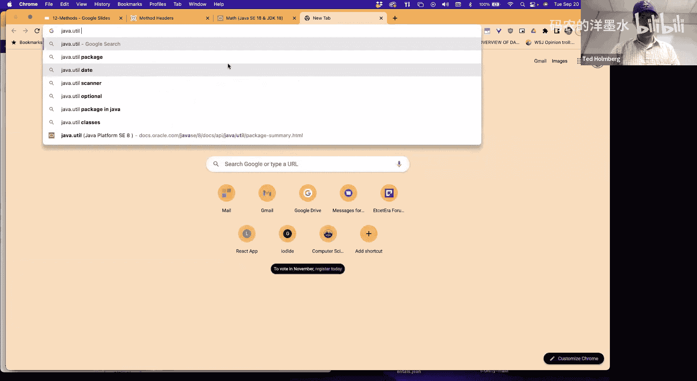
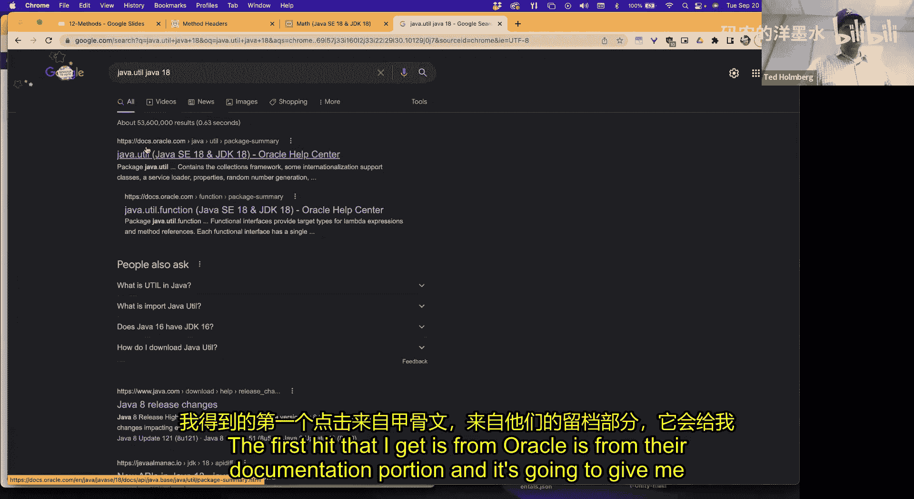
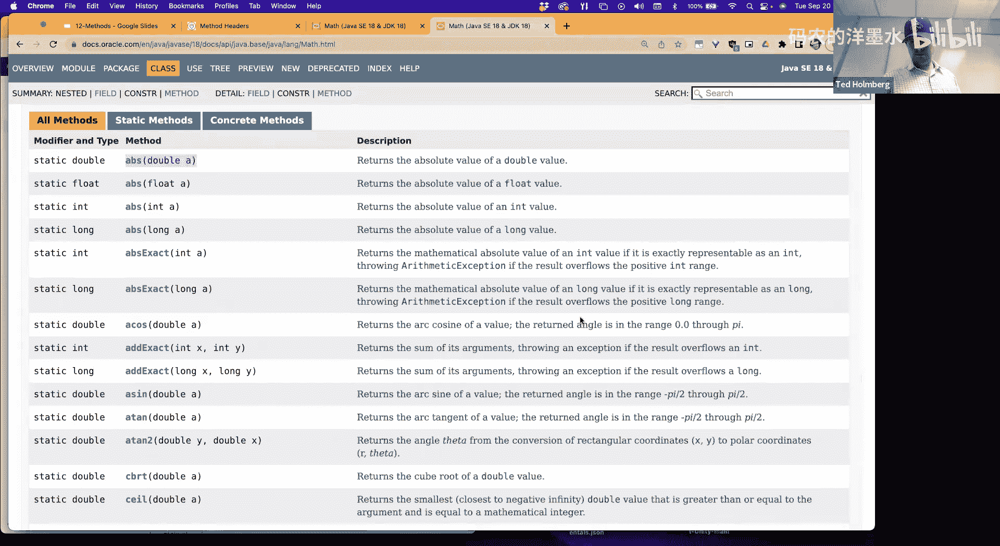

# 软件设计与开发：12：方法、类、包与应用程序接口 📚


在本节课中，我们将深入学习Java中的方法、类、包以及应用程序接口（API）。我们将探讨如何通过方法封装代码，如何将相关方法组织到类中，以及如何使用Java标准库中的API。课程内容将帮助初学者理解这些核心概念，并学会如何阅读和使用API文档。

---

上一节我们介绍了方法的基本概念和优势，本节中我们将详细拆解方法的构成部分。

## 方法详解 🔍

方法由两部分组成：**方法头**和**方法体**。方法头定义了方法的访问方式、返回类型、名称和参数。方法体包含了实现具体功能的代码块。

以下是方法头的四个组成部分：
1.  **访问修饰符**：例如 `public` 或 `private`，决定其他类是否可以访问此方法。
2.  **静态修饰符**：`static` 关键字表示该方法属于类本身，无需创建对象实例即可调用。
3.  **返回类型**：方法执行后返回的数据类型。如果不返回任何值，则使用 `void`。
4.  **方法签名**：由方法名和参数列表共同构成，用于唯一标识一个方法。

方法体是包含在一对大括号 `{}` 中的代码块，它包含了方法要执行的所有指令。

---

上一节我们了解了方法的构成，本节中我们来看看方法如何与输入输出交互。

## 方法的输入与输出 🔄

方法通过参数接收输入，并通过返回值提供输出。根据是否有输入和输出，方法可以分为四种类型。

以下是方法的四种类型：
*   **有输入，有输出**：方法接收参数并返回一个值。例如，计算两个数之和的方法。
    ```java
    public static int sum(int a, int b) {
        return a + b;
    }
    ```
*   **有输入，无输出**：方法接收参数但不返回值（`void`）。例如，打印一条定制消息的方法。
    ```java
    public static void printMessage(String msg) {
        System.out.println(msg);
    }
    ```
*   **无输入，有输出**：方法不接收参数但返回一个值。例如，获取固定问候语的方法。
    ```java
    public static String getGreeting() {
        return "Hello from Java!";
    }
    ```
*   **无输入，无输出**：方法既不接收参数也不返回值。例如，执行一个固定任务的方法。
    ```java
    public static void doTask() {
        System.out.println("Task completed.");
    }
    ```

调用方法时，必须按照方法签名中定义的顺序和类型传递参数。返回值可以被变量接收或在表达式中直接使用。

---

理解了方法的基本运作后，我们来看看如何将相关的方法组织在一起。

## 类与包 📦

**类**是一个容器，用于组织**相关的方法和数据（字段）**。例如，Java标准库中的 `Math` 类就包含了各种数学运算方法和常量（如 `PI`）。

**包**是用于组织**相关的类**的目录（文件夹）。Java使用包来管理庞大的类库，避免命名冲突。例如，`java.lang` 包包含了Java语言的核心类。

`public` 关键字使得一个类或方法可以被其他包中的类访问，这是代码可扩展性和重用的基础。

---

上一节我们讨论了如何组织代码，本节中我们来看看如何理解和使用他人编写的代码。

## 应用程序接口（API）文档 📖

**API（应用程序编程接口）文档**是软件组件的使用说明书。对于Java，API文档详细列出了每个包、类、方法和字段的说明。

阅读API文档时，每一行对应一个方法，其信息与方法头一一对应：
*   **修饰符和类型**：如 `public static`。
*   **返回类型**：方法返回的数据类型。
*   **方法签名**：方法名和参数列表。
*   **描述**：用自然语言解释方法的功能。

例如，`Math` 类中 `abs(double a)` 方法的API条目表示：这是一个公共静态方法，接收一个 `double` 类型参数，并返回一个 `double` 类型的绝对值。

只有 `public` 方法会出现在API文档中，因为只有它们才能被外部代码调用。

---

为了巩固对API的理解，让我们实际查看一下Java的标准API。

## 探索 `java.lang` 包 🧭



`java.lang` 包是Java语言的核心包，它会被**自动导入**到每一个Java程序中。我们无需编写 `import` 语句即可使用其中的类，如 `System`、`String` 和 `Math`。



以下是查看 `Math` 类API的步骤：
1.  打开Java官方API文档（例如，搜索“Java 18 API”）。
2.  找到 `java.lang` 包。
3.  在类列表中点击 `Math`。
4.  在 `Math` 类的页面中，你会看到两部分：
    *   **字段**：类中的常量数据，如 `PI` 和 `E`。
    *   **方法**：类中提供的所有静态方法列表，如 `sqrt`（平方根）、`pow`（幂运算）、`max`（最大值）等。

通过API文档，你可以快速了解有哪些现成的工具可以使用，从而避免“重复造轮子”。

---



本节课中我们一起学习了Java中方法、类、包和API的核心概念。我们拆解了方法的构成，区分了不同类型的方法，了解了如何通过类来组织代码，以及如何利用包来管理类库。最重要的是，我们掌握了阅读API文档这项关键技能，它能帮助我们高效地使用Java丰富的内置功能和他人的代码库。记住，优秀的开发者不仅善于编写代码，更善于利用现有的资源。