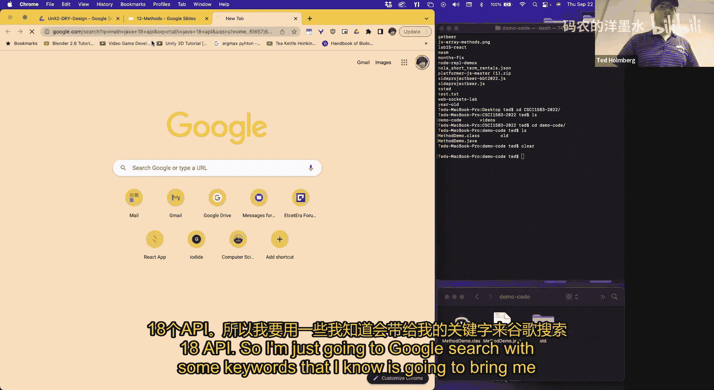
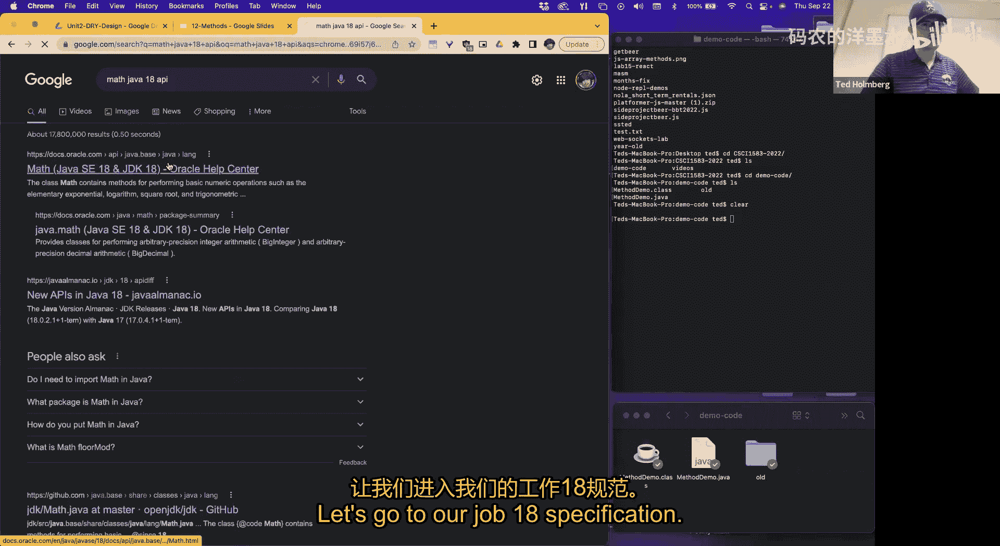
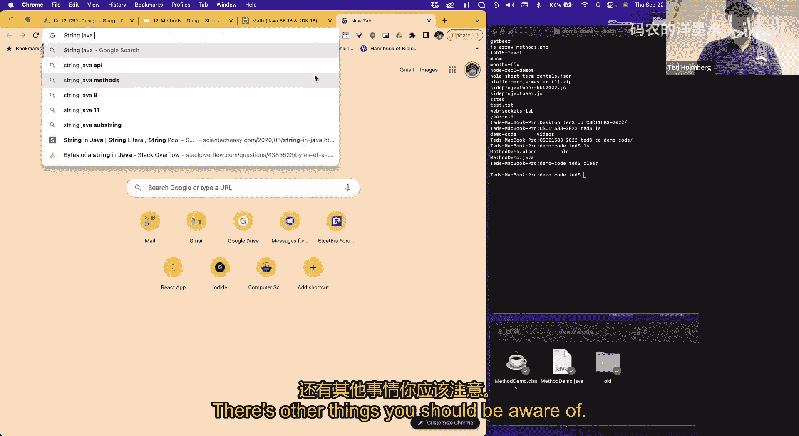
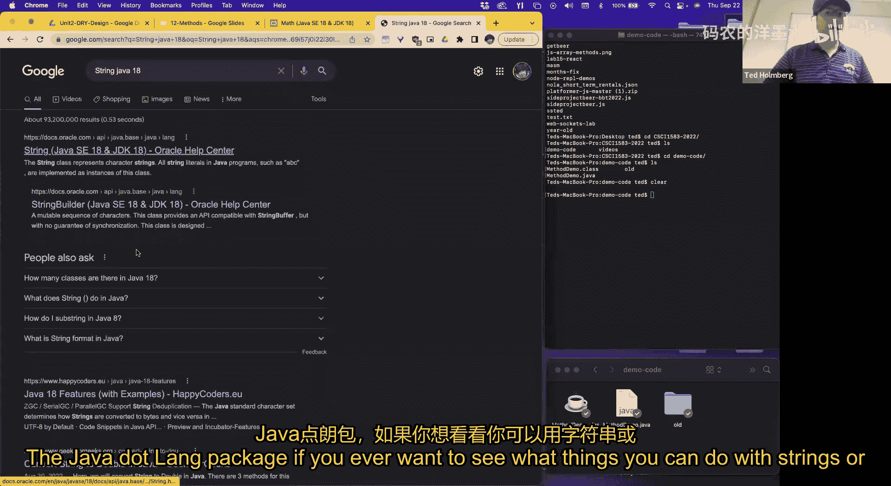
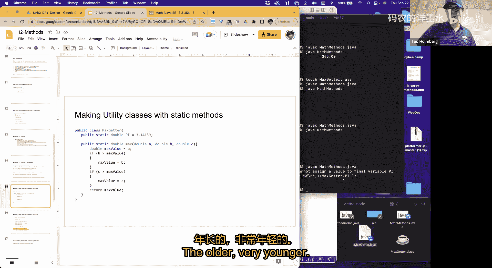

# 【全集】加州理工学院 软件设计与开发 中英字幕 1080P p13 Lecture 13 - 应用程序接口与数学类 -BV1AvzCBdE7a_p13-

Cloud， perfect。

Okay。So we're going to continue our discussion on methods classes and packages we were really。

 I think last time talking about。Methods。Method headers。

 method bodies within looking at API documentation。

 which gives you valuable and important and valuable information about methods that other people have written that you can then import and use in your own software。

😡，And so if you want to use the methods that other people have authored it's important to understand how to parse that documentation。

 I think we started to do that if i'm not mistaken。

Now I don't have those tabs open and let's go to where we last left off so we had mentioned the overview we had mentioned methods here。

I think we got。I this about where we were at， I think， about right here the methods right there？

Was here was it at the API breakdown？咁你放咩话晒。Let's see so I know we talked about this。

 we talked about the methods breakdown about how a method can be divided into a method header and a method body。

And the method header gives to the JVM all the important information that that method does。😡。

Before you even start implementing it， so it lets the JVM know， hey。

What has access to this method so if it's public everything has access to it if it's private only this particular class。

 so anything outside this class is restricted from it， if it's class。

 if it also has class in the access level， then it means the method is available from the class name itself。

 we're going to see that in the example that I'm going to go ahead and illustrate to you when we start building out the the when we use the math class。

 and then we build out our own method that we'll call max Stter。😡，Then we have the return type。

 the return type is either a void or a data type， it's void if the method is a procedure type method where all it does is process a set of statements but does not return back of value。

😡，It has a nonvoid return type， which could be an end， it could be a double， it could be a string。

 it could be a boolean if it is a method function， which means it processes it executes a collection of statements and then afterwards returns back a value of that data type so one thing you should always recall with a method function is that it has to have a return statement remember we did a sample method last class where we gave a return type for a method procedure one that doesn't give back any data one that had a void return type。

 but that is optional， we saw that that method also works if we omit the return keyword but it does not work。

😡，On the flip side of that， if it's a method function。And then we have the name of our method。

 which does not have to be unique unlike variables and that's because the signature of a method。

 the signature in our programming languages are the things that have to be unique the way that the JBM identifies between methods is based off of a combination of the method name and the set of inputs that the method uses。

 so that would be the parentheses with all of the local variables that are declared as input values and so again just like any other kind of variable declaration is going to be defined by data type and then whatever name we want to apply to that variable it should be meaningful and then we can use that variable inside of our method to represent whatever inputs the end user or whatever the client code we usually call that client code。

 whatever the client code is providing to this method。😡，Okay， so here we go。

 I have we were at the list of modifier and type method plus description。

So I think that's probably where we're at。🤢，Okay， and then we did this。

 I know for fact we did a sample code， so I'm not going to walk deeply into this because you'll if you need a recount of this。

 you'll get it in the video when I post it later today。😡，So I will skip this slide。

 but this is the one that I was talking about earlier where we have the two return statements and then I do remember omitting this one to illustrate that it still works but you can emit this one because this one says it does return back a string and then we also looked at the inputs here。

Where we give those inputs and they have to be in order。

In order for it to work because I showed those error messages as well。

 then we talked about the API and we highlighted the fact that in our Java code basis。

The way that it works is we have our instructions that actually do operations。

 all of our statements go into methods， all of our methods go into classes and then all of our classes go into packages and so the API documentation will show you what are all the package well packages can be nested inside of packages as well。

 so what are all the packages in classes inside a given package what methods are inside of a class because the smallest unit of code inside of Java as a method in fact if you ever hear of unit testing or which is something you'll learn about next semester in Java2 the unit you're testing is methods。

You're testing on a per unit basis。And I believe we even opened up an example。

 didn we navigate last class to Oracle's API and look at something like this where we did a breakdown of this is the modifier and type so the API documentation is certainly in line with the same way we declare those headers inside of our code base so this is the access level and again we o public because if you're going to be on the API you're available to other developers we ignore all the private methods because they're not important。

To us as external developers， as client developers。

Static lets us know from where we can call this method from so we know that if it's a static method we can call it from the class itself。

 we're going to see an example of that to really internalize what that means。😡。

Here double is the return types so this I know just by reading that that I'm going to get back a double when I call this method and then the method signature is given to me so that's going to be the name which is in the bold and then the set of inputs are in between the parentheses and again the set of inputs are always going to give the data type and then a labeling so in this instance the one that's called abs for absolute value is going to give the label of a so that's just a variable name to the input that goes into there and then we have this description this returns the absolute value of a double value。

😡，Okay and then the next thing I wanted to do was actually start walking through the package of Javava。

 laying and I think we started that and in fact and I think we even got to the math class let me get to that so let me start pick up from there so math Java 18 API so i'm just going to Google search with some keywords that I know is going bring me to where I need to go into the API documentation here。

One rule of thumb is。Always use。The most up to date version of。

Software when it's available and that's true for any software right so if your operating system has an update。

 you should install the update if Java has an update。

 you should install that update so I'm not going to look at Java 8 I'm not going to look at Java12 or 13 I personally want Java 18 now there is a cave out to this usually what most enterprise firms are going to do or larger companies are going to use what's called the Lts release is everyone familiar with when an LTS release is。

So usually there's two versions， especially in the developer community where you have the newest version and then the LTS release。

 the LTS is long term support。So if you commit to implementing on a codebase and you know that that codebase has to be supported for a number of years。

 then you want to adhere to a long long terms of support release so that you know that three years from now five years from now they're still issuing that that's still going to be a supported API now they'll have releases before then and if you're developing software for fun or for your own personal projects it's always nice to get the newest version to see what they've added to it but in the professional realm usually're restrict yourself to LTS releases som justn you know I'm saying always install the most up-to- date version but you know I live in academia and I don't you know build professional software that has to meet production level requirements all the time so those developers would say always install the LTS version but the most recent LTS version。

Okay， let's see here let's go to our Java 18 specification so here there's a couple of things we're going to see I think I highlighted this last time we have the module the module is a nested package that's inside of Java do playing so Java playing is implicitly。

Import it into all Java applications， so that means every Java application gets everything inside this package we don't have to import it like we have to do with Java。

 u。😡，So inside a job without lay I'm just going to pick and choose some interesting things well such as the math class because I actually want to show you samples of the math class remember the motivating thing I said last time was that。

One of the issues with the arithmetic operators， the primitive arithmetic operators that we have access to is that they limit you to very remedial computations right like you can do sub traction。

 addition， multiplication and division， that's it。😡。

So very often is the time that you need more complex math operations and you probably don't want to have to code those yourself by scratch so what Java has done was include as part of the standard library part of Java dot L part of the language spec is a class remember one of the things that classes provide to us is it allows us to group a collection of related methods together so we know a method is a block of code to code block that perform some task and the task that it performs is usually told to us in its name so if we have a group of similar tasks or related tasks like taking the absolute value computing the let's say the trigoometric functions finding the square roots taking the power these are all mathematical operations。

😡，It would make sense that we would cluster these， we would group these all together into a class that's called the math class。

So let's go into the math class here in the API here we have our fields fields is just another name for a variable these aren't really variables though because they use the keyword final final means that it's read only or another word for that is constant so these are constant values that are static or their properties of the class and they give us our value of E and they give us our value of pi and then we have all these methods and so this is one thing I want to highlight look at the first what is the interesting thing about the first four methods that are defined inside of our API here under the math class yeah and so that's that's the idea you can have methods that all have the same name in fact this is a strategy that the architects of Java。

And like wanted to really promote it' it actually has a name。

 this is what's called method overloading。Method overloading means you can have methods that have the same name but。

😡，The JVM can differentiate one from the other because it doesn't use just the name to select what method。

 what block of code is going to get executed when you use it it's also going to look at the set of inputs to make that decision so notice even though the first four methods all share the name tabs short for absolute value。

😡，Or absolute， they all have a different。Input now the number of inputs is the same its one input but the data type is different so what does this mean to us transparently it means that it doesn't matter what data type are numerical value is whether it's a double data type or whether it's a flow data type or whether it's an data type or long data type notice those are all numerical data types right but they're technically different from one another because theyre either fractional or they are integers right they're non-fal or because they have a different amount of encoding space so they can be larger than other numbers right like longs can be a bigger number than what ins supports or double can have more precision points than what float has but regardless of what you use for your number by overload。

😡，The method abs。It doesn't matter what the data type is， you can still use the same method name。

 you see how easy that is think about if you couldn't do that what would be the alternative you have four methods with four different names one would be abs double abs float abs long and abs int。

😡，It'd be like using the scanner object where you have to specify the type of data that you're putting into the method in order to try to get back。

 but with method that overloading you make that transparent you only have to remember one method name and then it select based off the data type you use you see how much easier it is for you that you have to remember less because of that。

😡，So I mean， does it make sense， does everyone understand the value of method overloading？🎼Excellent。

 okay， so with that said， just looking at this， we have this so obviously if we send in and double。

 we're going to return back a double， if we send in a float。

 we're going to return back and float if we send in and in we're going to return back and in and this just gives us a description So returns the absolute value of double returns the absolute value of flow and long so let's say some of the interesting methods that we have here inside of。

The math class so we also have like the arc cosine we have arc signine arc tangent。

 so if you have to do any interesting either trade functions or geometry functions you can go ahead and process your results there we have ceiling what do you think ceiling does take the ceiling of a number。

Yeah， exactly， so so it's going to return the smallest double value that is greater than or equal to the argument。

And then same thing with floor。Where it will remove the fractional component right so the ceiling so like if I did ceiling of say for instance。

 4。7， it'll just bring it to the next high signature if I did floor a 4。

7 just brings to the next level a signature right rounding is the thing that makes the decision on whether it is five or higher then it it gets rounded up or if it's four or lower it gets rounded down right that's rounding floor and ceiling doesn't care if there is a fractional number and it's a ceiling operation it just elevates it up to the next level if it is a floor method and it has any fractional number then we'll just bring it down to the next lower value it just drops the fractional component。

Okay， let's see what else we got here， yep this floor。

We have log values we have max values min values here you can take in two different numbers and we're return to max value two different numbers and the min value you can see there is a lot of methods in here here's one that you used we'll use it again today because I want to have a i'll probably give a lecture on this on Tuesday well yeah this is actually what i'll do on the pre reporteded lecture so this will be a fun lecture that to listen to so we'll talk about random numbers。

And you've actually seen this method already because that was in the homework right the way that we got the zombie to move around randomly was we use the math class and inside the math class is a random method and the random method returns back a fractional number that is scoped between 0 inclusive and one exclusive。

 which means that it can never be the number one it's going to be some number that always is the number0 points and in anything from 0。

0 to 0。99999 until there's no more memory to have not。Yeah。

So we'll take a look at that in a moment and we have a square root here so that if is if we need to take a square root that's pretty valuable if you ever need to compute things like error or distance or things like that。

And we also have where did P go？Iues it would be here and here if we want to go ahead and compute。

The power of something the base would be here and then this would be the exponent value so if you wanted to do like two to the power of four I could put two as my a and four as my B value excellent so anyone have any questions in terms of reading the API is everyone comfortable looking at the API and kind of understanding what these methods do。

Okay， so everyone can read the descriptions， does everyone feel comfortable reading the inputs values。

 okay， and does everyone feel comfortable being able to see what output it's going to get back。😡。

So let's play around with some of these then。And before we play around。

 I just want to highlight other。We are going to play。

 I just want to illustrate that here there's other things you should be aware of like， you know。

 string is part of Java。😡。

The Java dotl package。

If you ever want to see what things you can do with strings or integers or doubles like they have all these built- in methods that you slowly learn sometimes by working through the lab right sometimes your lab instructor will show you these methods you didn't know existed。

 but if you wanted to learn where they existed without having to depend on like the lab instructor or myself showing you。

😡，This is where you would go to find these things yourself right so in absence of someone else explicitly saying hey。

 you could do this cool method， you could explore you could browse what's available to you through the documentation so all of the data types。

 all the primitive data types I would recommend you just perusing the methods to see what's available to you。

So I know that we've used the system format i'm pretty sure we use it i'm sorry string dot format。

 which is a really powerful mechanism for us to make formated strings without having to send it into the output stream Okay。

 let me go back now to our slides。So here's some examples of some calls and I want to go ahead and。

🎼And we'll walk through this but the first thing I going to do is make a class map methods do Javava Okay。

 so now I have this let's go ahead and open that up so we'll open that up and。What do I usually use。

 visual studio code？Okay， despite what I just said。

 we will ignore the update in the middle of a lecture。

Don't always install the newest version right away。Yes。Okay。

 so here we have math methods let me cut code out and i'll add it in as it's relevant so let's cut out and always see because I like I like the evolution of code I think there's something to be said with how things evolve over time so the first thing we're gonna to do is what we always do whenever we create a new Java file we determine what the class name is going to be and that's the name we give the file name so immediately since I call this mathmatic such Java I know i'm going create a public class math methods now。

Inside of here， this is going to be an application so we need to have the main method。

And so the purpose of this application is to show you how we can use the math class to do more complex math operations so it's just a demo application so anyway have my main method my main methods defineds inside of my class let's check out some more stuff okay let's cut up this stuff here so the first I'm going do is I'm going to declare some data that we're going to mutate over the course of this application so i'm just going to make everything double so that I can have fractional values on it so as I do my computations here I'm just going have an x of y and z value that are random values ones x is 100。

6 y is3 z is minus345 minus 345。So again， these don't model anything。

 this is just to show you math operations so they are allowed to be random numbers。

 they're allowed to be bad variable names like X y and Z because that's really representative what math mathematicians do right mathematicians are horrible at naming variables inside of their algorithms or their formula。

😡，I mean， they don't even update the names after when they're given。

 you give a name to a formula back when was developed in the language of Greek and we still use pi and theta and mu and。

It is so much easier if we updated some of the terminology there to make it a little bit more transparent in terms of learning what those formulas are really expressing。

Okay， let's say here。Okay。Let's take a look so what I'm going to do here is I'm going to。

Invoke those math methods now like I said， since the math class is part of the Java dotling package。

 I don't have to import it so I can use it right away and because those methods are static I have access to them from the class itself what that means is we can use a dot operator remember the dot operator allows us to access one thing from within another thing so these methods exist inside of the math class so when I can do is I can say hey this as method right that was in the API which was defined inside the math class since it's a static class I can use the class name math and that's how I invoke it so from class math is in abs methods that a method if you remember can taken a numerical value any numerical value because it was overloaded it could be an int it could be a double it could be a floatat。

 it could be a long。Here we have a double so that's the one it's going to use it selects to use the one that matches the data type and that's transparent to us the JDM does that automatically。

😡，Again， one of the advantages of method overload。So remember this has a return type。

 so it's going to process whatever it does internally to produce an absolute value and then it gives it back to us inside of our code base and since it gives us back a value since it resolves back a value I can then take that value on the righthand side of an assignment operator recall an equal a single equal sign is an assignment operator and Java and most other programming languages and then I can store that into my variable result which I had declared but did not initialize so this is the first time' given it a value so after I do that I can then go ahead and print it out。

 I can print out hey， the absolute value of my fractional number。😡。

Is going to be whatever's inside results and then we can do the same thing if we want to do another computation。

 let's say I want to find the square root of nine。Well， the math class had a。

It had a method for that we saw it in the API documentation so let's call it let's from the math class we'll use the dot operator to to access a method within it we'll call the square root method oh let's not do that that's not the method name okay and then we'll pass it a value because it requires input。

And then we'll get back the result and then we'll print that out。

 then we'll test out the power method from map so it will supply as the first argument。😡。

The base and as the second argument， the exponent， so this is the equivalent of saying two to the power of three。

And then we're going to print that out。And then we're going to check out， hey。

 what about the max mapping where I can plus in two values？😡。

And x and a y and it will give me back the highest of the two and why don't we walk through why don't we first。

Collectively decide what these value should be and then let's see if it actually rings true so what's going to be the absolute value of Z here what is the my value of Z when I run this。

😡，Yeah， so there's going to be 345 is what I should get back positive 345 what about here what should be the result of line 11？

😡，Yeah， that should be three， what should be the result of line 14？Eight， right。

 two to the power of three is eight。And then what about here， Ma Though Max？😡，Yeah， so my y。

 my x is 100。6 and my y is3 if it returns back the max， it's going to be the 100。6。And then finally。

 I just want to highlight it's not just methods we can access。

 remember there were two fields also declared inside of the math class。

 it was pi and E and since they are public，😡，We can access them and since they're static。

 we can access them from the class itself， so from the math class I can use the dot operator and get a value of pi so let's go ahead and run this。

😡，So the first thing I'm going to do is compile。And then here I'm going to go ahead and run。

And so here the absolute value is 345， the square root is three， two to the power of three is eight。

 and the max value is 100。6， and then pi is 3。141593。Excellent。

 does anyone have any questions so you see how easy it is to use these methods other people have written and the advantage here is we don't care how they work。

 we just care about what we need to give to it and what it gives back。😡。

Yes actually so suppose that's a good question suppose I wanted to have only two decimal points one of the powerful mechanisms of parent f。

 which is why I like to use it so much is that I can specify instructions on how to display that variable in between the percent sign and the f so if I put like point two that lets me know limit the precision points of my decimal to two floating points so let's actually do that on all of them and recompile and test that out。

And actually， we'll even do it here。So this recompile and so now when I run my code notice everything now on my output。

 I can blow that up a little if you need to， is that better？Is now。

And if I wanted it to be zero floating points， I can make it zero even。😡。

Does all have the really strange result of displaying and。Oh。

 that's not what I want to does I have the really strange result of printing out pi is three。

Good question though， but and there's other things you can do like that as well and if you look it up。

 you could see all the different options you can do with format specifiers like that with being able because you could you could front load the number so that you can preendd a0 so it has to be like the leading digit let me see here if I can sometimes sometimes these are things that you do so little you have to look it up every time。

 but let me see if it's like that I want to say it's the value you want to prepend you put and then the number of units after that so I think 04。

0 makes it a four digit leading value and then the precision points will be zero。Actually。

 let's make the precision points too， let's see if I remember that correctly。

This is where you start getting into more eclectic things。No， so that's so let's see here。

 I wonder if that's going to。Let's comment out。Let's see if。Underder if it's the reverse then。Well。

 I want to go down a rabbit hole because I might do that。关对电话。

Oops nope yeah that's definitely not a because now yeah。

 so this so this first one's going to limit the number of digits that it can be。

 but I think that is a limiting value and not a a not a front load I don't remember how to get the front loaded number but you can look it up you definitely look it up。

Is there any other questions about this？Okay， so now what I want to show you next is that even though this is given to us。

 there's not really any magic that's happening， it's just a convenience factor。

 someone else can write a collection of methods， put it in a class and then share it with everyone else。

 and now no one else has to write or duplicate that code。

 notice this adheres to dry design for everyone for sharing code so if I write a method I can share it with everyone else。

 you can import my class into your codeb and then everyone else can use my methods。😡，So。

If we wanted to do a demo of that suppose that we create our own method maps。

 we're going to create a class that's not the math class it's going to be the max getter class and in fact let's take a look and I think I have it inside of my slides here。

😡，Okay so before we get there let me make sure i've highlighted and said everything I want to do about the math class so math is that all static methods one thing you should know about static methods because I don't think I had mentioned this before and I do want to make sure that is highlighted before I move into designing our own classes is that usually when you have a class that has nothing but static methods and if you look at the math class thats that's like the math class right it's nothing but a collection of static methods which are methods that are available from the class usually those are very specific classes they're usually called utility classes and it's because there's there have a group of essentially functions。

It's's a group of things that you use to process data with so it has some utility to other applications you don't build instances of it by for instance the scanner object we actually build an instance of and use the math class。

 the only reason why the math class exists is to have all these utility methods。😡。

And so usually a utility class is one that does not have a main method。

 it's utilized by other classes。😡，So classes help contain and encapsulate groups of methods that's what we're about to see that's what you already see with with the math class using the static keyword allows methods to be accessed from the class name from other classes provided it's also public so that's what public static means and so it's just a better way to organize our code classes can contain both methods and variables we saw that with the math class because it had pi and it had all the methods we played around with and then the final keyword makes a variable read only or what we otherwise call a constant and it prevents it from being changed so again just things I want to highlight since we looked at the math class。

So we can evoke methods from other classes， this means that Java is an extensible language which means that new functionality can constantly be added to it。

 that is in fact why we have a Java 18 can anyone think of like the equivalent of a programming language where you can't add to it something that is not an extensible language。

I could think of a couple。m using a calculator is like that right there's a closed set of instructions you can only do so many computations with a calculator a year from now it's going to be the same set of computations on your calculator other examples which might be a little bit out of date now but like a microwave for instance I don't think that's out of date everyone still uses a microwave right it has some pre programgram functionality that you can expand you can' extend。

I mean， unless they have smart microwaves now， they might have smart microwaves now。

 usually when something has the term smart， it means that it's now extensible。

 it can actually grow and evolve over time。DVRs are another example of that formerly old school VCRs right are programmatic that you can program them。

 but it's a close set of instructions that never extend over time。😡。

So that's what you can paralyze it with that's what you can compare to when I say that our code is extensible it's why Java is on version 18 each version releases new methods。

 but you don't even have to depend on the architects to include new methods you can include new methods the same way we did the math class and I'm about to show you how we can do that how you can create your own methods to use on your code base because that's where it really shines where we don't become reliant on someone else to give us the methods to share we can start doing it ourselves and we can create a shared。

😡，Collaboration of code that we each write one part of it once and we all make use of it。😡。

We strive to classify similar sets of methods into a singular class so remember there's that metaphor that collections of related。

Collections of related methods go into a single class， all math methods go in the math class。😡，Yep。

 okay。So let's take a look at making our own methods we're going to create a max getter method。

Let's go ahead and。And effectively， the entire point of this method because again。

 whenever we create the entire point of this class because whenever we create a new class。

 we want to identify what is its purpose in our software application。

 this is just a proof of concept of we will implement a method that we've already come across inside the math class to see how maybe they implemented it。

😡，So we're going to do that work ourselves， so let's go into here。Into。Wait， where is mine？

It's probably behind I see it got away from my computer there we go Okay， let's open up this。Okay。

 I'm going to update this here， I'm going to make this what it was before。

So it's consistent with what's inside the thrives。Okay， so in the max method， max getter method。

 let's go ahead and start。From scratchs so i'm going to cut out the implementation that's in the slide so the first thing I would do is I would define a class I want this class to be public because i'm going to use it inside of my math methods class so this is going we're going to build our own utility class a class that is designed to support another class this will be the first utility class that we've designed ourselves because open to this point every class we've created has always had a main method which meant that it was an application class right it was a class designed to be executed。

Okay so that means I will not add a main method utility the classes。

 you don't need to have a main method inside of a class。

 you only have a main method if it's supposed to execute and do something the max getter class is not supposed to execute and do anything on its own。

 it's supposed to have methods that other classes will rely on。😡。

So it's going to start having code that it shares with some other class。😡。

So we can start breaking the logic down across meaningful ways we'll see how that works in practice soon Okay。

 so I want to show you two different ways that we can add code and it's similar to what we already saw。

Here I can either add fields a field is just another word that we can call a variable i'm going to call this public static now i'm not going to apply the final keyword because I want to show you that if I don't apply the final keyword other classes have the ability to mutate this which is really dangerous we don't really ever want other classes to impose their will into our own class without permission right that's usually why we label our our fields as private but if I don't do that you'll see how the math methods class will be able to access the pi。

😡，Variable， even though it's another rule of thumb is when something's declared as a constant or read only variable you always use uppercase letters to illustrate that so it's a readability thing so you could read one line of code and identify whether somethings supposed to be a variable you can write into or it's a constant or a read only variable something that you can read the value up but you can't overwrite so we're going to pretend like this is a constant value we're going to forget to put the final keyword and we're going accidentally mutate it inside of our code base then we're going to fix it。

😡，Then what I'm going to do in here is let's talk about how we might implement Max and in fact。

 why don't we make a better version of the max method？😡。

Then what's inside of there in fact i'm going to delete the code and i'm going to say if we can't figure out how to implement this ourselves Okay。

 so suppose we want to go ahead and figure out how to get the max value of three numbers instead of just two right the math class is the trivial。

Implementation it makes a selection between a and B what if we made a selection between a B and c okay that's how max getter that's how our max get is going to work。

😡，So how would how might we do that why don't we now since we're implementing the method we now have to think about the ni degree implementation details right now we're in the role of designing the functionality of this method so how do we do this how do you do this in real life if I wanted to。

😡，Decide which one is higher， is it A B or sit how do you mentally do that let me give you an example。

 which is higher two， three or four。😡，Okay， which is higher four， three or two， okay。

 which is higher， three， four or two so everyone can do this right clearly。Now。

 explain to me how we can tell the computer how to do that。Yeah。

Yeah that's because that's what we do mentally right we evaluate the first number so why don't we do this what is it so let's say we assume the first number is max so we're going to create a local variable that represents our current max value max is going to be the first number because it's all we know about so far Okay then let's say next thing we might do。

😡，And compare it， right so。So， if。B is。And so what should we compare it to？Yeah。

 it makes sense to compare to a， but I'm going to argue for readability's sake。

 wouldn't it be better to use the variable max that we created？😡。

That'd be more readable right and so what's the relation between B and max？😡，For this if statement。

What are we doing in here so we know we're comparing these two， how should we compare them？😡，Okay。

 so if B is greater than max， then what do we do inside that F statement？😡。

Then max is assigned the value of big。系啊。Okay。Perfect。Okay， so everyone's happy with that so far。

 okay， so but that's only part of the story， what do we do next？Yep。

 if and now you see the strength of using the max variable as opposed to explicitly doing a and B right because let's think about this if we do max and we do the same thing。

😡，Let's think about this if b was greater than max， then max is the value of B。

 but if b wasn't greater than max， then max is the value of a。

 but it doesn't matter if it's the value of a or B because at this point it's still going to be the max value then so we'll take whatever the current max is。

 we'll compare it to C， and if c is greater than max， then we will say that max is now assigned C。😡。

And now we're claiming to do what here in this part， we're returning a double。

 so what are we going to return at the end of this？😡。

You have to have a return statement right anytime it's a non void return type that means it's a method function to what's the end thing that we're going to deliver at。

😡，Max， exactly， okay， let's test this up。Now let's go into our。And let's compare this。

Let's copy this and let's。Do instead of max now。Now what I can do is I can type in Max Skitter。

 my own class。😡，Since it's a static since we define that as a static method it's available from the class level from the class name itself and since it's in the same package the package is the same folder then it also gets implicitly imported so we don't have to manually imported so that's another rule you should know about it so in Java the Java do lane package and any class files that are share the same folder the same package as the current class so I can automatically use that and it will see that and so here I'll do what is the max between X Y z what should that result be。

It's yeah， it's going to be 100。6。 Okay， perfect。 And also， let's do this。 Let's。

 let's I'm going to copy pasta here instead of map up pie， we're going to do。Maxgitter Pi。

 and I just want to illustrate that we can define both fields that are available from our own user defined class or methods。

 but set this out and then I'm going to show you what happens by not making that read only。

Let's run that code really quick and here notice this is the max here。😡。

From our max getter class and this is the max from our math class so notice we've replicated exactly the behavior that was given to us from the max class that's all they're doing in Java we just didn't have to think about how to implement it but moving forward we can start breaking our code base across very various classes and that makes it way more readable it makes it more much more easy to find where your methods are and where your code is inside of a larger code base。

😡，So when you start building out a larger application。

 it becomes much easier to debug it and maintain it and add to it。😡。

And same thing with this pie it looks exactly well pretty similar we didn't go as many digits。

 but look at this look what i'm going to do。The pre increment so that you could actually see the result because it's not final I'm going to try incrementing pi I'm going to from the the math methods class tell the max getter class to increment its variable and since it is mutable since it is ridriable since it is mutable we will be able to now see that now pi can be 4。

1451590 so if I want to prevent that all I have to do is add the keyword final in there。😡。

And so now if I tried to go in， it's going to say， hey， you did an error here。

You cannot assign a value to a final variable。Because it's right， it's read only。

You're not allowed to write into it， so keep that in mind if you're sharing data between classes and it's public。

 most often you don't want the other class to have permissions to override it because that's super dangerous because now any other computation that relies on the value of pi would now be wrong。

😡，So you want to have that accessible so so so other classes can read it。

 but you don't want them to also be able to overwride it and so that that's what the final keyword allows us to do it allows us to share data in memory in a very。

😡，In a very approachable way so the idea here is I could have expressed pi is 3。

15149 right but isn't it more understandable when it's in the math class and it has the name pi that's what's called self-documenting code we want to avoid what are called magic numbers in our code based magic numbers or code that is part of your logic that affects something but it's not given context it's not given context because it just appears as a number remember' we're in the business of mathematical modeling so we should ascribe context to all the numbers we use so if you make a decision based off of a number and that number doesn't change don't just use the number。

 create a constant value that has a meaningful word and make it final and use that for your logic because that gives other authors even yourself in the future your future self the context to understand why you're comparing against that number。

😡，We're going to look at that in the next lecture I'll give you a demo of that is there any questions I ran out of time is there any questions？

😡，Okay， how are you guys feeling about methods so far， excellent okay？可呀。That's in right here。

Excellent okay so if there's no questions we'll pick up with methods again on the next lecture which I will prerecor and share with you all i'll send you an email out when it goes to and i'll just expect that everyone kind of watches that from whenever I posted so I will see you all。

In person on next Thursday。我嗯。It's going to be for my brother's birthday so very younger。

