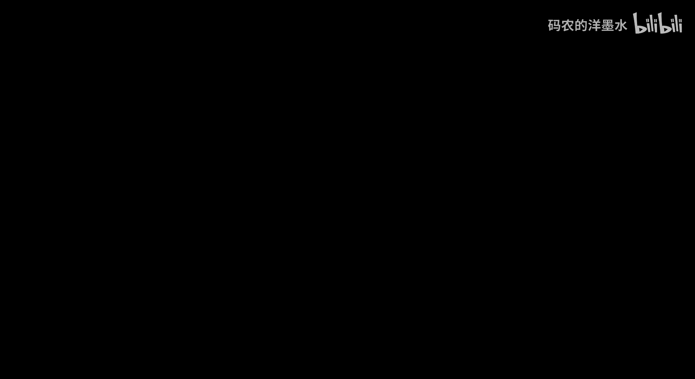
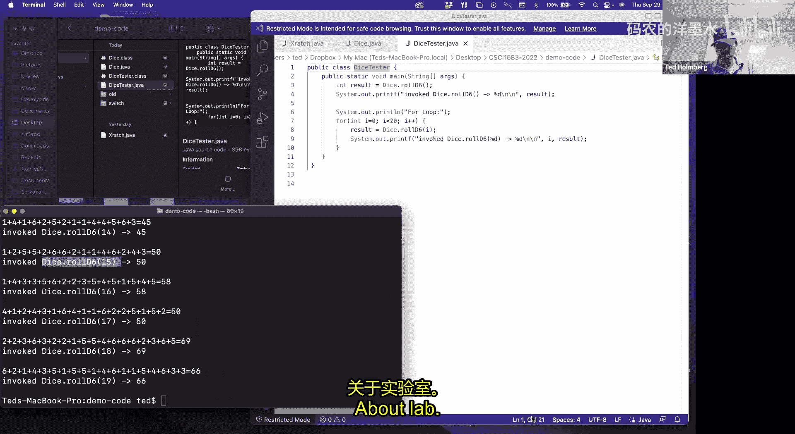
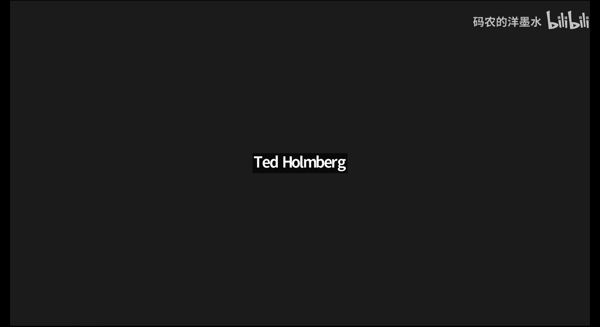

# 【全集】加州理工学院 软件设计与开发 中英字幕 1080P p14 Lecture 14 - 工具类与静态方法 -BV1AvzCBdE7a_p14-

Okay， I'd like to spend our lecture today to continue with our。

Examination into methods so up to this point our in our last lecture we had really spits taken a lot of time to define。

Methods and how they。Der from variables， how they differ between classes， how classes and methods。

Kind of a interact with one another， how methods are contained within classes and then classes are contained within packages。

Well， today I want to focus on us actually designing our own utility class。

And so utility classes typically have nothing but static methods we'll talk about that in just a moment。

 but up till now and including for the rest of the。This unit。

 we're going to just focus on static based methods and static based methods and Java were commonly used。

To create these utility classes so a quick overview is that what is a utility class what are static methods and static fields we'll talk about designing a utility class。

 implementing a utility class， designing a tester class and then finally how to improve a utility class。

So。Improving。Our utility costs。Excellent。Okay， so the question is what is a utility class。

 a utility class also known as a helper class is a class which contains justt methods。

 it is stateless and cannot be instantiated。So it contains a bunch of related methods so that they can be reused across their application。

So a utility class and a main method， a utility class is not typically an application class。

 and therefore it does not usually have a main method。

It's really designed to be used by other classes。So the value of a utility class is that。

So a utility class is an example of how Java is an extensible programming language right we talked about what that means。

 it means that we can constantly keep adding more and more code to it so that other developers don't have to work on the same problem that I just solved。

Or I don't have to work on that problem across multiple applications right like if there's something that I find is a common process that or task that has to be performed if I can figure out how to solve that task and then put into a class I can just import that class into any application use it so a good example of a utility class that we've already seen is the math class right because the math class is nothing but static methods that contain which means it's stateless we'll talk about what stateless means in a moment。

 but it's nothing but static methods which from the class name itself math we can call past the data that we want process and then it gives back a result。

And so regardless of our application， we can write 10 different applications and in each one rely on the math class to perform some of those mathematical computations for us。

So what is a static method or static fields remember a field is just another name for a variable。😡。

Typically fields are in class scope though。And we also have our method so a second method is called from the class scope without the need for instantiating it。

 static methods should be stateless， which means that they have one singular behavior。

A static field is a variable defined in the class scope that has a single state for the entire class。

 a state for a field or a variable is what its value is。

So when when you have a static field and if it's mutable， if it's not read only。

 you've seen those before in math as pi or E those were read only but we can call from the math class that value state in the homework assignment you'll create mutable class field that represent an enemy position or represent a player position and you'll actually be able to change that over time so I just want to illustrate that without the final keyword the fields are also their mutable the writeable you can change the value of them but when you change the value of it it is of that single value。

So it is that for the entire class without having to instantiate it we'll talk more about instantiation later。

 but in fact I want to say we're going to mention it right here when we talk about static methods versus non static methods so in the future we'll learn about instance methods instance methods is another name we can define for our non static method。

So we explicitly define when a method is static if we omit the static key word。😡。

Then by default it's an instance methods and so here instance methods are stateful。

 which means that the same method can produce differently it could produce different results or outcomes it can process things differently based on the instance that is being called from。

😡，An example of an instance method that we've already seen is the dot equals method where the state of the string affects what occurs from that method so think about it this way I have a string here which has the state of fo remember state refer is a value that could potentially change over time so in this instance these are both strings I have one string literal that is fo and from that I can call the dot equals method on we've seen that and the dot equals method requires one parameter where we pass in another string instance。

😡，And here if I call onfo dot equals and pass bar， it's going to return false。

 but if my string state is bar and I call dot equals and pass bar so the parameter that's being passed in the value being passed into the method is the same。

 but I get a different result， so this is a stateful results right it changes based off of the state of my string whether my string is fo or bar so this represents an instance。

😡，Of a non staticatic method and a static method if I were to call this method from the class it always produces the same outcome just does that make sense and again we'll learn much more about non staticatic methods later when we get into constructors and instantiations。

But right now， we will just comment our scope to the static methods which are defined in the class and just have the one behavior for one stateless behavior for everything。

Okay， so we were talking about designing our own utility class， so suppose that we want to。

Build a dice utility class so so this dice utility class should have。

A concept of what all the related methods it contains are or all of the related fields。

 so in our dice utility class it will be a class that contains a lot of dice volumean methods so here if we were to build say for instance games whether it's card of a board games or。

😡，Dice games or any other type of games that might require a die to be used we are going to expect that developers can import our dice utility class and use it to roll die so the idea of rolling a die is kind of stateless right we tell the class the method to do something and it gives us it gives us back a result。

😡，So this is a perfect example of when we'd want to design a utility class。

So in our implementation goals that we're going to step through here。

 we're going to want to be able to make a dice Java。😡，File。

 which will represent the utility class and then to verify that it actually works。

 we're going to create a dice tester。 Java file。😡，And so here we're going to step through what are all the considerations that we're going have to make in order to properly model a die roll。

So yeah， we'll step through how to model a dice with randomness， the equal distributions。

 explain how scaling works and shifting。And then here when we get to the tester。

 we'll talk more about what is a computer simulation。

 will'll simulate enrollment and die a number of times so that we can get an accurate simulation。

Okay， so let's talk about the data modeling process where we should always first start whenever we try to build anything inside of our Java environment。

 so before we can start。Implementing a die I mean let's talk about what a what i'm going to refer to as six sided die moving forward is as a D sex that's not just a quicker way of labeling that Okay。

 so with the D sex let's talk about the physical object of a D sex what what does it have。

It has six sides and what is on each of the sides or what we'll call faces yeah a peP and it has a number of peps it can have a one it has one face has a single peip。

 one face has two peps， one face has three peps， one face has four peps one face has five peps and one face has six peps and it's designed in a cubed shape right with presumably sharp edges。

Okay。So what is the purpose of a die typically so we use it as a real world object to generate random numbers。

 what is the range of the random numbers we can get from a six sided die。😡。

1 to six so and what is the okay so let's talk a little bit about modeling randomness now so we talked about what it is to use a randomizer in the real world in terms of a D6 so anytime we start talking about randomness it's important to know that in the computer science world in the world of mathematics in the world of the sciences we call that a stochastic or probabilistic process right its another word for that is nondeterministic like a deterministic process is when I do something I get the same result right when I follow my recipe to create a cake。

 the idea is I can do that process an unlimited number of times and produce a very similar or effectively the same cake each time right that's the point of a deterministic process but there were some things that happen that you want to model that are nondeterministic it's probabilistic and that's inherent in。

Behavior itself rolling a die is that thing like if I were to create a model for rolling a die I'm like well three is inside the range and I'm just going to put like roll D6 return3 that you could get a three but doesn't quite capture what the actual behavior of a die is right one of the interesting things about a real of the phenomena of rolling die is that it is stochastic it is nondeterministic there's no definite way to say when I roll this die is's going to produce this result there's no collection of if else selection statements I can make that's going to generate exactly what I want so if I want to model that I want to model that with that sense of randomness and once I do that once I realize that I have a problem that I'm trying to model that is stochastic I have to start thinking well how am I going model that randomness。

Okay， so here we gave this example already， an example of a storcchastic die is rolling the six sided die D6 is a stochastic event because there is an inherent random in this to each time we roll the die the outcome may be different each time in fact we would hope it's different each time we can roll the same value more than once。

 we could say roll the same value multiple times back to back to back。

 but it has to have a likelihood of also rolling something else。

So what must be considered to model randomness to properly model a stochastic property we have to identify all the possible outcomes and the likelihood of each to occur so again we've done that already for the Ds you could roll one a two or three or four or five or six so the next thing we're going to ask is well what are the different types of randomness that there are and so we'll talk about that after we're done looking into this so what is the likelihood of rolling any particular value on a singular ds。

It's one and six right like so there's no favored face right so when I roll it。😡。

The likelihood of me rolling a one versus rolling the two versus rolling a three or four or five or six are equal。

 there's no preference there。😡，We call that a uniform distribution because the likelihood of me rolling any singular value or getting any one value from the collection of values I can randomly get is all the same。

😡，So if I were to plot that out and so here since there's one occurrence so I have the face of one。

 the face of two， the phase of three four five and six well I have the number of times I could potentially roll it divided by the sum of all possible outcomes that's what this is the likelihood of an outcome is equal to the count of this outcome divided by the sum。

😡，Total of all possible outcomes so if I were to go ahead and on 1 D6。😡，Oh， not quite what I want。

Plot that out。The x axis here would be my die face， right， my value of one， two， three， four， five。

 and six， and my occurrence count。For the likelihood would be one occurrence for the one。

 one occurrence for the two one occurrence for the three and yeah we make if we divide that out that's one in six so we have a one in six chance for any singular value。

And so。Here。So if we want to properly model our D6， we have to ensure that it follows this behavior。

😡，How familiar are you all with random numbers？Or the likelihood of something occurring because there's more than one way that you can randomly select from a group of or a collection of things right uniform is just one of many we look at another distribution in the future and one that you probably quite familiar with。

 but if we implement our dye properly when we test it and we should test it to make especially the stochastic processes you wanttest it to make sure it exhibits the real life behavior you'd expect。

 but if we were to test this in the real world you'd go ahead roll the die and you shouldn't get a particular preference if the dye is not weighted。

Okay， so how might we design this role of a D6 inside a Java because that's that's the core principle of what we want to do so the first thing we should do is look at some of the APIs that we have access to and in fact if we look in the math class the math class has a random method if I actually read what the random method says from the API we see it's a static method because again math is a utility class we're designing our own utility class our utility class can in fact rely on methods from other utility classes。

So here we have a static method， it returns back a data type double。

It's random without any parameters right because this is the method signature。

 the method signature is just the name and whatever inputs it requires。

 and then the description is returns a double value with a positive sign greater than or equal to 0。

0 and less than 1。0。So effectively math dot random produces a random fractional number。

 the scope and inclusive of zero， but it up to one but not including one。

 so I'll use the mathematical terms to express the range of between two values， the then in the maps。

 we include them in we do not include the max。And where no value within that range has preference over any other thus the random method exhibits a uniform distribution。

 which is what we're looking for in a D set， so this seems like an ideal scenario。

 but it only rolls a fractional number， in fact， let's take a look at what that looks like。😡。

Let's go over here。And we've already seen this actually。We blow this out。

 we've already seen this in the first homework。So I'm going to launch an application called J shellll that allows me to run Java code writing terminal so here let me go do map do random and here I see I get 0。

71 and notice is all the precision points is like 1516 precision points。Here， 0。420。

3 and I could do this again and again， it's going to give me。S。查啊。Let's shrink this down some。Okay。

 let's say， is it？Okay perfect， it's going to give me a different value each time and the value is a very large value。

 even though scope between zero1， the number of digits in that random value is very large because it takes all the precision points。

😡，After。The rate explains。So the question is。How might you think？

We can use this random generator if it scope between zero to one to actually represent our die。

 how might we model that？Is it possible to use math random to model the role of a D6X？有书。

So we can apply a scalar value， so there's two things we can do in mathematics in order to affect a range of values and again a range of values is a contiguous set of values starting at some minimal and going into some maximumimal。

😡，So yeah， we can scale a range， so the most common way to scale a range is to multiply have a multiplant property。

😡，Performed on it so suppose we start with zero to one right here and to illustrate that this works for any number。

 I'm going to illustrate what happens if we scale the range of a random value。😡，By two， by three。

 by four， by five by and by six so that you can see what's going to happen。Here。

 if I went ahead and desizedd。My decal points， my radix points by every 10， so I go from 0。1。

 I'll take0 0。00。10。20。3 0。40。50。60。70。80。9 and since we don't have one。

 I'm going to kind of treat the tail end of what I have access to as 0。9。😡。

Right and realistically it would be like 0。999999999 until I get 15 or 16 decimal places back。

 but we'll just go ahead and look at the first two leading nines in our in our decimal place so let's say I want to scale the range so instead of just having。

0ero as the leading digit I had I could represent two out options so imagine with a random number generator if the goal here in terms of。

😡，Representing the number of outcomes that we're looking to have。😡。

That will be what's on the left side of the radx point， that will be the actual like whole number。

 the integer number right in front of the radx point and the radx point is the name that we give to a decimal point。

 but we don't attach the base to it。Okay。So let's take a look so we'll multiply the entire scope by two so what that would look like is if our number was 0。

0 and we multipplied that by two that would be 0。0 if we did 0。1 it would by two it would be 02。4。6。

8 then 1。0 at the halfway mark right。Then 1。2，14， 1。6， 1。8， 1。98。

So now if I take these fractional numbers here after performing this multiplication and if I just cast that into an integer。

 which means I truncate them I just drop the fractional part what you're going to notice is the leading digit right the part that we're going to say we can map as。

😡，The number of outcomes I could randomly select between is going to have a value of zero or value of one。

 so that means I can map two possible outcomes if I scale a randomly generated number by the value of two right because I can map one outcome as outcome zero and the other outcome as outcome one。

And my likelihood of that is just it's a uniform distribution so it's a 5050% outcome of whether I'm going to get a zero or whether i'm going to get a one let's see what happens if I multiply by three you're going to say it's going to be a very similar thing if I take my values that are up to about 0。

3 it's going to produce a set of values that still have a leading value of  zero。

If I get to this block of decal values and multiply by three it's going to give me a leading value of about one and then suddenly if I get to this block it's going to give me a leading value of two if I trunnccate so I just have the leading digit right if I just have an integer value it's going to have give me。

😡，And opportunity to have either a zero a one or two right so three possible outcomes So what you should see here and again if we continue we got leaving values of zero one2 and3 on range four on range5 it's012。

3 and 4 and then finally on range six it's going to be0，123。

4 and 5 so the value of the scaling the scalar number represents how many possible outcomes could I map if I were to represent the resulting random number as an energyteger starting at the value of zero and going all the way to whatever this ranging the scalar value is minus1 so if the number is two I get01 if if it's3 it's012 if it's four it01。

23 if it's five it's01，234 right because that's still five i'm still counting five digits on one hand five possible outcomes but we start。

キがちよ。Does this much make sense， everybody？嗯。Yeah and so think back on the zombie we wanted four possible outcomes。

 the outcome of moving up the outcome of moving down。

 the outcome of moving left and the outcome from moving right so we did map that random as you might recall and then we multipplied it by scalar value of four to produce one of four outcomes and then after that we truncated the fractional number because there's 16 digit like if we were checking for equality we probably never get the same random number twice or it's happened very very very rarely so when we know the number of outcomes you trunccate the fractional but you'll get a uniform distribution because there's an equal number of values between 0。

0 and 0。1 and 0。1 to 0。2 and 0。2 to 0。3 0。3 to 0。4 so when i'm showing you this the makeup here understand there's an equal amount of distribution between all those which means that the uniform distribution is going to be when you expand the out is going to be the same。

So that's I wanted to highlight this， there's an equal count of numbers between example values listed above so that you know if there is。

For some reason， an instance where this only has two values in this chart its actually an equal number of values when we mathematically do it because that just means that this isn't evenly divisible by5 or by 10 it's not evenly divisible by 10 which is the number of selections I decided to publish so in these instances like when I'm showing thirds I'm going to have some instances that show up four and one。

 but this is such a small sample doesn't illustrate that this isn't in fact a uniform distribution。

Okay， so this represents how we could potentially get。😡，Six different outcomes。

 what value for D6 would we want to apply as our scale level value？

Six right okay now the question is we when we roll a D when we roll a D6。

 the value that we get from a range six is going to be zero， one， two。

 three or five right but when we roll a D six it's going to be one two three， four， five or six。

So the second。Approach we can do with when working with random numbers is we can shift the entire range of values either to the left or the right we do shifting using addition so again think of it as this way if we want to shift to the range of values to the right we would add to the range so if my range is between zero and1 and if I add one to everything in that range within then effectively my new minimum is going to become one and my new maximum is going to be two if I want to shift all of the range of values to the left then my new minimum is going to become minus one and my new maximum we become zero so for the instances of modeling in a d6 if I really wanted to represent。

A role。Of one to six， all I have to do is take the new scaled range from zero to five。

 add one to whatever the result is。😡，And if it was a zero。

 then it becomes a one if it was a two that I randomly had pulled from that scope。

 I mean if it if it was a zero it would become a one。

 if it was a one it would become a two if it was a two it would become a three if it was a three it become a four if it was a four it becomes a five and if it was a5 it becomes a six so if by shifting everything over it still gives me only six possible outcomes but now all those outcomes have shifted to the right by one does that much make sense so but the idea is we have to apply or scalar first to rescope to rescope our range。

😡，From between zero to1 to zero to the number of outcomes we trunnccate the fractional component because we want to map a outcome to a integer account starting at zero going to all the way to the numbers we have and then if we need our actual value to be meaningful numerically like in the case of the zombie game the value didn't really matter we just used it to represent going up or down or left or right we represented the unique ID for a particular outcome to occur。

 but for modeling the role of a D6 we're actually using the value we're producing as part of the model so we're going to shift it so that it actually represents a role between one to six so does everyone understand the concept by which we will represent our stochastic process of rolling a D6 do。

😡，Okay， so then let's move on and talk about， okay。

 the mathematical expression then for modeling our D6 randomness would look like this。

 we would have our random number between zero and one， not including one， we would scale it。

 we apply scalar and then we'd apply our shift。😡，So let's use our top down subwise refinement to actually start building out this class my top statement we're going to build a dice library。

 a utility class that contains dice rolling methods。😡，And for our for our purposes here。

 we don't try to build all the methods we want at once。

 we start with a singular method and so and we'll grow out our application we want to make sure our singular method works after we've tested it then we can add another method to it so for our DIce utility class let's focus on rolling a single D6。

😡，We'll use our functional decomposition in line with our refinement process and effectively this is what we should get when we roll a D6。

 we're going to generate a random fractional number between zero and one。

 we'll multiply it by the number of possible outcomes。

 we'll pass that fractional number into an integer to drop the radx point and then finally we'll add one to shift the range from values from zero to five to one to six。

啊， yes要有有。Okay， so let's actually start building this out。Well， actually that's completely built out。

So this is what that would look like。I would have my class here public class dice。

I would create inside of there a static method because again these are supposed to be stateless methods。

 these are stateless function methods that we're doing because they're going to return back some data。

😡，They don't require any input here we're going to produce the random number between zero and1 here we're going to multiply by the number of outcomes。

 which is going to be six possible outcomes on a six sided die then we're going to cast that into an integer to drop the fractional component and then after we cast it to drop the fractional component we will shift it we will add one to it so that our range becomes one to six when we get that we will just store that into a die variable so that we can apply a name to that and then we'll just return that。

Excellent， does anyone have any questions in terms of this source code here？Let's go into here。

 let's create。Perfect。Just create a dice class then。

Which will represent our utility class that we're designing。There we go and we will save that。Yeah。

Okay， so it's not。Once weve spent so we spent a lot of time talking about our data model for a D6 and then after we've spent that time and then looked at some APIs and then plotted out how we'd actually model it。

 the implementation was super simple right and when we read the implementation is very evident and how it followed our mathematical expression。

 how it followed our data model， buts not we're not done yet。😡。

Even if we're not building an application from this C。

 even if this is a utility class that isn't designed to run in and of itself。

 we still have to test it to ensure that what our expectations are that our data model the way that we're synthetically simulating the behavior of a die inside of our application is incongruence is that it mimics that it emulates the actual role of a die。

 so after I'm done building my utility class method， I can't just executed and tested because again。

 utility classes rarely have a main method。😡，Because they're not designed to be application so what we're going to do is we're going to create a simulation application we're going to create a D6 simulation application this will be a class。

That will make use of our utility class to roll a D6。S million times。

YouNow a simulation is a very common application to build in the software world right so let's talk about what it means to be a simulation app in this instance a simulation app rolls a D6 many times recording each role to check if its probabilities are similar to a real D6 simulation should synthetically reproduce the behavior of authentic observations we've probably all been watching a lot of simulations with the hurricane that has just recently hit off the coast of Florida right that's that is a synthetic model built off a lot of numerical data that goes into a representation of all of the meaningful measures of the ocean to try to predict how the storm is going to move across time and space。

But the model that you see that's the forecast is not real。

But it's based off of the observations of real world phenomena and if it's a good model。

 then the projected。😡，The projected pathways write the synthetic paths that are simulated inside of a computer。

😡，Will then tell us information about what will happen in actual in the actual real world。

 what will actually happen with the real storm。Now， not all models。

Are correct right and in fact rarely are all models fully complete。

 but they just have to be good enough to give you insight in the phenomena that are happening around。

😡，So whenever you talk about simulations， a big thing about what we do in computer science is build simulations。

 whether we realize it or not so it's an important concept to think what a simulation is is what we've been doing。

 we've been simulating lots of things， sometimes imaginary， sometimes real。😡。

So if we wanted to check and see if the mathematical probabilities of a real D6 was one and six。

 how might you do that， let's talk about how you would actually test this。😡。

If you had a D6 and I said， prove that this is。One and six， not by math， but by behavior。

You would pick up the die， you would cast it and then you would record what the value is right and maybe you would have six different counters the counter for if it was a one。

 a two a three a four or five or six and you might rule that a lot of times and after because you're trying to you're trying to look at the probabilistic behavior because if you just roll at once that doesn't give you enough information if you roll at once you might get a three and you're like yeah。

 it gives me a three。😡，And nothing else。So then you'd roll it again。

 maybe it gives you another three， you roll it again。

 then it gives you a two so in order to build up to see if the likelihood because again it's stochastic so you have to observe stochastic processes over many different trials。

😡，And then it illustrates a behavior， a distributed behavior。

 we're looking for a uniform distributed behavior。😡。

So suppose I asked you to roll a D6 six million times， how many times should you roll a one？😡，Yeah。

 like a million times， right？And how many times should you roll it to approximately a million times？

And a three should appear approximately a million times not exactly because again， it's srcastic。

 but if it's truly uniform with a trial size at large。

 you should get approximately about a million per size now if I ask you to do this in the real world。

 how long might it take you to roll a die six million times？😡。

A while right one of the advantages of simulating behaviors inside of a computer is we can do it much quicker and cheaper right we we can simulate so if if this die actually exhibits properties that we'd expect it to then doing computer simulations allows us to like kind of predict the future right it's cheaper to do these experiments and we can do larger retrial runs than what you can do in actuality this is one reason why computer simulations are so so useful even in traditional sciences like chemistry and biology and physics because it's cheaper to run simulations narrow it down to the most optimal results and then you take the optimal results and actually try to put in production so if it's a chemical compound you narrow down what the actual what the actual compound should be。

Digitally， and then you try to manufacture it。😡，So it's just an illustration that computer science has affected every domain of every profession and in a very positive way。

 right it makes things cheaper and quicker to develop。

Okay so here what we're going to do is our simulation app is going to set up our initial data model to count the occurrences for each die outcome then we'll repeat many times rolling a die and incrementing the appropriate counter and then we'll print the account of occurrences for each die fix so that's going to be my topdown stepwise refinement that I'll use for my simulation out so with that said why don't we start implementing I'll take my my commented code and I'm going to put it into a disester class I'm going to put in the main method it's going to be a pretty simple class here here I'm going to set up my initial data my initial data is going to create six different counters counter one counter2 counter three counter4 counter5 from counter six which is going to count the frequency of each of those occurrences happening so i'm going to initialize those values to zero。

Then here for the second thing I want to do it's going to create a four loop。

 I say I'm gonna repeat this process many times， I think many times here is about six million times right that seems like a large enough sample size and I should be able to see about a million times for each of my counters should be increment it so for0 to6 million I don't know if I ever showed you this we could put underscores to act as a delimiter inside of our numbers will increment here I will roll inside of my dice class so notice to test this I'm actually going to access the roll d6 method from the dice class itself I'm going to save that and then i'm going to use a switch statement so my switch statement here is going to operate on the case of whatever this di roll is if it were the case of one I increment one counter if it was the case of two I increment the two counter it was the case of three。

 the three counter， the four counter， the five counter or the six counter。And then finally。

 I will print out the state of each of my counters。

 I will print what the dieface is and then the number of occurrences that actually occurred on those six million roles。

 is there any questions about how this test is defined or is this code simpler enough。Okay。

 so what we'll do here is let's take this。Let snake egg。Okay。

 so here I'll go go ahead and paste this in here and let's see what we get as a result。

 let's go ahead and。Andilile our code。Yeah。And let's run that。

And notice it takes like not even a second to run six million simulations of rolling to die。

 and my results are approximately about a million times。

Right per face so what that tells me is that I do have a uniform distribution。

 which means that this actually simulates。What it would be like to roll an actual D6 so I could use my application instead of actually having a physical dive to roll and I should have the same types of results I would expect if this were a game。

 for instance。😡，And each time I run this， I should have a different set of outcomes here。

 sometimes it's a little more than a million， sometimes it's a little less。

 but approximately it's going to be about。Okay， let's talk about improving our utility class so right now。

😡，And one way we can improve it is to talk about modeling ND6， such as say， for example，able2D6。

So right now our dice utility class we might want to add another method to it because suppose we want to roll multiple D6 die the way that we currently have implemented we would have to invoke that method multiple times or say for instance we wanted to be able to get a different random distribution right now when we roll a singular die we get a uniform distribution but what if we wanted to get a normal or Gaussian distribution a different likelihood of when our values might actually occur so what we're going to do here is we're going to design a new method that overloads the D6 method that's going to take in an integer argument that represents the number of D6 die that we want to roll。

So we'll have two methods， D6 without any parameters and D6 that has a singular parameter。

 but they'll have two different behaviors。What does it mean to be normal orgasian i'm sure everyone's heard of that and i'm sure everyone's heard of the bell curve right the bell curve is typically one that talks about a normal orgaussian distribution so recall that on a single D6 role my distribution is equal for all of my individual values i'm just as likely of rolling a one to two or three or four or five or six but there are a number of random stochastic processes that don't have uniform distribution。

😡，They have a Gaussian distribution， you're more likely to have something from the middle and you're less likely to get something that is one of your outliers or men or maps。

😡，Right。And so。If I were to roll 2D6， that is an illustration of where we no longer have a uniform distribution。

 because if I were to take the two values and sum of them together， say for instance。

 what are the possible， what's the range of values I can have when I have 2D6？😡。

It's two to 12 right the minimal value is two the maximum value is 12 let's look at the chart that I posted here how many different ways can I roll it to。

😡，How many different ways can I roll a three two right so I can roll a two by rolling a one and a one on both the die I can roll a three though two different ways if I roll a one and a two or two and a one。

😡，How many different ways can I roll a forward， that's right。A one and three。

 a two and two and a three and one， how many different ways can a roll a four？对。A four straight out。

 what about five？Four and a six。And that's the most right。

 there's six different ways I can roll a six if I roll a one and a five， if I roll a two and a four。

 if I roll a three and a three， if I roll a four and a two and if I roll a five and a one。😡。

What about a7？So seven should be five different ways right， oh no， I'm sorry， seven is the highest。

Yeah but that's six so it goes one it's one， two， three， four， five， six。

 so that's a one and a seven is a one and a six， a two and a five， a three and a four。

 a four and a three， a five and two and a six and a one。

So and then eight is five and nine is four and 10 is three and 11 is two and 12 is one just a six and a six okay。

 so the idea here is when I roll two six sideted dies。

 what is the most likely value I could potentially get。😡，It's a seven， right。

 because out of all the possible outcomes， how many outcomes do I have totaled that？😡。

How many outcomes， if I were to add all the different possible ways I can roll in two or three or four or five or six。

 I have 36 different outcomes， right？So I out of 36 possible outcomes。

 how many ways can I potentially get a sal？😡，It's six， right？So six out of 36。

 that's like a one in six chance。I'm more likely of getting a seven than anything else what and then you could see。

I can then trend towards that middle point so I have like five out of 36 ways to get either a six or an eight。

 but I only have one in 36 ways of getting either or two or 12 so I'm much more likely to get a value from the center。

 those are preference versus on the ends on the minute and maps。

 there's lots of times when we observe stochastic processes where this is the random behavior we want。

😡，This is important though this is why I'm covering this。

 the idea of behind rollinging a single D6 versus just 2D6 super practical。

 you've probably done it lots of times， but have ever considered the likelihood， the distribution。

 the probabilistic difference between those two different random approaches。😡。

Those two different random distributions， these are important things to look at when you're modeling stochastic processes。

What is the likelihood of each of these outcomes occurring and making sure you use the same or similar behavior。

 the one that's consistent with reality。And so if I were to render that into a plot notice how my distribution looks much different i'm much more likely to get this peak and then here I'm much less likely to get these ends so this if I were to have a larger sample size of values this would start to render into what looks like a bell curve we have such a so amount of values that it looks more like a triangle。

😡，Okay so let's talk about how we might design our overloaded D6 method in our utility class let's call this again roll D6 that's the entire point of an overloaded method we use the same name so we don't force the developer to remember more things but now instead of having no set of parentheses noosis of inputs it will take in an integer input that represents the quantity of D6 die we want to roll and then as our output we'll go ahead and talk about giving whatever the di sum is so our initial data is the quantity that's going to be given to us by whatever the calling code is the client code will give us a value that represents the quantity but then for us we'll have a di sum that represents zero and to test this will' also do a combo text so we won't just return the sum but will ensure that the sum is correct by kind of recording what the individual roles are and explain that so we'll have our combot being empty。

StAnd so our algorithm is we'll repeat a quantity number of times the following action we'll roll a D6 and so we call the other method that we implemented to roll the single D6 will add whatever the result of that is to the sum and then we'll concatenate to our our string our combot that particular value for that role that way we can make sure it happened X amount of times because again sastic process you have to be able to evaluate to make sure it's exhibiting。

😡，The behavior you would expect at the end of that。

 we'll go ahead and also concatenate the sum to our combo tax。

 we'll print that combo tax and then we'll return the solve。So that'll be our pseudo code。

That we've developed from our top down subwise refinement process so let's put that into action here is going to be an example of the new class here is my role D six has the same name。

 but it takes in a parameter so it's different different signature i'm going to create that combo tax which is an empty string。

😡，I'm going to have a parameter which is my quantity which is given to me and then I'm going to create a die sum that I'm going to initialize to zero then I'm going to do a four loop that's going to loop a number of times equal to the quantity of die we need to roll inside that four loop I'm going to roll D6 notice I'm rolling this method here so inside of one method I can call another I'm going to get that die I'm going to add it to my sum。

😡，Then I'm going to also concatenate it to my combos string and then i'm going to do something interesting here right i'm going to check to see if the quantity is not。

😡，If the current iterator so the current value of I is not quantity minus one。

 so is this not the last iteration， if it's not the last iteration i'm going to add a plus sign in between my numbers inside of my combo text and if it is the last one then I'm going to roll i'm going to add an equal sign so I can illustrate that this is assigned this other thing。

😡，And then afterwards i'm going to concatenate my sum I'll print that out so that we can test this and then i'm going to go ahead and actually return the di sum so let's go and actually update our。

😡，Dice here， so I'm going to add。That new method， that overloaded method。

 and now we've improved our utility class because now we can roll x number of die。

So let's make a new test or class class that it's actually going to test this。

 so for the purposes of this i'll illustrate we can still call di。or D6 to roll a singular Dect。

 but then I'm going to create a four loop that's going to go from zero to 20。

And actually pass that number in and we could see how big of a die roll that we roll there so let's what i'll do here is I'll just go ahead and go to my dice tester and we will update our code here。

Save that。Where are this。Let's go to diceteestster。java。嗯。Oh。It's called it this Dce tester。Yeah。

And if we do that， notice what we get here is。Our singular diet role。Here。

 which rolls a two and then for a four loop when we pass in a zero well it doesn't make sense to roll a zero die so notice we get back a result of zero so four loop never aligns and we initialize our di some is 0 so none of that actually works so that kind of violates the condition of rolling x amount of die but it's important to illustrate that this is what's called an edge case and we want to test our edge cases such that it gives us an expected result this is probably an expected result if we tell the computer roll0 d6 die but if we roll the d1 we can see that we just get two if we roll 2 d6 we can see we get6 plus2 is equal to 8 so the result we get back is 8 in our application here is a combot 35 and 1 which is9 here' is 4 d66561 is 185 d666 where this is showing me is I can have 7686 all the way to a combo。

t of 19D6 where I got 66 so but the thing here that I want to highlight is the flexibility we have was instead of just creating a method that rolls 2D6 or 3D6 by creating an overloaded method where we can pass an account。

 we can now roll an arbitrary number of D6 and then get back an appropriate result as if we rolled a handful of dis。

Excellent， does anyone have any questions about this？

And this is effectively the process we would go about。😡。

Implementing our own utility class and if I want to further extend this by adding more dice types or different combinations。

 I could do that and I would add that all in the same utility class in this instance we work at one method at a time and we add one new method as we see fit but we can expand this to have multiple method as many methods as this class needs to support。

😡，就呢都系冇fi。That's right， each of those numbers represents the actualization of A die role。

 so if here I did dice roll die15， that's asking my utility class rule 15D6。

 sum them all together and then give me the end result。😡。

And guess what the distribution probabilities are for anything that's two or more up it's actually a normal distribution。

 so the only time you have a uniform distribution is if you have a single die the moment you add one extra dye。

 the entire distribution probaities shift from being uniform flat to being Gaussian and the way the behavior actually changes as you add more dye is it gets a steep inclinedline so you get more and more trends towards the center and less and less likelihood of getting to the edges。

😡，If that makes sense， so like for instance， if I were to roll 3 d six。

 my chance of getting a three or getting a an 18 are far less。

Then on twoD setss and my chance of getting in the middle is going to be far far higher。

 so if you want to so the idea is that if you want a Gausian behavior。

 a normal behavior that really trends towards the center and rarely hits something on the min and max values on your standard deviations out。

 then you want to go ahead and have those multiple constituent components added together something together。

😡，Excellent， any other questions？So well then that is our lecture today and that sets me up nicely for the lecture that I'll go ahead and record and have you all watch later which where we will design a game around our dice utility app the game of craps so I'll go ahead and walk through from a top down stepwise refinement all the way to the implementation again using functional decomposition i'll record that and make that available on YouTube。

嗯。Maybe things or maybe too。About what， actually。

我这是不敢。

