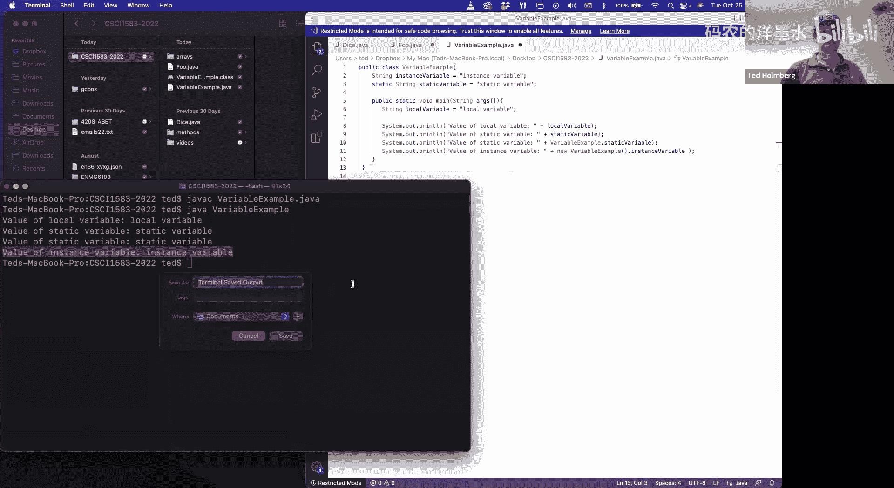
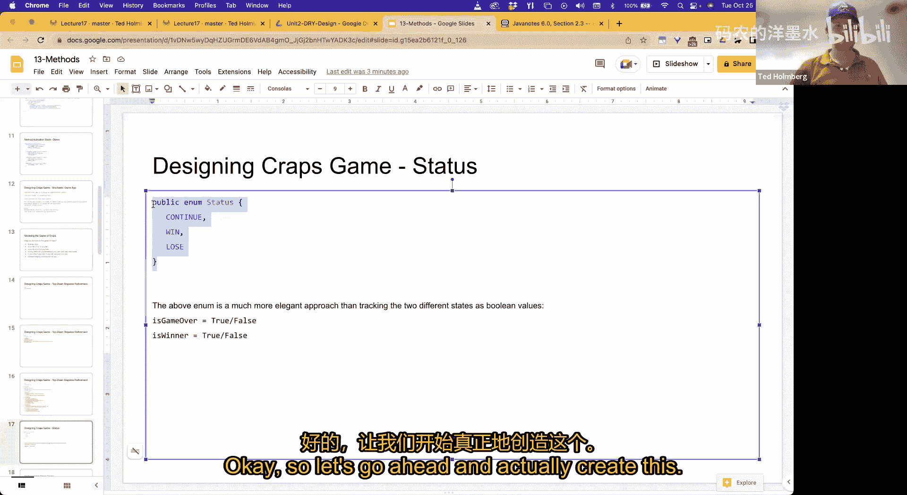
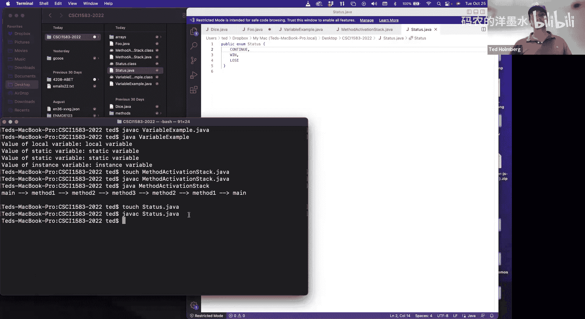
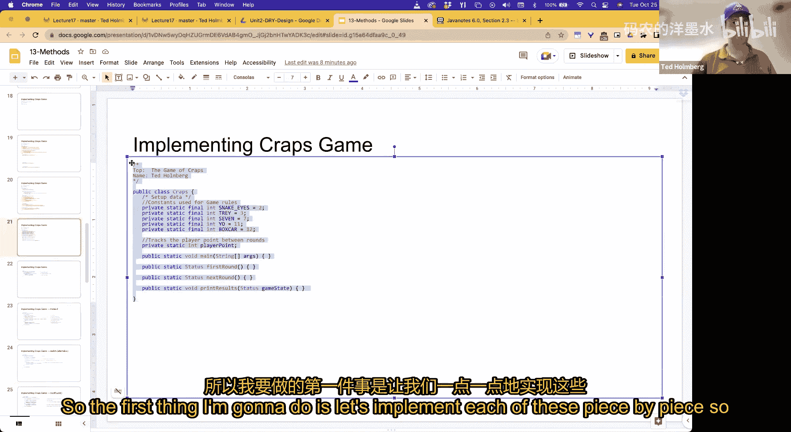
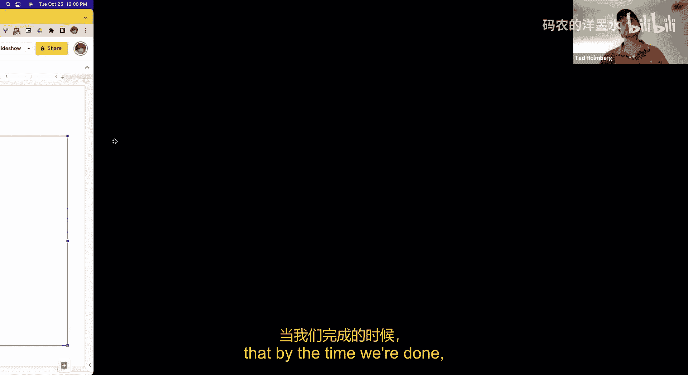
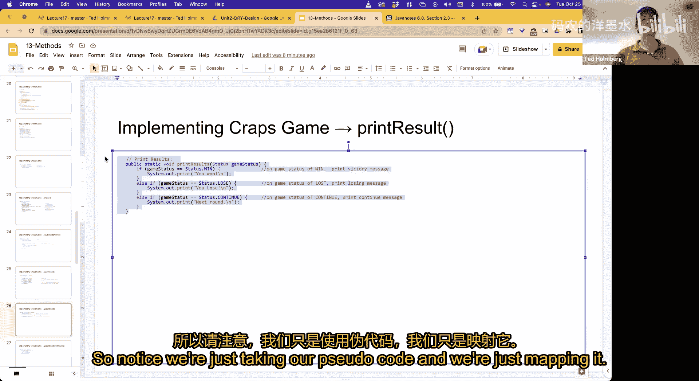
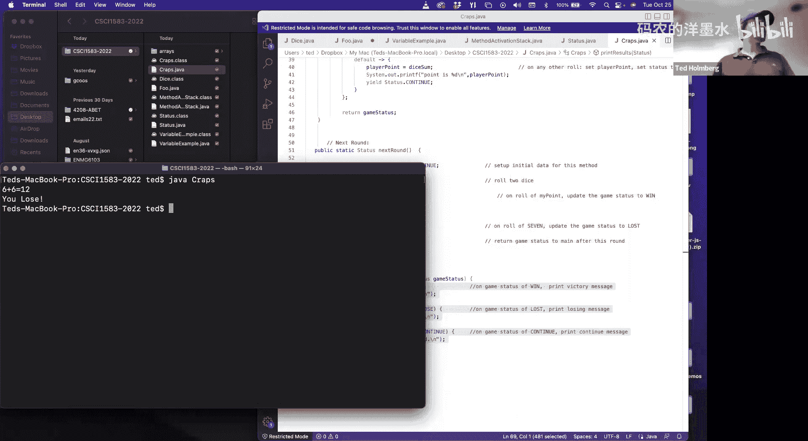

# 【全集】加州理工学院 软件设计与开发 中英字幕 1080P p15 Lecture 15 - 随机双骰子游戏 -BV1AvzCBdE7a_p15-

Yeah。Okay I we should not have sound now I don't know why my audio had cycled at all so in today's lecture like I was saying to the inperson class what we're going do today is use the top down step wise refinement along with method decomposition to build thatcras we talked about prior when we're still in the downstairs lab and has some technical defs and so the purpose of this is so that we can get everything uploaded onto YouTube by the end of today to where we're currently at which is pastor array。

And so this will be a good time to go ahead and reflect back on some of the concepts that relate to methods。

So here in today's lecture we'll talk a little bit more about magic numbers versus main constants we'll talk about local variables versus class variables versus instance variables instance variables will be the interesting thing to learn about today because that's where we're actually going be moving after today's lecture is done starting in the next lecture when we start talking about objects and be able to create our own objects we'll get a little tasting of that in some sample code here we'll talk about the enumerated types as custom data types that we ourselves can to define and they're most comparable to the way that the primitive data types are we'll talk more about that when we get to their slides when we talk about enumerated types I want to illustrate how powerful they are to match with switch data。

So probably the case of using switch statements will be to empower your ability to use en nuerator types so they pay off very well we'll also talk about the method activation stacks so when we go ahead and invoke a method and another method invokes another method what is the order of execution on there and then finally we're going to build our game of crops。

发谢。Okay， so here。Just a quick example of what we should always strive for is there's the concept of magic numbers magic numbers is simply a number that is embedded into your source code as a part of the logic so typically you have a computation or you have a selection or you might have a repetition structure that relies on a hardcoded value and as software engineers you want to avoid this real engineers will say love magic numbers like you know mathematicians do too but in my opinion both mathematicians and engineers don't name things well and so one thing that we're going to really strive to do from the get go when we're talking about selfdocumenting code is that we want it to be as readable as possible。

And so even if you have a value that never changes instead of just hard codingding that value。

 it makes more sense to give that value a name， a human readable name。

 a name that provides context to that number and then apply the final keyword so that it's not mutable so that it's not writeable so that it's only readable because you want if it's not supposed to change don't allow it to change but it also makes your code much more readable so for the example in this slide we were computing the area。

 and if we just hard coded the values， it is true we could get the area we are looking for in the example in the slide it's 3。

14159 times 3。15 times 3。15 Now with the way that it's illustrated those are all what we would call magic numbers and then you have to apply。

😡，Context to understand what's happening so you probably look at the 3。

14159 and you save to yourself well that looks like it's probably an approximation for pie and in this instance you'd be right。

😡，But you had to make that assumption yourself， then when you look at the next number 3。15 times 3。

15 that's not obvious at all and actually what it's meaning to convey is that that was a radius value right so clearly the area being computed there is pi times radius times radius right which is。

😡，The area of a circle， but again， notice the second。

The second block of code is much more readable than this first block of code。

 even though it's four times longer。So that's the thing sometimes readability comes at the cost of verboity。

 it's more verbo verbose， but that's all right。It's better to be readable and understandable than to be brief and to be kind of difficult to par and understand。

Okay， we talked already about the advantages of magic numbers versus what we will now call named constantss named constantss is just a variable that we've named。

 but it's no longer a variable if we apply the final keyword because now its not it's not writeriable so once we convert a variable to be read only we now call it a constant。

Okay， the other big thing that I think is definitely worth mentioning is to articulate the distinction between local variables versus class variables versus instance variables there are actually three classes of variables that exist so let's start with local variables even though that appears at the bottom that's the first type of variable we actually learned how to use a local variable is one that is defined inside of a code block。

😡，That is in a method that is defined inside of the method。

 so all local variables exist within methods。😡，But they can be they're localized to the most inner set of curly braces that they're defined in。

So the the very broadest scope of a local variable is going to be inside of the method itself。

 but it's possible in the method where you create a selection statement like a niF statement or a while statement that has its own set of curly braces and if you define a local variable inside that scope it only exists in that scope okay so we all know about the scope on local variable and if you try to access a local variable outside that scope you're going to get an error it's going to say symbol not bound and of course you can't access a variable before you declare it so always the rule for every variable in Java is you have to declare it before you can use it。

😡，And once it's been declared， you can only use it for so long as it's in that scope so moving on from local variables the next type of variable that we learned about were class variables。

 these are the ones that are defined inside of the class scope。😡，Alongside our methods。

Now we apply the ones that are called class variables。

 we require the use of a static keyword to be applied to it。

 just like what we've seen with the main method and so what that allows us to do is access that variable or field another name for a variable in Java as a field one way to access that field is using the class A now there's one other variable and we're going to get into that later this week it's called an instance variable it like the class variable is defined at the class scope but it does not use the static keyword and by not using the static keyword it's no longer a property of the class itself but a property of an instance of the class which means that it can。

😡，Have multiple it could have an individual value for every particular instance of the class we create so i'm not going to get too deep into that this lecture we're going to learn much more about that next selection。

😡，Okay， so some example code of what we're talking about here。

 let's take a look at this class so this class is called variable example。

 I have two variables that are defined inside of the class scope one of them in is an instance variable the other is a class variable so you can see how they distinguish from one another so the only difference is that the class variable uses that static keyword whereas the instance variable does not。

😡，Okay， let's make a main method， so inside of our main method here。

 I will then create a local variable。😡，So this is my local variable here because it's defined inside of a method。

😡，And if I wanted to print out this state， it would print out right here。

 then I can also access my static variable by just using the name now recall I can only just use its name so long as there's no other name inside this method。

😡，So as long as there's not a shared name， it defaults to looking at the class scope。

 an alternative way and a safer way of accessing the static variable is to use its full qualified path。

😡，So the path to this variable is scoped inside the variable example class。

 so I could use the class name， then I could use the dot operator， and from the dot operator。

 I can then access the variable name。😡，And then finally the instance variable。

 now typically this is a Bodd typically on instance variables。

 we don't assign them a value in the classco， but we can and for the purposes of this demo。

 I'm going to show you this， we are going to assign instance variable here to our instance variable。

 but to access it。😡，The only way it gets constructed is when we call to create a new instance of our variable example class。

 you've seen the new keyword before， effectively what you were doing every time you invoke the new keyword is it creates all the instance variables so these instance variables don't actually exist until you use the new keyword on top of that class and then any instance variables that are declared within that class are then created。

😡，So they don't exist。In to。This new keyword has been applied to it and then only for this instance。

 so the moment that this falls out of scope， that variable no longer exists。😡，Okay。

 is there any questions regarding this？And again， we can prove that this works。We can take this code。

嗰啲。And oh， we already have it pasted here。 So variable example。cavets。

Let's compile and this might be a blow up some for the class and let run that。

And here you could see this is the local variable， local variable， this is the static variable。

 static variable， this is also the static variable static variable。

And this is going to be the value of the instance variable。Which we actually got to print out。

That's right。

Okay， the next thing I want to talk about is the enumerated types， so enum is a very powerful。

Component that's given to us it's a top level keyword that goes at the same level that a class goes to so there's where there's one of three keywords we can use to declare。

😡，Our Java source code files， they can either be class which。😡。

We've kind of used what we haven't really talked deeply about we'll talk deeply about that later in the week there's interface which we'll talk about at the tail end of this semester and there's enO so an enum is effectively allows us to create our own data type so we learned about the primitive data types first we learned about floats we learned about doubles we learned about ints and cars and or CAs or Boolean values right and so what defines a primitive data type if you recall is that it's a closed set of values。

😡，And because it's a close set of values， every possible value。😡，Within that scope is well defined。

It's known inside of the JVL， the thing that distinguishes a string from the other primitive data types is that there's no closed set of strings。

😡，Because the number of permutations just using the letter A is infinitephony。😡，Okay。

 so with that said， what Eone allows us to do is to build effectively something that's very similar to our own primitive data type where we can create what's called an enumerated set an enumerated set is just one that is countable right there's a countable number of boolean values there's a countable number of inteatures that starts with some min value and goes to some max value。

 there's a countable number of characters。😡，So here with EnNum。

 we can create our own enumerated data type that has a well defined collection of values。😡，是。

And so the simplified form by which we do that is we use the enum keyword and then we give whatever the name of the new data type we want to create is going to be called and then we can create a set of curly braces and inside that cur set of curly braces we would have a comma separated list of all the actual values that make up our data set and so this allows us a very powerful mechanism to start build data out types that are akin to the primitive data types。

😡，So we could think of it as our own special custom data type。😡。

That allows us to define predeeffined constants or literal values so since these are literal values we usually name all of the enumerated types inside of them using uppercase ladder so that's another naming convention I hadn't mentioned it a couple slides ago but if we jump back just to the example that we saw here with magic numbers when I apply the final keyword that makes it a constant all constants should be in all uppercase。

😡，To highlight the fact that it's read only and not， it's not writeable just by looking at it。😡。

It gives us context。Okay， so some examples on when we might want to select to use enumerated types when we're building our own software is if we wanted to give something like compass directions because when we think of a compass direction we think of north。

 south east and west， right that's a closed set of values。😡。

That only makes sense on a compass or days of the week， for instance。

 it's a enumerated descriptive thing。😡，Same with the months of the year， or say， for instance。

 the states in the United States are the parishes in Louisiana。

Or the districts in New Orleans like all these could be represented as their own special data type of。

Enumerated things so what this looks like in practice the way we'd actually do this in action is we would create a Java file the name of the file would be whatever our data type is。

 so suppose we wanted to make a enumeration an enumerated data type in enum that was called day。

So we would use public so that we could use it in outer classes we'd use the keyword enome to highlight that's what we're creating and then we give this data type a name and so since technically it's a reference type it behaves like a primitive data type but it's not in effect as to close set of values it's still a reference type we're going to use the same rules to define other classes so the same way that we define classes and we'll do the same with interfaces as we always start with an uppercase letter。

😡，So here this is a day and then we will give it scope and inside the scope will be our set of values and since these values are constants right they're not mutable。

 we use all uppercase and we distinguish them with comms， we do a commas have great list on that。😡。

Okay， so in action， this would be how we might actually implement a piece of code that then uses that day。

😡，Enum type so here I have a public class main method I mean I have a public class main class inside of my main class。

 I have a main method inside my main method I can go ahead and I can declare a variable that can now hold an instance of our own special custom enum data type so day let's call this day not days。

😡，This is called yeah should be Okay， so here I have a。

Variable a data type of day and then the identifier I gave it today， then I can assign to it a value。

😡，From that enum type and to access those values we use that dot operator so the data type is day and then one of the values was Friday which is in all uppercase because that's how it's defined and then if I were to print that out it would print out Friday。

😡，So one alternate thing that's worth mentioning here is that。😡。

Enumerated types like I said earlier work really really well with switch statements。

 so let's take a quick example of that and when we look at an example of this。

 I want to highlight that even though we can create our enum types inside of its own class inside its own Java file。

 we can also declare them into the scope of another class。In fact。

 you can do this with other class definitions as well like this is true for all top level keywords in Java。

 but it's pretty common in Enum with the Eum data type the EnM type。😡。

So here I'll have a public class enum switch as my class， or since this is a class。

 it can now have a main method inside of my class though at the class scope I'm going to declare。😡。

A enome data type called momM。And inside of Mon， I'm going to then use a set of curly bracelets to define all of the values that a month data type can contain。

 which is going to be January， February， March， April， May， June， July， August， September， October。

 November， December。😡，Okay， so in my main method， as we stated earlier， I can now create an instant。

 I can now create a variable of data type month。😡，And then give it whatever label I want to give it I'll call it date and then i'm going to assign to it a value from that close set of values so inside of month was the value January now suppose we wanted to apply law。

😡，Suppose we wanted to go ahead and determine is a given mom a part of which season？Well。

We can usually split the months right there's four seasons right there's winter， there's fall。

 there's summer and there's spring。😡，And so winter is December， January and February， right？

And spring is March， April and May， right， which means that summer is June July and August。

 which means that technically we're still in fall， right that's September， October and November。是。

If it's one of those groups， then we could say what the season is this is a perfect time to use a switch statement。

 so one of the nice things about switch statements is that if we pass in。😡，Date here。

 and so date is the data type month， then the switch statement already knows that we're switching on a month enum type and therefore we can just use the value to define our cases and not have to use the dot operator。

😡，So that makes it much more readable in my opinion。

 so since we're switching on our date than on the case and remember we can define our cases in the switch statement as comma separated list so on the case that。

😡，The value is December comma January comma February， so if it's any one of those three things。

 then I'll use the arrow operator and then I'll perform this。😡，ThisThis execution。

 I will print out that it's went。系你。😊，And the nice thing about the arrow operation is we don't have to do a break statement so if it is that thing then it executes and then just falls down to the bottom it's done process because remember this is an alternate form of a multi selection statement okay otherwise if it's mark April or May then we'll print out spring。

😡，If the case is June， July or August and we'll print out summer， and then finally。

 if it's September， October and November， we'll print out fall。

And so this is where switch statements really gain a lot of value in my opinion。

 is when you couple them with enum types does anyone have any questions regarding this does this make sense everybody？

😡，Why theres a switch the and。Yeah so I think so the question here is we have inside the switch statement we're passing in the date and above it we're actually creating an assignment of date so one thing that's mandatory for a switch statement is that you passed in a value of something that you have and I could have passed in a literal value so I could have passed in I'm going to cut and copy here I could have passed in this right a realization of a literal value and it does comparison so what the switch statement is doing is doing equality operations is the thing that was passed to me here。

 which is month January is it this is it the case that happens in the first part of cases is it December January February in this instance it would be but let's say it wasn't let's say then it would go to the next case is it a March April May is it June July August is。

Seeppt September October， November it might even be something it might be an instance where you have a hole in the switch statement where it doesn't cover that case at all in which case none of the statements none of the cases would execute so with this switch statement it'll only execute the corresponding code that matches the case to what got passed in and so we could pass a literal value civically more powerful is that we pass in a variable because a variable can be mutable a variable can be processed into something different over the lifetime of of your software and then the result from your switch statement can change depending on what the state of your variable is does that answer your question that's right so we a rarelyarily chose one for the purpose of this code to work just as a demo now in the instance and in fact when we go to build out our gam of crafts we're going to use obviously an enum type that's one reason why。

spending so much time just explaining it and maybe that'll give more sense in how the enum type can change state or the variable that holds the enum can change state over time so imagine if I did this instead imagine if I had a user prompt that said what month is it and then I use that to extract。

😡，The enum type that we want instead that a hard coding mix I just hard coded it here and then if I ran this this this code it could be different depending on what the user typed in for what month it is that does that make sense。

😡，But on some of these demo codes， I try to abstract away everything that's not critical just to highlight and then we go back and do a real example and I think the real example of crafts should put this in perspective song。

Now another thing I should highlight with switch statements is if it's a single line of code we're executing。

 it doesn't need to go in it doesn't have to be put into a code block。

 but probably what it's better is if we did code blocks and code blocks if you recall is just to put everything inside of curly braces like that so this will this would actually be a better configuration of what i'm doing by by by blocking my code together。

😡，Or just that would have to go there。Just like that。

Okay let's talk about the method method activation stack as well because this is an important concept so the idea behind the way that methods work is that the JDM manages what's called the method activation stack so a S is a certain type of data structure behavior that works the same way you probably expect it to work actually there's two different types of ways that list that that data structures can be kind of access so if you have a sequence of values and you have to take one value from that sequence。

😡，There's three ways you can do it。You can either randomly select something from the sequence。

 that's what's called random X。😡，Right you could always pick the first thing that's at the list so the first thing so you keep it ordered in insertions so think of it as a line at the grocery store or at a fast food restaurant where the first person in goes to the counter and the person after them goes after that person and then next person goes after the person who's currently lasts in line and the person that gets serviced first is the one that was first in line right that's what's called a queue that's what what we call lines。

😡，arere called cues in the UK right in Britain that's the more accurate term that's like the data structure term that's the computer scienceency term that we use for that kind of operation that kind of concept so traditionally what we call lines or cus the alternative approach is what's called the stack a stack is the first the last thing into that collection is the first thing that comes out。

😡，Right or or another way of saying that is the first thing that goes into it ends up being the last thing that comes out。

 can you think of the concept of a stack in real life？You probably， for instance。

 are familiar with Stas with。panancakes， for instance， when you make your pancakes。

 you probably put the first one onto the plate and then you put the next one。

 the second one you make and then the third and the fourth when you go to eat pancakes or serve them someone's probably taking the one that's off the very top and then the one after that and then the one after that so a very natural way of thinking what a stack is would be exactly what is named after。

Things that form in stacks where you build the stack by putting one thing on top the other。

 but then you take off the stack by taking the top until you get to the bottom。

 which is the exact opposite of a cube。😡，Okay so because of that there's two different words that are worth using if it's a Q like structure we call that FO first in first out if it's a stack like structure we call it LiIO last in first out if you ever see those terms that's what it's referring to okay so with that said the way that our methods are executed is based off of the concept of stacks so。

😡，We've always set up to this point that the main method is our critical method that's the starting point of our application。

 the reason why that is is that when we invoke the JVM to start executing code what it does is it looks for the main method and it puts that onto the method activation stack and then it looks at all of the lines of code it looks at all the statements defined in the method and it'll execute them。

😡，Line by line right statement by statement so it goes to the top of that method and then it starts executing them in order now the moment that there is a method in vocation as one of those statements what the JVM does is it pauses where it's at。

😡，Currently executing the method you're in and then it pops。

The new block of instructions from the method that you're trying to invoke onto the activation stack and since this concept is you always service the last thing that was into the stack。

 it'll then jump the instruction pointer to the new method and start executing those statements in there and let's say for argument's sake。

 one of the statements inside of this new method invoke another method。😡。

The activation pointer would that that's executed all the instructions which software it's currently at and pop the new method on top of the activation stack。

 and then it would start with that other method。😡，And then it'll eventually get to the point where it can execute all the instructions in the topmost method that's been called that then when it's done。

 it jumps back to the prior one。😡，Compplaintes those calls and then when it's done that。

 it jumps back to the main method and executes those calls。😡。

And so when we refer to a method activation stack that's that's what we're referring to and in fact we have some sample code we can look at that kind of highlights this concept。

 so suppose for instance， that we had our main method。

Where we just created a variable that's called main and then we have a method one here， so inside of。

Our instructions， when we go to execute this we know that the main method is going to be the first thing that starts executing this first statement is going to to then execute。

 but then this is a methodical now message has meaning because it was set in the instruction before and it's actually going to get passed to the next method so we're going to stop what we're doing here we're going to jump to method one and it's provided some data here which is this string so we're going to add to that string a new string we're going to concatenate with method one and then we're going to pass that to method two so we're going to stop doing what we're doing inside method one and we're going jump to method two but with the string given to us for method one。

😡，So then we're going to take that string that we got from method one。

 we're going to concatenate method two into it， and then we're going to pass that to method three so we're going to stop what we're doing method two and we're going to jump to method three in method three we're going to grab the string we got from method two。

😡，Which got that strength from method one， which got that strength from Maine。

And we're getting a cat on that。Method three。And we're going to save that as output and then we're going to return that back to what cold method three。

 what code method three was method two， so we're going to get that return value here and we're going tocatenate that to our output and then we're going to send that back to the method that code method two。

 that was method one。😡，So method one will then get output and concatenate all output。

This new string that says method one， we're going to return this back to the thing they called Me one and that was the main method。

😡，Which is line number two， where we'll finally get that output string， which passed from Maine。

To method one， to method two， to method3， back to method two， back to method one。

 finally back to name。😡，And then we'll go ahead concodnate that this is mainine and finally print that out。

And in fact， if we look at this， it should show that sequence of like building up and coming back down。

😡，呃。What did I call this， this was called method activation stuff。哦。No， no， stop that。go位 and凑我姐。讲老公。

二项。So we will save this after walking this and just to see what the output is。Let's go ahead and。嗯。

Compile。嗯。And run， and we can see from main to method one to method two to method three to method two to method one to main。

So we're putting things onto the stack and then we take them back off。Okay。We built up a up。

Bin knowledge of concepts to now start talking about how might we go about designing the game of craps？

So when we go to build this we want to take advantage of a couple of things we want to use name constants instead of magic numbers。

 we want to use enum types to track gametack we want to use top down stepwise refinement to define our algorithm and we want to use functional decomposition so that we built our application split across methods so these are all the techniques for software development that we've talked about for software design that we've talked about and we want to actually see them in action we actually want to see them put to use to build a relatively basic game so before we can start building this game。

We want to talk a little bit about what the rules are so just as a reminder to anyone who hasn't played the game of crafts we spent a long time I know talking about srcchastic processes and the different distributions of random numbers the difference between uniform versus Gaussian or normal so in the game of crafts we rolled to die so we know from our prior discussions that rolling to die is a gaussian or normal。

sychastic behavior so it's going to exhibit something that looks like a bell curve where you're most likely to roll something that's a seven and then after that it's either going to be a six or an eight then after that it's going to be the five or the nine and it keeps going all the way until it's just two or 12 right okay we roll two die now。

If you roll a seven or 11， then you win on the first round。

And if you roll a two or three or 12 on the first round， then you lose。😡。

So there are certain values that if they occur， you win and if they occur。

 you lose and if they don't occur。😡，Then you neither win or lose on the first round。

 but you have to remember what you rolled and then you progress to a new round so in the next round。

😡，You roll again if you roll a seven。Then you lose。

 if you rolled the same thing you rolled on the first round， then you win。

And you can continue to play until you either win or lose。

So that's the basic game of the game of craps does anyone have any questions about that do does everyone kind of understand the rules？

Okay perfect， so let's start using the top down step by refinement process to actually articulate。😡。

How we might develop that set of rules into a software application。

 so the first thing we always start with is our top statement our top statement is a very。

Brief elevator pitch way of describing what it is that we're building so here my top statement will just be the game of craps。

😡，So it abstracts a lot of things away and recall from the top down S refinement process that we should always use our top statement as the header comment inside of our Java file。

😡，So then the next thing we're going to do is we're going to move on to the next refinement we're going to now that we've defined what it is we're building we're going to think initially what are the core critical abstract things we even have to think about and this is usually broken down into two things the first is our data model what are the things that we're using and then the second of all is going to be the basic sequence of events that have to happen for this code to work in order to get our our whatever it is we're modeling whatever behavior we're trying to automate to actually execute so inside of refinement one i'm going to say I got to set up my data or my data model right always every algorithm is contingent and built on top of that then after that we play the first round because that's what we talked about then we would report the game results。

😡，Because you could either win or lose after the first round or you might have to continue。

And then if there is no winner or loser， you move on to the next round and you continue while there's no winner or loser。

Whether you won or while you haven't won or loss， you continue playing the game and when you have finally either won or loss。

 then you print your final results， then you hit the game results and report what the final condition。

😡，Okay， Suzanne wouldt have any questions from proement one。

 did that kind of capture the general essence about what the game of crafts is about？

Any questions have I gotten to a point where you feel like you could have done this yourself yet？啊干。

So then the next thing is we would examine the refinement one and we ask ourselves is this enough information for me to start encoding this as a Java file and the question the answer is no right these are two abstract still for me to do a line by line translation from the English statement into a Java instruction so then I would go through and do another refinement step so the second refinement might look something like this i'm going to。

😡，Set up my data so Im what i'm effectively doing and I should also state。😡，I should also state。

 recall when we're talking about this， the first refinement， after we define our first refinement。

 that is usually what's going to be the makeup of our main market。😡。

So the first top statement is usually the header comment in a Java file and the main method is usually supposed to be devoid of minutia of all the little details it's supposed to be a broad view of your algorithm at large is super readable usually just an invocation of method calls that they themselves are super readable so keep in mind what refinement one says because chances are when we go to implement this that's exactly going to be what our main method is going to look like okay so what I do in the next refinement recall is I go on a line by line basis for my refinement one step and I break it down into the individual lines that have to happen so let's say and this is this process is what we call functional decomposition where we start looking at these concepts that aren't so well defined that you can translate directly into Java because it takes multiple actions it takes multiple。

😡，Instructions to do， but we encapsulate those instructions by whatever we call them in refinement one we're defining we're breaking apart the logic that we've defined that is all the logic that our software needs into what can be smaller by size function calls。

😡，Okay， so with that said and refine it two， I'm going to take this first line that says setup data and I'm going to say okay。

 this is the setup data line， this is the things， this is the data that my data model needs。😡。

In order to do this， I'm going to have to track a game status， right。

 that game status lets me know whether I won。😡，Or have I lost？

Or must I continue right those are the three states that this game maintains Okay。

 what is other data that we might need to know that we might need to have access to to play the game the my point the my point represents if you didn't win and if you didn't lost。

 then you have to remember what it was you rolled on the first round because you got to replicate it you got to reproduce it hopefully in some new round。

😡，So if that's the case， we're going to have to store that。

 we're going to have to remember that we're going to have to give it a name。😡。

So we'll have my point and then finally we have all of the special magical numbers。

 the special values that indicate whether we've won or lost。

 the special values that name the values that control our logic that we make decisions on in the game of craps is seven。

 it's 11， it's two， it's three， and it's 12， I believe。😡，Okay， so。

After we've declared this amount here， we can say okay we're done defining all of the data。

 let's move on to the second statement and better define what has to go there so it's play the first round what do we have to do to play the first round so i'm going create inside of my document the first round because that's the second line and then inside of there i'm going to start breaking down the logic well to play the first round i'm going to have to roll some dice i'm going to roll two dice。

😡，You're going to roll two dice on a roll of seven or yo。So yo is a specific term。

For dice rolling to mean what value？That's right。It's 11。

So notice seven is going to be in all upper case letters because that's what is actually called when rolling die。

 but we should use what is called and not just the number， same with 11。😡。

11 is the value but the name of it in the context of rolling diece as yet。😡，Okay。

 then we would update our game status to say， hey， we won。Only role of snake eyes。

 what value is snake eyes？Two， yeah， it's two ones， so again we have the value too。

 but it's got a name in the context of rolling die and that snake eyes， what about t？😡，Three， right。

 and finally box cars。12 exactly， so notice because these values are special the in the game of craps。

 then they should be special in our code。😡，Okay， so if it was any one of those values。

 then we would update our game status to lose and then finally if it's any other role。

 then we would go ahead and。😡，Remember my point。now for next round， so now here I would say， okay。

 now we got to print the game results well game results is here that kind of blocking away here。Okay。

 so。For my game results， I'm doing that twice， so I'm only going to encode it once。😡。

I have it here and here， so i'm going to have print results。

 I'm going to say on the results if my game statuses win then I'll print a victory message。

 if my game status is lose then I'll print a loser message and if my game statuses continue then I'm going to print a continue message that seems easy enough。

😡，And then finally， I will go ahead and take a look at， well， while there is no winner or loser。

 then we'll continue to play the next rounds。So what's a next round look like for next round。

 we roll two dice and on the role of player points， we update our game status to state that we won。😡。

Otherwise， if we roll to seven， we would update our game status to lost and if we didn't roll my point and if we didn't roll seven。

 then we've we've neither won or lost， we move to the next rounds of the game。😡，Excellent。

 so at this stage， I would look at my refinement。😡。

I've now performed a functional decomposition off of my refinement one。😡，And I can say to myself。

 I think each one of these subcategories is defined well enough for me to start encoing this。

 for me to start implementing this as a Java file， so at this time I am done with the design work as text as pseudocode and I can move to start implementing this as a set of instructions。

😡，So the first thing I would do is I would define my enumerated type to track the game status。

 notice inside of my pseudocode， I was tracking three different states on my game status。

 I could have either won the game， I could have either lost the game or I can be in a continuous state where I haven't yet won or I haven't yet lost and my logic is based off of that。

😡，So it makes sense to me then to now define a enum type that we could call status。😡。

That has three values continue win and lose now it's true I could implement this in a much clunkkiier way by using two Boolean values I could create like on the bottom here I could create and is game over bullolean that is either true or false and is winner that's true false because that captures the three conditions of whether I should continue the game or not continue the game and if I if the game is over then am I in the winner state or am I in the loser state。

😡，So I could do that， but does everyone see that this is more verbose， this is clunkkiier。

 this makes us track more variables， is this is a less elegant approach。😡。

So even though it's possible to do it with just boolean。

 we should use the more expressive but more powerful enum construct so that we can get really the control。

 the granularity， the implementation that we envision in our pseudo code。😡，Okay。

 so let's go ahead and actually create this。

So I'm going to create。A status Java file。And inside of the status Java file。It's down here。系。

It's down here， okay。Inside of here， we're going to create our enome that status that has the three states。

 continue win lose， we will save that。And we'll even double check。

 make sure there's no synharal errors every time you create a new change。

 you should always try to compile it just to ensure that you don't have any typos。

Because one of the worst things that you can do and I see this a lot with the labs is that people will go through and they'll keep building complex levels of code without ever testing it and then what happens is when you do go to test it you either get like 100 errors。

😡，Or you get erroneous behavior and then it becomes very challenging to know where in the code base went wrong if you make small changes in a test and you're happy with the changes。

 then when something finally does break down， you know exactly where in your code to go check to see what's causing the breakdown to occur。

😡，So testing is super important， get used， get into the habit of doing that。😡。

二改。So the next thing we're going to do as we implement our game of craps is we're going to take my top statement。

😡，And we're going to rebrand it instead it's top top isn't very descriptive for anyone else we'll use something like。

Description。The game of crafts and then we'll put name Ted Holberg always give yourself credit for what you write you probably do it when you write stories。

 novels， research papers do the same for source code。😡。

Because it provides you as the responsible entity。For questions related to。

For citations related to it。Okay， so the first thing I'm going to do is I'm going to use that top description as my header comment。

 I'm going to include my name and then I'm going to do public class crops。😡。

So the next thing I'm going to do is。And let's。Okay the next thing i'm going to do is inside of the crops class。

 I'm going to take some of those comments from my my document， so remember I have the setup data。😡。

Line that says I had to go ahead and have my constantsts used for， in fact。

 let me actually grab that here。😡，I should use the actual one， so let's say so here。

I want to use this。These comments and let's change that color to whatever it is green。Perfect。

There we go， so I'm going to define so I'll go ahead and put my data model that I have。😡。

Comment it out here because that's going to guide my implementation。😡。

Then i'm going to create a main method and inside of my main method i'm going to comment out my refinement one remember I said pay special attention to refinement one because most often is the case that should represent line by line。

😡，The set of method calls we're going to perform to actually execute your algorithm as a whole。

So I'm going to play the first game， I'm going to print the game results while there is no winner or loser then we'll continue playing the next rounds and then we'll print the game result then。

😡，In refinement two， I broke each of those lines down and I defined kind of a subsudo code for each of those things。

 but i'm going to create a method that represents each of those actions so I'm going to create a method that's called first round。

😡，I'm going to create a method that's called next round and I'm going create a method that's called print results and for this particular purpose notice that first round does have a return type after the first round。

 we're going to get back a status on our game Did we win the game did we lose the game or do we continue the game for the next round there's going to be a status that we should get back did I win did I lose or did I continue for printing that's just reporting to the user we don't need to get any information back We're just going to display so that's going to be a return type so here what I'm doing is I'm defining what methods is this application going to require and they're going to stub them sub them out means that I leave them empty I've declared them but I haven't implemented any of the source code yet I haven't implemented any instructions but what I have done is make some pretty critical choices as to。

What type of data do I have to pass in and what kind of data do I expect to get back out？And in fact。

 I think let me。O。So once these choices have been made。嗯。Okay， yeah。

 that's where we're at So once these choices have been made where I have。

Comments that represent my data model， I have comments that represent my main method。

 I have stubbed out empty versions of my methods。I'm now going to go and take the。

Coode descriptions from my refinement two of the top down steppri refinement and I'm going to paste those into the curly braces into the body of those methods because that tells me what each of those methods do so again this is going to let me it's going to act as a guide it's going to guide me on how to implement each of these individual methods。

😡，I did all the brain work。During the pseudocode stage， I want to take advantage of that。

 so I'm going to just cut and paste it in and use that as my code comments。😡。

So here I have the first round here， this is what we already read for the next round and here this is what we had already read for the。

But the game status for printing the game status so now it's time to start coding。

So inside of our states， we have the constant values that are going to be used to represent our game rules。

 so we're going to make those。😡，Class scopepe so we have access to them and all of the methods defined in our scope we're going to make it private to the class because the only class that needs to have access to our magic numbers to these roles is inside of our crap game so we're going to use an access level of private we're going to use static because we might need access across multiple methods。

😡，We're going to use final because these aren't supposed to be writeriable they're only supposed to be readable they're representative the actual values that occur in the game of crops they can be represented as in your data types a roll of 2 d6 could be very easily represented as an int of either two three four all the way up to 12 here for snake eyes since this is immutable since this is a constant value we're going to use all upper case so here I'll have snakeey set to two tray set to three7 set to seven yo set to 11 and boxcar set to 12 I'll also go ahead and will define。

😡，My player point， my player point will also be something that might potentially have to be accessed across multiple classes it might get set in the first in the first round。

 I'm sorry in multiple methods， it might get set in the first round and it might have to be used in the other rounds。

😡，So here I will go ahead and create a static variable to represent my。

And so then the next thing I'm going to do is I will then after declaring the data model that exists inside my class。

 I can now start implementing all of the methods and i'm going to start with the main method so my main method I could probably build out entirely like this once I create my main method and since I've stubed out my method names already。

😡，I will never have them mutate it again。So what is my main method Well， to the left。

 I mean sorry to the right is the original。Sudocode instruction we have and to the left is the Java instruction we can use to represent that so when we said we have to play the first game well what is it to play the first game it's to invo invoke the first round。

😡，I'm sorry play the first round how do we play the first round we invoke the first round method and remember that's going to give us back a game status value so we'll get back the game status value and we will save that。

😡，Into a variable of data hyp status。😡，So then what do we do for the next instruction our main method。

 well it was to print the game results， what might that look like。

 well that's going to be an invocation to our print results method that we've already declared it doesn't have a Java implementation yet。

 but it has a pseudocode implementation。😡，So here we'll pass the game status to our print results remember what the pseudocode implementation was was that if our game status was to win。

 then we would print a win message if it was lose we'd print a lose message if it was continue print some kind of continue message。

 then we said so long so while you don't have a winner or loser we continue to play。😡，And next round。

 well how can we represent that we can use a while statement and we check the game status is the game status equal to continue？

😡，So long as it equals continue。Which means it's not win or lose， then we will play a next round。

 which will give us back a new game status， which is our loop control variable。

 we will assign that to the game status variable we've declared。😡。

And then we're going to print that result， we're going to print the result to that game status。😡。

Okay， so let's take a look at how that first round method might look and actually let's actually start building this out。

😡，So the first thing I' going to do is let's implement each of these piece by piece so that by the time we're done。

 we can actually see what this looks like。

就啲啲。Okay， so here。We have this top statement， we have the name。They already。Wait a second。Yeah。

 didn't create okay perfect we change from top statement to description。Okay， and there we go。

Perfect。And now here， let's go to our main method。😡。

Now the nice thing about by st out our implementation。

 we can go through each step of the way and we can test， let's see if we have everything we need。

So here status first real， we don't have a return type is what it is。

So we'll wait we'll wait we need to have some return there， let's see if it lets me do return。No。

就是我们觉得。So what I'm doing here is I'm doing what's called stubbing up the implementation if I claim I have to return something Java won't let me even create an empty method that doesn't let me return at least something so here i'm just going to return I'm going see lets me return no values since status is a reference type so it allows me to yep at least compile so here at this stage I can make sure that the code I have even though I can't execute it to do anything yet at least compiles remember that's an important step always be compiling to see if there's any syntactal errors and sometimes it's worth stbing out your implementation for the purposes of testing。

😡，And then the next thing we're going to do is we're going to go and take our main method here。

And we're going to put our main method in here。Now is there any questions related to this main method does everyone。

 so we already stepped through it， does anyone have any questions about it or is it good？😡。

Because we sub that all these methods， even though i'm doing these method calls and these methods don't technically do anything yet notice I can still compile my code it's still valid Java code now so I can so i've done the one to one。

😡，Translation of pseudocode into Java code and it compiles。

Now I still can't run it yet because I really need to implement the behaviors of these other methods。

 let's take a look at the behavior for first roundm。😡。

So we already claimed that first round is going to return a status。

 so what we're going to do is we're going to create a local variable that's going to be called game status then I'm going to rely on my dice utility class to roll 2D6 for me and I'm going to get that song。

😡，Then I'm going to check if the sum is seven or yo。

 then I will set that game status local variable to the wind value from that enum type。😡，If it is。

Snake eyes or three or box car， then I will set that local variable game status to be lose and if it's not。

😡，The win and if it's not the lose if it's not any of those numbers if it's anything else then i'm going to set the game status to be continue I'm going to take whatever the di sum is and set that as my player point and now remember this is a class variable so when I set that I will now have access to it from other methods inside this class and then I will print out the player point and then when i'm done game status is guaranteed to have a value of either when lose or continue so then I will return that does anyone have any questions about this particular implementation so。

😡，Like I said， one of the powerful things about multi selection statements is they can be expressed either as a collection of nested if L statements。

 this is using the if else if。Meap you can also use a switch statement if I wanted to represent that logic with a switch statement I could do as such and i'm actually interested to get your opinion on which you which you prefer and i'll use either of them based off the feedback from from the class so this is the same method but instead of using if else this is the alternative switch structure let's look at what changes here so here i'm going to create I'm going to get a dice sum from my dice utility class where I tell it to roll 2 d6。

😡，I'm going to create a local variable called game status。

 but one of the cool things a switch statement can do that if else cannot do is it can return back a value。

 it can result into a value based off of what happens inside of the switch block so we can pass in。

 which means I can do an assignment operation on it。😡。

So I'm going to assign whatever the value that is resolved from the switch statement。

 I'm going to pass it in the di sum and on the case of7 or Y， I can use a comma separated list。

 then I use the arrow。😡，Operator to return back a wind status and since there's only one instruction there。

 I don't have to use curly braces。I only need to use curly braces to create what's called a code block if there's more than one instruction there's more than one statement if you have that you're trying to combine together okay on the case of snake guys tray or box car so I can separate that with a comma separated list I'm going to return back the value status blues and then on the default value which means if it's not the other two cases then this requires multiple lines of code so I'm going to use curly braces to create a code block I'm going to do the following I'm going to set the player point remember that's a class variable to dice sum I'm going to print out the value。

 hey the point is and then whatever is the die sum and then finally I'm going to use the yield keyword to yield back。

😡，To this assignment expression the value of continue so that's the one trick about using a switch statement to return a value inside of a code block if it's a singular value it's implicitly given the yield key word to give back a value yield means it's returning back a value if it's a singular value the yield is implicit so we don't have to add it but the moment that there's more than one set the statements inside of a code block associated to a switch we have to state which one we want to give back and that's what yield means。

😡，Okay， so this will get back to continue and then we can return our game status here。

 so is there any questions about either of these implementations？😡，What is know好。

So if you don't win or lose， then you go to the next round。

 so remember in our in our main method here。Here in our main method， we have this wild condition。

 while the game statuses continue， we invoke another round。😡，俾天关。

Then when then we stop playing the game and we report that you won the game or you lost the game。

 so the moment you win or lose the game is over， but until you win or lose we are in a continuous state。

So with that said， let's take a look at our next round and our next round is pretty simple right this is the one to one correspondence but behind it here we're going to create and return back a new game status after each round。

 so I'm going to create a local variable to represent what the status is for this round。

 we're assuming if we're playing this round that our statuses continue then we're going to roll2 d6 for this round。

 if the die sum is the player point。😡，Then we'll set this local variable of game status to be when otherwise else if the di sum is equal to seven。

 then we'll set the local variable of game status to lose。

 we only set it to win or lose on the condition of my point being enrolled or seven be enrolled。

 we've already defined that it's initialized at continue。

 so whenever it gets processed between those two selection statements is then going to be returned back as our game status。

😡，And again。Yeah， let's go ahead and take this。And implement this as。

We will replace that here and we'll make sure that our ination is correct and then the last thing we're going to do。

Is we're going to look at just the method print results now print results requires a game status to get passed to it。

😡，And if the game status is a win， we will print that win message， you won。

 if the game status is lose， we'll print a loss message which says you lose and if it's not when if it's not lose if it's a continue。

 then we're going to print that you go on to an next round。😡。

So notice we're just taking our pseudo code and we're just mapping it。

And we with each implementation， each edition， I'm checking to make sure my code compiles before I add more code。

 the moment it doesn't compile ID bug。So notice the nice thing about these concepts is allows me to actually kind of do some testing before I'm done the entire project and then finally I'm going to add in that print results。

 the implementation for that so presumably now I should be able to compile my code and then I should be able to run a game of crafts and let's see if it implements correctly so playing it now Ive got a four four is neither a win or a lose condition so my point is four and I move to a next round I roll in 11 which is neither a seven or my point so I move to a next round I roll in eight which is neither a seven or my point so I move to a next round I roll a four which means I won。

Which rolling a floor that's that's。The likelihood of me rolling that is not very high right okay let's play it again and so this is a stochastic process right because the game changes each time we wanted so I roll an 11 on the first time so I won I never had to go to the next round there。

😡，And here I won again。And here I'm going to lose and I'm gonna to lose because I'm gonna to roll a six it's neither a win or lose condition so I'll have to remember that I move to the next round and then I go ahead and I roll a seven or a four on the round after that which is neither a win or lose condition so I go into another round where I roll a seven which is the lose condition and so I lose and you could see I can keep running this game each time and it's going to implement the game the way we expect here I roll a 12 so I never progress to another round I lose on the first round so I think this represents exactly the rules we declared that represent our game of craft so I think we were able to model out a relatively sophisticated build of a crafts game Does anyone have any questions。

