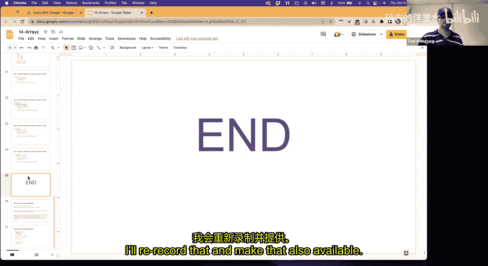

# 【全集】加州理工学院 软件设计与开发 中英字幕 1080P p16 Lecture 16 - 数组变量与多值存储 -BV1AvzCBdE7a_p16-

あ。

Excellent so now today I want to get into a moving on to the second part of unit2 so in unit2 we had introduced the concept of methods and what methods gave to us was the ability to go ahead and write one block of code once and repeatedly recall it so this allowed us to adhere to what we call don't repeat yourself so whenever we talk about dry design that's what we're talking about well there's another mechanism the next phase of of dry design is learning about array。

So a quick overview of this particular presentation。

 I'll give a quick intro to what arrays are and why it fits into unit2， which is our dry design。

 we'll then define arrays effectively informally and then talk about what arrays require in the confines of Java。

 we'll look at a real example of an array just to give you an analogy so that you have a good understanding of what it's trying to replicate our model。

 and then we'll look at Java example based off of our real life example。

 then we'll talk a little bit about how we can read and write with arrays。

 how we can go ahead and then take a look at a couple of design demos。

 how we can use arrays to enforce the dry design。😡。

So we'll look at a couple of demos that and some of these we've already done in the past。

 but we'll see how we can refactor them in an effective way and then finally I want to follow up this presentation with just distinguishing between pass by value and pass by reference because this is the first time that this concept is actually going to matter to us and this is going to be a concept that we're going to want to be considerate of in the future as we continue to move forward and work with more complex data types。

Okay， so。The first thing I want to highlight is that effectively what an array is is it's going to be a type of storage operation so remember in unit one of our。

In unit one of our raw。Of this lecture series， we highlighted that in algorithm designed there five basic building blocks。

 it's storage， its input， its output， it's a processing and its control operations so you could think of array as fitting into the storage operations so when we were looking at storage operations before we learned how we could declare a variable we learned how we could assign a value into a variable or how we could do both we can do an initialization which is both a declaration and an assignment in the same line well when an array allows us to do is it allows us to hold more than one value in a variable。

So it's a different type of storage operation one that's going to be more powerful。

 the reason why this fits nicely into unit two in terms of dry design is it allows us to better encapsulate our data just like methods allow us to do for code so think about this methods encapsulate we use that word before right what does encapsulate me。

😡，It means contain and also hide sameaneous right so it means that it can contain a lot of things and once it's been contained we don't really have to worry about the underlying implementation。

😡，So methods encapsulate a group of code， related code， related statements。

 a class encapsulates a group of related methods and technically fields as well。

 an array encapsulates a group of related data。Okay， so with that said in mind。

 the general concept that we should be thinking about with the race is it's effectively a variable that contains multiple values。

😡，So in Java， what does that mean， it's a variable that may be declared。😡。

As an array variable by using the box notation after its data type。

 we've actually been declaring array variables this entire time every time we create a main method。😡。

Think about。The data type that gets passed into the main method， its string。

 which is a data type followed by the box notation。

 which highlights not to treat that as a single value variable。

 but to treat that as a multi value variable。So when you declare an array。

 what effectively is happening。Behind the scenes inside of the computer is that it's going to take a contiguous block of memory and reserve that so remember when we declared a variable a addressable space in memory was stored for a singular value when we store an array we're going to reserve a block of memory that is equal to the amount of space to hold a value multiplied by the number of values we want to hold。

😡，Right so whereas an array might hold， let's say how big is an int in terms does everyone remember the bite size of an int？

😡，How big is an int they kind of covered that briefly。😡。

It's four bytes right so an int is encoded with four bytes if I want to hold more than one value of int let's say three I would take four bytes multiply that by the number of int values I want to hold that would be three so my array would have to reserve 14 bytes of addressable space to hold the first value the second value in the third value does that make sense so that's what's happening behind the scenes we don't really need to know that at this level all of that's abstracted away but's kind of good to understand that's what's happening。

😡，Okay so let's let's move on to and and the reason why it's good to know this is when we go to see how to create an array there's a piece of data we're going to have to provide and that's the rationale behind it so let's go to an actual real life example of an array let's look at a grocery list for instance a grocery list I would argue represents something that contains multiple items that's all related and used for。

😡，A particular use case so when I go to the grocery store I might look through my fridge and my pantry and whatnot and make a list of things and in this instance I have eggs。

 I have milk， I have bread， I have cold cuts I have cookies and have ice cream right so。😡。

I have all these items on my list， if I wanted to go ahead and say， for instance。

 shop with a friend and I want to identify something on the list， how would I naturally do that？😡。

SoRight so if it's on a single page usually what and I don't know is this true with everyone when I how many people have made a grocery list before actually let me let me take a sample of this okay so about half the class so what does the other half of the class do when you go to shop。

You just remember it。Okay， but you probably have like a mental list then right so you probably go into the grocery store knowing what you want to get now。

😡，How would you isolate something from a collection from the list if you wanted to identify one thing what is a very common way that we do that I would argue number right so we'd have like our first element our second element our third element and our fourth element on the list so that's an important concept that we use。

😡，In the real world to select one individual value from my grocery list， like for instance。

 if I wanted to check to see if bread was on there and verify that bread is on there I'd say oh yeah bread is item number two on my list now when we start counting。

😡，We'll call that indexing when I start indexing into my list to see which values are in there because when I say grocery list。

 I'm talking about the entire set of items in there right not any individual one item but if I want to add something to the list I have to go to the next empty line right or if I want to take something off my list like if I bought it。

 I would go to the line that's on and scratch it out right？😡，So in order to conceptually do that。

 what I'm doing is I'm finding the line number that matches the item I want on the list and that's how I'm accessing it。

😡，So we we we using index in the real world to access single value elements in a list we're going to do the same thing in Java。

 just know that our index number starts at zero。😡，Okay， so yeah， what are the observations here。

 the grocery lift may modeled as an array？Any one item is accessed by its index here。

 we have at index zero with the eggs then index one would the milk all the way to index five which would be ice cream right so each has its own unique。

😡，Row number， index number into my list was a good observation。

 how many elements do I have in my grocery list here？😡。

I have six and what does the max count on my index numbers？😡，And what's the rationale behind that。

 why do I have six elements， but the max element number is five because we start with zero and that consumes part of the count。

😡，That's an important thing that you must not forget when working with a raise and job。😡。

Okay so let's see the groceryary list consists of a collection of related data values of the same type so again when we declare an array it's very similar to what we're dealing with a variable which means that the multiple values that go into the array have to be the same data type I can't mix data types what does it mean to mix data types I can't for instance have a collection where the first the zero index is a string and then the first index is a integer and then the second index is in a booleing value if I declare that this is an array of strings then everything in there every value has to be a string data type if I declare that this is an array of integers then every value inside that array has to be of an integer data type and's true regardless of the data type it is now one powerful thing about and here to me。

One powerful thing about what we're going to learn about inside of the arrays as it manifests in Java is any data type can be converted into an array variable type。

 so an array variable。Even the user defined one so as our powerful mechanism for organizing data that's related。

😡，And so。Our Java equivalent of this here would be okay， this is a full Java application。

 so I'm going to create a public class in it array and can everyone see this。😡，Clearly okay。

 so I'm going to define my class i'm going to create my main method and again this is what I was talking about before every time we were declaring the data type in our main method inside that parameter list where the input goes。

 we've actually been declaring an array of strings the entire time and array variable that can hold more than one string value。

😡，Without realizing it so now what we're doing is slowly understanding more and more of the boilerp code we've been using from the very first lecture when we learn how to do hello world Okay。

 so with this concept in mind let's look at what's happening here so i'm going to create an initialization。

😡，So remember， an initialization is a declaration and it's an assignment at the same time。

So here I'm going to declare。😡，Inter right and in fact。

I don't have to do this as in as initialization， I could do it like this as well I can do the declaration and assignment just like this and actually I will do that here。

Okay so either of those are about so but i'm going to separate it because I think this is it's sometimes cleaner or easier to break things down into smaller steps so what we're doing here on this first line is I am declaring。

😡，A。Aray variable of data type string and by putting the box notation after it it highlights the JVM hey。

 this will hold more than one value， more than one string and then I give it a label and I could call it anything the labeling rules that I use are going to be the same for variables usually though you want to highlight or impress in your code that this is a special type of variable that can hold more than one value。

😡，So I'm going to highlight that by calling this grocery array。

 I could have also call this something like grocery list。😡，But that's you always。

 when working with things that can hold more than one value， you want to highlight。

 you want to make that readable。😡，Okay， so once I've declared that I can now assign that so to do an assignment operation I use the same operator that I would normally do so on the assignment operator which is a single equal sign I can have a variable type on the on the left hand side and then I can have a value type on the right hand side well this is how we can create a new empty array。

😡，We use the new keyword。😡，And then we go ahead and we use the same way we declared it。

 so we use the data type string。😡，And then we use the box notation。

 but now we have to provide information to actually construct this empty array。

 we have to tell Java how many elements this array should hold because when we create the array。

 it's actually reserving that space and memory to hold all those values。😡，So in this instance。

 I'm going to pass into the value six because six represents the number of items on my grocery list。

😡，So notice when I declare it， the box notation represents that this is a special array variable that can hold more than one value。

 but when I assign it， I have to actually pass a number in between the box to articulateangulate how many elements I want to be able to hold into it。

😡，呃。So the question is， am I allowed to start the list with the size of one with the length of one？

Is that the question？其实现在 start。Oh， so I can so I always index at zero there's no getting around that that is a rule in Java that the first positive countable number is zero。

😡，So， so usually， okay so this actually brings me to a good small segue that's worth mentioning that I don't think we've mentioned up to this point。

 you could take an integer value and you can describe it as either being unsigned or signed。😡。

Do you know what the distinction between a signed number and an unsigned number is。

 a signed number implies that it has a positive or negative sign in front of it。😡。

An unsigned number abstracts away the idea of negative numbers so that it only has positive numbers。

😡，The advantage of sign numbers and unsigned numbers and again this is something that we don't necessarily have to think about in Java because this is a higher level language and it's abstracted away。

 but when you get into lower level languages like assembly。

 these are things that you'll have to be more considerate of。😡。

The value of a unsigned number versus a signed number is that with the same amount of encoding right so we say it takes four bytes to encode our numbers and our numbers are limited scope right there's actually a a。

😡，Maximum negative number and a maximum positive number before we fall out of the encoding for an integer and when we fall out of that we have to use a long I think you had to do that inside of the lab right and you have to use things like long because you saw that the numbers can actually be bigger than a particular encoding scheme。

😡，So the advantage of unsigned numbers is they start the count at zero and they only go in the plus size direction so I can have double the size of a number if it's unsigned using the same amount of bytes versus if I signed it because now half of my number line is on the left hand side of the zero on the new number axis and the other half is on the right side now again these are concepts that we're going to abstract away for the purposes of our Java class whether were just mentioning now for you for when you start learning about these in assembly or later languages like maybe C or whatnot now。

😡，With that said， the reason why I brought this fact up is that the first countable number that's considered positive is zero。

😡，And so that's why we always start at the zero index when accessing elements in an array because what you want to think about it in all honesty。

 what you want to think about what that number represents is your offset in memory。

 so do you remember how I said when we store when we declare an array it's actually storing a big block of memory equal to that number of values。

😡，And so so if I if I'm declaring this hold six different values was actually happening behind the scenes is I'm creating a location in addressable space I'm reserving that space and memory that can hold not just one string value but up to six string values at index zero that means that I want to go to the zero place at the actual addressable space in memory to withdraw the first value at index one I want to go offset by one。

 so I want to skip past the first。😡，So get to the next value at index two I'm skipping the first two to get the third value at index three I'm skipping the first three to get the fourth value does that help it make more sense because that's actually what's happening when we're passing the index value is saying how many values to skip over。

😡，Inside of memory and so we index zero because we want to skip over the zero elements we want to get that first one。

😡，And that's why it only ever goes up to five， right because at skipping over the first five we'll give you whatever the last element is。

😡，Excellent， so we're going to declare an array using the new key word and then what looks very much like the declaration using the box notation with the exception that we have to put a number in there。

 you cannot create an array without saying what size it is。😡。

And that's just a metric of how it gets assigned in memory right it needs to know how many blocks of memory to reserve for you。

😡，Okay， so with that said。Notice then what I do here is I let me highlight this in order to put the。

😡，Zeroth element so I'm going to start counting at zero， the zero element into my array。

 it looks very much like a storage operation of a single value variable。

 but I have to provide the index number that I'm assigning the value into so grocery array can hold up to six values。

 but I have to use the numerical indexer to assign a particular value at a time。😡。

🎼So for this assignment operator to actually hold a string in there， I will access my again。

 remember an assignment operator， I have effectively a variable on the left hand side。

 so my variable that hold more than one value is grocery array use the box notation to put the index value I want to go ahead and actually access so here's going to be the index value of0 and then I can do a basic assignment where I can just store any string value there and then I can do the same thing at index1 index 2 index 3 index 4 and index5。

 so by the time I complete this block of code here I've now assigned every possible。😡，Value。

 every possible space， every possible cell is called themselves， every possible cell inside my array。

😡，With a string value。Now I don't have to， I couldn't leave those spaces empty right it's possible for me to leave those empty。

 but in this example I'm actually going to fill it up。😡。

But just know when you declare the size that length we'll call it a length。

 you can't have a length that's greater than that so that is the maximum number of elements that that array can then hold。

😡，Now， one thing that we're going to see is when working with a array since it is a singular variable that can hold more than one value。

😡，We make use of four loops a lot to try to access all the values from within an array。

 remember when we were talking about our repetition statements。

 when we're talking about control operations， we said there's one of two types of repetitions we have the while loops and the four loops while loops are typically done when we don't know how many times we need to loop ahead of time four loops are perfect for when we know the count isn't this is a great illustration of when we heavily relying on four loops because we have one variable that can hold in this instance six different values if I want to access all the values value0 value one value 2 value 3 value 4 value 5 then I can create a four loop that represents the index number into my array so here I'll set a。

Loop control variable set to I and make it zero。😡，Then one of the elements。

 like now like I said earlier， when we declare an array， we have to pass it the length。

 the number of elements that hold into it once we do that the array actually that's actually data that the array maintains so all arrays have a read only field called length which we can then go ahead and query and ask for its size so that we don't have to memorize it。

😡，So。On my loop control expression here， my Boolean expression。

 I will continue this loop so long as my indexing value I is less than the length of my grocery array。

 so the length is six。😡，I use less than and not less than an equal because six isn't a valid index number right my valid index numbers are zero one。

 two， three， four and five。😡，And then I will do i plus plus because that'll increment from zero to one to two to3 to4 to five so what i'll do inside the core loop then is I will access my grocery array。

😡，Right， variable。😡，And then I'll use my box notation。😡，To pass in the variable。

 the loop control variable that will be a valid index number。

 so this will access this will read the first element or the zeroth element。

 let's be more correct in terms of our indexing the zeroth element， which would be eggs。😡。

And then I would print that out。I would print both I。

 which is the index value and then the item that we extracted from the array。

 which I'm just going to store in a local variable in this for loop。😡，Then I'll print out milk。

 I'll print out bread， I'll print out cold cuts， cookies and ice cream we can actually test this so let's jump over to our。

Okay， let's see here， let's clear this。Let's go and。I wanted to say I called this。In it。

Aray do Javava。So now I have created that， let's go ahead and。Let me past this code in here perfect。

 Okay， so we've walked through this， I don't want to talk any more about this。

 let's just see what it looks like when I run this I'm going to increase this slightly so that everyone can easily see it let's see。

See if this doesn't compile without any errors， let's see public class in it array okay does not like in it array what did I do here？

Oh， thank you， oops。Got I got to a by the appropriate naming schemes here。

And have a class that starts with a lowercase。Okay， so let's。嗯。

And let's run that and so here my output should look almost exactly what my real example of a grocery list looks like。

 so I just want to show the one to one mapping of creating a grocery list and then mocking that inside of Java application。

Okay， so some observations I think we probably hit all these。

 but I put this slide just to make sure if in case I forgot one or two that we covered them all。

 so a variable is declared as an array variable by including the box notation after its data type during the variable declaration you also see now though why I。

😡，Early on told everyone to put the box notnotation after the data typeping not the variable name technically Java allows you to do with the variable name。

 but that's not very clear。😡，It's more clear for readability to do it when you're declaring the data type。

😡，Number two an array variable may contain multiple values of the same data type we saw that number three you may declare an array variable on any data type that works with a single variable value variable。

 so the rules for arrays are the exact same rules in terms of legality for a single variable value so whenever you could do a single variable value value you could also do an array。

Let's say when you construct an empty array value you use the new keyword and you have to provide the length as an integer array array variables have a read only field length we saw that which is fixed to that length of that particular array you can access an individual value using its index number the index numbers start at zero and a common use of four loops is to access all values within an array variable I think I hit all these talking points already。

😡，Okay， so。Again， just this slide that we've already talked about。

 but when I go ahead to give to these， it highlights an important concept。😡，Very explicitly。

That is the mechanism to write a value into an array。

 and that is the mechanism to read a value from an array。😡。

And the index value has to be scoped between zero and the length of the array。Okay。

 so we've seen how to construct an empty array， why don't we look at the same example we have with an array literal。

😡，So remember literal is a explicit value that represents a data type。

 so zero is an example of a literal value of integer like an integer literal value right 3。

14159 and is an example of a literal double value。😡。

Right double quotation hello world is a representation of a string literal well we actually have a mechanism to define a array literal。

😡，So instead of having to use the new keyword and construct an empty array。

 we can create a pre builds array if we know ahead of time the elements that are supposed to go into it so look at the highlighted code that I have in this example that's the only thing that we've changed between the prior code and this current code。

😡，Here you're going to see that my six elements， eggs， milk， bread， cold cuts， cookies。

 and ice cream are all string literals separated by commas。And。Contained between curly braces。

So this creates what's either called an array initializer list or an array literal and then when I create this。

 what job is going to do is it's going to pack all those values into an array instance and then I can store that instance into a variable。

😡，Of that data type so here I'm going to still make my string。😡，Aray。

 which could also be read as an array of strings。😡。

And then I'm going to give it my label grocery array and then i'm going to do my assignment now so this is the big thing about array literals also called array initializer list that second term is very important because you can only use this syntax when you're initializing。

😡，So you can't use this for a preexisting array， you can't declare an array。

 like in the other code that I did， the other example I did and then assign and then build or construct an array using this approach。

😡，You have to declare and assign at the same time。😡。

Or what we call initialized but other than that this is a nice approach of doing that if you know ahead of time the elements because it's really readable right eggs milk bread cold cuts cookies and ice cream now notice when we do this we don't have to state what the length is。

And that's because we've done even better than that， weve stated what all the elements are。

 so Java knows ahead of time it can count how many elements that is and it can naturally define the lymph based off of that。

😡，So it's going to say oh I have six different strings that I need to sort into memory。

 I'm going to create a six length array to store all those values。

 is there any questions regarding this？😡，Is this simple enough or I don't even have to prove this that the code works right can I and again that's a statement to put a c call in at the end on'm not even I don't even think this is worth running because I think it's simple enough prove it okay I guess i'll prove it i've been challenged。

😡，I let's say let's just change this to int。Let's and let's。

A pile and so we compile without error and there we can see that running this new block of code right that I've replaced with the old block。

Gives me the exact same output as the original block， so we've proofed it。Okay。

Again some observations I think weve probably hidden in all of these though array literals are also known as array initializers array literal is a commerce separated list of values enclosed in braces the array literal is only legal during initialization and not assignment thus you cannot use an array literal on a preexisting array array literals do not have to provide the length as it already provides all the values thus the length will be the number of values in the array literal perfect okay so。

😡，We've talked a lot about what is an array， how can we create an empty array。

 how can we create a prefilled array or use an array literal。

 and we also saw how to write into arrays， how to read into arrays and how to use the traditional for loop to access an array。

 but I'm going to highlight this now using for loops is so common to access elements within an array that Java has actually created an enhance for loop just for that purpose。

😡，So and so here the important thing to note though when using the enhanced for loop is it only can be used for reading values from an array and not writing values into an array or overwriting values or mutating the state of the array so if you have to change the state of the array in any way so do a write operation a right operation is an assignment operation right so if you need assign a value into an array you have to use the traditional for loop but if you need to constantly read a value this is a good kind of shortcut so the general syntax is that when you create your for loop inside of your parentheses here。

😡，You can put the data type that's stored in the array and effectively a label for it。

 So effectively what you're doing is you're creating a local variable that will exist within inside the four loop block。

 Then we're going to use a colon。😡，As a delimiter to this local variable。

 and then we're going to pass in on the right hand side of that colon， the array name。😡。

So this is the kind of generic syntax， the way that this would actually look like if it were real cold。

 a code would be a for loop and then this would be the local variable。

 so I will have a string from my grocery array that holds an item。

And then on the other side of that colon is going to be the collection that I want to read each element from and so what's going to happen is inside the for loop the value of item on the first iteration will be the one that's held at index zero and then the one that's held at index1 and then the one that's held at index23 four all the way till you get to the end so this guarantees that you will iterate。

😡，Again， I'm using the word iterate， iterate is something we talk about with walking across an a array。

 just like we would talk about executing a block of code in a repetition saver so that might be a jargonese term。

 you're going to hear it a lot。😡，So this is just a way of illustrating that the value of string item here of data type string。

😡，Variable name item will change over the course of the for loop and it will go through every possible item that's inside of our grocery array and that could be any data type so like look at this suppose I had a array that held all the prime numbers or prime numbers up to 100。

😡，Then if I went to iterate across it and read each of those values。

 I could use the enhanced for loop， I create a local variable that I can then access inside of the for loops body that will have。

 or it will be the element at index zero and one it be the first prime number。

 the second prime number， the third prime number all the way to the last prime number in the array over the course of that for loop。

😡，And I don't have to put a terminating condition or anything because Java handles that for me in the background。

 it knows I want to access that value and do something with it。😡。

Let's see and so an example of that of just comparing a for loop versus a traditional for loop front versus an enhanced for loop would look like this and again the advantage of it is it can clean up your logic a little bit more so so here I have my public class enhance for loop。

Here I'm going to create my main method。So here I'm going to use the array literal or the array initializer list to create an array of strings that contain the values of Tom。

 Mary Sue and John， and then I will。😡，Assign that into the array of string variable the variable the array of variable the variable array names array here。

😡，So on a traditional loop， I would have to create a local variable that represents my loop control variable。

 it's common when using it as an indexer just to use the label I。😡。

I will index until I get to the length of the array and then I'll increment my index my loop control variable for each size by one。

 so it goes from01，2 three just like well what we discussed before and then I will index that value and save it into a local variable called name and then I will print that name out。

😡，Okay， the exact same thing。That's handled for you if you want to do this inside a Java is this this is doing exactly the same as before but with less code here the loop control variable than it was defined here and accessing is effectively here string name colon the name of the array variable and now inside the loop body I can access name and it's going to change on the first iteration will be Tom on the second iteration will be Mary on the third iteration will be Sue and on the fourth and final iteration it'll be John。

😡，Excellent， is this good enough or do you need this to be proved as well？We're good， okay。

 let's move on。Okay。So I want to highlight that this works really well for reading。

 but I want to prove to you that this doesn't work for writing。

 so let's look at a similar code block here， same class enhanced for loop same main method same array oops I want to do that to it same array here。

 suppose that we wanted to write。😡，Into the array to overwrite one of the values that are already there。

 So what we could do is for our traditional loop， we would set our loop control variable。

 we would set our brake condition to be when our index value is。😡。

Not less than the names array dot length right so so long as that's true that it is less than we'll continue this process and we'll increment it so we're going to increment here so this is an assignment operation which means it's a right operation so we're going to assign and gain access to the space at index zero and we're going to override it with you've been hacked。

😡，And then we will grab that variable after overriding it to see if that's the case and then we're going to print that out and what would you anticipate to be printed out after this？

😡，You'd expect you'd expect you've been hack is now equal to every value inside that array right because we went to the index zero。

 we went to index one， went to index two， like wouldn you wouldn't you agree？😡，And in fact。

 let's test this out so that you can actually see what's happening here。Okay。

And I'm going to cut some code out here。So that we can focus just on this。So clear late。

 when I run this and let me clear the terminal so we don't have all this garbage。

So here let's compile， let's run。Okay， so clearly we've got you've been hacked， you've been hacked。

 you've been hacked， you've been hacked right， That's what we'd expect because we're overriding here。

 we're overriding。That value， so even though we have Tom， Mary Sue and John there。Where。

Destroying it in the traditional fore loop now what if I wanted to do the same thing。

Now I've already said I can't do this， but what if I tried to do this。

 what do you think would happen if？😡，Inside the enhanced for loopbe， I take the local variable name。

 I sign it to You've been hacked and print that out that's going to print it out。

 but it's not going to change my for loop。😡，Right， if I go and print out the for loop and let's。

Let's do this。Let's get rid of this here， Okay， so I'm going to create a for loop here where I assign the variable name。

😡，Right and then I'm going to go through after that and just go ahead and access each name in the names array and print it out what do you think it's going to print out？

😡，Does anyone have a prediction， why does this not work？

And look I'll even test this out really quick。See it's still Tom Mary sue and John everyone to use my output right so why can't but i'm doing an assignment here right I am assigning it to name here right why can't I assign why can't I write with the enhanced for I can clearly read with it we saw that but why can't I write to。

😡，And this is me an answer you already know， this is a scoping answer， right？😡，Any predictions。

 any guesses？Yeah， it's because the thing that we're overr， this is actually overriding name。

 but think about what name is it's a local variable， it only has meaning inside of the for loop。😡。

It's not actually giving me access directly into the array where all the values are being maintained at。

 it's grabbing a value from the array， storing it into a local variable and giving the access to the local variable I can overwrite the local variable as much as I want。

 but it's not going to mutate it's not going to write it's not going to change the state of my array。

😡，So again， important concept， if we want to mutate the state of R。

 you have to use a traditional for loop because you actually have to index into the block of memory where the values are being stored at and update them。

😡，The enhanced for loop only gives you that access by its value。😡。

So if you overwrite that local variable it doesn't matter all you've done is overwrite some other variable that represents a particular value at a particular iteration and it's discarded afterwards it never populates or triulates back to the original array value though there's not there's not a connection there and that's the thing I really want to impress press upon everyone there's not a connection there。

😡，Okay， let's go back。Okay so let's talk about arrays and dry design arrays help keep our code dry by grouping related data together can you think of examples where arrays would be useful so we talked a lot about arrays again we put this in unit two of our course where we're really focusing on principles of dry where we don't repeat ourselves you can see that an array is a single variable a special type of variable that can hold more than one value can you think of occurrences can you think of a simple code that would take advantage of an array。

😡，就是。Oh where you need to access the same thing multiple times Yeah or like if you have multiple similar things。

 I'm willing to bet。I will actually bet that all of you have already worked on code that would have been。

😡，It would have taken advantage of using arrays。Can you think about what that code is？

The zombie apocalypse game。Wouldn't it have been much easier to model your floor tiles。

 all your walkable spaces using something like as because those are all related to one another and they could give you boundary conditions on where the starting point is and where the ending point is and you can have a value of what is in each side of those cells。

😡，So think about all the replicated data you had for the zombie game instantly see you could have packed that all together in an array and so everyone I know has coded that I hope。

😡，Yes。Okay， but let's take some even smaller examples， I'm going to give you some some demos here。

 suppose we wanted to compute a grade average and we already know what the grades are。😡。

Okay so we're not creating an application where we have to query the user。

 we have a collection of grades and we just want to produce an average on it before we learned it about a raise。

 this is my we might have done this right here I have a public class variable average a main method and then I create let's say five grades so I'm going to create five variables now notice they're all kind of related right we have grade1 grade2 grade three grade4 grade5 and so here I would store those individual grades and then in order to compute an average housing average to find and average is defined by the sum of the grades divided by the number of grades right the count of the grades so it's not just enough that I know the individual grade scores when I go to build out this application I also have to put the number of grades the let grades the count of grades that I have and so then I have to compute my sum here。

Before we learned about arrays I'd have to do this manually right because each one of those values is stored somewhere else in memory in its own memory location。

 so I would dereference the grade at grade1 I would dereference the grade at grade two and grade three。

 grade four grade five some those together and then I would produce an average right so this is exactly how you would have had to done this prior to arrays with as this is what my code looks like。

😡，I can use an initializer list if I already know ahead of time， what are my grade values。

 that's what I'm doing here。😡，Then I'm going to assign。

That resulting populated array that it's going to produce a array filled with these values。

 I'm going to assign that then set that I'm going to initialize my grades array。😡。

I will create a sum of zero。 I will use the enhanced for loop because we don't have to overwride anything。

 So this is a good instance of when I would use that。

 So for each grade in my grades array so notice here I'm using plural to illustrate that this is more than one grade then inside my enhanced for loop I'm using as a local variable the singular grade So for each grade in grades I will。

😡，Use a compound assignment so I will add to the preexisting sum the new value of grade and then I'll be able to go ahead and compute the average based off of my sum and divide it by my array my grades array it has that internal field attracts how many。

😡，Elements are in there， so I could just do grades that went so does everyone see how this is more dry than this？

So where we would have had to implement this code in this approach， now we can do this approach。Okay。

 is there any questions about this？Or is it okay for me to move on to the next example？😡，嗯。Okay。

 so the next thing I want to show is let's go back。To our diimulator。😡。

So do you remember when we were talking about stochastic processes。

 those are it's another term for random processes？😡，If we were to build a library。

 a utility class that modeled the random role of a do。

 we stated that in order for that to be accurate in order for it to depict the real phenomena of rolling a do。

😡，It would have to have a uniform distribution， which means the likelihood of me rolling a one versus a two a three。

 a4 a five and six would have to be equal right so what did we do after we built our die class we built a frequency counter right we built a simulator that rolled the die a million time I think  six million times in fact right it rolled the six million times and count it how often did I roll the one the two。

 the three， the four actually let's look at that let me take the die class so we already saw the die class this is in a prior lecture and should that lecture should already be available online so I won't go into details about what it's doing but let's go ahead and added it into our code base here for today let's go ahead and just simply。

😡，Oh why it open up intelligent or intelligent？电脑不来。有到位。Okay。

There we go so we have our die class now the goal was let's run a simulator to test it so many times that we can get a intuition and can get insight into its behavior to see if the random process by which it generates numbers is in line with our mathematical definition of how a die actually rolls。

😡，So didn't we create code， isn't just the code we wrote earlier？😡，Does everyone remember this code？

And let's actually go to our dye tester here。Okay， so I'm not going to spend too much time stepping through this。

 but effectively it's the same thing we did with the average a and this is literally what we had implemented just a couple of weeks ago I think now in lecture and I think I mentioned when implementing this that we would find a better way to do this but you could say instantly we're violating why I have a counter one through six that I initialized a zero then I create a for loop。

😡，That goes from zero to6 million I roll the die D6 and then on a switch statement on the case of one。

 I implement the one counter， the two count， the three count， the four count。

 the five count of the six counter right these these the cases represent each of the possible things I get on my dye phase and then I print up those results and let's actually test this just to make sure。

对。Yeah， but。Pile that。And let's run that。Okay， so。What did I do here， die Tester？什乜事。I have。啊。So。

 what's going on here？No， oh， do I need to save it？Because it helps to save。

And let's go ahead and run that okay perfect this is the behavior we got and we're like oh yeah that that represents the phenomena that we'd normally have for randomly rolling a die because we get about a million times each instance let's look at how we can do this in a better approach let's look at the approach that takes advantage of a race。

So this is the non dry approach， this is how we can make our code go dry here I'm going to create a integer array that I'm going to call frequency that's going to count the number of times I roll a particular do。

😡，And then I'm going to create a new empty array， when I create a new empty array。

 the initialized value of an integer array starts at zero。😡。

So when I create an empty array of integer data types， the default value is0。

 I'm going to create an array that can hold how many elements， how many elements is this。😡。

Why am I doing six elements？It's a six side that right。Six elements， yeah， it's a six sided die。

So probably actually what I want to do is seven。So it makes sense to do six for six side of die but I'm actually going to change that to seven。

 why do you think I'm going to do seven？嗯。'Ex right。I'm going to use the index into the array。

 the number。😡，To access into my array as part of my data model。😡。

And will represent the value of the dye that I rolled。😡。

And that is that is a very common use case for using your index number。

 so keep in mind when we start encoding logic on top of arrays。

 one of the very common approaches is finding a way to make the index number something that's meaningful。

😡，So in the instance of rolling in a die， one， two，3，4。

 five or six right I want to be able to take that die number index into my rate and increment that count at that love at that time。

 so that means index zero I never roll a zero on my die so that'll be a dummy value that'll be a padding value that'll be a value that we know exist but we don't care。

😡，We'll ignore。So I'm going to create a seven element array， so that my max index value is six。

 then I'm going to do my for loop where I'm going to let's go back to this and only do the six I'm going to iterate six million times。

😡，I'm going to roll the die and then notice I'm going to take the die sum。

 which is either going to be a one or two or three or four， five or six。

 I'm going to index into my array variable at that location and since this represents effectively variable anything that I could do to a variable I can do to a particular index value。

😡，So since I'm passing in a integer value into。😡，The array variable using the box notation。

 I can perform an increment operator recall an increment operator in specs it reads the current value at that location and then it。

😡，Updates it it overwrites it it increments it by one so here i'll go ahead and if it were one I increment my count of the number of times one has occurred by one or if it's a two a three a four or five or a six then after I do that i'm going to do a four loop where i'm going to start at the dye base that's valid right so notice i'm not setting my dieface equal to zero here i'm setting it equal to one。

😡，对。And so long as my dyeface gets is less than， let's put seven is less than seven。

So that'll be one， two， three， four， five and six， I will increment my dieface and so here I'll print out my dyeface and I will index into the dyeface。

😡，To get the number of counts， to get the frequency that had occurred so this should produce。😡。

What did I call this？V6 tester。No intelligent。有。对。Sensitive。T pad， okay。So here。Let's compare this。

 I'm going to put this code in here。 We'll compile it。

And we'll run it and we'll see how it compares to our original code and there we go and notice the counts that we're getting are illustrating that yeah we're getting a uniform distribution。

 the behavior of my dice tester versus my D6 tester is exactly the same right so from the end user's perspective it's not evident that we coded it with an array or with variables。

😡，Remember when we learned about algorithm design we said you could create any kind of algorithm part two is about making it better about using drawing does everyone see why this is better though。

 how this is not just less code but it's more robust， it's more scalable。😡。

What do I mean by that Well what are some things that we've noticed by implementing this well for instance。

😡，The number of elements we have to hold is going to be equal to the max thing that I can roll plus one right so my max role is six so I need to hold seven elements and what are some other things that I can take a and look at let's see。

😡，When I go to print it out， the starting place in the array to grab is going to be whatever the minimal value is。

😡，So it's going to be the quantity。😡，And the same thing with the max value that I'm comparing here for my dieface so what if I wanted to prove so this is a relatively simple case right with Ds but what if I want to prove that with two six sided die it actually produces a gausian behavior we talked about that before right like and we actually we actually sat through and looked at all the permutations of two die and counted them up right we said that there was 36 permutations on2 die and what the likelihood of rolling a two a three a four or five a six to seven all the way to 12 didnt we do that earlier what if we want to prove that numerical。

😡，Through code do you see how I can easily extend this code to do that whereas with my old code I'd have to have a lot more variables declared and evaluate individually let's see what we'd have to do let's say I want to do an arbitrary number of do the beautiful thing about dry design is I only have to update a few lines of code on where I was hard coded Also the reason why we don't want to use magic numbers so let's say I want to test one do so we're going do this again we're going refactor our code to do one die so quantity is going to be one。

😡，Highlighted code is what we're changing here then we're going to say that the minimal rule you can have on one die is equal to the quantity。

 but notice that that that cold the minimal rule I can hold on two die is equal to the quantity because each one has the one pin so it would be a two。

😡，For three diet， it would be three for four diet， it would be four for 10 diet， it would be 10。

 okay。What about the max role， what is the number of the max role you look at the max value and you lowest supply by the quantity so the highest value I can roll on 2D6 is going to be two times6 that's 12 right on 3D6 it's going to be 18。

😡，For 10D6 is' going to be 60。😡，Now， since I want to be able to have that accessible inside my array。

 I'm going to add one to it。 So now instead of hard coding the size of my array， I'm going to。😡。

Use a variable， a static variable to I'm sorry， a final variable。

 a constant to create an array that's the size of Max。😡。

Then i'm going to use the method that rolls 2D6 or 3D6 whatever the the quantity is。

 and then i'm going to update my for loop to start at whatever the min role is and to effectively go all the way into what the max role is or frequency dot length doesn't matter let's see how this works in practice let's see if this code。

😡，Doesn't do the exact same thing and here I'll just so I don't have to create， I'll just update。

 but let's call this。😡，D6 tester， so let's see if this doesn't give us。

The same behavior is what we had before what did I instead of 11 million let's do one well we see here we see here that we have a uniform distribution so we've done a little bit refactoring。

 but by adhering to the dry design and by trying to prevent ourselves from using magic numbers I can now put two here to represent rolling2 die。

I can run that and now notice all of a sudden and actually let's actually increase this to like 11 million。

So that we can get a larger sample， but one thing I want you to see is look at the distribution how it's changed now so before this was a uniform distribution now my distribution is heavier right and the heaviest is with seven which is what we expected and then it's going to be within this band and in fact the chances of getting two or three are much less。

And if I did that a million times it's the same thing and what's beautiful about this is I can switch that to three very easily I change one number and now I can see what the probabilities are in my simulator if I were to roll 3D sets my chance of getting here would actually be between getting a 11 or a 10 that's my middle points。

I just as likely to enroll those two and then my as I step out it'd be nine and 12 and seven and 13 so again。

 this is the beautiful thing about designing。😡，With these principles in mind。

 it allows us to extend our code out。😡，In ways that would be impractical。😡，Otherwise。Okay。

 let me just make sure there's no other observations here， y two， three。

Excellent so that's I think where I want to stop today that brings me to 1215 and it allow me to really talk about next class we'll talk about the difference between passing arrays to other methods by value and variable and multidimensional arrays and there's kind of two concepts kind of correlate so this is a good stopping point is there any is there any questions that anyone has about today's lecture。

😡，Excellent， okay， like I said earlier， I'll go ahead and also post the last lecture。

 I'll re recordcor that and make that also okay。

Everyone， have a great day， I'll see you all next week。

