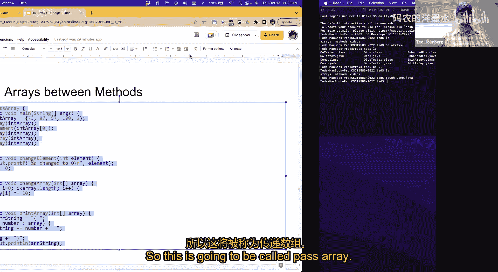
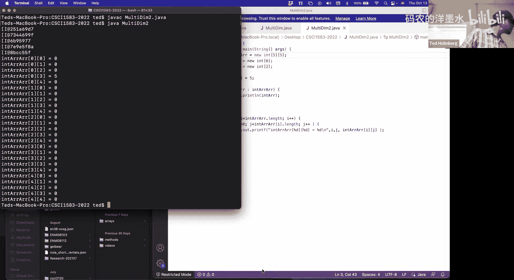

# 【全集】加州理工学院 软件设计与开发 中英字幕 1080P p17 Lecture 17 - 作为引用类型的数组 -BV1AvzCBdE7a_p17-

。Okay。So in today's lecture， I want to continue our conversation。

 I want to continue covering the concepts that relate to arrays here。

I want to move on to talk more about arrays and how they relate with reference types。

 so I know we've mentioned this previously， but let's be very explicit with some of these concepts so recall。

😡，Let's talk about what reference data types are， so we spent a lot of time earlier in the semester talking about primitive data types and one of the things that really defines a primitive data type is the fact that all of the values within a primitive data type are known。

 they're encoded。😡，As of literal values inside of Java so they don't consume any memory it's part of the Java installation that contains all those values the things that defined a reference data type is that it doesn't have a literal value defined within Java itself so when we when we assign a value to something that's a reference data type it's stored in memory and so we have a memory address that we go and look up to get that value to get access to that value so again when I have the value of three that's a primitive value Java has that encoded right doesn't have to decipher that。

😡，Whereas a string， we said strings are reference data types。

 that's why we use a capital uppercase S with it， and the reason why that has to be a reference data type。

Is because the number of permutations that string has there's no way to actually encode that to hardcode that into Java so every time we create a string it's a unique thing that we then store memory and we just retrieve it whenever we need it so we learned that process of storing things into memory that is what a variable is we learned that there's a special type of variable an array variable that allows us to store more than one value into memory and because of that arrays in themselves are kind of like this advanced data type that consumes memory address or memory space and so it's going to have the initial pointer in memory to where the array is stored at but then we also said that the index or value is the number of offset of additional values that we can hold in that contiguous block of memory。

So a memory address versus a primitive value is going to be very important when we start talking about how we can share a value。

Of our array variable as opposed to a primitive data type。And again。

 we talked about the array indexer variables， a couple of terms I want to just highlight when I start communicating about the code because I don't know if I've formally gave definitions to these or not。

We can use the term reference and de reference， so the term reference refers to the fact that I have a value。

And I have a variable name that variable name is an alias so when we see something that's human readable what it translates into the computer side of things is a hexademal number which is the addressable space and memory that we're looking to access so when we access that location and pull that value out that's what's called dereferencing so when I say dereference a value that means I'm looking up where it's stored in memory and i'm getting back the actual value that's stored there。

😡，So if you hear me use the word de referenceence， that's what I intend to mean by it。

And when I ever say reference or like a reference data type。

 I'm referring to the fact that there is a reference that we're using so that the value we're looking at isn't the actual value it's something that is used to look up in our memory to get the actual value so the value stored in memory I can and I can reference that value by just dereferencing it using the variable name that we've assigned to it。

Okay so the big thing here that I want to cover is this idea of passing by value first passing by reference so when we first learned about methods what we were really doing was passing by value so passing by value means that we can give that literal value in the parameter and so that value is then shared to another method that can mutate that value however it once and it doesn't change the original variable that by value where pass by reference means that we can give the actual memory address to where the data type is in memory and anything that changes using the reference anything that changes that object that data type that value of that data type using the memory address it will change for every other method that also has access to that value so let's say what that actually means so okay so what we're going to do here is we're going to show how。

To pass and array into a method， we're going to show the difference by between the past by value and the pass by reference concept。

Here， primitive values and string values are passed by values to other methods。

 which means that if we use variable as an argument。😡。

So arrays don't have a singular value the memory address of the array is passed to other methods so that they can read right into it this is called pass by reference this may be dangerous as now the array is shared across methods and changed within one method will cause it to change for all other methods so let's take a look at the source code and we're going to break it down and we're going to make sure that we all kind of understand what's going on here so this is going to be called pass array。

So let's go here， touch。Okay。So let's start with this， let's start by eliminating some code。

So let's get rid of oh let's start with just the print array so let's get rid of all this and then i'll go back and get this stuff as we need so i'm going to create a class called pass array i'm going to create a main method。

And on my main method， I'm going to use a array initializer list here or an array literal to create an int array that has the value 73。

 87， 57， 102。And then I'm going to take this array literal， and I'm going to store that into memory。

😡，Under the alias under the identifier of int array and then what I'm going to do is I'm going to create a helper method。

 so another method defined inside the class scope of my pass array it's going to take in a parameter here。

Of an inteature array an array of nts and so this remember is going to declare a local variable called array which only exists inside the block of code that's assigned inside this method then what I'm going to do here is I'm going to create a string called R string I'm going to assign it a initial string which is just like a open curly brace。

😡，Then I'm going to create an enhanced for loop where I'm going to iterate over each of the values inside of the array and this array was passed to us right by the invoking method。

😡，So what I'm going to do then is I'm going to take each value that was passed in and I'm going to concatenate this so notice I'm going to use this compound assignment operator where I have a string and I'm going to add to that string。

 the current string， the new value of this number so it's going to convert that number from an integer into a string and then it's going to add an empty space after it。

 so after we do that for every。Integer value inside of our array I will then go ahead and concatenate a closing curly brace so this is going to effectively create a string that when we pass an array into it it's going to make it print out such that it looks like a literal array right and then i'll just do a system that' print on that and since i'm doing the print to console here there's no reason to return this back to the invoking method so here so this would be a procedure method so here i'm going to use the return type of void。

😡，Because we're just doing eight， we're just executing a block of statements。Excellent。

 so does anyone have any questions about what's happening with this method here？

Or is this clear enough？Okay so then what I'm going to do is now that I have this helper method I'm then going to invoke it inside my main method so i'm going to call on print array and inside print array i'm going pass it that integer array that integer array is a reference data type so when I pass that array i'm actually giving to this method print array the memory address to where all these values are stored i'm not giving it like what is that one。

 two， three，45 i'm not giving it five different values all at once i'm just giving it the address。😡。

So let's see what happens here。Let me， blow this up some。So what this is called pass array。

 so let's compile that and then let's run that。So here we get a。

A printout enter our console that has the open curly brace then it iterates over each of the numbers 73。

 then it adds a space 87 then adds a space 57 then adds a space 100 then adds a space to then adds a space after we're done that and enhanced for loop it adds that closing brace and finally after building that string it prints it out so this is exactly what we'd expected to have。

Okay， let's add to that though because。So the first thing we're going to do now is let's add this method called here let's change an element inside of this array so we're going to make this one call here now let's grab that method and let's talk about what's going to happen with this method so I'm going to grab this method。

😡，Let's add this into our source code i'm going to add it up here so this is the method that i'm about to do a dissection on so again this is going to be a public static void means we're not going to return anything it's just going to be a block of statements that execute but don't provide back any values well call this change array and the parameters that's going to require is going to be a in a array we're going to pass in our array。

So here。I'm going to go ahead and then。Use a classical a traditional for loop so I'm going to create an index variable cold I I'm going to start it at zero because zero is the first place that we can index into then i'm going to go ahead and so long as I is less than the length of my array so I want to index into every possible value for it I will go ahead and increment it so inside of the body of my for loop I'm going to use the box notation to dereference。

The value in my array that's at location I， so the first element in my or let's call the zeroth element of my array is at location zero and the first element would be at location one and the second would be in location two I do all the way until I get to location4。

😡，And then I'm going to use a compounds assignment。To multiply whatever the current value is by 10。😡。

Okay， and then。Then what I'm going to do after I change the element is let's do this let's。😡。

I'm going to also print the array。系喂。This is changer array。Yeah。

So let's we'll just update it there we go so change array。

 so i'm going what i'm going to do is i'm going to print the array。

 then i'm going to change the array。😡，And then I'm going to print the erect。

The state of the array after I do that。So what would you expect to happen on line four when we invoke printer red。

 what should be the output？😡，70，570。terWell that would be on line six right so after we call change array。

😡，Everything will be changed though that that's the key ID though right so when we do it the first call here to print a right w7387 5702 but you're right at the second call in line six everything should be。

😡，Multiply by 10 so we would expect it to be 730， 870。

 570020 right does does everyone agree that that's what we should expect？😡，Okay。

 so let's take a look at this。And let's actually test that。And here we go。

 we see on the first printout before we invoke change array。

 it is in fact what it originally was declared and initialized as and then after invoking that method。

 this is the invocation on on print array on line six， we see everything has been multiplied by 10。

 but notice。Notice that the values then in the array have actually been updated right that because we passed the array by reference we gave the reference and memory to the other method when we when we passed it along so any changes that happened in this method notice got reflected inside of not only the main method but inside of print array anything that's using this array that we're passing an array around well now have to deal with those changes now that's good in some ways but can you see how that could potentially be negative as well if if you didn't if you didn't realize that a method was changing the state of your array then that could be really bad right？

😡，Okay， let's take a look at passing by value though so that's passing by reference let's actually go to change element。

 which is what I originally wanted to look at first so we can compare a contrast。

So here I'm going to invoke a change element method， which we haven't defined yet。

 so let me go ahead and copy that here。😡，And I'm going to put it up here at the top so that we can examine it so this is going to be the new method we're going to look at it's also going to be a public static void method so it's not going to return anything it's going to be called change element because the idea is we don't want to change the entire array we just want to change a singular singular element from the array so notice since we're not going to pass the array。

Into the parameter space iss going to be a singular integer value。😡。

Here what we'll do is we'll print out the initial value that got passed in so that'll be whatever the element was。

 and we will just go ahead and then set that element to be zero。😡。

Okay and then here what we'll do is after we call a change element we're gonna print the array so again we're not returning anything we're just executing this block of code what do you anticipate on line8 now so we know what happens on line four and six we've already tested that what will happen when I go and call print array line8 let's take a look first at what the parameter that was past in so since i'm passing in a singular integer value i'm not passing in a full array since i'm passing a singular integer value i'm going to dereference from my in let's say the value at position zero。

😡，And I'm going to pass that as the in value that goes here。

 and then I'll execute this block where I print it out and then set that element to zero so after doing that block of code。

😡，That's assigned to this method， what's going to be the final printout on line eight when we send this to our printer right nothing？

😡，What do you think it is？So first of all， what value is the one that's being sent to change element？

Out of my array， so I have so if this is the array here， which element are is the one of interest。😡。

嗯。Yeah it's going be it's going to be the first one right because we're dereferencing index zero that we're passing into change element so the one that's actually going to pass into this method is going to be the value that is 730 right which means that we're not passing any other value because remember this this method here is taking in a singular in value it's not taking in a array which means that we're going to be passing by value we're not passing by reference we only pass by reference when we send the entire array when we send an individual primitive value we're passing by value。

😡，So with that said， what do you think is going to happen is is it's still going to be 730 or is it going to be zero？

What do you think， zero， how many other people think zero？Okay。

 what about 730 who thinks it will remain unchanged？So it's about a equal split， let's check it out。

Let's save and let's run and let's actually save my changes to the source code。

So that we can actually run that Okay， here we go so here。I have the original。

Aray here I have the effects of the array after we invoke change array， which uses pass by reference。

 here is the system dot out inside of the method change element where we say， oh。

 I've gotten this element value of 730， I'm changing that local variable to zero。

 but now if I print out the array after that method call， notice it remains unchanged。😡。

And it's because we didn't pass the memory address， we passed the individual value。

 so anything that happens inside here is affecting just the value that was passed in。

 it doesn't have access to the array to mutate it。😡。

So this is a very nuanced thing that can cause some erroneous behavior if you don't realize what's happening here。

😡，So do you see， does everyone see why now this remains 730 and doesn't become zero？

It's because this element here that we're setting to 0 and line 15 isn't tethered to the values that are held inside the memory that represents our array。

 We extracted that value here。And then that value is then assigned to the local variable of int elements。

 but once it's been assigned that value， it no longer has a link to the array。

 so if we mutate that value， the only thing we mutate is the local variable。

 which is some other location and memory that is separate from the location and memory that our array is being held at。

😡，Is that so so so if I was like try to draw this out let me make a comment here so if I try to draw this out imagine that these are my addressable spaces so for argument's sake let's use like letters to create addressable spaces so I have like let's say Aa represents the first value in my array so let's say this is the starting point in my array so this is where I hold my value of 73。

And here all I'll make a pointer so at and then A B。We then hold that next value 87。

And then let's say A would hold that next value， let's say 57。

 then let's say A D would hold this other value， let's say 100。

 and then a E would hold this other value that's So when we declare our array that holds what five elements one。

2，3，45， what's happening is it gets a initial assignable block of memory where it stores the first value and then it also assigned gets all those memory dresses allocated at once so the second is going to be in the next assignable block that that is allowed so that would be 87 and 57。

 so that's why we have the index of1， the index of0， I'll put this off to the side。

Because that's an offset from the original memory address that allows us to gain access to the value we want。

Okay， and then finally， okay， so what happens， though is when we de referenceence。

 let me try to line this up。 Okay， so when we de referenceence in line。

Seven here what we're doing is we're accessing this value well this value after when we were doing that everything was multiplied by okay so。

😡，We're accessing this value here and we're passing the value。

 not the memory address so it's like we're copying this and we're putting that there that's what Java is doing for is putting that actual numerical value there well that is a literal value。

😡，That is a primitive data type value。 So it's passed by value here。

 So when we go to invoke this method， since they have a parameter that uses a。Prerimitive variable。

 this is creating a local space of memory。 So let's say that this new memory address is B A and inside this。

Which is we give the name element so when when we mentioned element element and B are effectively the same thing it's an alias and what's held there would now be the value of73 and every time we make a change to this value。

 it actually affects the memory rest at B so when we set that to zero。

 this is the thing that changes whereas this all remains the same like this illustration help at all kind of or did this just confuse people more。

The so that's that is a representation of the offset from the original space and memory that we're storing all of our values at so again the way that it array。

Deeclaration works versus the way that a normal variable declaration works is a variable declaration declaration represents a space and memory so when we say I want to hold an integer and I want to call that inature X then we create an alias we create an identifier in our code where we can use the human readable name of X。

 but what x really represents is this numerical， this hexademal numerical memory address that is the actual memory location of where the value of X is being stored at now an array is very special in the fact that it not only can hold one value but it can hold multiple values。

 but all those values are in the same block of memory so what that means is that if I want to store four values in an array I have to declare that I have an array of size four of length four and what happens is first indexable value。

That normally gets assigned to the variable is where the initial value the value at index0 is at。

 but then if I index one the next space after that int is where the second value at and then the next space after that value is where the third value is and then finally after that is the fourth value so here i'm just representing that the memory address here is incremented by one so 870 literally follow 730 like like not just in my explanation to you but physically held in memory all those values are grouped together whereas when I try to illustrate we're going to go to some other location of memory when we invoke this function it could be any random memory address not it' not part of the raised memory address though does that answer your question so all of this is a contiguous block and that's why we use the index values。

Because it tells us how many spaces to jump in memory to access the value we want。😡。

But because of that， because all the values are grouped by memory。

 there's no way for us to share this as a literal thing。so when we go to share with other methods。

 we share it by giving the memory address of the array and then if we make changes to anything in memory。

 well it affects everything else， we saw that， but when we dereference a value。😡。

Where we just pull the individual value and then pass that into this method here。😡。

We're not given the memory address of array at index zero， we're dereferencecing it。

 so we're going into the memory， we're getting the value that's held of that memory and we're providing that the value。

 not the memory location。😡，And so what happens then is that value is then shared inside of this。😡。

Prameter space where we're creating a local variable that's called element that holds a data type in and here what I' was trying to highlight here is that's some other different location and memory。

😡，And then when we invoke that value， we're providing it the value of 730。

We're not giving the memory location to our array， we're actually giving it the primitive value。😡。

That was held in that array， so that's going to create another storage operation that's called element that now has the value 730。

 but if we mutate the value held at that memory address。

 so again on line 25 here we mutated that to zero。😡，So in this part of memory it goes to zero。

 we'll notice that doesn't change what's happening in the original race faced inside the original memory。

😡，That's holding all of the values in our array so when we're done processing this method。

 even though we change this local value to zero， it doesn't change it here so that when we do our final printout it remains the same。

😡，And so really， that's the difference between being able to pass。

Data by the value versus passing data by its memory address， by its reference。

 whenever I say reference， I mean is location and memory。😡，Did that help clear up the question？Okay。

Okay， anyone online who has any questions related to these concepts？Okay， so this， so this idea。

 though。😡，That。A memory address name is a reference。😡，超。

I'm sorry that a array name is a reference to its location and memory and it's a continuous walk of code is now going to motivate the next thing we can do with arrays so we learned that arrays are super powerful that regardless of the data type whether it's primitive or whether it's a reference data type like strings we can create an array of it so here's my next thing。

😡，Do you think it's possible for us to create an array that can hold other arrays？😡。

And so the answer is yes， we can create an array of arrays。

Or we can create what are called multidimensional arrays。

 so there's another a number of names we can call these。Multidisional arrays。

 array of arrays or nest arrays。😡，So multi we'll also take a look at multidimensional array literals or initializers versus the standard array literal and' also look at how to create new empty multidimensional arrays。

 so let's take a look at this。So the idea behind a multidimensional array and so this particular example code that we're looking at here is using the initializer list so remember with a singular initializer list this would be an array。

So in a array of arrays， we can have one array， we can have two arrays， we can have three arrays。

So this is a way that we can initialize an array of an array。 So the idea here is that we have。

The outer array here， so this is going to be a string array of arrays。

 or I guess that you can think of it like this。😡，Let me。So。Here。Okay so let's think of it like this。

 so we know that single box notation when applied to a variable says okay。

 we can hold the values of strings but by putting this box notation。

 it means we can hold more than one value of strings so that's going to create a string array when these two things are combined if I put another set of box notations after that here I'm going to create an array that can hold a collection of string arrays。

😡，So what's happening in memory。Here is I can then create this outer array。😡。

That can hold these individual smaller arrays。😡，And then if we were to print these up。

 we could see that we can have the array that holds Ted Alex Joe， this array that holds Mark Joe。

 Lily， Tim， this array that holds Mike and Ed， and then we can go through and if we want to print those values out。

 we not only have to iterate for the each element in the outer array。

 but then we also have to iterate over each element in the nestled array or the inner array。

Let's see， let's see if the other one's a little bit easier to read， so we can go back to this one。

Oh。I think they're about equal in kind of concepts that hit our complexity of。So let's go here。

 let's test this out， so let's do our multiD array。And let's test this out so here。Go here。Okay。

So what I'm going to do here is i'm just going to create a class multid going to create a main method here i'm going to declare and initialize a multidimensional array so let's let's start by doing this first let's convert this into a a standard array。

And then well we'll expand this so recall what they。Let's actually get that all onto one line Okay。

 so for a standard array this was the array literal and then here let's go ahead and comment this out。

Let's comment this out。Yes。Okay， perfect。Let's run this and then we're going to add the complexity of。

It went， oh， there's no J。食啦。No。嗯。Okay， let's see here。 What does it not like。Oh， oops。

 got to remove that too。And yeah that looks good okay once we get this to run。

 we'll go through and wall through it very precisely。 Okay。

 so that actually runs so let's take a look at this sample code and then we're gonna to add to it so that it can actually be multidimensional So here this is a misnomer now we're creating a standard string array called names and we're going to assign into our name string array a string literal So remember that's a group of values that can represent the values of an array so here it's a comma separated list or the first values is going to be Ted the next one will be Alex the next one will be Joe and so I will store these values in memory then i'm going to create a for loop that's going to use as my index value of zero and for so long as my index value is less than the length of my array I will increment my indexer and all I'm going to do here this is right here this is。

Comment it out so i'm not doing this right here I can actually remove that for now。

 so then what i'm going to do is i'm going to print out system out up print。

The array names and i'm going to put in the index number that i'm currently using and then i'm going to show the value i'm going to do a dereference here at that index to show the value that's held there so my output and let me clear out all this so that I when I run this we can see that's going to be at names index zero it's Ted at names index one it's Alex and it names index two it's Joe so up to this point does anyone have any questions before I add complexity to this。

Everyone's good with this。Okay， so I can actually instead of making names a array of strings by adding another set of。

😡，Box notations in the declaration， it is now an array that holds string arrays。

 it's an array of array of strings。😡，Or another way as we call it a 2D array。😡，Of strength。

So now that I'm now now if I look on the other side of this assignment。

 now that I've said that this can hold。😡，An array of array of strings， this is now。Not valid。

I I now have one singular array， which means that the values I'm trying to store are strings。

 but the values I should try to be storing inside of my array of string arrays is arrays let me see if let me do this let me see if I can go ahead and do double parentheses。

😡，What's。嗯，commentment that out。And let us just。Comment out this right here。

This system that out let's let's slowly grow this out so it allowed me to compile this doesn't do anything let's actually do the print out here but and let's modify this print out a little bit so what do I want to print out here yeah let's let's see what happens when I when I keep this as is。

Let me recompile。Okay， here we go， so now what happens the moment I did that and let me let me show what happens if I don't include these double quotations let's motivate some things。

So that works。And when I do this I get an error so did everyone see the small change I made why do I need the double curly braces as opposed to the single curly braces。

 why will this code not work with the single curly braces？😡，Yeah。

 so this is saying the type of data that name should hold is a collection it's multiple stringer arrays if I have the single curly braces。

 then the first value i'm giving is a string not a stringer array right？

And so that's invalid because the type of data it's expecting isn't a string。

 it's an array that holds strings， so think about what that actually means it means it's looking for a memory address。

😡，That will then jump to some set of string values。😡，Whereas this is an actual string value。

 so it's not the same type of data。😡，But the moment I put a double。

Curly brace another way I can express that and maybe an easier way of me expressing that is let me put some let me use some spacing I love formatting things this is what we're actually assigning so an array of an array requires an array that holds an array that is holding strings does everyone see that's what that is。

😡，So since I have two sets of brackets here， if I use a literal。

 I need to have a collection of array literals inside an array literal。😡，And I can do this。

We'll talk about that later。Okay， so then when I do my printout and let me save this。

Let me clear this， let's reupile。Let's prerun this Okay。

 so now let's look at this print names zero at index zero is assigned sign and then what do you think is happening here？

😡，Does everyone see what that output is， do I need to blow that up some？

What do you think that that's kind of weird， right？So what we see here is that we're getting。😡，Java。

lang。str at， and so this is the memory of Ru。😡，So whenever you see these things report it。

 it's saying， oh， I have this like complex object， I have this array object that holds string。

 so this is a way of Java reporting that this is a string array at this memory address。😡。

Which is way different than just the。😡，Then just the actual name values。 In fact。

 if I want to access these name values。For each of these boxes that I have。

 I need to have an index value， so when I'm going through for int0 equals I mean for I equals zero here and to the length of this array。

 well let me ask you this， what is the length of my outer array here。😡，Yeah， it's one。

 there's only one element in it， right？What is the length of the inner array contained within it？

Three， right？So the array held within the array of arrays has three string values。

 but there's only one array of strings inside of my 2D array or my array of array of strings。😡，Okay。

 perfect。And we can actually kind of test this out here can。

Let's actually add a system dot out dot print F where we put。

Percent D new line character and semicolon and let's just do。Name， okay， let's save that。Names。

 floral。Okay， save that and rerun that。 And we should see， yeah， so length of a right is one here。

 and then we get the。Aray memory value。O。So。Suppose that I don't want to see the memory location。

 suppose that I actually wanted to say。😡，The actual values that were held inside that array of strings。

 then I not only want to index to notice this first indexer that I'm doing to names I what that's pulling for me is the inner array of strengths。

😡，Within once I have access to that， I can use a second index value to walk across each of the values inside of that nested array。

😡，So let's take a look at that let's do four and let's give this we got to give it a different name let's use j so I represents the index of the outer array j will represent the index into my inner array that i'm accessing currently so let's start J at index0 and then let's say so long as j is less than。

😡，你。Inside of names。I'm going to index and using I。 And at that location is another array。

 isn't there。So that means that that array itself has a lamb。I'm going to go ahead and increment。

Okay， here。Does everyone understand what's happening with this forward loop so i'm going to create a new index value to be able to track the position inside of each inner array right now there's only one。

😡，And I can actually go and access the length of that inner array by using the external indexer I。

To get a reference of in memory to that array。And then ask it hey， other array。

 what is your length which is going to be different than the outer array right we said the inner array was length three。

 the outer array was length one。😡，And then we'll go ahead and。Gain that value。

 Oh we'll increment and walk across that space。 So let's look at the length of that array here。

So that we can actually see what it is and then let's see if we can actually get the name so to get the name。

 let's do system。 out dot print F， we're going to index using the outer indexer which gives us access to the inner array。

 then we're actually going to index into the second index value inside the inner inside the inner array so this is the outer this is the inner。

And then this will be the actual string value that we want， so here I will index at names。IJ。

 so for each box that we've declared， we can put an index value in there that will eventually resolve to us as string value let's actually print out the values of Ij2 as well。

😡，Okay， so let me take this let me clear my terminal， let's compile this and。So here。

 let's see what's happening my outer rate has a length of one oh。Let me do this too。

Let me clean up my output a little bit， let me pull out the for loop and put that there。Okay。

 here we go。So the length of my outer array is one at names indexd zero is my array of strings。😡。

So using the lymph that's held at that memory location。

 I could find out that that array has three elements。At index zero。

 so on the array that's held at the zeroth position at index zero inside of that array is the value Ted。

At index zero in the outer array and at index one inside of that first inner array is the value Alex and at array zero on the outer array and the array index of two is Joe。

😡，So here I've actually been able to use enough indexing values to get from the array of array of strings to the array of string to the actual string value。

😡，So why don't we try doing this， let's create more than one array to see how this works out then。😡。

And one of the interesting things to know about this approach。

Is that we can create a multidimensal array that can be referred to as jagged。

And what I mean by that is is anyone familiar with the term tabular data。

 so there's a rule for tabular data isn that so has anyone worked with a like a spreadsheet software like Excel or Google Sheets or is everyone at least familiar with the concept of Excel？

😡，So yeah， so with Excel， you have rows and columns and the rows can be given names。

 the columns can be given names and inside of each of those is a cell。

So one rule about tabular and we call that table data or tabular data so Excel spreadsheets all follow the rules of tabular data。

 which means that the number of rows and the number of columns are always the same so each row has the same number of columns each column has the same number of rows that does that make sense。

😡，So with an array of arrays we we can model tabular data with a 2D array。

 but we also aren't confined by that definition of tabular data we can create what's called a jagged array which means that our first array if we were to express it in terms of rows and columns would say it has three columns of data right Ted Alex and Joe whereas our second array so it's almost like this row can have two columns Elsa and Tim and then finally this last array can have a single element so that's like having one column on the third row so this is what's referred to as a jagged array because they're mismatched if I treated this as tabular data it wouldn't work out well but that's a powerful mechanism that we can use inside a Java okay so let's take a look at that so notice all I'm doing to create a multi-dimensional literal is I'm just creating array。

Literals and I'm separating them by comm。Now I use formatting to make this much more readable right I'm not putting this all in the same line of code because that would make it very complicated to parse this with my human eyes。

😡，It's not necessary to do this， but it's for readability。😡，Okay。

 so let's go and recompile this and see how it changes。Here I have。

My length of my array of my outer array is now three right in fact， let's let's do this。

 let's make it for just for argument's sake。😡，Let's put another one up here。That has the name。啊。Okay。

 well compile and we were run。 so our outer array now has four four array of strings is held inside of there。

 That first array has a length of one and at index 0。

0 right so we're going to use the outer indexer in the inner indexer to actually access the string value that is in Dan after we're done accessing all the values of this for loop。

 we will then jump to the outer for loop where the I increments to one So now we can say that the length of the array of the next array is going to be four。

Though I'm sorry that's this right here。 In fact， let me pull this out。

 let's make this more readable instead of printing that out inside the for loop。啊。Okay， perfect。

 let's clear this。Try to clean up the logic here， okay， so the length of my outer array is four。😡。

At name zero。Is going to be this array。 That array is a length of one at index 0。

 and then index 0 of that inner array will be the value of d， which is this one right here。

 Then since I'm done iterating to that array， I'm done with the inner for loop and then move back to my outer for loop。

 where I increment the index value of I from 0 to 1。

So then I use that index value of one to index into names and say I'm now going to look at this array now let's look at the difference the data type is the same this represents a string array this represents a string array notice the memory location is different this is the memory location of the array that holds Danny this is the memory location of the array that holds Ted Alex Joe the length of the array at that memory address is free。

😡，The value at array of the string array at index1 and of index zero into that array is T。😡，So again。

 I use the double indexer， So at index one index0s head and again。

 that's like saying this is the index0， this is index one。And then we go by columns， so that be Ted。

 Alex， Joe。0， Ted one， Alex to Joe all of these are part of the same array that's at index one in my outer array。

 Then when I'm done that， I'm done that for a loop。

I increment my index value of I to two and now I look at this whole different string array that's holds in memory。

 I can inspect it and see， oh， it's got a length of two。😡，I can then。Use a nested for loop。

 an inner for loop to create that indexer J started at zero and so at index value of zero is Elsa at index value of one with J is1 when I'm done that。

I exit out the inter4 loop， I increment my I to be3 to look at the final string array。

 I examine that and say hey that's got a length of one I index at index3 with I index zero with J and I get access to Henry so does everyone kind of understand how multidimensional arrays work？

😡，And so what's really crazy about multidimensional arrays is I'm not just limited to an array of arrays I can have an array of array of array of arrays or an array of an array of array of array of blah。

 blah blah blah， blah like a 4 d arrays5 d arrays， 60 arrays I can just keep nesting arrays because the idea of dimensionality there is just。

😡，An array that points to another array that could potentially point to another array。

 but it always will resolve back down to some fundamental value。

 you can't just have containers that hold containers that hold like containers that don't end up holding something at the end。

 but the important thing is in order to find your way to a value。

 you have to index in using those index or numbers for each box notation that it gets nested deep into memory space。

😡，Excellent， does anyone have any questions if there was a fifth inner array that was。

A empty string would be zero what would happen when its ski no so technically an empty string is still a valid string literal。

 it just doesn't have any characters stored inside of it。

So I think what you might be asking is if we had an empty array like this， would that be a valid。

 right？Where it doesn't have anything， I don't even know， I don't know if I've ever tried to create。

 oh， Lord。Didn't mean to hit that， I don't know if I've ever tried to create an array literal with nothing in it。

 I don't think it'll let you do that。We'll say， maybe it will。I can honestly say I've never tried。

 well， didn't didn't crash。And yeah， look at this。 It's valid Java code。 It's a length of a array 0。

And we skip it because there's no elements inside of there。But we can index in。

 we see that's the location in memory。So yeah， we can even just create a empty array using a set of curly braces。

 but the problem is it's a a length of zero so you can't add anything to it it's weird that they allow you to create an array with1 zero right because it doesn't even have an index zero term。

Weird。Yes。A good question， though， it actually made me try something that I haven't tried before。

Okay， let's move on then so there's no questions regarding that well I kind of want to take some time to illustrate this one other multidimensional array example。

😡，To show how we create an empty array。 So we saw how to use a array。

 a 2 d array literal to make an array。 So let's do this。 let's clear this。 Let's do a。

Let me create a what is this multi Di2。 Java。Let's jumpmp here。And let's paste this into here。 Okay。

 so here I have multi ti2。I'm going to go ahead and create my main method now。

I want to show this in one of two ways。The first is when I go and declare my array。

 I'm going to create a two dimensional in a array or an array of array of nts。

 I'm going to give it the name int RR。😡，And then I'm going assign it using instead of the array literal list I'm going to go ahead and use the new keyword now when we did this notice it looks pretty similar to how we've done this before where we use the data type we use the box notation inside the box notation we have to declare the length of it but for a twodiional array we only are mandatorydatorily have to set the array that is in the outer array we don't have to set a value that's in the inner array here why do you think that's the case。

😡，Why don't I have to do something like this， for instance， or this？😡，Or whatever， whatever number。

When I create this outer array。Well， the rationale is that when I first declare my array here。😡。

What I'm doing is I got to create a contagious block of I got a store， I got to reserve。

 a contaguous block of addressable space that holds five values where the values I'm holding because that's going to indicate to me what size I got to give to the JVM so it knows how to reserve that space for me well this outer array is holding a collection of inner array。

😡，Objects right， what's the size of an inner array object Well it's the size of a memory location。

 right？😡，Does that make sense， so we know what the memory location is it's not holding。

 that's the big thing to remember with this concept of multidimensional arrays。

 it's not holding the values themselves nested inside of an array。

 it's holding a memory location to some other place in memory。😡。

So it doesn't matter if the memory that if the interray holds 100 elements or if it holds one element。

 the size of it's the same。😡，Because the memory address is the same。

 the memory address to some other location memory， whether it ends up holding a single value or it ends up holding 100。

000 values is going to be the same size for the memory address。😡。

It's like the same concept with housing addresses， right。

 the same size of a houseage risk for a shack and a mansion in terms of the address is the same。

 right？Now， when you go to that location， then you see the volume。😡，Difference between the two。

So that's why we only have to declare the outer array here because it knows okay。

 I'm going to hold memory locations for up to five memory locations and then inside of there we can create new arrays at index zero that holds again we'll use jagged arrays this one will hold six。

😡，Elements this will hold two elements then I can index into an element。

 let's say inside of index zero and my outer array index three in my inner array and actually assign that five then just create a quick for loop。

That prints out the value of my arrays and then a for loop that prints out the value of the value that are inside those arrays。

Let's quickly look at this。嗯。And multi。Dim two。😔，Let make sure I save。There we go。

 so what we see here is I have。On this war loop， I'm printing out hey。It has actually a total of。嗯。

Five arrays， I have a memory address for this first array because we assigned it here on line4。

 I have a memory address notice as saying an integer array at this location。

 an integer array at this location at index1， but since I declared five and have' only assigned two of them the other three spaces or left null there's no reference to any array there so I can held up to five integer arrays。

 I've only set two of them。😡，For the ones that are set。

 if I iterate through them to actually extract the values the。

Value of this one here of at a rate index zero is going to be。

Where I set my five right so at line seven where I did in array rate inter rate at index0 so it's this one here that can hold six elements and then at index3 so at index oh so element4 right or。

And the third position of all set， I will now have the value five and the default value on your integer rate if we don't set it as zero。

And then after that， look what I'm getting， I'm getting some exceptions we'll talk about what the null pointer exceptions are in a moment。

 but since I don't have a place in memory if I try to print this out I actually my my code crashes right I can't get anything past this first array because well I can I can do the second array here but then when I get to this array that's null well I can't dereference into a nu array。

And so that's what's crashing my code so so here the null pointer exception cannot read the array length between here and here because it's null。

Excellent， so before I end today's lecture is there any is there any questions about this code about creating new arrays without the initializer list。

 how I can create the outer array first then I can create the inner array the one last thing I want to add is if I do know that it's tabular data so the numbers of rows and columns are the same instead of declaring just the outer array I can also do something like this and this would create a outer array of five integer arrays and each of those inner arrays would then be also declared as holding five elements and so if I just add that five there and compile my code and then on that notice now all of those are valid so here I now have five integer arrays and the indexing position in all of those are valid without my code crashing where I can then illustrate I can index into the outer array 01。

2，3 and4 and each of those inner arrays 01，23，4。And have effectively 16 or so different addressable spaces。

Okay， does anyone have any questions about these concepts？Excellent， well。

 we will continue talking about arrays today's Thursday， so I guess next Tuesday。Excellent。

 but I think this is it with multidimensional arrays if when you start on your homework5 we use a multidimensional array to model our maze game right to model the positions of fact your zombie game would do well to be modeled with the multidimensional array because your zombie games effectively tabular data with equal amounts of rows and columns so you'll get a chance to actually see that in homework five。

Okay。

嗯。hu。