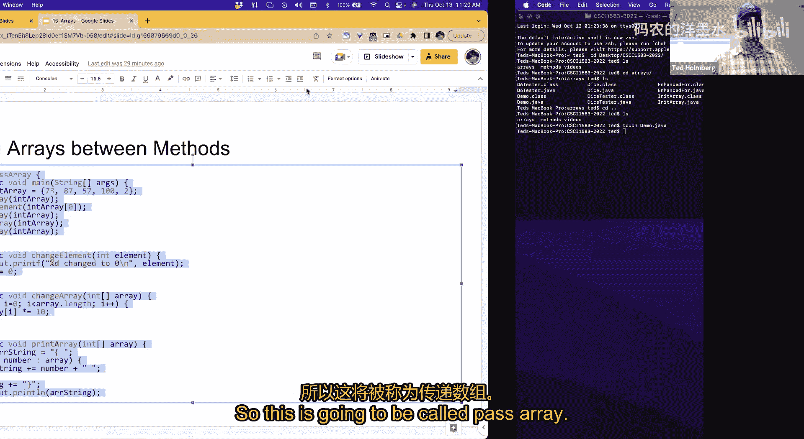
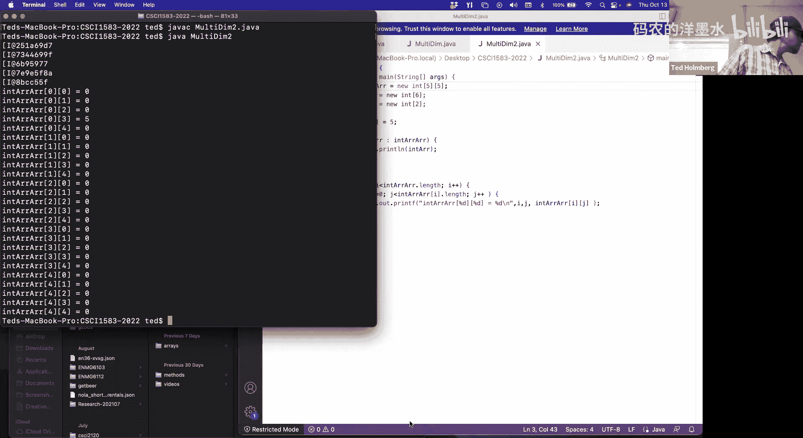

# 软件设计与开发：第17讲：作为引用类型的数组


在本节课中，我们将深入学习数组，特别是它们作为引用类型的行为。我们将探讨“按值传递”与“按引用传递”的核心区别，并介绍多维数组的概念。理解这些概念对于编写高效且可预测的代码至关重要。

## 引用数据类型回顾

上一节我们介绍了数组的基础知识，本节中我们来看看数组作为引用类型的特性。

首先，我们需要明确什么是引用数据类型。在本学期初，我们花了很多时间讨论基本数据类型。基本数据类型的一个关键特征是，其所有值都是已知的，它们被编码为Java内部的字面值，不占用额外的内存空间。



而引用数据类型则没有在Java内部预定义的字面值。当我们为引用数据类型赋值时，该值被存储在内存中。我们通过一个内存地址来查找和访问这个值。例如，整数值 `3` 是一个基本值，Java已经编码了它。而字符串是引用数据类型，这就是为什么我们用大写 `S` 的 `String`。字符串之所以必须是引用类型，是因为其可能的组合数量无限，无法硬编码到Java中。每次我们创建一个字符串，它都是一个存储在内存中的独特对象，我们只在需要时检索它。

将数据存储到内存中的过程就是变量的本质。我们学到有一种特殊的变量——数组变量，它允许我们在内存中存储多个值。因此，数组本身是一种消耗内存空间的高级数据类型。它有一个指向内存中数组存储位置的初始指针。同时，索引或偏移量表示我们可以在该连续内存块中存储的额外值的数量。

当我们开始讨论如何共享数组变量的值，而不是基本数据类型的值时，内存地址与基本值之间的区别将变得非常重要。

## 引用与解引用

在深入讨论之前，我们先明确几个术语：**引用**和**解引用**。

*   **引用**：指的是我们有一个值和一个变量名。这个变量名是一个别名。对人类可读的名称，在计算机层面会转换成一个十六进制数，即我们要访问的内存地址空间。
*   **解引用**：当我们访问该内存位置并取出其中存储的值时，这个过程就叫做解引用。解引用一个值意味着查找它在内存中的存储位置，并取回实际存储在那里的值。

当我们提到引用数据类型时，指的是我们使用的值本身并不是实际值，而是用于在内存中查找实际值的引用。存储在内存中的值，我们可以通过分配给它的变量名进行解引用来引用它。

## 按值传递 vs. 按引用传递

接下来，我们要探讨的核心概念是“按值传递”和“按引用传递”。

当我们最初学习方法时，我们实际上是在进行“按值传递”。这意味着我们将字面值作为参数传递。该值被共享给另一个方法，那个方法可以随意改变这个值，但**不会改变原始变量**。

而“按引用传递”意味着我们将数据在内存中的实际地址传递给方法。任何使用该引用（内存地址）对该数据对象所做的更改，对于所有其他也能访问该值的方法来说，都会生效。

以下是两者的关键区别：

*   **基本值**和**字符串值**是**按值**传递给其他方法的。这意味着如果我们使用变量作为参数，传递的是其值的副本。
*   **数组**没有一个单一的值。传递给其他方法的是**数组的内存地址**，这样它们可以直接读取或写入。这被称为**按引用传递**。这可能存在风险，因为现在数组在多个方法之间共享，在一个方法中的更改会导致所有其他方法中的数组也发生改变。

让我们通过源代码来具体分析，确保大家都能理解这里发生的事情。

## 代码示例：传递数组

我们将创建一个名为 `PassArray` 的类来演示这些概念。

```java
public class PassArray {
    public static void main(String[] args) {
        // 使用数组初始化列表创建一个整数数组
        int[] intArray = {73, 87, 57, 102};

        // 调用 printArray 方法，传递数组（按引用传递）
        printArray(intArray);
    }

    // 一个打印数组内容的辅助方法
    public static void printArray(int[] array) {
        String resultString = "{";
        // 使用增强for循环遍历数组
        for (int number : array) {
            resultString += number + " ";
        }
        resultString += "}";
        System.out.println(resultString);
    }
}
```

在这段代码中，`printArray` 方法接收一个整数数组作为参数。当我们从 `main` 方法调用 `printArray(intArray)` 时，我们传递的是 `intArray` 的内存地址，而不是数组中的各个值。该方法接收这个引用，并能够遍历和打印数组的内容。

## 修改数组元素（按引用传递）

现在，我们添加一个方法来修改数组，观察按引用传递的效果。

```java
public class PassArray {
    public static void main(String[] args) {
        int[] intArray = {73, 87, 57, 102};

        System.out.println("调用 changeArray 前:");
        printArray(intArray); // 输出: {73 87 57 102 }

        // 调用 changeArray 方法，传递数组引用
        changeArray(intArray);

        System.out.println("调用 changeArray 后:");
        printArray(intArray); // 输出会改变！
    }

    public static void printArray(int[] array) { /* 同上 */ }

    // 一个修改数组每个元素的方法
    public static void changeArray(int[] array) {
        for (int i = 0; i < array.length; i++) {
            array[i] = array[i] * 10; // 解引用并修改值
        }
    }
}
```

运行这段代码，你会发现调用 `changeArray` 之后，`main` 方法中打印的数组内容也变成了 `{730 870 570 1020}`。这是因为 `changeArray` 方法通过接收到的内存地址，直接修改了原始数组内存位置中的值。所有持有该数组引用的方法都会看到这个变化。

## 修改单个元素（按值传递）

为了对比，我们看看如果只传递数组中的一个元素（一个基本类型值）会发生什么。

```java
public class PassArray {
    public static void main(String[] args) {
        int[] intArray = {73, 87, 57, 102};
        changeArray(intArray); // 先乘以10，数组变为 {730, 870, 570, 1020}

        System.out.println("调用 changeElement 前:");
        printArray(intArray); // 输出: {730 870 570 1020 }

        // 尝试修改第一个元素，传递的是 array[0] 的值（730），而不是引用
        changeElement(intArray[0]);

        System.out.println("调用 changeElement 后:");
        printArray(intArray); // 输出会是什么？ {730 870 570 1020 } 还是 {0 870 570 1020 }?
    }

    public static void printArray(int[] array) { /* 同上 */ }
    public static void changeArray(int[] array) { /* 同上 */ }

    // 一个试图修改单个整数元素的方法
    public static void changeElement(int element) {
        System.out.println("在 changeElement 中，接收到的值是: " + element);
        element = 0; // 这只修改了局部变量 `element` 的值
        System.out.println("在 changeElement 中，修改后的值是: " + element);
    }
}
```

运行代码后，你会发现数组的第一个元素在调用 `changeElement` 后**仍然是 730**，而不是 0。这是因为 `intArray[0]` 进行了解引用操作，取出了值 `730`。这个 `730` 作为一个基本类型值（按值传递）被传递给 `changeElement` 方法。方法内部的 `element` 是一个局部变量，存储了这个值 `730` 的副本。将 `element` 改为 `0` 只影响这个局部副本，而**没有**影响到原始数组 `intArray` 在内存中位置 `0` 的值。

## 多维数组

理解了数组是引用类型后，我们自然会想到一个问题：能否创建包含其他数组的数组？答案是肯定的，这就是**多维数组**，也称为**数组的数组**或**嵌套数组**。

我们将学习多维数组的字面量初始化、创建新的空多维数组以及如何访问其中的元素。

### 多维数组字面量

以下是一个字符串类型的二维数组（数组的数组）示例：

```java
public class MultiDimArray {
    public static void main(String[] args) {
        // 声明并初始化一个二维字符串数组（锯齿状数组）
        String[][] names = {
            {"Dan"},                     // 第0行，1列
            {"Ted", "Alex", "Joe"},      // 第1行，3列
            {"Elsa", "Tim"},             // 第2行，2列
            {"Henry"}                    // 第3行，1列
        };

        // 遍历二维数组
        for (int i = 0; i < names.length; i++) {
            System.out.println("外层数组索引 " + i + " 指向的内存地址: " + names[i]);
            System.out.println("  该内层数组的长度为: " + names[i].length);

            // 遍历内层数组
            for (int j = 0; j < names[i].length; j++) {
                // 使用两个索引访问具体的字符串值
                System.out.println("  names[" + i + "][" + j + "] = " + names[i][j]);
            }
        }
    }
}
```

在这个例子中，`names` 是一个“锯齿状数组”，因为每一行（内层数组）的长度可以不同。我们使用嵌套的 `for` 循环来遍历它：外层循环 (`i`) 遍历外层数组（行），内层循环 (`j`) 遍历当前行所指向的内层数组（列）。

### 创建空的多维数组

我们也可以先声明数组，然后再为其分配内存空间。

```java
public class MultiDimArray2 {
    public static void main(String[] args) {
        // 1. 声明一个二维整数数组，并创建外层数组（可容纳5个内层数组的引用）
        int[][] int2DArray = new int[5][]; // 只指定外层大小，内层数组暂为 null

        // 2. 手动创建两个内层数组（锯齿状）
        int2DArray[0] = new int[6]; // 第一个内层数组长度为6
        int2DArray[1] = new int[2]; // 第二个内层数组长度为2

        // 3. 为某个元素赋值
        int2DArray[0][3] = 5; // 设置 int2DArray[0] 这个数组的索引3处值为5

        // 4. 尝试遍历和打印（注意：未初始化的内层数组为 null）
        for (int i = 0; i < int2DArray.length; i++) {
            if (int2DArray[i] != null) {
                System.out.println("int2DArray[" + i + "] 的长度: " + int2DArray[i].length);
                for (int j = 0; j < int2DArray[i].length; j++) {
                    System.out.println("  int2DArray[" + i + "][" + j + "] = " + int2DArray[i][j]);
                }
            } else {
                System.out.println("int2DArray[" + i + "] 是 null，无法访问其长度或元素。");
            }
        }
    }
}
```

**重要提示**：当我们使用 `new int[5][]` 时，只创建了外层数组。这个数组有5个位置，每个位置可以存放一个对整数数组的引用，但初始时它们都是 `null`。如果我们试图在没有初始化内层数组（例如 `int2DArray[2]`）的情况下就访问 `int2DArray[2].length` 或 `int2DArray[2][0]`，将会抛出 `NullPointerException`。

### 规则的二维数组（表格数据）

如果数据是规则的表格形式（每行有相同的列数），我们可以在创建时同时指定内外层大小：

```java
// 创建一个 5行 x 5列 的规则二维整数数组，所有元素初始化为0
int[][] table = new int[5][5];
```
这种方式一次性分配了所有内存，`table[0]` 到 `table[4]` 每个都是一个长度为5的整数数组，可以直接访问而无需担心 `null` 值。

## 总结

本节课中我们一起学习了数组作为引用类型的核心行为。

1.  **引用与解引用**：我们明确了引用是内存地址的别名，解引用是通过地址获取实际值的过程。
2.  **按值传递 vs. 按引用传递**：这是本节课的关键。基本类型按值传递，传递的是副本；数组等引用类型按引用传递，传递的是内存地址，导致数据在方法间共享。
3.  **多维数组**：我们学习了如何创建和操作多维数组（数组的数组）。这包括使用字面量初始化锯齿状数组，以及使用 `new` 关键字动态创建规则或不规则的多维数组。访问多维数组中的元素需要使用多个索引。



理解按引用传递对于预测程序行为、避免意外修改共享数据至关重要。而多维数组是建模复杂数据（如网格、表格）的强大工具。在接下来的作业中，你将有机会应用这些概念，例如使用二维数组来构建一个游戏地图。