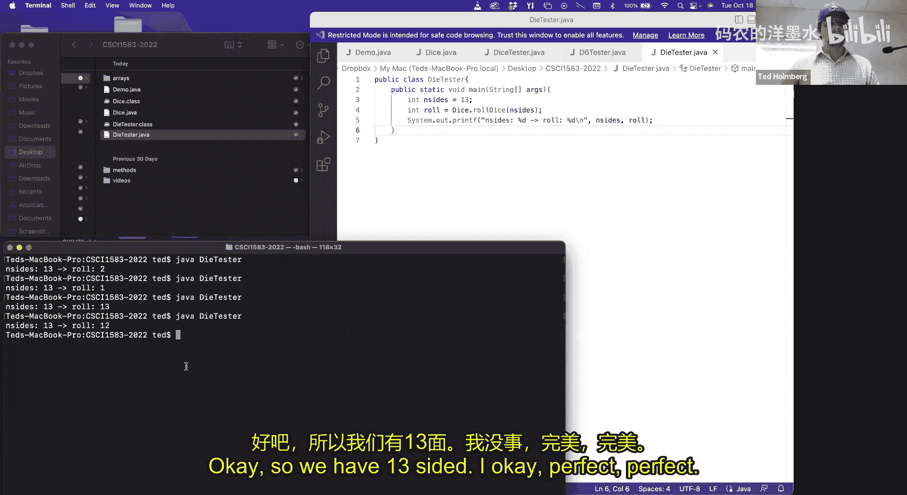
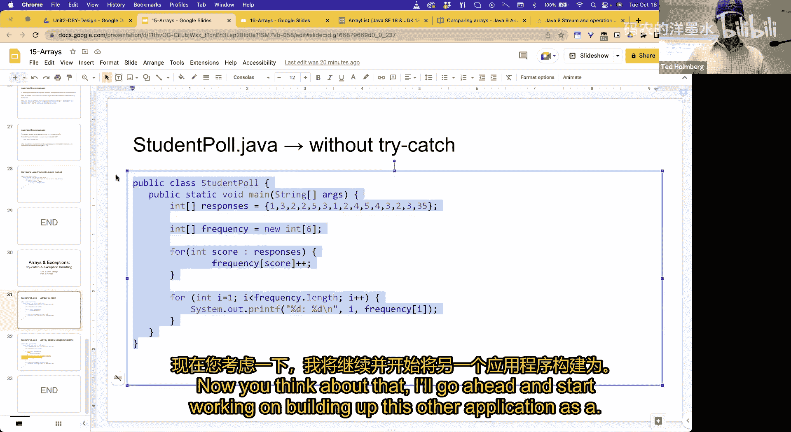
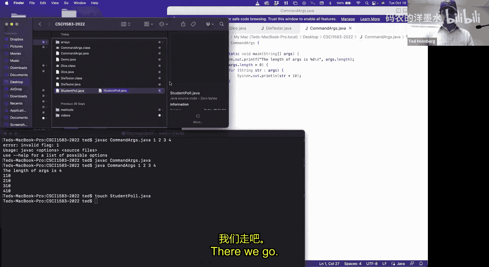
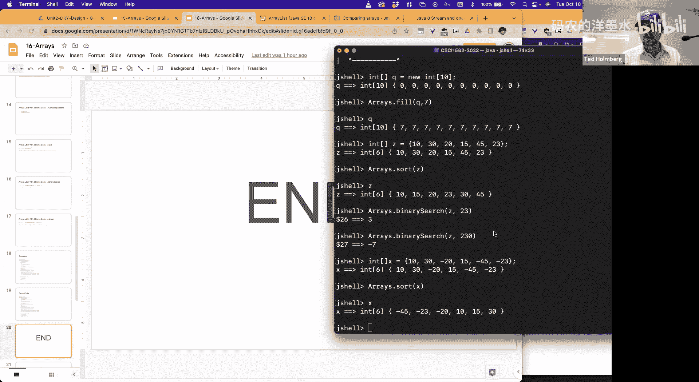

# 【全集】加州理工学院 软件设计与开发 中英字幕 1080P p18 Lecture 18 - 数组工具类 -BV1AvzCBdE7a_p18-

Excellent well today's lecture I want to continue what we've already started in terms of covering arrays so last lecture we had talked about multidimensional arrays and we had talked about the distinction between passing by right reference versus passing by value so today I want to go back to our dice game we've already used the dice game。

Previously。Let's see， what did we implement in our dice game last time？I'll say here so。Oh。

 I think what we had done really for our dice game was to go ahead and look at how we can evaluate。

I wasn't the last lecture we did， but we can go back to it here so the last time we touched the dice game。

We had。Let's open it up and actually won't we。Yeah have actually copy this we bring it into the current workspace。

Okay perfect so last time with the dice game， what we had done here was we hadn't changed anything per se about the dice class。

 but what we did change was the dice tester class。Here。

 so remember the mechanism we did before had look like this right where we had a had to define a set of variables for each face and then we improved this。

With our D6 tester class when we first talked about the power of arrays。

 we could go ahead and use an array to hold those frequencies and then we could test any arbitrary number of die together one two。

 three， four， five6 and this really empowered our ability to test our dice class well now I'm going to get into a concept where we're actually going to our dice class and and make it even slightly better。

And so what's going to allow us to make it better is going to be going to be this comfortable called variable length arguments。

We're getting an echo of sports。LetSee， I don't know where it could be coming and so I' wantll make sure that。

Oh， I have an idea。这点毛。Okay that。Even。Okay， is that better with the echo？Excellent。There we go。2。

慢 my send go here。Okay。Okay， so what I want to look into is this concept of a variable length argument。

 so up to this point we've seen that we can pass an array into a method as input and when we do that we're giving a reference。

Of that array to the method， So any kind of processing that happens in there。

 whatever reading or especially writing will change the state of our array for everything else that has that has a value of that。

 let me show you something that's a little bit interesting though in terms of the variable length arguments。

 we're going to do this two ways。 I'm going to kind of reserve explaining what variable length argument is until we can actually see it。

 And once we actually see it， I'll go ahead and and give you a more kind of formal definition。

 But let's talk about what we're going to use variable length argument for in today's lecture。

 So remember we have the dice class where the intent here is we want to improve our dice utility class with the following problem statement。

 supposeupp that we want to add a method that allows us to roll in any sided do So up to this point。

We're limited to D6s right， so how might we implement that based off of how we know the D6 I already works。

Let's see we'd probably do it something along the lines like this we'd have a public static method right it's a property of the class itself iss going to return back an integer value。

 which is going to represent the value of the die after we've rolled it。So the side that is up。

 we will we need to give it a name since this is going to be an any sided dye。

 we can just call it rolled dice or rolled。😡，Or we could call it roll D and if we wanted to。

 but we'll call it dice and then we'll pass in an integer value that represents the faith counts on it。

 so if it's a six sided die， it would have six faces， if it's an eight sided die。

 it would have eight faces if it was a 20 sided die， it would have 20 faces。

Then what I would do is the same thing I have been doing i'll go ahead and use the math utility class to produce a random number between zero to one i'll multiply。

By that scalar value that'll give me up to whatever the face count is。

 I will then cast that into a integer and then add one to it so I offset from0 to whatever n minus1 so that's one to n and then I would return that So this should give us what we're looking for in terms of that behavior。

 Why don't we go in and add that intodise class。😡，And actually， let's go grab。Okay。

 so let's also grab a tester here too， so let me go here， Do we have。Let's just do this touch。Dice。

 it will make a new dice tester。Yes。Let's do this。Public class。D tester。Public static avoid Maine。

Inside of there， we'll have our string array that contains。Arguments， and here we're going to。

Test this out， let's do dice dot and which we call that method， we called it roll dice。Okay。

 so suppose we wanted the behavior of a six sided die then that's what we would expect we' put six phases。

 let's get our role value here and let's just do a system letout system。That out do front。Actually。

 that's2。 F。And let's put that the role。Let's do this。Ps is equal to6。

Let's pass that as a variable so that I can have。Pases or。And sides。Okay。Is okay， perfect。

 so the number of sites and then what we rolled。And then that will also be。A integer。

 so then we will put the number of sides here， and then we will have our actual roll。Okay。

 let's test this out， let's see if this doesn't produce what we think it should。

 let's blow that up some。Let's compile our code。是。哦对啲啊。Okay， what does it make sure I saved it。Okay。

 what does oh dice。Comm with copy pasta。Here is we left we left off a curly verse so brace to brace perfect open close。

And the compiles just fine。 Okay， so now let's run our diser and see。What we get。 Okay。

 so on a six sided die， we rolled the one， a4， a5， a 5， a3， a5 perfect。

 That looks that looks exactly what I expect。 Now， let's change us。 Supp we put 12 here。Okay。

 and so on an inside of die 12， we can roll a six， a 10， a 10， a five， a two， and eight。

 seven that looks good to me。Let's put a two here。Suppose we had a two sided dying。Actually。

 let's just do this。So actually， you can actually run。

I don't know if I've showed you the trick as long as。You have your main method。

 it's actually possible to run code and compile it in the same action so。

I can actually run Java and then dieter。Java and if there's any changes it'll try to compile and run that simultaneously。

Okay let's see here。😔，So between one and two， that's exactly what we'd expect we can even have dye here that are impossibly shaped like a 13 sided die。

Anyway， we can see that this all works。Yeah， let's see。Save。Okay， so we have3s inside it's on， okay。

 perfect， perfect。

So。啊管 yeah。啊，不太可。4 get0。No， and the reason why we can't get a zero is if we go back to our die。

 we have this offset of one。So if we were to generate a zero so recall math that random can generate any number between zero to one。

 but not including one， so like 0。99999 and then whenever we're out of memory for that。

 then we multiply by whatever our face value is， so let's say it's just two。

So in that instance it's either going to be zero or it's going to be a one after we truncated it so be up to a zero multiply by two it could be 1。

999999， but then we trunccate it so it's going to be either between01 but then we're going to offset it by one we're going to shift all of the values to the right so our zero becomes our one and our one becomes our two。

And there's instances actually where sometimes you might want to shift to the left as well。

 so one cool thing you could potentially do I don't know if anyone had done this for their zombie game。

 but you can create a。Random value that scopes between minus1，0 and one， right？

So if you take and generate three random values， so let's say it's zero one and two。

And if you subtract it by one， your entire range shifts to the left on the number line by one。

 so you go from 012 to minus101。😡，And then imagine if you use that as your random move for your zombie so then your zombie each turn would randomly go in the X direction minus1 positive one or zero it just stay still on that access and so that's an alternate way we can create a randomized zombie movement so I just want to highlight that when we shift the number of values when we shift our randomized values。

 we don't always want to shift them to the right we shift them to a right in this instance because that emulates what happens on a die but sometimes for the problem at hand。

 we might want to shift everything to the left because maybe we want to have a mix of negative numbers and positive numbers that are part of our stochastic process so always keep that in mind when you're modeling something that involves randomness it's like what is the range of my values。

What is the is the starting， the maximal and minimal？What is the distribution of those values。

 like is it Gaussian， is it uniform and does it include just positive numbers or does it include a collaboration or a combination of positive and negative numbers？

Excellent， does that answer your question？Okay， so we have。A。Die now that can。

 we have a method now that can roll and any sided die。And here I like the name role DN better。

 so I'm going to call that DN here。Yeah。So the next thing we might want to do to improve our die class further。

 suppose now we want to add a method that allows us to roll multiple insided dot so here what we already had was we have the role D6 and then we had an overloaded method that rolls multiple D6 here I have a role DN。

Suppose I wanted to go ahead and roll multiple the end， how might I do that？

I can't simply just do a quantity because the thing that gets passed in is the number of faces。😡。

So I might do it in the way that we learned how to already pass a right so as opposed to a a number of guide we needs to roll maybe we'll have a collection of。

Face counts that represent the first side。Second die， the third die。

 the fourth die what have you So suppose that this is the solution we go for So we have an array of integers that will hold each face count for the multiple die we want to roll and then suppose that we have our die sum and we do this enhanced for loop for each die count for each face count for each end。

Let's call this inside。Inside of the dice array。啊。Keep it die。We will roll that die， get the value。

 and then we will add it to our sum and return our sum。So here。Let's put that in there。

Let's overload this。 It's the same thing。 So now I have a roll Dn for a singular insided die。

 and then I have a roll Dn where I can pass in a dice array。

 Let's see what that looks like really quick。 Let's， let's let's close that， close that。

 let's jump over here。 So instead of calling this。It's called this Dan。

So here let's create an integer array。We'll call this。Our diallist， or di。

And we'll just use an initializer list so suppose that we have like a six sided die and eight sided die a 10 sided die and it's 12 sided die so suppose that's what we want now because we've created this array as a parameter。

 we can pass an array into here。And let's test this out。Oh we're going to have an issue here。哦。

We will not have the sides， let's get rid of that， so let's just have our role。And actually。

 why don't we go in here and just to test this out for the purposes of testing it out。

 let's also do a system that out for console login so we can actually see this in action so we're going to go and do a quick print half。

So we'll put。And sides here。Percente， and then we will put our role is。Percent D。

 and then we'll do a new line character perfect。And then we'll put our whatever。The style is here。

 but also whatever the。D value is。Okay， that way we can actually examine this as we've run this。

 let's go ahead， there this。Let's clear that let's compile our code， let's run our code。冇。Okay。

 so here we can see we indeed during this part of this step we put this console this this system dot out so we can see on our system what's happening so notice inside of our array it rolls a six sided die it rolls an eighth sided die it rolls a10 sided die it rolls a 12 sided die I go to my die tester that's the collection of die I have it takes all these it sums it up and it returns back to my die tester the value of 20。

So this works， right this allows me now。To have a my dice utility class have the ability to roll any number of inside to dye。

 but what's the deficiency with this， what makes this a little bit more difficult？

And it guesses like why？This works， but do you think there's a better approach。

 is there a approach that you'd prefer to say or do you think this is just a fine approach？😡。

Maybe a way to prevent to I in the same number。Well， unfortunately。

 because it's a storcchastic process， that's something that can actually happen in nature。

 but what's something a developer needs to know in order to use our role DN method that's a little bit more complicated than our other role D6 method。

So what was our role D6 method Do you remember our role D6 method。

 we have this one that doesn't use a parameter， this one that used a singular parameter where we can just pass into value in there right what about this new method。

 What does this new method require in order for us for us to do multiple。Insided dying。

What do we have to supply that method？An array， exactly。

 so we're having to construct an array for the entire purpose of just sending it into the method。

 we don't really need the array except that's the only way we can supply all those values。😡，Because。

There's no other way that we know of to create a variable lamp。😡，Set of values。

And what I mean by that is。I want this method to work if i'm going to roll do inside ci a die versus three versus4 versus5 versus 100 right I want to support any number of die but I can't hard code just having one parameters having two parameters having three parameters having four parameters so a solution to that was to implement an array which can have any number of values。

 but then I。😡，From the client side of that method have to build an array just to call that method that's kind of a pain right that that's an overhead that I don't necessarily want in my code inside of my logic。

 so what I could do as the developer of this method is instead of using the box notation in my parameter list。

😡，I can define this as a variable length parameter where I can do dot dot dot。😡，So dot， dot， dot。

Effectively allows me to pass in a collection of values into the parameter。

 and then Java will group them up and automatically house them for me as if it were an array。😡。

So now the client code that invokes this method doesn't have to create an array to contain those values。

 they can just they can just put a comma separated list of values in that inside that method so let's see so I changed the box notation to the dot dot dot notation it's only works in parameters again it's called variable length parameter so instead of having to create this here I can just take the contents。

😡，681012 I'll comment this out here because we don't need this di anymore and now I can just pass in those values more organically I want a six sided die an eight sided die a 10 sided die a 12 sided die let me go ahead save that let's clear this。

Let's compile and let's run and notice we get the exact same behavior。

And since this is variable length I can remove one and now have three parameters I can compile I can run and you can see now it's going to roll the three so this is a very powerful mechanism that effectively reduces the overhead cost on the client to know that they have to create an array and just allows them to put in the values directly into the method without having to wrap them up themselves。

Now just some words of caution。If you're using a variable length parameter like this。

 it has to be the last parameter inside of your parameter list。😡，Because it's variable length。

 there's no， there's no concept of how long it is。 So suppose I needed something like a string in here。

 I'd have to put the string， say， for instance， here。😡，In front of the variable length argument。

 I couldn't put it behind it like for instance， I couldn't come back behind here and then put a boolean value。

😡，I don't know like this would be illegal because it doesn't know how long this is so it's just going to assume when it runs out of all the other parameters that's what the variable length parameters is going to be remaining so just know that rule it has to be the very last thing here's another question for you do you think this is legal。

😡，Let me copy this。Do you think I can use the spread operator， the dot operator the three dots。

 so the spread operator and the box notation simultaneously。

 do you think I can overload a method like this？😡，I guess we can always find out。So there we go。

 we see that we cannot declare both。A method that uses the box notation and a method that uses a spread notation because effectively internally for Java they're both represented with arrays。

 so it uses the same signature it's just one the client has to manually build the array whereas Java automatically builds that array from the collection of values that are passed in it's effectively like an initializer lists that's hidden from the end user。

Excellent， does anyone have any questions about this or does this seem kind of obvious enough？Okay。

And one last thing， do you think I can do this？Since we said it's the same thing。Before we move on。

 do you think I could take an in array and then pass it where I would normally have that spread operator and let's actually get rid of this。

Where I have this variable length argument defined， well， the best。

Way to find out is to try to compile and notice it does go ahead and work。And if we run it。

You will see it works like normal so the nice thing about the spread operator is that you can still treat it as if it were a parameter that accepts in standard arrays。

 but if it's a set of values itll go ahead and nest those again the deficiency though is that the spread operator the initially the variable length argument can only be the last argument inside of a inside of your parameter list so you can only have one。

Okay。I guess this is what we had just， so we just did the tester for that。

And then we just did this with the spread perfect， so we already covered all this。

So then the next thing I want to mention in relation to array so we talked about the variable length argument we've talked about multidimensional arrays we've talked about passing by reference versus passing by values let's talk about command line as and the main method。

 so this will be I think。Let me think about this， we talked about public。We talked about class。

 we haven't really we talked about class， we talked about the identifier for class。

 we talked about curly races， we talked about public for Ma， we talked about static for Ma。

 we talked about void we talked about Maine that's just the name string so this is going to be a string array of arts。

 this is going to be the last of the boilerplate code that we started on the first day class。

So the main method， as you recall， takes in that as。😡。

Parameter inside the main method well we're going to see what that actually does it allows us to supply command line arguments into our application。

 so any Java application can accept in any number of arguments from the command line and so this allows the user to effectively specify typically configuration information into our application before it launches。

😡，And the reason why that's what this is usually used for is that you can't use it to get data while the application is running。

 so you can use it to go ahead and get information before it starts running。

So the user enters the command line arguments when invoking an application and specifies them after the name of the class to be run。

So for example， suppose we had a Java application that was called sort。

 which sorts the lines in a file。😡，To sort the data in a file named friendsrenza TxT。

 we might do something like this， we would call on our job application。

 we'd give it the Java class that has the main method。

 let's say its sort and then I can put an argument after that when I invoke it from the command line and that argument will then be put into the a string array when we initially launch and then we have access to those those values。

So let's take a look at this this pretty relatively easy concept。

 let's create a Java application to play around with it so let's create what is this called command。

Abs。打闸啊。Take this。Yeah。Okay so。Quick run through what we have here。I'm going to create a class。

 public class command as， going to end it here inside of there。

 I'm going to just create a main method。That has my string array of as。So this is given to me， right。

 I have access this， I have access to this a string array inside of my main method because it's in the parameter list now what gets imputed into there。

😡，Is going to be。The data that I can when I first launched this。

From my from my terminal here so anyway i'm going to run this without any argument so that we can see what the length of it is initially so here since it's an array keep in mind that arrays track their own length so we'll print out the length if the length is greater than zero then i'm going to do an enhanced for loop on that as and i'm going to print out the values okay so let's take a look let's clear this。

Let's compile this code， command a。 Javava perfect， let's just run it like normal like。

Any other Java application so I'm just going to do Java command as here we see that the length of as is zero right because we haven't supplied any arguments。

😡，Okay， so let's do this。Howello。Here now we see the length of args is1。

And since that length is greater than zero， I'm going to do the enhanced for loop on there and then print out the argument inside of as here。

😡，Okay， let's do。Hello world and so now we could see we could just separate。

 we can use a space as a delimiter and put any number of arguments we want after the invocation of our application after the name of our application and that'll be placed into that string array of arguments for us so here we can see the length of arts is two hellello world and we could do all sorts of things like I could do123 I could put true I could put 3。

14159。Right， and。Any number of things will then print out now when I do this。

 what do you think the data type of this number of this is one， two， three？

What data type is that when it's inside my job application？

this should be pretty obvious right you right it's a string so keep that in mind that anything that's coming in from your command line is going to be treated as strings because it's a string array so if you want to treat that as numerical data if you want to treat that as boolean data you'd have to cast it right you can cast it from a string into an inteature or into a float or into a booleing value but just remember you would have to do that because otherwise if I was expecting numbers and I start doing something like this。

可以吧。No。boss。1en， for instance， that's going to be a concatenation operation。One， two， three， four。

In Dallasice flag。Oh whatop。Let's actually run it。Yeah。

 so we'll just do a combinationation operation， so just be aware of that。

The data type here should make it very evident though， does anyone have any questions about this？

And again， this is a this would be maybe an alternate way that we might have implemented homework for。

 for instance， so in homework4 you might have noticed that we use the pipe operator or the redirect operator I'm sorry that we use the redirect operator to redirect。

Our system。Input to look away from the keyboard instead look at a text file。

 but I could have done it this way as well I could have given the text file into our arguments and grabbed that from the AGs array and then open it up using a scanner object the only reason why we didn't do it that way is that we hadn't learned about array array yet for that homework。

😡，And I gotsh you're a little bit more comfortable working at the command line with some more operators that you hadn't had a chance to see。

Excellent， anyway， that's a really quick concept there。

So the last kind of little thing I want to talk about with arrays just on a general level since we talked about using command line arguments。

 we've talked about what the main method is using in terms of the string array and why that's been there all this time to be able to capture command line arguments talked a lot about passing by reference and multidimensional arrays let's talk about exception handling so there are instances where we might try to do things with arrays that can cause failures cause our application to not work the way we expected to what do you think that might be。

How are arrays a little bit more dangerous than say for instance than say。Typical variable。

Like with a typical variable， you can read and write to it。

Pretty easily right the only difficulty you might have is if you try to use a variable that's out of scope and then that might lead to an error and usually that area that error is can't find symbol right and that's because you declare a variable inside a set of curly braces and you try to access it outside those set of cur braces。

With a raise。What do you need to know to be able to access the values from the array？😡。

So it's not only the name like you would a variable。

 but what's the other piece of data that's super critical？While you think about that。

 I'll go ahead and start working on building up this other application as a。

Griff a concept。There we go。

🎼Well I'd say the other thing you need to know is what so if you need a value from an array there's two things you need right the first is the name of the array but then what's the second how do you get a value from the array once you know what the array name is？

Well， a return statement is definitely what you'd use inside of a method。

But let's say that you already have an array and it's already been populated with values。

What's required to get one of those values from， let's say you have an array with 10 values。😡。

And so the array name is a contiguous walk of memory that contains all 10 of those values。

 but at any given time typically you only want a single value， right you don't want all 10 at once。

Usually you were processing that value at a time， how do you extract an individual value from the？😡。

Exactly you have an index value right the index value represents the individual value you want to grab from that array。

 but notice that's also a very risky action why is that risky。

 why could that lead to danger in our software， why might that lead to failure situations why is it not always guaranteed to succeed what are instances where that might break down for us。

嗯。If the value of your index， exactly the value of the index is different than the length of the array。

 let's say you try to use an index value。😡，That's larger than the length of the array then that's not very that's not actual legal right I mean it's legal it's legal it's an integer but it's not a ballot index number and so what is Java going to give back in response to that you don't know right because that you don't have that space and memory reserved and it's the same thing with a negative number technically a negative number is also an integer but it's not a proper index number because the topmost element in your array is an index zero there's no negative indexes inside a Java。

😡，So we can potentially get ourselves in trouble because a lot of times when we use the index values。

 we're doing them programmatically right we don't hardcode them。

 we rarely hardcode our index values which means like we do like a four loop well if we accidentally get our index value wrong for whatever reason then that can lead into failure situations or what we'll call exceptional behaviors in our software。

 it's exceptional because technically it's legal technically it is legal to give an index value that's outside the bounds of the array and Java doesn't know that during compile times because it doesn't actually know。

😡，Despite the fact that you declare a size， it doesn't know that you can't do that。😡。

It's not checking the size of memory allocated when it goes through the compile set it's just checking the legality of is this valid syntax and so what happens is this is one of those things that can happen during runtime and not compile time that produces a lot of erroneous behavior okay let's actually see a piece of code where we might model something and it doesn't work appropriately so suppose for instance that we're going to go ahead and take a student poll the quality of food on campus right。

😡，Now for the sake of time， we're just going to imagine that we already have these responses so the responses and。

😡，Let me actually do this。The responses are information that we collected with a survey。

 so suppose that we have how many people is this this is one，2， three，456，7，89。

 1011 12 13 14 15 say about 15 I guess。So we have about 15 responses here and we ask students to rank between one to five。

What the quality of the food was so we have like some one， some three， some two， some five。

 some threes， whatever right we want to build software。That shows us。

What is the frequency for each score so we could do that in a similar way that we did that for our D6 testing right so I have these numbers。

😡，What I can do is I can create some other array that's called my frequency array and I'm going to make it the size of six。

😡，Okay， just to make sure everyone understands why I'm doing six as a size。

 what is the concept behind that and again I want you to reflect back on what we did for the D6 tester when we were doing that。

 why if the highest score is a five， why am I going to make an array for my frequency array at size of length six？

😡，Yeah， exactly so that we have the index value of five because what we're going to do。

 the motivation is we will have a dummy index of zero that will never be incremented and then we'll have the actual scores that the students gave as their responses。

 a one a two a three a four and a five。😡，And so the idea here is that we can create this for loop。

So for each score in responses， we can use the score as an index value into the array。

 so the score itself becomes a part of the model， so our array is modeling the index as the score value and then we'll call this increment operation so when we first create an integer array it defaults。

 it has to have a default value so every value in any array has a default value for integers at zero for floats and doubles at zero for boolean values its false。

😡，For strings， it's null。And for all reference types it's a null reference。

 that's what that means I have no reference to anything in memory。😡，So keep that in mind。

 I think that's actually one of the questions on the next test is the default values of things inside of a array。

But we'll take advantage of the fact that the default value is zero。

 so when we first see that score we'll increment it from zero to one or if it's one。

 it increments to two。😡，Then what we'll do is we'll go ahead and print out the length of this。

 I mean we'll print out the frequency， so I'll do a four loop starting at one。

 which is the valid score。😡，I'll go all the way into the length， which is up to six， so I'll do one。

 two， three，4，5 and then I'll increment。😡，Then what I'll do is in my output statement。

 I'm going to print the score and then its frequency let's see what this looks like when it's working the way be expect it to work。

Okay， so here we have the score， so we had two ones， four twos。Five， threes， two。

 fours and three falls。But suppose。And this happens very often。

We are dependent on this data that got aggregated for us that that was given to us S that there was an error when they put that together suppose that。

😡，Whoever supplied you with the data forgot this comma right here。

 how's that going to affect our software？😡，And then here can。

Do I need to blow it up so everyone can say so what what is this last entry now if I were to if they just missed that one little very easy thing to do。

 very easy mistake。And again， they're not building the software。

 so they're just transcribing whoever's supplying us with this data is just transcribing the values。

 so probably just a mythtype on the keyboard， but how's that now going to affect how our software runs？

😡，What's going to happen when we get to the value that was three comma5， but is now 35？Yeah。

 it's outside the scope of five。And so even though that is a ballot， even though that I'm sorry。

 even though that's a legal integer value that can serve as an index place。

 it's outside the scope of my frequency。So let's see what happens if I try to run， first of all。

 let's see if it compiles， it does compile。Let's see what happens when I try to run it。

I get an exception。Wwhich occurs during run time does not occur during compile time and so these exceptions have names。

 this particular exception is called an array index out of bound exception。

It's located inside of the Java do L package， which means it's part of the standard Java library we get it without having to import it and all exceptions include messages so that they can give us information as to what caused our application to effectively crash so here it says index 35 is outside of the bounds for length6。

😡，And then it even shows me where in my code this happened at。

 it happens inside the class student poll， it happens inside the main method。

 in particular it happened on line eight， and if I go to line eight it shows me this is the line that is tried to execute when this exception occurred。

😡，And of course， that's where we said this is the riskiest time first to use an array。

 this is the time that could potentially lead us into a failure condition。😡。

Because if we use an index value， that is either。Too large or negative。

 let's do the same thing with a negative five。We'll get that same exception index five is out of bounds for1 six。

Well， if we put a ladder， we'll get a different type， so let's say we use a character here。Well。

 we'll get we should get a different type of error。Let meMake sure I save that。Oh。

 let me not is the character。Cars are integers。Let's actually use something that is a different data type。

So。Those use a string so here we're going to get a different type of error that's going to say a a string cannot be converted into an in a car can because it's a key code。

And so it'll tell me it's an incompatible type。So if they put just a letter here。

 let's say they did this though， again transcription purposes。

 let's say they accidentally hit like the a symbol。 Well。

 this is going to be a different type of error it's going to produce here it's going to say。

Cannot find the symbol because when you don't have the literal symbols around a literal value。

 whether it's the single quote or the double quote or whether it's the dot or the period for a numerical data。

 then it's going to think that I'm just referencing some variable here。

So yeah you'll get compile time errors with things like letters。

 but for things like numbers like that comma this is completely hidden because this is a legal value for an integer array and technically it's a legal value as an index value just not for our index value so when we go to run it then we hit our fail condition so what can we do in regard to this that's the question how can we protect ourselves when we identify that there is a risky thing that might lead to failure in our application。

😡，Then there's a way for us to try to address it because look what happens when that， again。

 I want to highlight what happens when that occurs。😡，Okay。Let's break it。Save that。Okay， so。

When this occurs notice I don't get it stops my application where that exception occurred and it throws that exception message to me that means all the processing I did up to that point I did I counted all these other frequencies and up to this point。

😡，When I get to here I crash and I don't get any response right I don't get any output。

 any meaningful output I get an error to let me know how I can fix this and how might I fix this by the way what might I want to do to fix that we'll talk about that in just a moment。

😡，So what we can do to try to recover from this because one nice thing about exceptions is they're not exactly like errors。

 they look on the surface to be like an error。😡，That prevents your software from running but actually was running and when it hit that exceptional behavior that's what caused it to stop running so when we identify that hey there's these instances that could be risky and it might lead us to this exceptional thing happening that's outside of the normal use case I can create what's called a try catchch block and I can put the exceptional thing inside of the Tri block and if it works like normal then that's fine but if it doesn't work。

😡，Then I can try to catch the exception that gets thrown from it。So let's update our code here。😡。

So we said this is the part of our code where the exceptional behavior occurs。

 so I'm going to put that inside of a try， so here I'm going to try to increment the frequency。😡。

Using the score。😡，And on the instant。Of an array index out of bound exception。

 we could see this is what the exception name was inside of my command line。

 so I'm going to catch an exception by that class name and then i'm going to give it an identifier so I can access it inside of the catch block here I'm just going to print it out I'm going to do a system that I thought print on the exception object that got thrown and let me fix this let me show you what happens when it's normal when it's not broken when we know it's valid and legal and we should not run into any issues I'm going to put that comma back between my three and my five。

So let's compile that。Let's run this So here that random light normal so the tricatch block doesn't do anything for normally behaving code。

 but now let's go back and break it now we have 35 and we know ahead of time this prevented our code from working so here we will try to do these things we know that we will throw a right index auto of bound exception so that's what this catch block does we're going to give that exception the label E now what we would do is we would try to figure out well if that exception occurs what do we want to do How do we fix that how might we fix this if you encountered this you might assume you might assume that they're supposed to be a comma there。

😡，But maybe it was a typo， maybe that value was really just a three and they accidentally like hit the maybe they were inputting on their phone or something and they accidentally hit the five or maybe it was supposed to be a five and the encency hit the three ahead of time because they entered three type twice maybe they doubled tap the three and then the five。

😡，So maybe it's supposed to be three， maybe it's supposed to be five， right。

 maybe it's supposed to be three and five。How might we fix it like what are just suggestions should should we one way to put a comment make the assumption there another common thing here is just to delete the errronage value right if we had identify that but we're not going to do that we're not going to mutate the actual data set we're going to leave it as being broken。

So we're going to catch the six stuff and we catch the step and we're going to print it out。

Now the nice thing about catchtioning exception is it prevents our system from crashing now。

 we can recover from it。😡，So where're before。We didn't get any doubt values back。

 look what happens now。When we run our code， we're going to print out that exception。

When it actually occurs and so when if I print E notice that is what was happening at the terminal as well。

 Java dot layng do array index out of bounds exception index 35 out of bounds for length6。

 but then where I was normally crashing because I caught the exception，😡。

I was able to finish executing the rest of my application。😡。

So we will ignore that so remember before when we have the three and the five。

 the values of three were it was two， four， five， two， three。

 so if we ignore those last two values it's going to be two， four， four，22。😡。

So we're able to recover and actually get some kind of meaningful。Results。

And we're going to see this again and again， so this is your first introduction into this concept of being able to identify a risky dangerous exceptional thing that might occur in our code and we can try to defend against it by building this try catchtch block and we'll talk more about how to do that later on。

😡，Throughout this semester。And so this one in particular is the rate index out of balance Okay。

 so does anyone have any questions regarding that。Excellent。

 so the last thing I kind of want to talk about today for the raise classes is I want to move on from the general basics of arrays we pretty much covered everything that's foundationally important about arrays so at this level you should you should have already been well equipped after last lecture to deal with so last Thursday to start working on homework5 because that uses multi-dimensional arrays and you build kind of like an exploration game of sort like a maze game now you definitely have all the tools for homework5 the last part of arrays we're really going to look at some utility classes for arrays that are given to us that allows us to uses in a much more powerful way without having to build tooling for us by ourselves we have tooling given to us by Java in the Java u class I want to examine that I want to look at that and then I want to follow up by。

ducing another type of container that uses an array。

 but it's much more flexible and that's going to be called an array list so I'd like to finish today off just talking about the array class。

The array class is a utility class， so it's in the Jo do u。Inside the Javava。ut package。

So this class contains various methods that we can use to manipulate arrays such as sorting and searching or filling。

 we's talk about those really briefly。Let's see here and it's technically part of the Java collections framework so we're going to take a very limited look at the Java collections framework this semester we're really going to look at the erase class which is a utility class and we're going to look at the array list class but you're going to go much deeper into the Java collections framework next semester where you'll look at lists and you'll look at maps and you'll look at sets and you'll look at cues and you'll look at trees and you'll look at you know I think that's for the most part what you'll cover。

Probably hash maps。So just a quick so a quick descriptor in terms of the Java collections framework a collection is sometimes also called a container is simply just an object that allows you to group multiple elements into a single unit so you kind of think of an array effectively as a collection or as a container so collections are used to store retrieve manipulate and aggregate our data together typically they represent a data item。

In the form of some kind of natural grouping。So it could be like， for instance。

 a poker hand would be a collection of cards or mail folder could be a collection of letters or a telephone directory would be a collection of phone numbers。

And the advantage of using the Java collections framework for these is all the reasons we talked about for extensive the extensibility of the Java programming language。

 it reduces our programming efforts， it increases the speed by which we can produce our code and the quality。

 it allows for interoperability between unrelated APIs。

 it allows us to reduce the effort to design new APIs on our own。And it also foster software we use。

 let's see here。Let's see so the catch does remove I have a question so the catch does remove to run can you program to catch to do something yes。

 so there was a question。Before I move on too deep into here。

 there's a question regarding the catch here， yes， I can program this catch to do any number of things。

😡，I could have programmed that to。Like evaluate the number， for instance。

 and impute a another number there instead so or I could have。Well。

 so when I was asking about strategy， so let me take a step back and just say when I was asking about strategies。

 what might we do if we get the wrong number， that's what you would implement inside the catch block it's whatever your strategy is for handling that。

Exceptional case and so here just as a proof of concept， I just printed it out but。

More often is the case， you have a tactic on how you want to handle that and so you would encode your strategy。

For that inside of the catch block so yeah you could do any you could put any block of code inside of there in fact。

 we will see that later on in the semester how we will recover from a couch such as just printinging it out we'll actually use logic to correct it。

Okay， so jumping back over here， so the Java collection framework is going to be something that you're going to see much。

 much more in Java too it is just going to be your first little tasting of it。😡，So。

There's going to be effectively three different categories of operations that it's going to empower us with。

 right？Processing operations storage operations and control operations effectively with arrays we have a little bit more difficulty doing things like checking whether one array is relational to another array or if one array is equal to another array or in being able to cast an array like into a stream for instance。

 so those are readily obvious to us。They assign into array arrays a little bit more difficult than a variable so like for instance we can just write directly into a variable before an array we have to know that index value or say for instance。

 you want to go ahead and fill your array with just not a default value of zero but like say the default value of7 or something like there's all these instances that are really useful in terms of how do we store things in the array how can we process on top of it such as checking for equality or caking it or how do we control things regarding like being able to search for an item or be able to sort all the elements in there so instead of manually creating that stuff。

On our own， that's what the utility class for a race includes for us， all these built in operations。

Okay， so first let's take a look at the so I grabbed all this right from the API let's look at some very useful classes from array do u so in fact。

 what I'm going to do is I'm going to do some live programming here using the J shell。

Put this up here， so let me go here。哦。Can I not just create a？Mired。Can one a new one will。Oh。

 let's just take this one and move it over here if it wants to be difficult。Ecom。😡。

And let's see here。There are that and let me grab here so we can see this simultaneously。

Mt be too small。Okay， so for two string method how。

We've been able to print the contents of an array up to this point how did we how have we done that。

 what was the mechanism by which we printed every element from an array easy。

 that's an easy task first of all， right， but how did we do？We would make a method。

We pass the array into the method， then we create a for loop and we print each thing into it。Okay。

So let's go here and there we go。Let's go to。And me launched a shell really quick。

 which allows me to case， so imagine if I had this arrive。Andt。And let's call this array a。

 we'll start at A suppose that I have。Let's do a string array。So suppose I have。Hello。hel。And bar。

 okay， so suppose that I have these elements inside of my array。

Now before I would have to create a for loop and print each thing out， but if I import。

 so let me import from Java。 u。The array class from the arrays class， there is a two string method。😡。

Where I can pass in an array， remember of that array named A， can everyone see this。

 is that big enough？And it's going to create a string for me that's going to look just like so so instead of me having to implement a simple print method every time I want to examine the state of an array。

 I can instead just import array the Java utility。 arrays and and from there past the array to this two string method。

😡，🎼And I get a tax representation of it， let's say I have the same thing here。

 let's say that this is a hint array。And let's go and do as two string for B。

 I can do the same thing for any type of array。So this is a really practical way for me to be able to display the state of my array at any time as a string。

Another popular thing that's really nice to do with a raise is to go ahead and check for equality right so what do you think equality should mean for a raise？

And let me make another array here， So if I say array a。So I have a array B here。

 everyone sees a rate B， it's got the values one， two， three。Okay。

 so I'm going to make another right it's called C， and I'm also going to put。In there。One， two。

 three。So now let's look at B，'s look at C， are these equal， would you say that those are equal？😡。

What do you think I'll get， oh， what do you think I'll get if I do this？D， equal， equal6。Fs。Yes。Why。

😡，对。Yeah they are separate things remember， this is a dangerous thing about the primitive。

Equality operator， the primitive equality operator only it checks value to value。

 primitive value to primitive value， you do not use the primitive operator equality operator on reference data types and these are reference data types remember what it's looking at for reference data types is the memory address and these are different memory addresses。

😡，Because they're stored in two different locations of memory。😡，So if I want to define。

 so it's all based of how we define equality。What we probably are thinking equality is for arrays is is it the same data type is it the same length and does it have the same number of values that's what the equals method gives me so if I do arrays dot equals and I pass it B。

😡，And C， it's going to say it's true now because that's what we probably think equality is。

 whereas A and C。😡，Well。It's going to give me。There's really exceptional behavior。

 I guess I should have used a similar data type。And how far down does this k Okay， let's see here。

 let's do D， let's do int。Aray D is equal to。Okay， let's go back up here and do C and D and then yeah。

 and that then we'll get false。Okay， let's see here we saw equals。

 we have the ability to compare multiple arrays to one another。

 so this will allow you to see if one array is effectively greater than or equal or the same in size to another array。

😡，Or the first instance of a mismatch， let's see what mismatch does， for instance， here。

 let's create an array that's E。That has the values one26， so I have E and I have B here。

 so the first instance of mismatch is at index two right because they both have one。

 they both have two but where this is six this is three so if I go to arrays。Dot。

Mismatch and I give it both B and E， what's going to happen is it's going to show me index two is where there's the first change between the two arrays。

And if I compare two arrays that are the same， was that B and D or was it B and C。

 I think it was B and C， it's going to give me minus one to say there's no change。

So it's an integer value we talked about Sinel values。

 this is a Sinel value where any negative value is hey these are the same there's no index by when there's an offset and then let's do like E yeah and that was the other one we saw excellent。

Yes。They have the ability where we can copy the contents from one array to the other and we give the new array a length so this is examples of not processing operations。

 but kind of like storing and assignment operations so suppose that I have this array let's say that I have an in array let's call this one G and let's say that I have the values 10。

 20 30， 40，50。So here I can do。A raised dot copy of。

I can pass a G and then I can give it a size that I want。

 so let's say I want three elements then it's going to show iss going to grab the first three elements and create a whole new array for me of that size。

And notice if I try to do it without defining the size， that's going to lead to an error。

Another thing is suppose that I want an array that's empty filled with a set of default values I have a fill method。

 so suppose I had this imagine if I had this array that let's call it we'll just call it Q and we will create a new in of size。

1。Okay， so remember， it defaults to being all zeros， but if I go to arrays do fill。😡。

And I pass it my array。And the value I want to fill it。

 let's say I want to fill it with sevens now when I look at my array。

 it's going to fill the entire thing with the value of sevens so again。

 these aren't difficult things to implement， but they're great quality of life things。

The other two big ones that I kind of want to leave off is just being able to also sort and search so here I also have the ability to say for instance。

 to array dot sort and let's give it a array that is is actually create an array that is kind of randomized so let's create an array Z。

That has， let's say， 10， 30， 20， 15， 45 and 23。So if I do。

Ara dot sort and I pass it in my Z and then I examine my Z notice it's now 10，20， it's 10，15， 2023。

 3045 Not it does mutate the state of my array right I'm not doing assignments there I pass it a reference of my array and this method goes through and it source it for me。

And。Suppose I want to find an element inside that array。

 then I could also do binary search binary search is the argument。

 it's the type strategy that searching works。😡，So something else you'll learn in the next job I just know that that's the word we use for searching so suppose I want to search for the value 20 or 23 I'm going to pass it a reference of my array and the value that I want to see if where it is in my array and it's going to give me the index value so it's going to say that value 23 is at index3 so 10 but 0。

1，23 yep that's at index3 and if I try to give it something that's not in there then again it's going to give me a negative number any negative number represents a value that is not inside the array it's a Sinel value we do not find that value excellent Sam we have any questions about the arrays class。

Some really useful class right lots of cool things that you should know about when you're working with a race so you don't have to implement them yourself。

What's that？So。Um， you mean like。Yeah， yeah， yeah， yeah， yeah。 So I'm now realizing I never did that。

 but yeah， I could of easily of made a set of negative numbers or a combination of negative positive numbers and this would be valid right So now I have negative numbers in there and then if I go to。

A raise。Dod so。And then passing that x array it now will sort the negatives in front of the positives so I mean if it's an integer array any numerical value is technically legal and valid inside of it and then we'll use the sort mechanism that you probably would expect it to for numerical ordering。

Excellent， anyone else have any questions？All right， I'll see you all on Thursdays then。去查一见。Yeah。

