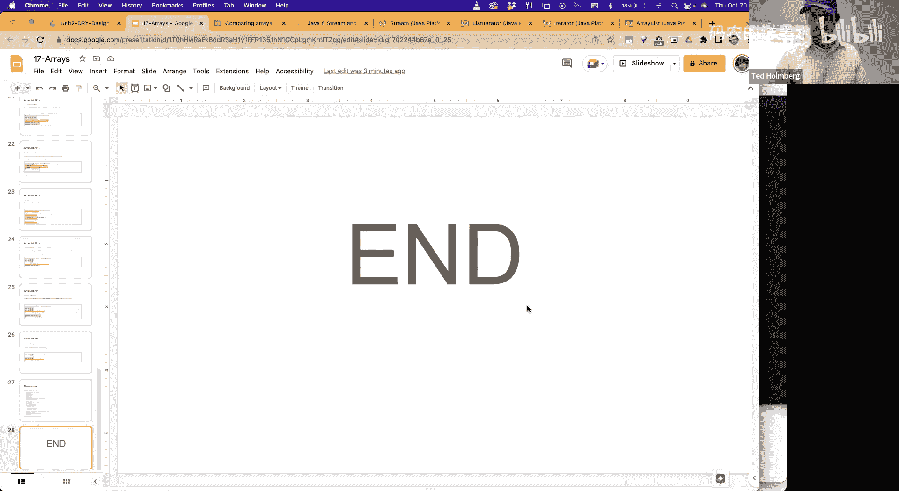

# 【全集】加州理工学院 软件设计与开发 中英字幕 1080P p19 Lecture 19 - ArrayList 类 -BV1AvzCBdE7a_p19-

Okay so in today's lecture what I want to do is this will probably be our final lecture covering arrays because we really covered all the basics with arrays then we covered multidimensional arrays we covered arrays as references and all sorts of crazy things with that we talked about the variable arguments we talked about command line arguments we even looked at the arrays class that was a utility class that gave us a lot of cool functionality that we don't already have an arrays so in this lecture my last lecture that will cover arrays before we move on to the next topic in unit too which is the dry design it's going to be the array list so the array list is a class that's also part of Java u we'll see that in a moment it's built on top of an array but it's a more complex it'。

It's more complex in that there's more functionality to it。

 but it's easier for us to use so after I showed you all these things with arrays which are kind of in this middle ground between a。

😡，A reference type but it's kind of homebroreed into the system with its own symbols so it feels more like a it wants to be a kind of primitive type and array list is a pure reference type but it's going to give us a lot of functionality that arrays won't and so when you start deciding hey I need to container or I need a collection to be able to put data in I want to show you an alternate choice you might be able to choose from。

Okay， so an array list is inside of the packet of Java u and it contains the array list class which you could look up on the API I think I took the most significant methods and I put sample codes inside the slide deck that I want to share with you Now let's start off with some interesting comparisons between array list and a standard array so a standard array as you might recall you have to declare what the length is when you first created and sometimes that can be a hassle right like you might not necessarily know how much data you need to store in an array。

When you app' when you're authoring your application that might be something that has to expand over over runtime。

 let's say you're taking data from the user and you're storing it into an array then you might get 10 items from from the user or maybe you get a thousand right you might not necessarily know or let's say that you're trying to build a game and you want to create a game that can generate new enemies and you want to keep adding enemies into your collection and you want that to grow over time well arrays can be difficult right you have to create a really big array initially and a lot of it will be empty one of the cool things about an array list is you don't have to declare a size for it you can start it as empty and you can dynamically add elements to it and as you add elements to it it'll naturally grow in size in fact you can not only just add elements to it unlike an array where once you put in an element it' that set size you can't expand it you can't diminish it within array。

You can actually remove elements and you can actually decrease the size of it。

So array lists are already super powerful in the fact that you can add or subtract items from it and that's built right into it。

So it's a reizable array of implementation that gives you array like methods。

 array like functionality。So it also implements all sorts of cool list operations and that we can take advantage of and we'll look at those over the course of today's lecture so the class provides methods to manipulate the size of the array that's used internally and it's what's part of the Java collections framework now I had mentioned the Java collections framework once before if you recall the utility class we looked at last lecture which was Java inside the Java。

ut package which was called arrays which gave all sorts of functionality on top of arrays that was also part of the collections framework so we're only going to look at two classes from the collections framework the array list and the arrays next class though in 2120 in Java2 you're going to learn much much more about the collections framework and all the different kind of data containers you could potentially have and in fact that'll eventually bring you to data structures。

Wwhich is all about mechanisms and algorithms to contain data and access data， create， read。

 update and delete your data from data containers that it get to be a very。

 very complex domain where there's a lot of consideration of what kind of behavior you want from your container right now we're going to keep it simple。

😡，And arrays are probably the simplest type of container。

 and array list is just an extension of that。Okay， so we're going to really be kind of looking at the API。

 I gave a link to the API， the most current version as of today's lecture。

 the most current version of Java that's available is probably Java 18 that you have。

So I have a link there， which if you followed the link， it should bring you here。

To the API documentation， but instead of reintriing the API documentation。

 I've encoded it into our slide deck。Okay so let's actually just play around with a array list instead of having like a lecture where we talk about it i'm going to open up jS which is a rub it's an interpreter that allows me to just like plug in some Java code and we can instantly see what happens with that so before I can start I need to import array list just like。

😡，Anything else from the Java。 u package recall that the only thing that's implicitly imported to our code is anything that's contained inside the Java do L package。

 so let's go ahead and i'm going to copy this import array I mean Java。util。

 array list so let's launch our j shellll。Okay， so I'm inside a JO shell。

 so here I should be able to import and now with that I now have access to the array list class。

Now the first thing before we can do anything with array list we have to be able to utilize the constructor。

 so just like in order to create an array we had to use the new keyword and then on the new keyword use kind of the same syntax we were using to construct or to declare our array this is going to be more classical of a constructor for array list so here the way this would work is array list is going to be the data type that we would use and so。

😡，啲。Thing it contains is going to go inside of angle brackets so this is a little bit different than the way that we declared what went into a primitive array so here this will be an array list that holds strings so we have to declare not only the data type array list if we want to use it but inside the angle brackets we then will define what this array list can hold and that could be any kind of data it could be integers it could be floats it could be more complex types that we'll see when we move on to objects then we'll have whatever name we want to give to it here we'll just call it array list we have an assignment this would be a declaration so also an example of an initialization which means we will declare and a at the same time so we have our assignment operator we use the new keyword to build instances of anything that is a reference data type。

So you again recall you've seen the new keyword with scanner right have we seen it with anything else or a scanner the only thing we've really seen the new key word with can you recall？

😡，Is this so it's only the need to okay。So then this is the second time we've seen the new keyword really utilized then so here well I guess we've seen it with primitive arrays as well right so we've seen it with scanner we've seen it with the primitive arrays and now we're seeing it with the array list so just know whenever you want to create a new reference data type。

Object in or instance inside a Java， new creates new things。

And then we'll invoke its constructor and so the constructor is going to look very much like what we have here in the declaration it's going to be a ray list only in when on the right hand side of the constructor。

 we can leave the。Data type that's in between the ankle brackets blank we can use what's called the diamond operator so we don't have to be we don't have to be explicit about declaring string here because it's already been declared there and then here we will then also go ahead and open and close our parentheses because we have to do that every time we have a method call so this will create a new instance of an array。

😡，Bless。So let's actually see this in action so if I go into my J shell and we paste oh。

What do I have here Okay， so here。I can see。I now have an array list and if I type and inspect inside of JShell。

 I can see， yep， I have an array list and notice that array list is currently empty。

 it's showing me the contents inside JShell and there's nothing in there。Excellent。

 can everyone see the terminal， by the way， is this is this large enough do I need to blow this up some is that better？

Okay， so now that we've created an array list， let's actually see some of the cool things we can do with it So one of the first methods we should take a look at is the add method with the add method。

 we can put any kind of element that can be stored inside this array list and recall that the elements that are allowed in the array list are what we declare inside the the angled brackets when we first declare it So if I here created a array list called our list。

That that is designed to hold strings then I can add string elements to it and so here just to give you an example。

 I'm going to go ahead and add apple， I'll add banana and I'll add carrots all to my array list and then we're going to go ahead and print that out。

And actually we already have our array list built so let's go into here and just do this new code here so here we're going to add the apples。

 we're going add the bananas we're going to add the carrots and then we're going print that out and we can see that we actually get a response notice this this gives back a boolean response to let us know that the action of adding was successful So this is why I'm getting printouts of true true true because J Shell is just letting me know hey that that was a that was a function style method that gives me back data and it letting me know it was a successful call and then afterwards the printout from my system got out is now showing that I now have an array list that contains an apple it contains a banana and it contains carrots。

Okay， so there's a overloaded version of this method where instead of just applyinging the element we want to add。

 we can prefix it with the index into the array list， we want to add it at。😡，So let me do this。

 I'm going to exit out。And that way I don't have a dirty。

Set of variables and that way we could see what's happening here between each step。

So I'm going to relaunch J shell I'm going to reimport nice so I'm going to reimport my array list Okay perfect。

 so here what I'm going to do is I'm going to create a new array list。

Of that will hold strings because I can see that inside of the angle bracket during the declaration portion。

 then I'm going to add an apple。And actually let's do this let's print this out each step of the way and then what I'm going to do is I'm going to add banana。

 but I'm going to add banana at index zero， which means it's going to push itself in front of Apple so after this step and actually i'm going to print。

The results after each ad。So here， when I print out after adding an apple， it'll just be apple。

 when I insert， when I add at index zero， it should then be banana apple。

 and then when I add carrots at index0， it's going to push banana back by one。

 so it'll be carrots banana apple。😡，So again， this is a really powerful mechanism to be able to dynamically shift things around inside of an array list as well。

 something that would be much more difficult to do with a primitive a。

And here when we print that out， we can see we created the array list。

 then we add it apple so we get that true response notice here the response is void so it doesn't let us know whether it's successful or not。

 but after we add the Apple we have Apple we add banana at index0 so it becomes banana apple then we add carrot at index 0 so then banana gets shifted to index one and Apple gets shifted to index2。

Okay， let's see what else we got here。The next thing I want to take a look at is a clear method。

 So there's actually a very easy mechanism to go ahead and just remove everything from your array list if you want to so here what we're going do in this basic block of code is we're going to create a new empty array list this time I'm going to use integer notice I'm using integer as a reference data type instead of being in lowercase letters I'm putting it in uppercase letter starting with an uppercase that I'm spelling it out so let's see something here let's test something what if。

What if I tried to use the primitive instead of the reference type。

 what if I tried to use the primitive int when I do that notice actually I can't do that with an array list like I can do with an array that is a distinguishing factor we should be aware with of is that an array list can only contain things of reference data types it can actually contain primitive data types but fortunately in Java dot Lng inside that package every primitive data type has a one to one corresponding reference data type that it can match to that it can automatically convert itself or be treated as so int lowercase I and T is equivalent the reference data type equivalent to that is integer completely spelled out with an uppercase I it's the same with float。

 it's the same with double， it's the same with car or character。😡，So here， since this doesn't work。

 if I go and replace the primitive。😡，With the reference， notice now that works。

And then I can add integer literals as if it were a primitive data type。

And so let's do the rest of this， so here let's add 1020 30。

We'll do that and if I actually inspect our array list now。No。Cps locks。Okay， so we have 102030。

 so now if I do array list do clear。And I go and expect notice everything is now gone from it。

Excellent the next method actually kind of corresponds to a question you were I didn't know if you had looked at ahead or whatnot at some of the methods that are available but there is actually a clone method so the clone method allows us to create a copy of an array list so here let's first build an array we can compare so i'm going to do the same thing i'm going to clean up my workspace here。

Oh， no。I will then go ahead and clear the terminal， let's relaunch J shell， let's import。

Our a rayist， and let's make this new。Aray list that， again。

 will be an integer to hold integers and it'll have the value 1020 and 30。

 will' add three values into there。 and I'll inspect it。 I can see， yes， it has 1020 and 30 in there。

 So here let's check this out。 Let's go ahead and clone。

So here I'm going to create another assignment， so I'm going to create an array list that holds oh。

 you can't be primitive data type though it's got to be。

Coect correct this slide while we're here Okay there we go so we'll create another array list reference we'll call it other list and we'll sign into it array list do co。

嗯。Oh wait， lets see here should be returns a shallow copy。Let's see object， oh， do I have to。

 let's see if it wants it like this。Okay， perfect。 so one big thing to recall is that we have to。

Pay attention to the API and see what the data type is。

 So this as it returns an object we'll talk about what an object is in Java。

 but here I can create an object data type and now I have my other list and so now my other list let's see here。

是。It'll let me。Then go and print out， let's do。System thatt out。Dot print Ln。

 and let's put in our other list。And here we can see that it contains the same amount of elements。

 10， 20 and 30。Okay， so another thing that's interesting about about the array list is the ability to query it and ask it if it contains an element。

 so again with the primitive array if you want to do this you probably have to do a four loop and check each item to see if it's equal but here we can just do the contains so in order to do this。

Let's。Let's not do the clone though， let's do this。It's doing new。ay list。

And let's see if it actually lets me pass an R list in here into the constructor。Okay。

 let's start with this。First things first， let me exit out。Let me clear。Let me relaunch my J shell。

And let us。Import and let's make that first list So here I'm going to create an array list called our list it will hold integers and will' add 102030。

 So now if I look at our list it in fact has 1020 and 30。Then here， let's see if it lets me do this。

 let's see if I can't create a our list here。That holds integers。

 Let's make sure that is not primitive， but rather。

The reference type and let's correct this slide since we're doing this。Perfect。Okay。

 and here I'll call this other list and here I'll create a new array list。

 but I'll pass in the R list and in fact， it does let me pass one array list into another array list。

So now if I look at other list。I now have 102030， so here let's now go to other list。

And add to it 40 so now if I look at other list I have 102030 40 if I look at our list。

 I have 102030。😡，So now let's let let's test these two out let's see if on result one I'm going to ask other list if it contains 40 and on our list I'm going to ask on result2 I'm going to ask our list if it contains 40 so one of these should be true the other should be false so we paste those in we could see one is true。

 the other is false and if I want to verify that I can just if this were not on the interpreter I could do a printout and it would say true and false so this is just a quick and easy way to be able to check to see if there's a value inside of my array。

Another thing that's super useful is the equals method we already mentioned the complexity of the primitive equals operator that it only works with primitive data types and if you try to use on records type it's just going to compare a memory address to another memory address which is usually not the behavior you're looking for so to in order to check to make sure your array list or holding the same data type and have the same number of elements and the those elements are of the same value we can just call dot equals let's take a look at that and again instead of this。

Let's do that。This has to be。That， and let's pass。are listened to there perfect Okay。

 so let's start by building these two different lists like what we have already done。

And before we do this， let's exit。Let's clear， let's launch， and let's import。Okay。

 so here we've already seen this lots now we're going to create a new array list of data type integer。

 we will add 102030 to it and then we'll use that array list to build a copy of it by passing it into the constructor and then creating another list。

 so I have a R list。And I have an other list。Okay， so for the equals。For result one。

 let's check if it's equal now we expect they should be because they have the same number of elements。

 they're the same data type， and each element has the same value。So here。We get back true， right， so。

 but on other list， let's go ahead and add to a 40。And now if we look at other list。

 you can see it's got 102030，40， where our list has 102030。 so if we do that same thing。

 let's go up here。Let's see a single line。So here。If I create a result too and say r list equals other less now it's going to be false so just an illustration that we have the ability to do any equality operation on these。

Now one thing that's going to be slightly different between the array list versus the primitive array is the ability to read data。

 read values back from it。 So instead of using box notation as you probably notice like on a primitive data type we're using method calls So in order to get data we have to use the gi method so let's take so we can get the so we can provide the index into the array list and it's going to return back the item。

 the value， the element at that index， so let's create an array really quick and then we'll take a look at being able to get that back so before we do this let's exit。

Let's clear and let's launch back into J show Okay。

 so now that I'm back into J show let's reimport our array list。

 let us create this array that has apple banana and carrots let me inspect it just to make sure it's exactly what I think it is yep apple banana carrots So now what we're going to do is let's create a string that we will call item and we will assign into it from our list we will call the get from outfit it and we will get。

The value that's at index one， okay， and that's going to be banana。And then I could print that out。

 I could do system dot out dot。Print， but we already say because the interpreter is。

Reactive that I can go ahead and just see it here。But we can also inspect it the same way we would inside of our normal code base。

Okay， in addition to having the ability to get the value， we can also get the index of。

A particular value so we can we can pass a value we could we could take let's say we have our string array。

 we can pass a string into the array list and say what indexes that that that what index is that at in fact let's try this twice let's do this on side let's do index one and let's do index2 because if it's not in there it's going to create a sentinel value of minus1 So here let's put。

Okay。Perfect， okay， so let's create our array。First， before we do this， let's exit。Clear launch。

Import and we will create a array list of data type string。

 We will add apple banana and carrots into it。 We will inspect just to make sure we can see it's what we claim it to be Apple banana carrots Okay。

 so here we're going to do。Index one。And from our array list。

 we will do index of and then we're going to pass in one of the values that can be held inside of this array list。

 so we will do banana。And see this lets us know that banana is inside the array list and it that index one。

 Now let's do the same thing， but let's do cake and I'm going to change this。

So's variable to index2 and here this is going to be minus one because cake is not in that so the sentimentin value is earned whenever you remember a negative index is not a valid index。

 it's not a legal index into an array， so whenever we get it we know oh， that thing isn't there。Okay。

 there's another method in here， which allows us just to check to see if the array list is empty or not because remember this is a dynamically sizing container so it can start empty。

 we can add elements to it so it can be not empty， but then we can clear it and then we can make it empty again。

😡，And in fact， let's actually add the ability to clear it。

Just to see that that is a thing we can do and I'll highlight this line here as well。Okay。

 so let's go here。That's。Exdit out。That's clear。Let's go back in， let's import。Okay。

 so the first thing we're going to do is we're going to create a new array。

 but we're not going to add anything into it。And then we're going to query， is it empty？

And of course it should be right because we haven't added anything in so it's going to say true now let's add some elements in there。

 apple banana and carrots。So now if I inspect it， I can see， oh， it's got apple。

 banana and carrots in there。So now if I query。We can see it's going to be false， it's not empty。

And then finally， let's do。Our list dot。Wer。笑啊。Our list do is。Empty。I should now say is true again。

And if I inspect it， I can say that it has no elements。Excellent now array containers。

 anything that's part of the Java u doc collections framework anything part of the collections framework has something that has a special class that it can provide to you called an iterator so an iterator is another mechanism that allows us to walk across the array list to access elements so so far the only way we've learned to walk across a container an array is to use a for loop now we've learned how to use both a traditional for loop and an enhanced for loop to do that but an alternate way is to use the iterator so let's take a look at that。

Let's exit out。Let's clear， let's launch J show and let's import。Okay。

 so here let's create just an array array list really quick。

 let's add apple banana and carrots in there， so if I inspect I should say I have apple banana and carrots。

So the next thing I'm going to do is I'm going to call this method iterator on my array list。

 notice it's going to return back an iterator。Data type and inside of the ankle brackets where it says E E is supposed to be whatever is the actual data type held inside of our array list。

 so if our array list here is a string then this is going to be an iterator to access string elements。

😡，So here I will just paste this iterator， I'm going to call my iterator just iter。😡。

And it will come from my R list so on my r list is an iterator method that will allow me to now get access to an iterator and so notice I now have something called it and so for iter I can actually let's look at iterators。

😡，Quick API， it's very short， it only has a couple methods。

 the ability to see if there's a next element inside that we can access and if there is then we can grab it。

 can we can get next。So let's try those out so on it I will ask。Is has next and a it's true。

 So then I'll say， okay， well then what's the next element that I can access and it's going to give me Apple and then I can do has next again。

 It'll say true。 I do that I'm like now it's banana。I can ask it again。

 has next it says true I get it and now's cars and then finally I can do has next and no that's false and so if I want to walk across it again I'd have to grab a new iterator from it so notice an iterator is just an easy convenient mechanism that allows us to walk without having to use a board loop。

It's actually built very similar to the way the scanner object works。

 right where you can ask it if it has something and if it does， you grab the next thing。😡。

So we saw index of another method I really want to show you this part of the array list is that we can also check the last index of as well。

 so suppose you have two identical elements in your array index of will always give you the first appearing instance of it so suppose you want to get the later instance suppose you want to get the last reference of that element then we could use last index。

😡，Instead， so let's take a look at this example first where we are going to have two instances of 10。

 So let me open up this。 let's clear this， let's。Okay， let's go back into J show。

 let's import our Ars so let's start by just creating an array list here and we're going to add it's going to be an integer Ars we're going to add in 10 then 20 then 10 then 30。

呃，哦。Oops。M stay bracket there。That's。Starting with。Okay。

 so let's create this list and then we'll take a look at exactly what this is going to do for us so okay。

 we created our array list。See now if I go and inspect I have 10， 20， 10， 30。

 notice if I do index of。And then pass in 10， it's going to say， oh，10 is at index zero。

 but actually it's at index zero and what's the other index it's at。😡，Exactly， so if we wanted to。

 if we wanted to get that it's that index too， I could do。

Last index of and so now it's going to get maybe the index two instead of the index zero。

There's a second type of iterator so we already saw the iterator class。

 there's another iterator called the list iterator it's very similar to the other iterator I showed you。

 but instead of just being able to go forwards it can it can also go backwards so you can go you can ask if it has the next and then grab the next or you can ask if it has a previous and grab its previous let's take a look at that。

😡，So here I'm going to exit out of here。Oh no， not quite what it once to do wants to clear run our first。

开看。Let's launch into there。 let's import。Our array list， Okay。

 so the first thing we're going to do here is we're going to create an array list of data type string。

 we're going to add apple。 We're going to add banana。 We're going to add carrots。

 then I'm going create a reference type of list iterator that will be able to return string data types because that's what our container holds I'm going to call it it and I'm going to assign to it from array list has that method list iterator。

 So let's go ahead and do that。 So now I have a it variable I can do what I did before I can do has next right。

诶。Okay， this iterator。Oh， whoops。This is not spelled right。That has been an I。Okay。

 let's try this again。Okay， now I have an iterator。A list iterator， so now I can do has next。

And it's going to say true， and then I'll be able to do next。And that'll give me banana。

 that'll give apple。 that'll give me banana。 That'll give me carrots。

 And now when I would do has necks normally with the normal iterator where it would say false。

 And then that's it here I can now go backwards if I want to sew and go， oh， well。

 does it have a previous。And it's true， and in fact， I can go。To get carrots， I can get banana in。

 I can get apple， and then when I get there， I can go in the opposite direction。

 I go back forward just again if I one or two。So this really powerful iterator that allows me to go both backwards and forwards and to check to see if there's an element in front of me or an element behind me。

And again， you'll learn much more about iterators in the next class in 20120。

 this is kind of just say a preview of what's to come。Okay， we looked at Literator。Oh。

 the list iterator also allows you to pass in an index of so when you create it。

 you can actually decide where you want to start it at。😡，U I could show you that。

 but it's it's pretty self evident you just pass a number into it and it'll start you with that possession inside of your array list to inspect。

So if you want to start at the end， for instance you could do that or if you want to start it in the middle。

 or if you want to see if the index of an element is at a certain part。

 you can create an iterator then that is at that element index in your array list。

Let's say we can also remove elements so we remove by index， so let's take a look at that。你。

So let's jump over here， let's exit。Let's clear， jumpump it into J shellll and let's。

Create an array list here， I have an array list。🎼Of apple banana carrots。

 supposeuppose that I want to remove banana。 then I can go ahead and say and here I'm going to show you what's going happen is this not only removes it from the array list。

 but notice it says it returns data type E Data type E is just a placeholder that represents well。

 whatever element this array list contains because that's a dynamic thing。

 A list can hold any kind of element。 So here I'm just going to create a variable to grab the thing we're removing out of it。

 So here I'll call this item。 So string item。 So from my R list， I will tell it remove index1。

 So here I saw that it has apple banana and carrots。 when I do this。 I now am going to remove banana。

 and now that's stored inside of that variable。So if I look at my variable item。

 it has banana and if I inspect my array list， it's now just apple and carrots。

And I can remove not only using an index and if I use the index it gives me the element I can also tell it what object I want to remove so instead of saying index one I could say remove banana and instead of returning to banana it's going to return back a boolean value true or false on whether it was successful or not let's take a look at that。

😡，So I'm going to exit out of here。I'm going to clear， re launchedun into JSll。

 let's go ahead and import。Yeah， lookss fine， Okay， let's import my Javava。util。t array list。

 let's create a new array list。Of data type string。

 I'm going add apple banana and carrots that inspect to make sure it's exactly what I expect。

 Apple banana carrots。 So here， let's go ahead and call remove。

 But we're actually going to pass in the value of banana。

And here I'm going to save the resulting value that's going to get back to me on whether it's successful or not。

 so that's going to be true。😡，Banana was removed。 And if I look at our list， we can see， yeah， apple。

 carrots， bananas no longer in there。 Let's try that with something that's not in there。

 So let's try maybe a berry。And now it's going to say false that the remove was not successful because there was no berry value inside the array list and in fact。

 if I go and inspect it， it's still just apple and carrots。

Okay there's in addition to being able to add elements like we've already seen we've seen where we can add to the end of the array list。

 we also saw that we can an index number where we can force something to go at a particular index and it shifts everything behind it there's also the ability to set set is different than add because we listen index we want to send a value into and it just overwrites that value doesn't push it back like what add does itll it'll destroy whatever is at that index and replace it with this new value。

😡，So we'll just take a quick look at that。Let's go ahead and clear。

So let's start by just creating a simple string array list。

Let's first start by launching J shell and then let's start by importing our array list。

 So here we're going to create an array list and we're just going to add Apple So if I look at array list I now have just Apple but now what I'm going to do is I'm going to this is going to return back the element the element it returns back should be the element that was that was ejected out that was overridden。

So let's let's test that out so we're going to have the string and we're going to get our result and in fact。

 I'll make this say item。And so on array list at index zero I'm going to set banana。

 so notice it gives me back what was the old value at that index， which is Apple。

 so if I inspect item now the thing that I assigned from that I now have the value of Apple and if I inspect my array list I now see that at the index that was Apple is instead now banana。

😡，And I could do that again， so let's actually。Do this， let's go to Ars add。

 let's add Apple in there。Just a week now。No。Okay， so now if I look at my array list。Banana apple。

 perfect。 Now， let's go back to the set。 And here instead of satin banana， people said carrots。

 just to show you that there's no shifting。 So when I do this。

I now am going to have inside of item banana and if I look at my array list。

 it's now going to be carrot where banana was， but Apple is still at index one just to illustrate that it doesn't change anything else except for the index we're setting into and then when we do set if we need to preserve that value if we need to use that value for something。

 we can save it into a variable because it gives it to us and just't just like mysteriously overr it。

Another thing we can do is so recall that with a primitive array with a standard array it tracks its length。

 we could do dot length and that's a fixed value that never changes。

 but an array list is resizable right it starts at size zero as we add elements the size increases so we use a different word for something that's resizable versus something that's not reizable length is something that says stone whereas size represents the current size the number of elements that's currently in the array list so we can actually inspect the size of the array list throughout the lifetime of our application and it can change over time let's take a look at that。

So let's start by creating。So it's empty， so if I do size now。😡，I'm going to bother say， well。

 yeah's。And of course， size is an integer。Discrete countable things typically are。

 So now if I inspect size you see it zero。 so now let's go to our list。And let's add to it Apple。

So now if I go to check it size and here I won't save it into anything。

 i'll just check it so we can inspect it so if I check the size here I could see now it's one and so now if we add a new element into it。

I can now see that the size is two。And now if I go to my R list and I clear it like what we saw before。

 remember， if I clear it makes everything go away， well if I check the size。

 I can see the size goes back to zero。We can also grab sublist。From our array。

 so that means we can give a starting index and a ending index and actually grab just a sub portion of our array list let's take a quick look at that。

You can see there's a lot of methods so you get a lot of flexibility with this that you simply don't get with arrays。

Okay， let's import。Let's create。An array list really quick that will be data type integer and we'll hold a 102030 and 40 Let's just double check thatup 10203040 so suppose I wanted to go ahead and get that middle portion of that array list and save it into another list So here notice this returns back a list data type and the E inside the angle brackets is whatever is the data type that is contained inside the array list initially So since this is an integer data type my list has to be an integer data type So here let's go here and I'm going to create a variable that's just called result and I'm going to assign to it from my R list I will call that sublist method and I'm going give it a starting index of one and an ending index of three and what is going return to me is this middle values right the values in between that start and end index and so if I inspect result now I can see it's going to be。

That sublist from my original array list。I can also take an array list and actually convert it into a primitive array so if for any reason you need to take something that's like this really complex reference type but handle it in a more array like structure it's very easy to do in fact we're going to see how to do that right now。

😡，Let's exit it out。Let's clear， let's launch JS， let's do our import。

So we're going to start by just creating an array so we can play around with it。

 What am I missing here， I'm missing this。Prenheses。So let's control see that。Lets。Exit。

 let's just go ahead and clear out and we'll start over so let's launch ourJ show and let's just create an array list so that we can motivate what we're going to do next。

Okay， so let's check our our list， our list 102030，40。 Okay。

 so here this isn't quite what I want to do。 I want to do what is going on here This is。

Last index of oh。Yeah， this is。This is what I want to do here Okay。

 so here we're going to create a integer array。So here I'm going to want to create a， well。

 I might have to do it as an object。Because remember， I got to follow the API。

 the API says this is an object data type， so let's change this here inside the sample。

And it's going to be of a primitive array type， so if I do that now notice all of a sudden I have an object。

That has 102030，40 and now that I have that object that I called result。

 I can now use box notation on it。 So at index 0， it's going to be 10。At index one。

 it will be 20 at index 2， it'll be 30 and index。Well， there is no。Index four。

 or I'm meant to do index three。And get an array index of it and that also means that I have a dot length on it。

 right？Which is going to be four so I can easily convert an array list into a array and I can also easily convert it into a string right we've been seeing it convert into a string implicitly by just doing systems that out that print or I can just invoke the two string method on it and it translates it into a string let's just take a look at that。

And。I think for the most part， that's all the that oh no。See here， let's create this method。

 I mean let's create this array list。That has since 203040， let's take a look at it。10203040。 Okay。

 so here I'm going to create a string。🎼Variable that I'll call result。

 and I will go on my array list， and I will call the two string method on it。

 I'm going to call that two string method。 It's going to。Convert my array into text。

 And so now I can look at results and see that results is now that text。 Excel， So I think there's a。

Vast number of methods I went through the API on myself and I looked at all the interesting ones that make a rate list much more powerful than a standard array。

 and then I just wanted to create some basic little simple code so you can see it in action because I think it's much better to be able to kind of。

Player around like kind of sandbox your code kind of play around with it to get a better understanding of what's happening and I think that's pretty much it though I think we covered a majority of what we can do with the array list so that said does anyone have any questions about it but how do you feel about the array list versus the arrays that we had spent so many lectures learning about？

Do you have a preference do you like as better， do you like array list better， Yeah， really powerful。

 excellent。Well you're free to use either one for homework five homework five should be posted I'll have the due date be next Friday because we've covered everything with as i'll try to get all of the lectures posted onto YouTube this weekend I have a big due date on Friday so after that i'll go ahead and get everything put up on our YouTube channel。

Excellent， so if there's no questions， I will go ahead and let everyone out a little early today because we covered all the content we need to today。

对。All right。No no questions online All right， everyone have a great day。

 I will see you next week it's Thursday。

