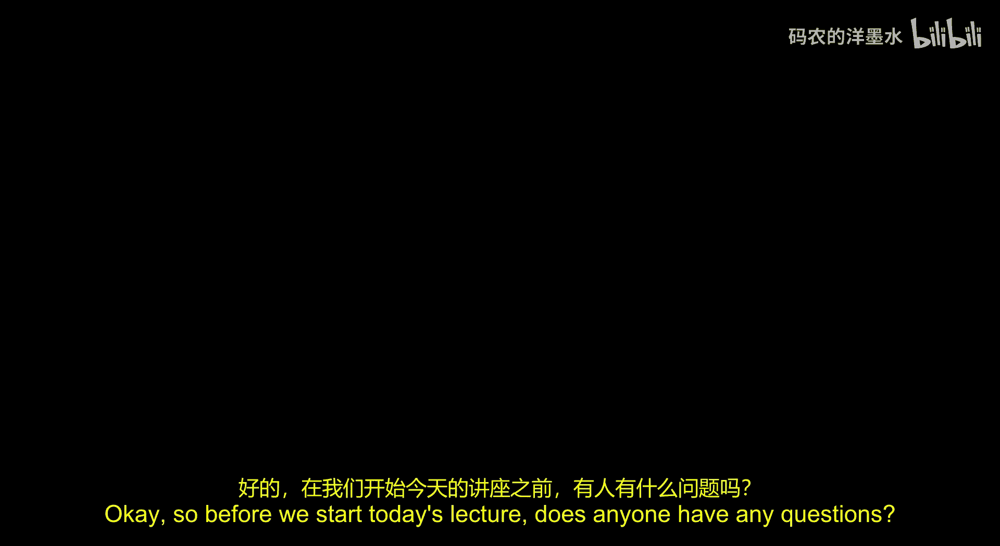
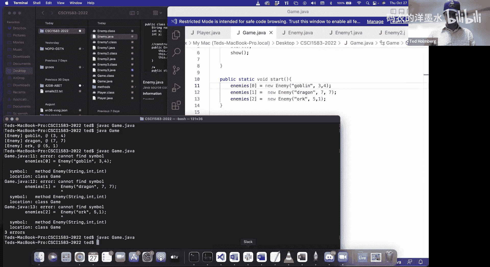

# 【全集】加州理工学院 软件设计与开发 中英字幕 1080P p20 Lecture 20 - 实例与类 -BV1AvzCBdE7a_p20-

So before we start today's lecture， does anyone have any questions？

About what we covered with methods or arrays so far。Okay。Well。I want to move。

On to the next thing said let me let me think about this。

 we talked about array list two lectureers ago and we backtracked and talked a little bit about methods and we stepped through the top down stepwise refinement approach where are you all in the labs right now？

GreatOh， excellent。So I want to spend today's lecture then introducing and motivating the concepts about objects。

We won't necessarily do a PowerPoint presentation， we'll just write some code。

It's just write some code。And learn how to do objects。Its seeing a different approach。Okay。

 so with that said， does anyone have any questions before we start doing this？Oh， that's said， yeah。

 I could do that。That's smart， is that screening ain't doing anything？Okay， so here we go。Excellent。

 okay， let me close the story。Okay， so we're finally getting into a point where we're a little bit more sophisticated in what we can do。

So let's jump over here， let's where am I here at us？

Let's move all this stuff into what do I have and here Bra list， this is method stuff。

 let me do this。😔，Yeah。Method。Suff， okay， very descriptive。

Just' take all this stuff and just throw it right in here， take that and throw okay， perfect。

So now nice clean， Okay， let's just create something so I can。

Make a food dot Java class file just so we can go ahead and get our text editor you open to。

There we go， perfect。Okay。So what have we learned so far？

About what we do with classes and what we do but what is the motivating thing we've learned about classes I guess we're going to do this a little bit more dialogue style right like why do we have classes what have classes given us what is the motivating concept for us。

To implement the class in Java。So far， what has been the role of the class？Not the class。

 but the class keyword， the Java class keyword。When do you use it？

Surely everyone's used the class keyword， right， do you remember？So when's the one time it gets used？

At the beginning right and then we assign a set of curly braces to define a scope right to have an open and close for that class so the class is like an entity of sorts it's a container of sorts what does it contain。

Methods yeah it contains methods it can even contain fields right Okay。

 so let's take a look let's actually build。Let's actually build just a class and as of now everything we've learned how to do are part of the class itself it's static to the class hence the term static and we build this out so let's do a public class。

😡，And okay， let's call this game， we've been doing a lot of game oriented stuff。

 suppose we're building some kind of game class。Okay。

 so we have public class game and we're going to open and close the scope on that with curly braces and so now this。

Is going to have our methods。 Okay， let's say we have a public static。Vvoid main method。

That is a string array of arguments。O。So。We learned that a class can have methods。

 So let's play around with the class， as we already know how。

 And let's see some of the deficiencies that using。

Class based scoping that that uses the static concept let's see where that falls short for us so suppose we're building up this game suppose we want to build out a game that has a player so let me quickly make a player class here。

Let's say also have an enemy class。Okay， so here。Let's get our enemy into there。

 let's get our player into there， perfect。Let's move this down some。Okay。Oh， let me do this move。

Move。W to be gained on job。你电了冇啊。Okay， there we go。So I have a game class。

 it's going to have my main method， I'm going to have my player class。

 I'll make it public so I can access it from other classes。So one nice thing about classes。

 as you recall， is it allows us to contain a collection of related methods and fields。

 that's what we claimed。So when I start designing this game anything that's related to an enemy should go into the enemy class anything that's related to a player should go in the player class anything that's related to the game logic to go into the game class and the game class can call on the player class to do things it can call on the enemy class to do things so let's say let's start defining some fields and for now i'm not going to give them a。

And access level so we're just going to say， let's suppose that our player has， say for instance。

 a X and here let's do it the way we have been doing。A。

Let's say that the player is also going to have a wide position。Okay。

 and let's say we create that start method in the player。

Where we can pass in and X and y into the parameter space。And then we will go ahead and assign。

To player acts， that value of xs。And。To player Y that value of y so we're taking data that's passed in local data to this method and now we're signing it into the class field。

 the static class field。And then here let's make a two string method too。Make this static。

Or I'll call it something else for now， let's call this oh someone make it static。

 but let's call it two text。Where here。小唱下。😔，I will return。Um。String do format。

Again you can now use a format as string， let's give the player name to。嗯。

There we go so our player now has so the fields that go into the class kind of represents the properties that define a player so let's say we're making the generic game up to this point this game just has a notion of having an X Y position and having a name for our player and so let's。

And all this is going to come from this start method。Just like so so here。

 let me go ahead and do percent S， let me put maybe that this is a player。

And let me give the X Y coordinates at。And percent D。Percent day。And let me do player。😔，Dot name。

That's my ass and then I'll see my player。Dot X。 And then my player。Doc Y， okay。

 so I have two behaviors inside my player， the ability to represent my player as text and the ability to start my player up。

😡，Let's actually give one more thing to our player， let's say。That's good for now。Okay。

Let's do the same thing， I'm actually I'm going to do a fux paw here。

I'm going to copy all of my code and say well， an enemy should probably have similar things。

 an enemy should have a name， an enemy should have an ex position， an enemy should have a y position。

 we're going to violate the dry principle， but we'll learn how we can make this better later。

Once step at a time， but for now I'm just going to copy and paste and instead of player。

 I will call this now enemy。Okay， so now。This is probably what you're relatively used to so far。

 right， This is what you've。Probably been playing around with in terms of your own implementation on being able to at least separate the role and responsibility of your code base across different classes。

And so here now， inside my main method， let's actually play around with this's。

Absolutely great oh yeah thank you so much see the you see the problem of copy pasting you have to remember everything you did and change it yeah I don't want that to say play don state to say enemy。

I。Oh yeah， and all of this stuff here， every instance that says player has to say an。Otherwise。

 it's not going to work。Okay， and it's going to be the same here inside of here。系谂你。Anmy。And okay。

 perfect。 So now no instances， I don't need to import this。No instances of player appear now in Ed。

Okay， so we have a basic scaffold of an enemy， we have a basic scaffold of a player and now we have right here。

Oh let's let's make some helper methods in here， so let's do a public static void。Start method。

And so maybe in here， what we'll do is we'll say， hey。

What we're going to do is we're going to access the player class。

 we're going to tell the player class to start。😡，And we got to give the player class and name。

 let's say that the player's name is Ted and let's say that we start the player at three， four。

And then we might go player dot， I mean， not player， let's do then。Ennemy。Dot start。

And let's say that this enemy's name is Goblin。And let's say that the enemy starts at one， two。

So now here inside of my start menu， I'm going to say， okay， let's start our code。

 let's start the game。And then let's say here， let's do public。Static void。So。

And what this is is just going to be a printout of where everything is at。

So we'll just do two string methods for that。 So what we'll do here is we will get the string。

That represents。A player taxed。And from player。I will call the two tax method。

And here I will get the enemy text。And here I will call on。Annemy。笑。

Do two text there perfect now what I'll do is I'll do system that out do print。嗯。

I'll just do print LN， make it easy， I'll print out the player text。And then I'll do the same thing。

Ready。And it meets facts。Perfect， okay。So then once I have that， let's go into here and just do show。

Let's clear this out and let's take a look。That will we get when we go ahead and compile our game。有。

好。And when we run that， we see that the player Ted is at34 and the enemy goblin is at one two yeah that's exactly what we expect Okay。

 so what are some limitations of this current build。What if I want to have a second enemy right。

 What if I did this， What if I wanted to dynamically add would this work could I then to get goblin start dragging at 7。

7， say for instance。So would this work？For me to add more enemies if I wanted to have more than one。

小为。Well， let's see what happens， let's see what happens if we want our code。Well。

 the issue that we're going to have is we can start goblin， okay。

 let's step through what happens here。What happens when in my in my my start method so let's start at the main method let's track everything that happens during the life cyclee of our applications to really understand if we've added a second monster or not so let's start from where the application starts always the main method the first thing we're going to execute then is a start method let's jump to the start method the first thing we're going to execute is the player start method and we're going to pass it Ted3 and4 so let's go to player and let's see what that so this takes in Ted34 here we're taking the class fields right so we have all these static fields that are property of the class itself I'm going to set that to Ted so the advantage to this is even after through this method is done calling that value still exists。

😡，That value will exist with a life cycle of the application when I set it。So。So name is now Ted。

X is now three y is now four and when I'm done that that's it I return control back over to the game method and then I run enemy start goblin12 within then what we do here is we jump over to enemy and we're passing in goblin12 as the ordered set of parameters so what we're going to do is we're going to assign to the class a static class variable。

😡，The set class field， the name of goblin， and then we're going to set the x value for to one and then the y value to two and after we set those from the local variable from the local method。

 from the local set of variables to the fields， the class fields，😡，So the classical variables。

 then we jump back。Two game， and then we call enemy start again。And then what we do is we jump here。

 and so what is that that's Dragon 77， so name what was the name before？😡。

was there a name before for enemy name at this point， what is it Darbllin， so now what is it？

So what we've done is we've accessed what was the name goblin and we've overridden it。😡。

Because the name， the value of name can only have one value at any time。😡。

So I can't have two competing values at the same class field simultaneously。

 it can either be goblin or it can be dragon， but it can only be one。😡，So we've overriden。

 we've undone what we've done with Goblin to overwrite it with dragon and it's going to be the same thing with the positions if I set X to seven wells no longer one anymore we've overriden the value of the X position and if we go to y and we overwrite the value of two with seven it's the same thing so you can think of this enemy as only being able to exist in one state at any given time and every time you mutate the state whatever it was before is different now it changes it's lost so。

😡，With class fields you can only have one one set of values for the entire class I so what that means。

 so this these these values last outside of the methods。

 but when you set them they can only have that one value。😡。

So that makes it difficult if I want to have more than one enemy right。

 then what's my solution if I use this approach， how can I have a second enemy？😡。

I have to make another class。Right。I have to make another class， let's call it En too。

And then if I want a third enemy and'd have to make an enemy， let's see。

 let's actually do this that is talking about it， let's actually do in fact。

 I'm gonna to do this in awful way possible like a I have an enemy one class Okay， so actually。

 if I'm gonna start numbering them， let me not just have an enemy， let me have an enemy one。

And enemy too， and does anyone see what principle we're violating here？

Yeah exactly we're doing a lot of repetition here right okay， let me close this end me。

And suppose I wanted a game that had three enemies。Okay， so then what I would have to do。

 let's say what I have to change this time enemy one would go to enemy one， one， one， one， one。关啊。1。

Sa。超。2，2，2。笑。笑啊。超。3。3 three， three anyway you could see let's test this out。

 make sure that this works the way we expected it but the idea is by having three different classes each maintain their own set of fields。

 this would legally allow us to have our three enemies right and we'll test this out but we could probably already guess this isn't a great solution。

So enemy one， En two is now dragon， and now let's doe this。Enmy3 is a orc。That's add I don't know，5。

 one。So now when I go here， I will go to Nvy1 to get the。goblin。Change this to God one。Perfect， okay。

 then I got to do this again， going to coffee pasta。Dragon。From enemy too。And what is that orRC？三。

Enmy 3， and then let's print out system thatout。 print。What was the last one， oh， I dragon no。Yeah。

 perfect and let's do a system。Out dot。All right， a line and what was the last one work okay？

Save that。🎼It's compile let's run okay， we now have the behavior we initially wanted right we have a player。

 we have a goblin at one two， we have a dragon at 77， we have an orRC at5 one。

Then every time I want to mutate any one of these， I have to go to that specific class to change those specific fields because using the static key word means that that class can only have that one set of fields。

So where does the static keyword break down for us with this demo is it evident is it the fact that it is actually pretty routine that when we define a class。

 remember a class just models a set of related behaviors and properties right so a player is a set of properties which we demo out which we express as fields like a name like an X coordinate like a Y coordinate like a str like a defense。

😡，Like a speed， like these are all properties that can define what it means to the player and they could all be the properties are all individual data types。

 it can be stringed， it can be integers， it can be doubles。😡，Okay。

 in addition to that players have behaviors， a player can start， a player could potentially move。

 a player could potentially attack， so all those methods go in there same with enemy right an enemy is defined as a set of related behaviors or properties and the behaviors are usually implemented as methods and as properties are implemented as the set of fields that are defined within it。

😡，Now， probably as the case is you can have more than one enemy at once。😡。

You get a more than one thing that you've modeled。Inside of your application。

 so let's suppose that we're making like a game like， for instance， a。

So this already breaks down on the dry principle， but say for instance。

 we made want to make a game like what are those like dodging style games like asteroids or like in space invaders or like the idea is that or like one of those like 1942 games right so you have a player is everyone familiar with this this genre game。

😡，So it's it goes back decades right like this is a really classic genre you have a you have a player unit that has to dodge either enemies or projectiles shot from enemies and if you get hit then you lose the game and if you dodge it and get to the end and get the high score that's the equivalent of winning right okay has everyone played a game like that or seen a game like that。

😡，So we're on base with this。Okay， so let me ask you this。

How many enemies do you think is inside a game like space invaders or asteroids or any one of these larger games？

Yeah， I mean， yeah， in fact， I can even argue it could be an unlimited number。

 right based off of how long you live。😡，So how could we implement an approach that supports I mean look at how much work it took us to make three and that's a lot of overhead and a lot of codeblloat。

 a lot of duplication and it only got a three enemy not hundreds。

 not thousands not an unlimited number so what we want is a new approach we want an approach that we can define a class wants that models something like an enemy but it allows me to build any number of enemies from it without having to make a new class each time I need to create a new set of values that represents an enemy and that's where objects that's where instances that's where constructors are going come from that's the default value that our fields have our instance fields have when we remove the static key word let's take a look at that let's go back reduplicate my enemy so that it's just enemy and we will play around with this so let's go here called just something enemy now because I overwrote that I think。

Okay。And we'll refactor our code so here。Instead of enemy1。

 I'll call this enemy instead of a static string name。It will now just be stringing。Instead of。

Statatic int X， it'll just be int X， and instead of static int y， it'll just be int y。😡，And here。

Now this is a secret though， this is not a secret， if a secret of an awful secret。

 this is an important concept。😡，Any data types that don't have the static keyword that's a class field can only be accessed by methods that also don't have the static keyword。

😡，Another way of me putting this is that only static methods can only access static fields。😡。

Does that is everyone on board with that so therefore if I try to just do this from the get go this should fail this should tell me I can't do this well let me get rid of。

😡，Well first of all， let's see what happens if I try to compile the code just removing the static keyword and then we'll talk about what why that has happened can everyone read my command line i'll blow it up so if necessary okay。

嗯。wait letm me go here， so the goal here is we have those three things。

 let's see if I can tell enemy， but let's just try to compile。

 let's just instead a game we'll just compile enemy just to see whatever our messages is going to tell us。

Oh， no our messages， very interesting。Okay。So then let's use any of them。

Let's let's just do it in the name method here。 So let's do take a data type enemy。

And then what we'll do here is。An enemymy， and let's call this E1， or we'll just call it a monster。

It is going to be。Enmy dot。Start and this will be our。We'll implement a。Computer bug。At minus1。

 minus1。And then here， let's just do a system， dot out， dot print。And yep。

 we'll do that the monster Okay， and then here just for now let's comment out our start let's comment out our show because we're just going to test out this concept right in our main method Okay。

 so let's do Java C game do Java。Okay， perfect now let's start looking at what some issues are here。

 so I'm trying to compile this。And I'm trying to compile it when i'm using it to something else。

 I get this error that says this is an incompatible type。

 it cannot be converted to enemy enemy does start。😡，Computer enemy。Oh yeah， it makes sense。

 it doesn't return anything。Okay， let's save that。Okay， so now here we have。

Cannot find symbol monster Oh Well， yeah， let's do。Enmy。2 text。I want' to just print that out。Okay。

 that's。We hear this let's clear our terminal and recompile and see what our new message is。Okay。

 so let's see here it says cannotnot find symbol enemy。2 text， I guess I need to do Campll case。是。

Okay， now let's run that。So enemy computer bug at -1 minus-1。 Okay， let's go here。I remove these。

 I access those， oh it's interesting that Java no longer throws a error for that。

What's that I mean there should be let's say here that's a good question let's get rid of。Rm do。

Class。But even if。Okay， let's remove all of our class files。And let's compile and let's run。

Yeah yeah， I mean， it's nice that it goes and runs this。

Without declaring these as static because it's still going ahead and creating those interesting。

 interesting。Always you get these nuanced things you want to anticipate sometimes because I never code in this approach。

 so sometimes I would expect Java to be a little bit more robustbose than it actually is so it's fun to know that this is now allowable。

Okay， but the idea here is that if I it doesn't solve any problems。

 then if this is working because it's still going to be a class field because if I。😡，If I。

Do the start method again。Actually， since those aren't， we can just do this。啊。

Since we made those public， we can just access them directly so we could do。enemymy的。对。

Let's do nine comment nine， Okay， okay， let's see， let's see what happens here。

So it allows us to update but it doesn't save any problems because we're still just updating things to the same class so this isn't quite there yet。

 but it's super interesting now to me we no longer have to declare our field a static I had no idea that they've made that an optional keyword in Java that they now implicitly adhere that's crazy。

😡，That is。I'm sure there's a reason for that。Okay， so。

What I want to do is not access these as if they're class variables， though， I want to access them。

 want to I want to use my class。😡，As if it's a template to build out enemies。

 so I'm going to build a special method。So I'm going to comment this out。

So this is kind of the framework that I want to use。In fact， I'm interested now。

 I'm not going to get rid of that。I want to see if I can do both of these at the same time because now I'm in an area where I want to test。

Okay。So we're going to create a public method and this is going to be the only time。Where this。

Happens in Java this we're going to create a method where the return type and the name is the same thing。

😡，And it has to be the name of the class， so instead of having a method that has the return type and then a name like every other method you've seen。

 we're going to build a constructor， a constructor allows us to produce a individual copy of all of the class field。

 all the fields we'll call them instance fields， all the instance fields。

 all those fields that are not static， we'll be able to create a copy of them and give back to the calling code。

😡，And it's and the data type for what it goes back is of the enemy data type so this a constructor allows to start constructing。

😡，Individual enemy objects that all have their own name。

 that all have their own x value and all have their own y values that we can set each of them individually。

 and they can all coexist at the same time so that you could have an orrc and a dragon and a goblin and thousands of other enemies all built from the same class up in it。

😡，That's where we want to go， that's what when you hear object oriented programming OOP。

 that's what it's all about。😡，It's about being able to define a class as if were're a blueprint on how it can then manufacture any unlimited number of instances that comprise the fields and then have those behaviors。

😡，Okay， so let's so the way that we create a constructor， this is my constructor。Right there。

It has to have the same name as your class and that's both the return type and the name。😡。

So let's just。And here our construct， just like any other method， is allowed to have。

Parameterters to be defined inside of it it's allowed to have a set of arguments。

 so here let's do the same thing that a start method looks like let's say that we have a string that we pass in for name and let's say that we have an int that we pass in that's our x value。

 another int that pass that we pass in as our y value。😡，Now， this is the thing。Yeah。

I want to access that。We know。Oh， I see what's been happening。

Do you guys say code was working before， I had no idea， okay， now that I'm actually looking。

 it's the copy pasta， the reason why we avoid just copy pasting code。😡。

Look at the variables I was actually setting。Those are static variables。😡，Okay， now let's do this。

 Let's go back。 I'm going to break midway through。I'm going to change all this style。Because。

Java is going to break the way I wanted to。 I just didn't。Implement the code I should have。😡，There。

 that's exactly what I wanted。So this is also the issue we had before。😡。

Is that when we try to go ahead and on line 14， what is line 14 it's here so in our start method when we remove the static key word in enemy。

 we can't do that， we can't access it anymore。😡，Right because it's not part of the class anymore it's an instance field it's not a class field so what this is going to tell me is hey your error。

 this is a nonstatic variable name， it can't not be referenced in a static context well what does it mean to be in a static context well this methods declared a static therefore any statement that's in between the block of the curly braces。

 anything that's in that method body is in a static context the only thing that's available to you during a static context called or static variables since we remove the static keyword we can no longer access that name that X and that y because those are now become instance field and the only thing that can access an instance field is an instance method or a method that does not have the static keyword a non-static method。

😡，And the reason why is that once we remove the static key from it， we can now have。😡。

Name X and Y have duplicated copies that coexist like I said before。

 so the methods that access those have to know what set of X Ys and names is accessing right there's not just one there's any number of them。

😡，So。I can't use things like enemy or just the enemy class anymore。

 Ive got to use a different keyword to access the instance fields。😡。

And so there's a special keyword in Java that allows us to grab a value for a particular instance。

 so let me go back to my constructor and show you what that is。😡，So I want to set name。

 I can't use class name because it's an instance， so i'm going to use the this keyword。

 so for this instance that we're creating we will have at X and now that's the instance field that's referencing this but that remember that can this is and this is where。

😡，You have to mentally think about it each time we call the constructors creating new copy like a new container that has its own x y it wraps all the data inside of it so every time we call this it's creating new instances of this so you can have 20 different thiss and each this communicates with its own it refers to its own individual values for that particular instance so this。

😡，Dot x will be assigned at x value， this dot y will be assigned that y value， this dot name。

Will be and again， we don't have to put these assignments in any particular order I don't know if i've ever shown that I can just put my assignments in like i'm passing my parameters as name X and y but I can assign X Y name that's fine there's no reason I can't do that Okay。

 so now when I do that I'm still having issues here because there's no such thing as a static name。

Or static X or static y I have to remove the static contact from it and then it doesn't make sense to refer to the class to access that because there's no class variable that has a one set value for the entire class these are instantiateated they're different every time I build a new enemy so here i'd also want to make this a this。

😡，A this dot name， a this dot enemy， oh， go to that dot。And okay。

 so now I'm going to replace every instance where're using the class name within this keyword and actually I'm going to change this instead of being yeah I'm going to call this two string I like that better so we're going to convert it to a string and return back a string。

Oh yeah， I missed that yeah， okay perfect。Okay， so now what this should allow us to do。

Un you're formatting a straight。嗯拜拜。Yeah， right here。What is that referring just that front part？

So so it should be mentioned that string do format first of all。

 let me just highlight that string do format is a mechanism that's very similar to print F which is sort of for print format which means that I can start with a formatted string or string literal and I can put special placeholder characters it's a percent S or percent D or percent F and then after I've created my formatted string for every instance where I had a placeholder I have to supply some value that the JVM will then replace the placeholder with an actual string or energy number or floating point number right and so what is happening here is this is a string literal so this is technically just a piece of text right but I'm trying to produce text that highlights a this is an enemy and then this is a placeholder percent s to that would be replace with this name which would be the enemy name so it be like orc or goblin or dragon。

And then I would put the at sign and then a set of parentheses and then a percent D and percent D。

 two more placeholders， which will then be replaced with the x and the y values of what's happening in this class。

Okay， so let me save this here。And let's jump back to our game。And take a look at this。 So here。

So the question is。Let's go back to start so this is our old version of start I'm going to and our old version of show in fact。

 I'm going to comment this out so we can look at it later。So we can do a comparison。

Let's take a look at this。 Let's do a new so here， public static。

avoidvoid start so let's do the same thing we did in this method。

 but now that we've defined these instance fields we've we've we've stepped back away from using。No。

 I kept these older things。So that we can compare contrastlators so this is the new class the non static。

 the one that uses instance fields and instance methods， this is instance fields。

Or what we sometimes refer to as instant variables is probably what you hear them as as well。

 this is a constructor and this is an instance method and the reason why is none of these have the static keyword there's not the static key word anywhere in this class。

😡，We've removed this class from any sense of being static。Okay。

 so now whereas this was our old implementation， static was peppered all throughout it。

 all of our fields were static， all of our methods were staticatic。

 but that meant that we could only have one set of values at any given time。😡。

So let's see the advantage of removing。🎼The static keyword。 So here inside of my start method。

 I can now have an enemy type。 because what we said is what the construct does is it builds a new instance of an enemy and it gives it back to us。

 So now we can store that instance inside of our software inside of our main method or start method or application or whatnot。

 So actually， let me come up here。 and let's say I have a。

Let's actually make some property so I can share these between so let's say I'm going to create an enemy。

Array that's called enemies。 Oh not quite right。我死啊。😔，Let's see enemy， let's create this static。

That way I can access it back and forth。It's gone on and amazed。诶 im。Anemmy are right is。

Let's say it's what it's going to be new。And the array of。呃。Let's start with。O。

Another advantage is that we can start group grouping or collecting things based off of the data type as well Okay so suppose that oh I guess we can just do this。

still啊。Enemies， equal to new。Enemmy at size， three， Okay， so that holds us。

 let's just throw hold three enemies。Okay， now what we're going to do is we're going to create an enemy。

呃。Absolly， let's do this。Let's create an。Dublin。系。What's going on okay， new。Enmy。

 and'm going to pass it in。Goblin。What was the location I used for Goblin3，4？Okay。

 let's say that I do an enemy that is a dragon。And I'm going to call the enemy constructor and my enemy constructor just like my start method takes in this parameters。

 So this is a dragon。What was my dragon at 77？And then let's say I have a new enemy that was my orc that I will call new enemy。

And。Let's say that this is the orc and the orc was at。5ive one， Okay， and so instead of doing this。

 I'm just going to create an initializer list where I can pass in my goblin， I can pass in my dragon。

 I can pass in my work。And just store all those into my oh。

 I guess I can't do that because I've declared it here。Wow， let's do this。系啊。ハワントアです。

enemymy mobs is equal to。And then I'll set。Animities， equals and arms。Okay， that'll work。Okay。

 let's step through a little bit about what I'm attempting to do here。

So the first thing I did was I am invoking the constructor。

 so that constructor was that special method that we created an enemy。

 now in order to call a constructor， it has to be prefaced with the new keyword。

The new keyword followed by an invocation to a class's constructor will create an instance of that class so any instance fields that are declared in that class will be created a memory and then given back as an instance as about as this complex value this complex value has all of these nested properties that define the name and the x value and the y value so notice I can have an instance of enemy if I go back to enemy that has three different values it's three different properties one's just string into or inks so here I can set the first one by passing into the constructor of the cobblelin。

😡，s goblin3 and four and then that's going give me back something so i'm going store it into memory so that I don't lose it if I don't store it I lose it right remember remember that's one of the rules we set up in one of the first days of lecture is that if without a storage operation whatever gets processed on a single line of code is thrown away so we get back this instance of an enemy so we can then store it but now it's going to be a reference data type it's reference data type because it's made of all sorts of different elements all sorts of different variables。

😡，So it's a way of containing a individual monster in this instance， we can call it goblin。

 goblin's just a variable name， but the data type presented。😡。

And so then we can call the constructor again and they give it the dragon name give it seven as the x coordinate7 as the y coordinate and say that I'm in different variable so now I have two different instances of enemy that coexist at the same time inside of this method and then but i'm able to distinguish them from one another because I can score them in individual variables of data type enemy and then finally I can make another。

😡，Variable of data type enemy to hold another instance where I'm going to call that constructor and I'm going to pass it in the same things we were passing to start。

 but notice now instead of having to build three different classes like what we were doing here。

 I can build one class and just keep calling the construct to construct new instances。😡。

Then what I'm going to do is I'm going to take those three enemies， they're all enemies。

 which means if I wanted so I can hold them inside of an array because one of the rules of the array is it's a container class that holds similar data so as long as the data type is the same I can have those values in there well these are all data type enemies。

😡，So I can create an enemy array and here I'm just going to use an initializer list just to make it easy on myself and so the problem is。

😡，But I want to have access to it and I don't want to pass it around between methods so I made a static variable inside the game class that can hold multiple enemies。

 but remember that in order for you to use the initializer list you have to declare and assign at the same time right can' you can't initialize a predeclared array so I create this throwaway array that's what mobs is and then once it's created I'm going to set that array to be assigned to the enemy's array which will now insist outside this method does anyone have any questions as to what I'm attempting to do inside here does everyone understand the concept。

😡，Any questions？Does this seem obvious？😡，Or。So I don't know if I'm getting upstairs because this is confusing or if it's obvious。

😡，So give me a little bit of feedback so I know what direction to go。

Whether I need a speed up or slow down。嗯可以可答吗。Okay， yeah。

 is there a particular line that you're at that you want re explained？

But let's start let's start through a step three so when because let's look at what we changed here so the first thing I did was create a static field inside the game class called enemies。

😡，That has the data type enemy so does everyone understand that enemy now is a legal data type that we can now store as a variable type the same as that what we could do for a string or like a int or as a float or a double right so notice whenever we create a array we always said it's the data type and then the box notation the box notation says oh this is a variable that can now hold that type of data but more than one value of it so does this much make sense to everybody。

😡，Okay so now what we're gonna to do is let's look at the start method let's look at the first let's break down each statement I'm looking at line 11 in particular I'm going break that assignment operation down into the right hand side in the left hand side so we always resolve the right hand side first this right hand side is using the new keyword the new keyword think back now on it think you've used it before。

 but now I'm going to challenge you to actually understand what you were doing when you were using because we never really discuss what was happening with a new keyword it causes the JVM to go search out a constructor and invoke it and produce an instance of that thing when of you use a new keyword before how many times scanner like first day or second day of class when we're talking about input and output you have to create new scanner and so in lab it was purposely designed where there are instances where you produce more than one scan。

SProbably one to get input and then another to parse a string isn't it didn't you have a problem like that in the lab so what that illustrated whether you realized it or not was you produce two different scanner types。

 two different scanner instances that all that both looked at two different things to scan。😡。

So in the same piece of source code， there was two scanner objects， both scanning different things。

 one was your keyboard and the other was a string。😡。

Do you remember that so this isn't dissimilar to what we were doing there and the reason why you were able to do that is you had to use the new keyword twice and when you called the scanner's constructor you passed it what it scans over and in one instance there's poly system do in and in another instance it was probably reference to the string you wanted to scan over。

😡，So when we're doing here， what we're doing though is we're flipping that with the scanner with in the instance of using scanners that constructor was already defined for us so we were just learning how to call it now we're learning how to define our own constructor and then we're showing you how you can call it from a different piece of source code from some piece of client code。

😡，Okay， do you have a question？But new could animal。The new keyword has to preface a constructor。

 a call to a constructor， what's that？So this， so one big thing about Java is they will。

Highlight certain key words so new is a reserved word and Java which means that you can never use it as a variable name and so when Java sees the word new appear in source code it knows it's about to make an invocation to a constructor and it's going to return back it's going to get back an instance so it's a clue to it to say hey。

 I have to jump somewhere else in the code to get this constructor。😡。

And then here is the actual name of the constructor method that we're invoking and a very rigid rule in Java is that a constructor has to have the same name exactly as the class。

😡，So if the class is enemy， then the constructor has to be enemy。

 let me jump back to that then then the constructor has to be enemy and since the return type and the name are the same thing。

 it's the only method in Java that appears not to have a return type in actuality it does in actuality。

 the return type is an instance of enemy。😡，Which just so happens to be its name。

 so really what's happening is it's grouping the return type and the name into the one declaration。😡。

So you always have to call your constructs that and remember when we create our instance fields now our non static fields。

 no static keyword， and then we start using this keyword in place of the class name。😡。

So every place where we were using enemy we now use this and the reason why we have to do that is because this can refer to any number of instances of this class so and so to try to paint a picture of this and the instance of goblin when we call。

😡，This string two string。That returns this name， this x and this Y， well， for goblin。

 those values are going to be goblin 3，4。😡，For dragon though it's going be dragon 77 and for enemy it's going to be orc 51 so those values of name X and Y can actually be they can actually have a different group of values for each instance that they appear so the methods that operate on them it have to be instance methods。

 they have to operate in the context of a nonstatic environment， it has to know oh。

 when you're looking for this string the information for this particular instance。

 you want dragon or you want orc or you want goblin right because there's actually a unique set of values for every instance and they can change over time like I can go and then tell the the dragon to move and then it could be at 67 but goblin could still say a  three。

4 and or can still stay at 51 so I can independently mutate。😡。

Each one of those instances without having any effect on the other ones。

 very powerful mechanism notice how this really adheres to dry。

 we only have to write one class to represent any number of enemies and then programmatically we can just invoke the constructor and get as many as we need。

😡，And now we don't have to write three different classes for three different enemies。

And you see well how faulty that was just over the course of this just for a tiny example of printinging out of creating state and printinging it out。

 I had several errors where I was referring to the wrong monster because like cut and paste right and'm like what's going on and then when I actually sat down and looked at the code just shows how even someone who has been a seasoned developer when you rely on cut pasting code and just trying to get things to show off because you have something else you're trying to do you miss all that minutia and then things don't work the way you think it shit and so much of development time could be wasted on debugging the reason why you rigorously test is the hardest part of development is when it's not done white and when you're having to debug things？

So that's why we do adhere to these dry principles。Anyway。

 so we call this constructor once and save it to a instance of enemy。😡。

S operation that we'll call goblin we'll call it again here for dragon we'll call it again and save this third instances orc then we'll take our three instances we'll embed it into initializer list and create a local array of an enemy data type that's called mobs so now mobs has as index0 are goblin as index1 are dragon and as index as index to our orc and then since this exists I can just say hey enemies is the static enemy array I want you now to have the same reference as this mob array this mobs array now when the start method exits out the mobs array falls out of scope right it gets destroyed it's collected by the garbage collector for Java so any remember any local variables after method is done executing get thrown away they don't exist anymore but because enemies is a class variable。

It will still hold on to that reference of mobs so we still have access to our goblin Dragon orrc there。

 so that's what's happening this last line of code。😡。

So it's a scoping thing that and and I only did that so I didn't have to return anything and then build all that other complicated logic。

 but and I guess show you a different way of doing things。So I see here yeah。

 this is this should be very fun for the zombie apocalyse games。

 all you all of you who wanted to learn how to start implementing more than one zombie。

 this is the real way to actually do it and actually let's test this out now let's actually let's so we can see the comparison between this and this。

And then if I really wanted to， I really wanted to shrink the implementation。

 let me shrink the implementation。😡，I'll just do this。to play some code golf。Okay， so here。

 an alternate approach just to reduce a couple lines of code。

Is this right Does everyone see how that's the same thing？

Or well produce the same thing so here I creating an enemy's array that will hold three enemies。

And here inside of index zero， I'll create the first enemy that is a goblin in index1。

 I'll store the second enemy， which is a dragon and then the third the second in index two。

It'll be the orc。Okay， so now let's go to show。So here we can compare these two this versus this。

And now let's do this public。Oh， I guess I can't do that。I'd be inside there， Okay， so public。

Static void show so let's actually display this improve that this is going to give the same kind of output that we were getting before。

 so here i'm going to zoo four。I'll use the enhanced for loop because I'm only going to display things。

 so for each enemy， let's see for each enemy， I'll call it monster as just the name。

And then this is inside of my enemy's array。I will do a system dot out dot print。

And I'll pass in this monster。It's clear this。And there we go。

 exactly the same behavior we had before， goblin， enemy goblin at 34 enemy Dr at 77 enemy orRC at 51。

But notice because now we can group all these things what we couldn't do with classes。

 you can't group classes， classes are in instances， classes aren't a returned data type。

 they're not a reference data type in of themselves right it's just a block of code that contains enemies and methods So before in our show method every time we want to print something out。

 there's no way to do that iteratively there's no way to build a repetition statement to build just a for loopbe and say print the thing from this class in this class in this class right we actually have to give the class path for each of those things。

 But once we。Can start managing our instances as if they're a variable just like any other type of variable then we could throw them in an array and then we can start using for loops we can start iterating over them so look at the advantage here guess the show so here this is what I had to do to show this stuff I had to go ahead and request for the text and then display it for each individual class but now since I have that array I can just use that for loop and then print it out and I get the same I get the same output that I got here。

😡，And in fact， anytime I want to check anything since I can group all the related instances together I can create four loops to check to see if there's collision detections or for drawing or for all those other things so if I wanted to create hundreds of monsters that becomes much easier to iterate across an array of them and actually have inside the array where I pertuurrb them I request for them to do something in our object at a time an instance at a time like hey effectively enemy1 draw enemy2。

 draw enemy 3， draw enemy4 draw but it would be more appropriately it' say hey enemy at index zero。

 draw enemy at index1 draw enemy at index2 draw or enemy at index zero。

 are you touching the player enemy at index1 are you touching the player enemy at index two are you touching the player so it becomes much better to be able to start organizing your code as a collection of instances derived from classes and then group。

them into a race when you have to be able to implement something like a game or any other application where you're using a collection of entities all at once so if something is unique and you only need one you don't have to do that you can just use the array and make the calls as you need them but the moment you have more than one thing and the fact that that thing could potentially grow out that's where coupling instances and arrays becomes really powerful and you'll see that in homework6 where you' actually build a dodger game and you're gonna see when you build that game it would be impossible to do the way that we were coding using the static key across everything and I'm sorry it made me I'm sorry to show you to code that way because such a violation of the principles of Java like we never apply the static keyword the way we do like I was showing you four programming practices but the reason why I do that is to highlight what we get when we remove that to motivate what objectoriented programming is and what the advantage。

Of introducing this concept of building instances from classes provides us like that's one of the things that Java and prior to Java C++ had really given to the software developer community。

 and it was a distinguishing principle against OOP objectoriented design versus the traditional way we were design our code where it just like blocks of code and properties that you could go ahead and kind of block together。

Okay， so with that said， does anyone have any questions。

 does this seem kind of understandable enough？Yeah。

what isOkay so in the new method or the old method Okay so here this are you talking about right here so this is the enhanced for loop it's something that we had talked about with arrays and again i'll go ahead and publish those video so you can go ahead and access it but keep in mind that with four loops and arrays are so tightly coupled together instead of having to create an index value that is our local control variable and then a comparison of the index variable to the length of the array and then an increment because remember this i'll show you the alternate approach like probably the way you're used to seeing your。

Your your for loops look like this， right and this would be。Anemies stop life。

And this would be so usually this ist an alternate way of doing this。

 so this and this are going to do the same thing， but then here I would also have to like i'd have to index into the enemy's array using this index value。

 but if i'm operating on an array all arrays can use this enhanced formatted loop where if。😡。

Between using using the colon as a delimiter on the right hand side of the colon is a reference to an array I want to iterate across so recall that enemies is an array。

😡，Then on the right hand side is the local variable name。

 so it's like a declaration of a local variable of the data type that's held inside that array Okay。

 then what this is going to do is it's going to assign。

Inside the body of this for loop to the value of monster each instance of enemy starting at index0 all the way to the last so over the course of this for loop the value of monster will be assigned every possible value that's held inside the array that's held inside of enemies so that makes so it's an easy way to read all the contents of an array without having to have the verbosity of declaring the loop control variable evaluating the loop control variable incrementing the loop control variable and then using the loop control variable as an indexer into the array。

😡，Does that make sense？So just to put in perspective， a equally valid way would have been to do this。

I'll show you the one to one correspondence for。And I equal to 0， I less than。Enems dot lamp。

I o boss。And then it would be system dot out dot print。Enemies at index I。

So these two so effectively this method and this method are exactly the same one uses the traditional for loop。

 the other uses the enhanced for loop that allows you to easily read the values from arrays I'm going to argue that the enhanced for loop is far more readable when we need to read values from arrays now remember it's only for reading the values from arrays you can't mutate the array using the enhanced for loop so for any reason you have to write into one of the cells of the array you still have to use the traditional for loop to access that value and overwrite it。

Excellent， any other questions？I would。Oh that's that's a good question well there's only one way to find that out let's see what happens if we try to invoke without the new keyword because you said every time we invoke the constructor we have to alert the JVM that hey we're trying to invoke a constructor using the new keyword i've never actually tried to do that so。

One way to test in Java it's super easy， remove it and test here it says cannot find symbol so now it's looking for probably a method or a class or something probably a method it's probably just looking for a method called this but constructs are special method they can only be called when you preface with new so it doesn't look for the way it looks for a traditional method。

😡，So it just won't work so if you get this error though。

What that means is you haven't used the new key。If you look， it's like。And the moment we do that。

 we should be able to compile again perfect any other。Now， I guess outside of topics。

 do you prefer just to do these walkthroughs like this or do you prefer the PowerPoint slides？😡。

I'll let you think about that and let me know in Discord because that'll let me know if it's worth me putting together more PowerPoint slides or just doing these code walkthrough is where we can talk about it。

Excellent， if there's no other questions we will past our time so we can go ahead and everyone have a great week and I will see you next。

We have class next week it's like it's it's November 1s right yeah so。哦。

你想唔识得佢咩。