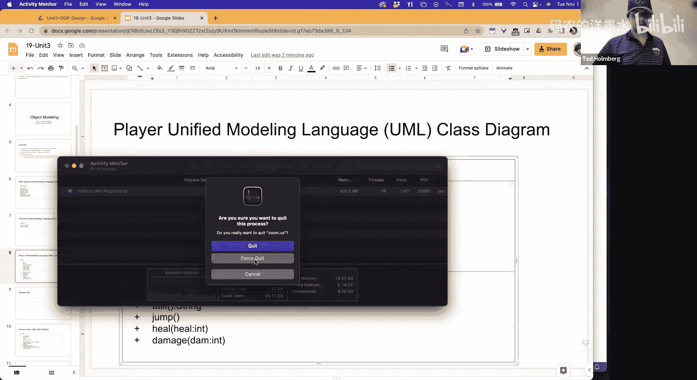
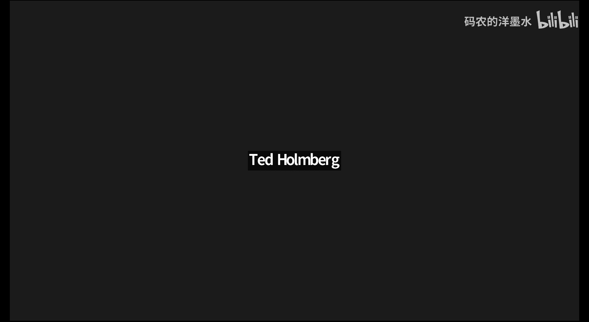

# 【全集】加州理工学院 软件设计与开发 中英字幕 1080P p21 Lecture 21 - 面向对象建模 -BV1AvzCBdE7a_p21-

Okay， perfect， we should be rewarding now。perfecterfect。Im sure I'm not muted okay。

 perfect can everyone hear me again。I had to leave because my Zoom app had stopped working。Okay， so。

Does anyone have any questions about what we covered last class so last class we covered the concept of instances and up until that point we only really saw what static keywords were at the class scope so we finally removed that and we saw how we were able to utilize that。

啊。Okay。So with that said， that is actually hail the end of the final part of unit two unit2 is like mainly talking about methods and arrays。

 several several lectures and we gave a quick sneak peek into the concept of instances that allow us to instantly go ahead and produce multiple copies from the class as opposed to de in a full class for our day to data model and that would motivate our next unit and for that reason I'm going to likely go ahead and release the unit two tasks。

Today。After lecture and I'll make that available to everyone probably until next Friday so you'll have a full week on the unit two test and all I can say is there'll be be very so much the unit one test。

 which means don't wait to the very end to fill it out because it's a long oruous test there is any reason I give you a full week to work on it。

And it' not it's not because I'm super kind， but it's because it's a lot of work。嗯。But you know。

 it is open book。And it' asked you ask you to do code maybe consider writing the code and seeing if it executes you have an ability you're not working in a tight timeframe here you're working a long data timeframe you have the ability to answer all the questions think people on them and then go ahead and and then evaluate or check them forness yourself an assessment on them and if for any reason you don't understand a question。

 it's okay to send me a just4 DM asking for clarifications right so if you don't know quite what you're answering then ask me like asking me like for some specificity in terms of what the question is really asking for so if you're kind of confused by it don't just necessarily leave it blank and move on。

Okay， let's see here。Oh， me me see there， there we go。

Both microphones were on simultaneouslyane before internet crowd was hearing two of me and stereo。

Okay so with that said does anyone have any questions and again you'll you should have availability of all of the YouTube lectures and the PowerPoint slides as well and。

And if you， this is one thing though， if I define a word。

 another thing I want to highlight is if I define a word in very particular in the lecture and you've just so happened to come across a word used。

 but in a similar way，Through the internet， I won't give you credit for the internet definition because I want to use the termin to be established inside of the classroom。

So I did notice that that was something that had happened sometimes on the test one so I want you to be aware of the word choices。

 the uses of our words as it pertains to this class because unfortunately the jargons inside of computer science or sometimes cross-shared amongst multiple domains so when I talk about like for instance data modeling at the level we're at I'm talking about things like just to give an instance of the last has and talking more about like designing the data that our application needs。

 but as you grow as a developer that's going to start talking about design decisions that motivates how you build out a data architecture as well and those are both data model designs but a two different granular levels so just keep that in mind when you go and do any kind of research to answer your question has to pertain to what this particular class about so even if technically the answer might be correct in another domain I'm evaluating your understanding of what we're learning here today。

Yeah。Okay。So does anyone have any questions about what we covered in last class or in homework or how's everyone doing with homework at this point？

Has everyone started moving on to homework five， the array homework？呀。

Is that your favorite one so far？What about homework six？

That's the one we're going to be learn about how to do for this lecture and then there's one more homework there's homework seven。

So keep in mind， we were November 1st right now， so I want to say the last the last week of lectures is like December like the first week of December。

 so you have about a month left now just to just make sure that you're on top of over there。Okay。

 so with that said， we're going to start unit three today。

 we're done with unit two I think goodness has been such a long unit and so for unit three。

We're going to get into object oriented programming design so again we've staggered our way all the way to the entire point of this class we started with algorithm design that was unit one then in unit two we went to dry design so we're like okay we can design algorithms how can we do that in a way where we minimize the amount that we repeat ourselves and then we learned how to build methods so technically what we learned how to do was what's called procedural programming where we start breaking our algorithm down into a collection of smaller methods or procedures。

And so now what we're going to do is we're going to now that we've motivated this idea of an object or an instance from a class。

 which is what we're going to refer to as kind of building out an object。

 we're we're going to use that as another leveling up tool for our code and say， well。

How can we start designing our code as a collection of objects as opposed to a collection of methods？

Or and before that was just a collection of statements so each time along the way we're learning how to kind of break things down and encapsulate them contain them in more and more meaningful ways and so the real concept that motivates object oriented programming is that we。

Tend to think of things。Concepts。As objects and of themselves right that's a very human like experience since we live in a world of objects to think of things as obvious think about what motivates the work of a true of an engineer that's on the other side of campus of a mechanical engineer。

 for instance， or like yeah a mechanical engineer make great example when they go to design。

🎼A piece of hardware when they go to design something it's usually constructed a physical objects that assemble together and build out a hole so if you look at say for instance a clock for instance。

 a clock might be created out of a combination of small gears and face plate and the arms and the motor and everything else that's required that gets put together for the clock to operate to tell you time and each piece that's been。

Install that's been integrated into the clock has a purpose。😡。

Towards the whole of what the clock provides， which is to tell time and so ideally if if that piece didn't have a purpose。

 then you could remove it right so the idea is that you remove all the unnecessary pieces you're left with just what is the bare necessity to make the clock work and then you're ready to go into production right you ship that off you can get it manufactured and then you can start selling your clocks so the same way that an engineer would approach first of all going on paper designing out each of the individual pieces and then figuring out how those pieces work together to build a clock as a whole we want to adopt that approach to start building out our software we want to start thinking of all of the pieces of our software as actual software objects。

And then when we start planning out an application。

 what we really want to do is want to figure out what are the minimal amount of software objects。

 all that have their own kind of role inside of what our application is designed to do to fit together to create the application we seek and so we're going to start talking about how we can do that with this concept of object oriented program。

Okay， and so a quick overview of just what this entire unit's going to look like and things might get added into here depending on time is that we'll talk a little bit about OOP the objectoriented programming design and so the first thing we're going to compare it to is going to be procedural programming versus objectoriented procedural programming just so you know what we've been doing up to this point procedural just means it' it' methodbased and so here we're finally going to pivot to our software being more object based I think if you go and read the catalog is going to state that this entire class was an introduction into an objectoriented approach so you can see we kind of slowly evolve ourselves so that here in November we can finally really start talking about this but by now we should have motivated it in such a way that you should see the value for what we're about to do。

And it goingt be that different than what we've already been doing you've already kind of seen objects a little bit we'll just start talking about how expressive they are how powerful they are and how we can start designing entire software systems around objects themselves so yeah we're going to talk about how software is constructed from object types I think i've just motivated that with what we had discussed with the clocks and what we'd like to try to。

Get ourselves to here in terms of our software development world as a software engineer and then modeling things as types of objects and then this is going to be the big thing about objects is that we really want to take advantage of abstraction and encapsulation and unit testability modularity and So we'll cover all these concepts is like the five concepts that really drive why we want to adopt to an object oriented approach and we'll actually see that as we start coding but the big things here is that designing using an object first metaphor allows us to abstract away everything that's part of our problem domain that's not a member of this object in and of itself so before we begin start talking about what makes up a an object let's start talking about well how do we model with objects as opposed to how do we model with data so we spend a lot of time talking about data。

Object modeling is built on top of that concept of data modeling。

 but allows us to start encapsulating our data into these object models and then these object models will then be able to have object to object interactions that happens through methods methods allow objects to share code with other objects just like methods allow classes to share code with other classes so the same metaphor that we learned about how we can transmit how we can have our code based interact with one another through through the interchange through the invocation of methods is going to be how objects communicate with one another as well。

And then later on， not right now， but just to create a roadmap of where we're going with this。

 we're going to start building more complex versions of objects。

 so we talked about object to object interaction where objects can have methods and they can get invoked by other objects。

But you can also just do object from object interaction and some what that means is you can build objects from other preexsisting objects and there's several different ways we can do this well I say several but there's really two main ways we can do this its composition and it's going to be through inheritance and those are two different relationship one is going to be is a relationship the others is going to be has a relationship and again this is just establishing a roadmap we'll talk more about that in the upcoming lectures that are going to happen later on this month。

Then we'll finally talk about。🎼The root class that all objects are built from which is the object class and what methods are defined inside the object class and what implications it has for us and then finally we'll get into inheritance so after we take a little delve into composition we look at inheritance on how we can build objects from other objects and start seeing how we can build not only concrete classes but we can build abstractc classes and we can build interfaces and how all of that will serve us to start building out complex pieces of software and once we get to that point we'll have you pretty much wellpried for 2120 the next the next class where it'll have the base expectation that you know how to design software with an object oriented approach and then it'll start showing you the tooling that you'd want to be able to start building software at a more professional level as opposed to an individual level how to start building software amongst teams of people as opposed to just。

An individual based endeavor that you've been doing。Excellent。Okay， so。

And I guess before we get into any live coding， the one last thing that I just want to highlight here is that in terms of object oriented programming design。

The thing that really distinguishes unit three is that we're moving from procedural programming。

 as I said before， where program is divided smaller parts。

 which we call functions or methods and so in object oriented program we're going to divide our smaller parts into what are called objects。

And so。Here。He will。Remove that because this isn't necessarily true。

So we'll remove that on that's saving here， that's this is what's good here。

Because the last thing is we'll actually see at the very tail end of the semester going back to my overview how we can use either a bottom up object oriented design approach to build out our application or top down it works both ways you can actually build your hierarchial tree of object to object interactions or object from object interactions from the base to the peak or from the peak to the base and so we're going to start with the bottom up approach by the time we get to the end of the semester I want you to see how we could do the same thing using a top down approach and I'll explain what that means as we get there first let's just get into object modeling。

So here。With object modeling we're just going to learn how to start designing everything in our app as an object that then works together and so here we'll finally start taking advantage of some of these concepts such as the access type like private versus public and so typically。

Yeah， we want our fields。Or our variables to be private and we're going to want our methods to be public and so we're going to see why that is and it all has to do with ensuring that we have a valid state so we'll define that what that is as we move along Okay so let's build out an application or let's build out a class so that we can start doing some cool stuff with objects and this will help motivate us somewhat along with what we want to do。

Yeah。Okay。Okay， it's perfect。Okay， so。Last class， when we were starting our concept of introducing how to build instances。

 we took the low hangingging fruit examples one of the easiest things in my opinion to start modeling are things that are analogous to real worldorld objects right because there's like a one to one mapping there so recall when we were building our game we had a like monster class。

 if I recall correctly in a player class and so those are clearly very discrete and by discrete I mean there's a boundary on that when I say a player you probably vividly can think of what defines a player and so looking at the games and then again you can call back you could do a look back at the games you've actually been creating for the homework probably the properties that define a player so one of the first things we do when we start designing our objects is we start with a UML class。

早く？And so in ourL UML class diagram you've probably seen these these might be used in the homework。

 they might also be used in the future labs so just so you understand how to read these more importantly so you know how to actually start using these to plan out your own software it's important to understand it consists of three different portions so initially you'll start at the very top the top is going to be the name of your class so if I wanted to make a player class so let's do this right now let's let's。

Let's make a new slide。And here we'll call this the player UML。

And then what we'll do here is we're going to do and actually let me do this， let me insert。

Where a table。And it's going be three parts。 let's get rid of this。 I don't need that。 Okay。

 so I have this。 I move this easily。 Okay have this move this here。

 and now we're going to duplicate this。 So let's take a look back about what we did last class and start illustrating how we can use that。

To motivate。How we start modeling with objects so we've already done this in practice so let's pretend that we designed it before building it first because that's typically where we want to come from we want to design it and then build it we don't want to build it then design it that's that is unfortunately a lot of software developers actually do that that is not a good way to design software that's theesis of design software。

😡，Okay， so here for our UML and so if you want to know it UML stands for it's。It's unified。

Modeelling。换过去。Or UMl， so whenever you see UMl， UML is。A well set。

Of diagramming tools that allows us to start expressing the relationship of multiple things UML actually exists at different granular levels this might be the first time we're seeing in this class。

 but typically the two most common use cases you're going to see for UML。

Is to produce something that looks like a flow chart to be able to identify how the flow of control across your algorithm works so for instance you can look at a UMl diagram where a while loop loops back on itself or like a selection statement branches into paths so if you ever wanted to go ahead and create a flowchar of your algorithm just to be able to trace it what happens at each level you can do that a more complex variant of UMl is to go ahead and start modeling all of the individual objects inside your software system so here when I go to build out my game and I want to use this UMl diagram to start identifying to start building the responsibilities of each of my objects I start by identifying an object so my game needs to have a player so i'm going put that at the very top of my UML diagram and the next thing that I need is I need to define。

What properties does a player have， These are the attributes of a player these are。

Dfinitive qualities of a player right can anyone think of like what are definable attributes that a player might have okay so so a player could potentially move but when a player is moving what does that mean what inside of the player so if the player moves up what is actually happening inside the player or with the player so the player has to have a coordinates a set of position so let's say a player has to have an x and a player has have a y right and when you move the player。

 what that means is the player is at a particular position and in this instance I've given the player an X Y position if I was modeling someone like you and the classroom I might even give you a seat position right because you actually have a depth dimension in reality okay but let's say that will abstract this away。

Sacked away the third dimension so we're saying that one of the properties of Re is where they're located and if we think of directions as being something that's orthogonal is that a word that everyone's。

familiar with or。So orthogonal just means that it's independent。😡，And when I say independent。

 that means there's no dependence between the two， so I'll give you an instance for that if you move left or right。

😡，That doesn't affect in any way your ability to move up and down right so left to right movement is independent from up and down movement so that much makes sense so we could say that the X axis is orthogonal to the y axis。

😡，And so if we had another doubt。Such as or another access like Z that doesn't go into the X or the y axis if it's independent。

 which means that no amount of movement in X and y affects the property of z then you could say that Z is orthogonal to y and z is orthogonal to X your cardinal directions right or at least moving east or west and north or south would also be orthogonal to one or another so orthogonal is just a way of expressing that you have two sets of independent variables and so an illustration of something that is not orthogonal would be。

😡，Is everyone familiar with the formula for computing a line？

What does the formula typically for computing lower？

You might have y is equal to let's say a x plus b right does that sound fine so where a is a scalr and then B is some amount that you can go ahead and offset it by right so you have a scalar about。

The entire point of expressing does this invoke anyone's memories if I want to express a line any linear equations effectively that and then if I wanted to I can have like AX plus or Ax sub1 plus Bx sub2 plus C right that would also be a form of a linear equation because we were adding them all together。

But those but AX so on and I'm going to show you。Okay， so here， if I had， y is equal to。A x plus B。

 we could see X here。X here would be my independent variable and y here would be a dependent variable。

 Y is dependent on the value of x to have mean， but y is affected by the value of x。

 therefore y is not orthogonal to x。😡，Does that help？

Kind of bridge the gap between what is a orthogonal not a orthogonal so a change in x will change the value of law。

😡，So y becomes dependent on a value of x？Okay so that's completely an aside。

 but one that I think is worth just kind of talking about and being aware of as we start just communicating in the confines of computer science computer science is very technically kind of a sub domainomain of math but。

😡，More like an abstracted form， it focuses more on processes than it does proves。Okay， so we have X。

😡，We have Y， which are both spatial properties of our player。

 but they're orthogonal so they can be expressed independently。

 what else do we have that might define what a player does？😡，Or is properties of the employer？请再听零。

Okay， so so a representation， so for the purposes of the game that we've been building usually we've been referring to like an image file so I'm going to use something more expressive like an image。

A player might also have a name right so maybe you can name the players or anything else that you think we could use the model player。

对对。So yeah， so physics might be a attribute that might be especially if you're doing homework seven。

 because you'll see that that's the platform we' game where we actually do implement something like gravity to go ahead and actually have our character move around in and so physics is。

So typically。This is fun。So when we talk about physics。A common thing that all。

Enities that are subject to the rules of physics is to have a body。😡。

And so this is this is this is a true thing for almost any application that's that's going to model any kind of physicsbased interactions。

 so here we would say our player has a body， a body means that it is something that can be registered with the physics subsystem of our application so that anything else that has a body。

Can also can also have the rules of physics applied to it that could be like collision detection that could be like gravity that could be anything in fact a lot of times this is called rigid body physics if you've ever heard that phrase so if you start seeing these things while you're fiddling around this is what they're talking about so yeah so if we wanted a game that's had physics we'd have a rigid body on our player in addition to an X y position in addition to an image in an name anything else。

And think about if you dont if you don't have a rigid body， then you're effectively a ghost。

 and I don't think ghosts are inhibited by physics。They just flow through walls。

Things like that Okay so this seems good enough here so the next thing I do though is I need to express while i'm designing my ul what type of data each one of these properties are going to be modeled at so like I said earlier。

Object modeling is built on top of data modeling。 At the end of the day。

 we're still having to resolve all of our algorithms as a collection of。

Effectively primitive data types right it still has to resolve into a collection of values。

 but what we're starting to see is that these values can start being grouped together to define the properties。

 the attributes， the features of。😡，An object。So we can start grouping things in terms of building out objects here we're building out a player we said what a player is inside of a game would be an X coordinate。

 a Y coordinate， a name for the player， an image for the player， a rigid body。

 other things that a player might have is maybe a strength。It could be a deepb。

It could be a amount of hit points， it could be amount of and let's call this HP。

It could be an amount of experience points， it could be an amount of magic points right like keep thinking about what kind of game you're building and you could probably keep list more and more attributes that are meaningful for the application at hand so that's what we're doing here is what we're starting to do is abstractive。

Let me take a step away from player for just a moment and challenge you with something similar yet slightly different what if I asked you to explain to model as an object a student at UNO？

Okay， so actually let's do this instead of keeping this abstract， let's jump up here and let's put。

You are now。Student。Great。Okay， so。So here the first thing I'm going to do is I'm going to put Uo student actually though what I'm going to do here is I'm going to bridge the gap though。

 so I'm going to make it。A legal thing。So there we go so that it's so that it's a one to one mapping for that the class angle will actually be so here our Uo student。

Okay， so we said grades so how0 grades so are grades usually listed as a overall GPA is it a collections we'll talk about that later。

 so we have grades， what else is there。That defines a UNO student like so you could think about yourself。

嗯。So there's the student ID number。What else do all students have？At UN now， what's that， Yeah。

 a name， right？And probably， I don't know， when you go in there。

 is there an option for a first name and a last name or those separate are those the same？Okay。

 so we'll put first name， we'll put last name， okay， what else so you have grades。

 you have a student ID， you have a first name， you have a last name， is that everything？Yeah。

 okay manager， perfect。嗯。So what's on the transcript so let's say so what is a transcript Okay。

 so let's。Yeah。That sounds like a complicated thing so here I'm going to create something called a transcript。

Can it erase this？Ill put。Transcript here and i'll put that a student has a transcript but that's so that's such a vague and my vague thing is。

That brings up to the next point that ones were up。When we say you have a student ID。

 how can I model that， how can I express that？😡，What is that is that something that can express for a primitive data type or do I need another object that's more feature rich that's more expressive than just a singular primitive value well what is a student I in the confines of UNO。

😡，It's so it seems to be a numerical， but let me ask you this。

 is there a specific number of digits on it？😡，Couning up， think internally， don't say out loud。

 especially since everyone's being recorded， but think internally and count how many digits。

Are in your student ID？And then I'm going to query and see if everyone has the same number of digits。

Okay， I'll give you a moment just to do that。Okay， how many digits does your student ID？对。Yeah。

 so okay， so。This brings up an interesting point because I'm willing to wager。

 so I'm going to put this， but I'm also going to put a caveat that it's seven digits so this causes kind of。

😡，A slight issue that we might not be super aware of because I'm willing to bet that your student ideas may have nothing but integer numbers。

Right yours， yours， right no letters， okay， so it seems like this is the perfect candidate for an integer model。

😡，However， what if？Your student ID was zero，1， two， three， four，5， six。

And I saved that as an integer， what would happen。What would I get back if I go to ask for the student I did？

温最。How many digits is that？I lose one， you see why I lose one right because any number that profits with a zero doesn't really count towards the magnitude of that number。

Whereas it is a significant digit for something like an ID。

 this is a very real realization right here that you should consider that even though something might be able to be modeled as a integer if it's nothing but integer numbers。

 however there's an additional constraint like it has to be a certain number of characters it's probably better to model that as a string then。

😡，Because the string guarantees that each individual character will be saved。😡。

Ha a representation of whatever that characteristic is so an ID so with everyone say that even though those are seven digit numbers。

 it makes more sense to save this the idea of a student as a strength because we can guarantee that if we save it with seven。

Characters， we're going to get back something that's seven characters。😡，And therefore0，12，3，4。

56 will equal0，1，2，3，4，56 which might not be the true if we compare two numbers right which would just be one。

2，3，45 this is really important when you start doing things like pin numbers right because that becomes insane when you compare pin numbers and then if someone could guess your pin number。

 let's say your pin number was like0 like1，2 is3 or0，1。

01 or something like that then like some software that's trying to hack your pen code if it treated it as a integer as opposed to a string would be able to like gas without having to remember or recall the front zeros the front zeros to be arbitr they'd be meaningless right they wouldn't actually be encoding anything。

Okay， so we will save that as a string that's neither here nor there's another illustration of why we want to use strings as opposed to in for things like ID。

😡，So what about the first name， what kind of data type might we want to look？

Model with the first name。Stng right so that is something we can probably go ahead and use something that's effectively a primitive type what about last name that's also string what about a major。

I don't man。Practure， okay。We'll come back to transcript， what about grades we talked about grades。

 how might we represent a grade？So I'm assuming when we say grays， what we really mean here is GPA。

that。And so here we'll do。We'll do a float or we'll do a double so notice the next thing I do when i'm designing out my UML is the first thing I do is identify what is the objects that i'm thinking deeply on that I want to try to find the properties of then in the second panel i'm going to define the properties that are critical for what our problem domain is that so you know other things that might define a UNO student but aren't important to this application it might be blood pressure right it might be your your heart rate right it might be your insulin level like these are all things that define you as a human but doesn't make sense to include that stuff for unO students it could be like your foot size or your height or。

Your or any one of these other concepts that you can look at and say this is a property that's true for everyone who builds up the UNO student population。

 but does that have any meaning？😡，For managing a group of UNO students inside of an application。

 like in the confines of their role as a student。See。

 so there's sometimes so there's this thing when we're modeling to only select the features or properties that make sense for how you plan to use that object。

😡，Okay， so here we'll just go ahead and identify the properties and those properties are always going to represent themselves in our class。

😡，Inside of all of our objects as a collection of fields or collection of variables and so these will each student can be uniquely different from the other student so clearly we're going to start using instance fields or instance variables to represent place。

Okay。So then the next thing we have to do， oh， we have this last one transcript。

 what is a transcript？Well what does a transcript represent like yes。

 so that could be like the courses you took so。Here I can do this in one of two ways。Probably。

What we could do is。For this purpose， maybe we can model that as a stringer right。

Probably what you'd want to do in the future though is say well a transcript is a little too complicated and there's probably a behavior you want to do in the transcript like query it for specific data like what was the courses taken at like fall of 2022 or spring of 2023 or or you know what was the grade associated with that course and so notice that's a complex thing such that you probably want to model that as a class itself and build the student to have a reference towards a transcript instance does that makes sense so probably what you want so at this level we could say oh a transcript might just be a string array that's a collection of the courses but honestly youd probably want to make the transcript a reference to some transcript and then you would go into your transcript and say oh this would be a let's say let's say it might be semester。

Yes。See， these are the semesters you're registered in and this might be represented as some kind of array。

Some kind of array of。诶。Well， you might call semesters， but let's not do that。

 let's say we'll do something like classes。As a string array and let's say you have your gradeids as a double array so maybe a transcript is a string it's two strings。

That。That kind of matched up with one another where one represents the classes。😡，Right。You know。

 I'm going to use courses because classes has a very specific word in Java。

So one is our set of courses and the other is our set of grades so now if I put transcript here what this means is oh there's this other object that I'm going to build later on that's going to be a collection of courses and grades and so when I see transcript here what I can think of is this other complex entityity that's built of properties but the properties that expresses is a collection of grades and a collection of courses。

😡，吧。Does that make sense so do you see how I start to like create all the and this happens during the design phase like notice we just started modeling this by default and i'm glad you gave me transcripts because that represented a non a complex relationship that a UNO student has like it was something that's more expressive than a prim of value and something that's a string or double or what about something like this probably another thing that we would have inside of a student would be is are they currently registered。

And that this could be expressed as like a booleing value， right？Okay。So then the next thing。

 the third pain we have here are what are the behaviors？

That this object should be able to perform let's jump back to the player for this instance。

 so here i'm going to remove some of these other things that I have so I can have a more simplified version of a player because we really I went really off the wall by by adding a lot of fields into my player for even very expressive player so here。

😡，What things can a playerger do？So here these are the actions our object can take。

 so the fields represented properties that define the object。😡。

And so whenever we have an object where its properties have a set of values。

 so like when we create an instance of a player let's say we give the player the name Ted and let's say we give the player the Xm Y coordinate to three and4 and let's say we give a JpeEG image to our player then this player is what we call has state because we've set values to all the instance fields to all the instance variables and so one of the beautiful things about。

😡，Object orient to programming is with the use of instances we can build as many instances of players that all have their own state so whenever you hear the word state in reference to computer science what we mean to say is that we've built an instance that has a set of values at any particular time so a instance state can change over time the name can change from Ted to Bob the X Y position can change from three to four three and four to four and4 and five and4 so one of the cool things about objects are they're stateful they remember their state they have memory that can mutate over the course that can evolve over the course of our application and each instance maintains its own state yeah since my。

Okay， so here。The next thing is。So。In addition to having states。

 typically the other thing our objects can do is to have behaviors。😡。

And just like in the real world where you have the ability to walk and talk and think of behaviors as verbs right so if you think of are the fields as properties and so properties are very expressive it's a way that you might define as a as a set of list items。

😡，What someone is。🎼Right so when thinking of building a data model。

 you first start with what is it that I'm trying to model， then you use effectively a list of。

Properties。That is expressive by a name。😡，And so you can use the same rules you'd use for an English writing class to be very descriptive in terms of what those properties are when you think of behaviors。

 think of them as action verbs that the object contain take so what are what are the properties of a player。

😡，So we would have move， we would have attack。Yeah， we can have talk， we can have。

we can have jump if we want， so these are all could be actions。

That our player can engage in and so here let's do the same thing with player that we did with our unO students to be more expressive here so now you could see how we start to fill up our three pain box our ul class diagram。

Yeah。So inside of here typically I not only give the name of my property。

 but then I would give a colon and then I'd say I give myself a reference of how I plan to model this so how can we model our exposition for our player that could be an if right because usually we're going to be operating on a grid in this instance what about our Y。

😡，And then let's say we want to also have a with。And let's say we want to have a height。

So it would be the width of our player。It could be a double， that's fine。

I mean we we're we're the ones who are modeling them right now， we just what we're doing though。

 is we're building a contract with our future self。

 so we're letting ourselves know that these are going to be the properties that are。😡。

Object is going to have so when we build any behaviors when we build any logic that uses this object。

 it just has to know that width and heights are going to be doubles that that might be perfect because maybe you want the width and the height to be like 3。

5 and you wouldn't have that if it was integer maybe it could only be three or four。So I mean。

 doubles give you more flexibility in this regard。What about in the imagesms a？Yeah。

 probably a path name， right， but this is where you think about well， what makes up an image？😡，It。Oh。

 god。A suggestion on here where should have the ability to heal。

Which means I should put back probably hit points。Which I will say is an integer。Okay。

 and finally a name and we'll say the name is a string okay so。

We're slowly building out our player and so notice inside of the second pane where we define all the properties or our instance fields after we give a descriptive name about what。

😡，That object has， we then map it to how we intend to model it inside a Java。😡，At the end of the day。

 you have to eventually get to。A collection of models。

That resolve to be primitive values and I clump things like strings as that like text down to your rudimentary data types。

 you said there's like fundamentally three rudimentary data types right numerical text and booleing。

😡，So everything at the end of the day resolves down to one of those types of data。

But sometimes you got to make models that kind of cascade to that point and to jump back to this example。

 like with the UNO student， we had almost all primitive data types。

All primitive values until we got to transcript and then transcript is a little too complex really to model as the primitive data to value itself。

 so we made another UML that says oh that could be a collection of courses and a collection of grades so at the end of the day effectively a transcript represents。

A string of array and a double array， so if I follow that chain of thought。

 I see eventually I do get down to my most fundamental data types。😡，Okay。

 so here I fortunately have all my fundamental data types described for my player and the next thing I do is I would make suggestions。

On。What type of data we need to pass into our behavior So here we're getting。😡。

We're getting names to the behavior that our player has but that's not just enough we also have to illustrate well what does this behavior require from the outside and then what does it get back after it's done performing so for instance when we move do we have to provide anything to move to make it make sense？

😡，Yeah， and so it's probably going to be a new accent and a new Y， right。

 which is going to be an endt。And it's going to be so if you require data to be passed into this method into this behavior to make the object be able to perform its task。

 then we're going to put that inside the parentheses and next to it just like what we did with the instance fields。

 we're also going to put the type of data that would have to be passed in。😡。

And then here do we and then we have to ask ourselves when we do move。

 it changes the state of our player right so move is we might give a new X Y position and we're going to update the X and Y here。

😡，Does it give back anything， does it return back about， probably not， right。

 it probably changes the state of the character and that's it。😡，Yeah。Okay。What about attack？

What might attack it Oh and then so if I have attacked， maybe let me give myself an AP here。

 just represents my attack pilot。So。So an attack， does it require anything as input？😡，Yeah。

What might it require as in place space？Well， so that could be something that triggers the action on it。

 but in terms of having the player to attack so right now and this is a good point like right now we want to divorce。

From our thought process be。User actions that cause the behavior from the player versus。😡。

What the player' behavior is inside of just the software application。

 so the user interactions are going to be things that are usually going to be controlled by what's called a controller and the the result of what gets depicted to the player are usually going to be a responsibility of what's called the view and so we want our model to be kind of agnostic。

😡，Unknowing about what causes its attack action to trigger right we might want to bind it to a keyboard key。

 but we might want to bind it to a mouse key or we might want to bind it to a touch gesture or we might want to bind it to a command line implementation so one of the cool things about developing software and this object oriented approach is we create this like object of a player and it has all of the methods and the beautiful thing about the methods is that is our interface into the player so when we have this this model we want everything that's inside of it to be accountable to that player instance we don't want anything outside of the player to say what its attack power is or what its health power is or what its X or Y coordinate is so I make these so i'm going to put minus signs in front these right so i'm glad that you actually mentioned this because this is an important concept。

😡，Is that it's not just inside of the instance。😡，Fiels these instance variables where everything is defined。

 but we should also make it private。😡，So that no other class has direct access to a player's field because think about what a violation that would be。

 then a monster could just access the players' fields and set the HP to zero。

 set the AP to zero we don't want any change to the players' attributes to happen from anywhere else except for within the player。

😡，And the reason why is that ensures that we provide accountability if our player enters an invalid state。

 let me give you an instance of an invalid state， let's say is it possible is do you think it's valid for width to be a negative number。

 do you think it's valid for height to be a negative number？😡，Well。

 should it be valid that or an image to have a no value？😡，Should it be possible for the AP。

 the attack power to be a negative power？😡，Imagine if what attack power was was represented the amount of damage you did if suddenly that became negative。

 every time you hit a monster， it would heal it， right？😡，Does it be a negative of a negative number？

So there's certain situations when we start building out these models。

 we have an expectation of what we consider to be a valid state and sometimes the ballot state and the legal state are two separate things。

 the legal state is anything that is a integer number for x and Y that could be a negative value。

 which does a negative value make sense in the way that we're programming our game for x and y to be a legal coordinate。

😡，So it's I'm sorry it's not a valid value for a coordinate， but it's a legal value for an integer。

 so you can have a legal value for X and Y， but it could be it can invalidate the way we're using it in terms of modeling a coordinate does that make sense。

 so when you think of how you're using your numbers， sometimes they have a tighter scope。😡。

Then the actual。Primitive data type we're going to talk more about this as we build out other models because this is an important concept just to motivate。

 this is why we want all of our fields to be private because we don't we want because we're going to think deeply about how we're using each of those fields for this particular model and so whenever we mutate those fields whenever we change states we can use the set of rules that were and abide by those rules to ensure that our instances always remain in a valid state。

😡，Like we never want our state to go invalidin， what that means is like having a negative X or a negative y or a negative width or a negative height。

😡，and if we make our instance variables public it not only gives every other class and object access direct access to the instance variables in this particular class but then we can't guarantee that we would have proper state and now other classes would have to know the rules that govern the state of this class and that's outside of the that's outside of the expectations of what other classes should know remember we're trying to abstract and encapsulate encapsulate means we data we hide our data in the class by making it private and we expose it through the methods the methods are what it's going to be public and the methods are effectively going to be the API for all the other objects inside of our software to be able to interface to be able to talk to to be able to exchange or interact with one another so these I'm going to put plus signs。

😡，Signs represent what has the public access type， whereas。😡。

The minus sign represents what we have private。So here， when we move， this is public。

 move can be called by another。Piece of code somewhere else in the software it can supply an XY value and that's how the XY state of the player will change and then inside of that move method is where you could put in your constraints where it's like。

 well， if you try to move in a negative place， ignore。😡。

So here we can actually enforce our rules to ensure our player always remains in a valid state and again this motivates a concept of accountability when your software breaks down if it hits erroneous like some kind of strange erroneous behavior and it's not producing the results you think it should by ensuring that all the data is private to each individual instance it lets you know where to go in your codeb when something's not working if everything had access to everything else if it was all just a global scope that you're working then you'd have to look at every piece of code potentially to see where the breakdown is at so again accountability is super important for building software just like it is for managing any large scale institutions I mean you have accountability at UNO right like each person who has a job here has a particular role that they're accountable for because of no one。

Had that accountability， who would you go to when there was a breakdown in the ordering and the way that things functionally worked。

So the same approach you take for like business management and delegating tasks across a pool of people is the same way we're going to delegate tasks and have a functional application working。

So they kind of these theories kind of cross over conceptually between project management and software engineering。

Okay， so attack so that brought me so all of that was discussed because we said attack might be triggered by like an action from the user and so the idea is that attack will be a public method so that some other entity like let's say a controller instance a keyboard controller instance would look for the player to hit like the space bar and then it would tell the player do your attack method。

😡，And you'll probably see that in some of these future homeworks where you start building a controller class that you register the player with and then the controller class will look for certain actions to occur on the keyboard and and trigger the player instance based off of the interaction with the player so you will actually see what exactly you were mentioning you'll see how we can handle that in an objectoriented platform that's one thing you'll see probably in homework six certainly in homework seven。

Okay， but other than that， how might we think what does it attack to？

So let's say attack doesn't require anything let's say when we do the attack it gives us back the amount of damage to apply to something else right so maybe attack lets us know so maybe it gives us back。

😡，An integer value which represents the amount of damage these hack dos。Tk。

 maybe what talking does is it gives back a string， which is the text that our player provides。😡，Jan。

Might not have to take either input or output because junk might be just like oh you increment on the y axis。

 so this is an example where we don't have to define an output or an input and for heal maybe what we need is we need the amount of health。

😡，So like a heel value which would represented it as a as an integer value and so that would add to which means we should also have。

A damage， which would be。The damage。Which would be represented as an in self。Okay， so here。

What you're thinking of that bottom as is it's not just a set of behaviors that the object can exhibit。

 but it's also effectively the API you're designing for other objects to be able to interface with this object。

😡，On how it's going to work， how it's going to operate within your application。😡。

Excellent so does anyone have any questions regarding the UML diagram of this and so here you could see we kind of did that Lucy Guosey last class where we just created a class and we created some instance fields and creative methods but before you actually start implementing any code you should always consider building out your UML diagrams because it gives you a chance to think deeply about what are all the properties that define each of the objects that are going to go in your application how are you going to define those properties in terms of the fundamental data types that is going to express them and then what are going to be the set of behaviors that objects going to need to be performative to be accessible to be able to do its job in the application。

And then those methods can then be called by other objects inside your software system。

Which is effectively what we were doing when we were building that game last time right we built methods that were publicly available。

 we built our instance variables， but we didn't list some as private yet。

 but now you know why they should be。Okay， so so far what we've been modeling has been relatively simple soft things that are concrete representations that have clear boundaries like player and monster and UNO student this is where it got to be kind of interesting to me today where we when we're doing unO student and we're like oh unO students have a transcript because that to me is a non-ob object in and of itself and this will happen routinely when you start and really what should be the motivation behind building an object shouldn't be is it a wellcon like thing right like that's a good way to motivate the very initial starting of building out an object but at the end of the day an object is simply。

😡，A concept that where you want to group。Data that's more complex that has more than one value that has more than one thing that needs to keep track of so up until now I don't know if I would have considered a transcript as this really kind of clear distinguished boundary but when you think about it you're like well I can't just express it as a string I can't just express it as a string array I can't express it as a number I can't express it as a bullying so when I run through my head and say can I express it as a number a bullying or text and I say no I'm like well can I represent as a collection of strings or a collection of bulls or a collection of numbers and I say no to those so I hit six nos i'm like well I'm gonna have to represent this as an object。

And then I give it a name like transcript， or probably another thing that it makes sense。

 honestly going back to player is it probably doesn't make sense to have X and Y individual to the player。

 probably what I'd want to do honestly is to create like a chord。😡。

Which would be of a coordinate data type and then that would be an X and Y value because a player shouldn't be responsible for knowing what is a valid X and Y coordinate that's really outside the job of a player if you are hired in the role of a player and they're like oh you also have to know what is valid for X and Y you'd probably be like a that's outside my wheelhouse right that's not what I got hired for that's not what's on my resume。

😡，It's like you should have something else that manages whether my where my GPS locations are valid or not。

Or like if a player like had a date， for instance， let's say we're making a user for a Facebook profile and it has a date you probably don't want to manage all the logic for what makes up a valid date like month year and day inside of a user。

Property right like oh is is this the appropriate leap year No you probably want to have another type like date type that manages all the concepts that decides whether it's a valid date or not So the same things we're talking about why we want our players to be private we want to try to abstract all the complexity that a player shouldn't be involved in and put that into some other object and then then our player can just be dependent on these other objects to do their jobs to say whether it's a valid coordinate or whether it's a valid date or whatever right okay so if run out of time today I think we've motivated a lot of the modeling decisions and how we can start building out our applications and so next class we're actually going build out some code using this approach we're gonna start with a UMl diagram we walk through it and then we'll build a application with it excellent I will see you all next class。

对。是。I emailed you about one of my court things that wasn't braided yet， yeah hang on me。

 this is freezing up on again。Yeah I've been super busy recently Okay。

 so I just I I just got a little bit more。

