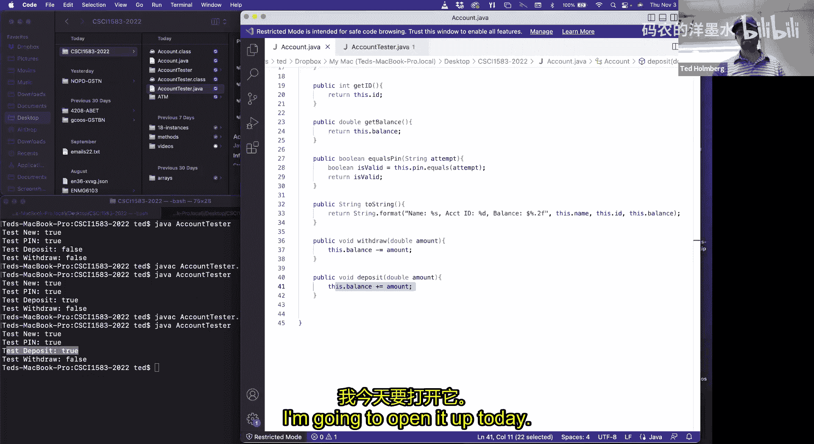

# 【全集】加州理工学院 软件设计与开发 中英字幕 1080P p22 Lecture 22 - 账户对象的设计与测试 -BV1AvzCBdE7a_p22-

Excellent， okay， so does anyone do we have any questions before we start today's lecture where we continue our overview over object oriented programming principles。

🎼I'm assuming no okay so do you all remember what we did last lecture so last lecture we really started talking about what the motivations behind object oriented programming is and then what we did was we looked at the UML diagram and how we start modeling using objects and the models really help us identify three different categories。

 three different concepts that are going to motivate our objects first of all。

 what is the name of the object the class name。Second。

 it's going to be what are the properties of the？Back and对。

You should ultimately resolve into something that is one of the fundamental date。

 something that is either expressed as a numerical as something that is tax or that is a。

🎼That itself as an object that will eventually get resolved into a set of values that are of a fundamental type because if you recall that is motive。

Like data modeling object modeling is kind of a layer built on top of data modeling and then we also looked at the behavior。

That' it。Since are kind of like our API， the set of things that we can do to an object so that it can。

Cooperate so that it can perform。Inside of our software application， inside of our environment。 Okay。

 so with that said， we looked at some very concrete examples。

 things that have kind of very rigid boundaries that have a that have an analogy to the real world。

 things like a player， things like a monster， things like a un a student。

 So here I want to start kind of abstracting the idea of what we model into something like an account。

 So today we're actually going to step through the implementation of building an account。

Class that's designed to build instances from。😡，🎼And so that kind of represents an object。

 but that I feel like an account object is a little bit less concrete than something like a unO student where when you think of a unO student you think oh that's a physical thing account is more like a grouping of related data that's effectively what we're gonna want to do from objects so I mean many software applications utilize accounts right like so almost anything that allows you to create a username and password is going to be account driven so it's a fundamental concept to start thinking about well how can we create an account where you can have any number of accounts right so objectoriented programming principles really support the idea of an account driven application so here I have kind of predesigned an account that will kind of start to will' start to implement ourselves so let's run through oh am I not sharing my。

Screen on here so let's get a laptop laptop Okay， let's get the projector on so that the in person class can see。

Okay so here I have an account uMl that's already predesigned so why don't we step through this really quick to make sure we all understand what this model is now recall what i'm trying to do is you can have multiple accounts right and so each account could potentially be different depending on what the application is what I mean by that is if you create an account for a bank versus an account for Facebook。

😡，Versus an account for like steam， those are all going to be。😡，Different。

 even though they're all accounts， they're all going to have different proprietary components as to how they facilitate inside of their own environment。

 like for instance， your bank account might have information related to what your balance is and other personal information that kind of identifies you towards whatever that whatever it is being managed by that account。

😡，🎼So again with a bank account it probably be a balance it's going to be one of most fundamental things that you'd have access to but let's look at other things like for instance。

 Facebook would probably have a list of friends right it doesn't make any sense for your bank account to have a list of friends necessarily unless you create some kind of social media banking app like Venmo and then it does make sense right so like a Venmo app would have。

Properties that are similar to a social media account and properties that would be similar to a bank account and so actually that's how a lot of like advancements with web applications works you find things that work in the real world and you say how can we make it something that works well inside of this cyber environment going back to the steam example like if you had a steam account that might also have a collection of friends but probably else has a collection of games that you've purchased or maybe as a collection of games on your wish list your Amazon account probably also has a wish list probably has a collection of orders that that you've had all your historical orders as well as your it too can have something like a list of credit lines that you can use to go ahead and create a purchase anyway the idea is。

Regardless of the fact that we're modeling an account。

All accounts in this instance could be very different depending on what your application is。

So in this instance we're going to model an account that's predominantly designed to be like a bank account。

 something like if we were designing an ETM machine。

 what would an account object and ATM machine look like and so for that purpose let's take a look here let's look at these first so first of all recall that anything that has a minus sign in front is going to be labeled private inside my class does everyone remember why it's pretty important to have all of our data all of our instance fields all of our instance variables to be labeled is private what the motivating concept of that is。

So they won't change encapsulated and hide it so that no other class has direct access to the state of our data and the reason why we're going to see this in another example。

 either in this lecture or in the next lecture is that。

All of the rules that guide whether the state of our object is valid or not are going to be defined inside of this class because this is where we're thinking most deeply on the the properties of this class。

 this is where we're thinking most deeply on how we're modeling this class to be a member of the entire software application that we're building out extending using it from and so for that purpose we want every other client code to have to go through our methods where we put a lot of thought a lot of logic into ensuring that any change of state in this in this instance。

Only result in a valid state change because if you give direct access to any other object within the software environment。

 they could potentially just change it to whatever。

 and then that can create a very brittle and non-ro software environment that can be prone to failure and errors and a nightmare of maintainability。

So we're going to go ahead and list these all as as private。

 so we have a name which we will represent as a string。

 we have a pin to access your account that's effectively your password in other forms of account。

 so every account regardless of what the application is usually has some kind of name or identifier and some type of password or pin number。

We also have an ID so it's important to state that we have an ID and a name why is it important to have an ID do you think for an account。

So。Absolutely， yeah， so we need to be able to discriminate between one account and the other。

 we need to be able to identify from a variety of accounts if we give the account an identifier。😡。

We know we can say that this account， let's say， number one is different than this account with ID3。

 even if the name is John Smith。We can't necessarily guarantee that people's names are unique right there's a lot of shared names so we can't use that as an ID for the account。

 you can only use that as a way of labeling the person。😡。

Absolutely so that' very good so we'll have an ID for an account we'll have our password or pen we'll have a name and then finally since this is designed to model a bank account we'll also go ahead and have a balance so i'll model my balance as a double and i'll just i'll state this is there an alternate way that we could model the balance so here I chose a double I chose an int for the ID I chose a string for pen when we talked about that last class and I chose a string for the name。

But I kind of want to talk about the way I'm modeling the balance here。

 do you think that this is the best way to model balance？😡。

Now I selected this so I don't want to necessarily prejudice you another way but what would be another what would be another alternative to modeling a balance right because that's one of the cool things about data modeling and you can do this in any way internally and no one else has to know why or how it's fundamentally modeled as long as they get the expected results from the class。

😡，So any ideas besides？T stringing well so it would technically be possible。

 but then it would limit your ability to do any kind of arithmetic operations because every time you go to do an arithmetic operation you'd have to cast the string into a double and that could be a very dangerous behavior when you start talking about modeling money an actual applications that represent an actual value of money you want to be as。

😡，You want to be as steadfast as possible， you want to be as as possible that nothing can go wrong。

So yeah oh a long interesting so longs don't necessarily represent a floating point value so online I got the suggestion that it could be a long value and yeah absolutely it could be a long value no longs or integer values they're not they're not doubles so what would be your base unit with a long bin。

Well what's the base unit of mining？Is it dollars is there something that's more basic than a dollar can a dollar be broken cent is there yeah cent is so using a long value。

 you can actually model a balance off of the number of cents。

As opposed to the double value where our base unit is actually a dollar and then the two decal places。

 the two precision points after the ratingx point where we're illustrating as a percentage of a dollar right the number of cents that that dollar has what way do you think is better because now I want to challenge you there's two。

Correct ways right there's two， let me say there's two valid ways we can model one where we use double and where the base units is effectively one unless there's precision points and that's our sense。

 which is typically how you probably see it most often at stores and whatnot on price tags or you can just use the most basic value of a sense and compute that as a long integer integer type。

 but a long data type。So what do you think I'm interested to get some feedback。

 what do you think is the better approach？😡，Havinging born with my storage for our numbers。

There's none one balance to。Yeah， so it could be it could be it could be millions。

 so in which case long makes a lot of sense and we could always now doubles a big number two what's does anyone remember what like the deficiency of a double value is where it can get has anyone let me ask you this has anyone seen the movie office space？

OhWow， I'm super okay， well， it's worth watching， I think。Been a while。

 does anyone remember what a motivating？For those who have seen it。

 do you remember what the motivating con was？With the developers how could they shave sense off though yeah that's exactly what they were doing they were shaving sense off of each transaction right but it wasn't actually sense it was fractions of sense and because the idea is that if you model money with a floating point number they're only approximations remember they're not actually concrete values floats are always an approximate which means when you start talking about modeling dollars and this is true in actual real applications you never ever ever model money with floating point numbers we do it as tests here。

But if you were to build an actual application， you would use long。

 should use something that is exact， something that has precision。

 the best precision is with integer type。😡，Nonf because now you can't shave the approximate difference in two different transactions like they did in office space now of course the thought they did an office space was they computed what the amount was between all these several transactions and just deposited in one big lump sum instead of doing it a microtransa at a time so they got caught because they just transferred like a million dollars into their account but if you were wondering like what mo the background plot of that movie。

 it's literally based off of using not a good model to model money which is motivates why data modeling so important and why these decisions even though on the surface they seem like there's not much consequence about using one data type versus the other there is there can be very much great hindrances for one selection over the other and that only comes with experience but yeah so I just want to point out。

I am going to go ahead and model our balance as a double for this example。

 but if this were a production application， I would be using a long value and I would be treating all the transactions on a balance as in terms of sense in dollars and that's why it's because I want the exactness。

 especially when you deal with something like money。

Because there's a real tangible loss if you make an error。

Excellent okay so then there is one interesting thing here what are we seeing here inside the U of the diagram we didn't see that last time right we see here that I have something that's actually clearly labeled a static also private that's called count that has an image what do you suppose this is supposed to model。

打叮下。So the count here is going to be the count of accounts that have been created which we might be able to use to create an ID number so the first account that we ever create will be let's say account number one and then account number two and then account number three so you can see why that static because we want to have one value for that and not have that be individual base have that be instance base so it is possible for a class to have。

A mix of static fields and instance fields， but when you make a decision on whether a field should be static or instance should come down to this might I need multiple values for this particular thing or should this have one singular value for every instance of the class should it have one value for the class itself when we're talking about the overall number of all accounts created that should be something that's a property of the class and not a property of an instance of a class is everyone does everyone kind of understand that distinction because that could be a very nuanced distinction。

😡，You're good with that。Okay now let's take a look at some of the methods we have we have a account so these are all plus。

 these represent things that are going to have that are going to be public to outside client code we have our constructor and our constructor is going to take in two parameters it's going to take in a name and it's going to take a password or pen number。

Now， and then everything else， one role of the constructor and I'll talk about this when we created is it's responsible for setting up a new incident。

So sometimes these new instances require data to get passed into the constructor and sometimes in new instance the constructor knows what the starting value should be so let's look at this for instance when we're calling our constructor here on account when we create a new instance of account we need we don't know we don't know without the client code telling us what the name should be right so we're going to need the name is that much makes sense and the same thing whenever we create a new account。

 we also need to know what the pin number is going be right we can't know that ahead of time so those two things it makes sense we need to pass that into the constructor so it can be set inside of our instance what about ID is that something that the user should pass to us。

😡，The ID on the account。What do you think？You think the user should now what's the dangerous thing if we allow the user to pass an ID exactly there's no way to guarantee if we make this a parameter that the user is allowed to supply to us there's no guarantee that two users won't supply us with the same ID so when it comes to creating identifiers internally to our own system because remember the thing and ID models is the way for us in our application to distinguish from one account instance from another then we should model we should be in control of the rules for creating ID numbers so that's going to be something that we internally decide on and because of that we're not going to pass that in as a parameter for the constructor。

😡，What about balance？What should every starting balance be before you do a deposit or withdrawal？😡。

Zero so we know that ahead of time as well so a zero for the balance will produce the logic to create an ID number and then we'll need the name and the pin number every time we create an account and then the other things that well have is the application will probably need access to this data here。

😡，From other instances and since it's private nothing else outside of the class will be able to either read or write from it。

 so a mechanism that allows other client code to at least be able to read data from this instance is to provide what are called getter methods or query methods so a getter method simply returns the value that's stored in one of the instance fields since it's private nothing has access to it but since the public methods are accessible we can create a gett name and all this does is return the value at the instance field name and we can have a get ID and all is going to do is going to return the value that's held at the ID field and we can create a get balance method where it all it does is returns back the value that's held inside of the balance field but notice here I don't have a get pen inside。

😡，Of my inside of my。My class definition here right I have a get name I almost I have a getter for almost everything except for for pen why do you suppose I did not decide to do a get pen call on that？

😡，Because only the user should know that can represent。嗯。

Yeah and is the pen supposed to be something that is openly available to other things so one of the purposes of a pen just like passwords means that it should be private to the end user。

And one of the worst things you can do when you're safeguarding someone's information is to save the passwords or pin numbers in a way that's easily accessible from within the system so we should be cognizant when we start designing our software of what。

😡，Data should be openly requested from our objects and what should we put gates behind what should we put safes behind lock behind and so in this instance I still give availability to the pin but look at what I do instead instead of getting the getter I put equals pin where you could pass in an attempt as a string and then it gives you a Boolean response so we can still interact with our account by providing a pin but instead of getting the pin directly back we're going to be able to evaluate privately and say whether it's right or wrong。

😡，And notice like you want to think deeply before just creating getter methods for everything like these are the considerations you should have when you start designing out what methods you're going to provide。

 even something as simple as a getter method。😡，So yeah so so so so the top here are our fields when we created an account we're going to supply a pen yeah we're inside the constructor and just in this simple implementation once we created a pen you can't ever change it so here then once we've created it we can then try attempts and it'll tell us whether we've gotten it or failed it and then the last thing we're going to do is we'll also have a two string method that will allow us to represent our instance as text data right so that we can print it out to the console and see that as we play around with it that its state is changing the way we expect it to so two stringing methods are super powerful for us as developers to evaluate how our instances change over time because presumably。

We can make withdrawals， we can make deposits， we want to test our code before we put it in production right you don't want to code an ATM machine and then never test it because that's going to that's going to be awful。

So two stringing of math allows us to create simulations so that we can verify and validate that our code works the way we expect it to。

Excellent， okay， oh well that's the actual implementation。

So let's go and actually start building this。So。Okay， let's clear this。

So we're going to create an account dot Java。Chahoveel file and the first thing we do。

Looking at our UML diagram is we're going to see what the name we provided for this and we're going to make a new class so it's going to be public so it's accessible to outside classes we're going to call it account then we're going to open and close the scope。

Oh， I need class to， public class account， perfect。Okay so now we have a class definition。

 the next thing i'm going to do is i'm going to look at the data fields that I have here and we're going to go ahead and add that at the top level before I do any methods is usually convention to add all of your properties。

 so typically a class is。It's laid out in the same way we lay at our UML diagram， so the class name。

 the collection of properties and then all of your methods。And so here I'll just paste these for now。

 I'll comment them out。So this came directly from my UMl diagram。Okay， so here。

I'm going to create a private。Static。And。Count。And I'll even when we first started up。

 set it to zero。And so we can set。Class fields inside of the class definition。

 but the constructor should be the entityity that sets up all instance fields we'll look at that in just a moment。

 the rest of these are going to be non staticatic or instance fields。😡，So here， let's make。Private。呃。

String。Name。Here we'll do private。String， pen。We do private and。矮静。Okay。And here we'll do。Private。

Double。Balance。Okay， perfect。 so now I have。My class， and I have the properties that define。

What this class？Is model as？So the next thing I'm going to do is I'm going to go here to my ul diagram and i'm going to grab the list of methods that I think my class should have actually i'm kind of missing some methods in here what are some other things we should actually be able to do in here feel like we should be able to withdraw。

And deposit。Deposit doesn't return back withdrawal， but this should take in a double amount。

 which is some amount。你ello。The name。嗯。And then what it is。Okay， perfect。

And I think does this look fine is this relatively like clearly I missed some really fundamental things about having a bank account is there anything else in here that you think I should add so I have account I have get name。

 I get ID， Ive get balance， I have equals pen， I have two string， I have withdrawn deposit。

Is that like for a basic ATM， is that right？Okay， I'm trusting that everyone's like kind of reading over my shoulder while'm I'm coding here。

Give me good feedback on building out an ATM machine。Okay。

 so the next thing I'm going to do here is I'm going to go ahead and I'm going to。

Create mock implementations of all the methods so at this point i'm not going to focus in on really thinking about what the logic is i'm just going to create the method definitions and do what's called methods stubing stubing is a process where I declare a method and then I just leave the body of the method blank if it doesn't necessarily need to return anything and if it does return something if it's a reference type I return null if it's like an integer or double that it returns I return zero if it's a bulloleying and I just return false effectively I just return a dummy value so the idea behind stubbbing out the implementation is I make sure ahead of time that I put all the methods that I've planned for this class to support and then i'm going to kick the can down of worrying about how to implement them but I just want to make sure that they were there so I never forget about them。

😡，So I'm building kind of a mock version an empty version of what my class will look like when it's complete so here。

We're going to put public。So I'm going to start with my constructor， public account。

And so here I'm going to actually use the Java。Notation， so the data type goes before the name。

And here the string goes before the identifier， the pen。And so I'll just leave that empty for now。

And then here we'll make this public and so remember constructors very special they're different than every other method because its return type and name is grouped together as the same thing so it's the only method that doesn't have three distinct components like we give the access level of public and whether static or instance but there's no return type that's super evident because the return type is actually an account instance everything else remember we have to have that return type so public here I see at the end that this is supposed to return a string。

So I'm going to put in my return type string and then I'm going to remove this tail end here And so I see I haven't placed any parameters here。

 so I'm just going to go ahead and。Create a body now since this has a return type here and I have to have a return keyword that's the other weird thing about a account right it doesn't have a return type because it doesn't use the return keyword either right because it's it gets its value in unison with the new keyword so it's also one of these rare things that doesn't have the return keyword。

Which is why it doesn't have a return type。Okay， so here since this does have a return type and since I said I'm making stubdiations。

 a return type of string that is dummy would be null right because it's a reference data type it uses an uppercase letter。

So I can just use a no reference just so that my implementation is valid。Public stream get name。

ok唔重咯。Okay， let's go here。It's still。Public。And then here we'll do int。

And we'll do the same thing we see that this here， the return type is going to be of a integer data type that's primitive。

 so for now I will just return zero all the time just to have a subdo implementation。

I now i'll look at good balance I had a plus that that's going to be public I see the return type I labeled there is double so i'm going to do public。

Double， get balance。I'm going to give it an empty body since it does have a return type though it's invalid and it does return something。

 so I'll just return 0。0 for now。For equals pen I'm going to make this public so it's available outside the class I see that the return type that I labeled inside sub my U diagram is a boolean so I'm going to put that where the return type actually goes here I see you actually have input here too。

 so i'm going to put the input in the format that Java expects it so status type followed by the name。

And then here， this is going to return a Booleying value so I'll just put return false。Again。

 we're just subving out all this implementation。So here public。String。

 so I'm going to get rid of what the return data side there is and in here I'll just。Return。No。

 perfect And then here for withdrawal will do public。

Void because now we don't have a return type there。

 I think this is the first time we're actually method that doesn't return data here we're going to have to put the data type in front of our identifier for it to be valid Java。

And then here we don't have to do anything since the return type is void。

 so we'll just leave that blank in our subdi and then finally I'll do public void。

 I'll do the same thing here。And get rid of this。Okay。

 perfect so at this point I now have a stubbed out class it has a name。

 it has all the properties and it has all the methods。

 although the method behaviors haven't been actually implemented the way that they should be they're dummy they're just empty but I should be able to at least make sure my syntax is correct and this should be able to compile before I start adding any complexity of code it's very important the stage that you do compile to catch any easy to catch errors because right now this would be the easiest time。

😡，🎼To debug right because there's almost no logic in that now as we progress and we add logic step by step into each method。

 we want to we want to go ahead and compile in each method that allows us to catch any errors as early as possible so we know how to handle them。

Because one of the worst things you can do I'm sure let let me ask you if you've encountered this。

 have you waited to compile your code until the very end and gotten something like 38 different errors all like pointing at various classes and various methods right isn't that a hassle to debug it's much easier to code a little compile test a little。

😡，Debug a little， then code a little bit more and then debug a little bit more。

 don't kick that can down because you're going to be cusing your future self is going to be cuing your past self for that。

😡，I've actually known people who have code an entire project and it was so bugriden。

 they had to throw away all their code and start from scratch again。😡。

There's a pretty common saying in the domain of software development。

It's a 30 hours of coding can save you three hours of planning。Yeah。So yeah。Okay， let's see here。

So we were able to successfully compile now it doesn't do anything， right now。😡。

Let's start implementing this step by step。😡，So I'm going to start with the account class。

And typically when we start actually when we start。Building out our classes。

 we want to be able to kind of task to make sure that they're doing the thing that we anticipate them doing so how might we。

Verify that our logic works for our account so our account doesn't have a main method right because it's not designed to be an application it's designed to be a part a member of a larger pool of classes right so it's a smaller part of something that's greater and it's used by other code right so I can't just run this like some of our other applications because there's no main method to run so how might I verify and validate that this might work as i'm buildinging it out。

😡，Yeah except build build in a other class that has a main method that builds in instance of account and tests it for the explicit purposes of testing them so let's do that too so i'm going to create i'm going to touch what's call this account tester do Java。

Let's put this here。And let's do this， let's do public class。Account tester。In fact。

 I have some dummy code for account tester in here let me jump to that as it's already subbed out and we'll actually see what we're going to be testing so so I don't have to type all this in real time and you just watch me type out。

Everything， let's take a look at what my account tester looks like because I should be able to actually run this。

Yeah， I should actually be able to run this it looks like okay so here I have my account tester class it's going to have a main methods remember anything that's an actual application Java has to have a main method that's the launching point of all applications inside my main application I'm going to create a local variable that's called test result and it's going to be of a boolean value and then I'm going to call test new so I have all these different smaller helper methods that I'm going to put all my test code into so in order to test to make sure create an account works I'm going to create a tester method called test new that's going to return back Boolean。

True or false， whether I pass that test or not。Then I'm going to have a tester to test to see if my equals pen work so I'm going to test that separate from being able to just create new instances。

 then I'm going to create a tester to test to see if the withdrawal function works and also the test method works and after each one of these tests now these themselves are subed out right so that default。

The default of a test is always fair。😡，Until you've illustrated that you can pass it。

So we'll we'll set the initial value to full so what I'm going to do is I'm going to call for test test the ability to create new accounts。

 and then I'm going to print test new。And then I'm going to print the result and the same with equals。

 deposit and withdrawal， let's actually test that out。

And we can see as of now my tester says my test new is false， my test pin is false。

 my test deposit is false and my test would draw is false and what my goal is going to be is as I implement my class I'm going to go into this helper this test class and I'm going to put in what I think should happen and see if I get a past results and if I do get a past result and let me know I can move on to the next method and I keep testing each of those methods until I'm happy because what this is supposed to represent is this is the set of calls on account that I would expect to happen in a real application so if my account class can pass all these tests then that means it's robust enough to be performedant in the actual deployed workspace where it's going to have to exist out and so it allows me to create a playground to verify that it does everything that is it going to have to do when it's actually in the real life application。

That I'm going to write around it。 Does that make sense。

 So this is a concept that's called unit testing。Where we can test each unit of our code a little piece out of a time。

 so instead of building our code all the way through and having to test it as it actually runs。

 we can actually kind of create objects and talk with them call their methods and make sure that each method called does what we expect it to do and ideally if all the methods are doing what we think they should do then be able perform that same way in a real world application so it's just a manageable way of testing every part of your software as well。

😡，To make sure that these crazy errors don't end up cropping up。

And you'll learn much more about this in Java too this is a good preface for you that motivates how to actually design software objects in a very effective way Okay。

 so let's go over here， let's go into the constructor now。

So in the constructor I see that I'm getting in the name and I'm getting in the pin。

 so I'm going to use those values that are passed into the constructor to set my instance fields so here I'm going to use the keyword for instance fields so this dot name will be assigned the value the local value for name that got passed into the parameter list。

 so the name on the righthand side of this assignment is this one whereas the name on the lefthand assignment is this one the one on line three。

😡，Two different variables。One is at the scope of instance， the other is at the scope of local。😡。

Here we'll do this dot pin is assigned the pin that got passed in Okay。

 so those are the two that are required to be given to us to create a new instance the name that should go to the account。

 the password that goes on to the account then let's see we know that this dot balance。😡。

Should be equal to 0。0。Zero doesn't matter zero， I could just pick zero， but whatever。😡。

And then finally， for this。I D。What I'm going to do to assign this is I will currently look at what count is so on account since this is a static field called count。

 I will use the class name account I will then access from it the account and despite the fact that that's private since this method exists within the class I can access any private fields to this class so I will access and set count。

 but I'll also do a。😡，P incrementalcrement。So what I'm going to do is I'm going to increment it so that it's different。

😡，RightSo it starts at zero and remember what the preaccrement does is it's going to take that value and make it one then I'm going to take that value of one and I'm going to assign it it's my ID and then now the new value of count will be actually one for the entire class so if I create another instance it'll go from one to two。

 two to three， three to four does everyone see how I can do that how I can couple or utilize this static field and actually give it a different value in each of these instances。

😡，And we can actually test this to make sure it works。 In fact， at this point， I'm almost。

Done enough to be able to test my constructor， but before I can test my constructor I need to actually also implement my two stringing method because my two stringing method will allow me to evaluate the state of my object based off of its fields right like it allows me to express my my instance in the form of text so the only way I can verify that I've created something that has these values is to implement the two stringing method right does that much make sense it's my mechanism to express this as a string。

😡，So here I will do what string dot format， a low stringing dot format。

I'm going to make a formatted string。 so my formatted string is let's say here。

 let me just grab the one that is in here。So this， this is what we'll use。

So the format is string that I'll use is going to be。

We'll give the name and then percent ask will be a placeholder value for this particular name we'll give the account ID and then give the ID will'll have the balance and then actually go ahead and then display the balance Okay。

 so here so that first thing is going to be the name。The next thing is going to be the。Balance。And。

The last thing， oh wait， nope， it's going to be account I。

 so it's going to be ID and then it's going to be。Balance， okay。

 so the ordering is very important because the first。

Herarameter has to line up with the percent S so the percent S is this name。

 then the percent D for account ID is this ID and the percent point to F， as you might recall。

 is we're going to throttle the precision point on a floating point number to only be two precisions since that'll represent the number of cents and that'll be my balance。

Okay， so now let's test this out。Oh yeah， that's going to cause some issues。Okay。

 so now we have balance， so if I first of all now i'm going to compile this so let's go ahead and compile our account。

Okay， so that's all。Synactically correct let's go into my account tester and let's start testing this out and so just for the purposes of brevity here the way that I might set this up。

Would be along these lines。Let's I'm going to now implement this set line let's see what we're actually doing here so on the first line 15 here。

 I'm going to create a local variable that's called tester pass。

That i'm going to assign false initially now i'm going to try to create two accounts because I want to verify that I can make more than one and that the。

😡，State of it is different between two instances and I also want to verify that the account ID increments the way I expect it will so I'm going to create account one that's called Joejoy with a pin number0060 now remember I modeled my pin numbers as strings in case I had leading zeros so I want to test that。

😡，Here for my second account I'm going to create a name Suus Suzy and I'm going to give Sue Susie a pin number one。

 two34 so I'm going to create I'm going to invoke the constructor remember the construct' invoked with the new keyword followed by the account right that method that we created and then it has to have whatever parameters we define so a name and a pin and I'm going to save these into count variables so I have an account one and account two。

Then I'm going to create my expected string from my two string method。

 so the string that I expect from。😡，My from from from account one would be name Col Joejoy。

 right the name that's given comma account ID， colon and that should be account ID1 because I do the pre increment from zero to one。

😡，And then the balance should start at zero。And then what I should expect as my display out for account number two will have the name Sue Suie。

 it'll have the account ID of two and also a balance of zero zero。😡。

So then what I'm going to do is I'm going to have my expected value。😡。

Which is represented as a string and we're going to see if it's equal to the results from account one。

 if I invoke the two string method on it。😡，And then what I'm going to do is this is going to return something that's either true or false。

 right？😡，So whether it's true or false。😡，I'm going to preserve that and then on the line after that。

 I'm going to take what my expected two string that's the one with Sue Susie。

 I'm going to see if that's equal to account2。2 string。😡。

And notice I'm using a compound assignment here， this is the and assign the and and assign。😡。

So what this does is it looks at what the previous value of testpa was and so if it was true。

 it does true and whatever this resolves to be or if it was false。

 it does false end does whatever this is， why is it important。

 why is it important that I do use this compound assignment and just not this。😡，What's that？

Yeah that's right because because in order to pass this test。

 I can't just overwrite what the prior result was I want to take into account every prior test result。

😡，And so an easy way for me to do that is just to do this compound assigned there。

 so this way every if I did five test results and I just kind of ended them together。

 if any one of them failed， then the entire result would be a failure。😡，Okay。

 so then when everything is said and done， I then take whatever the value of my tester pass is and now I return that back to my main method that will then report true or false。

 which is what we did before if you recall right here when we stubbed out the implementation so everything was a false so let's save this。

😡，Let's compile my account Tester and now let's run my account Tester。

And now you're going to see with the one that I've implemented on my constructor for test new。

 it's now true。😡，So I can move on。I know that when I produce a new instance of accounts and when I convert it into a string。

 what I think it should have in terms of a set of values is what it actually has。😡。

And so I don't have to spend any more time thinking about this method I can move on to the next method。

 so again this is a great guide for me to evaluate how well defined。

 how constructed each of my methods in my class are before I go ahead and share my class with the rest of the code books。

😡，Testing is super important to get everyone the habit of testing as early as possible。Okay。

 so now I'm going to clear this for now。 Let's move on then into account。

 So let's say the next thing we're going to do here is let's。So let's do the getters。

 the getters are super simple， in fact the getters are so simple。

 typically but you don't even test them。😡，Because they're hard to mess up。Let me show you。

 we have get name。He returns back a string， all I have to do is replace the null with this dot name。

😡，I'm done。Yes。That is how we implement a getter to get ID。

 I'm going to replace the zero with this ID。😡，To get balance， I'm going to return 0。0 with this do。

Balance。Okay， so these are done I'm going to compile to make sure that it compiles。😡，呃。Oh perfect。

 perfect that way I will actually get an error。So I'll test to make sure that。

I don't get any errors and what I'll get is an error that shows me hey。

 you spelled did instead of this and I don't know what that is， it thinks it's a variable。😡。

So I will replace that with the this and so now。Perfect。

 all the more reason why we do that kind of compilation stuff， exactly why。😡，Okay。

But usually for these as well， you'll get an error from compiling there's no logical error that you have to test against so my the way that I test my getters is through a compilation step not necessarily a build an account and evaluated stuff。

😡，Okay， this one though has a little bit more logic， the equals pen。

 so let's see how we might do this。Let's create something that's called。Is valid。And set it to。Well。

We'll just'll just create something called is valid， do I care about that？I'll just do this。Well。

 I could probably just return。And let me make sure that this logically makes sense to everybody。

 I can do this dot pin dot。Equals。Attempt， is that following。

 is that too much logic or does everyone see how that's going to resolve into a bullying value？

If this makes more sense， I can show that I can create is valid。And then return is valid。

That ends up being the same type of fin。It's spellverturn correctly。

Because what I'll do is this itself is a string， it has an equals me。

 I'll see if the attempt string equals this， which will result until a bulloleying value。

 something that's either true or false， and then I'll just return that。Okay。

 so now that we have something that has a little bit more logic， let's test it out。😡。

I'm going to go into my。Test equals here， and I'm going to do some cheating， some copy pasta。

So here i'm going to do something similar I'm going to create my tester passm going to assign it ball I'm going to create two new accounts so my account jojoy my account sue susie and here what i'm going to do instead is。

So I'll have my pen， so I don't need。I expect it's going to be different here。

It's going to be a Boolean value。And a boolean value。Sos decide what so let's test it when it's true。

And let's test it when it's false。And so here。Let's do。Um。Account one， dot。Equals pin。

 and let's do the pin as。啊 let's say。Let's do。S0。And so here let's do the opposite thing。

 let's do balls。And true， so here I'm going to do that and then I'm going to do equal equal to expectant one。

And then on account two I'll do the call that i'm actually evaluating the important thing here is that I'm trying to evaluate the method I'm testing。

 which is equals method here I'll do the actual。I2，2，4。And this will be expected to okay。

 does anyone have any questions on how I'm testing this， how I'm testing something that's true false。

My question was just about the account one， account Joe， so we need to take this out of the1 people。

You mean these this right here Okay so this is the thing I'm creating each of these methods I'm creating local variables that means when the method is done they don't exist anymore so for instance when after test new runs and I create account one in an account2 when after I return when I get to the end of that closing brace account one account two don't exist anymore now the thing about testing is I always have to test these instance methods against actual instances so one of the first things you're going to see me do and this I'm going to copy paste I have to spend all my time having to type this out manually each time is I have to create a couple of instances then mutate the instance and what I want to do is I want to check to see if the method I just worked produces the results I expect it should result that's right well what it's going happen is it probably won't。

CompileSo imagine that I remove these two I'm going to comment them out for now。

Right so these are now commented out it won't probably even let me compile because it's going to tell me account one is an unknown symbol。

And so I'll prove that here。And yeah， here we have account one cannot find that symbol and it's because we need to create an instance of an account。

So that we can test it so that we can see does it equal because that' that doesn't have a definition there's no assignment to that instance field until we've actually constructed it so here what we're going to do is we're going to construct two new instances of account that's going to have its unique set of names and it unique ID and it own unique pin number and here I'm going to figure out what my expected values are so that I can compare so here account one equals pen of 60 I should expect that to be false so I'm going to do is the result of this and this is something that results to be a boolean and true false then I'm going do the double equal because this is on a primitive data type now does that equal this result of false and I could have hardcoded it as well I could just put false but I like seeing the word expected again just like you don't want to have magic numbers you don't want to have magic bullies right so now we know this is the expected value for the first test this is the expected。

al for the second test where we actually pass in what the pin should be and this will let me know that I get a failure with wrong pins and I get a correct thing for the right pin。

Okay， so let's test this， let's actually see if it compiles foring。

So now that compiles and now let's run that。And now notice。

Because I've actually implemented logic of my tester。

 I can run it without having to affect the main method and I see that my first test method passed true and my second test method passed so now I can move on to the next thing。

😡，Which is going to be the ability to withdraw。Okay， so what is the logic for withdraw？

It's going to do something with this balance， right？

And I guess I should do the same thing with deposit， let's do deposit first。

Let's reverse these we probably need to deposit money before we come withdraw money， right？哪不块钱。Yes。

Go back to be account。Okay。But why do the president not expected to have a damp stand on his mom？

Right here， because that's a compound assignment， so recall that compound assignments allow us to take a primitive。

😡，Operator like what happens， Okay， let me leave that。 Let me do a quick question for you here。

Actually， let me open up Jay Shell。New tab here， let me launch Jhell。Okay。

 so if I created an integer called X， right and if I set x to 10。

Right so I know if I look at x it has the value of 10。

 if I use a compound assignment x plus equal 10 what going to be the result of this。

Have you seen this before something like a plus equal？😡。

So that's what's called a compound assignment compound assignments are the same as having an assignment where。

So what's going to be the result of that if I have x is assigned x plus 10。😡。

This is gonna to be 20 because what it's doing is on the right hand side it reads the value of x which is currently 10 and then it does the addition of whatever the value is and then it overwrites it well an abbreviated way of expressing this logic is to use a compound assignment instead so instead of doing x is assigned x plus 10 I can remove the x on the right hand side and I can create a plus equal assign plus a plus is assignment so it will take whatever the current value of x is。

😡，Wwhichch is 10 and it will add to it what is then on the right hand side of this compound assignment which would be 10 so the results of this would also be 20 right Okay。

 so does that much make sense and so what would it be if I change that to a asterisk to a time sign。

😡，Exactly， okay。Let's do something else。 Suppose I had a boolean。That we will then call。Q。

 and then let's make Q equal to false right what would be the result of Q if I did Q。😡。

Is assigned sign Q and。😡，True。So if it's。So what's the value of Q here so that's false so what's false and true what's that result to so that would be false right now just like I could go ahead and create a compound assignment with arithmetic operators I can create a compound assignment with logical operators so I can having this second Q is redundant what I can do instead is I could put the ampers stand。

Assignment operator to make a compound logical operator so it will evaluate the current state of my queue and whatever the value is on the right hand side of that operator does that make sense now。

😡，Okay， let's jump。And so that's why we're doing that here because we want to maintain and evaluate what the previous state of our tester pass was and not just simply override it。

 we want to combine it with the new all the old tests。😡。

Does that make sense so we want all the tests to pass in order to get a true and if any one of them fails then we get a false but this allows us to test edge cases as well we can test many different ways and then if for any reason we get a false we're like okay one of these ways and worked the way I anticipated it to work。

😡，Okay， so let me go back over here then how should deposit work let's do deposit so we know it's going to do something to this stock balance。

😡，What are we going to do to balance with the product and we have an amount。

 so what are we going to do to balance？嗰仔。So add the amount， so let me ask you this。

 is this the good enough？😡，We can test this out what is is everyone happy with this？

Implementation to take whatever the amount is and add to it the balance， which means to withdraw。

We can do this balance。Os。Theoretically that would be reducing the balance right so here we can subtract from the balance CM amount okay。

 so this works。嗯。When you said the count as zero， it's not going to find someone big ground。

Well're not we're never doing anything we should never touch count at all count represents the count of accounts we've created。

So where balance is going to represent the balance of what this account has available now a simple way of implementing this and this is how we're going to implement it would be you pass in the amount you would want to withdraw and you would remove that amount from your balance。

And then for deposit， we'd go ahead and we would take and deposit some amount。

 and we would add that to our balance。嗯。Does anyone see any we'll test this out this is the point of testing so if this is good enough we'll test this out but then we'll talk next class about how we might want to think about improving this more so but we're going to start with the naive approach。

😡，So let's go over here and for testing deposit， I'm going to do similar thing I did here。

And I'm going to have my tester pass equal to assigned to false and then here I'm going to create a new account。

 new account perfect and doesn'。time you want that just going to be well well for just looking at the deposit。

 if we pass in an amount， we're going to take whatever the amount is and it does it actually adds to that balance right here right it's adding to it。

Whatever this amount is。听懂。You shouldn't， you're getting exactly where we're going to have to get to from testing。

 yeah， some deficiencies here already identified。For withdrawal。

 there's no check to guarantee that we have enough money to draw against。😡。

But that's exactly why we want to test those conditions， yeah。

 and there's another interesting thing that we're allowed to do here that we might not want to be able to do。

Yes。We'll do this with testing and we'll probably cover this a lot more。Next class。

 but let me get this first test working and then we'll continue to delve into how to identify a very good catch on that before we even got into the testing of that。

😡，Okay， so let me okay， so here。WellOur expected value here will be， let's say， double values。

So let's just test the ability to deposit。So， let's do。

And just for this first test I'm just going to use account one so I'll have my expected one my expected to I start at zeros so I don't really have to test that per se so let's say that my expected one is going to be 100 Okay perfect so let's just do this first test just to see how this works then we'll start testing on other interesting concepts next class so on account one we're going to actually let's do this。

Yeah， let's do。Account one dot。Deposit。And let's put in $100。Perfect， okay。

 so after performing the method now let's test to make sure it works the way they expect to so I have an expected value that's going to be different than i'm going to put as 100 and then i'm going to get account。

One dot get balance and i'm going to see if that's equal to whom I expect it one I'm just going to get rid of this tester here。

 we're just going to test the simplest case can we just go ahead and add 100 and then we're going to see if the balance is actually equal to this expected value。

😡，嗯 okay。what I'm saying anyway ways is that after the balance is had。

 the hunger is going to pass the tax when you take seven0 of deposit positive。

Well let's test let's test actually that's a great so let's let's absolutely do that so let's do let's add 100 and so。

And then let's deposit 100 more dollars and then on expected to now， it should be $200， right？

So now to pass this task and again， I don't want to overwrite this， I want to do that。And。

Assignment so the what I'm going to do here is I'm going to create account one。

 I'm going to deposit $100 into it， I'm going to create an expected value of 100 and I'm going to see all my tester pass。

Is the balance？100 at this point and I'm going to set that to tester pass and then I'm going to add another1 hundred0 dollars。

 I'm going to put expected to as 200， and then I'm going to put is my tester pass。

Does it pass if the balance is now $200 so it should be incrementally adding right not just overriding。

 but it's actually adding to the balance let's test that。😡。

And we could see that it is indeed the case that is true that as we keep depositing money it keeps building up in value now we're going to test this for these edge cases like was mentioned earlier on how we could potentially break this so I want everyone right now to look at this code between this class and next class look at how we've implemented withdrawal look at how we've implemented deposit think about numbers that are technically legal numbers but would be invalid operations to do at a bank。

And think about that， and then I want to hear suggestions you have next class。

And then we'll talk about how we can implement logic into these methods to prevent that from happening。

😡，Excellent， is there any other questions that anyone has？Well then have a great weekend。

 I'll see you all next Tuesday。I regardingz you open that quiz no I need to verify that all the questions are valid on so i'm going to do that i'm going to open it up today。

