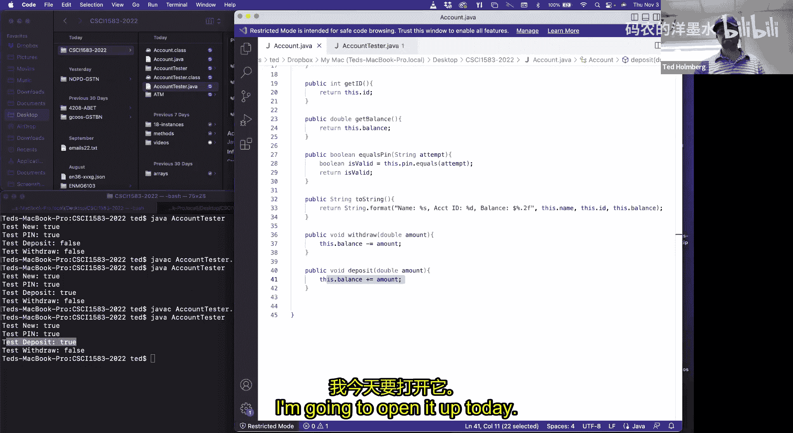

# 软件设计与开发：22：账户对象的设计与测试


在本节课中，我们将继续学习面向对象编程原则。我们将通过一个具体的例子——设计一个银行账户类，来实践如何从UML图建模到代码实现，并学习如何通过单元测试来验证我们的代码。

上一节我们介绍了面向对象编程的基本动机和UML建模的三个核心概念：类名、属性和行为。本节中，我们来看看如何将这些概念应用到一个具体的“账户”对象的设计与实现中。

## 账户类的UML设计

首先，我们来看一下为银行账户设计的UML图。这个账户类模拟了ATM机中的账户。


以下是该类的核心组成部分：

*   **类名**：`Account`
*   **属性（私有）**：
    *   `- name: String`：账户持有者姓名。
    *   `- pin: String`：账户访问密码（PIN）。
    *   `- id: int`：账户的唯一标识符（ID）。
    *   `- balance: double`：账户余额。
    *   `- count: static int`：一个静态变量，用于记录已创建的账户总数，以便为每个新账户生成唯一的ID。
*   **方法（公有）**：
    *   `+ Account(name: String, pin: String)`：构造函数，用于创建新账户。
    *   `+ getName(): String`：获取账户姓名。
    *   `+ getId(): int`：获取账户ID。
    *   `+ getBalance(): double`：获取账户余额。
    *   `+ equalsPin(attempt: String): boolean`：验证输入的PIN码是否正确。
    *   `+ toString(): String`：返回账户信息的字符串表示。
    *   `+ deposit(amount: double): void`：向账户存款。
    *   `+ withdraw(amount: double): void`：从账户取款。

### 设计决策解析

以下是关于上述设计的一些关键思考：

*   **属性为何私有（private）？** 将实例字段设为私有是**封装**的核心。这确保了对象状态的完整性和安全性，所有对数据的修改都必须通过我们精心设计的方法（如`deposit`、`withdraw`）来进行，从而可以在方法内部添加验证逻辑，防止对象进入无效状态。
*   **为何需要ID和姓名两个字段？** 姓名可能重复，不能作为唯一标识。ID由系统内部生成（如通过静态变量`count`递增），可以确保每个账户实例的唯一性。
*   **为何用`double`表示余额？** 在本教学示例中，我们使用`double`是为了简化。但在真实金融应用中，应使用`long`类型以**美分**为单位存储金额，以避免浮点数精度问题（如电影《上班一条虫》中的情节）。
*   **为何没有`getPin()`方法？** 出于安全考虑，密码（PIN）不应被直接获取。我们提供了`equalsPin`方法，允许外部代码验证密码是否正确，而不暴露密码本身。
*   **静态变量`count`的作用**：它属于类本身，而非任何实例。用于跟踪创建的账户总数，并为每个新账户分配一个递增的、唯一的ID。

## 实现账户类

现在，我们开始根据UML图实现`Account`类。一个好的实践是首先“存根化”所有方法。

### 步骤1：创建类框架和存根方法

我们首先创建类，声明所有属性，并为所有方法创建空实现（存根）。这有助于在添加复杂逻辑前确保语法正确。

```java
public class Account {
    // 属性声明
    private static int count = 0;
    private String name;
    private String pin;
    private int id;
    private double balance;

    // 构造函数存根
    public Account(String name, String pin) { }

    // 方法存根
    public String getName() { return null; }
    public int getId() { return 0; }
    public double getBalance() { return 0.0; }
    public boolean equalsPin(String attempt) { return false; }
    public String toString() { return null; }
    public void deposit(double amount) { }
    public void withdraw(double amount) { }
}
```

编译这个存根类可以及早发现拼写错误等简单问题。

### 步骤2：实现构造函数和`toString`方法

构造函数负责初始化新对象的状态。`toString`方法对于调试和测试至关重要，它能以文本形式展示对象的当前状态。

```java
public Account(String name, String pin) {
    this.name = name; // 设置账户姓名
    this.pin = pin;   // 设置账户PIN码
    this.balance = 0.0; // 初始余额为0
    this.id = ++count; // 递增静态计数，并赋值给当前账户ID
}

public String toString() {
    // 格式化输出账户信息
    return String.format("%s, account ID: %d, balance: $%.2f", name, id, balance);
}
```

*   `this`关键字用于区分实例变量和局部变量（参数）。
*   `++count`是前置递增运算符，先将`count`加1，然后将其值赋给`id`。

### 步骤3：实现Getter方法和`equalsPin`

Getter方法很简单，直接返回对应的私有字段值。`equalsPin`方法使用字符串的`equals`方法进行比较。

```java
public String getName() { return this.name; }
public int getId() { return this.id; }
public double getBalance() { return this.balance; }

public boolean equalsPin(String attempt) {
    // 比较输入的attempt与存储的pin是否一致
    return this.pin.equals(attempt);
}
```

### 步骤4：实现`deposit`和`withdraw`方法（初始版本）

我们首先实现一个基础版本，直接修改余额。

```java
public void deposit(double amount) {
    this.balance += amount; // 存款：余额增加
}

public void withdraw(double amount) {
    this.balance -= amount; // 取款：余额减少
}
```

**注意**：这个初始实现存在明显问题，例如取款时未检查余额是否充足，存款时未检查金额是否为负数。我们将在测试后讨论如何改进。

## 单元测试：验证代码行为

为了确保我们的类按预期工作，我们创建一个单独的测试类`AccountTester`。单元测试允许我们独立地验证每个方法的功能。

### 测试类结构

```java
public class AccountTester {
    public static void main(String[] args) {
        boolean testResult;

        testResult = testNew(); // 测试构造函数
        System.out.println("testNew: " + testResult);

        testResult = testEqualsPin(); // 测试PIN验证
        System.out.println("testEqualsPin: " + testResult);

        testResult = testDeposit(); // 测试存款
        System.out.println("testDeposit: " + testResult);

        testResult = testWithdraw(); // 测试取款
        System.out.println("testWithdraw: " + testResult);
    }

    // 各个测试方法（初始返回false）
    public static boolean testNew() { return false; }
    public static boolean testEqualsPin() { return false; }
    public static boolean testDeposit() { return false; }
    public static boolean testWithdraw() { return false; }
}
```

### 实现测试方法：以`testNew`和`testDeposit`为例

以下是`testNew`和`testDeposit`测试方法的实现示例：

```java
public static boolean testNew() {
    boolean testerPass = false;
    // 创建两个账户实例
    Account acct1 = new Account("Joejoy", "0060");
    Account acct2 = new Account("Sue Susie", "1234");

    // 定义期望的toString输出
    String expected1 = "Joejoy, account ID: 1, balance: $0.00";
    String expected2 = "Sue Susie, account ID: 2, balance: $0.00";

    // 验证实际输出与期望是否匹配
    testerPass = expected1.equals(acct1.toString());
    testerPass = testerPass && expected2.equals(acct2.toString()); // 使用&&=复合赋值

    return testerPass;
}

public static boolean testDeposit() {
    boolean testerPass = false;
    Account acct1 = new Account("Test", "1111");

    // 第一次存款并测试
    acct1.deposit(100.00);
    double expected1 = 100.00;
    testerPass = (expected1 == acct1.getBalance());

    // 第二次存款并测试（验证余额是累加的）
    acct1.deposit(100.00);
    double expected2 = 200.00;
    testerPass = testerPass && (expected2 == acct1.getBalance()); // 复合赋值

    return testerPass;
}
```

*   **复合赋值运算符`&&=`**：它用于将当前`testerPass`的值与新的测试结果进行逻辑与（AND）操作。这确保了必须所有测试条件都通过，最终结果才为`true`。

运行这些测试，我们可以验证构造函数、`toString`和`deposit`方法在当前实现下是否工作正常。对于`withdraw`方法，我们需要设计更全面的测试来暴露其缺陷（例如透支、负金额取款）。

## 总结与下节预告

本节课中我们一起学习了如何将一个UML设计转化为具体的Java类。我们实现了`Account`类，包括其属性、构造函数、访问器方法以及核心的`deposit`和`withdraw`方法。更重要的是，我们引入了**单元测试**的概念，并创建了`AccountTester`类来系统化地验证我们代码的正确性。



目前我们的`deposit`和`withdraw`方法还非常基础，缺乏必要的业务规则检查（例如防止透支、处理负值）。在下一节课中，我们将重点关注如何改进这些方法，通过添加条件逻辑来增强我们类的**健壮性**，并讨论如何通过测试来驱动这些改进。请大家提前思考：我们的当前实现可能被哪些“边界情况”或无效输入破坏？